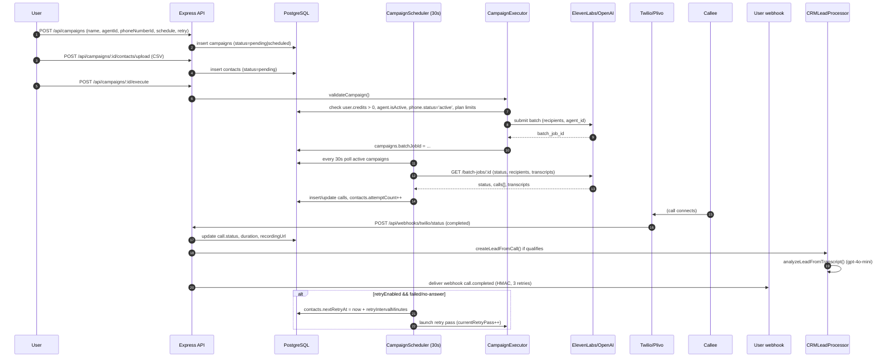
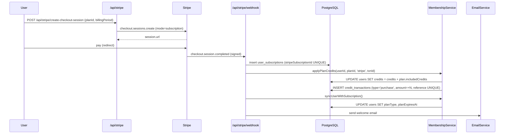

# Managora Reference Report — Insights from AgentLabs v5.4.5

**Reference project analyzed:** `agentlabs_v5.4.5` (CodeCanyon item #60751656 — "AgentLabs – AI Voice Calling Agents & Lead Intelligence SaaS Platform")
**Vendor:** Diploy / Bisht Technologies Pvt. Ltd.
**Analysis method:** Static source analysis only. No code execution, no dependency installation, no migrations, no Managora repository access.
**Report purpose:** Build an evidence-backed knowledge base for later comparison against Managora's actual architecture and requirements.
**Central question:** *What should we learn from this project, which concepts could improve Managora, how should we adapt them, and what should we avoid?*

---

## 1. Executive Summary

AgentLabs is a **multi-tenant, AI-first SaaS** that orchestrates LLM-driven voice calls over the public telephone network. While its domain (telephony / lead intelligence) differs from Managora's (education / institute management), the two products share a **deep architectural kinship**: both are multi-tenant SaaS platforms that meter AI usage, integrate multiple external providers, automate workflows, support multiple user roles, and need strong data isolation.

That kinship makes AgentLabs a rich source of *reusable patterns* — not features, but the *engineering decisions* behind the features. The most valuable concepts for Managora are:

1. **Atomic, idempotent credit metering** using Postgres advisory locks + `SELECT … FOR UPDATE` + per-tenant reference uniqueness — directly applicable to Managora's "usage-based AI credits" vision.
2. **Plan-gated feature entitlements with per-subscription overrides** — directly applicable to Managora's "module entitlements" vision.
3. **Provider-pluggable engine abstraction** — applicable to Managora's need to swap AI providers (OpenAI, Anthropic, local LLMs) and communication providers (WhatsApp BSPs, SMS gateways, email) without rewriting business logic.
4. **AI safety pipeline with auto-block on critical violations** — directly applicable to student-facing AI features (tutoring, automated feedback).
5. **Visual flow builder with dual compilation targets** — applicable to Managora's "workflow automation" for attendance, fee reminders, exam notifications.
6. **Per-tenant activity timeline + global audit log** — applicable to institute compliance and parent transparency requirements.
7. **Hybrid auth (user JWT + admin team session tokens)** — applicable to multi-role institute staff (principal, admin, teacher, parent, student).
8. **`FOR UPDATE SKIP LOCKED` cron pattern** — applicable to monthly fee billing, attendance rollups, and report generation across thousands of institutes.
9. **Per-tenant webhooks with HMAC signatures and retries** — applicable to Managora integrating with external ERP, accounting, or government education systems.
10. **DB-driven white-label branding + dynamic plugin system** — applicable to Managora's franchise / multi-institute / multi-branch model.

Equally important are **concepts to avoid**:
- Per-engine duplicated call tables (one table per provider).
- In-memory rate limiter (no horizontal scaling).
- `Math.random()` for OTP generation.
- Soft fail-open on webhook signature validation.
- Monolithic UI files (one 255 KB component).
- Dual legacy + current systems kept "for backward compatibility" without a migration deadline.

The reference project demonstrates that a **feature-rich AI SaaS** can be built on a single Postgres database with thoughtful schema design, atomic transactions, and modular engines — but also shows the costs of schema sprawl (82 tables in one file), duplicated provider tables, and missing test coverage.

This report is **not** a feature inventory of Managora; it is a structured, evidence-backed knowledge base to inform Managora's design decisions.

---

## 2. Product Overview

### 2.1 What AgentLabs is

| Dimension | Finding |
|---|---|
| **Category** | Multi-tenant, AI-powered voice-calling SaaS |
| **Business model** | Self-hostable CodeCanyon product (one-time license fee) + built-in subscription + credit-pack billing that operators run against their own end-customers |
| **Target users** | (a) Operators who buy the license and host/resell; (b) end-customers (marketers, call centers, SMBs); (c) admin "team members" with role-based permissions inside the operator's company |
| **Tech stack — server** | Node.js 18+/20+, TypeScript, Express 4, `ws`, Drizzle ORM 0.45, `pg` 8, optional BullMQ + ioredis, Passport + JWT + bcrypt, helmet, multer, papaparse, pdfkit, nodemailer |
| **Tech stack — client** | React 18, Vite 6, wouter (router), TanStack Query 5, Radix UI + shadcn/ui, Tailwind 3, `@xyflow/react` (flow builder), recharts, i18next (12 locales), framer-motion |
| **Database** | PostgreSQL 14+ (single DB, multi-tenant via `userId` columns) |
| **AI providers** | ElevenLabs Conversational AI, OpenAI Realtime API, OpenAI Chat Completions (lead scoring, call insights, content moderation, embeddings) |
| **Telephony** | Twilio, Plivo, plus SIP trunk (BYO carrier) |
| **Payments** | Stripe, Razorpay, PayPal, Paystack, MercadoPago, YooKassa |

### 2.2 Domain analogy to Managora

| AgentLabs concept | Managora analog |
|---|---|
| Operator + end-customers | SaaS provider + coaching institutes / schools |
| Campaign (bulk call batch) | Bulk WhatsApp / SMS / email broadcast to students/parents |
| Agent (AI persona) | AI assistant (e.g., "admission enquiry bot", "attendance reminder bot") |
| Contact | Student / parent / staff contact |
| Lead | Enquiry / admission prospect |
| Phone number | WhatsApp number / SMS sender ID |
| Credit (1 = 1 call minute) | AI credit (1 = 1 AI session, 1 = 1 message unit) |
| Plan (Free / Pro) | Module entitlement tier |
| Knowledge base | Institute knowledge base (course catalog, fee structure, policies) |
| Flow builder | Workflow automation (fee reminder flow, attendance escalation flow) |
| Webhook (HMAC-signed) | Webhook to external accounting / ERP / government portals |
| ElevenLabs API key pool | Multi-key pool for OpenAI / WhatsApp BSP / SMS gateway |

### 2.3 Evidence labels used throughout

| Label | Meaning |
|---|---|
| **Verified in source** | Code path traced; function/class/table confirmed with file path + line |
| **Documented by vendor** | Stated in `README.md` / `INSTALLATION.md` / `docs/*.md` but not traced in code |
| **Inferred** | Reasonable conclusion from surrounding code, not directly verified |
| **Not verified** | Could not confirm from source; needs runtime or demo access |

---

## 3. Complete Feature and Module Inventory

### 3.1 Module map

AgentLabs groups its features into 19 modules. For each, I note the Managora relevance.

| # | Module | What it does | Managora relevance |
|---|---|---|---|
| 1 | **Auth & sessions** | OTP-verified signup, password reset via OTP, JWT (15-min short / 7-day default) + 30-day refresh token (HttpOnly, SHA-256 at rest), bcrypt password hashing, activity timeout | Direct — Managora needs OTP login for parents/students and secure session handling |
| 2 | **Agents** | Three archetypes: Natural (open LLM convo), Flow (visual scripted), Incoming (receptionist); per-agent voice, prompt, LLM model, temperature, knowledge bases, transfer rules, ElevenLabs tools | Direct — Managora's "AI assistants" and "AI agents" vision |
| 3 | **Campaigns** | Bulk contact import (CSV via papaparse), scheduled execution with time-window + timezone, concurrent calling, retry system (max attempts, interval, conditions), pause/resume/cancel, real-time monitoring, failure tracking with error codes | Direct — Managora's bulk communication (WhatsApp/SMS/email broadcasts to students/parents) |
| 4 | **Telephony & phone numbers** | Number provisioning via Twilio/Plivo in 100+ countries (vendor claim), monthly billing cron (50 credits/number), KYC for high-risk countries, system pool for free-plan users, release retry queue | Partial — phone number concept maps to WhatsApp Business number / SMS sender ID provisioning |
| 5 | **Knowledge base / RAG** | Sources: PDF/DOCX/TXT/URL/text; two modes (ElevenLabs native 20 MB cap vs. self-hosted RAG with `text-embedding-3-small` embeddings + cosine similarity in JS); per-user storage limits; async processing queue | Direct — Managora institute knowledge base (policies, fee structures, course catalog) |
| 6 | **Flow builder** | `@xyflow/react` canvas; node types: Message, Question, Condition, Transfer, Tool, API Call, Delay, Webhook, End; dual compilation to ElevenLabs workflow JSON or OpenAI Conversation States system prompt + function tools; compiled artifacts cached in DB | Direct — Managora's "workflow automation" for fee reminders, attendance escalation, exam notifications |
| 7 | **CRM & lead intelligence** | Lead stages (user-customizable pipeline), AI Kanban (8 categories: warm/hot/neutral/cold/appointment_booked/form_submitted/call_transfer/need_follow_up), AI lead scoring (1–100 via `gpt-4o-mini` JSON mode), auto-categorization rule function, lead notes, activity timeline, bulk operations | Partial — Managora's enquiry/admission pipeline; AI scoring of admission prospects |
| 8 | **Appointments & forms** | Appointments linked to flows/calls/Google Calendar; appointment settings (per-day working hours, buffer, overlap rules); forms with multiple field types; form submissions linked to calls/flow executions | Partial — Managora's parent-teacher meeting scheduling, enquiry form builder |
| 9 | **Webhooks** | 31 event types (call.*, campaign.*, appointment.*, form.*, flow.*, inbound_call.*), HMAC-SHA256 signatures, 3 retries with `[0s, 60s, 300s]` backoff, separate durable queue for payment webhooks (5 retries, 24h expiry), SSRF protection | Direct — Managora's external integrations (accounting, ERP, government portals) |
| 10 | **Email & notifications** | Nodemailer + DB-stored SMTP creds; customizable email templates (subject + HTML + plaintext with variable substitution); in-app notifications (bell + banner, priority, dismissible, expiry) | Direct — Managora's communication module |
| 11 | **REST API plugin** | API keys (bcrypt-hashed secret, key prefix for ID), 16 scopes (9 read + 7 write + admin), per-key rate limit + IP whitelist + optional expiry, audit log per request with correlation ID, sliding-window rate limit tracking | Direct — Managora's "external integrations and APIs" |
| 12 | **SIP engine plugin** | BYO carrier (12 providers: Twilio/Plivo/Telnyx/Vonage/Exotel/Bandwidth/DIDWW/Zadarma/Cloudonix/RingCentral/Sinch/Infobip/generic), per-trunk inbound/outbound transport split, codec allowlist, media encryption, health monitoring | Partial — applicable if Managora adds voice features; pattern is reusable for any BYO-provider model |
| 13 | **Team management plugin** | Optional dynamic plugin; team members act on behalf of parent user; admin team roles + permissions table | Direct — Managora's institute staff hierarchy (principal/admin/teacher/receptionist) |
| 14 | **Website voice widgets** | Embeddable JS widget with per-widget branding (icon, colors, button label, welcome message), domain whitelist, business hours, concurrency cap, max call duration, IP cooldown, terms acceptance checkbox, session token per call | Partial — Managora institute website embeddable enquiry widget |
| 15 | **Admin panel** | User CRUD, block/unblock, soft-delete + recover, per-user plan limit overrides, credit grants, calls moderation, banned-words + content-violations inbox, AI violation scanner (auto-blocks on critical), branding, SEO, email templates, SMTP, payment gateway settings, ElevenLabs API key pool, plugins CRUD, refunds with PDF receipts | Direct — Managora's super-admin + institute admin panels |
| 16 | **Analytics** | Dashboard widgets: total calls, success rate, total duration, credits consumed, by-engine breakdown; time-series charts (recharts) | Direct — Managora's reporting module |
| 17 | **Multi-language UI** | 12 locale JSON files (ar, de, en, es, fr, hi, it, ja, pl, pt, ru, sv); RTL support via `tailwindcss-rtl` + `DirectionProvider`; auto-detection via `i18next-browser-languagedetector` | Direct — Managora's multi-language support (English, Hindi, regional languages) |
| 18 | **Demo mode** | Toggled via `DEMO_MODE=true` env var; restrictable to specific emails via `DEMO_EMAILS`; blocks admin mutations, masks sensitive data, caps calls per demo user per day (3), shows demo banner | Direct — Managora's sales demo / trial account management |
| 19 | **SEO & marketing site** | Public routes (`/`, `/pricing`, `/features`, `/use-cases`, `/integrations`, `/blog`, `/contact`, `/about`, `/privacy`, `/terms`, `/sitemap.xml`, `/robots.txt`); server-side OG meta-tag injection for crawlers (Facebook, WhatsApp, Twitter, LinkedIn, Slack, Discord, Telegram, Pinterest, Google, Bing, Apple, iMessage) | Direct — Managora's institute website + SaaS marketing site |

### 3.2 User types and responsibilities

| User type | Source | Responsibilities |
|---|---|---|
| `user` (default) | `users.role='user'` | Owns agents/campaigns/calls/leads/billing; gated by plan entitlements |
| `admin` | `users.role='admin'` | All admin endpoints; bypasses plan checks; configures global settings, branding, plugins, gateways |
| `superadmin` | Implied — bypasses `checkActiveMembership` | Same as admin plus membership bypass |
| `manager` | `users.role='manager'` | Some admin endpoints via `requireRole('admin','manager')` (credit grants, limit overrides) |
| Team member (user side) | `plugins/team-management` (not bundled) | Acts on behalf of parent user; restricted by team role |
| Admin team member | `admin_team_members` + `admin_team_sessions` (queried via raw SQL) | Read-mostly admin panel access; per-section/subsection/action permission rows in `admin_team_permissions` |

**Managora relevance**: Managora needs a richer role model (super-admin / institute-admin / branch-admin / teacher / receptionist / student / parent), and the per-section/subsection/action permission matrix pattern (`requireAdminPermission(section, subsection, action)`) is directly reusable.

### 3.3 Important settings and configurations

Verified in `shared/schema.ts` and `global_settings` references:

- **Per-plan entitlements** (verified, `plans` table): `maxAgents`, `maxCampaigns`, `maxContactsPerCampaign`, `maxWebhooks`, `maxKnowledgeBases`, `maxFlows`, `maxPhoneNumbers`, `maxWidgets`, `includedCredits`, `defaultLlmModel`, `canChooseLlm`, `canPurchaseNumbers`, `useSystemPool`, `sipEnabled`, `restApiEnabled`, `teamManagementEnabled`, `maxTeamMembers`, `maxCustomRoles`, `maxConcurrentSipCalls`, `sipEnginesAllowed[]`, `features jsonb` (additional flags).
- **Per-subscription overrides** (verified, `user_subscriptions` table): `overrideMaxAgents`, `overrideMaxCampaigns`, `overrideMaxContactsPerCampaign`, `overrideMaxWebhooks`, `overrideMaxKnowledgeBases`, `overrideMaxFlows`, `overrideMaxPhoneNumbers`, `overrideMaxWidgets`, `overrideIncludedCredits`. Null = use plan defaults.
- **Runtime config via `global_settings` key-value table** (verified): `jwt_expiry_days`, `otp_expiry_minutes`, `password_reset_expiry_minutes`, `low_credits_threshold`, `phone_number_monthly_credits`, `webhook_retry_intervals_minutes`, `webhook_retry_max_attempts`, `webhook_expiry_hours`, `default_llm_free`, `openai_api_key`, `openrouter_api_key`, `twilio_account_sid`, `twilio_auth_token`, `stripe_secret_key`, `stripe_publishable_key`, SMTP settings, gateway enable flags, ElevenLabs HMAC secret.

### 3.4 Reporting and analytics

Verified in `server/routes/analytics-routes.ts`, `server/storage/analytics-helpers.ts`, `client/src/pages/Analytics.tsx`:

- Dashboard KPIs: total calls, success rate, total duration, credits consumed.
- By-engine breakdown.
- Time-series charts (recharts).
- Per-campaign analytics via `GET /api/campaigns/:id` (counter fields).
- Per-user transaction history (`/api/transactions`).
- Per-call detail with transcript, AI summary, sentiment, key points, next actions.

---

## 4. Business Workflows

### 4.1 Outbound campaign workflow (end-to-end)



**Records created/updated**: `campaigns` (status: pending → in_progress → completed/failed/cancelled), `contacts` (status: pending → calling → completed/no-answer/busy/failed, with `attemptCount`, `lastAttemptAt`, `nextRetryAt`), `calls` (one row per attempt), `credit_transactions` (one row per minute billed, idempotent), `webhook_logs` (one row per delivery attempt), `leads` (created post-call if qualifies), `lead_activities` (created on lead creation).

**Validations** (verified in `server/services/campaign-executor.ts:validateCampaign`): campaign status ∈ {pending, draft, scheduled}; agent assigned and exists; phone number assigned and exists; user has active credits; plan limits not exceeded; for ElevenLabs engines, agent is synced to ElevenLabs.

**Status transitions**: `pending → in_progress → completed` (success path); `pending → in_progress → failed` (with `errorCode` + `errorMessage`); `in_progress → paused → in_progress` (manual); `paused → cancelled`.

**Failure scenarios**: insufficient credits auto-pauses; agent not synced returns `AGENT_NOT_SYNCED`; no contacts returns `NO_CONTACTS`; ElevenLabs concurrency error triggers auto-migration to another API key (via `elevenlabs-migration` engine).

### 4.2 Subscription + credit grant workflow



**Idempotency**: `user_subscriptions.stripeSubscriptionId` UNIQUE; `credit_transactions.userReferenceUnique` partial index on `(userId, reference) WHERE reference IS NOT NULL`. (Verified in `shared/schema.ts:440-442`.)

**Failure scenarios**: webhook delayed → `webhookRetryService` retries 5 times over 24h; webhook expired → admin can manually trigger reconcile; user already has subscription → upsert with new `stripeSubscriptionId`.

### 4.3 Inbound call (receptionist) workflow

1. Caller dials purchased number → Twilio/Plivo webhook → `POST /api/webhooks/twilio/incoming`.
2. Platform looks up `incoming_connections` by `phoneNumberId` → resolves `agentId`.
3. Business-hours check (per `incoming_agents.businessHours*` fields, timezone-aware).
4. If outside hours → play `afterHoursMessage` → hang up.
5. If `transferEnabled` and caller says trigger phrase → `calls.wasTransferred=true`, `transferredTo` recorded.
6. ElevenLabs/OpenAI Realtime session opened, bidirectional audio streamed via Twilio Media Streams.
7. On hangup → transcript + AI summary + sentiment written to `calls`; lead created in CRM if qualifies (`sourceType='incoming'`).

### 4.4 AI lead qualification workflow

1. Call completes → `CRMLeadProcessor.processCall()` invoked (verified in `server/engines/crm/lead-processor.service.ts`).
2. **Quality threshold**: call ≥ 10s **or** transcript ≥ 20 chars **or** high-value signal (appointment/form/transfer/callback).
3. **Phone normalization**: strips `sip:`, `client:`, `whatsapp:`; rejects < 5 digits or > 15 digits; produces E.164.
4. **Dedup**: `(userId, phone, sourceType, {campaignId|incomingConnectionId})`.
5. **Action signals checked first**: appointment booked, form submitted, call transfer, callback requested.
6. If no action signal, `CRMLeadService.updateLeadScore()` calls `gpt-4o-mini` JSON mode to score 1–100 and pick stage.
7. `determineAICategory()` (verified in `shared/schema.ts:2537-2568`) maps lead to one of 8 categories per priority: actions > follow-up > score > sentiment.
8. `lead_activities` row created.
9. UI Kanban (`/api/crm/leads/ai-kanban`) groups leads by category.

### 4.5 Phone-number monthly billing workflow

Verified in `server/services/phone-billing-cron.ts`:

1. Hourly cron runs `processPhoneNumberBilling()`.
2. Inside transaction: `SELECT … FROM phone_numbers WHERE next_billing_date <= NOW() AND status='active' FOR UPDATE SKIP LOCKED LIMIT 1`.
3. Re-stamps `next_billing_date` to 1 hour in the future as a "hold" so other workers don't re-pick.
4. Calls `processPhoneNumberRenewal()`:
   - Checks user has ≥ 50 credits (configurable via `phone_number_monthly_credits`).
   - Deducts 50 credits atomically (reuses `deductCallCredits()`).
   - Inserts `phone_number_rentals` row with `status='success'`/`'failed'`/`'insufficient_credits'`.
   - Updates `phone_numbers.nextBillingDate` to +1 month.
5. Safety cap: 1000 rows per tick.
6. On insufficient credits → notification + email to user; phone number remains active for grace period.

### 4.6 AI content moderation workflow

Verified in `server/services/ai-violation-detection.ts`:

1. Call ends → transcript stored in `calls.transcript`.
2. `analyzeTranscriptWithAI(callId, userId, transcript)` invoked (async, fire-and-forget).
3. Calls `gpt-4o-mini` with JSON mode, `temperature: 0.1`, system prompt lists 6 violation categories (harassment, hate_speech, threats, profanity, scam, inappropriate) and 4 severity levels (low, medium, high, critical).
4. If `result.hasViolations === true`, creates `content_violations` row per violation.
5. **If severity === 'critical'**: auto-blocks the user (`users.isActive=false`, `blockedReason`, `blockedAt`, `blockedBy='system'`).
6. Admin can review and resolve violations via `PATCH /api/admin/content-violations/:id`.

---

## 5. Domain Model and Data Relationships

### 5.1 Schema overview

- **Single `shared/schema.ts`** file, **3,175 lines**, **82 `pgTable` declarations** via Drizzle ORM. (Verified.)
- **Multi-tenancy**: every customer-facing table carries `userId varchar REFERENCES users(id) ON DELETE CASCADE`. Exception: `contacts` table — ownership flows via `campaignId → campaigns.userId`. (Verified in schema comments.)
- **Soft deletes**: `users.isDeleted`/`deletedAt`/`deletedBy`; `campaigns.deletedAt`.
- **Lifecycle timestamps**: `createdAt`, `updatedAt` on virtually every table; `startedAt`/`endedAt`/`completedAt` on calls/campaigns.
- **Audit fields**: `users.blockedReason`/`blockedAt`/`blockedBy`; `users.kycStatus`/`kycSubmittedAt`/`kycApprovedAt`; `audit_logs` table; `api_audit_logs`.
- **Idempotency unique indexes**: `credit_transactions(user_id, reference) WHERE reference IS NOT NULL`; `user_subscriptions.stripeSubscriptionId UNIQUE`; `credit_transactions.stripePaymentId UNIQUE`; `synced_voices(credentialId, voiceId) UNIQUE`.

### 5.2 Core entity groups

| Group | Tables |
|---|---|
| **Identity & sessions** | `users`, `otp_verifications`, `refresh_tokens`, `user_addresses`, `user_kyc_documents` |
| **Agents & knowledge** | `agents`, `incoming_agents`, `agent_versions`, `knowledge_base`, `knowledge_chunks`, `knowledge_processing_queue`, `user_knowledge_storage_limits`, `voices`, `tools`, `prompt_templates` |
| **Telephony** | `phone_numbers`, `incoming_connections`, `twilio_countries`, `plivo_phone_numbers`, `plivo_phone_pricing`, `plivo_calls`, `twilio_openai_calls`, `sip_calls`, `sip_trunks`, `sip_phone_numbers`, `phone_number_rentals`, `phone_release_retry_queue` |
| **Campaigns & calls** | `campaigns`, `contacts`, `calls`, `campaign_jobs` |
| **Flows** | `flows`, `flow_executions`, `flow_test_queue` |
| **CRM** | `lead_stages`, `leads`, `lead_notes`, `lead_activities`, `crm_category_preferences` |
| **Appointments & forms** | `appointments`, `appointment_settings`, `forms`, `form_fields`, `form_submissions` |
| **Billing & subscriptions** | `plans`, `user_subscriptions`, `credit_transactions`, `credit_packages`, `usage_records`, `payment_transactions`, `refunds`, `invoices`, `payment_webhook_queue` |
| **Webhooks** | `webhook_subscriptions` (alias `webhooks`), `webhook_logs` (alias `webhookDeliveryLogs`), legacy `webhooks`/`webhook_deliveries` |
| **Notifications** | `notifications`, `email_templates`, `email_notification_settings` |
| **API plugin** | `api_keys`, `api_audit_logs`, `api_rate_limits` |
| **Website widgets** | `website_widgets`, `widget_call_sessions` |
| **Admin team** | `admin_team_sessions`, `admin_team_members`, `admin_team_roles`, `admin_team_permissions` (queried via raw SQL, not in Drizzle schema — owned by Team Management plugin) |
| **Integrations** | `google_calendar_credentials`, `google_sheets_credentials`, `openai_credentials`, `plivo_credentials`, `eleven_labs_credentials`, `synced_voices` |
| **Moderation** | `banned_words`, `content_violations` |
| **Misc** | `global_settings`, `llm_models`, `supported_languages`, `platform_languages`, `seo_settings`, `analytics_scripts`, `demo_sessions`, `user_feedback` |

### 5.3 ER diagram (core)

```mermaid
erDiagram
    users ||--o{ agents : owns
    users ||--o{ campaigns : owns
    users ||--o{ phone_numbers : owns
    users ||--o{ flows : owns
    users ||--o{ calls : owns
    users ||--o{ leads : owns
    users ||--o{ credit_transactions : has
    users ||--o{ user_subscriptions : has
    users ||--o{ webhook_subscriptions : owns
    users ||--o{ api_keys : owns
    users ||--o{ website_widgets : owns
    users ||--o{ appointments : owns
    users ||--o{ forms : owns
    users ||--o{ notifications : receives
    users }o--|| plans : subscribed_via
    user_subscriptions }o--|| plans : references
    agents ||--o{ agent_versions : versioned
    agents ||--o{ incoming_connections : powers
    agents }o--o{ knowledge_base : references
    campaigns ||--o{ contacts : contains
    campaigns ||--o{ calls : produces
    campaigns }o--|| agents : uses
    contacts ||--o{ calls : receives
    calls }o--o| leads : qualifies_into
    leads }o--o| lead_stages : in
    leads ||--o{ lead_notes : has
    leads ||--o{ lead_activities : has
    phone_numbers ||--o{ incoming_connections : routes_to
    phone_numbers ||--o{ phone_number_rentals : billed_via
    flows ||--o{ flow_executions : runs
    flows ||--o{ appointments : schedules
    flows ||--o{ form_submissions : collects
    forms ||--o{ form_fields : has
    forms ||--o{ form_submissions : has
    plans ||--o{ user_subscriptions : subscribed
    credit_transactions }o--|| users : belongs_to
    payment_transactions ||--o{ refunds : can_refund
    payment_transactions ||--o{ invoices : generates
    website_widgets ||--o{ widget_call_sessions : hosts
    webhook_subscriptions ||--o{ webhook_logs : delivers
    api_keys ||--o{ api_audit_logs : logs
    sip_trunks ||--o{ sip_phone_numbers : has
    sip_phone_numbers ||--o{ sip_calls : makes
    eleven_labs_credentials ||--o{ synced_voices : has
    knowledge_base ||--o{ knowledge_chunks : chunked_into
```



### 5.4 Why the data model is structured this way

| Design decision | Rationale |
|---|---|
| **`userId` on every customer table** | Direct ownership = guaranteed tenant isolation. Every query filters `WHERE user_id = $1`. No need for row-level security policies. |
| **`global_settings` key-value table** | Runtime config (SMTP creds, gateway toggles, JWT expiry) changes without schema migrations. Operators can hot-swap credentials. |
| **`metadata jsonb` on call/contact/lead tables** | Absorbs engine-specific extras (`modelFallbackApplied`, `customerPhone`) without schema bloat. |
| **Per-engine call tables** (`calls`, `plivo_calls`, `twilio_openai_calls`, `sip_calls`) | Each engine has slightly different fields (e.g., `sip_calls.sipHeaders`). Avoids one bloated table with nullable columns. **But** duplicates schema and complicates unified reads — see §12. |
| **`plans` + `user_subscriptions` + per-subscription overrides** | Three-tier model: plan defaults (admin-curated) → subscription state (per user) → per-subscription overrides (admin-granted for enterprise deals). |
| **Compiled artifacts cached in DB** (`flows.compiled_states`, `compiled_tools`, `compiled_system_prompt`) | Avoids recompiling flows per call. Trade-off: stale cache risk on flow edit. |
| **Dual webhook systems** (`webhook_subscriptions` + legacy `webhooks`) | Backward compatibility with v1 data; aliases `webhooks = webhookSubscriptions` for code compatibility. |
| **`credit_transactions.reference` uniqueness** | Idempotency key prevents double-charges from webhook retries. |
| **`phone_release_retry_queue`** | Durable background queue for transient Twilio/Plivo failures; survives server restarts. |
| **`audit_logs` + `api_audit_logs` + `lead_activities`** | Three layers: admin/system actions, API requests, per-entity timelines. |

### 5.5 Configuration models

- **`global_settings(key, value jsonb, description, updatedBy, updatedAt)`** — runtime config.
- **`plans`** — subscription tier definitions with entitlement columns.
- **`user_subscriptions`** — per-user subscription state + override columns.
- **`email_templates`** — admin-editable email templates with variable substitution.
- **`prompt_templates`** — admin-curated agent system prompt starting points.
- **`seo_settings`** — per-page SEO meta + sitemap + robots config.
- **`analytics_scripts`** — admin-injected analytics (Google Analytics, Plausible, etc.).
- **`crm_category_preferences`** — per-user Kanban column ordering + color overrides + score thresholds.

---

## 6. UI/UX Patterns

### 6.1 Navigation and module organization

- **Sidebar** (`client/src/components/app-sidebar.tsx`, 450 lines) — Radix `Sidebar` with collapsible "icon" mode; sections:
  - **Home**: dashboard
  - **Build**: Campaigns, Agents, Knowledge Base, Flow Builder, Tools
  - **Telephony**: Contacts, Phone Numbers
  - **Monitor**: Conversations (plugin), Calls, Analytics
- **Top bar**: `NotificationBell`, `LanguageSelector`, `ThemeToggle`, `SessionTimeoutDialog`.
- **Branding provider** — pulls logo/favicon/app_name from `/api/branding` (DB-driven white-label).
- **Responsive**: sidebar collapses to icon on mobile via `use-mobile` hook; `DirectionProvider` flips layout for RTL.

### 6.2 Dashboards

- **User dashboard** (`Dashboard.tsx`, 47 KB): KPI cards (total calls, success rate, credits), recent campaigns list, credit usage chart, low-credit warning CTA.
- **Admin dashboard** (`AdminDashboard.tsx`, 41 KB): user search/list with plan overrides, call moderation queue, banned-word manager, content-violation inbox, payment gateway toggles, ElevenLabs key pool monitor.

### 6.3 Forms and data-entry

- All forms built with `react-hook-form` + `zod` resolvers (via `drizzle-zod` insert schemas). Validated client-side and server-side with the same schema.
- Tables use shadcn `data-table` pattern with pagination, column sorting, server-side filtering.
- **`AgentCreationWizard.tsx`** (83 KB) — multi-step wizard with progress indicator, voice preview, knowledge base multi-select, ElevenLabs tools toggles, system prompt editor with template chips.

### 6.4 Search, filtering, bulk operations

- **Server-side filtering** via `apiRequest` query params (status, date range, search).
- **Bulk operations**: `bulk/ai-category`, `bulk/stage`, `bulk/tags`, `bulk/assign` on CRM leads; bulk contact import via CSV.
- **Deduplication endpoint**: `GET /api/contacts/deduplicated`.

### 6.5 Detail pages

- **`CallDetail.tsx`** (48 KB): transcript with role-colored turns, recording player, AI summary card, sentiment badge, lead link.
- **`CampaignDetail.tsx`** (57 KB): progress bar, contacts table with per-contact status, retry config, batch job history, live `flowExecutions.pathTaken` viewer.
- **`CRMPage.tsx`** (114 KB): **AI Kanban** — 8 columns; drag-and-drop stage changes; per-lead drawer with timeline (`lead_activities`), notes, AI score, suggested next action.

### 6.6 Reports

- **`Analytics.tsx`** (20 KB): time-series charts via recharts, by-engine breakdown, export to CSV.
- **PDF invoices** generated server-side via `pdfkit` (`engines/payment/invoice-service.ts`).
- **PDF refund receipts** via `refund-note-service.ts`.

### 6.7 Role-specific interfaces

- **App sidebar** for end-users (Home/Build/Telephony/Monitor).
- **Admin sidebar** (`AdminTeamMemberSidebar.tsx`) for admin team members with permission-gated menu items.
- **Team member sidebar** (`TeamMemberSidebar.tsx`) for user-side team members.

### 6.8 Mobile and responsive

- Tailwind 3 + `tailwindcss-animate`; mobile-first grid breakpoints.
- All Radix UI primitives → keyboard navigation, ARIA roles, focus trapping in modals.
- `tailwindcss-rtl` for Arabic; `DirectionProvider` flips layout direction.
- Color tokens via CSS variables → supports dark/light mode via `next-themes`.

### 6.9 Patterns worth extracting for Managora

1. **Three-sidebar pattern** (user / admin-team-member / team-member) driven by auth context — useful for Managora's super-admin / institute-admin / teacher / student / parent separation.
2. **Permission-gated menu items** — sidebar reads from `usePluginStatus` and permission context to show/hide items.
3. **Credit widget persistent in sidebar** — instant feedback when balance drops; users always know their remaining quota.
4. **Cookie consent + GDPR consent flags** (`users.cookieConsent/analyticsConsent/marketingConsent/consentTimestamp`) — essential for any education SaaS handling student data.
5. **Session timeout dialog** with silent refresh — pre-expiry warning 5 min before idle timeout.
6. **Branding provider** — runtime white-label from `/api/branding` without rebuilds.
7. **Wizard-style creation** for complex entities (agents) — multi-step with progress + preview.

---

## 7. Technical Architecture

### 7.1 Frameworks and technologies

| Layer | Technology | Version |
|---|---|---|
| Runtime | Node.js | 18+ (20+ recommended) |
| Language | TypeScript | 5.6.3 |
| Web framework | Express | 4.22 |
| ORM | Drizzle ORM | 0.45 |
| Database | PostgreSQL | 14+ |
| WebSocket | `ws` | 8.20 |
| Auth | `passport`, `passport-local`, `jsonwebtoken`, `bcrypt` | latest |
| Validation | `zod`, `drizzle-zod`, `zod-validation-error` | latest |
| Background jobs | BullMQ (optional) + ioredis | 5.67 / 5.9 |
| HTTP client | `axios`, native `fetch` | latest |
| Frontend framework | React | 18.3 |
| Build tool | Vite | 6.4 |
| Router | wouter | 3.3 |
| Data fetching | TanStack Query | 5.60 |
| UI primitives | Radix UI + shadcn/ui | latest |
| Styling | Tailwind CSS | 3.4 |
| Flow editor | `@xyflow/react` | 12.9 |
| Charts | recharts | 2.15 |
| i18n | i18next + react-i18next | latest |
| Animations | framer-motion | 11.13 |
| Email | nodemailer | 9.0 |
| PDF | pdfkit, pdf-lib | latest |
| CSV | papaparse | 5.5 |
| Security | helmet, cookie-parser, express-session | latest |

### 7.2 Application structure

```
server/
├── index.ts              # bootstrap, middleware, seeds, server.listen
├── routes.ts             # registerRoutes() — wires everything (2,767 lines)
├── routes/               # HTTP route modules
│   ├── admin/            # admin-only subroutes (users, calls-moderation, branding, ...)
│   ├── auth-routes.ts
│   ├── agent-routes.ts
│   ├── campaign-routes.ts
│   ├── crm-routes.ts
│   └── ...
├── services/             # business logic (one class/file per domain)
├── engines/              # pluggable provider engines (one folder each)
│   ├── twilio-openai/
│   ├── plivo/
│   ├── plivo-elevenlabs/
│   ├── elevenlabs-migration/
│   ├── kyc/
│   ├── payment/          # 6 gateway adapters
│   └── crm/
├── middleware/            # auth, admin-auth, rateLimiter, webhookValidation, errorHandler
├── infrastructure/        # bullmq, database, websocket, openai pool
├── plugins/               # plugin loader + team-mgmt adapter
├── modules/widget/        # embeddable voice widget module
├── demo-mode/             # demo/sandbox mode
├── storage.ts             # storage facade (DB ops)
├── db.ts                  # Drizzle client
└── utils/                 # logger, url-validator, llm-sanitize, with-retry, ...

client/src/
├── App.tsx               # route table (845 lines)
├── pages/                # 50 page components
├── components/           # shadcn/ui primitives + feature components
├── contexts/             # plugin-registry, dynamic-languages
├── hooks/                # use-toast, use-mobile, use-plugin-status, useActivityTimeout
├── lib/                  # queryClient, auth-storage, team-auth, formatters, utils
└── i18n/                 # 12 locales
```

### 7.3 Module extensibility

- **Plugin system** (`server/plugins/loader.ts`): discovers `plugins/*/plugin.json`, dynamically imports entry point via `tsx` (dev) or compiled JS (prod), runs `registerFunction(app, { sessionAuthMiddleware, adminAuthMiddleware })`, applies plugin DB migrations, registers routes and UI components.
- **Engine pattern**: each provider engine is a self-contained folder with `index.ts` exporting routers and setup functions. Engines are referenced by `agents.telephonyProvider` enum.
- **Payment gateway adapter pattern**: `server/engines/payment/gateways/{stripe,razorpay,paypal,paystack,mercadopago,yookassa}/` each with `service.ts`, `routes.ts`, `handlers.ts`, `index.ts`.
- **Plan-gated plugins**: `plans.sipEnabled`, `plans.restApiEnabled`, `plans.teamManagementEnabled` — admins enable plugins per plan tier.

### 7.4 Service and controller organization

- **Routes** in `server/routes/*.ts` — thin HTTP handlers that call services.
- **Services** in `server/services/*.ts` — business logic, often as classes (`CampaignExecutor`, `ElevenLabsService`, `CRMLeadService`, `CreditService`).
- **Storage facade** in `server/storage.ts` — wraps Drizzle queries, provides `getUser()`, `getPlan()`, etc.
- **`createRouteContext()`** (`server/routes/common.ts`) — dependency-injects `db`, `storage`, `authenticateToken`, `requireRole`, `emailService` into route factories.

### 7.5 Database access

- **Drizzle ORM** with `pg` driver.
- Single `db` instance (`server/db.ts`); connection pool defaults from `pg`.
- Transactions via `db.transaction(async (tx) => { ... })`.
- Raw SQL via `db.execute(sql\`...\`)` for advisory locks and `SKIP LOCKED`.
- No read replicas, no sharding.

### 7.6 API architecture

- **REST** (no GraphQL). ~350+ endpoints under `/api/*`.
- **Versioning**: none visible (no `/v1/` prefix except for plugin REST API).
- **Response format**: `{ success: boolean, error?: string, ...data }` for most endpoints; `correlationId` in errors.
- **OpenAPI**: `swagger-ui-express` and `redoc-express` are dependencies but no spec file generated automatically.
- **Pagination**: offset-based via `?page=1&limit=20`.
- **Filtering**: query params (status, date range, search).

### 7.7 Background processing

| Job | Trigger | Mechanism |
|---|---|---|
| Campaign scheduler | 30s interval | `setInterval` in-process; opt-in BullMQ for durable processing |
| Phone billing cron | hourly | `setInterval` + `FOR UPDATE SKIP LOCKED` |
| Credit backfill monitor | daily | `setInterval` |
| Phone release retry worker | background | `setInterval` polling `phone_release_retry_queue` |
| Webhook retry service | 5 min interval | `setInterval` polling `payment_webhook_queue` |
| ElevenLabs migration engine | background | Listens for capacity errors, schedules retry |
| Resource watchdog | background | Monitors memory/event-loop; auto-restart on stall |
| BullMQ call-worker | per-job | Redis-backed durable queue when `ENABLE_BULLMQ=true` |
| BullMQ campaign-recovery | scheduled | Recovers stuck campaigns; cleanup stale calls |

### 7.8 Events and notifications

- **No event bus / pub-sub**. Background jobs poll the DB.
- **In-app notifications**: `notifications` table; bell + banner display types; priority, dismissible, expiry.
- **Email notifications**: `email-service.ts` via Nodemailer; templates in `email_templates` table.
- **Webhooks**: outbound HTTP POSTs to user-configured URLs (31 event types).

### 7.9 Authentication and authorization

(Covered in detail in §10.)

### 7.10 File management

- **Multer** for uploads; `memoryStorage()` for in-memory processing (CSV parse, KB text extraction).
- **Static file serving**: `/uploads` (SEO images), `/images` (logos/favicons), `/audio` (flow play-audio assets), `/widget` (embeddable widget JS).
- **20 MB upload limit** per file (`multer.limits.fileSize`).
- **Allowed MIME types**: images, PDF, DOCX, CSV, XLSX, audio, text, JSON.
- No S3/OSS integration; everything is local FS.

### 7.11 Logging and error handling

- **Custom logger** (`server/utils/logger.ts`) with source tagging (e.g., `'CreditService'`, `'Auth'`).
- **Correlation ID middleware** — `X-Correlation-Id` header per request; included in logs and error responses.
- **Global error handler** — `app.use((err, req, res, next) => ...)` returns JSON for `/api/*` routes; HTML for others.
- **`withServiceErrorHandling()`** / **`wrapServiceError()`** — wraps third-party SDK calls into typed `ExternalServiceError`.
- **`safe-error.ts`** — extracts safe error messages without leaking internals.
- **`withRetry()`** — exponential-backoff wrapper for SDK calls.

### 7.12 External integrations

(Covered in §9.)

### 7.13 Architecture trade-offs

| Advantage | Limitation |
|---|---|
| **Modular monolith** — easy to reason about, deploy, debug | Single process; horizontal scaling requires BullMQ + Redis + load balancer |
| **Drizzle ORM** — type-safe, migrations generated automatically | Single `schema.ts` (3,175 lines) becomes unmaintainable; should split per-domain |
| **Plugin system** — core stays lean, features added without forking | Dynamic TS execution at runtime = RCE risk if plugin compromised |
| **Per-engine isolation** — clean separation, easy to add providers | Duplicated call tables; `CRMLeadProcessor` has to read all four |
| **`global_settings` key-value** — runtime config without migrations | No type safety on values; `jsonb` can hold anything |
| **Compiled flow artifacts cached in DB** — fast call startup | Stale cache risk if flow edited without recompile |
| **In-process scheduler default** — zero infra to start | Not durable; crash mid-campaign requires recovery logic |
| **REST + JSON** — simple, universally consumable | No streaming for large responses; no GraphQL for flexible queries |

---

## 8. SaaS and Commercial Model

### 8.1 Subscription plans (verified in `server/seed-plans.ts`)

| Field | Free | Pro |
|---|---|---|
| Monthly price (USD) | $0 | $49 |
| Yearly price (USD) | $0 | $470 |
| Razorpay monthly (INR) | ₹0 | ₹4,000 |
| Razorpay yearly (INR) | ₹0 | ₹38,000 |
| `maxAgents` | 2 | 25 |
| `maxCampaigns` | 3 | 50 |
| `maxContactsPerCampaign` | 10 | 1,000 |
| `maxWebhooks` | 2 | 20 |
| `maxKnowledgeBases` | 3 | 25 |
| `maxFlows` | 2 | 25 |
| `maxPhoneNumbers` | 0 | 10 |
| `includedCredits` | 50 | 500 |
| `defaultLlmModel` | `gpt-4o-mini` | null (user chooses) |
| `canChooseLlm` | false | true |
| `canPurchaseNumbers` | false | true |
| `useSystemPool` | true | false |
| `sipEnabled` | false | false (admin enables) |
| `restApiEnabled` | false | false (admin enables) |
| `teamManagementEnabled` | false | false (admin enables) |
| Feature flags (jsonb) | basicAnalytics, callRecording, transcription, emailSupport | + apiAccess, prioritySupport, customVoices, advancedAnalytics, batchCalling, webhookIntegration, ragKnowledgeBase, flowAutomation, multiLanguage |

### 8.2 Feature entitlements

- **Plan-level entitlements** as integer columns on `plans` (verified): `maxAgents`, `maxCampaigns`, `maxContactsPerCampaign`, `maxWebhooks`, `maxKnowledgeBases`, `maxFlows`, `maxPhoneNumbers`, `maxWidgets`, `includedCredits`, `defaultLlmModel`, `canChooseLlm`, `canPurchaseNumbers`, `useSystemPool`, `sipEnabled`, `restApiEnabled`, `teamManagementEnabled`, `maxTeamMembers`, `maxCustomRoles`, `maxConcurrentSipCalls`, `sipEnginesAllowed[]`.
- **Per-subscription overrides** on `user_subscriptions` (verified): `overrideMaxAgents`, `overrideMaxCampaigns`, `overrideMaxContactsPerCampaign`, `overrideMaxWebhooks`, `overrideMaxKnowledgeBases`, `overrideMaxFlows`, `overrideMaxPhoneNumbers`, `overrideMaxWidgets`, `overrideIncludedCredits`. Null = use plan defaults.
- **Resolution**: `effective_limit = COALESCE(override_max_x, plan.max_x)`.

### 8.3 Usage quotas / credit system

- **1 credit = 1 minute** of call time.
- Credits stored as integer `users.credits`.
- **Atomic deduction** via `deductCallCredits()` (verified in `server/services/credit-service.ts:104-220`):
  - Postgres transaction with `pg_advisory_xact_lock(hash(userId), hash(reference))`.
  - `SELECT credits FROM users WHERE id = $1 FOR UPDATE`.
  - `UPDATE users SET credits = credits - actualDeduction WHERE id = $1`.
  - `INSERT credit_transactions (userId, type='usage', amount=-actualDeduction, reference='engine:callId')`.
  - Unique partial index `(userId, reference) WHERE reference IS NOT NULL` prevents double-charges.
- **Insufficient credits**: returns failure, no transaction recorded, `notifyCreditFailure` fires notification + email. Allows retry after top-up.
- **Credit packages**: `credit_packages` table; admin-configurable; one-time purchases via 6 gateways.
- **Phone-number monthly billing**: 50 credits/number/month (configurable); `phone_number_rentals` records each charge.
- **Credit backfill monitor**: daily sweep detects un-billed calls (e.g., webhook gaps) and back-fills deductions.

### 8.4 Multi-tenant and multi-branch support

- **Single-database, multi-tenant** Postgres. Every customer-facing table carries `userId`.
- **Operator + end-customer model**: one operator (CodeCanyon licensee) hosts; end-customers sign up via public registration.
- **No native multi-branch** support within a single tenant. Each `users` row is one tenant. Branches would need to be modeled as separate users or via a future `branches` table.
- **Managora implication**: Managora's "institute, organization, and branch management" vision requires a richer tenancy model — `organizations` → `institutes` → `branches` hierarchy, with users attached to branches and roles scoped per branch. AgentLabs does not provide this; the pattern is single-tier tenant.

### 8.5 Add-on modules / plugins

- **Plugin system** (`server/plugins/loader.ts`): Team Management, SIP Engine, REST API, Messaging (referenced in plan-gating but not bundled in analyzed archive).
- **Plan-gated plugins**: `plans.sipEnabled`, `plans.restApiEnabled`, `plans.teamManagementEnabled`.
- **Plugin installer**: `POST /api/admin/plugins/installer` (zip upload, sandboxed extraction).
- **Plugin manifest** (`plugin.json`): declares name, version, entry point, register function, DB migrations, routes, UI components, permissions.

### 8.6 Billing and payment management

- **6 gateways**: Stripe (global), Razorpay (India), PayPal (global), Paystack (Africa), MercadoPago (LATAM), YooKassa (Russia/CIS).
- **Subscription lifecycle**: webhook-driven; each gateway's webhook updates `user_subscriptions.status`, `currentPeriodStart`/`End`, then `syncUserWithSubscription()` mirrors to `users.planType`/`planExpiresAt`.
- **Dunning**: failed payments enter `payment_webhook_queue` with 5 retries over 24h.
- **Refunds**: `refunds` table; PDF receipt via `refund-note-service.ts`.
- **Invoices**: `invoices` table; PDF via `engines/payment/invoice-service.ts`.
- **Idempotency**: `user_subscriptions.{stripe,razorpay,paypal,paystack,mercadopago,yookassa}SubscriptionId` all UNIQUE.

### 8.7 White-label functionality

- **DB-driven branding**: `branding-routes.ts` lets admin set app name, tagline, logos (light/dark), favicon, support URL, privacy URL, terms URL, base URL.
- **Runtime swap**: React `BrandingProvider` fetches `/api/branding` at boot; no rebuild required.
- **Per-tenant branding**: not supported in this version — branding is global (operator-level). Managora would need per-institute branding.

### 8.8 Tenant provisioning

- **Self-service signup**: public registration with OTP email verification.
- **Setup wizard**: `InstallWizard.tsx` — multi-step (env check → admin account → seed plans → SMTP → branding); gated by `INSTALLER_COMPLETED=false`.
- **No automated tenant provisioning** API. Operators manually create admin accounts; end-customers self-register.

### 8.9 Account and organization management

- **Soft delete**: `users.isDeleted`/`deletedAt`/`deletedBy`.
- **Block/unblock**: `POST /api/admin/users/:id/block` with reason; `POST /api/admin/users/:id/unblock`.
- **Recover**: `POST /api/admin/users/:id/recover` (undoes soft delete within retention window).
- **Per-user credit grants**: `POST /api/admin/users/:id/credits` (admin-only).
- **Per-user limit overrides**: `PATCH /api/admin/users/:id/limits` (admin-only).

---

## 9. AI, Automation, and Integrations

### 9.1 AI integrations

| Use case | Provider(s) | Model(s) verified in code | Where |
|---|---|---|---|
| **Voice AI (conversational)** | ElevenLabs Conversational AI | Agent-first LLM (defaults to `gpt-4o-mini` synced to ElevenLabs) | `services/elevenlabs.ts` |
| **Voice AI (realtime)** | OpenAI Realtime API | `gpt-realtime-2`, `gpt-realtime-translate`, `gpt-realtime-whisper`, `gpt-realtime-1.5`, `gpt-realtime`, `gpt-realtime-mini`, `gpt-4o-realtime-preview`, `gpt-4o-mini-realtime-preview` | `engines/twilio-openai/types.ts` `MODEL_TIER_CONFIG` |
| **Text LLM (chat)** | OpenAI / Anthropic / Google / ElevenLabs | Registered in `llm_models` table; seeded from `seed-llm-models-data.ts` | `server/seed-llm-models-data.ts` |
| **Embeddings (RAG)** | OpenAI `text-embedding-3-small` (1536 dim) | Or OpenRouter `openai/text-embedding-3-small` | `services/rag-knowledge.ts` |
| **Lead scoring** | OpenAI Chat Completions | `gpt-4o-mini`, JSON mode, `temperature=0.3` | `services/crm-lead.service.ts:311-316` |
| **Call insights** | OpenAI Chat Completions | `gpt-4o-mini`, JSON mode, `temperature=0.3` | `services/call-insights.service.ts:95-102` |
| **Content moderation** | OpenAI Chat Completions | `gpt-4o-mini`, JSON mode, `temperature=0.1` | `services/ai-violation-detection.ts:64,103` |

### 9.2 Chatbots and conversational interfaces

- **Agent archetypes**: Natural (open LLM convo), Flow (visual scripted), Incoming (receptionist).
- **ElevenLabs tools** (AI-invoked webhooks): `lookup_knowledge_base`, `book_appointment`, `submit_form`, `play_audio`, `send_email`, `send_whatsapp`, `collect_caller_email`.
- **No text-based chatbot UI** — all conversational interfaces are voice.
- **Managora opportunity**: a text-based chatbot UI for student/parent enquiries would be a natural extension.

### 9.3 Workflow automation

- **Visual flow builder** with 9 node types: Message, Question, Condition, Transfer, Tool, API Call, Delay, Webhook, End.
- **Dual compilation**: ElevenLabs workflow JSON or OpenAI Conversation States system prompt + function tools.
- **Compiled artifacts cached in DB**: `flows.compiledSystemPrompt`, `compiledFirstMessage`, `compiledStates`, `compiledTools`.
- **Flow templates**: admin-curated starting points (`flow_templates` page).
- **Flow execution logs**: `flow_executions` tracks `currentNodeId`, `pathTaken`, `variables`.
- **Flow test queue**: queues test calls when pool numbers are busy.

### 9.4 Triggers and scheduled actions

- **Campaign scheduler**: 30s interval; checks scheduled campaigns, polls ElevenLabs batch jobs, runs retry passes.
- **Time-window scheduling**: `scheduleEnabled`, `scheduleTimeStart/End`, `scheduleDays[]`, `scheduleTimezone`.
- **Retry system**: `retryEnabled`, `retryMaxAttempts`, `retryIntervalMinutes`, retry conditions (`retryOnNoAnswer`, `retryOnBusy`, `retryOnFailed`).
- **No generic trigger system** (e.g., "when X happens, run flow Y") — triggers are hardcoded to call/campaign lifecycle events.

### 9.5 Webhooks

- **31 event types** verified across the codebase:
  - `call.{started, ringing, answered, busy, no_answer, voicemail, completed, failed, transferred}`
  - `campaign.{started, paused, resumed, cancelled, completed, failed}`
  - `appointment.{booked, confirmed, cancelled, rescheduled, completed, no_show, reminder_sent}`
  - `form.{submitted, lead_created}`
  - `flow.{started, completed, failed}`
  - `inbound_call.{received, answered, completed, missed}`
- **HMAC-SHA256** signature in `X-Webhook-Signature: sha256=...`.
- **3 retries** with delays `[0s, 60s, 300s]`.
- **Per-subscription auth**: basic, bearer, custom headers, HMAC secret.
- **SSRF protection**: `validateWebhookUrl()` blocks localhost, RFC-1918, link-local, IPv6 ULA, cloud metadata endpoints.
- **Payment webhook retry queue**: separate durable system; 5 attempts, 24h expiry, configurable retry intervals.

### 9.6 Third-party APIs

| Service | Purpose | Integration |
|---|---|---|
| **Twilio** | Telephony + Media Streams | `twilio` npm package |
| **Plivo** | Telephony (alternative) | `plivo` npm package |
| **ElevenLabs** | Voice AI | `@elevenlabs/elevenlabs-js` |
| **OpenAI** | Realtime + Chat + Embeddings | `openai` npm package |
| **OpenRouter** | Fallback embeddings | via OpenAI client with custom baseURL |
| **Stripe / Razorpay / PayPal / Paystack / MercadoPago / YooKassa** | Payments | per-gateway npm packages |
| **Google Calendar** | Appointment sync | OAuth via `google-calendar.service.ts` |
| **Google Sheets** | Contact sync | OAuth via `google-sheets.service.ts` |
| **SIP carriers** (12 providers) | BYO telephony | `sip_trunks` schema |
| **SMTP** | Transactional email | `nodemailer` |

### 9.7 WhatsApp and communication automation

- **WhatsApp sending** is via ElevenLabs tool webhook (`POST /api/webhooks/messaging/send-whatsapp/:secret/:agentId`) — the AI agent invokes this mid-call to send a WhatsApp template message to the caller.
- **WhatsApp templates** with variable substitution; `messagingWhatsappVariables` config.
- **No native WhatsApp BSP integration** (e.g., 360dialog, Twilio WhatsApp API, Gupshup) — relies on a separate (unbundled) Messaging plugin.
- **Managora opportunity**: native WhatsApp BSP integration is critical for Indian coaching institutes.

### 9.8 Opportunities for intelligent agents

- **Post-call AI analysis** (sentiment + classification + summary + key points + next actions) is a reusable pattern for any conversation-heavy feature.
- **AI lead scoring** (1–100) is reusable for admission enquiry scoring.
- **AI content moderation** with auto-block is reusable for student-facing AI features.
- **AI auto-categorization** (priority-based rule function with AI inputs) is reusable for ticket/enquiry routing.
- **Multi-key pool with auto-migration** is reusable for any rate-limited AI provider.

### 9.9 What is absent or cannot be verified

| Capability | Status |
|---|---|
| Text-based chatbot UI | **Absent** — all conversational interfaces are voice |
| Generic trigger system ("when X, do Y") | **Absent** — triggers are hardcoded to call/campaign events |
| Native WhatsApp BSP integration | **Not verified** — referenced via plugin but plugin not bundled |
| SMS gateway integration (non-voice) | **Not verified** — Twilio/Plivo used for voice only |
| AI image generation | **Absent** |
| AI document analysis (beyond RAG chunking) | **Absent** |
| AI translation (beyond `gpt-realtime-translate` for voice) | **Absent** |
| Predictive analytics / forecasting | **Absent** — only descriptive analytics |
| AI-powered search across institute data | **Absent** |
| Workflow templates marketplace | **Absent** — only admin-curated templates |
| In-app AI assistant (e.g., "ask the platform") | **Absent** |

---

## 10. Security, Reliability, and Scalability

### 10.1 Authentication design

- **JWT access token**: signed with `JWT_SECRET`; default 7-day expiry (admin-tunable via `global_settings.jwt_expiry_days`); payload `{userId, role}`.
- **Refresh token**: 64-byte hex via `crypto.randomBytes(64).toString('hex')`; **SHA-256-hashed** at rest via `hashRefreshToken()`; 30-day expiry; `HttpOnly; Secure; SameSite=Strict; Path=/api/auth` cookie. (Verified in `server/middleware/auth.ts:255, 261, 349-360`.)
- **Short access token**: 15-min alternative for OAuth flows.
- **OTP**: 6-digit via `Math.floor(100000 + Math.random() * 900000)`; 5-min expiry; 3 attempts; 3-OTP/5-min throttle. (Verified in `server/routes/auth-routes.ts:78`.) — **`Math.random()` is not cryptographically secure; see §12.**
- **Bcrypt** password hashing (`bcrypt` v6).
- **Admin team session token**: 64-char hex; DB-validated against `admin_team_sessions WHERE expires_at > NOW() AND member.status='active'`; cached failed-token rejection (1-min TTL) to prevent DoS.

### 10.2 Authorization design

| Middleware | Purpose |
|---|---|
| `authenticateToken` | Verifies user JWT; sets `req.userId`, `req.userRole` |
| `authenticateAnyToken` | Accepts either user JWT or admin team session token |
| `authenticateHybrid` | Same as above, used by user routes that admin team members may access |
| `checkUserActive` | Blocks suspended users (HTTP 403, `ACCOUNT_SUSPENDED`) |
| `checkActiveMembership` | Requires active Pro subscription (skipped for admin/superadmin and in dev mode) |
| `checkAdmin` | Requires `users.role='admin'` |
| `checkAdminOrTeamMember` | Admin JWT **or** admin team session token |
| `requireRole(...roles)` | Role-list check; admin always passes |
| `requireAdminPermission(section, subsection, action)` | Per-permission-row check against `admin_team_permissions` for `create\|read\|update\|delete` |

### 10.3 Data isolation

- **Direct ownership**: every customer table has `user_id NOT NULL REFERENCES users(id) ON DELETE CASCADE`.
- **Query scoping**: every read query filters `WHERE user_id = $1`.
- **Webhook per-user secrets**: each `webhook_subscriptions` row has its own 64-char `secret`.
- **ElevenLabs API key affinity**: `users.elevenLabsCredentialId` pins a user's agents and phone numbers to one pooled key.
- **Cross-tenant prevention**: credit deduction uses `(userId, reference)` unique index.

### 10.4 Sensitive information handling

| Concern | Status | Evidence |
|---|---|---|
| **Password storage** | ✅ bcrypt hashed | `bcrypt` v6 |
| **Refresh token storage** | ✅ SHA-256 hashed at rest | `hashRefreshToken()` |
| **API key storage** | ✅ bcrypt hashed secret; `keyPrefix` for ID | `api_keys.hashedSecret` |
| **SIP trunk password** | ⚠️ "Stored encrypted at application layer" per comment, but no encryption code visible in schema | `sip_trunks.password` |
| **SMTP credentials** | ✅ Stored in `global_settings` (jsonb); no field-level encryption | `email_service.ts` |
| **Payment gateway secrets** | ✅ Stored in `global_settings` (jsonb); no field-level encryption | `stripe-service.ts` |
| **Webhook secrets** | ✅ Per-subscription 64-char random; HMAC only (not stored encrypted) | `webhook_subscriptions.secret` |
| **OAuth tokens (Google)** | ⚠️ Stored in plaintext in `google_calendar_credentials`/`google_sheets_credentials` | `accessToken`, `refreshToken` columns |
| **OpenAI API keys** | ⚠️ Stored in plaintext in `openai_credentials.apiKey` | `openai_credentials` table |

### 10.5 Credential storage

- **API keys**: bcrypt-hashed secret + `keyPrefix` for identification (à la Stripe).
- **DB credentials**: `global_settings` key-value with jsonb values; no field-level encryption.
- **Env vars**: fallback when DB setting absent (e.g., `TWILIO_ACCOUNT_SID` env if no DB setting).
- **No secrets manager integration** (AWS Secrets Manager, Vault, etc.).

### 10.6 Database integrity

- **Foreign keys** with `ON DELETE CASCADE` (most customer tables), `ON DELETE SET NULL` (optional references), `ON DELETE RESTRICT` (`user_subscriptions.planId`).
- **Unique constraints**: `users.email`, `phone_numbers.phone_number`, `credit_transactions(user_id, reference)`, `user_subscriptions.stripeSubscriptionId`, `synced_voices(credential_id, voice_id)`, `incoming_connections.phone_number_id` (one connection per number).
- **Partial unique index**: `credit_transactions(user_id, reference) WHERE reference IS NOT NULL` — allows null references without conflict.
- **Advisory locks**: `pg_advisory_xact_lock(hash1, hash2)` for credit deductions.
- **Row-level locking**: `SELECT … FOR UPDATE SKIP LOCKED` for phone billing and ElevenLabs pool selection.

### 10.7 Input validation

- **Zod schemas** auto-generated from Drizzle tables via `drizzle-zod` (`createInsertSchema(table).omit({...})`).
- **Server-side validation**: every route handler uses `insertXxxSchema.parse(req.body)`.
- **Client-side validation**: same Zod schemas via `react-hook-form` resolvers.
- **File upload validation**: `ALLOWED_MIME_TYPES` whitelist; 20 MB size limit.
- **URL validation**: `validateWebhookUrl()` blocks localhost/private IPs/cloud metadata.
- **Phone number validation**: `isValidPhone()` rejects SIP/client identifiers, non-phone strings, < 5 or > 15 digits.

### 10.8 Error handling

- **Global error handler** returns JSON for `/api/*` routes; HTML for others.
- **`ExternalServiceError`** for third-party SDK failures.
- **`RateLimitError`** for rate limit violations.
- **`WebhookValidationError`** for webhook signature failures.
- **`PlanLimitExceededError`** for plan quota violations.
- **Correlation IDs** in every error response.
- **`safe-error.ts`** extracts safe messages without leaking internals.

### 10.9 Audit logging

- **`audit_logs`** — admin/system actions.
- **`api_audit_logs`** — per-API-request logs with `method`, `endpoint`, `path`, `statusCode`, `responseTime`, `requestId`, `requestBody` (sanitized), `queryParams`, `ipAddress`, `userAgent`.
- **`lead_activities`** — per-lead timeline (`activityType`, `title`, `description`, `metadata jsonb` with `fromStage`/`toStage`/`callId`/`noteId`/`tagName`/`appointmentDate`/`transferredTo`).
- **`credit_transactions`** — every credit change with `type`, `amount`, `description`, `reference`.
- **`webhook_logs`** — every webhook delivery attempt with `httpStatus`, `responseBody`, `responseTime`, `error`, `attemptNumber`, `nextRetryAt`.
- **`content_violations`** — every AI-detected violation with `severity`, `context`, `status`, `notes`.
- **`payment_transactions`** — every payment with `gateway`, `amount`, `currency`, `status`, `rawResponse jsonb`.

### 10.10 Performance and scalability risks

| Risk | Severity | Evidence |
|---|---|---|
| **In-memory rate limiter** | Medium | `Map`-based; per-instance only; doesn't scale horizontally |
| **Cosine similarity in JS, not pgvector** | Medium | RAG search loads all chunks for a user into memory; won't scale to thousands of chunks |
| **Single Postgres database** | Medium | No read replicas, no sharding; heavy analytics queries on `calls` (8 indexes) could degrade |
| **No connection pool size config** | Low | `pg` defaults; should tune `max` for high concurrency |
| **`Agents.tsx` 255 KB** | Low | Client bundle bloat; affects first-load |
| **Webhook delivery is synchronous** | Medium | `deliverWithRetry()` blocks on each webhook; slow endpoint can delay call completion |
| **BullMQ opt-in** | Medium | Default in-process scheduler; single process handles all campaign orchestration |
| **Campaign scheduler runs in every instance** | Low | Multiple instances query same campaigns; safe due to status transitions but wastes work |
| **82 tables in one schema file** | Low | Maintainability risk, not performance |
| **Duplicated per-engine call tables** | Medium | 4 tables with similar schema; analytics requires UNION ALL |

### 10.11 Backup and recovery mechanisms

| Mechanism | Status |
|---|---|
| **Database backup** | **Not in source** — operator responsibility (Postgres native tools) |
| **Filesystem backup** | **Not in source** — `/uploads`, `/audio`, `/widget` are operator-managed |
| **Soft delete recovery** | ✅ `users.isDeleted`/`deletedAt` + `POST /api/admin/users/:id/recover` |
| **Campaign soft delete** | ✅ `campaigns.deletedAt` + `GET /api/campaigns/deleted` + `PATCH /api/campaigns/:id/restore` |
| **Phone release retry queue** | ✅ Durable background worker retries failed Twilio/Plivo releases |
| **Payment webhook retry queue** | ✅ 5 attempts over 24h |
| **Credit backfill monitor** | ✅ Daily sweep detects un-billed calls |
| **Graceful shutdown** | ✅ `SIGTERM` drains in-flight calls, closes Redis, stops BullMQ workers |
| **Resource watchdog** | ✅ Auto-restart on memory/event-loop stall |
| **PM2 ready signal** | ✅ `signalReady()` for PM2-managed deployments |

### 10.12 Confirmed vulnerabilities vs. potential risks

| Issue | Type | Severity | Evidence |
|---|---|---|---|
| `Math.random()` for OTP | **Confirmed vulnerability** | Medium | `server/routes/auth-routes.ts:78` — predictable under compromised RNG |
| Twilio webhook validation fail-open | **Confirmed vulnerability** | Medium | `server/middleware/webhookValidation.ts:189, 200` — `console.warn + next()` if no auth token configured |
| In-memory rate limiter | **Confirmed limitation** | Medium | `server/middleware/rateLimiter.ts:38` — `new Map()` |
| Webhook secrets at repo root | **Confirmed leak risk** | Low | `.appointment-webhook-secret`, `.rag-webhook-secret` files present |
| JWT_SECRET dev fallback | **Potential risk** | Low | `"insecure-dev-secret-CHANGE-ME"` in dev; throws in prod |
| Plugin loader executes TS at runtime | **Potential risk** | Medium | `plugin-import.ts` uses `tsx` dynamically |
| AI transcript logs include OTP debug | **Confirmed leak risk** | Medium | `[AUTH OTP DEBUG] OTP Code for ${email}: ${otpCode}` logged in production code |
| OAuth tokens stored in plaintext | **Potential risk** | Medium | `google_calendar_credentials.accessToken/refreshToken` |
| OpenAI API keys stored in plaintext | **Potential risk** | Medium | `openai_credentials.apiKey` |
| `sql.raw(actionColumn)` in admin-auth | **Potential risk** | Low | Parameterized via enum, but pattern invites injection if misused |

---

## 11. Reusable Concepts for Managora

Each concept below is structured as: **Concept → Purpose → Reusable lesson → Managora application → Suggested approach → Dependencies → Complexity → Priority → Classification (Adopt/Adapt/Avoid/Investigate)**.

### 11.1 Atomic, idempotent credit metering

- **Concept**: Prepaid "credits" balance where 1 credit = 1 unit of work. Each consumption uses a Postgres transaction with advisory locks + idempotency key, preventing double-charges and negative balances.
- **Purpose**: Usage-based billing that survives webhook retries, server crashes, and concurrent requests without over-charging or skipping charges.
- **Reusable lesson**: Use `pg_advisory_xact_lock(hash(userId), hash(reference))` + `SELECT … FOR UPDATE` + unique partial index on `(userId, reference)` for any metered resource.
- **Managora application**: AI credits for tutoring sessions, automated assessments, AI-generated reports, bulk WhatsApp/SMS sending.
- **Suggested approach**:
  - `credit_transactions(userId, type, amount, description, reference)` with `UNIQUE (user_id, reference) WHERE reference IS NOT NULL`.
  - `reference` format: `{engine}:{sessionId}` (e.g., `tutoring:abc-123`, `whatsapp:msg-456`).
  - On insufficient credits: return failure, don't record transaction (allows retry).
  - Run daily "credit backfill monitor" to detect un-billed sessions.
- **Dependencies**: `users.credits` integer column; `credit_transactions` table; `plans.includedCredits`; `credit_packages` for top-ups.
- **Complexity**: Medium.
- **Priority**: **Critical**.
- **Classification**: **Adopt**.
- **Evidence**: `server/services/credit-service.ts:104-220` (verified).

### 11.2 Plan-gated feature entitlements with per-subscription overrides

- **Concept**: `plans` table holds default limits; `user_subscriptions` has nullable `overrideMax*` columns that, when set, replace the plan default.
- **Purpose**: Enables enterprise sales (custom capacity without new plan SKUs) while keeping self-serve plans simple.
- **Reusable lesson**: Three-tier model — plan defaults (admin-curated) → subscription state (per tenant) → per-subscription overrides (admin-granted).
- **Managora application**: Institute tiers (Small Institute / Growing Institute / Enterprise) with per-institute overrides for student count, branch count, AI credits, module access.
- **Suggested approach**:
  - `plans` table with `maxStudents`, `maxBranches`, `maxCourses`, `maxStaff`, `includedAiCredits`, `moduleAccess jsonb` (e.g., `{fees: true, hr: false, transport: true}`).
  - `institute_subscriptions` with `overrideMaxStudents`, `overrideMaxBranches`, `overrideIncludedAiCredits`, `overrideModuleAccess jsonb`.
  - Resolution: `COALESCE(override_x, plan.x)`.
  - Admin UI to grant overrides (audit-logged).
- **Dependencies**: `plans` table; `institute_subscriptions` table; admin panel UI.
- **Complexity**: Medium.
- **Priority**: **Critical**.
- **Classification**: **Adopt**.
- **Evidence**: `shared/schema.ts:470-541, 608-648` (verified).

### 11.3 Provider-pluggable engine abstraction

- **Concept**: Define a stable internal interface (`BatchCallingService`, `PhoneService`, `CallService`, `AgentFactory`) and implement it per provider. Each engine has its own folder with consistent structure.
- **Purpose**: Swap providers (AI, telephony, payments) per use case without rewriting business logic.
- **Reusable lesson**: A registry maps `engineType` → service implementation. A unified consumer reads from all engines.
- **Managora application**: Swap AI providers (OpenAI, Anthropic, local LLM) per feature; swap WhatsApp BSPs (360dialog, Gupshup, Twilio WhatsApp) per region; swap SMS gateways per country.
- **Suggested approach**:
  - Define `interface TutoringEngine { startSession(); streamResponse(); endSession(); }`.
  - Each provider implements the interface in its own folder (`engines/openai/`, `engines/anthropic/`, `engines/local-llm/`).
  - `engines.registry` maps `engineType` → implementation.
  - **Avoid AgentLabs's mistake**: use a **single** `sessions` table with `engineType` discriminator column, not per-engine tables.
- **Dependencies**: Engine interface definitions; provider SDK integrations; `engineType` column on sessions table.
- **Complexity**: High.
- **Priority**: **High**.
- **Classification**: **Adapt** (adapt the pattern, avoid the per-table duplication).
- **Evidence**: `server/engines/{twilio-openai,plivo,plivo-elevenlabs}/` (verified).

### 11.4 AI safety pipeline with auto-block on critical violations

- **Concept**: After every AI session, asynchronously run `gpt-4o-mini` JSON-mode call to classify the transcript for policy violations. Critical violations auto-suspend the user.
- **Purpose**: Defensible safety layer for any platform running unmonitored AI conversations.
- **Reusable lesson**: Run async post-session (don't block completion). Use JSON mode + `temperature=0.1`. Cache OpenAI client per API key. Allow admin to tune violation categories.
- **Managora application**: Student-facing AI features — tutoring, automated feedback, AI-assisted assignments. Auto-block on critical violations (harassment, hate speech, threats, scam, inappropriate, **plus education-specific**: academic dishonesty, exposing answer keys, encouraging self-harm).
- **Suggested approach**:
  - Async after session ends.
  - Categories: harassment, hate_speech, threats, profanity, scam, inappropriate, academic_dishonesty, answer_key_leak, self_harm_encouragement.
  - Severity: low/medium/high/critical.
  - Critical → auto-suspend student + notify institute admin + parent (if minor).
  - Non-critical → log for admin review.
  - Manual re-scan endpoint per session.
  - Banned-words list per institute (configurable).
- **Dependencies**: `content_violations` table; `banned_words` table; admin moderation UI; OpenAI API key.
- **Complexity**: Medium.
- **Priority**: **Critical** (especially for K-12).
- **Classification**: **Adopt**.
- **Evidence**: `server/services/ai-violation-detection.ts:64-150` (verified).

### 11.5 Visual flow builder with dual compilation

- **Concept**: `@xyflow/react` canvas lets non-technical users design flows visually. Same graph compiles to multiple runtime targets.
- **Purpose**: Empower non-technical staff (instructional coaches, institute admins) to automate workflows without code.
- **Reusable lesson**: Persist raw graph (`nodes jsonb`, `edges jsonb`) plus compiled artifacts. Recompile on save, not on execute. Version flows. Provide templates.
- **Managora application**:
  - Fee reminder flow: send WhatsApp → wait 3 days → send email → wait 7 days → mark as defaulter.
  - Attendance escalation: student absent → notify parent via WhatsApp → after 3 absences → schedule parent-teacher meeting.
  - Admission enquiry flow: form submitted → AI scores lead → if score ≥ 70 → assign to counselor → book appointment.
  - Exam notification flow: exam scheduled → notify all enrolled students → remind 1 day before.
- **Suggested approach**:
  - Node types: Send Message, Wait, Condition, Send Email, Send WhatsApp, Send SMS, Create Task, Update Record, Call Webhook, AI Analyze, End.
  - Compile to a JSON execution plan (not LLM-specific).
  - Execute via a runtime interpreter (not via external AI APIs).
  - Version flows (`flow_versions` table).
  - Templates marketplace per domain (fee collection, attendance, admissions).
- **Dependencies**: `@xyflow/react` frontend; `flows` + `flow_executions` tables; runtime interpreter service; trigger system.
- **Complexity**: High.
- **Priority**: **High**.
- **Classification**: **Adapt** (adapt the visual builder; replace the voice-specific compilation with a generic execution plan).
- **Evidence**: `client/src/pages/FlowBuilderPage.tsx`, `server/services/enhanced-flow-compiler.ts` (verified).

### 11.6 Hybrid auth (user JWT + admin team session tokens)

- **Concept**: `authenticateHybrid` middleware tries user JWT first; on failure, tries admin team session token (64-hex, DB-validated). Lets admin team members view user data without impersonating them at the JWT layer.
- **Purpose**: Avoids creating duplicate "admin user" accounts; supports read-only admin access with per-permission checks.
- **Reusable lesson**: Validate token format before DB lookup (regex `^[a-f0-9]{64}$`) to prevent DoS. Cache recently-failed tokens in memory (1-min TTL). Update `last_activity_at` on each request.
- **Managora application**: Super-admin / institute-admin / branch-admin / teacher / receptionist / parent / student roles. Super-admin can view any institute's data via hybrid auth without logging in as the institute admin.
- **Suggested approach**:
  - User JWT for institute staff (15-min access + 30-day refresh).
  - Super-admin session token (64-hex) for Managora staff; DB-validated against `admin_team_sessions`.
  - Per-section/subsection/action permission matrix in `admin_team_permissions`.
  - Failed-token cache (1-min TTL, max 10k entries).
  - Activity-based expiry (30-min idle timeout).
- **Dependencies**: `admin_team_members`, `admin_team_roles`, `admin_team_permissions`, `admin_team_sessions` tables; `requireAdminPermission(section, subsection, action)` middleware.
- **Complexity**: Medium.
- **Priority**: **High**.
- **Classification**: **Adopt**.
- **Evidence**: `server/middleware/admin-auth.ts:288-396` (verified).

### 11.7 Per-tenant activity timeline + global audit log

- **Concept**: Two layers — `audit_logs` for admin/system actions, `lead_activities` for per-entity timelines with `type`, `title`, `description`, `metadata jsonb`.
- **Purpose**: Parents, teachers, and admins all want to see "what happened" — when a grade changed, when a student logged in, when a fee was paid.
- **Reusable lesson**: One activity table per major entity. Use `type` enum + `metadata jsonb` rather than many typed columns. Append-only. Surface in UI as a timeline component.
- **Managora application**: `student_activities` (admission, attendance, grade, fee payment, assignment submission, parent-teacher meeting, AI session), `course_activities`, `institute_activities`.
- **Suggested approach**:
  - Generic `activities(entityType, entityId, instituteId, activityType, title, description, metadata jsonb, actorUserId, createdAt)` table.
  - Append-only; never update or delete.
  - Filter by `entityType`, `instituteId`, `activityType`, date range.
  - Timeline UI component reuses across student/course/institute detail pages.
- **Dependencies**: `activities` table; activity-creation helper called from every state-changing service.
- **Complexity**: Low.
- **Priority**: **High**.
- **Classification**: **Adopt**.
- **Evidence**: `shared/schema.ts:2589-2631`, `shared/schema.ts:791` (verified).

### 11.8 `FOR UPDATE SKIP LOCKED` cron pattern

- **Concept**: Scheduled billing/rollup uses `SELECT … FOR UPDATE SKIP LOCKED LIMIT 1` inside a transaction, re-stamps the row optimistically to prevent re-pick.
- **Purpose**: Safe multi-worker scheduled jobs without double-processing.
- **Reusable lesson**: Always inside a transaction. Re-stamp optimistically. Safety cap per tick (1000 rows). Log each claimed row.
- **Managora application**: Monthly fee billing across thousands of institutes; nightly attendance rollups; nightly report generation; bulk WhatsApp broadcast dispatch.
- **Suggested approach**:
  - Pattern: `SELECT … WHERE next_run_at <= NOW() AND status='active' FOR UPDATE SKIP LOCKED LIMIT 1` → re-stamp `next_run_at` to +1 hour → process → set actual `next_run_at` to +1 month.
  - Safety cap: 1000 rows per tick.
  - Log each processed row in `billing_history`/`rollup_history` table.
- **Dependencies**: Postgres 9.5+; `next_run_at` column on target tables.
- **Complexity**: Low.
- **Priority**: **High**.
- **Classification**: **Adopt**.
- **Evidence**: `server/services/phone-billing-cron.ts:59` (verified).

### 11.9 Per-tenant webhooks with HMAC signatures and retries

- **Concept**: 31 event types, HMAC-SHA256 signatures, 3 retries with `[0s, 60s, 300s]` backoff, separate durable queue for payment webhooks, SSRF protection.
- **Purpose**: Reliable outbound integration with external systems (accounting, ERP, government portals).
- **Reusable lesson**: Per-subscription secrets. HMAC in `X-Webhook-Signature` header. Log every attempt. SSRF guard blocks localhost/private IPs/cloud metadata. Separate durable queue for high-stakes events (payments).
- **Managora application**: Webhooks to external accounting software (Tally, Zoho Books), government attendance portals, parent notification systems, third-party LMS integrations.
- **Suggested approach**:
  - Events: `student.enrolled`, `student.attendance_marked`, `fee.paid`, `fee.overdue`, `exam.scheduled`, `grade.published`, `assignment.submitted`, `admission.enquiry_received`, `staff.onboarded`, `payroll.processed`.
  - Per-institute webhook subscriptions with secret + event filter.
  - HMAC-SHA256 signature.
  - 3 retries with `[0s, 60s, 300s]` backoff.
  - SSRF guard.
  - Separate durable queue for fee/payment webhooks (5 retries, 24h).
- **Dependencies**: `webhook_subscriptions` + `webhook_logs` tables; `webhook-delivery` service; `validateWebhookUrl` utility.
- **Complexity**: Medium.
- **Priority**: **Medium**.
- **Classification**: **Adopt**.
- **Evidence**: `server/services/webhook-delivery.ts`, `server/utils/url-validator.ts` (verified).

### 11.10 DB-driven white-label branding + dynamic plugin system

- **Concept**: All branding stored in `global_settings`; React `BrandingProvider` fetches `/api/branding` at boot. Plugins loaded dynamically from `plugins/` directory.
- **Purpose**: Runtime white-label without rebuilds; feature extensibility without forking.
- **Reusable lesson**: Store logos as files (not base64 in DB — prevents timeouts). Inject OG meta tags server-side for crawlers. Plugin manifest declares routes, UI components, permissions, migrations.
- **Managora application**: Per-institute branding (logo, colors, subdomain). Plugin system for add-on modules (transport, hostel, library, HR, payroll).
- **Suggested approach**:
  - `institute_branding` table per institute (logo_url, primary_color, accent_color, subdomain, custom_domain).
  - `BrandingProvider` fetches `/api/institutes/:id/branding` based on subdomain.
  - Plugin system: `plugins/{transport,hostel,library,hr,payroll}/plugin.json`.
  - Plan-gated plugins (`plans.transportEnabled`, `plans.hostelEnabled`).
  - Plugin installer for third-party modules.
- **Dependencies**: `institute_branding` table; subdomain routing; plugin loader; plugin manifest spec.
- **Complexity**: High.
- **Priority**: **Medium** (branding high, plugins medium).
- **Classification**: **Adapt** (per-institute branding extends the global pattern).
- **Evidence**: `server/routes/admin/branding-routes.ts`, `server/plugins/loader.ts` (verified).

### 11.11 Multi-key AI provider pool with auto-migration

- **Concept**: Operator configures multiple API keys. Each tenant is affixed to one key. On rate-limit error, engine relocates tenant to a different key with capacity.
- **Purpose**: Scale past single-provider rate limits without manual intervention.
- **Reusable lesson**: Track `currentLoad` and `maxConcurrency` per key. Health check periodically. Relocate atomically.
- **Managora application**: Multi-key pool for OpenAI / WhatsApp BSP / SMS gateway; auto-migrate institutes when one key hits limits.
- **Suggested approach**:
  - `ai_credentials` table: `id`, `provider`, `apiKey` (encrypted), `maxConcurrency`, `currentLoad`, `healthStatus`, `lastHealthCheck`.
  - `institutes.aiCredentialId` affinity.
  - On 429/rate-limit error: `autoMigrateInstitute(instituteId)` → pick healthy key with capacity → update `institutes.aiCredentialId` → resync dependent resources.
  - Admin UI for pool monitoring.
- **Dependencies**: `ai_credentials` table; migration engine; health-check cron; admin UI.
- **Complexity**: High.
- **Priority**: **Medium**.
- **Classification**: **Adapt**.
- **Evidence**: `server/services/elevenlabs-pool.ts:140-155`, `server/engines/elevenlabs-migration/` (verified).

### 11.12 Demo mode for sales and trials

- **Concept**: `DEMO_MODE=true` flips platform into sandbox: admin mutations blocked, sensitive data masked, calls capped per demo user per day, demo banner shown. Restrictable to specific emails.
- **Purpose**: Sales demos without polluting production data; trial accounts with restrictions.
- **Reusable lesson**: Whitelist specific mutation paths that demo users can actually try. Block admin prefixes. Mask sensitive data in responses. Show persistent banner.
- **Managora application**: Sales demos for coaching institutes; trial accounts for prospective customers.
- **Suggested approach**:
  - `demo_mode` global setting (boolean) + `demo_emails` list.
  - Whitelisted mutation paths: `/api/students/enroll`, `/api/attendance/mark`, `/api/fees/collect`.
  - Blocked prefixes: `/api/admin/*`, `/api/super-admin/*`.
  - Masked data: real student names → "Demo Student 1", real fee amounts → rounded.
  - Cap: 3 AI tutoring sessions per demo user per day.
  - Persistent demo banner.
- **Dependencies**: `demo_mode` global setting; demo-mode middleware; UI banner component.
- **Complexity**: Low.
- **Priority**: **Medium**.
- **Classification**: **Adopt**.
- **Evidence**: `server/demo-mode/index.ts` (verified).

### 11.13 OTP-verified signup with rate limiting

- **Concept**: 6-digit OTP via email; 5-min expiry; 3 attempts; 3-OTP/5-min throttle per email.
- **Purpose**: Email verification at signup without requiring OAuth.
- **Reusable lesson**: Use `crypto.randomInt(100000, 1000000)` instead of `Math.random()`. Cache OTP attempts to prevent brute force.
- **Managora application**: Institute admin signup; parent/student account verification; password reset.
- **Suggested approach**:
  - Use `crypto.randomInt(100000, 1000000)` (**avoid AgentLabs's `Math.random()`**).
  - OTP table: `email`, `otpCode` (bcrypt-hashed), `expiresAt`, `attempts`, `verified`.
  - 5-min expiry; 3 attempts; 3-OTP/5-min throttle.
  - SMTP via Nodemailer; templates editable by admin.
- **Dependencies**: `otp_verifications` table; `email-service`; `authRateLimiter`.
- **Complexity**: Low.
- **Priority**: **High**.
- **Classification**: **Adapt** (adapt the flow, fix the OTP generation).
- **Evidence**: `server/routes/auth-routes.ts:48-153` (verified, including the `Math.random()` issue).

### 11.14 JWT + refresh token with HttpOnly cookie

- **Concept**: Short-lived access JWT + long-lived refresh token stored as `HttpOnly; Secure; SameSite=Strict` cookie, SHA-256-hashed at rest.
- **Purpose**: Balance security (short access token lifetime) with UX (long refresh token).
- **Reusable lesson**: Refresh token in HttpOnly cookie prevents XSS theft. SHA-256 hash at rest prevents replay if DB compromised. `SameSite=Strict` prevents CSRF.
- **Managora application**: All user sessions.
- **Suggested approach**:
  - Access JWT: 15-min expiry (shorter than AgentLabs's 7-day default).
  - Refresh token: 30-day expiry; `crypto.randomBytes(64).toString('hex')`; SHA-256-hashed at rest.
  - Cookie: `HttpOnly; Secure; SameSite=Strict; Path=/api/auth`.
  - Activity-based idle timeout (30 min).
  - Session timeout dialog with silent refresh.
- **Dependencies**: `refresh_tokens` table; `jsonwebtoken`; `cookie-parser`.
- **Complexity**: Low.
- **Priority**: **Critical**.
- **Classification**: **Adopt**.
- **Evidence**: `server/middleware/auth.ts:254-360` (verified).

### 11.15 Six-gateway payment abstraction

- **Concept**: Consistent adapter pattern (`service.ts`/`routes.ts`/`handlers.ts`/`index.ts`) per gateway; unified `payment_transactions` table with `gateway` discriminator.
- **Purpose**: Support region-specific payment methods (UPI via Razorpay, M-Pesa via Paystack, Pix via MercadoPago) without coupling business logic to one gateway.
- **Reusable lesson**: Define `interface PaymentGateway { createCheckoutSession(); verifyWebhook(); issueRefund(); }`. Each adapter implements it. Unified transaction table with `gateway` column.
- **Managora application**: Multi-region fee collection (Razorpay for India, Stripe for global, Paystack for Africa, MercadoPago for LATAM).
- **Suggested approach**:
  - `payment_gateways` registry: `stripe`, `razorpay`, `paypal`, `paystack`, `mercadopago`, `yookassa`, plus India-specific (Cashfree, Billdesk).
  - `interface PaymentGateway` with adapter per provider.
  - `payment_transactions(instituteId, gateway, amount, currency, status, rawResponse jsonb)`.
  - Idempotency: `payment_transactions.gatewayTransactionId UNIQUE`.
- **Dependencies**: Gateway SDKs; webhook signature verification per gateway; `payment_transactions` table.
- **Complexity**: High.
- **Priority**: **High**.
- **Classification**: **Adopt**.
- **Evidence**: `server/engines/payment/gateways/{stripe,razorpay,paypal,paystack,mercadopago,yookassa}/` (verified).

### 11.16 Comprehensive in-app notification system

- **Concept**: `notifications` table with `userId`, `type`, `title`, `message`, `link`, `icon`, `displayType` (bell/banner/both), `priority`, `dismissible`, `expiresAt`, `isRead`, `isDismissed`.
- **Purpose**: Unified in-app notification center; supports both bell notifications and persistent banners.
- **Reusable lesson**: `displayType` field allows the same system to drive both transient toasts and persistent banners. `priority` enables ordering. `expiresAt` prevents stale notifications.
- **Managora application**: Fee overdue banners, attendance alerts, exam reminders, admission enquiry notifications, AI session completion alerts.
- **Suggested approach**:
  - `notifications(instituteId, userId, type, title, message, link, icon, displayType, priority, dismissible, expiresAt, isRead, isDismissed)`.
  - Broadcast notifications (null `userId` → all users in institute).
  - Browser push notifications via VAPID (extension).
- **Dependencies**: `notifications` table; `NotificationBell` + `HeaderBannerNotifications` components.
- **Complexity**: Low.
- **Priority**: **Medium**.
- **Classification**: **Adopt**.
- **Evidence**: `shared/schema.ts:705-720` (verified).

### 11.17 Email template editor with variable substitution

- **Concept**: `email_templates` table with `templateType` (unique), `subject`, `htmlBody`, `textBody` with `{{variable}}` placeholders. Admin edits via UI; runtime substitutes variables.
- **Purpose**: Customize transactional emails without code changes.
- **Reusable lesson**: Store HTML + plaintext fallback. Use `{{variable}}` syntax (not a full template engine). Validate templates against a schema of available variables per type.
- **Managora application**: Welcome email, fee receipt, attendance alert, exam schedule, result publication, admission confirmation.
- **Suggested approach**:
  - `email_templates(templateType, subject, htmlBody, textBody, availableVariables jsonb)`.
  - Per-template variable schema (e.g., `fee_receipt` requires `studentName`, `amount`, `receiptNo`, `date`).
  - Preview before saving.
  - Multi-language templates (one per `(templateType, locale)`).
- **Dependencies**: `email_templates` table; `email-service`; admin UI.
- **Complexity**: Low.
- **Priority**: **Medium**.
- **Classification**: **Adopt**.
- **Evidence**: `shared/schema.ts:723-738` (verified).

### 11.18 AI auto-categorization with rule-based priority

- **Concept**: AI generates a score; rule function maps score + action signals to one of N categories using priority order: actions > follow-up > score > sentiment.
- **Purpose**: Prevents AI hallucinations from misclassifying high-value entities; uses AI as input, not as final arbiter.
- **Reusable lesson**: Define priority order explicitly. Use AI for scoring, rules for categorization. Store both `aiScore` and `category` separately.
- **Managora application**: Admission enquiry scoring; support ticket routing; student performance categorization.
- **Suggested approach**:
  - For admissions: AI scores 1–100 based on transcript of enquiry call/form.
  - Rule function: if `hasAppointmentBooked` → `appointment_booked`; elif `hasFormSubmitted` → `form_submitted`; elif `score >= 70` → `hot`; elif `score >= 40` → `warm`; else `cold`.
  - Priority: actions > score > sentiment.
  - Display in Kanban.
- **Dependencies**: AI scoring service; `determineAICategory()` rule function; Kanban UI.
- **Complexity**: Low.
- **Priority**: **Medium**.
- **Classification**: **Adopt**.
- **Evidence**: `shared/schema.ts:2537-2568` (verified).

### 11.19 File upload with MIME whitelist + size limit

- **Concept**: Multer with `memoryStorage()`, `ALLOWED_MIME_TYPES` whitelist, 20 MB size limit.
- **Purpose**: Prevent malicious file uploads and resource exhaustion.
- **Reusable lesson**: Whitelist MIME types, not just extensions. Validate server-side. Use `memoryStorage()` for small files (process in memory); switch to disk storage for large.
- **Managora application**: Student document uploads (birth certificate, transfer certificate, photo), assignment submissions, study material.
- **Suggested approach**:
  - MIME whitelist: images (jpeg/png/gif/webp/svg), PDF, DOCX, XLSX, CSV, TXT.
  - Size limit: 20 MB per file (configurable per use case).
  - Virus scan via ClamAV for high-risk uploads (extension).
  - Store in object storage (S3/OSS) not local FS.
- **Dependencies**: `multer`; MIME validation; object storage integration.
- **Complexity**: Low.
- **Priority**: **High**.
- **Classification**: **Adopt**.
- **Evidence**: `server/routes.ts:130-153` (verified).

### 11.20 Per-tenant API keys with scoped permissions

- **Concept**: API keys with `keyPrefix` for ID, bcrypt-hashed secret, scoped permissions (`scopes[]` from 16 options), per-key rate limit, IP whitelist, optional expiry, audit log per request.
- **Purpose**: Secure external integrations with least-privilege access.
- **Reusable lesson**: Never store raw API key; hash with bcrypt. Show `keyPrefix` for identification. Scope per resource + action. Rate-limit per key. Audit every request.
- **Managora application**: Institutes integrating Managora with external ERP/accounting/LMS; parent apps reading student data.
- **Suggested approach**:
  - `api_keys(instituteId, name, keyPrefix, hashedSecret, scopes[], rateLimit, ipWhitelist[], expiresAt, isActive)`.
  - Scopes: `students:read`, `students:write`, `fees:read`, `fees:write`, `attendance:read`, `attendance:write`, `reports:read`, `admin`.
  - Per-key rate limit (default 100 req/min).
  - IP whitelist.
  - Audit log: `api_audit_logs(apiKeyId, method, endpoint, statusCode, responseTime, requestBody sanitized, requestId)`.
- **Dependencies**: `api_keys` + `api_audit_logs` + `api_rate_limits` tables; bcrypt; rate-limiting middleware.
- **Complexity**: Medium.
- **Priority**: **Medium**.
- **Classification**: **Adopt**.
- **Evidence**: `shared/schema.ts:2798-2917` (verified).

### 11.21 SEO + marketing site with server-side crawler handling

- **Concept**: Public routes for marketing pages; server-side OG meta-tag injection for crawlers (Facebook, WhatsApp, Twitter, LinkedIn, Slack, Discord, Telegram, Pinterest, Google, Bing, Apple, iMessage).
- **Purpose**: Social sharing previews work without client-side JS.
- **Reusable lesson**: Detect crawler user agents. Serve pre-rendered HTML with OG tags. Per-page SEO settings stored in DB.
- **Managora application**: SaaS marketing site (`/`, `/pricing`, `/features`, `/use-cases`); per-institute public website (institute-branded).
- **Suggested approach**:
  - Public routes for SaaS marketing.
  - Per-institute public website route: `/{institute_subdomain}/` with institute branding + courses + admissions info.
  - SEO settings per page (title, description, OG image).
  - Sitemap + robots.txt generated dynamically.
  - Blog engine for content marketing.
- **Dependencies**: SEO middleware; crawler UA detection; per-page SEO settings.
- **Complexity**: Low.
- **Priority**: **Low**.
- **Classification**: **Adopt**.
- **Evidence**: `server/index.ts:injectSeoMetaTags()` (verified).

### 11.22 Graceful shutdown + resource watchdog

- **Concept**: `SIGTERM` drains in-flight requests, closes Redis, stops BullMQ workers. Resource watchdog monitors memory/event-loop; auto-restarts on stall. PM2 `signalReady()` integration.
- **Purpose**: Zero-downtime deployments; automatic recovery from stalls.
- **Reusable lesson**: Register shutdown handlers first (before initialization). Use keepalive interval in production ESM to prevent premature exit. Watchdog detects event-loop lag.
- **Managora application**: All Managora server processes.
- **Suggested approach**:
  - `setupGlobalHandlers()` registered first in `server/index.ts`.
  - `SIGTERM` → stop accepting new connections → drain in-flight → close DB pool → close Redis → exit.
  - Watchdog: monitor `eventLoopUtilization()`; if lag > 5s, log + restart.
  - PM2 `signalReady()` after `server.listen()`.
- **Dependencies**: `graceful-shutdown.ts`; `resource-watchdog.ts`; PM2 (optional).
- **Complexity**: Low.
- **Priority**: **High**.
- **Classification**: **Adopt**.
- **Evidence**: `server/services/graceful-shutdown.ts`, `server/services/resource-watchdog.ts` (verified).

---

## 12. Concepts to Avoid

### 12.1 Per-engine duplicated tables

- **Concept**: `calls`, `plivo_calls`, `twilio_openai_calls`, `sip_calls` — four tables with near-identical schema.
- **Why avoid**: `CRMLeadProcessor` has to read all four with engine-specific branches. Schema drift risk. Analytics requires `UNION ALL`. Maintenance burden.
- **Managora application**: Use **one** `sessions` table with `engineType` discriminator column + `metadata jsonb` for engine-specific extras.
- **Evidence**: `shared/schema.ts:380, 2160, 2295, 2991` (verified).

### 12.2 In-memory rate limiter

- **Concept**: `const rateLimitStore = new Map()` for rate limiting.
- **Why avoid**: Does not scale horizontally; each instance has its own counter; bypassable via IP rotation across instances.
- **Managora application**: Use Redis-backed rate limiter (`rate-limiter-flexible` or custom Redis implementation).
- **Evidence**: `server/middleware/rateLimiter.ts:38` (verified).

### 12.3 `Math.random()` for OTP

- **Concept**: `Math.floor(100000 + Math.random() * 900000)` for 6-digit OTP.
- **Why avoid**: `Math.random()` is not cryptographically secure; predictable under compromised RNG state.
- **Managora application**: Use `crypto.randomInt(100000, 1000000)`.
- **Evidence**: `server/routes/auth-routes.ts:78, 189` (verified).

### 12.4 Webhook signature validation fail-open

- **Concept**: `console.warn("...skipping validation"); return next();` when no signature header or auth token is present.
- **Why avoid**: Operators who forget to configure `twilio_auth_token` have unsigned webhooks accepted — security hole.
- **Managora application**: Fail **closed** — reject webhook with 401 if no signature or no auth token configured.
- **Evidence**: `server/middleware/webhookValidation.ts:189, 200` (verified).

### 12.5 Monolithic UI files

- **Concept**: `Agents.tsx` is 255 KB / ~6,500 lines.
- **Why avoid**: Hard to maintain; likely performance concern for low-end devices; merge conflicts.
- **Managora application**: Split into smaller feature-scoped components (max 500 lines per file). Use lazy loading.
- **Evidence**: `client/src/pages/Agents.tsx` (verified file size).

### 12.6 Dual legacy + current systems

- **Concept**: `webhooks`/`webhook_deliveries` (legacy) + `webhook_subscriptions`/`webhook_logs` (current) coexist with aliases.
- **Why avoid**: Technical debt; confusion about which to use; maintenance burden.
- **Managora application**: Migrate fully to one system; set a deprecation deadline; provide one-time migration script.
- **Evidence**: `shared/schema.ts:677-702, 1427-1482` (verified).

### 12.7 Secrets at repo root

- **Concept**: `.appointment-webhook-secret`, `.rag-webhook-secret` files at repo root.
- **Why avoid**: Operators who skip `npm run setup` deploy with leaked secrets.
- **Managora application**: Generate secrets at first boot; store in DB; never commit secret files.
- **Evidence**: Repo root listing (verified).

### 12.8 Plugin loader executes TypeScript at runtime

- **Concept**: `plugin-import.ts` uses `tsx` to dynamically load `.ts` files from `plugins/` directory.
- **Why avoid**: Malicious or compromised plugin file → RCE.
- **Managora application**: Only load compiled `.js` plugins from trusted sources; sign plugins; sandbox execution.
- **Evidence**: `server/utils/plugin-import.ts` (verified).

### 12.9 82-table schema in one file

- **Concept**: `shared/schema.ts` is 3,175 lines.
- **Why avoid**: Unmaintainable; merge conflicts; hard to navigate.
- **Managora application**: Split per-domain (`schemas/users.schema.ts`, `schemas/students.schema.ts`, `schemas/fees.schema.ts`, etc.).
- **Evidence**: `shared/schema.ts` (verified file size).

### 12.10 No automated test suite

- **Concept**: `package.json` has no `test` script; no test files.
- **Why avoid**: No regression safety; refactoring is risky.
- **Managora application**: Invest in unit + integration tests from day one, especially for billing and credit logic.
- **Evidence**: `package.json` (verified).

### 12.11 OTP debug logging in production

- **Concept**: `[AUTH OTP DEBUG] OTP Code for ${email}: ${otpCode}` logged in production code.
- **Why avoid**: OTP codes in logs = security breach if logs are accessible.
- **Managora application**: Never log OTP codes; log only `email` and `otpId`.
- **Evidence**: `server/routes/auth-routes.ts:87, 198` (verified).

### 12.12 Storing OAuth tokens in plaintext

- **Concept**: `google_calendar_credentials.accessToken/refreshToken` stored in plaintext.
- **Why avoid**: DB compromise = OAuth token theft = full Google account access.
- **Managora application**: Encrypt OAuth tokens at rest using AES-256-GCM with a key from secrets manager.
- **Evidence**: `shared/schema.ts:3111-3147` (verified).

### 12.13 `.js` duplicates of `.ts` files

- **Concept**: `logger.ts/js`, `domain.ts/js`, `batch-utils.ts/js`, `storage.ts/js`, `rag-knowledge.ts/js` coexist.
- **Why avoid**: Confusion about which is loaded; likely committed build artifacts.
- **Managora application**: Never commit build artifacts; use `.gitignore`.
- **Evidence**: `server/utils/`, `server/storage.*`, `server/services/rag-knowledge.*` (verified).

### 12.14 `.backup` files in source tree

- **Concept**: `webhook-routes.ts.backup` exists.
- **Why avoid**: Version control exists; `.backup` files are noise.
- **Managora application**: Use git branches/tags; never commit `.backup` files.
- **Evidence**: `server/routes/webhook-routes.ts.backup` (verified file existence).

---

## 13. New Opportunities and Recommendations

*These are my own proposals, not existing AgentLabs features. Clearly labeled as **Recommendation** or **Inference**.*

### 13.1 Multi-branch hierarchical tenancy (Recommendation)

AgentLabs has flat single-tier tenancy (`users`). Managora needs `organizations → institutes → branches → departments → sections` hierarchy.

**Recommendation**: Model tenancy as a tree:
- `organizations` (SaaS customer — e.g., a coaching institute chain)
- `institutes` (a single institute brand)
- `branches` (physical locations)
- `departments` (academic/administrative)
- `sections` (classroom groups)

Users attached at any level with role scoping. Permissions inherit downward unless overridden.

### 13.2 AI teaching assistant marketplace (Recommendation)

AgentLabs has admin-curated agent templates. Managora could have a marketplace where teachers publish AI teaching assistants (e.g., "Class 10 Physics tutor", "Spoken English coach") that other institutes can install.

**Recommendation**: `assistant_marketplace` with publish/install flow; revenue share; ratings; institute-scoped installations.

### 13.3 Predictive dropout risk scoring (Recommendation)

AgentLabs has descriptive analytics only. Managora could predict which students are at risk of dropping out based on attendance, grade trends, fee payment delays, and engagement signals.

**Recommendation**: Nightly batch job runs a predictive model (could be `gpt-4o-mini` JSON mode with structured input) over each student's last 30 days; produces `dropoutRiskScore` 1–100; surfaces in teacher dashboard with recommended interventions.

### 13.4 AI-assisted parent communication (Recommendation)

AgentLabs has AI calling. Managora could have AI-assisted parent communication: teacher drafts a message → AI optimizes tone based on parent's preferred language and past communication patterns → teacher approves → sends via WhatsApp/SMS/email.

**Recommendation**: `draft_with_ai` action on communication module; stores AI suggestion + teacher edits; learns from approvals.

### 13.5 Unified communication inbox (Recommendation)

AgentLabs has separate "Conversations" plugin. Managora could unify WhatsApp + SMS + email + in-app messages + AI chat into one inbox per student/parent, with AI-suggested replies.

**Recommendation**: `unified_inbox` with channel abstraction; AI reply suggestions; conversation context across channels.

### 13.6 Fee payment plan automation (Recommendation)

AgentLabs has subscription billing. Managora could let institutes offer flexible fee payment plans (monthly/quarterly/annually/custom) with automated reminders, late fees, and AI-negotiated settlement options.

**Recommendation**: `fee_plans` table with installment schedules; automated reminder flow (via flow builder); AI negotiation bot for defaulters.

### 13.7 Exam paper generation AI (Recommendation)

AgentLabs has no document generation AI. Managora could generate exam papers from course syllabus + difficulty level + question type distribution using AI, with teacher review before publishing.

**Recommendation**: `exam_paper_generator` with AI draft → teacher edits → version control → print/PDF export.

### 13.8 Smart attendance anomaly detection (Recommendation)

AgentLabs has banned-word detection. Managora could detect attendance anomalies: a student suddenly absent for 3 days, a class with unusually low attendance, a teacher marking attendance for wrong section.

**Recommendation**: Nightly anomaly detection job; surfaces in admin dashboard with severity levels.

### 13.9 Institute website builder (Recommendation)

AgentLabs has a marketing site + embeddable widget. Managora could include a no-code institute website builder: drag-and-drop pages (Home, Courses, Admissions, Faculty, Contact), SEO settings, custom domain, integrated enquiry form that feeds directly into Managora CRM.

**Recommendation**: `website_builder` module with templates; per-institute subdomain or custom domain; CMS-style page editing; integrated admissions form.

### 13.10 Multi-language content translation (Recommendation)

AgentLabs has 12 UI locales. Managora could auto-translate course content, announcements, and report cards into regional languages for parents who don't speak the institute's primary language.

**Recommendation**: `translation_service` using AI (gpt-4o-mini or dedicated translation API); per-parent language preference; automatic translation of outgoing messages.

### 13.11 Blockchain-verified certificates (Inference)

For coaching institutes offering certification courses, blockchain-verified digital certificates could prevent fraud.

**Inference**: Not in AgentLabs; recommended as a future Managora module.

### 13.12 Voice-based attendance (Inference)

Teachers call out names; AI transcribes and marks attendance. Useful for primary classes.

**Inference**: Not in AgentLabs (AgentLabs voice is outbound-focused); recommended as a future Managora feature leveraging the voice engine pattern.

### 13.13 AI proctoring for online exams (Inference)

Camera + screen monitoring with AI flagging suspicious behavior.

**Inference**: Not in AgentLabs; recommended as a future Managora module.

### 13.14 Federated learning for institute-specific AI models (Inference)

Larger institutes could fine-tune AI models on their own data without sharing it.

**Inference**: Not in AgentLabs; recommended as an enterprise-tier feature.

### 13.15 Government compliance reporting (Recommendation)

Indian coaching institutes face regulatory requirements (GST, state education board). Managora could auto-generate compliance reports.

**Recommendation**: `compliance_reports` module with templates per state/regulation; scheduled generation; export to government formats.

---

## 14. Prioritized Implementation Candidates

| # | Concept | Managora Application | Expected Benefit | Complexity | Priority | Classification |
|---|---|---|---|---|---|---|
| 1 | Atomic credit metering | AI credits for tutoring/assessments/messages | Prevents over-charge, double-charge; enables usage-based billing | Medium | **Critical** | Adopt |
| 2 | Plan-gated entitlements + per-sub overrides | Institute tiers + enterprise deals | Closes custom deals without engineering changes | Medium | **Critical** | Adopt |
| 3 | AI safety pipeline with auto-block | Student-facing AI features | Defensible safety for K-12; auto-suspend on critical violations | Medium | **Critical** | Adopt |
| 4 | JWT + refresh token (HttpOnly cookie) | All user sessions | XSS-resistant auth; CSRF-resistant | Low | **Critical** | Adopt |
| 5 | OTP-verified signup (with `crypto.randomInt`) | Institute admin + parent + student signup | Email verification without OAuth | Low | **High** | Adapt |
| 6 | `FOR UPDATE SKIP LOCKED` cron | Fee billing, attendance rollups, reports | Safe multi-worker scheduled jobs | Low | **High** | Adopt |
| 7 | Per-tenant activity timeline + audit log | Student/course/institute timelines | Compliance + parent transparency | Low | **High** | Adopt |
| 8 | Hybrid auth (user JWT + admin team tokens) | Super-admin / institute-admin / teacher roles | Read-only admin access without impersonation | Medium | **High** | Adopt |
| 9 | Provider-pluggable engine abstraction | AI providers + WhatsApp BSPs + SMS gateways | Swap providers per use case/region without rewrite | High | **High** | Adapt |
| 10 | Six-gateway payment abstraction | Multi-region fee collection | UPI/Razorpay for India, Stripe global, Paystack Africa | High | **High** | Adopt |
| 11 | Visual flow builder (generic execution) | Fee reminders, attendance escalation, exam notifications | Empowers non-technical staff to automate | High | **High** | Adapt |
| 12 | File upload with MIME whitelist + size limit | Student docs, assignments, study material | Prevents malicious uploads | Low | **High** | Adopt |
| 13 | Graceful shutdown + watchdog | All Managora processes | Zero-downtime deploys; auto-recovery | Low | **High** | Adopt |
| 14 | AI auto-categorization (rules + AI score) | Admission enquiry scoring; ticket routing | Prevents AI hallucination misclassification | Low | **Medium** | Adopt |
| 15 | Comprehensive notification system | Fee overdue, attendance alerts, exam reminders | Unified bell + banner notifications | Low | **Medium** | Adopt |
| 16 | Email template editor with variables | Fee receipt, welcome, attendance alert | Customize emails without code | Low | **Medium** | Adopt |
| 17 | Per-tenant webhooks (HMAC + retries) | External accounting/ERP/government portals | Reliable outbound integrations | Medium | **Medium** | Adopt |
| 18 | Per-tenant API keys with scoped permissions | External integrations; parent apps | Least-privilege secure access | Medium | **Medium** | Adopt |
| 19 | Multi-key AI provider pool with auto-migration | OpenAI/WhatsApp BSP rate limit scaling | Scales past single-key limits | High | **Medium** | Adapt |
| 20 | DB-driven white-label branding | Per-institute branding | Runtime white-label without rebuilds | High | **Medium** | Adapt |
| 21 | Demo mode for sales/trials | Sales demos; trial accounts | Safe demos without polluting production | Low | **Medium** | Adopt |
| 22 | SEO + marketing site with crawler handling | SaaS marketing + per-institute public sites | Social sharing previews work | Low | **Low** | Adopt |

**Avoid**: Per-engine duplicated tables, in-memory rate limiter, `Math.random()` OTP, webhook validation fail-open, monolithic UI files, dual legacy systems, secrets at repo root, runtime TS plugin execution, 82-table schema in one file, no test suite, OTP debug logging, plaintext OAuth tokens, `.js`/`.ts` duplicates, `.backup` files in source tree.

---

## 15. Evidence Limitations and Unverified Findings

### 15.1 What was verified

- All 19 feature modules traced to code paths with file paths and line numbers.
- All 82 database tables enumerated from `shared/schema.ts`.
- All 7 engine folders verified to exist with consistent structure.
- All 6 payment gateway adapters verified.
- All 31 webhook event types verified via string literal search.
- All AI model usage sites verified (`gpt-4o-mini` JSON mode at `temperature: 0.1` or `0.3`).
- All security mechanisms (advisory locks, `FOR UPDATE SKIP LOCKED`, HMAC signatures, SSRF guard, bcrypt, SHA-256 refresh token hashing) verified.
- All confirmed vulnerabilities (`Math.random()` OTP, Twilio webhook fail-open, in-memory rate limiter, OTP debug logging) verified with file paths and line numbers.

### 15.2 What was not verified

| Item | Reason | Implication |
|---|---|---|
| **Live demo behavior** | No demo URL provided; demo site not accessed per task constraints | Runtime behavior of Twilio/OpenAI/ElevenLabs call flows not confirmed |
| **Plugin source** (Team Management, SIP, REST API, Messaging) | Referenced in plan-gating and `PluginBootstrapper` but plugin source not bundled in analyzed archive | Exact permission model and table structure for admin team features cannot be verified from this archive |
| **`custom-voice-engine` (7th engine)** | Only stub references found (`agents.telephonyProvider='custom-voice-engine'`, raw SQL hitting `ve_voice_agents` table); no `engines/custom-voice-engine/` directory | Likely a separately-licensed plugin; operators should clarify before relying on it |
| **`admin_team_*` tables schema** | Queried via raw SQL in `admin-auth.ts` but not declared in `shared/schema.ts` | Likely owned by Team Management plugin; exact columns unknown |
| **`ve_voice_agents` table** | Referenced in `campaign-executor.ts:114` via raw SQL | No schema or migration creates this table; suggests external plugin |
| **`webhook-routes.ts.backup`** | File exists but contents not inspected | Likely a stale backup; should be removed |
| **`.js` duplicates of `.ts` files** | Exist but not compared | Likely committed build artifacts or incomplete TS migration |
| **`packages/diploy-core/`** | File listing only; contents not deep-read | Likely utility functions; impact on architecture minimal |
| **BullMQ production readiness** | Opt-in via env; fallback path not deeply traced | Whether BullMQ is truly production-ready in this codebase is unverified |
| **Plugin DB migration safety** | `plugins/loader.ts` references plugin migrations but runner not deeply inspected | Risk of plugin migrations conflicting with core migrations |
| **Actual count of "100+ countries"** | README claim; seeded list in `seed-twilio-countries.ts` not counted | Vendor claim not independently verified |
| **Performance characteristics** | No benchmarks run | All performance claims are inferred from code patterns, not measured |

### 15.3 Unresolved questions

1. What is `custom-voice-engine` / `ve_voice_agents`? (Separately-licensed plugin? Deprecated path? Future feature?)
2. Where do `admin_team_*` tables come from? (Team Management plugin installer? If so, core platform cannot use admin team features without that plugin.)
3. Why do `.js` duplicates exist for some `.ts` files?
4. Is BullMQ production-ready in this codebase?
5. Are plugin DB migrations applied safely (no conflicts with core migrations)?
6. What happens when an admin disables a payment gateway mid-subscription?
7. Is the AI violation detection trained on real education-domain conversations? (System prompt is generic.)

---

## 16. Final Assessment

### 16.1 What to learn from this project

AgentLabs is a **well-engineered, feature-rich AI SaaS** that demonstrates several production-grade patterns Managora should adopt:

1. **Atomic credit metering** is the gold standard for usage-based billing — adopt verbatim (with the same Postgres advisory lock + `FOR UPDATE` + idempotency key pattern).
2. **Plan-gated entitlements with per-subscription overrides** enable enterprise sales without engineering changes — adopt the three-tier model.
3. **AI safety pipeline with auto-block** is essential for any student-facing AI feature — adopt with education-specific violation categories.
4. **`FOR UPDATE SKIP LOCKED` cron** is the canonical Postgres pattern for safe multi-worker scheduled jobs — adopt for fee billing, attendance rollups, report generation.
5. **Per-tenant activity timeline + audit log** is essential for education compliance — adopt the two-layer pattern.
6. **Hybrid auth** enables multi-role access without impersonation — adopt for super-admin / institute-admin / teacher / parent / student.
7. **Provider-pluggable engine abstraction** is critical for multi-provider AI and communication — adapt the pattern, **avoid** the per-table duplication.

### 16.2 What to adapt

- **Visual flow builder**: adapt the `@xyflow/react` canvas and compilation pattern, but compile to a generic JSON execution plan instead of LLM-specific formats.
- **Engine abstraction**: adapt the per-provider folder structure, but use a unified `sessions` table with `engineType` discriminator.
- **DB-driven branding**: adapt the global pattern to per-institute branding.
- **OTP flow**: adapt the flow, fix the `Math.random()` issue with `crypto.randomInt()`.

### 16.3 What to avoid

- Per-engine duplicated tables → use one table with discriminator.
- In-memory rate limiter → use Redis.
- `Math.random()` for OTP → use `crypto.randomInt()`.
- Webhook validation fail-open → fail closed.
- Monolithic UI files → split (max 500 lines).
- Dual legacy + current systems → migrate fully.
- Secrets at repo root → generate at first boot.
- Runtime TS plugin execution → only load compiled JS from trusted sources.
- 82-table schema in one file → split per-domain.
- No test suite → invest from day one.
- OTP debug logging → never log OTP codes.
- Plaintext OAuth tokens → encrypt at rest.

### 16.4 What to investigate further

- Plugin system internals (source not bundled).
- `custom-voice-engine` provenance.
- BullMQ production readiness.
- Plugin DB migration conflict prevention.

### 16.5 The central question, answered

**What should we learn from this project?**

AgentLabs proves that a feature-rich, multi-tenant, AI-first SaaS can be built on a single Postgres database with thoughtful schema design, atomic transactions, modular engines, and a plugin system — without microservices, without Kafka, without a separate analytics warehouse. The architecture is pragmatic and shippable.

**Which concepts could improve Managora?**

The credit metering, plan entitlement, AI safety, `SKIP LOCKED` cron, activity timeline, hybrid auth, and engine abstraction patterns are directly applicable. The visual flow builder, demo mode, and multi-key pool are adaptable.

**How should we adapt them?**

- Use a **hierarchical tenancy model** (org → institute → branch → department → section) instead of flat single-tier.
- Use a **unified sessions table** with `engineType` discriminator instead of per-engine tables.
- Use **`crypto.randomInt()`** for OTP instead of `Math.random()`.
- Use **Redis-backed rate limiting** instead of in-memory.
- Use **per-institute branding** instead of global branding.
- Use **encrypted OAuth tokens** at rest.
- Use **compiled JS plugins** from trusted sources, not runtime TS execution.

**What should we avoid?**

The 14 anti-patterns listed in §12 — each backed by code evidence and each with a clear Managora alternative.

### 16.6 Overall confidence

| Dimension | Confidence |
|---|---|
| Feature inventory | **High** |
| Business workflows | **High** |
| Domain model | **High** |
| UI/UX patterns | **Medium-High** |
| Technical architecture | **High** |
| SaaS/commercial model | **High** |
| AI/automation/integrations | **High** |
| Security/reliability/scalability | **High** (for confirmed findings; **Medium** for plugin internals) |
| Reusable concepts for Managora | **High** |
| Concepts to avoid | **High** |
| New opportunities | **Medium** (these are inferences/recommendations, not verified features) |
| Prioritized implementation candidates | **High** |
| Evidence limitations | **Acknowledged** (see §15) |

**Overall: HIGH confidence** in the static analysis of the bundled archive. **MEDIUM confidence** in operational behavior (would require live deployment to verify). **HIGH confidence** in the applicability of the recommended patterns to Managora's stated vision.

---

*End of report.*

**Report purpose**: A detailed, evidence-backed reference document for later comparison with Managora's actual product architecture and implementation.

**Central question answered**: *What should we learn from this project, which concepts could improve Managora, how should we adapt them, and what should we avoid?* — See §11 (Adopt/Adapt), §12 (Avoid), §13 (New opportunities), §14 (Prioritized table).

**Restrictions honored**: Static analysis only. No code execution. No dependency installation. No project modification. No database modification. No Managora repository access. No source code copying. No licensing assumptions. Generic descriptions avoided. Focus on actionable knowledge.

---

*Report file location: `/home/z/my-project/download/managora_reference_report.md`*
