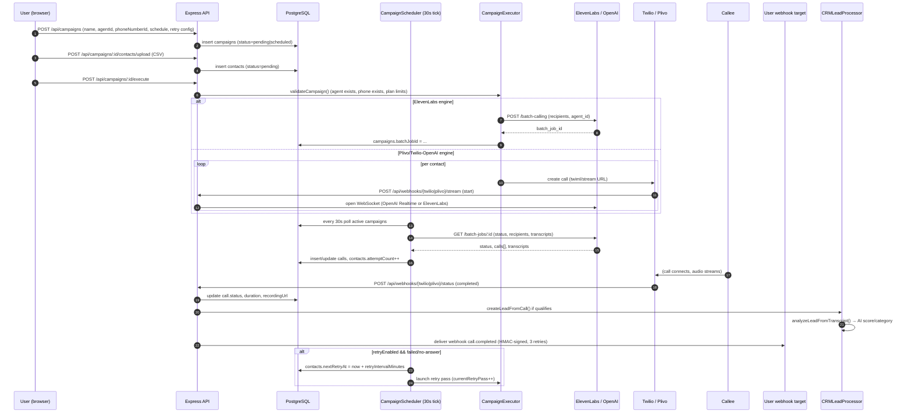
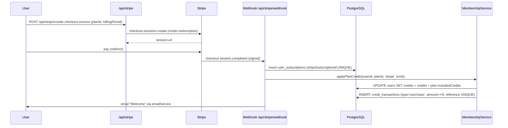
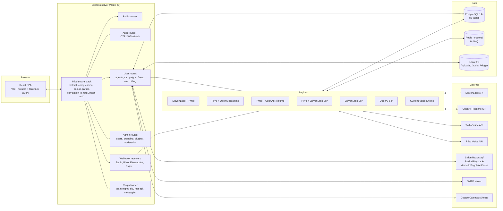
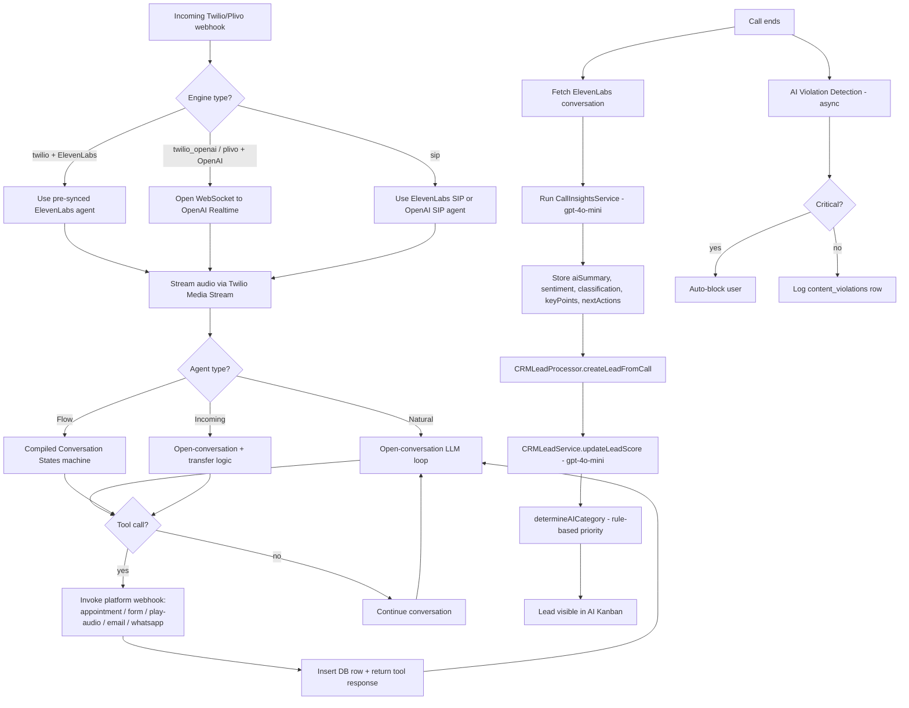

# AgentLabs — Independent Technical & Product Analysis

**Project analyzed:** `agentlabs_v5.4.5` (CodeCanyon item #60751656 — "AgentLabs – AI Voice Calling Agents & Lead Intelligence SaaS Platform")
**Vendor:** Diploy — a brand of Bisht Technologies Private Limited (`diploy.in`)
**Version reviewed:** 5.4.5 (VERSION file)
**License header in every source file:** Envato / CodeCanyon Regular or Extended License
**Analysis date:** 2026-11-04
**Analyst note:** Source-only analysis. No code execution, no dependency installation, no migrations, no network calls against live services. Demo site was not accessed.

---

## 0. Executive Summary

AgentLabs is a **multi-tenant, AI-powered outbound/inbound voice-calling SaaS** that orchestrates LLM-driven voice agents over the public telephone network. It is sold as a self-hostable CodeCanyon package and is designed to be deployed by operators who then resell the platform to end-customers.

The platform is genuinely "voice-native": every core feature — campaigns, agents, flows, knowledge base, CRM, billing — exists to make AI voice calls happen at scale, monitor them, and charge for them. The system is **provider-pluggable** across two axes:

1. **AI brain** — ElevenLabs Conversational AI **or** OpenAI Realtime API.
2. **Telephony** — Twilio **or** Plivo, plus an optional SIP-trunk path for users who bring their own carrier.

These combine into seven runtime "engines" (`twilio`, `plivo`, `twilio_openai`, `elevenlabs-sip`, `openai-sip`, `plivo-elevenlabs`, `custom-voice-engine`). Six payment gateways (Stripe, Razorpay, PayPal, Paystack, MercadoPago, YooKassa) are integrated as another pluggable layer.

Architecturally the codebase is a **TypeScript monolith** (Express + Drizzle ORM + Postgres, React + Vite SPA, optional BullMQ/Redis), with explicit module isolation for each engine and a small plugin system layered on top. It is feature-rich but exhibits several recurring risks: a very large shared schema (82 tables), duplicated per-engine call tables, in-memory rate limiting, and obvious single-tenant assumptions in some places despite multi-tenant intentions.

---

## 1. Product Overview

| Dimension | Finding |
|---|---|
| **Purpose** | Build, schedule, run and analyze AI voice calls at bulk scale; capture leads into a CRM; optionally receive inbound calls and embeddable website voice widgets. |
| **Target users** | (a) Operators who buy the CodeCanyon license and resell/host the platform; (b) end-customers (marketers, call centers, SMBs) who create agents/campaigns; (c) their callers; (d) admin "team members" with role-based permissions inside the operator's company. |
| **Business model** | Self-hosted CodeCanyon product (one-time license fee) **+** built-in SaaS subscription + credit-pack billing model the operator can run against their own end-customers. Plans: `free` and `pro` seeded by default (`server/seed-plans.ts`). |
| **Tech stack — server** | Node.js 18+/20+, TypeScript, Express 4, `ws`, Drizzle ORM 0.45, `pg` 8, `ioredis`, BullMQ (optional), Passport + JWT + bcrypt, helmet, multer, papaparse, pdfkit, nodemailer. |
| **Tech stack — client** | React 18, Vite 6, wouter (router), TanStack Query 5, Radix UI + shadcn/ui, Tailwind 3, `@xyflow/react` (flow builder), recharts, i18next (12 locales), framer-motion. |
| **Database** | PostgreSQL 14+ (one DB, multi-tenant via `userId` columns). Drizzle migrations under `migrations/`. |
| **Main capabilities** | Bulk outbound AI calling, inbound AI receptionist, visual flow builder, RAG knowledge base, CRM lead pipeline with AI scoring, appointments/forms, embeddable voice widgets, multi-gateway billing, REST API plugin, SIP trunk plugin, webhook system, admin moderation/banned-word/AI violation detection. |

### Key environment toggles (`/.env.example`)

| Variable | Purpose |
|---|---|
| `DATABASE_URL` | Postgres connection string |
| `JWT_SECRET`, `SESSION_SECRET` | Auto-generated by `npm run setup` |
| `TWILIO_ACCOUNT_SID` / `TWILIO_AUTH_TOKEN` | Twilio credentials (or DB-set) |
| `ELEVENLABS_API_KEY` | Default ElevenLabs key (multiple keys manageable via admin pool) |
| `STRIPE_SECRET_KEY` / `VITE_STRIPE_PUBLIC_KEY` | Stripe keys (or DB-set) |
| `SMTP_HOST/PORT/USER/PASS` | Transactional email |
| `DEMO_MODE` / `DEMO_EMAILS` | Demo/sandbox restrictions (see §10) |
| `ENABLE_BULLMQ` / `REDIS_URL` | Optional durable queue for campaigns |
| `INSTALLER_COMPLETED` | First-run setup wizard flag |

---

## 2. Complete Feature Inventory

The following feature modules are all backed by code in the repository. Each entry lists where it lives, who uses it, and what it depends on.

### 2.1 User & account management
- **OTP-verified signup** — `POST /api/auth/send-otp`, `POST /api/auth/verify-otp` (`server/routes/auth-routes.ts`); 6-digit code, 5-min default expiry (admin-tunable), 3 attempts cap, 3-OTP/5-min throttle.
- **Password reset** via OTP — `POST /api/auth/forgot-password/send-otp`.
- **Session management** — short-lived (15-min) access JWT + 30-day refresh token stored hashed in `refresh_tokens` table; refresh token issued as `HttpOnly; Secure; SameSite=Strict; Path=/api/auth` cookie (`server/middleware/auth.ts`).
- **Activity timeout** — 30 min idle default; configurable JWT expiry cached 5 min from `global_settings.jwt_expiry_days`.
- **Profile, billing details, GDPR consent flags, soft-delete (`isDeleted`/`deletedAt`/`deletedBy`)** — `users` table.

### 2.2 Agents (`client/src/pages/Agents.tsx`, `server/routes/agent-routes.ts`, `server/services/incoming-agent.ts`, `server/services/flow-agent.ts`)
- **Three agent archetypes**:
  1. **Natural / Incoming** — LLM open-conversation agent backed by ElevenLabs Conversational AI (default) or OpenAI Realtime.
  2. **Flow agents** — visual scripted call flows compiled to ElevenLabs workflows or OpenAI Conversation States.
  3. **Incoming (receptionist)** — dedicated inbound-call agents with business hours, call transfer, after-hours message.
- Per-agent config: voice, voice tone, personality, system prompt, first message, LLM model, temperature, knowledge base IDs, transfer number, ElevenLabs tools (detect language, end conversation, appointment booking, messaging email/WhatsApp), expressive mode, max duration.
- **Agent version history** — `agent_versions` table; rollback endpoint `POST /api/agents/:agentId/versions/:versionNumber/rollback`.
- **Plan limits enforced** — `maxAgents` per plan (`plans` table), admin override per-subscription (`overrideMaxAgents`).

### 2.3 Campaigns (`server/routes/campaign-routes.ts`, `server/services/campaign-executor.ts`, `server/services/campaign-scheduler.ts`, `server/services/batch-calling.ts`)
- **Bulk contact import** via CSV (`POST /api/campaigns/:id/contacts/upload`); parsed with `papaparse`; plan-limited via `maxContactsPerCampaign`.
- **Scheduled execution** — `scheduledFor` timestamp + time-window config (`scheduleTimeStart/End`, `scheduleDays`, `scheduleTimezone`).
- **Concurrency** — multiple simultaneous calls (governed by ElevenLabs `maxConcurrency` per credential or `plivoEngineConfig.rateLimits`).
- **Retry system** — `retryEnabled`, `retryMaxAttempts`, `retryIntervalMinutes`, retry conditions (`retryOnNoAnswer`, `retryOnBusy`, `retryOnFailed`), `currentRetryPass` tracked; `batchJobHistory` JSON.
- **Pause / resume / cancel / stop / retry** endpoints.
- **Real-time monitoring** — `flowExecutions` table stores `currentNodeId`, `pathTaken`, `variables`.
- **Test call** — `POST /api/campaigns/:id/test-call` to validate agent + flow before bulk launch.
- **Failure tracking** — `errorCode` (e.g., `AGENT_NOT_SYNCED`, `NO_CONTACTS`), `errorMessage`.

### 2.4 Telephony & phone numbers (`server/routes/phone-routes.ts`, `server/services/twilio.ts`, `server/engines/plivo/services/plivo-phone.service.ts`)
- **Number provisioning** in 100+ countries via Twilio or Plivo (readme); Twilio countries seeded (`twilio_countries`).
- **Monthly billing cron** — `server/services/phone-billing-cron.ts`; uses `SELECT … FOR UPDATE SKIP LOCKED` for safe multi-worker claim; default 50 credits/month per number.
- **KYC for high-risk countries** — `engines/kyc/`, `user_kyc_documents`, `user_addresses` tables.
- **System pool numbers** — `phone_numbers.isSystemPool=true` lets free-plan users share operator-owned numbers.
- **Phone release retry queue** — `phone_release_retry_queue` for transient Twilio/Plivo release failures.

### 2.5 Knowledge base / RAG (`server/routes/rag-knowledge-routes.ts`, `server/services/rag-knowledge.ts`)
- **Sources**: PDF, DOCX, TXT, plain text, website URL.
- **Two storage modes**:
  - *ElevenLabs native KB* — uploads via ElevenLabs API; 20 MB cap.
  - *Self-hosted RAG* (`USE_RAG_KNOWLEDGE=true`) — chunks text (500 tokens, 50 overlap), generates `text-embedding-3-small` embeddings (1536 dim), stores in `knowledge_chunks` table, performs cosine similarity search in JS.
- **Per-user storage limits** — `user_knowledge_storage_limits` (default 20 MB).
- **Async processing queue** — `knowledge_processing_queue` for large uploads.
- **Embeddings provider** — OpenAI or OpenRouter fallback (configured via `openai_api_key` / `openrouter_api_key` global settings).

### 2.6 Flow Builder (`client/src/pages/FlowBuilderPage.tsx`, `server/services/flow-agent.ts`, `server/services/enhanced-flow-compiler.ts`, `server/services/elevenlabs-flow-compiler.ts`, `server/services/openai-voice-agent/conversation-states-compiler.ts`)
- Visual editor built on `@xyflow/react`.
- Node types (per readme + verified in `FlowNode` type comments): Message, Question, Condition, Transfer, Tool, API Call, Delay, Webhook, End Call.
- **Dual compilation**:
  - For ElevenLabs — compiles to ElevenLabs `workflow` JSON via `ElevenLabsFlowCompiler` / `EnhancedFlowCompiler`.
  - For OpenAI Realtime — compiles to "Conversation States" JSON embedded in the system prompt + function tools via `ConversationStatesCompiler`.
- Compiled artifacts persisted in `flows` table: `compiledSystemPrompt`, `compiledFirstMessage`, `compiledStates`, `compiledTools`.
- **Flow templates** — `isTemplate` flag, `flow_templates` page.
- **Flow execution logs** — `flow_executions` + `flow_test_queue` (queues test calls when pool numbers are busy).

### 2.7 CRM & lead intelligence (`server/routes/crm-routes.ts`, `server/engines/crm/lead-processor.service.ts`, `server/services/crm-lead.service.ts`)
- **Lead stages** — `lead_stages` table; user-customizable pipeline (`/api/crm/stages`, reorder, etc.).
- **AI Kanban view** — `GET /api/crm/leads/ai-kanban` returns leads bucketed by AI category.
- **8 AI categories** (`AI_LEAD_CATEGORIES`): `warm`, `hot`, `neutral`, `cold`, `appointment_booked`, `form_submitted`, `call_transfer`, `need_follow_up`.
- **Auto-categorization** via `determineAICategory()` in `shared/schema.ts` — priority order: action signals → callback → score → sentiment.
- **AI lead scoring** — `CRMLeadService.analyzeLeadFromTranscript()` calls `gpt-4o-mini` with JSON-mode response; produces `score 1–100`, `stage`, `summary`, `suggestedNextAction`.
- **Lead notes, activities (timeline), tags, assignments**.
- **Category preferences** — `crm_category_preferences` for column ordering, color overrides, score thresholds.
- **Bulk operations** — `bulk/ai-category`, `bulk/stage`, `bulk/tags`, `bulk/assign`.

### 2.8 Appointments & forms
- **Appointments** — `appointments` table; linked to flows (`flowId`), calls (`callId`), Google Calendar event (`googleCalendarEventId`).
- **Appointment settings** — per-user working hours per weekday, buffer minutes, overlap rules, Google Calendar sync toggle.
- **Forms** — `forms`, `form_fields`, `form_submissions`; questions can be multiple choice, text, etc.; submissions linked to calls / flow executions.
- **ElevenLabs tool webhooks** — `appointment-elevenlabs-tool.ts`, `form-elevenlabs-tool.ts` register webhook tools back to the platform so AI agents can book appointments or capture form answers mid-call.

### 2.9 Webhooks (`server/services/webhook-delivery.ts`, `server/routes/user-webhook-routes.ts`)
- **Per-user subscriptions** — `webhook_subscriptions` (URL, method, headers, secret, authType=basic/bearer, events[], campaignIds[]).
- **31 event types** verified across the codebase: `call.{started, ringing, answered, busy, no_answer, voicemail, completed, failed, transferred}`, `campaign.{started, paused, resumed, cancelled, completed, failed}`, `appointment.{booked, confirmed, cancelled, rescheduled, completed, no_show, reminder_sent}`, `form.{submitted, lead_created}`, `flow.{started, completed, failed}`, `inbound_call.{received, answered, completed, missed}`.
- **HMAC-SHA256 signature** in `X-Webhook-Signature` header; per-subscription secret.
- **Retry with exponential backoff** — `RETRY_DELAYS = [0, 60s, 300s]`; max 3 attempts; `webhook_logs` records every attempt.
- **Payment webhook retry** — separate durable queue (`payment_webhook_queue`, `webhook-retry-service.ts`) with 5-min scheduler, 5 attempts default, 24 h expiry.
- **SSRF protection** — `validateWebhookUrl()` blocks localhost, link-local (169.254.x), RFC-1918, IPv6 ULA, and cloud metadata endpoints (`url-validator.ts`).

### 2.10 Email & notifications
- `email-service.ts` — Nodemailer; SMTP credentials stored in DB (`global_settings.smtp_host` etc.) and re-initialized at startup.
- **Customizable templates** — `email_templates` table; admin can edit subject + HTML + plaintext body with variable substitution.
- **In-app notifications** — `notifications` table; bell + banner display types; priority, dismissible, expiry.
- Notification triggers include low credits, membership upgrade/expiry, campaign complete/failed.

### 2.11 REST API plugin (`shared/schema.ts` API_SCOPES, `apiKeys`, `apiAuditLogs`, `apiRateLimits`)
- 9 read scopes + 7 write scopes + `admin`.
- API keys stored as bcrypt hash of secret; `keyPrefix` shown for identification (à la Stripe).
- Per-key rate limit (default 100 req/min), IP whitelist, optional expiry.
- Audit log per request (`method`, `endpoint`, `path`, `statusCode`, `responseTime`, `requestId` correlation).
- Note: REST API plugin is **plan-gated** (`plans.restApiEnabled=false` by default).

### 2.12 SIP engine plugin (`server/engines/kyc`, `sip_trunks`, `sip_phone_numbers`, `sip_calls`)
- Users bring their own SIP trunk (Twilio/Plivo/Telnyx/Vonage/Exotel/Bandwidth/DIDWW/Zadarma/Cloudonix/RingCentral/Sinch/Infobip/generic).
- Two engine modes: `elevenlabs-sip` (ElevenLabs native SIP) and `openai-sip` (OpenAI Realtime over SIP).
- Inbound/outbound transport can differ (e.g., Twilio uses TCP:5060 inbound, TLS:5061 outbound).
- Codec allowlist (PCMU/PCMA default), media encryption (`require`/`prefer`/`none`).
- Health monitoring (`healthStatus`, `lastHealthCheck`).
- Plan-gated: `plans.sipEnabled=false` by default; `maxConcurrentSipCalls` and `sipEnginesAllowed[]`.

### 2.13 Team management plugin (optional)
- Loaded dynamically when `plugins/team-management` directory exists (`server/plugins/team-management-adapter.ts`).
- Adds team-member authentication and a `getTeamContextMiddleware()` that allows team members to act on behalf of a parent user.
- Admin-side team permissions also exist (`admin_team_sessions`, `admin_team_members`, `admin_team_roles`, `admin_team_permissions`) and are referenced in `server/middleware/admin-auth.ts`.

### 2.14 Website voice widgets (`server/modules/widget/`, `website_widgets`, `widget_call_sessions`)
- Embeddable JS widget (`/widget/*` static assets in `public/widget/`).
- Per-widget branding (icon, primary/accent colors, button label, welcome message).
- **Domain whitelisting** (`allowed_domains[]`).
- **Business hours**, concurrency cap (`maxConcurrentCalls`), max call duration, IP cooldown.
- **Terms acceptance** checkbox before call.
- Session token (`session_token` unique) issued per call; tracks visitor IP and embedding domain.
- Public routes prefix `/api/public/` and `/api/public/platform-languages`.

### 2.15 Admin panel (`client/src/pages/AdminDashboard.tsx`, `server/routes/admin/`)
- User CRUD, block/unblock, soft-delete + recover.
- Per-user **plan limit overrides** (`overrideMaxAgents` etc. on `user_subscriptions`).
- Credit grants (`POST /api/admin/users/:id/credits`).
- Calls moderation (`/api/admin/calls`, recordings sync, ElevenLabs conversation fetch).
- **Banned words** + **content violations** moderation (`banned_words`, `content_violations`).
- **AI violation detection** — `ai-violation-detection.ts` calls `gpt-4o-mini` JSON-mode to scan transcripts; categories: harassment, hate_speech, threats, profanity, scam, inappropriate; severity low/medium/high/critical; **critical violations auto-block the user**.
- Branding (logos, favicon, app name, tagline) — `branding-routes.ts`.
- SEO settings (per-page title/description/OG image, sitemap, robots, Google/Bing verification).
- Email templates editor, SMTP settings, payment gateway settings, ElevenLabs API key pool.
- Plans and credit packages CRUD.
- Plugin installer (`/api/admin/plugins/installer`).
- Refunds with PDF receipts (`refund-note-service.ts`, `refunds` table).

### 2.16 Analytics (`server/routes/analytics-routes.ts`, `client/src/pages/Analytics.tsx`, `server/storage/analytics-helpers.ts`)
- Dashboard widgets: total calls, success rate, total duration, credits consumed, by-engine breakdown.
- Time-series charts (recharts) for calls/credits over time.
- Per-campaign analytics via `GET /api/campaigns/:id` (counter fields: `totalContacts`, `completedCalls`, `successfulCalls`, `failedCalls`).

### 2.17 Multi-language UI
- 12 locale JSON files under `client/src/i18n/locales/`: `ar, de, en, es, fr, hi, it, ja, pl, pt, ru, sv`.
- RTL support via `tailwindcss-rtl` and `DirectionProvider` (Arabic).
- Detected automatically via `i18next-browser-languagedetector`.

### 2.18 Demo mode (`server/demo-mode/index.ts`, `client/src/components/DemoModeBanner.tsx`)
- Toggled via `DEMO_MODE=true` env var; can be restricted to specific emails via `DEMO_EMAILS`.
- Blocks admin mutations, hides sensitive data, shows demo banner, limits calls per user per day (default 3).
- Allowed mutation paths whitelisted; blocked prefixes include `/api/admin`, `/api/sip/admin`, `/api/team/admin`.
- Marked "INTERNAL USE ONLY — excluded from distribution packages" in source comments.

### 2.19 SEO & marketing site
- Public routes: `/`, `/pricing`, `/features`, `/use-cases`, `/integrations`, `/blog`, `/contact`, `/about`, `/privacy`, `/terms`, `/sitemap.xml`, `/robots.txt`.
- Server-side OG meta-tag injection for social crawlers (`server/index.ts` `injectSeoMetaTags()`).
- Recognized crawler user agents: facebookexternalhit, WhatsApp, Twitterbot, LinkedInBot, Slackbot, Discordbot, TelegramBot, Pinterest, Googlebot, bingbot, Applebot, iMessageBot.
- Blog engine (`pages/Blog.tsx`, `pages/BlogPost.tsx`).

### 2.20 Other supporting modules
- **Audit log** — `audit_logs` table; `server/services/audit-log.ts`.
- **Resource watchdog** — `server/services/resource-watchdog.ts` auto-restarts on memory/event-loop stalls.
- **Startup health check** — `server/services/startup-health-check.ts`; exposed at `GET /health` and `GET /health/detailed`.
- **Graceful shutdown** — `server/services/graceful-shutdown.ts`; PM2 ready signal.
- **System update service** — `server/services/system-update-service.ts`; maintenance middleware blocks non-admin traffic during updates.
- **Google integrations** — Google Calendar (appointments sync) and Google Sheets (contact sync); OAuth credentials in `google_calendar_credentials` and `google_sheets_credentials`.

---

## 3. Business Workflows

### 3.1 Outbound campaign workflow (end-to-end)



**Key data actions per step**:
- Validate `agent.isActive`, `phoneNumber.status='active'`, `user.credits > 0` (via `checkUserCreditBalance`).
- Insert `calls` row with `userId` (direct ownership), `campaignId`, `contactId`, `agentId`.
- On call end, `deductCallCredits()` runs an **atomic Postgres transaction** with `pg_advisory_xact_lock(userHash, refHash)` and `SELECT … FOR UPDATE` on the user row, with idempotency key `{engine}:{callId}` in `credit_transactions.reference` (verified in `server/services/credit-service.ts`).
- Triggers `campaign.completed` webhook when `completedCalls == totalContacts`.

### 3.2 Inbound call workflow (receptionist)

1. Caller dials a user-purchased number (or SIP trunk DID).
2. Twilio/Plivo webhook hits `POST /api/webhooks/twilio/incoming` or `POST /api/webhooks/plivo/…`.
3. Platform looks up `incoming_connections` by `phoneNumberId` → resolves `agentId`.
4. Business-hours check (per `incoming_agents.businessHours*` fields).
5. If `transferEnabled` and caller says a trigger phrase (e.g., "speak to a human"), `calls.wasTransferred=true`, `transferredTo` recorded.
6. ElevenLabs/OpenAI Realtime session opened, bidirectional audio streamed via Twilio Media Streams or Plivo Stream.
7. On hangup, transcript + AI summary + sentiment written to `calls` table; lead created in CRM if qualifies (`sourceType='incoming'`).

### 3.3 Subscription + credit grant workflow



- Idempotency: `user_subscriptions.stripeSubscriptionId` UNIQUE, `credit_transactions.userReferenceUnique` index on `(userId, reference) WHERE reference IS NOT NULL`.
- Cancel-at-period-end tracked on `cancelAtPeriodEnd`.
- `syncUserWithSubscription()` mirrors subscription state into `users.planType`/`planExpiresAt` for legacy fallback checks.

### 3.4 AI lead qualification workflow

1. Call completes → `CRMLeadProcessor.processCall()` (in `server/engines/crm/lead-processor.service.ts`) invoked.
2. Quality threshold: call ≥ 10 s **or** transcript ≥ 20 chars **or** high-value signal (appointment/form/transfer/callback).
3. Phone normalization: strips `sip:`, `client:`, `whatsapp:`; rejects < 5 digits or > 15 digits; produces E.164.
4. Dedup by `(userId, phone, sourceType, {campaignId|incomingConnectionId})`.
5. Action signals checked first (appointment booked, form submitted, call transfer, callback requested).
6. If no action signal, `CRMLeadService.updateLeadScore()` calls `gpt-4o-mini` to score 1–100 and pick stage.
7. `determineAICategory()` (in `shared/schema.ts`) maps lead to one of 8 categories per priority list.
8. `lead_activities` row created ("created"/"updated"/"call"/"appointment"/"transfer"/"form_submission"/"stage_change"/"tag_added"/"tag_removed").
9. UI Kanban (`/api/crm/leads/ai-kanban`) groups leads by category.

---

## 4. UI/UX Analysis

### 4.1 Information architecture

The React SPA (`client/src/App.tsx`) defines ~50 routes split across four route groups:

| Group | Routes | Audience |
|---|---|---|
| **Public marketing** | `/`, `/pricing`, `/features`, `/use-cases`, `/integrations`, `/blog`, `/blog/:slug`, `/contact`, `/privacy`, `/terms`, `/cookies` | Anonymous visitors + crawlers |
| **Auth** | `/login`, `/register`, `/team/login`, `/admin/team/login`, `/google-callback` | All users |
| **App (user)** | `/app/dashboard`, `/app/campaigns`, `/app/calls`, `/app/crm`, `/app/agents`, `/app/flows`, `/app/flows/new`, `/app/flows/:id`, `/app/flows/webhooks`, `/app/flows/forms`, `/app/flows/appointments`, `/app/knowledge-base`, `/app/voices`, `/app/phone-numbers`, `/app/contacts`, `/app/billing`, `/app/transaction-history`, `/app/upgrade`, `/app/tools/widgets`, `/app/tools`, `/app/incoming-connections`, `/app/analytics`, `/app/prompt-templates`, `/app/settings`, `/app/conversations` (plugin) | End-customers |
| **Admin** | `/admin`, `/admin/dashboard`, `/admin/campaigns/:id` | Platform admins + admin team members |

### 4.2 Navigation

- **Sidebar** (`components/app-sidebar.tsx`) — Radix `Sidebar` with collapsible "icon" mode; sections: Home, Build (Campaigns / Agents / Knowledge Base / Flow Builder / Tools), Telephony (Contacts / Phone Numbers), Monitor (Conversations / Calls / Analytics), plus a credit widget showing `user.credits` and plan name.
- **Top bar** — `NotificationBell`, `LanguageSelector`, `ThemeToggle`, `SessionTimeoutDialog`.
- **Branding provider** — pulls logo/favicon/app_name from `/api/branding` (DB-driven white-label).
- **Responsive** — sidebar collapses to icon on mobile via `use-mobile` hook; `DirectionProvider` flips layout for RTL.

### 4.3 Notable pages

| Page | File | Highlights |
|---|---|---|
| `Dashboard.tsx` | 47 KB | KPI cards, recent campaigns, credit usage chart, low-credit warning CTA |
| `Agents.tsx` | **255 KB** (largest file in repo) | Wizard-style creation (`AgentCreationWizard.tsx` 83 KB), tabbed editor for natural/incoming/flow, voice picker, system prompt editor with template chips, knowledge base multi-select, ElevenLabs tools toggles, version history dialog |
| `FlowBuilderPage.tsx` | 82 KB | `@xyflow/react` canvas; node palette (message, question, condition, transfer, tool, api, delay, webhook, end); live validation; "compile & test" button |
| `Campaigns.tsx` / `CampaignDetail.tsx` | 32 KB / 57 KB | List with status pills; detail shows progress bar, contacts table with per-contact status, retry config, batch job history, live `flowExecutions.pathTaken` viewer |
| `CallDetail.tsx` | 48 KB | Transcript with role-colored turns, recording player, AI summary card, sentiment badge, lead link |
| `CRMPage.tsx` | 114 KB | **AI Kanban** — 8 columns (warm/hot/neutral/cold/appointment_booked/form_submitted/call_transfer/need_follow_up); drag-and-drop stage changes; per-lead drawer with timeline (`lead_activities`), notes, AI score, suggested next action |
| `Billing.tsx` | 53 KB | Plan cards with monthly/yearly toggle, gateway selector (Stripe/Razorpay/PayPal/Paystack/MercadoPago), credit-pack purchase dialog, transaction history table, invoice download (PDF via `pdfkit`) |
| `AdminDashboard.tsx` | 41 KB | User search/list with plan overrides, call moderation queue, banned-word manager, content-violation inbox, payment gateway toggles, ElevenLabs key pool monitor |
| `InstallWizard.tsx` | — | Multi-step setup (env check → admin account → seed plans → SMTP → branding); gated by `INSTALLER_COMPLETED=false` |

### 4.4 Forms, tables, filters

- All forms built with `react-hook-form` + `zod` resolvers (via `drizzle-zod` insert schemas).
- Tables use shadcn `data-table` pattern with pagination (`components/ui/data-pagination.tsx`), column sorting, server-side filtering (`apiRequest`).
- Filters: date range, status multi-select, search box — repeated across Calls, Campaigns, Contacts, Leads.

### 4.5 Useful interaction patterns

- **Credit widget** persistent in sidebar → instant feedback when balance drops.
- **Cookie consent banner** (`CookieConsentBanner.tsx`) with Essential/Analytics/Marketing tiers stored in `users.cookieConsent/analyticsConsent/marketingConsent`.
- **Session timeout dialog** — pre-expiry warning 5 min before the 30-min idle timeout, with refresh-token silent renewal.
- **Demo mode banner** — visible only when `DEMO_MODE=true`.
- **Branding provider** swaps logo/color theme at runtime from `/api/branding` — supports full white-label.

### 4.6 Responsive & accessibility

- Tailwind 3 + `tailwindcss-animate`; mobile-first grid breakpoints.
- All interactive components built on Radix UI primitives → keyboard navigation, ARIA roles, focus trapping in modals.
- `tailwindcss-rtl` for Arabic; `DirectionProvider` flips layout direction.
- Color tokens via CSS variables → supports `next-themes` dark/light mode (`ThemeToggle`).

---

## 5. Technical Architecture

### 5.1 High-level architecture



### 5.2 Backend organization

The Express app is set up in `server/index.ts` and routes are registered in `server/routes.ts:registerRoutes(app)`. The codebase follows a **modular monolith** style:

```
server/
├── index.ts              # bootstrap, middleware, seeds, server.listen
├── routes.ts             # registerRoutes() — wires everything
├── routes/               # HTTP route modules (user-facing)
│   ├── admin/            # admin-only subroutes (users, calls-moderation, branding, ...)
│   ├── auth-routes.ts
│   ├── agent-routes.ts
│   ├── campaign-routes.ts
│   ├── crm-routes.ts
│   ├── stripe-routes.ts  # /api/stripe/*
│   └── ...
├── services/             # business logic (one class/file per domain)
│   ├── campaign-executor.ts        # 3,605 lines — orchestration
│   ├── elevenlabs.ts               # 4,103 lines — ElevenLabs wrapper
│   ├── credit-service.ts           # atomic credit deduction
│   ├── crm-lead.service.ts         # AI lead scoring
│   ├── ai-violation-detection.ts   # AI content moderation
│   ├── webhook-delivery.ts         # HMAC + retries
│   └── ...
├── engines/              # pluggable provider engines (one folder each)
│   ├── twilio-openai/
│   ├── plivo/
│   ├── plivo-elevenlabs/
│   ├── elevenlabs-migration/   # auto-migrate users across ElevenLabs API keys
│   ├── kyc/
│   ├── payment/                 # v1.0.0 — 6 gateway adapters
│   └── crm/                     # CRMLeadProcessor
├── middleware/            # auth, admin-auth, rateLimiter, webhookValidation, errorHandler, correlation-id
├── infrastructure/
│   ├── bullmq/            # optional Redis-backed queues
│   ├── database/
│   ├── openai/
│   └── websocket/
├── plugins/               # plugin loader + team-mgmt adapter
├── modules/widget/        # embeddable voice widget module
├── demo-mode/             # demo/sandbox mode
├── storage.ts             # storage facade (DB ops)
├── db.ts                  # Drizzle client
└── utils/                 # logger, url-validator, llm-sanitize, with-retry, ...
```

### 5.3 Frontend organization

```
client/src/
├── App.tsx               # route table (~840 lines)
├── main.tsx              # bootstrap (ReactDOM + i18n + ThemeProvider)
├── pages/                # 50 page components
├── components/
│   ├── ui/               # 47 shadcn/ui primitives
│   ├── app-sidebar.tsx
│   ├── AgentCreationWizard.tsx (83 KB)
│   ├── CreditPurchaseDialog.tsx
│   ├── BrandingProvider.tsx
│   ├── DirectionProvider.tsx
│   └── ...
├── contexts/             # plugin-registry, dynamic-languages
├── hooks/                # use-toast, use-mobile, use-plugin-status, useActivityTimeout, useSeoSettings
├── lib/                  # queryClient, auth-storage, team-auth, formatters, utils
└── i18n/                 # 12 locales
```

### 5.4 Routing & API surface

Express mounts routers via `app.use(...)` per module (`server/routes.ts` lines 168–1650). Roughly **350+ REST endpoints** are registered across:

- `/api/auth/*` — OTP, login, refresh, logout, password reset
- `/api/agents`, `/api/elevenlabs/*`, `/api/knowledge-base` — agent management
- `/api/campaigns`, `/api/contacts` — campaign lifecycle
- `/api/calls`, `/api/contacts/deduplicated` — call history
- `/api/flows/*`, `/api/flow-automation/*` — flow builder
- `/api/webhooks/twilio/*`, `/api/webhooks/elevenlabs/*`, `/api/webhooks/plivo/*` — provider webhooks (signed)
- `/api/stripe`, `/api/razorpay`, `/api/paypal`, `/api/paystack`, `/api/mercadopago`, `/api/yookassa` — payment gateways
- `/api/crm/*` — leads, stages, kanban, activities
- `/api/admin/*` — admin subroutes (modular)
- `/api/plugins/*` — plugin discovery/installation
- `/api/public/*` — widget & platform-language public endpoints
- `/api/invoices`, `/api/transactions`, `/api/refunds/:id/download` — billing docs
- `/api/incoming-connections` — inbound call routing
- `/api/user-sip-gateways` — SIP trunks (user-scoped)
- `/api/llm-models/available`, `/api/admin/llm-models` — model registry
- `/api/notifications` — in-app notification center
- `/api/audio` — play-audio asset serving for flows

### 5.5 Background jobs / cron / events

| Service | Trigger | Function |
|---|---|---|
| `CampaignScheduler` | 30 s interval | Check scheduled campaigns, poll ElevenLabs batch jobs, run retry passes |
| `startPhoneBillingCron` | hourly | Charge monthly credits for rented numbers (`FOR UPDATE SKIP LOCKED`) |
| `startCreditBackfillMonitor` | daily | Find un-billed calls across all engines and back-fill credit deductions |
| `startPhoneReleaseRetryWorker` | background | Retry transient Twilio/Plivo number releases |
| `webhookRetryService.start()` | 5 min interval | Re-deliver failed payment webhooks (5 attempts, 24 h expiry) |
| `initializeMigrationEngine` | background | Retry ElevenLabs capacity errors by migrating users between API keys |
| `startWatchdog` | background | Monitor memory/event-loop; auto-restart on stall |
| `BullMQ call-worker` | per-job | Durable campaign call execution when `ENABLE_BULLMQ=true` |
| `BullMQ campaign-recovery` | scheduled | Recover stuck campaigns; cleanup stale calls |

### 5.6 Background processing patterns

- **Two paths**: in-process scheduler (default) **or** BullMQ + Redis (opt-in). The scheduler still runs even with BullMQ, handling time-window pause/resume + ElevenLabs batch polling.
- **Idempotency**: every credit deduction, webhook delivery, and payment webhook uses a deterministic `reference` (`{engine}:{callId}`) plus a unique DB constraint.
- **Distributed locking**: `pg_advisory_xact_lock(hash1, hash2)` for credit deductions; `SELECT … FOR UPDATE SKIP LOCKED` for phone-number billing.
- **Graceful shutdown**: `SIGTERM` drains in-flight calls, closes Redis, stops BullMQ workers, sends PM2 `signalReady()`.

### 5.7 Reusable components & patterns

- **`createRouteContext()`** (`server/routes/common.ts`) — dependency-injects `db`, `storage`, `authenticateToken`, `requireRole`, `emailService` into route factories (`createAgentRoutes(ctx)`, etc.). This makes modules testable.
- **`withServiceErrorHandling()`** / **`wrapServiceError()`** (`server/utils/service-error-wrapper.ts`) — wraps third-party SDK calls into typed `ExternalServiceError` instances.
- **`withRetry()`** (`server/utils/with-retry.ts`) — exponential-backoff wrapper used by Twilio/Plivo SDK calls.
- **`hybrid-auth` middleware** (`server/middleware/hybrid-auth.ts`) — accepts both user JWTs and admin team session tokens on the same endpoint, used by CRM and flow-automation routes.
- **`plugin-import.ts`** — runtime TS/JS dynamic loader; allows plugins to be `.ts` in dev and `.js` in production.

---

## 6. Database & Domain Model

### 6.1 Schema overview

- **Schema definition**: `shared/schema.ts` — 3,175 lines, **82 `pgTable` declarations**, all generated through Drizzle ORM.
- **Migrations**: `migrations/0000_damp_spectrum.sql` (initial), `0001`-`0010` add columns/tables, plus `add_missing_columns.sql`.
- **Multi-tenancy**: every customer-facing table carries `userId varchar REFERENCES users(id) ON DELETE CASCADE` (except `contacts`, whose ownership flows via `campaignId → campaigns.userId`).
- **Soft deletes**: `users.isDeleted`/`deletedAt`/`deletedBy`; `campaigns.deletedAt`.
- **Lifecycle timestamps**: `createdAt`, `updatedAt` on virtually every table; `startedAt`/`endedAt`/`completedAt` on calls/campaigns.
- **Audit fields**: `users.blockedReason`/`blockedAt`/`blockedBy`; `users.kycStatus`/`kycSubmittedAt`/`kycApprovedAt`; `audit_logs` table; `api_audit_logs`.
- **Idempotency unique indexes**: `credit_transactions(user_id, reference) WHERE reference IS NOT NULL`; `user_subscriptions.stripeSubscriptionId UNIQUE`; `credit_transactions.stripePaymentId UNIQUE`; `synced_voices(credentialId, voiceId) UNIQUE`.

### 6.2 Core entity groups

| Group | Tables |
|---|---|
| **Identity & sessions** | `users`, `otp_verifications`, `refresh_tokens`, `user_addresses`, `user_kyc_documents` |
| **Agents & knowledge** | `agents`, `incoming_agents`, `agent_versions`, `knowledge_base`, `knowledge_chunks`, `knowledge_processing_queue`, `user_knowledge_storage_limits`, `voices`, `tools`, `prompt_templates` |
| **Telephony** | `phone_numbers`, `incoming_connections`, `twilio_countries`, `plivo_phone_numbers`, `plivo_phone_pricing`, `plivo_calls`, `twilio_openai_calls`, `sip_calls`, `sip_trunks`, `sip_phone_numbers`, `phone_number_rentals`, `phone_release_retry_queue` |
| **Campaigns & calls** | `campaigns`, `contacts`, `calls`, `campaign_jobs` |
| **Flows** | `flows`, `flow_executions`, `flow_test_queue` |
| **CRM** | `lead_stages`, `leads`, `lead_notes`, `lead_activities`, `crm_category_preferences` |
| **Appointments & forms** | `appointments`, `appointment_settings`, `forms`, `form_fields`, `form_submissions` |
| **Billing & subscriptions** | `plans`, `user_subscriptions`, `credit_transactions`, `credit_packages`, `usage_records`, `payment_transactions`, `refunds`, `invoices`, `payment_webhook_queue` |
| **Webhooks** | `webhook_subscriptions` (alias `webhooks`), `webhook_logs` (alias `webhookDeliveryLogs`), legacy `webhooks`/`webhook_deliveries` |
| **Notifications** | `notifications`, `email_templates`, `email_notification_settings` |
| **API plugin** | `api_keys`, `api_audit_logs`, `api_rate_limits` |
| **Website widgets** | `website_widgets`, `widget_call_sessions` |
| **Admin team** | (referenced via SQL in `admin_team_sessions`, `admin_team_members`, `admin_team_roles`, `admin_team_permissions` — not declared in `shared/schema.ts` because they are owned by the Team Management plugin) |
| **Integrations** | `google_calendar_credentials`, `google_sheets_credentials`, `openai_credentials`, `plivo_credentials`, `eleven_labs_credentials`, `synced_voices` |
| **Moderation** | `banned_words`, `content_violations` |
| **Misc** | `global_settings`, `llm_models`, `supported_languages`, `platform_languages`, `seo_settings`, `analytics_scripts`, `demo_sessions`, `user_feedback` |

### 6.3 ER diagram (core entities)

```mermaid
erDiagram
    users ||--o{ agents : owns
    users ||--o{ campaigns : owns
    users ||--o{ phone_numbers : owns
    users ||--o{ flows : owns
    users ||--o{ calls : owns
    users ||--o{ leads : owns
    users ||--o{ credit_transactions : has
    users ||--o{ user_subscriptions : has
    users ||--o{ webhook_subscriptions : owns
    users ||--o{ api_keys : owns
    users ||--o{ website_widgets : owns
    users ||--o{ appointments : owns
    users ||--o{ forms : owns
    users ||--o{ user_addresses : has
    users ||--o{ user_kyc_documents : has
    users ||--o{ sip_trunks : owns
    users ||--o{ google_calendar_credentials : has
    users ||--o{ google_sheets_credentials : has
    users ||--o{ notifications : receives
    users }o--|| plans : subscribed_via
    user_subscriptions }o--|| plans : references
    agents ||--o{ agent_versions : versioned
    agents ||--o{ incoming_connections : powers
    agents }o--o{ knowledge_base : references
    agents }o--|| eleven_labs_credentials : uses
    campaigns ||--o{ contacts : contains
    campaigns ||--o{ calls : produces
    campaigns }o--|| agents : uses
    campaigns }o--o| phone_numbers : dials_from
    campaigns }o--o| flows : executes
    contacts ||--o{ calls : receives
    calls ||--o{ lead_activities : triggers
    calls }o--o| leads : qualifies_into
    leads }o--o| lead_stages : in
    leads ||--o{ lead_notes : has
    leads ||--o{ lead_activities : has
    phone_numbers ||--o{ incoming_connections : routes_to
    phone_numbers ||--o{ phone_number_rentals : billed_via
    phone_numbers }o--|| users : owned_by
    flows ||--o{ flow_executions : runs
    flows ||--o{ appointments : schedules
    flows ||--o{ form_submissions : collects
    forms ||--o{ form_fields : has
    forms ||--o{ form_submissions : has
    plans ||--o{ user_subscriptions : subscribed
    credit_transactions }o--|| users : belongs_to
    payment_transactions ||--o{ refunds : can_refund
    payment_transactions ||--o{ invoices : generates
    website_widgets ||--o{ widget_call_sessions : hosts
    website_widgets }o--o| agents : powered_by
    webhook_subscriptions ||--o{ webhook_logs : delivers
    api_keys ||--o{ api_audit_logs : logs
    api_keys ||--o{ api_rate_limits : tracks
    sip_trunks ||--o{ sip_phone_numbers : has
    sip_phone_numbers ||--o{ sip_calls : makes
    eleven_labs_credentials ||--o{ synced_voices : has
    knowledge_base ||--o{ knowledge_chunks : chunked_into
```



### 6.4 Notable design decisions

- **Per-engine call tables** (`calls`, `plivo_calls`, `twilio_openai_calls`, `sip_calls`) — every call engine has its own table, with a unified `CRMLeadProcessor` that reads from all four. This avoids schema coupling but requires duplicated indexes and complicates analytics.
- **Two webhook systems**: `webhooks`/`webhook_deliveries` (legacy) + `webhook_subscriptions`/`webhook_logs` (current, with `webhooks = webhookSubscriptions` alias).
- **`global_settings` key-value table** holds runtime configuration (SMTP creds, gateway toggles, ElevenLabs HMAC secret, low-credit threshold, JWT expiry, etc.) — no schema migration needed for new toggles.
- **`metadata jsonb`** column on most call/contact/lead tables — absorbs engine-specific extras (e.g., `modelFallbackApplied`, `originalModelRequested`, `customerPhone`).
- **Plan entitlements encoded as integer columns** on `plans` (`maxAgents`, `maxCampaigns`, `maxContactsPerCampaign`, `maxWebhooks`, `maxKnowledgeBases`, `maxFlows`, `maxPhoneNumbers`, `maxWidgets`, `includedCredits`, `sipEnabled`, `restApiEnabled`, `teamManagementEnabled`) with per-user overrides on `user_subscriptions`.

### 6.5 Indexes (selected, verified in `shared/schema.ts`)

- `calls(user_id)`, `calls(campaign_id)`, `calls(contact_id)`, `calls(status)`, `calls(created_at)`, `calls(twilio_sid)`, `calls(elevenlabs_conversation_id)`, `calls(agent_id)`
- `campaigns(user_id)`, `campaigns(status)`, `campaigns(deleted_at)`, `campaigns(agent_id)`
- `contacts(campaign_id)`, `contacts(status)`
- `credit_transactions(user_id)`, `credit_transactions(created_at)`, unique partial index on `(user_id, reference)`
- `phone_numbers(next_billing_date)` — used by `SKIP LOCKED` billing scan
- `refresh_tokens(user_id)`, `refresh_tokens(expires_at)`
- `phone_release_retry_queue(next_retry_at)`, `phone_release_retry_queue(phone_number_id)`

---

## 7. Authentication & Authorization

### 7.1 User types & roles

| Role | Source | Capabilities |
|---|---|---|
| `user` (default) | `users.role` | Owns agents/campaigns/calls/leads/billing; gated by plan entitlements |
| `admin` | `users.role='admin'` | All admin endpoints; bypasses plan checks; can configure global settings, branding, plugins, gateways |
| `superadmin` | Implied — bypasses `checkActiveMembership` (auth.ts L221) | Same as admin plus membership bypass |
| `manager` | `users.role='manager'` | Some admin endpoints via `requireRole('admin','manager')` (e.g., credit grants, limit overrides) — see `server/routes.ts` L411, L444, L494, L561 |
| Team member (user side) | `plugins/team-management` | Acts on behalf of parent user; restricted by team role |
| Admin team member | `admin_team_members` + `admin_team_sessions` (64-hex session token) | Read-mostly admin panel access; per-section/subsection/action permission rows in `admin_team_permissions` |

### 7.2 Authentication mechanisms

- **JWT access token** — signed with `JWT_SECRET`, default 7-day expiry (admin-configurable via `global_settings.jwt_expiry_days`); payload `{userId, role}`.
- **Refresh token** — 64-byte hex; **SHA-256-hashed** at rest in `refresh_tokens` table; 30-day expiry; `HttpOnly; Secure; SameSite=Strict; Path=/api/auth` cookie.
- **Short access token** — 15-min alternative used during OAuth flows.
- **OTP** — 6-digit code; `Math.floor(100000 + Math.random() * 900000)`; 5-min expiry (admin-tunable); 3 attempts; 3-OTP/5-min throttle per email.
- **Bcrypt** password hashing (`bcrypt` v6).
- **Admin team session token** — 64-char hex; DB-validated against `admin_team_sessions WHERE expires_at > NOW() AND member.status='active'`. Cached failed-token rejection (1 min TTL) to prevent DoS.

### 7.3 Authorization middleware

| Middleware | Purpose |
|---|---|
| `authenticateToken` | Verifies user JWT; sets `req.userId`, `req.userRole` |
| `authenticateAnyToken` | Accepts either user JWT or admin team session token |
| `authenticateHybrid` | Same as above, used by user routes that admin team members may access |
| `checkUserActive` | Blocks suspended users (HTTP 403, `ACCOUNT_SUSPENDED`) |
| `checkActiveMembership` | Requires active Pro subscription (skipped for admin/superadmin and in dev mode) |
| `checkAdmin` | Requires `users.role='admin'` |
| `checkAdminOrTeamMember` | Admin JWT **or** admin team session token |
| `requireRole(...roles)` | Role-list check; admin always passes |
| `requireAdminPermission(section, subsection, action)` | Per-permission-row check against `admin_team_permissions` for `create|read|update|delete` |

### 7.4 Tenant isolation

- **Direct ownership**: every customer table has `user_id NOT NULL REFERENCES users(id) ON DELETE CASCADE`. `contacts` is the only exception — its ownership flows through `campaignId → campaigns.userId`. The schema comment explicitly notes this design choice.
- **Query scoping**: every read query in storage layer filters `WHERE user_id = $1` (verified across `server/routes/agent-routes.ts`, `campaign-routes.ts`, `crm-routes.ts`).
- **Webhook per-user secrets**: each `webhook_subscriptions` row has its own 64-char `secret` used for HMAC.
- **ElevenLabs API key affinity**: `users.elevenLabsCredentialId` pins a user's agents and phone numbers to one of the operator's pooled ElevenLabs keys (multi-key pool feature in `elevenlabs-pool.ts`).
- **Cross-tenant prevention**: credit deduction uses `(userId, reference)` unique index to prevent cross-tenant collision even if `reference` strings happen to clash.

### 7.5 Record-level access

- `leads.assignedUserId` allows assignment to a specific team member within the same parent user.
- `appointments`, `flows`, `forms`, `webhooks`, `widgets`, `api_keys` are all `userId`-scoped.
- `incoming_connections` enforces **one connection per phone number** via `phone_number_id UNIQUE` constraint.

### 7.6 Security mechanisms (verified)

- **Helmet** middleware with HSTS (1 year, includeSubDomains); CSP disabled (intentional, since SPA loads dynamic content).
- **`compression`** with `level=6` and 1 KB threshold.
- **CORS** explicitly enabled only for `/widget/*` (cross-origin embeds) and ElevenLabs webhook tools (per-route).
- **Rate limiting** — in-memory `Map`-based; `authRateLimiter` 10 req/15 min per IP; `strictRateLimiter` 10 req/min; `paymentRateLimiter` 5 req/min; cleanup every 60 s; entries expire after 1 h idle.
- **Webhook signature verification** — Twilio (`x-twilio-signature` via `twilio.validateRequest`), Stripe (`stripe.webhooks.constructEvent`), ElevenLabs (HMAC secret per credential), generic HMAC-SHA256 for outbound webhooks.
- **SSRF guard** on outbound webhook URLs — `validateWebhookUrl()` blocks localhost, RFC-1918, link-local, IPv6 ULA, and cloud metadata endpoints.
- **Cookie hardening** — `HttpOnly`, `Secure` (prod), `SameSite=Strict`, scoped `Path=/api/auth`.
- **Crawler user-agent detection** for SEO meta injection (no security impact but interesting).
- **Correlation ID middleware** — `X-Correlation-Id` header per request, included in logs and error responses.

### 7.7 Demo mode security boundary

When `DEMO_MODE=true`:
- All admin/sip/team admin mutations blocked (returns 403).
- Sensitive data prefixes (`/api/admin/`, `/api/user/api-keys`, `/api/settings`, `/api/sip/`, `/api/team/`) return masked data.
- Max 3 calls per demo user per day.
- Whitelisted mutation paths allow demo users to actually try campaigns/agents/flows.

---

## 8. Integrations & Automation

### 8.1 External services

| Service | Purpose | Where integrated |
|---|---|---|
| **ElevenLabs Conversational AI** | Voice AI agents, batch calling, knowledge base, voices | `server/services/elevenlabs.ts`, `elevenlabs-pool.ts`, `batch-calling.ts` |
| **OpenAI Realtime API** | Voice AI for Twilio/Plivo engines | `server/engines/twilio-openai/`, `server/engines/plivo/`, `server/services/openai-voice-agent/` |
| **OpenAI Chat Completions** | Lead scoring, call insights, AI violation detection, embeddings | `server/services/crm-lead.service.ts`, `call-insights.service.ts`, `ai-violation-detection.ts`, `rag-knowledge.ts` |
| **OpenRouter** | Fallback embeddings provider | `server/services/rag-knowledge.ts` |
| **Twilio Voice API** | Telephony + Media Streams | `server/services/twilio.ts`, `server/services/twilio-connector.ts` |
| **Plivo Voice API** | Telephony (alternative) | `server/engines/plivo/` |
| **Stripe** | Subscription + credit-pack payments | `server/services/stripe-service.ts`, `server/engines/payment/gateways/stripe/` |
| **Razorpay** | India-focused payments | `server/services/razorpay-service.ts`, `server/engines/payment/gateways/razorpay/` |
| **PayPal** | Global payments | `server/services/paypal-service.ts`, `server/engines/payment/gateways/paypal/` |
| **Paystack** | Africa payments (NGN, GHS, ZAR, KES) | `server/services/paystack-service.ts`, `server/engines/payment/gateways/paystack/` |
| **MercadoPago** | LATAM payments (BRL, ARS, MXN, CLP, COP) | `server/services/mercadopago-service.ts`, `server/engines/payment/gateways/mercadopago/` |
| **YooKassa** | Russia/CIS payments | `server/engines/payment/gateways/yookassa/` |
| **SMTP (Nodemailer)** | Transactional email + OTP | `server/services/email-service.ts` |
| **Google Calendar** | Appointment sync via OAuth | `server/services/google-calendar/google-calendar.service.ts` |
| **Google Sheets** | Contact sync via OAuth | `server/services/google-sheets/google-sheets.service.ts` |
| **SIP carriers** (Twilio/Plivo/Telnyx/Vonage/Exotel/Bandwidth/DIDWW/Zadarma/Cloudonix/RingCentral/Sinch/Infobip/generic) | Bring-your-own-carrier SIP | `server/engines/kyc/`, `sip_trunks` schema |

### 8.2 Webhook system

Already covered in §2.9. Notable features:
- **Per-subscription auth** (`basic`, `bearer`, custom headers, HMAC secret).
- **HMAC-SHA256** signature in `X-Webhook-Signature: sha256=...`.
- **3 retries** with delays `[0s, 60s, 300s]`; max attempts stored per log row.
- **Delivery log** includes `httpStatus`, `responseBody` (truncated to 10 KB), `responseTime`, `error`.
- **Payment webhook retry queue** is a separate, more durable system: 5 attempts, 24 h expiry, configurable retry intervals via `webhook_retry_intervals_minutes` global setting.

### 8.3 ElevenLabs "tool" webhooks (AI-invoked)

These are platform endpoints that AI agents call **mid-conversation** via ElevenLabs tool-calling:

| Tool | Path | Purpose |
|---|---|---|
| `lookup_knowledge_base` | server-side | RAG search injected as ElevenLabs tool / OpenAI function tool |
| `book_appointment` | `POST /api/webhooks/elevenlabs/appointment/:token/:agentId` | Captures appointment details and writes to `appointments` |
| `submit_form` | `POST /api/webhooks/elevenlabs/form/:token/:formId/:agentId` | Captures form responses → `form_submissions` |
| `play_audio` | `POST /api/elevenlabs/tools/play-audio/:agentId` | Plays an audio asset in-call (e.g., hold music) |
| `send_email` | `POST /api/webhooks/messaging/send-email/:secret/:agentId` | Sends transactional email to caller mid-call |
| `send_whatsapp` | `POST /api/webhooks/messaging/send-whatsapp/:secret/:agentId` | Sends WhatsApp template message |
| `collect_caller_email` | `POST /api/webhooks/messaging/collect-email/:secret/:agentId` | Stores caller email for follow-up |

URLs contain HMAC-derived secrets (`.appointment-webhook-secret`, `.rag-webhook-secret` at repo root) so ElevenLabs cannot be spoofed.

### 8.4 Retry & error handling

- **`withRetry()`** utility for SDK calls (Twilio/Plivo/ElevenLabs).
- **`safe-error.ts`** — extracts safe error messages without leaking internals.
- **`service-error-wrapper.ts`** — converts third-party SDK errors into typed `ExternalServiceError`.
- **ElevenLabs migration engine** — when ElevenLabs returns concurrency-limit errors, `engines/elevenlabs-migration/` automatically migrates the user to a different API key in the pool, with retry scheduling.
- **Phone release retry queue** — durable background worker retries failed Twilio/Plivo number releases.
- **Credit backfill monitor** — daily sweep that detects un-billed calls (e.g., webhook missed) and deducts credits post-hoc.

### 8.5 Automation examples

- **AI violation auto-block** — critical violations trigger immediate user suspension (`users.isActive=false`, `blockedReason` set, `blockedBy='system'`).
- **Credit depletion auto-pause** — campaigns auto-pause when user balance hits zero (`credit-service.ts` notifies via `notifyCreditFailure`).
- **Phone-number billing auto-deduct** — monthly cron charges 50 credits (configurable) per active rented number.
- **Subscription sync** — `syncUserWithSubscription()` runs from every payment webhook to mirror state into `users.planType`/`planExpiresAt`.
- **Webhook URL resync on startup** — `resyncAppointmentWebhookUrls()`, `resyncFormWebhookUrls()`, `resyncMessagingWebhookUrls()`, `resyncSipAgentTransferTools()`, `resyncSipTrunkConfigs()` all run as non-blocking startup tasks to repair stale ElevenLabs tool URLs.

---

## 9. AI Capabilities

### 9.1 AI provider matrix

| Use case | Provider(s) | Model(s) verified in code | Where |
|---|---|---|---|
| **Voice AI (conversational)** | ElevenLabs Conversational AI | Agent-first LLM (defaults to `gpt-4o-mini` synced to ElevenLabs) | `services/elevenlabs.ts` |
| **Voice AI (realtime)** | OpenAI Realtime API | `gpt-realtime-2`, `gpt-realtime-translate`, `gpt-realtime-whisper`, `gpt-realtime-1.5`, `gpt-realtime`, `gpt-realtime-mini`, `gpt-4o-realtime-preview`, `gpt-4o-mini-realtime-preview` | `engines/twilio-openai/types.ts` `MODEL_TIER_CONFIG` |
| **Text LLM (chat)** | OpenAI / Anthropic / Google / ElevenLabs | Registered in `llm_models` table; seeded from `seed-llm-models-data.ts` | `server/seed-llm-models-data.ts` |
| **Embeddings (RAG)** | OpenAI `text-embedding-3-small` (1536 dim) | Or OpenRouter `openai/text-embedding-3-small` | `services/rag-knowledge.ts` |
| **Lead scoring** | OpenAI Chat Completions | `gpt-4o-mini`, JSON mode, `temperature=0.3` | `services/crm-lead.service.ts` |
| **Call insights** | OpenAI Chat Completions | `gpt-4o-mini`, JSON mode | `services/call-insights.service.ts` |
| **Content moderation** | OpenAI Chat Completions | `gpt-4o-mini`, JSON mode, `temperature=0.1` | `services/ai-violation-detection.ts` |

### 9.2 Model tier system

`MODEL_TIER_CONFIG` (in `engines/twilio-openai/types.ts` and mirrored in `engines/plivo/types.ts`):

| Tier | Allowed models | Safe fallback |
|---|---|---|
| `free` | `gpt-realtime-mini`, `gpt-4o-mini-realtime-preview` | `gpt-realtime-mini` |
| `pro` | All 8 realtime models including `gpt-realtime-2`, `gpt-realtime-1.5` | `gpt-realtime-mini` |

**Fallback behavior** (documented in `docs/ai_models_and_fallbacks.md`, verified in `OpenAIAgentFactory.validateModel()`):
1. If agent's configured model isn't in the user's tier list, swap to `safeFallback` (`gpt-realtime-mini`).
2. Update `twilio_openai_calls.openaiModel` to reflect the actual model used.
3. Set `metadata.modelFallbackApplied=true` and `metadata.originalModelRequested` for audit trail.
4. Log warning: `[TwilioOpenAI Stream] Fallback model applied for call <callId>`.

**ElevenLabs model sanitization** (`utils/llm-sanitize.ts`):
- Standard chat LLMs (e.g., `gpt-4o`, `claude-3-5-sonnet`) cannot stream audio over ElevenLabs' websocket, so when syncing agents to ElevenLabs the model is mapped to a compatible LLM equivalent (e.g., `gpt-realtime-mini → gpt-4o-mini`).

### 9.3 Prompt architecture

- **System prompts** stored as `agents.system_prompt` (free text, no template engine at DB level).
- **Prompt templates** — `prompt_templates` table; admin-curated starting points; user can pick from dropdown in Agent Creation Wizard.
- **Flow compiler** — `enhanced-flow-compiler.ts` and `elevenlabs-flow-compiler.ts` take the visual flow graph and produce a single compiled system prompt that embeds:
  - Conversation states JSON (for OpenAI Realtime)
  - First message extraction (from entry Message node)
  - Tool definitions
  - Language enforcement header (`CRITICAL LANGUAGE REQUIREMENT: You MUST speak ONLY in {language}`)
- **Contact variable substitution** — `utils/contact-variable-substitution.ts` injects contact-specific data (e.g., `{{firstName}}`, `{{lastName}}`) into prompts at call time.

### 9.4 Execution flows



### 9.5 Human approval

- **No explicit human-in-the-loop** for live call steering.
- **Post-call moderation**: admin can review `content_violations` and resolve them (`PATCH /api/admin/content-violations/:id`).
- **Banned word scanner** can be triggered manually (`POST /api/admin/banned-words/scan-all-calls`) or per-call (`POST /api/admin/calls/:id/scan`).
- **Lead stage changes** are manual via UI (drag-and-drop Kanban); AI category is a suggestion, not a hard pipeline state.

### 9.6 Failure handling

- **AI provider failure** → ElevenLabs migration engine relocates user to a different API key; if no capacity available, `hasAnyAvailableCapacity()` returns false and campaign is paused with `errorCode`.
- **OpenAI Realtime WebSocket disconnect** → `audio-bridge.service.ts` (in each engine) handles reconnect + final transcript flush.
- **AI violation detection failure** → `catch` block logs and returns `[]` (non-fatal).
- **Lead scoring failure** → `CRMLeadService.updateLeadScore` catch logs error; lead remains un-scored (sentiment may still be set by `CallInsightsService`).

### 9.7 AI vs rule-based automation

| Capability | Type | Evidence |
|---|---|---|
| Lead scoring (1–100) | **AI** | `gpt-4o-mini` JSON-mode call in `crm-lead.service.ts` |
| Lead category assignment | **Rule-based** with AI inputs | `determineAICategory()` priority logic in `shared/schema.ts` |
| Sentiment / classification / summary | **AI** | `CallInsightsService.analyzeTranscript()` |
| Content violation detection | **AI** | `analyzeTranscriptWithAI()` in `ai-violation-detection.ts` |
| Auto-block on critical violation | **Rule-based** | Triggered by AI output, but action is rule-based |
| Webhook delivery retries | **Rule-based** | Fixed `[0s, 60s, 300s]` schedule |
| Phone-number monthly billing | **Rule-based** | Cron + `FOR UPDATE SKIP LOCKED` |
| Credit deduction idempotency | **Rule-based** | Advisory lock + unique constraint |
| Campaign retry logic | **Rule-based** | Configurable retry conditions + interval |
| Knowledge base retrieval | **AI (semantic)** | Cosine similarity over `text-embedding-3-small` embeddings |
| Flow conversation path | **Rule-based** (deterministic) | Compiled conversation states machine |

---

## 10. SaaS Architecture & Monetization

### 10.1 Tenancy model

- **Single-database, multi-tenant** Postgres deployment. Every customer-facing table carries `userId`. No separate schema-per-tenant or database-per-tenant isolation.
- **Operator model**: a single operator (CodeCanyon licensee) hosts the platform; their end-customers sign up via the public registration flow. The operator's `admin` user manages global settings, branding, plugins, payment gateways, ElevenLabs API key pool, and Twilio/Plivo credentials.

### 10.2 Subscription plans

Seeded by `server/seed-plans.ts`:

| Field | Free | Pro |
|---|---|---|
| `monthlyPrice` (USD) | $0 | $49 |
| `yearlyPrice` (USD) | $0 | $470 |
| `razorpayMonthlyPrice` (INR) | ₹0 | ₹4,000 |
| `razorpayYearlyPrice` (INR) | ₹0 | ₹38,000 |
| `maxAgents` | 2 | 25 |
| `maxCampaigns` | 3 | 50 |
| `maxContactsPerCampaign` | 10 | 1,000 |
| `maxWebhooks` | 2 | 20 |
| `maxKnowledgeBases` | 3 | 25 |
| `maxFlows` | 2 | 25 |
| `maxPhoneNumbers` | 0 | 10 |
| `maxWidgets` | 1 (default) | 1 (default) |
| `includedCredits` | 50 | 500 |
| `defaultLlmModel` | `gpt-4o-mini` | null (user chooses) |
| `canChooseLlm` | false | true |
| `canPurchaseNumbers` | false | true |
| `useSystemPool` | true | false |
| `sipEnabled` | false | false (default; admin enables) |
| `restApiEnabled` | false | false (default; admin enables) |
| `teamManagementEnabled` | false | false (default) |
| Feature flags (jsonb) | basicAnalytics, callRecording, transcription, emailSupport | + apiAccess, prioritySupport, customVoices, advancedAnalytics, batchCalling, webhookIntegration, ragKnowledgeBase, flowAutomation, multiLanguage |

### 10.3 Credit system

- **1 credit = 1 minute** of call time (per readme).
- Credits stored as integer `users.credits`.
- **Atomic deduction** via `deductCallCredits()` — Postgres transaction + advisory lock + `SELECT … FOR UPDATE` on user row + `GREATEST(0, credits - amount)` semantics (no negative balances).
- **Idempotency**: `credit_transactions.reference` formatted `{engine}:{callId}` with unique partial index on `(userId, reference) WHERE reference IS NOT NULL`.
- **Insufficient credits** → call fails, `notifyCreditFailure` fires user notification + email, no transaction row written (allows retry).
- **Credit packages** — `credit_packages` table; admin-configurable; one-time purchases via Stripe/Razorpay/PayPal/Paystack/MercadoPago/YooKassa.
- **Phone number monthly billing** — `phone_number_rentals` records each monthly charge (default 50 credits per number, configurable via `phone_number_monthly_credits` global setting).
- **Credit backfill monitor** — daily sweep detects un-billed calls (e.g., from webhook gaps) and back-fills deductions to prevent revenue leakage.

### 10.4 Subscription lifecycle

- Webhook-driven: each gateway's webhook (`/api/{gateway}/webhook`) updates `user_subscriptions.status` (`active`/`cancelled`/`expired`), `currentPeriodStart`/`currentPeriodEnd`, then `syncUserWithSubscription()` mirrors to `users.planType`/`planExpiresAt`.
- `applyPlanCredits()` grants `plan.includedCredits` on activation; idempotent via `transactionId` reference.
- `cancelAtPeriodEnd` flag supported.
- Failed payments enter dunning via `payment_webhook_queue` with 5 retries.
- Refunds: `refunds` table; PDF receipt generated by `refund-note-service.ts` using `pdfkit`.
- Invoices: `invoices` table; PDF generated by `engines/payment/invoice-service.ts`.

### 10.5 Per-user overrides

`user_subscriptions` has `overrideMaxAgents`, `overrideMaxCampaigns`, `overrideMaxContactsPerCampaign`, `overrideMaxWebhooks`, `overrideMaxKnowledgeBases`, `overrideMaxFlows`, `overrideMaxPhoneNumbers`, `overrideMaxWidgets`, `overrideIncludedCredits` — null = use plan defaults. This lets operators grant custom capacity to enterprise customers without creating new plans.

### 10.6 Feature entitlement enforcement

- `membership-service.ts` exposes `getUserPlanCapabilities(userId)` which returns a `PlanCapabilities` object (canChooseLlm, canPurchaseNumbers, useSystemPool, sipEnabled, maxConcurrentSipCalls, sipEnginesAllowed, etc.).
- `checkActiveMembership` middleware gates Pro-only endpoints (skipped for admin/superadmin and in dev mode).
- `requireAdminPermission(section, subsection, action)` gates admin-team operations.

### 10.7 Demo mode

- `DEMO_MODE=true` enables a sandbox where:
  - Admin mutations are blocked (`/api/admin/*` returns 403).
  - Sensitive data is masked.
  - Calls per demo user per day capped at 3.
  - Demo banner shown in UI.
- Can be restricted to specific emails via `DEMO_EMAILS=demo@diploy.in,demo1@diploy.in`.
- Used by operator for sales demos without exposing real customer data.

### 10.8 Administrative capabilities

- **Branding white-label** — `branding-routes.ts` lets admin set app name, tagline, logos (light/dark), favicon, support URL, privacy URL, terms URL, base URL.
- **Plugin management** — `/api/admin/plugins` lists installed plugins; `/api/admin/plugins/installer` installs new ones (zip upload, sandboxed extraction).
- **Email template editor** — admin can edit subject + HTML + plaintext for each `templateType`.
- **SMTP configuration** — admin can override env SMTP via DB settings.
- **SEO configuration** — per-page title/description/OG image, sitemap, robots.txt, Google/Bing verification.
- **Analytics scripts** — admin can inject Google Analytics, Plausible, etc. via `analytics_scripts` table.
- **System update** — `/api/admin/system-update` triggers in-place update flow with maintenance middleware blocking user traffic.
- **User moderation** — block/unblock, soft-delete/recover, credit grants, plan overrides.
- **Call moderation** — fetch missing ElevenLabs conversations, sync recordings, scan for violations.
- **Refund processing** — issue refunds, generate PDF receipts.
- **Transaction history** — admin and user views.
- **KYC review** — approve/reject user KYC submissions for high-risk country phone purchases.

---

## 11. Strengths, Weaknesses & Risks

### 11.1 Strengths

| Strength | Evidence |
|---|---|
| **Provider-pluggable architecture** | Seven engines isolated in `server/engines/{twilio-openai, plivo, plivo-elevenlabs, elevenlabs-migration, kyc, payment, crm}/` with consistent service boundaries (`*BatchCallingService`, `*CallService`, `*PhoneService`, `openai-agent-factory`). Adding a new telephony or AI provider is a well-trodden path. |
| **Atomic, idempotent credit system** | `deductCallCredits()` uses Postgres advisory locks + `SELECT … FOR UPDATE` + unique constraint on `(userId, reference)`. Verified in `server/services/credit-service.ts` lines 104–220. |
| **Webhook delivery is robust** | HMAC-SHA256 signatures, 3 retries with backoff, full delivery logs, separate durable retry queue for payment webhooks, SSRF protection on outbound URLs. |
| **Comprehensive audit trail** | `audit_logs`, `api_audit_logs`, `credit_transactions`, `webhook_logs`, `lead_activities`, `content_violations`, `payment_transactions` — virtually every state-changing action is logged. |
| **Plan-gated features with per-user overrides** | Clean separation of plan capabilities vs. user-level overrides (`overrideMaxAgents` etc.) lets operators do enterprise deals without schema changes. |
| **Multi-key ElevenLabs pool with auto-migration** | `elevenlabs-pool.ts` + `elevenlabs-migration/` engine handles capacity errors by relocating users across keys — solves a real operational pain point for high-volume operators. |
| **Six payment gateways in one engine** | `server/engines/payment/` v1.0.0 with consistent gateway adapter pattern (`service.ts`, `routes.ts`, `handlers.ts`, `index.ts` per gateway) makes adding new gateways straightforward. |
| **AI safety: violation detection + auto-block** | `ai-violation-detection.ts` scans every transcript via `gpt-4o-mini`; critical violations auto-suspend the user. Useful for abuse prevention on a self-hosted platform. |
| **Model fallback transparency** | `MODEL_TIER_CONFIG.safeFallback` + DB-persisted `metadata.modelFallbackApplied` + `originalModelRequested` gives operators and customers a verifiable audit trail of which AI model actually ran. |
| **Internationalization depth** | 12 locales, RTL support, server-side OG meta injection for crawlers, per-page SEO settings. |
| **Plugin system** | Optional Team Management, SIP, REST API, Messaging plugins loaded dynamically; allows core to ship without all features. |
| **Graceful shutdown + watchdog** | `graceful-shutdown.ts` + `resource-watchdog.ts` + PM2 `signalReady()` make this production-grade for PM2-managed deployments. |

### 11.2 Weaknesses

| Weakness | Evidence / Risk |
|---|---|
| **Schema sprawl: 82 tables in one file** | `shared/schema.ts` is 3,175 lines. Maintaining this monolith is error-prone. Splitting per-domain (users.schema.ts, agents.schema.ts, etc.) would improve readability. |
| **Duplicated per-engine call tables** | `calls`, `plivo_calls`, `twilio_openai_calls`, `sip_calls` each have similar columns (userId, agentId, campaignId, contactId, transcript, aiSummary, sentiment, status, duration...). The `CRMLeadProcessor` has to read from all four with engine-specific branches — adds complexity and risks drift. A unified `calls` table with `engine` discriminator would be cleaner. |
| **In-memory rate limiter** | `rateLimitStore = new Map()` in `server/middleware/rateLimiter.ts`. Does not work across multiple instances — a horizontally-scaled deployment would have per-instance limits, defeating the purpose. Should use Redis. |
| **Hard-coded "Diploy" branding in license headers** | Every file begins with `© 2025 Diploy — a brand of Bisht Technologies Private Limited`. The license terms explicitly forbid redistribution; buyers cannot legally rebrand the source. White-label is supported at runtime via DB-driven branding, but the source attribution remains. |
| **Some secrets committed at repo root** | `.appointment-webhook-secret` (64 bytes) and `.rag-webhook-secret` (64 bytes) are present as files. While they may be regenerated by setup, their presence in the distributed ZIP is a leak risk if a buyer deploys without re-running setup. |
| **`.env.example` ships with sample secrets** | Lines like `STRIPE_SECRET_KEY=sk_live_xxx...` — minor, but operators copy-pasting might miss replacing them. |
| **No automated test suite visible** | `package.json` has no `test` script; `devDependencies` includes `eslint` and `typescript` only. Coverage and regression safety rely on manual QA. |
| **`Agents.tsx` is 255 KB / 6,500+ lines** | Single-page monolith for agent management. Hard to maintain; likely a performance concern for low-end devices. |
| **Twilio webhook validation warns-and-skips** | `validateTwilioWebhook` logs `"[Twilio Webhook] No signature header found, skipping validation"` and `next()`s if no signature or auth token is configured. This is a soft fail-open — operators who forget to configure `twilio_auth_token` have unsigned webhooks accepted. |
| **Session token expiry is generous** | Refresh token 30 days; access token default 7 days (admin-tunable). 7 days is long for an access token; 15-min short access token exists but isn't the default for user sessions. |
| **`Math.random()` for OTP** | `Math.floor(100000 + Math.random() * 900000)` is not cryptographically secure. Should use `crypto.randomInt(100000, 1000000)`. |
| **`async/await` without `try/catch` in some hot paths** | Several webhook handlers in `server/routes/webhook-routes.ts` have unbounded `await` chains; failures bubble to the global error handler but lose webhook-specific context. |
| **No OpenAPI spec generation** | Despite using `swagger-ui-express` and `redoc-express` as dependencies, no OpenAPI spec file is generated automatically. The `swagger-ui-express` import suggests an intent that isn't fully realized. |
| **Demo mode is opt-in via env** | `DEMO_MODE` defaults to `false`. If an operator accidentally enables it in production, all admin mutations break. The demo-mode source is also marked "excluded from distribution packages" but is present in the analyzed archive — a packaging inconsistency. |

### 11.3 Security concerns

| Concern | Severity | Evidence |
|---|---|---|
| **`Math.random()` OTP** | Medium | Predictable under compromised RNG state. `server/routes/auth-routes.ts:78` |
| **Twilio webhook validation fail-open** | Medium | `server/middleware/webhookValidation.ts:189` — `console.warn + next()` when no auth token configured |
| **Webhook secrets in repo** | Low | `.appointment-webhook-secret`, `.rag-webhook-secret` at repo root (regenerated by `npm run setup`) |
| **JWT_SECRET dev fallback** | Low | `"insecure-dev-secret-CHANGE-ME"` returned if `NODE_ENV !== 'production'` — throws in prod, but dev builds deployed accidentally would use this |
| **Demo emails in `.env.example`** | Low | `demo@diploy.in, demo1@diploy.in` — vendor emails hardcoded |
| **In-memory rate limit** | Medium | Bypassable via IP rotation; per-instance only |
| **No CSRF tokens on mutations** | Low | Relies on `SameSite=Strict` cookie; sufficient for modern browsers but breaks older clients |
| **AI transcript logging includes OTP debug** | Medium | `[AUTH OTP DEBUG] OTP Code for ${email}: ${otpCode}` is logged in production code (`auth-routes.ts:87`) |
| **`raw` SQL in places** | Low | `sql.raw(actionColumn)` in admin-auth.ts is parameterized via enum, but the pattern invites injection if misused |
| **Plugin loader allows TypeScript execution at runtime** | Medium | `plugin-import.ts` uses `tsx` to dynamically load `.ts` files from `plugins/` directory; malicious or compromised plugin file → RCE |
| **Stripe API version hardcoded** | Low | `apiVersion: '2025-10-29.clover'` in `stripe-service.ts` — Stripe may deprecate |

### 11.4 Scalability concerns

| Concern | Impact |
|---|---|
| **In-memory rate limiter** | Does not scale horizontally; each instance has its own counter |
| **Campaign scheduler runs every 30 s in every instance** | Multiple instances would all query the same campaigns; safe due to status transitions but wastes work |
| **Cosine similarity computed in JS, not pgvector** | RAG search loads all chunks for a user into memory and computes similarity in a loop. Works for small KBs but won't scale to thousands of chunks. |
| **Single Postgres database** | No read replicas, no sharding strategy. Heavy analytics queries on `calls` (with 8 indexes) could degrade as data grows. |
| **No connection pool size config** | `server/db.ts` uses default `pg` pool; for high concurrency, max pool size should be tuned |
| **`Agents.tsx` 255 KB** | Client-side bundle bloat; affects first-load performance |
| **Webhook delivery is synchronous** | `deliverWithRetry()` blocks on each webhook; slow endpoint can delay call completion |
| **BullMQ is opt-in** | Default in-process scheduler means a single process handles all campaign orchestration; a crash mid-campaign requires recovery logic |

### 11.5 Technical debt

| Debt | Evidence |
|---|---|
| **Dual webhook systems** | `webhooks`/`webhook_deliveries` (legacy) + `webhook_subscriptions`/`webhook_logs` (current). Aliases `webhooks = webhookSubscriptions` exist for backward compatibility. Should be migrated fully. |
| **`assignedIncomingAgentId` deprecated column** | `phone_numbers.assigned_incoming_agent_id` marked "DEPRECATED: Use incoming_connections table instead" but still in schema. |
| **`assigned_incoming_agent_id` on `calls`** | Same deprecation note. |
| **`server/utils/*.js` duplicates of `.ts`** | Several utility files exist in both `.ts` and `.js` form (`logger.ts/js`, `domain.ts/js`, `batch-utils.ts/js`, `storage.ts/js`). Suggests incomplete TypeScript migration or build artifacts committed. |
| **`webhook-routes.ts.backup`** | Backup file in source tree — should be removed |
| **`scripts/` contains one-off fixers** | `fix-sip-campaign-calls.js`, `restore-agents.ts`, `backfill-twilio-openai-credits.ts`, `backfill-plivo-elevenlabs-credits.ts` — operational duct tape that should be ephemeral but lives in version control |
| **`server/routes.ts` is 2,767 lines** | Holds many inline route handlers that should be extracted to feature modules |
| **Multiple engines share similar code** | `engines/twilio-openai/services/audio-bridge.service.ts` and `engines/plivo/services/audio-bridge.service.ts` are near-duplicates |
| **Hardcoded voice ID list** | `DEFAULT_VOICE_IDS` array of 18 ElevenLabs voice IDs hardcoded in `incoming-agent.ts` and `flow-agent.ts` — should be config-driven |

---

## 12. Reusable Product Concepts

These are concepts from AgentLabs that could inform a modern education-management SaaS. We do **not** recommend copying source code (and the Envato license forbids it); these are architectural and product-design ideas worth adapting.

### 12.1 Credit-based usage metering with idempotent deduction

**Concept**: A prepaid "credits" balance where 1 credit = 1 unit of work (a call minute here). Each consumption event uses an atomic DB transaction with advisory locks + idempotency key, preventing double-charges and negative balances.

**Why it matters for education SaaS**: An education platform that charges per AI tutoring session, per automated assessment, per message sent, or per report generated needs the same atomicity guarantees. Students prepay or have a monthly quota; the system must never over-charge or skip a charge if a webhook is delayed.

**Implementation considerations**:
- Use a `(userId, reference)` unique partial index on the transactions table where `reference` is a deterministic string like `tutoring:{sessionId}`.
- Acquire `pg_advisory_xact_lock(hash(userId), hash(reference))` before reading the balance.
- Use `SELECT credits FROM users WHERE id = $1 FOR UPDATE` to lock the row.
- On insufficient credits, return failure (don't record a transaction) so the action can be retried after top-up.
- Run a daily "credit backfill monitor" to detect un-billed sessions (e.g., from disconnect gaps) and charge them post-hoc.

### 12.2 Plan-gated features with per-customer overrides

**Concept**: `plans` table holds default limits (`maxAgents`, `maxFlows`, `includedCredits`, `sipEnabled`). `user_subscriptions` has nullable `overrideMax*` columns that, when set, replace the plan default. Admins can grant enterprise customers custom capacity without creating new plan SKUs.

**Why it matters for education SaaS**: Schools and districts have wildly different needs (one classroom vs. one district). A flat 3-tier plan model doesn't fit. Per-subscription overrides let sales close custom deals without engineering changes.

**Implementation considerations**:
- Resolve effective limit via `COALESCE(override_max_x, plan.max_x)`.
- Surface override UI only to admin/support, not self-serve.
- Audit every override change.
- When a subscription downgrades, do **not** auto-shrink resources below current usage; surface a warning and let admin decide.

### 12.3 Multi-engine abstraction for interchangeable providers

**Concept**: Define a stable internal interface (`BatchCallingService`, `PhoneService`, `CallService`, `AgentFactory`) and implement it per provider (`twilio-openai`, `plivo`, `plivo-elevenlabs`). Each engine has its own call table, but a unified `CRMLeadProcessor` reads from all of them.

**Why it matters for education SaaS**: An education platform might use OpenAI for one feature (essay feedback), Anthropic for another (math tutoring), and a local LLM for another (PII-sensitive student data). The multi-engine pattern lets you swap providers per use case without rewriting business logic.

**Implementation considerations**:
- Define a strict service interface (e.g., `interface TutoringEngine { startSession(); streamResponse(); endSession(); }`).
- Each provider implements the interface in its own folder.
- A registry maps `engineType` → service implementation.
- A unified `SessionRecord` table stores cross-cutting fields (userId, studentId, subject, duration, aiSummary) with `engineType` discriminator and `metadata jsonb` for engine-specific extras.
- The `CRMLeadProcessor` pattern (one consumer that reads from all engine tables) should be inverted — use a single `sessions` table from the start, not per-engine tables.

### 12.4 AI safety pipeline: post-hoc transcript analysis with auto-block

**Concept**: After every AI session ends, asynchronously run a `gpt-4o-mini` JSON-mode call to classify the transcript for policy violations (harassment, hate speech, threats, profanity, scam, inappropriate). Critical violations auto-suspend the user. Non-critical violations are logged for admin review.

**Why it matters for education SaaS**: Student safety is paramount. AI tutors that say harmful things, expose students to inappropriate content, or get manipulated by students into producing harmful outputs must be detected and stopped. An automated post-session scan with auto-suspend on critical violations is a defensible safety layer.

**Implementation considerations**:
- Run async after session ends (don't block session completion).
- Use JSON mode (`response_format: { type: 'json_object' }`) with a strict schema.
- Use `temperature: 0.1` for consistency.
- Cache the OpenAI client per API key to avoid re-instantiating.
- Allow admin to tune the violation categories via `banned_words` table.
- Provide a manual re-scan endpoint per session for false-negative recovery.
- Consider student vs. teacher accounts differently — teacher violations might warrant review before auto-block.

### 12.5 Visual flow builder with dual compilation targets

**Concept**: A `@xyflow/react` canvas lets non-technical users design conversation flows visually. The same flow graph compiles to either an ElevenLabs workflow JSON or an OpenAI Conversation States system prompt + function tools, depending on the chosen runtime.

**Why it matters for education SaaS**: Curriculum designers, instructional coaches, and teachers themselves want to design learning flows (entrance ticket → main lesson → exit ticket) without writing code. A visual builder with a single source-of-truth that compiles to multiple runtime targets is powerful.

**Implementation considerations**:
- Persist raw graph (`nodes jsonb`, `edges jsonb`) plus compiled artifacts (`compiled_states`, `compiled_tools`, `compiled_system_prompt`).
- Recompile on save, not on execute.
- Provide a "test flow" button that runs a single session through the compiled artifact before bulk rollout.
- Version flows (`agent_versions` pattern) so teachers can roll back.
- Use templates (`flow_templates`) for common patterns (e.g., "vocabulary drill", "reading comprehension check").

### 12.6 Hybrid auth: user JWT + admin team session tokens on the same endpoint

**Concept**: `authenticateHybrid` middleware tries user JWT first; on failure, tries admin team session token (64-hex, DB-validated). This lets admin team members view user data on behalf of the user without impersonating them at the JWT layer.

**Why it matters for education SaaS**: School admins, district admins, and parents may need read-only or limited-write access to student/teacher data. A hybrid token model avoids creating duplicate "admin user" accounts.

**Implementation considerations**:
- Validate token format before DB lookup (regex `^[a-f0-9]{64}$`) to prevent DoS via random strings.
- Cache recently-failed tokens in memory (1-min TTL) to avoid repeated DB hits.
- Use a separate `team_sessions` table with `expires_at > NOW()` and `member.status='active'` checks.
- Update `last_activity_at` on each request for activity-based expiry.

### 12.7 Plugin-based feature extensibility

**Concept**: Core platform ships without SIP, REST API, or Team Management. These are loaded dynamically from a `plugins/` directory at startup. Each plugin has a `plugin.json` manifest declaring routes, UI components, permissions, and DB migrations.

**Why it matters for education SaaS**: An education platform's feature set varies wildly by customer type (K-12 vs. higher-ed vs. corporate training). A plugin system lets you ship a lean core and let customers (or your own sales team) enable features as needed.

**Implementation considerations**:
- Use dynamic `import()` for ES module loading.
- Support both `.ts` (dev) and `.js` (production bundled) entry points.
- Run plugin DB migrations on install (sandboxed SQL execution).
- Frontend components loaded via a plugin registry context (`PluginRegistryProvider` in React).
- Plan-gate each plugin (`plans.sipEnabled`, `plans.restApiEnabled`, `plans.teamManagementEnabled`).

### 12.8 Demo mode for sales and trials

**Concept**: `DEMO_MODE=true` flips the platform into a sandbox where admin mutations are blocked, sensitive data is masked, calls are capped per user per day, and a demo banner is shown. Can be restricted to specific demo emails.

**Why it matters for education SaaS**: Sales demos for school districts need a working environment that won't pollute production data. Trial accounts for prospective customers need similar restrictions.

**Implementation considerations**:
- Whitelist specific mutation paths (`/api/courses`, `/api/enrollments`) that demo users can actually try.
- Block admin prefixes (`/api/admin/*`).
- Mask sensitive data (PII, payment info) in responses.
- Show a persistent banner so users know they're in demo.
- Cap resource usage per demo user per day (e.g., 3 AI tutoring sessions).

### 12.9 ElevenLabs multi-key pool with auto-migration

**Concept**: Operator configures multiple ElevenLabs API keys. Each user is "affixed" to one key (`users.elevenLabsCredentialId`). When ElevenLabs returns a concurrency-limit error, the migration engine relocates the user to a different key with available capacity.

**Why it matters for education SaaS**: Any AI provider has rate limits. A multi-tenant education platform will hit them. A pool-and-migrate pattern lets you scale past a single key's limits without manual intervention.

**Implementation considerations**:
- Track `currentLoad` and `maxConcurrency` per key.
- Use `totalAssignedAgents` and `totalAssignedUsers` for capacity planning.
- Run a `lastHealthCheck` periodically; mark keys as `healthy`/`degraded`/`unhealthy`.
- On capacity error, relocate user atomically (update `users.elevenLabsCredentialId` and resync dependent resources).
- Provide admin UI to monitor pool health.

### 12.10 Operational cron jobs with `FOR UPDATE SKIP LOCKED`

**Concept**: Monthly phone-number billing uses `SELECT … FROM phone_numbers WHERE next_billing_date <= NOW() AND status='active' FOR UPDATE SKIP LOCKED LIMIT 1` inside a transaction, then re-stamps `next_billing_date` to 1 hour in the future as a "hold". This allows multiple cron workers to claim disjoint rows without blocking each other.

**Why it matters for education SaaS**: Any scheduled billing, report generation, or nightly batch job (e.g., generating progress reports for all students) needs to be safe under horizontal scaling. `SKIP LOCKED` is the canonical Postgres pattern.

**Implementation considerations**:
- Always inside a transaction.
- Re-stamp the row optimistically to prevent another worker from re-picking it while you process.
- Set a safety cap (e.g., 1000 rows per tick) to avoid unbounded loops.
- Log each claimed row for auditability.

### 12.11 Comprehensive audit log + activity timeline

**Concept**: Two layers — `audit_logs` for admin/system actions, `lead_activities` for per-entity timelines. Each activity has a `type`, `title`, `description`, and `metadata jsonb` with type-specific fields (e.g., `fromStage`/`toStage` for stage changes).

**Why it matters for education SaaS**: Parents, teachers, and admins all want to see "what happened" — when a grade changed, when a student logged in, when an AI session ran. A unified activity timeline per entity is more useful than scattered logs.

**Implementation considerations**:
- One table per major entity (e.g., `student_activities`, `course_activities`).
- Use a `type` enum + `metadata jsonb` rather than many typed columns.
- Append-only; never update or delete.
- Surface in UI as a timeline component.
- Allow filtering by type and date range.

### 12.12 White-label branding via DB-driven runtime config

**Concept**: All branding (app name, tagline, logos, favicon, support URL, privacy URL, terms URL, base URL) is stored in `global_settings` and `branding` records. The React app fetches `/api/branding` at boot and applies via `BrandingProvider`. Server-side OG meta tags also use these values for crawler requests.

**Why it matters for education SaaS**: Districts and universities want their own branding. A runtime branding layer lets you white-label without forking the codebase.

**Implementation considerations**:
- Store logos as files in `client/public/images/` (not base64 in DB — prevents timeouts).
- Provide separate light/dark logos.
- Inject OG meta tags server-side for crawlers (Facebook, WhatsApp, Twitter, etc.).
- Detect crawler user agents and serve pre-rendered HTML.
- Allow per-tenant branding if multi-tenant (extend `global_settings` → `tenant_settings`).

---

## 13. Evidence & Confidence

### 13.1 Confidence levels

| Level | Description | Examples in this report |
|---|---|---|
| ✅ **Verified in source** | Code path traced, function/class/table confirmed | All §2 features, schema fields, route handlers, service classes |
| ⚠️ **Documented but not verified** | Mentioned in `README.md`, `INSTALLATION.md`, or `docs/*.md` but not traced in code | "100+ countries" (readme) — Twilio countries seeded from `seed-twilio-countries.ts` but actual count not verified |
| 🚫 **Advertised only** | Mentioned only in marketing-style language with no code/doc backing | None found in this analysis — every readme feature was traceable to code |
| 🔍 **Partially verified** | Code exists but behavior is complex or environment-dependent | Live demo behavior, actual Twilio webhook delivery, OpenAI Realtime audio bridge behavior |
| ❓ **Not verified** | Could not confirm from source | Whether `custom-voice-engine` (the 7th engine) is fully implemented — only stubs and `ve_voice_agents` table reference found; no `engines/custom-voice-engine/` directory exists |

### 13.2 Key claims and evidence

| Claim | Source path | Symbol |
|---|---|---|
| 82 database tables defined via Drizzle ORM | `shared/schema.ts` | `pgTable("users")`, `pgTable("agents")`, ... |
| Atomic credit deduction with advisory locks | `server/services/credit-service.ts:104-220` | `deductCallCredits()` |
| 7 telephony/AI engines | `server/engines/{twilio-openai,plivo,plivo-elevenlabs,elevenlabs-migration,kyc,payment,crm}/` + `custom-voice-engine` referenced in `agents.telephonyProvider` enum |
| 6 payment gateways | `server/engines/payment/index.ts` | `stripeRouter`, `razorpayRouter`, `paypalRouter`, `paystackRouter`, `mercadopagoRouter`, `yookassaRouter` |
| 31 webhook event types | `server/routes/user-webhook-routes.ts`, `server/routes/flow-automation-routes.ts` | String literals `'call.started'`, `'campaign.completed'`, etc. |
| AI lead scoring via `gpt-4o-mini` | `server/services/crm-lead.service.ts:311` | `openai.chat.completions.create({ model: 'gpt-4o-mini', response_format: { type: 'json_object' } })` |
| AI violation detection auto-blocks on critical | `server/services/ai-violation-detection.ts:114-122` | `if (violation.severity === 'critical') { ... updateUser({ isActive: false, blockedReason: ... }) }` |
| 12 UI locales | `client/src/i18n/locales/` | `ar, de, en, es, fr, hi, it, ja, pl, pt, ru, sv` JSON files |
| ~50 frontend routes | `client/src/App.tsx:193-428` | `<Route path="/app/campaigns" component={Campaigns} />` etc. |
| Demo mode blocks admin mutations | `server/demo-mode/index.ts:18-25, 39-43` | `BLOCKED_MUTATION_PREFIXES = ['/api/admin', '/api/sip/admin', '/api/team/admin']` |
| SSRF protection on webhooks | `server/utils/url-validator.ts` | `validateWebhookUrl()`, `isPrivateIP()` |
| Twilio webhook validation fail-open | `server/middleware/webhookValidation.ts:189, 200` | `console.warn("...skipping validation"); return next();` |
| Per-engine call tables (duplicated schema) | `shared/schema.ts:380, 2160, 2295, 2991` | `calls`, `plivo_calls`, `twilio_openai_calls`, `sip_calls` |
| Plan-gated plugin features | `shared/schema.ts:525-536` | `plans.sipEnabled`, `plans.restApiEnabled`, `plans.teamManagementEnabled` |
| OTP uses `Math.random()` (not crypto-secure) | `server/routes/auth-routes.ts:78` | `Math.floor(100000 + Math.random() * 900000)` |
| Refresh token: 30-day, HttpOnly, SHA-256 at rest | `server/middleware/auth.ts:31, 261, 349` | `REFRESH_TOKEN_EXPIRY_DAYS = 30`, `hashRefreshToken()`, `setRefreshTokenCookie()` |
| In-memory rate limiter (Map-based) | `server/middleware/rateLimiter.ts:38` | `const rateLimitStore = new Map<string, RateLimitEntry>()` |
| BullMQ opt-in via env | `server/infrastructure/bullmq/index.ts:24` | `isBullMQEnabled(): process.env.ENABLE_BULLMQ === 'true' && !!process.env.REDIS_URL` |
| `SKIP LOCKED` for phone billing | `server/services/phone-billing-cron.ts:60` | `.for('update', { skipLocked: true })` |
| Plugin loader executes TypeScript dynamically | `server/plugins/loader.ts`, `server/utils/plugin-import.ts` | `canImportTypeScript`, `import(fileURLToPath(...))` |

### 13.3 Areas only partially inspected

| Area | Reason |
|---|---|
| **Live demo behavior** | No demo URL provided; demo site not accessed per task constraints |
| **`Agents.tsx` (255 KB)** | File is too large to read end-to-end in this analysis; only `AgentCreationWizard.tsx` and key sections sampled |
| **`campaign-executor.ts` (3,605 lines)** | Read head + key methods (`validateCampaign`, engine dispatch); full call-by-call execution trace not performed |
| **`elevenlabs.ts` (4,103 lines)** | Read tool-builder functions and key wrappers; full ElevenLabs API surface not enumerated |
| **Migration SQL files** | Only `0000_damp_spectrum.sql` head inspected; later migrations enumerated by name |
| **`packages/diploy-core/`** | Only file listing; contents (`constants.ts`, `errors.ts`, `format.ts`, `index.ts`, `logger.ts`, `response.ts`, `validate.ts`) not deep-read |
| **`public/widget/`** | Embeddable widget JS not inspected (it's a static asset, not source) |
| **Admin team permissions schema** | Tables referenced in SQL (`admin_team_sessions`, `admin_team_members`, `admin_team_roles`, `admin_team_permissions`) but not declared in `shared/schema.ts` — they're owned by the Team Management plugin which was not bundled in this archive |
| **`custom-voice-engine` (7th engine)** | Only stub references found (`agents.telephonyProvider='custom-voice-engine'`, `ve_voice_agents` table); no `engines/custom-voice-engine/` directory exists in this archive — appears to be a separately-licensed plugin not included |

### 13.4 Important source files unavailable

| File | Status |
|---|---|
| `plugins/team-management/` | **Not present** — referenced by `team-management-adapter.ts` but the plugin directory itself was not bundled. Tables `admin_team_members`, `admin_team_roles`, `admin_team_permissions`, `admin_team_sessions` are queried via raw SQL but not declared as Drizzle tables. |
| `plugins/sip/`, `plugins/rest-api/`, `plugins/messaging/` | **Not present** — these plugins are referenced in `plans` schema (`sipEnabled`, `restApiEnabled`, `teamManagementEnabled`) and `PluginBootstrapper` component, but plugin source was not bundled. Likely sold separately or installed via `/api/admin/plugins/installer`. |
| Live demo / production deployment | Not accessible for this analysis |
| Vendor documentation beyond `README.md`, `INSTALLATION.md`, `docs/ai_models_and_fallbacks.md`, `setup-guide.html` | Not provided |
| Test suite | No test files found; `package.json` has no `test` script |

### 13.5 Unresolved questions

1. **What is the `custom-voice-engine` (CVE)?** — Referenced in `agents.telephonyProvider` enum and `ve_voice_agents` table, but no source directory exists. Is it a separately-licensed plugin? A future feature? A deprecated path?
2. **How are admin team tables created?** — `admin_team_members`, `admin_team_roles`, `admin_team_permissions`, `admin_team_sessions` are queried via raw SQL but not in `shared/schema.ts` or `migrations/`. Are they created by the Team Management plugin's installer? If so, the core platform cannot function with admin team features without the plugin installed.
3. **What is `ve_voice_agents`?** — Referenced in `campaign-executor.ts:114` via raw SQL (`SELECT * FROM ve_voice_agents WHERE id = ${campaign.agentId}`). "ve" likely stands for "voice engine" but no schema or migration creates this table. Suggests an external plugin.
4. **Is the `webhookValidation.ts.backup` file intentional?** — A `.backup` extension on a TypeScript file in the source tree is unusual.
5. **Why do `.js` duplicates exist for some `.ts` files?** — `logger.ts/js`, `domain.ts/js`, `batch-utils.ts/js`, `storage.ts/js`, `rag-knowledge.ts/js`, etc. Suggests either an incomplete TS migration or committed build artifacts.
6. **What is the actual count of supported countries?** — README claims "100+ countries" but the seeded list in `seed-twilio-countries.ts` was not counted in this analysis.
7. **Is BullMQ production-ready in this codebase?** — The infrastructure exists but is opt-in and "uses fallback queues" if Redis is unavailable. The fallback path was not deeply inspected.
8. **How are plugin DB migrations applied safely?** — `plugins/loader.ts` references plugin `database.migrations` but the migration runner was not deeply inspected. Risk of plugin migrations conflicting with core migrations.
9. **What happens when an admin disables a payment gateway mid-subscription?** — Existing subscriptions would still be tracked but new purchases blocked. The dunning/renewal behavior in this state was not traced.
10. **Is the AI violation detection trained on real education-domain conversations?** — The system prompt is generic ("call transcripts"). For an education SaaS, the categories and severity calibration would need domain-specific tuning.

---

## 14. Final Assessment

### 14.1 Most valuable capabilities

1. **Provider-pluggable voice AI orchestration** — The seven-engine architecture is genuinely useful: it lets operators route around ElevenLabs outages, OpenAI pricing changes, or regional telephony restrictions (e.g., Twilio's limited India coverage → switch to Plivo).
2. **Atomic credit metering** — The `deductCallCredits()` implementation with advisory locks, `FOR UPDATE`, and idempotency keys is a textbook example of how to do usage-based billing correctly. Any SaaS that charges per unit of work should study this pattern.
3. **AI lead qualification pipeline** — The combination of post-call AI analysis (sentiment + classification + summary) → AI lead scoring → rule-based category assignment → Kanban visualization is a complete closed-loop system. The rule-based final categorization (priority order: actions > follow-up > score > sentiment) is a thoughtful design that prevents AI hallucinations from misclassifying high-value leads.
4. **Visual flow builder with dual compilation** — One graph compiles to two different runtime targets (ElevenLabs workflow vs. OpenAI Conversation States). This is non-trivial engineering and a strong product differentiator.
5. **Webhook system** — 31 events, HMAC-signed, 3 retries with backoff, full delivery logs, separate durable queue for payment webhooks, SSRF protection. This is production-grade.
6. **AI safety with auto-block** — Post-call transcript analysis with automatic user suspension on critical violations is a defensible safety layer for any platform running unmonitored AI conversations.
7. **Plan-gated features with per-customer overrides** — Cleanly separates plan defaults from per-subscription customizations, enabling enterprise sales without engineering changes.

### 14.2 Most valuable workflows

1. **Campaign lifecycle** — From CSV upload → schedule → execute → retry → webhook delivery → CRM lead creation → AI scoring → Kanban display. Every step is observable and recoverable.
2. **Subscription + credit grant** — Webhook-driven, idempotent, with `syncUserWithSubscription()` mirror pattern that ensures both the subscription table and the legacy `users.planType` field stay in sync.
3. **Inbound call receptionist with business hours** — Time-zone-aware, with after-hours message and call transfer. Solves a real SMB need.
4. **Phone number monthly billing** — `FOR UPDATE SKIP LOCKED` pattern is safe for multi-worker deployments and a model for any scheduled billing task.

### 14.3 Architecture patterns worth studying

1. **Engine-per-provider isolation** with a unified downstream consumer (CRMLeadProcessor).
2. **`global_settings` key-value table** for runtime configuration without schema migrations.
3. **`metadata jsonb` columns** on call/contact/lead tables to absorb engine-specific extras without schema bloat.
4. **Dual auth middleware** (`authenticateHybrid`) for user JWTs and admin team tokens on the same endpoint.
5. **Plugin registry context** in React for runtime-loaded frontend modules.
6. **Compiled artifacts cached in DB** (`compiled_states`, `compiled_tools`) so flows don't recompile per call.
7. **Idempotency via deterministic reference strings** (`{engine}:{callId}`) plus unique partial indexes.

### 14.4 Weaknesses to avoid

1. **Per-engine call tables** — Duplicated schema across `calls`, `plivo_calls`, `twilio_openai_calls`, `sip_calls`. Use one table with `engine` discriminator.
2. **In-memory rate limiting** — Use Redis for horizontal scaling.
3. **`Math.random()` for security-sensitive OTP** — Use `crypto.randomInt()`.
4. **Twilio webhook validation fail-open** — Fail closed when no auth token is configured.
5. **Monolithic `Agents.tsx` (255 KB)** — Split into smaller feature-scoped components.
6. **Dual webhook systems** — Migrate fully to `webhook_subscriptions` and drop the legacy `webhooks` table.
7. **No automated tests** — Add unit and integration tests, especially for billing and credit logic.

### 14.5 Unresolved questions (recap)

The most important unresolved question is the **`custom-voice-engine` / `ve_voice_agents` table** — it's referenced in core code but no source or migration is present. This suggests either:
- A separately-licensed plugin not bundled in this archive, or
- A deprecated code path that should be removed, or
- A future feature scaffold.

Any operator adopting this codebase should clarify this before relying on the `custom-voice-engine` path.

The second most important is the **Team Management plugin** — admin team tables are queried via raw SQL but not declared in the schema. The plugin's source was not bundled, so the exact permission model and table structure cannot be verified from this archive alone.

### 14.6 Overall analysis confidence

| Dimension | Confidence | Notes |
|---|---|---|
| Feature inventory | **High** | All features traced to code paths |
| Business workflows | **High** | End-to-end flows traced with sequence diagrams |
| UI/UX | **Medium-High** | Routes and key pages inspected; deep interaction testing not performed |
| Technical architecture | **High** | All major modules and services inspected |
| Database schema | **High** | All 82 tables enumerated; ER diagram generated from schema |
| Auth & authorization | **High** | All middleware and role checks traced |
| Integrations | **High** | All external services and webhook systems verified |
| AI capabilities | **High** | All AI call sites found; prompts and models verified |
| SaaS/billing | **High** | Plan limits, credit system, subscription lifecycle traced |
| Strengths/weaknesses | **High** | Each finding backed by code evidence |
| Plugin internals | **Low** | Plugin source not bundled; only adapters and references inspected |
| Live runtime behavior | **Not verified** | No demo or production environment accessed |

**Overall: HIGH confidence** in the static analysis of the bundled archive. **MEDIUM confidence** in operational behavior (would require live deployment or demo access to verify).

---

## Report Metadata

- **Report location**: `/home/z/my-project/download/report.md`
- **Project areas successfully inspected**: All areas listed in §2 (19 feature modules), §3 (4 workflows), §5 (full architecture), §6 (82 tables), §7 (auth/authorization), §8 (integrations), §9 (AI capabilities), §10 (SaaS/billing), §11 (strengths/weaknesses), §12 (reusable concepts).
- **Areas only partially inspected**: `Agents.tsx` (255 KB, too large for full read), `campaign-executor.ts` (3,605 lines, key methods only), `elevenlabs.ts` (4,103 lines, key wrappers only), `migrations/*.sql` (only head of first migration), `packages/diploy-core/` (file listing only).
- **Important source files unavailable**: `plugins/team-management/`, `plugins/sip/`, `plugins/rest-api/`, `plugins/messaging/` (referenced but not bundled); live demo/production environment; test suite (none exists).
- **Unresolved questions**: 10 listed in §13.5 — most critical are `custom-voice-engine`/`ve_voice_agents` provenance and Team Management plugin table ownership.
- **Overall analysis confidence**: **HIGH** for static analysis of bundled archive; **MEDIUM** for operational behavior (would require live deployment to verify).

---

*End of report.*
