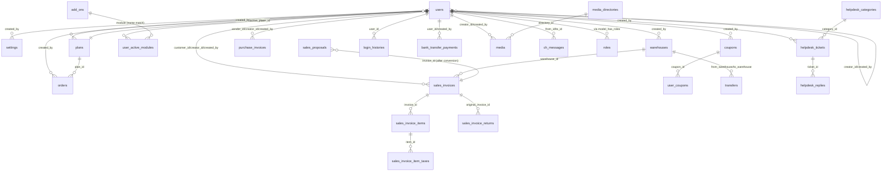
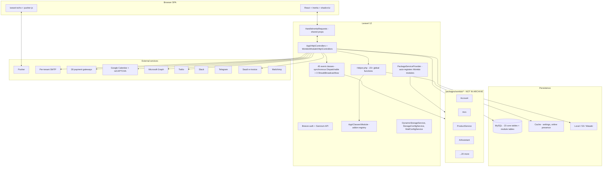

# Reference Project Analysis — Reusable Insights for Managora AI

**Reference project:** ERPGo SaaS v9.8 (CodeCanyon #33263426) by Workdo.
**Source:** `erpgosaas-98.rar` from `https://pixeldrain.net/u/kt7yYoPu` (~59 MB, 23 989 entries).
**Analysis method:** Static source inspection only. No execution, no dependency install, no migrations run.
**Target product:** Managora — an AI-first, multi-tenant education and institute-management SaaS (initial focus: coaching institutes; expansion path to schools, colleges, training centers, course sellers, franchises).
**Date:** 2026-11-04.

---

## 0. Scope and Evidence Boundary

The reference project is a **generic multi-tenant SaaS ERP shell** (Laravel 12 + Inertia + React 18 + shadcn/ui) with a **modular marketplace framework** — it is not an education product. Its value to Managora is **architectural and operational patterns**, not domain features.

The archive contains **only the Laravel skeleton** (176 PHP files in `app/`, 23 migrations, 24 config files, frontend dependency cache in `node_modules/.vite/deps/`). The actual ERP modules (`Account`, `Hrm`, `AIAssistant`, `Pos`, `Taskly`, `Lead`, `ProductService`, etc.) are **not in the archive** — they live in a `packages/workdo/*` directory that the skeleton auto-discovers but the archive does not ship. Therefore:

- **Skeleton patterns** (multi-tenancy, RBAC, SaaS billing, module framework, events, installer, settings engine): **Verified in source** — high confidence.
- **Module-level capabilities** (HRM, Accounting, AI Assistant, POS): **Documented only** via `PlanSeeder` module names + cross-references in skeleton code (`\Workdo\Account\Models\Customer`, `\Workdo\ProductService\Models\ProductServiceItem`, `\Workdo\Hrm\Models\Employee`). Implementation cannot be verified.
- **AI capabilities**: Only two route names visible (`ai-assistant.settings.store`, `ai-assistant.generate` in `app/Http/Middleware/DemoModeMiddleware.php:148-149`). No LLM SDK in `composer.json`. **Not verified.**
- **Frontend JSX pages**: Absent (`resources/` not in archive). UI patterns inferred from `Inertia::render()` calls + bundled dependency cache.

This report cites source paths for every significant claim. Where a claim is about module behaviour, it is explicitly labelled.

---

## 1. Executive Summary

ERPGo SaaS demonstrates a **production-grade modular SaaS architecture** that solves several problems Managora will face:

1. **How to ship a core product and let customers add modules à la carte** — solved via `PackageServiceProvider` auto-discovery + `AddOn` registry + ZIP-upload installer with `module.json` manifest validation.
2. **How to make modules communicate without coupling** — solved via 45 typed event classes (`Create/Update/Destroy/Post/Accept/Reject/Convert/...`) that modules subscribe to via their own `EventServiceProvider`.
3. **How to bill for plan × module × seats × storage** — solved via `Plan` (JSON modules array) + `UserActiveModule` (per-tenant add-ons) + `assignPlan()` reconciler that auto-disables excess users on downgrade.
4. **How to give each tenant its own SMTP / S3 / Pusher config without redeploying** — solved via runtime `Config::set()` injection from the `settings` table, cached per tenant.
5. **How to do granular RBAC without policy classes** — solved via the `manage-any-X` vs `manage-own-X` two-tier permission pattern, repeated identically across every entity.
6. **How to run a sales demo without trashing the instance** — solved via `DemoModeMiddleware` with a curated exempt list that allows state transitions but blocks settings/password/destructive changes.

The reference project also exhibits **patterns Managora should avoid**: single-database shared-schema tenancy with no DB-level isolation (acceptable at <500 tenants, risky beyond), hardcoded default credentials (`superadmin@example.com / 1234`), `User::all()` in broadcasting (O(N) channels per presence event), synchronous email/event processing (no `ShouldQueue` in skeleton), `chmod 0777` on installed module directories, and `Cache::rememberForever` without tags.

For Managora specifically, the **highest-value adaptations** are:

- **Modular marketplace architecture** mapped to education modules (Core + Fees + Library + Transport + Hostel + Admissions + Parent Portal + WhatsApp + AI Assistant).
- **Event-driven extensibility** where a single `StudentAdmitted` event fans out to Fees (create fee schedule), Library (issue card), Transport (assign route), Parent Portal (welcome email + login), ID Card (generate PDF), and AI Assistant (draft welcome message).
- **Two-tier RBAC** mapped to education roles (principal/department-head sees all; class teacher sees own class; parent sees own child; student sees own record).
- **Plan × module × seat × storage × AI-credits** subscription matrix — extending the reference's model with **usage-based AI credits** since Managora is AI-first.
- **Per-tenant communication config** (WhatsApp Business API creds, SMTP, SMS gateway) injected at runtime — essential for institutes that have their own WhatsApp Business numbers.

The reference project has **no education-specific logic and no verifiable AI implementation**. Managora's AI-first vision requires building capabilities the reference cannot inform — these are labelled as **New Opportunities** in §13.

---

## 2. Product Overview

| Attribute | Finding | Evidence |
|---|---|---|
| Product | ERPGo SaaS v9.8, multi-tenant SaaS ERP | `config/verification.php`: `'system' => 'ERPGo SaaS', 'system_version' => '9.8'` |
| Vendor | Workdo (`workdo.io`), distributed via CodeCanyon | Archive path prefix `codecanyon-33263426-erpgo-saas-all-in-one-business-erp-with-project-account-hrm-crm-pos/` |
| Stack — backend | PHP 8.2+, Laravel 12, Sanctum, Spatie Permission + Media Library, Inertia server adapter, Ziggy | `composer.json` |
| Stack — frontend | React 18 + Inertia.js React + Vite + Tailwind 4 + shadcn/ui (Radix) + Recharts + Tiptap + FullCalendar + laravel-echo + pusher-js + i18next + react-datepicker + react-signature-canvas + jsbarcode + qrcode + html2pdf.js | `node_modules/.vite/deps/` cache (70+ bundled libs); `components.json` shadcn config |
| Stack — storage | Local / AWS S3 / Wasabi (runtime-switchable per tenant) | `config/filesystems.php`, `app/Services/DynamicStorageService.php`, `app/Services/StorageConfigService.php` |
| Stack — realtime | Pusher (per-tenant creds injected at runtime) | `app/Events/MessageSent.php:30-45`, `config/broadcasting.php` |
| Stack — payments | 28 gateway modules listed (Stripe, PayPal, Razorpay, Flutterwave, Paystack, Mollie, etc.); only BankTransfer controller in skeleton | `app/Models/User.php::$superadmin_activated_module`, `app/Http/Controllers/BankTransferPaymentController.php` |
| Tenancy model | Single shared database; isolation via `created_by` column on every row + `creatorId()` helper; no DB-level RLS | Every migration has `created_by` FK; `app/Helpers/Helper.php:17-25` `creatorId()` |
| Module system | `packages/workdo/<Module>/` auto-discovered by `PackageServiceProvider`; each module ships `module.json`, migrations, seeders, controllers, React pages, menu files, language files | `app/Providers/PackageServiceProvider.php:13-35`, `app/Console/Commands/CreateReactPackage.php` |
| Business model | Subscription plans (Free / Starter / Professional) bundling modules; add-on modules priced monthly/yearly; coupons; trials; bank-transfer approvals | `database/seeders/PlanSeeder.php`, `app/Models/Plan.php`, `app/Models/AddOn.php` |

**Relevance to Managora:** The stack is modern and directly transferable. Laravel 12 + Inertia + React + shadcn/ui is a sound choice for an AI-first education SaaS. The modular marketplace framework is the single most valuable architectural pattern to study.

---

## 3. Complete Feature and Module Inventory

### 3.1 Verified skeleton capabilities

| Capability | What it does | Business problem solved | Evidence |
|---|---|---|---|
| Multi-tenant auth | Login, register, password reset, email verification, 2FA library, socialite library, impersonation | Self-service tenant onboarding + secure access | `app/Http/Controllers/Auth/*` (9 files), `app/Http/Controllers/Api/AuthApiController.php` |
| User management | CRUD users, assign roles, change password, impersonate, view login history, toggle login status, plan-based seat enforcement | Tenant admin manages their staff/client/vendor users | `app/Http/Controllers/UserController.php` |
| Role & permission management | CRUD roles; permission picker grouped by `add_on` (module) → `module`; hide super-admin-only modules from company users | Fine-grained RBAC without code changes | `app/Http/Controllers/RoleController.php:19-50` |
| Plan management | CRUD plans with JSON `modules` array, monthly/yearly pricing, trial days, storage limit, seat limit; module price overrides per add-on | SaaS subscription packaging | `app/Http/Controllers/PlanController.php`, `app/Models/Plan.php` |
| Order management | Read-only order list with search/sort/paginate; orders created by payment flows | Billing audit trail | `app/Http/Controllers/OrderController.php` |
| Coupon management | CRUD coupons (`percentage/flat/fixed`), `limit`, `limit_per_user`, `min/max spend`, `expiry`, `included_module/excluded_module` JSON; usage tracking per user | Targeted promotions, scholarship codes | `app/Http/Controllers/CouponController.php`, `app/Helpers/Helper.php:575-630` `applyCouponDiscount()` |
| Bank-transfer payments | User uploads receipt → `pending` row; super-admin approves/rejects; on approval auto-creates Order + runs `assignPlan()` | Manual payment channel for institutions | `app/Http/Controllers/BankTransferPaymentController.php` |
| Sales invoices | Full lifecycle `draft → posted → partial → paid / overdue`; auto-number `SI-YYYY-MM-NNN`; per-line discount + tax + named taxes; only draft is editable/deletable | Billing customers | `app/Http/Controllers/SalesInvoiceController.php` |
| Sales proposals (quotes) | `draft → sent → accepted/rejected → convert-to-invoice` (clones items into a new draft invoice) | Pre-sale quoting | `app/Http/Controllers/SalesProposalController.php:230-290` |
| Sales returns | Linked to original invoice; reason enum; `draft → approved → completed → cancelled`; calculates available return qty per line | Returns / refunds | `app/Http/Controllers/SalesReturnController.php` |
| Purchase invoices / returns | Mirror of sales side with `vendor_id` instead of `customer_id` | Supplier billing | `app/Http/Controllers/PurchaseInvoiceController.php`, `PurchaseReturnController.php` |
| Warehouses | Simple CRUD with name/address/city/zip/phone/email/is_active | Multi-location inventory | `app/Models/Warehouse.php` |
| Stock transfers | Move stock between warehouses; supports sort by related `product.name` / `warehouse.name` via joins | Inter-location stock movement | `app/Http/Controllers/TransferController.php:11-55` |
| Helpdesk | Categories (with color), tickets (8-digit random ID, priority, status `open/in_progress/resolved/closed`), replies (with attachments JSON, internal notes flag) | Internal/external support | `app/Http/Controllers/Helpdesk{Category,Ticket,Reply}Controller.php` |
| Messenger | 1-1 chat with read receipts, soft delete (both parties must delete for hard delete), favorites, pinned, message editing, presence via 5-min cache TTL, real-time via Pusher | Internal communication | `app/Http/Controllers/MessengerController.php`, `app/Events/MessageSent.php` |
| Media library | Wraps Spatie MediaLibrary; user-scoped directories; per-tenant storage quota check; batch upload; local/S3/Wasabi switchable | File management with quota | `app/Http/Controllers/MediaController.php`, `app/PathGenerators/MediaPathGenerator.php` |
| Settings engine | Key-value `settings` table (`key, value, is_public, created_by`); grouped tabs (Brand/Company/System/Currency/Cookie/SEO/Storage/Email/Pusher/Bank-transfer); cached per tenant | Tenant + super-admin configuration without code | `app/Http/Controllers/SettingController.php`, `app/Helpers/Helper.php:39-150` |
| Email templates | Per-template, per-language subject + HTML body + JSON variables; `sendEmailTemplate($name, $mailTo, $obj)` resolves template → loads language → substitutes `{variables}` → sends via per-tenant SMTP | Multilingual automated emails | `app/Models/EmailTemplate.php:18-110` |
| Notification templates | Same pattern as email but for in-app notifications (`type` field, e.g. `mail`) | In-app + email notifications | `app/Http/Controllers/NotificationTemplateController.php` |
| Languages / translations | UI for editing `resources/lang/{locale}.json` per-key; merges enabled module translations; auto-RTL for `ar`/`he` | Multilingual UI | `app/Http/Controllers/TranslationController.php:30-90` |
| Module marketplace | Super-admin uploads ZIP → extract → validate `module.json` → register `AddOn` row; enable/disable runs `migrate --path=...` + `package:seed`; parent/child module dependency check | Extensibility without redeploy | `app/Http/Controllers/ModuleController.php:80-220` |
| Installer wizard | 7-step (Welcome/Requirements/Permissions/Environment/Database/Addons/Final); tests DB connection; runs `migrate:fresh --seed`; enables discovered modules; writes `storage/installed` flag | Self-hosting onboarding | `app/Http/Controllers/InstallerController.php` |
| One-click updater | On super-admin login: checks `migrate:status` for pending + compares `packages/workdo/*` count vs `AddOn::count()`; if new content, redirects to `/updater`; updater runs migrate + install new packages + re-seed + clear caches | Post-deploy updates without SSH | `app/Http/Controllers/UpdaterController.php`, `app/Http/Controllers/Auth/AuthenticatedSessionController.php:35-65` |
| API auth | Sanctum token issuance (`tokens()->delete()` first → single active token); `module` query param validates module is enabled for user's tenant | Mobile app / external integration auth | `app/Http/Controllers/Api/AuthApiController.php:21-50` |
| Login history | Records IP, parsed browser/OS, geo-lookup via `ip-api.com` HTTP | Security audit | `app/Http/Controllers/Auth/AuthenticatedSessionController.php:80-140` |
| Demo mode | Blocks destructive PUT/PATCH/DELETE + settings/password changes; **exempts** state-transition routes (accept/reject/approve) so prospects can exercise workflows | Safe sales demos | `app/Http/Middleware/DemoModeMiddleware.php` |
| Plan enforcement | `PlanModuleCheck` middleware: if plan expired or `active_plan=0`, restricts to plan-related routes only; logs out sub-users if creator's plan expired | Subscription enforcement | `app/Http/Middleware/PlanModuleCheck.php` |
| Module entitlement | `Plan::getUserSubscriptionModules()` = (plan modules ∪ user_active_modules) ∩ globally-enabled addons | Feature gating | `app/Models/Plan.php::getUserSubscriptionModules()` |
| Seat management | `assignPlan()` reconciles `total_user`; on downgrade, **silently disables** excess users (ordered by `created_at desc`); on upgrade, re-enables | Plan-driven seat limits | `app/Helpers/Helper.php:380-420` |
| Storage quota | `users.storage_limit` (bytes); `MediaController::checkStorageLimit()` enforces on upload | Plan-driven storage limits | `app/Http/Controllers/MediaController.php` |

### 3.2 Documented modules (NOT in archive — names only)

The skeleton's `PlanSeeder` enumerates 24 module names as plan entitlements. These are the ERP features sold as part of ERPGo SaaS but their source is unavailable:

**Domain modules:** `Taskly` (projects), `Account` (accounting), `Hrm` (HR), `Lead` (CRM pipeline), `Pos` (point of sale), `BudgetPlanner`, `Calendar`, `Contract`, `DoubleEntry` (double-entry accounting), `FormBuilder`, `Goal` (OKR), `Performance` (employee reviews), `Quotation`, `Recruitment`, `Timesheet`, `Training` (LMS), `SupportTicket`.

**Communication modules:** `Slack`, `Telegram`, `Twilio` (SMS), `Webhook`, `ZoomMeeting`.

**AI module:** `AIAssistant` — listed in Free and Professional plans. Only route names `ai-assistant.settings.store` and `ai-assistant.generate` are visible (`DemoModeMiddleware.php:148-149`). No LLM SDK in `composer.json`. **Implementation not verifiable.**

**Payment gateways (28):** Stripe, PayPal, Razorpay, Flutterwave, Paystack, Mollie, PayTab, CinetPay, Midtrans, Iyzipay, Coingate, Xendit, YooKassa, Toyyibpay, Tap, Fedapay, Cashfree, AuthorizeNet, Aamarpay, Benefit, Payfast, PayTR, Easebuzz, Khalti, Mercado, Ozow, PaiementPro, PayHere — listed in `User::$superadmin_activated_module`.

**Cross-references in skeleton code confirm at least three modules exist:**
- `Workdo\Account\Models\Customer`, `Vendor`, `CustomerPaymentAllocation`, `VendorPaymentAllocation` — referenced from `SalesInvoice` and `PurchaseInvoice` models.
- `Workdo\ProductService\Models\ProductServiceItem`, `WarehouseStock` — referenced from invoice controllers and `TransferController`.
- `Workdo\Hrm\Models\Employee` — referenced from `Api/AuthApiController.php:10`.

**Managora domain mapping** (inference, not project features):

| ERPGo concept | Managora equivalent |
|---|---|
| Company (tenant) | Institute / organization |
| Warehouse | Branch / campus |
| User type `company` | Institute admin / principal |
| User type `staff` | Teacher / non-teaching staff |
| User type `client` | Student / parent |
| User type `vendor` | Supplier (library books, lab equipment, uniforms) |
| Sales invoice | Fee invoice / fee receipt |
| Sales proposal | Fee estimate / admission quote |
| Sales return | Fee refund / fee reversal |
| Purchase invoice | Inventory purchase (books, equipment) |
| Helpdesk ticket | Student/parent grievance or enquiry ticket |
| Messenger | Teacher↔student / teacher↔parent chat |
| Coupon | Scholarship code / early-bird discount / sibling discount |
| Plan | Managora subscription tier (Coaching / School / College / Enterprise) |
| Add-on module | Education module (Library, Transport, Hostel, Admissions, Parent Portal, WhatsApp, AI Assistant) |

---

## 4. Business Workflows

### 4.1 Tenant onboarding (verified)

**Actors:** Visitor (future tenant admin), super-admin (platform operator), email service.

**Steps:**
1. Visitor visits `/register` — gated by `admin_setting('enableRegistration') === 'on'` (`RegisteredUserController.php:23`).
2. Visitor submits name/email/password.
3. `User::create(['type' => 'company', 'created_by' => $superAdmin->id])`.
4. `User::CompanySetting($user->id)` copies brand/system/currency defaults from super-admin settings into the new tenant's `settings` rows (`User.php:200-235`).
5. `User::MakeRole($user->id)` creates three roles scoped to this tenant: `staff`, `client`, `vendor` — each with a baseline permission set (`User.php:240-340`).
6. `$user->assignRole('company')`.
7. If `New User` email template is enabled (`company_setting('New User') == 'on'`), `EmailTemplate::sendEmailTemplate('New User', [$user->email], $emailData)` resolves the template, loads the tenant's default language, substitutes `{app_name}/{name}/{email}/{password}/{app_url}/{company_name}`, and sends via per-tenant SMTP.
8. If email verification is enabled, `SetConfigEmail($adminUser->id)` is called to inject SMTP creds, then `$user->sendEmailVerificationNotification()`.
9. User is logged in and redirected to `/dashboard`.

**Records created:** 1 `users` row, ~30 `settings` rows (defaults), 3 `roles` rows, baseline `role_has_permissions` rows.

**Managora adaptation:** The same flow works for an institute signing up. The `company` type becomes `institute_admin`. `User::MakeRole()` would create `teacher`, `parent`, `student`, `staff` roles. `CompanySetting()` would seed institute-specific defaults (academic year start, grading scale, currency, language, WhatsApp opt-in template).

### 4.2 Plan subscription + payment (verified)

**Actors:** Tenant admin, payment gateway or bank-transfer approver, super-admin.

**Steps:**
1. Tenant visits `/plans`, sees plans filtered by their currently-subscribed modules (`PlanController.php:21-50`).
2. Picks plan + duration (Month/Year/Trial) + optional add-on modules + optional coupon code.
3. Price = `plan.package_price_{duration}` + Σ(add-on `monthly_price` or `yearly_price` from `AddOn` table, summed via `ModulePriceByName()` helper).
4. Coupon applied via `applyCouponDiscount($code, $price, $userId)` — validates `status`, `expiry_date`, `limit`, `limit_per_user`, `minimum_spend`, `maximum_spend`; computes discount per `type` (`percentage` = `% of original`, `flat` = `min(discount, original)`, `fixed` = `max(0, original - discount)`).
5. If bank-transfer: user uploads receipt → `bank_transfer_payments` row created as `pending` (or `approved` if price ≤ 0 after coupon) → super-admin approves via `BankTransferPaymentController` approve action.
6. If gateway: redirect to `payment.{gateway}.store` (in module, not in archive).
7. On approval/gateway success → `assignPlan($plan_id, $duration, $modules, $counter, $user_id)`:
   - Sets `users.active_plan`, `plan_expire_date` (Month → +1 month, Year → +1 year, Trial → `trial_expire_date = now + trial_days`).
   - Reconciles `UserActiveModule` rows: deletes existing, re-creates from new module list, **dispatches `DefaultData` event** (modules listen to seed their own default data) + `GivePermissionToRole` event (modules listen to inject their permissions into the tenant's `staff`/`client`/`vendor` roles).
   - Sets `users.total_user` and `users.storage_limit` from the plan.
   - **If new seat count < current active user count**: queries `User::orderBy('created_at', 'desc')->where('created_by', $user->id)->where('is_disable', 0)->take($count)->get()` and sets `is_disable=1, is_enable_login=0` on each. **No email notification, no grace period.** (`Helper.php:380-420`)
8. `Order::create([...])` records the transaction.

**Records created/updated:** `users` (active_plan, plan_expire_date, total_user, storage_limit), `user_active_modules` (reconciled), `user_coupons` (usage record), `orders` (transaction), `bank_transfer_payments` (if bank-transfer).

**Status transitions:** `bank_transfer_payments.status`: `pending → approved | rejected`. `orders.payment_status`: `pending → succeeded | failed | refunded`.

**Failure scenarios:** Coupon expired / limit exceeded / min-spend not met → return `['valid' => false, 'message' => ...]`. Bank-transfer receipt upload fails → return error. `assignPlan()` fails if plan deleted → `['is_success' => false, 'error' => 'Plan is deleted.']`.

**Managora adaptation:** Add **AI credits** as a fourth dimension (plan × modules × seats × storage × **AI credits/month**). On plan change, reconcile AI credit allocation. Add **grace period + email notification** before disabling excess users on downgrade (the reference silently disables — that's an §12 "Avoid" item).

### 4.3 Sales invoice lifecycle (verified)

**Actors:** Staff (creator), client (recipient), system.

**States:** `draft → posted → partial → paid` (or `overdue` if `due_date < now AND balance > 0`).

**Rules:**
- Auto-generated invoice number `SI-{YYYY}-{MM}-{NNN}` where NNN is per-tenant sequential (`SalesInvoice.php:85-105`).
- Only `draft` invoices are editable or deletable. Posted invoices are immutable (except payment allocation via `Workdo\Account\Models\CustomerPaymentAllocation`).
- `isOverdue()` accessor and `display_status` appended attribute compute the effective status dynamically.
- Per-line: `quantity × unit_price → discount (% of line) → tax (% of after-discount)`. Server-side `calculateTotals()` recomputes all totals (never trusts client-submitted totals).
- `CreateSalesInvoice::dispatch($request, $invoice)` fires after `save()` — modules listen (e.g. `Account` module creates journal entries, `ProductService` module decrements warehouse stock).
- `print` action renders `Sales/Print` Inertia page (frontend uses `html2pdf.js` to generate client-side PDF).

**Managora adaptation:** Map to **fee invoice lifecycle**: `draft → issued → partially_paid → paid → waived` (add `waived` for scholarships). Add `fee_installment_id` FK so an invoice belongs to a fee schedule. Fire `CreateFeeInvoice` event so the Parent Portal module can notify parents via WhatsApp/Email and the AI Assistant can suggest a reminder schedule.

### 4.4 Sales proposal → invoice conversion (verified)

`SalesProposalController::convertToInvoice()` (`SalesProposalController.php:230-290`): when an accepted proposal is converted, a new `SalesInvoice` (status=draft) is created, all `SalesProposalItem` rows are cloned into `SalesInvoiceItem`, all `SalesProposalItemTax` rows are cloned, and the proposal is marked `converted_to_invoice=true, invoice_id=$invoice->id`. The `ConvertSalesProposal` event fires so modules can react.

**Managora application:** Use this pattern for **admission quote → fee invoice conversion**. An admission quote (proposed fee structure with scholarships/discounts) becomes a fee invoice on admission confirmation. The clone-with-event pattern ensures clean separation.

### 4.5 Module installation via ZIP upload (verified)

`ModuleController::installSinglePackage()` (`ModuleController.php:160-220`):

1. Super-admin uploads ZIP via `/modules/install` (validated `mimes:zip, max:51200`).
2. `ZipArchive::open()` + extract to `packages/workdo/tmp_{uniqid()}/`.
3. Read `tmp_path/{rootFolder}/module.json` — fail if missing.
4. Move files to `packages/workdo/{module.name}/` (using `module.name` from JSON, not the ZIP filename).
5. `chmod 0777` recursively (⚠️ see §12 Avoid).
6. `AddOn::firstOrCreate(['module' => $module.name, ...])` with `is_enable=false`.
7. Super-admin then calls `/modules/enable {name}`:
   - `Artisan::call('migrate --path=/packages/workdo/{name}/src/Database/Migrations --force')`.
   - `Artisan::call('package:seed {name}')` (runs `Workdo\{Name}\Database\Seeders\{Name}DatabaseSeeder`).
   - `AddOn.is_enable = 1`.
   - `Check_Parent_Module()` recursively checks `module.json.parent_module[]` and enables parents first.
8. `Module::moduleCacheForget($name)` clears the cache.

**Path-traversal guard:** `enableModule()` validates `$moduleName` against `/^[a-zA-Z0-9_-]+$/` (`InstallCommand.php:130-135`, `UpdaterController::enableModule`). This prevents `../` attacks via the module name.

**Managora adaptation:** Adopt this exact pattern for Managora's module marketplace. Each education module (Library, Transport, Hostel, Admissions, Parent Portal, WhatsApp, AI Assistant) ships as a ZIP with `module.json`. Institutes browse a marketplace, click "Install", and the module is enabled per-tenant (not globally — see §11 for the per-tenant entitlement extension).

### 4.6 Real-time 1-1 chat (verified)

`MessengerController::send()` + `MessageSent` event:

1. Sender POSTs message → `ChMessage` row created with `seen=0`.
2. `event(new MessageSent($message, $receiverId))`.
3. Event constructor reads `pusher_app_key/secret/app_id/cluster` from `admin_setting()` and writes them to `config(['broadcasting.connections.pusher.*'])` **at runtime per event** — so each tenant's Pusher creds are used without a redeploy (`MessageSent.php:30-45`).
4. Event implements `ShouldBroadcastNow` (synchronous, no queue) and broadcasts to public `Channel("messenger.{receiverId}")`.
5. Frontend `laravel-echo` + `pusher-js` listens on that channel.
6. When receiver opens conversation, `MessengerController::getMessages()` flips `seen=1` on page 1 of pagination.
7. Presence: `UpdateUserActiveStatus` middleware (web stack) writes `Cache::put("user_online_{$user->id}", true, now()->addMinutes(5))` on every authenticated request. `UserOnline`/`UserOffline` events broadcast to all users' messenger channels.

**Soft delete:** `deleted_by_sender` and `deleted_by_receiver` booleans. Message is hard-deleted only when both are true.

**Managora application:** Direct mapping to teacher↔parent / teacher↔student chat. But the reference broadcasts to a **public channel** (`Channel::class`, not `PrivateChannel::class`) — for education data (student info, grades), Managora must use **authenticated private channels** with per-user authorization. Also, `UserOnline::broadcastOn()` returns an array of channels for **every user in the database** (`UserOnline.php:38-46`) — this is an §12 Avoid pattern; use Pusher presence channels instead.

### 4.7 Per-tenant email sending (verified)

`EmailTemplate::sendEmailTemplate($name, $mailTo, $obj, $user_id, $creator_id)` (`EmailTemplate.php:18-110`):

1. Resolve `EmailTemplate` by name.
2. Load `EmailTemplateLang` for the user's `defaultLanguage` (fallback to `en`).
3. Substitute `{variable}` placeholders via `replaceVariable()` (supports ~40 variables: `{app_name}`, `{invoice_number}`, `{deal_name}`, `{candidate_name}`, `{appointment_date}`, etc.).
4. Call `SetConfigEmail($user_id)` — reads `email_host/port/encryption/username/password/fromAddress` from `getCompanyAllSetting($user_id)` and writes to `config(['mail.*'])`.
5. `Mail::to($mailTo)->send(new CommonEmailTemplate($content, $user_id))` — synchronous.

**Managora application:** Same pattern, extended to **WhatsApp / SMS / push notifications**. A unified `CommunicationTemplate::send($name, $channel, $recipient, $variables)` dispatcher that resolves the template per channel per language, injects the tenant's channel creds (WhatsApp Business API token, SMS gateway key), and sends. This is critical for Managora's multichannel communication vision.

### 4.8 Demo mode (verified)

`DemoModeMiddleware` (`DemoModeMiddleware.php`):

- Allows all GET requests.
- Blocks PUT/PATCH/DELETE and POST to URIs containing `/update`, `/destroy`, `/toggle-status`, `/approve`, `/reject`, `/reset-password`, `/upgrade-plan`, `/settings`, `/password`, `/media/batch`, `/subscribe`, `/start-trial`, `/assign-free`, `/landing-page`.
- **Exempts 30+ specific route names** that ARE allowed in demo (e.g. `sales-proposals.accept`, `sales-proposals.reject`, `quotations.approve`, `account.vendor-payments.update-status`, `assets.asset-assignments.return`, `retainers.sent`, `retainers.convert-to-invoice`, `settings.brand.update` — the last writes theme to a cookie instead of DB).
- Returns 403 JSON for `Accept: application/json` requests; redirect-back-with-error for Inertia.

**Managora application:** Adopt for sales demos to coaching institute owners. Let them "create a fee invoice", "mark attendance", "publish exam results", "send a WhatsApp message" — but block SMTP/WhatsApp credential changes, password changes, plan subscription, and user deletion. The exempt-list pattern is more thoughtful than blanket read-only.

---

## 5. Domain Model and Data Relationships

### 5.1 Core tables (verified — 23 migrations)

| Table | Purpose | Key fields | Lifecycle/audit |
|---|---|---|---|
| `users` | Tenants + sub-users | `type` (superadmin/company/staff/client/vendor), `active_plan` (FK→plans), `plan_expire_date`, `trial_expire_date`, `is_trial_done`, `total_user` (seat limit, -1=unlimited), `storage_limit` (bytes), `is_disable`, `is_enable_login`, `creator_id`, `created_by`, `active_status`, `last_seen_at`, `slug` | `timestamps`; `creator_id`/`created_by` for ownership chain |
| `plans` | Subscription plans | `name`, `number_of_users`, `free_plan`, `modules` (JSON array of module names), `package_price_monthly`, `package_price_yearly`, `storage_limit` (KB), `trial`, `trial_days`, `status`, `created_by` | `timestamps` |
| `orders` | Payment transactions | `order_id` (unique), `plan_id`, `price`, `discount_amount`, `currency`, `txn_id`, `payment_status` (enum: pending/succeeded/failed/refunded), `payment_type`, `receipt`, `created_by` | `timestamps` |
| `coupons` | Discount codes | `code` (unique), `discount`, `type` (percentage/flat/fixed), `limit`, `limit_per_user`, `minimum_spend`, `maximum_spend`, `expiry_date`, `included_module` (JSON), `excluded_module` (JSON), `status`, `created_by` | `timestamps`; `index(status, expiry_date)`, `index(code)` |
| `user_coupons` | Usage tracking | `coupon_id`, `user_id`, `order_id` | `timestamps` |
| `bank_transfer_payments` | Manual payment approvals | `user_id`, `order_id` (unique), `price`, `status` (pending/approved/rejected), `attachment`, `request` (longText JSON of form data), `type`, `created_by` | `timestamps` |
| `add_ons` | Module registry | `module` (name), `name` (alias), `monthly_price`, `yearly_price`, `image`, `is_enable`, `for_admin` (super-admin-only flag), `package_name`, `priority` | `timestamps` |
| `user_active_modules` | Per-tenant active modules | `user_id`, `module` (name) | `timestamps` |
| `warehouses` | Locations | `name`, `address`, `city`, `zip_code`, `phone`, `email`, `is_active`, `creator_id`, `created_by` | `timestamps` |
| `transfers` | Inter-location stock moves | `from_warehouse`, `to_warehouse`, `product_id` (FK→`product_service_items` — module-owned), `quantity`, `date`, `creator_id`, `created_by` | `timestamps` |
| `sales_invoices` | Customer invoices | `invoice_number` (`SI-YYYY-MM-NNN`), `invoice_date`, `due_date`, `customer_id` (FK→users), `warehouse_id`, `subtotal`, `tax_amount`, `discount_amount`, `total_amount`, `paid_amount`, `balance_amount`, `status` (draft/posted/partial/paid/overdue), `type` (product/service), `payment_terms`, `notes`, `creator_id`, `created_by` | `timestamps`; `index(status, invoice_date)` |
| `sales_invoice_items` | Line items | `invoice_id`, `product_id` (FK→module), `quantity`, `unit_price`, `discount_percentage`, `tax_percentage` | |
| `sales_invoice_item_taxes` | Named taxes per line | `item_id`, `tax_name`, `tax_rate` | |
| `sales_invoice_returns` (+ items + taxes) | Returns | `return_number`, `original_invoice_id`, `reason` (defective/wrong_item/damaged/excess_quantity/other), `status` (draft/approved/completed/cancelled) | |
| `sales_proposals` (+ items + taxes) | Quotes | `proposal_number` (`SP-YYYY-MM-NNN`), `status` (draft/sent/accepted/rejected), `converted_to_invoice` (bool), `invoice_id` (nullable FK) | |
| `purchase_invoices/returns` (+ items + taxes) | Mirror of sales with `vendor_id` | | |
| `helpdesk_categories` | Ticket categories | `name`, `description`, `color` (7-char hex), `is_active`, `creator_id`, `created_by` | |
| `helpdesk_tickets` | Tickets | `ticket_id` (unique 8-digit random, collision-checked in `boot()`), `title`, `description`, `status` (open/in_progress/resolved/closed), `priority` (low/medium/high/urgent), `category_id`, `created_by`, `resolved_at` | `timestamps` |
| `helpdesk_replies` | Responses | `ticket_id`, `message`, `attachments` (JSON array), `is_internal` (bool — private notes), `created_by` | |
| `ch_messages` | Chat messages | `from_id`, `to_id`, `body` (5000), `attachment`, `seen`, `deleted_by_sender`, `deleted_by_receiver` | `timestamps`; no FKs (bigInteger columns) |
| `ch_favorites`, `ch_pinned` | Chat organization | `user_id`, `favorite_id`/`pinned_id` | `unique(user_id, favorite_id)` |
| `login_histories` | Login audit | `user_id`, `ip` (45), `date`, `details` (JSON: country/city/ISP/browser/OS), `type`, `created_by` | |
| `media_directories` | User-scoped folders | `name`, `slug` (unique), `parent_id` (self-FK), `creator_id`, `created_by` | |
| `media` | Spatie MediaLibrary + custom | `model_id`, `model_type` (morph), `collection_name`, `file_name`, `disk`, `size`, `directory_id`, `creator_id`, `created_by` | `nullableTimestamps()` |
| `settings` | Key-value config | `key`, `value` (text), `is_public` (bool), `created_by` | `timestamps`; no unique constraint on (key, created_by) — relies on `updateOrCreate` |
| `notifications` | Notification templates | `module`, `type`, `action`, `status`, `permissions` | |
| `notification_template_langs` | Per-language content | `parent_id`, `lang`, `content`, `variables` (JSON) | |
| `email_templates` | Email templates | `name`, `from`, `module_name`, `creator_id`, `created_by` | |
| `email_template_langs` | Per-language email content | `parent_id`, `lang`, `subject`, `content`, `variables` (JSON) | |
| `permissions` (extended Spatie) | RBAC permissions | `name`, `guard_name`, **`add_on`** (module name), **`module`** (sub-group), **`label`** | `unique(name, guard_name)` |
| `roles` (extended Spatie) | Roles | `name`, `guard_name`, **`label`**, **`editable`** (bool — prevents deleting system roles), **`created_by`** (tenant scoping) | |
| Spatie pivots | `model_has_permissions`, `model_has_roles`, `role_has_permissions` | Standard | |

### 5.2 Cross-module foreign keys (verified)

The skeleton's migrations reference tables owned by modules not in the archive:
- `transfers.product_id` → `product_service_items.id` (`Workdo\ProductService` module)
- `sales_invoice_items.product_id` → relationship to `Workdo\ProductService\Models\ProductServiceItem`
- `sales_invoices.customer_id` → `users.id` (FK) + relationship to `Workdo\Account\Models\Customer` via `user_id`
- `purchase_invoices.vendor_id` → `users.id` (FK) + relationship to `Workdo\Account\Models\Vendor`

This confirms the skeleton is **only fully functional when `ProductService` and `Account` modules are installed**. The pattern: the skeleton owns the "transactional" tables (invoices, returns, proposals) while modules own the "master data" tables (products, customers, vendors).

**Managora application:** Apply the same separation. Managora's core owns `fee_invoices`, `attendance_records`, `exam_results`, `enrollments`. Modules own `students`, `parents`, `teachers`, `courses`, `batches`, `library_books`, `transport_routes`, `hostel_rooms`. Cross-module FKs go through the `users.id` pivot for person entities (student/parent/teacher are all `users` with different `type`).

### 5.3 Multi-tenant isolation strategy (verified)

**Single shared database. No `tenant_id` column. No DB-level row-level security.** Isolation is achieved via:

1. **`created_by` column on every business row** = the tenant owner's `users.id`.
2. **`creator_id` column** = the actual creator's `users.id` (for "own" permission scoping).
3. **`creatorId()` helper** (`Helper.php:17-25`): returns `Auth::user()->id` if `type` is `superadmin` or `company`, else `Auth::user()->created_by`. This resolves the tenant owner for any authenticated user.
4. **Every query** manually adds `where('created_by', creatorId())` or `where('creator_id', Auth::id())`.
5. **Settings** scoped by `created_by` on `settings` table.
6. **Roles** scoped by `created_by` on `roles` table — each tenant has its own `staff`/`client`/`vendor` role rows.

**Trade-off:** Operationally simple (one DB, one connection, cross-tenant analytics trivial). Risk: a single missed `where()` clause = cross-tenant data leak. There is no global query scope enforcing this — it's developer discipline.

**Managora consideration:** Acceptable for early-stage (<500 institutes). At scale, consider PostgreSQL Row-Level Security with `SET app.current_tenant = :id` per request, or schema-per-tenant for regulated markets (schools with data residency requirements).

### 5.4 ER diagram (verified subset)



---

## 6. UI/UX Patterns

The React JSX source is **not in the archive** (`resources/` absent). The following is inferred from `Inertia::render()` calls in controllers, the `node_modules/.vite/deps/` cache (70+ bundled libs), `components.json` (shadcn config), and `HandleInertiaRequests::share()` (shared Inertia props).

### 6.1 Navigation and shell

- **Single Inertia root view** `'app'` with shared props: `auth.user` (with `permissions[]`, `roles[]`, `activatedPackages[]`), `lang`, `flash.success/error`, `packages` (all module metadata), `adminAllSetting`, `companyAllSetting`, `imageUrlPrefix`, `currencies`, `defaultLanguages`, `is_demo` (`HandleInertiaRequests.php`).
- **Module-driven menus**: each Workdo package ships `src/Resources/js/menus/company-menu.ts` and `superadmin-menu.ts`. The frontend merges these at runtime based on `activatedPackages`. `HomeController::regularDashboard()` actually **reads these `.ts` files server-side via regex** to find the first dashboard route the user is permitted to access, and redirects there. This is an unusual coupling (server reads frontend menu files) but ensures the dashboard always lands on a permitted module.
- **Sidebar defaults**: `sidebarVariant=inset`, `sidebarStyle=plain`, `themeMode=light`, `themeColor=green`, `customColor=#10b77f`. Auto-RTL for `ar`/`he`.
- **Dark mode** via `next-themes`.
- **Toasts** via `sonner`.

### 6.2 Tables, filters, forms (verified controller patterns)

Every `index()` controller method follows an identical pattern:

- `->when(request('search'), fn($q) => $q->where(...))` for each filter.
- `->when(request('sort'), fn($q) => $q->orderBy(request('sort'), request('direction', 'desc')))` with **sort field whitelisting** to prevent SQL injection (`SalesInvoiceController.php` whitelists `['invoice_number', 'invoice_date', 'due_date', 'subtotal', 'tax_amount', 'total_amount', 'balance_amount', 'status', 'created_at']`).
- `->paginate(request('per_page', 10))->withQueryString()` — preserves filters across pagination.
- Date range filter parses `"YYYY-MM-DD - YYYY-MM-DD"` format.
- Permission flags forwarded to Inertia as props: `'canCreate' => $user->can('create-plans')`, etc. — frontend hides/shows buttons.
- `Auth::user()->can('manage-X')` called in every controller action (176 occurrences verified).

### 6.3 Detail pages, modals, print

- Detail views: `Sales/View`, `SalesProposals/View`, `Purchase/View`, `helpdesk/tickets/show`, `coupons/details`, `Transfers/Show`.
- Print views: `Sales/Print`, `Purchase/Print`, `SalesProposals/Print` — frontend renders HTML and `html2pdf.js` generates PDF client-side.
- `TransferController::create()` returns `back()` with comment "Modal-based create, no separate page needed" — confirms a pattern of **modal-driven creation for simple entities vs. dedicated pages for complex ones**.

### 6.4 Bundled UI libraries (from `.vite/deps/`)

- **shadcn/ui stack**: 16 `@radix-ui/react-*` primitives + `class-variance-authority` + `clsx` + `tailwind-merge`.
- **Charts**: `recharts`.
- **Calendar**: `@fullcalendar/{core,daygrid,interaction,react,timegrid}` + `core_locales-all`.
- **Rich text**: `@tiptap/{react,starter-kit,extension-{color,highlight,link,strike,text-align,text-style}}` — for email template editing.
- **Drag-and-drop**: `@hello-pangea/dnd` — likely for kanban pipelines (Lead/Deal modules).
- **Date picker**: `react-datepicker`.
- **Signature**: `react-signature-canvas` — likely for contracts.
- **Captcha**: `react-google-recaptcha`.
- **Barcode/QR**: `jsbarcode`, `qrcode`.
- **PDF**: `html2pdf.js`, `html2canvas.esm`, `purify.es` (DOMPurify).
- **i18n**: `i18next`, `react-i18next`.
- **Realtime**: `laravel-echo`, `pusher-js`.
- **HTTP**: `axios`.

### 6.5 Responsive behaviour

Inferred: Tailwind 4 + shadcn/ui is mobile-first by default. The `sidebarVariant=inset` suggests a collapsible sidebar. No explicit mobile breakpoint logic in skeleton code. The presence of `react-signature-canvas` and `react-google-recaptcha` implies touch-friendly inputs.

**Managora UX recommendation:** Coaching institutes in India/SEA are mobile-first (teachers and parents on phones). Build a PWA with offline-capable attendance marking (sync when online) and WhatsApp-deep-linked notifications. The reference's desktop-first pattern is adequate but not optimal for Managora's market.

---

## 7. Technical Architecture

### 7.1 Architecture diagram



### 7.2 Module extensibility (verified — key pattern)

**`PackageServiceProvider::register()`** (`app/Providers/PackageServiceProvider.php:13-35`):

```php
$packageDirectories = glob(base_path('packages/workdo/*'), GLOB_ONLYDIR);
foreach ($packageDirectories as $packageDir) {
    $composerFile = $packageDir . '/composer.json';
    if (file_exists($composerFile)) {
        $composerConfig = json_decode(file_get_contents($composerFile), true);
        // Register PSR-4 autoload
        foreach ($composerConfig['autoload']['psr-4'] as $namespace => $path) {
            $loader->addPsr4($namespace, $packageDir . '/' . $path);
        }
        // Register service providers
        foreach ($composerConfig['extra']['laravel']['providers'] as $provider) {
            $this->app->register($provider);
        }
    }
}
```

This is a **custom module loader** that bypasses Composer's autoloader for the `packages/` directory. Each module is self-contained with its own `composer.json`, `module.json`, migrations, seeders, controllers, models, React pages, menus, and language files.

**`App\Classes\Module`** (`app/Classes/Module.php`): the module registry. Discovers `packages/workdo/*/module.json`, caches via `Cache::rememberForever`, supports `find`, `all`, `allEnabled`, `enable`, `disable`, `getOrdered`, `getPath`, `moduleCacheForget`. Has `parent_module`/`child_module` dependency resolution.

**Module manifest (`module.json`)** — inferred from `Module::find()` and `ModuleController::installSinglePackage()`:
```json
{
  "name": "ModuleName",
  "alias": "Display Name",
  "monthly_price": 0,
  "yearly_price": 0,
  "description": "...",
  "priority": 10,
  "child_module": [],
  "parent_module": [],
  "version": "1.0",
  "package_name": "workdo/module-name",
  "display": true,
  "for_admin": false
}
```

**Module structure** (inferred from `CreateReactPackage.php` stub generator):
```
packages/workdo/{Name}/
├── composer.json
├── module.json
└── src/
    ├── Database/{Migrations,Seeders}/
    ├── Http/{Controllers,Requests}/
    ├── Models/
    ├── Providers/{Name}ServiceProvider.php, EventServiceProvider.php
    ├── Listeners/
    ├── Events/
    ├── Routes/web.php
    ├── Resources/
    │   ├── js/Pages/...
    │   ├── js/menus/{company-menu,superadmin-menu}.ts
    │   └── lang/{locale}.json
    └── marketplace/
```

### 7.3 Service organization (verified)

- **`App\Services\DynamicStorageService`** — reconfigures `filesystems.disks.s3.*` and `wasabi.*` at runtime from DB settings; `getActiveDiskInstance()` returns the right Storage facade; `testConnection()` writes+reads a test file.
- **`App\Services\StorageConfigService`** — cached (5 min) storage config loader; maps `storageType` setting to Laravel disk name; `getFileValidationRules()` returns `['max:...', 'mimes:...']` from settings.
- **`App\Services\MailConfigService`** — applies per-tenant SMTP creds to `config(['mail.*'])`.

### 7.4 Background processing (verified — limited)

- `QUEUE_CONNECTION=database` in `.env.example`. `database/migrations/0001_01_01_000002_create_jobs_table.php` exists (standard Laravel `jobs`, `job_batches`, `failed_jobs`).
- **Console kernel** (`app/Console/Kernel.php`): `schedule()` method is **empty** — no scheduled jobs in skeleton. Modules likely register their own scheduled commands via their ServiceProvider.
- **Events**: 45 event classes. Only 3 implement `ShouldBroadcastNow` (real-time Pusher): `MessageSent`, `UserOnline`, `UserOffline`. The other 42 are plain `Dispatchable` (synchronous). **None implement `ShouldQueue`** — all event listeners run synchronously in the request cycle.
- **Email sending**: synchronous via `Mail::to()->send()` in `EmailTemplate::sendEmailTemplate()`. No `ShouldQueue` mailable in skeleton.

**Trade-off:** Simpler debugging, no queue infrastructure required. Risk: slow request cycles when email sending or side-effects block the response.

### 7.5 API architecture (verified)

- **Web routes**: Inertia-based, all routes return HTML views via `Inertia::render()`.
- **API routes**: `Api/AuthApiController` provides Sanctum-based token auth (`login`, `logout`, `refresh`, `changePassword`, `editProfile`). Uses `ApiResponseTrait` for consistent JSON responses (`successResponse`, `errorResponse`, `validationErrorResponse`, `paginatedResponse`).
- **`ApiForceJson` middleware** sets `Accept: application/json` for all `api/*` requests.
- **Ziggy** (`tightenco/ziggy`) exposes Laravel route names to JavaScript so the frontend can call `route('users.index')` and get the correct URL.
- **No versioning** (`/api/v1/`) observed in skeleton. No OpenAPI/Swagger spec shipped.

### 7.6 Authentication & authorization (verified)

- **Session auth**: Laravel Breeze (web guard).
- **API token auth**: Sanctum, `HasApiTokens` trait on `User`. `AuthApiController::login` deletes prior tokens then issues a new one (single active token per device).
- **RBAC**: Spatie Permission with **extended `permissions` table** (`add_on`, `module`, `label` columns) and **extended `roles` table** (`label`, `editable`, `created_by`).
- **166 base permissions** seeded by `PermissionRoleSeeder` (`database/seeders/PermissionRoleSeeder.php`).
- **Two-tier pattern**: `manage-any-X` (sees all tenant rows) vs `manage-own-X` (sees only own rows). Verified identically in `SalesInvoiceController::checkInvoiceAccess()`, `SalesProposalController`, `PurchaseInvoiceController`, `SalesReturnController`, `PurchaseReturnController`, `UserController`, `MediaController`, `HelpdeskTicketController`.
- **Plan enforcement**: `PlanModuleCheck` middleware — takes `$moduleName` argument, checks `module_is_active($m)`, redirects to dashboard if not entitled. Also checks plan expiry and restricts to plan-related routes only.
- **Impersonation**: `UserController::impersonate()` stores `impersonator_id` in session, `Auth::login($user)`. `leaveImpersonation()` restores. Shared with Inertia as `auth.impersonating` prop.
- **Login history**: `AuthenticatedSessionController::logLoginHistory()` records IP + parsed UA + geo-lookup.
- **2FA**: `pragmarx/google2fa-laravel` + `bacon/bacon-qr-code` in `composer.json`. **No controller code in skeleton** — likely in `routes/web.php` (absent) or a missing module.
- **Socialite**: `laravel/socialite` in `composer.json`. **No controller code in skeleton.**
- **reCAPTCHA**: `anhskohbo/no-captcha` + `react-google-recaptcha` frontend.

### 7.7 File management (verified)

- **Spatie MediaLibrary** with custom `MediaPathGenerator` storing files under `media/{model_id}/`.
- **Three disks**: `local` (default `public` disk), `s3`, `wasabi` — switchable per tenant via `storageType` setting.
- **Upload validation**: `mimes:` + `max:` rules derived from `StorageConfigService::getFileValidationRules()` which reads `allowedFileTypes` and `maxUploadSize` from admin settings.
- **Storage quota**: `users.storage_limit` (bytes); `MediaController::checkStorageLimit()` enforces on upload.
- **Upload helpers**: `upload_file($request, $key, $name, $path)`, `upload_base64_file(...)`, `delete_file($url)` — all use `DynamicStorageService::getActiveDiskInstance()`.

### 7.8 Logging & error handling (verified)

- **LaraBug** integration for production error reporting (`config/larabug.php`, `larabug/larabug` in composer).
- **Laravel Ignition** for local dev (`spatie/laravel-ignition`).
- **Debugbar** always registered in `bootstrap/providers.php` (⚠️ should be conditional — see §12).
- **Email errors** caught and returned as `['is_success' => false, 'error' => ...]` (`EmailTemplate::sendEmailTemplate`).
- **File upload errors** caught and returned as `['flag' => 0, 'msg' => ...]` (`upload_file` helper).
- **Module installation errors** caught per-module and reported as "✗ Failed to install {alias}: {message}" without aborting the batch (`InstallCommand::installPackages`).

### 7.9 External integrations (verified in `composer.json`)

| Package | Purpose | Module (inferred) |
|---|---|---|
| `stripe/stripe-php` v17 | Stripe payments | `Stripe` module |
| `srmklive/paypal` v3 | PayPal payments | `Paypal` module |
| `razorpay/razorpay` v2.9 | Razorpay (India) | `Razorpay` module |
| `twilio/sdk` v8.8 | Twilio SMS/WhatsApp | `Twilio` module |
| `google/apiclient` v2.18 + `spatie/laravel-google-calendar` v3.8 | Google Calendar + reCAPTCHA | `Calendar` module |
| `microsoft/microsoft-graph` v2.49 | Microsoft 365 (Outlook/Teams/OneDrive) | Likely calendar/email sync |
| `mailchimp/marketing` v3 | Mailchimp email marketing | Likely marketing module |
| `webklex/laravel-imap` v6.2 | Inbound email polling | Likely Helpdesk email-to-ticket |
| `salla/zatca` v3 | Saudi ZATCA e-invoice compliance | Likely part of `Account` |
| `phpoffice/phpspreadsheet` v5.1 | Excel/CSV import-export | Likely multiple modules |
| `pusher/pusher-php-server` v7.2 | Pusher server SDK | Real-time messaging |
| `pragmarx/google2fa-laravel` + `bacon/bacon-qr-code` | TOTP 2FA | Likely core auth |
| `laravel/socialite` v5.23 | Social login | Likely core auth |
| `league/oauth2-client` v2.8 | Generic OAuth2 | Likely Microsoft Graph auth |
| `guzzlehttp/guzzle` v7.10 | HTTP client | Used by IP-API + module integrations |

---

## 8. SaaS and Commercial Model

### 8.1 Subscription plans (verified)

**`Plan` model** (`app/Models/Plan.php`): `name`, `description`, `number_of_users` (seat limit), `status`, `free_plan` (bool), `modules` (JSON array of module names), `package_price_yearly`, `package_price_monthly`, `storage_limit` (KB), `trial` (bool), `trial_days`, `created_by`.

**Seeded plans** (`PlanSeeder.php`):

| Plan | Seats | Modules | Monthly | Yearly | Trial |
|---|---|---|---|---|---|
| Free | 10 | 25 modules | $0 | $0 | No |
| Starter | 50 | 22 modules | $25 | $240 | 14 days |
| Professional | 100 | 25 modules | $99 | $960 | 30 days |

### 8.2 Feature entitlements (verified)

**Effective module set** = (`plans.modules` ∪ `user_active_modules`) ∩ (`add_ons where is_enable=1`).

- `Plan::getUserSubscriptionModules($userId)` (`Plan.php:30-65`): merges plan modules + user's individually activated modules, intersects with globally enabled addons, returns the effective set.
- `PlanModuleCheck` middleware enforces per-route with `$moduleName` argument.
- `Module_is_active($module, $user_id)` helper (`Helper.php:225-260`): checks global enable + per-user entitlement.
- Super-admin bypasses all module checks.

### 8.3 Usage quotas (verified)

- **Seats**: `users.total_user` (set from `plans.number_of_users` on `assignPlan()`). `canCreateUser()` helper enforces on creation. On downgrade, excess users are **silently disabled** (`is_disable=1, is_enable_login=0`), ordered by `created_at desc`.
- **Storage**: `users.storage_limit` (bytes, set from `plans.storage_limit`). `MediaController::checkStorageLimit()` enforces on upload.
- **No AI credit quota** in skeleton — this is a gap Managora must fill (§13).

### 8.4 Multi-tenant and multi-branch support (verified)

- **Multi-tenant**: single DB, `created_by` scoping (§5.3).
- **Multi-branch**: the `warehouses` table + `warehouse_id` FK on invoices/returns/transfers + `created_by` scoping. A tenant can have N warehouses (branches/campuses) and filter invoices by warehouse. This maps directly to Managora's "branch management" requirement.

### 8.5 Add-on modules (verified)

- `AddOn` table: global registry of all installed modules with `monthly_price`/`yearly_price`.
- `UserActiveModule` table: per-tenant list of active modules.
- `ModuleController::enable/disable`: super-admin toggles `AddOn.is_enable` globally.
- Tenants purchase add-ons via `/plans/subscribe` with `user_module_input` parameter → `assignPlan()` reconciles `UserActiveModule` rows.

### 8.6 Billing and payment management (verified)

- `Order` table records every transaction: `order_id` (unique), `plan_id`, `price`, `discount_amount`, `currency` (3-char), `txn_id`, `payment_status` (pending/succeeded/failed/refunded), `payment_type`, `receipt`, `created_by`.
- 28 payment gateway modules (names only) — each registers `payment.{gateway}.store` and `payment.{gateway}.status` routes.
- `BankTransferPaymentController`: manual payment channel with super-admin approval workflow.
- Coupons applied at checkout via `applyCouponDiscount()`; usage tracked in `user_coupons`.

### 8.7 White-label functionality (verified — partial)

- **Brand settings**: `logo_light`, `logo_dark`, `favicon`, `titleText`, `footerText` per tenant (in `settings` table via `setSetting()`).
- **Theme customization**: `sidebarVariant`, `sidebarStyle`, `layoutDirection` (LTR/RTL), `themeMode` (light/dark), `themeColor` (preset), `customColor` (hex).
- **APP_NAME** set to "ERPGo SaaS" in `.env` — the super-admin can change `titleText` but the underlying app name is fixed.
- **No custom domain support** observed in skeleton (no tenant subdomain routing).

### 8.8 Tenant provisioning (verified)

- Self-registration via `/register` (gated by `enableRegistration` setting).
- Super-admin creates company users via `UserController`.
- On creation: `User::CompanySetting()` seeds default settings, `User::MakeRole()` creates default roles.
- `assignPlan()` can be called manually (by super-admin) or via checkout flow.

**Commercial implications for Managora:**

| Aspect | Reference approach | Managora recommendation |
|---|---|---|
| Plan structure | Module-bundled plans (Free/Starter/Professional) | Vertical plans: Coaching / School / College / Enterprise, each bundling relevant education modules |
| Add-on pricing | Per-module monthly/yearly | Per-module + **AI credit packs** (usage-based) |
| Trial | 14/30-day plan trials | Module-specific trials (try WhatsApp module free for 30 days) |
| Seats | `total_user` (all user types mixed) | Separate seat types: teacher seats, student seats (often unlimited), admin seats |
| Storage | Global per-tenant limit | Per-module storage (library documents vs. exam answer sheets vs. media) |
| White-label | Logo + theme per tenant | Custom domain + custom WhatsApp number + custom from-email per institute |

---

## 9. AI, Automation, and Integrations

### 9.1 AI capabilities — NOT VERIFIED

**Evidence of an AI module existing:**
- `AIAssistant` listed in `PlanSeeder` modules for Free and Professional plans (`PlanSeeder.php:19, 45`).
- `DemoModeMiddleware` exempts two route names: `ai-assistant.settings.store` and `ai-assistant.generate` (`DemoModeMiddleware.php:148-149`).

**Evidence of AI implementation: ABSENT.**
- No LLM SDK in `composer.json` (no `openai-php/client`, no `anthropic` SDK, no `orhanerday/open-ai`).
- No AI-related migration in `database/migrations/`.
- No AI-related model in `app/Models/`.
- No AI-related event class in `app/Events/`.
- No AI-related controller in `app/Http/Controllers/` (the `AIAssistant` module source is not in the archive).

**Classification: Not verified.** The `AIAssistant` module is a separately-installed Workdo package. Whether it uses OpenAI, Anthropic, Gemini, or a self-hosted model cannot be determined. Whether it has prompt management, context building, usage tracking, human approval, or failure handling cannot be determined.

**Inference (clearly labelled as speculation):** Based on the route names:
- `ai-assistant.settings.store` → likely a settings panel for API key + provider selection + model choice.
- `ai-assistant.generate` → likely a POST endpoint accepting a prompt + context, returning LLM output.

This is the absolute minimum viable AI integration. It tells us nothing about prompt templates, RAG, function calling, agentic workflows, usage metering, or human-in-the-loop approval.

### 9.2 Automation (verified — limited)

- **Event-driven automation**: 45 event classes fire on entity lifecycle. Modules subscribe via their `EventServiceProvider`. This is the primary automation mechanism — but it's **synchronous and rule-based**, not AI-driven.
- **Scheduled jobs**: `Console/Kernel.php::schedule()` is empty. No cron-based automation in skeleton.
- **No webhook system in skeleton**: the `Webhook` module is listed in `PlanSeeder` but its source is not in the archive.
- **No workflow builder in skeleton**: no visual automation editor, no trigger/action configuration UI.

### 9.3 Communication automation (verified — partial)

- **Email templates**: 9 seeded templates (`New User`, `Customer Invoice Send`, `Payment Reminder`, `Invoice Payment Create`, `Proposal Send`, `New Helpdesk Ticket`, `New Helpdesk Ticket Reply`, `Purchase Send`, `Purchase Payment Create`) — each with 17 language variants (`EmailTemplatesSeeder.php`).
- **Notification templates**: same 9 actions seeded as in-app notifications (`NotificationsTableSeeder.php`).
- **No WhatsApp integration in skeleton**: the `Twilio` module (which could send WhatsApp via Twilio's API) is listed but not in archive.
- **No SMS integration in skeleton**: same — `Twilio` module.
- **No Telegram/Slack in skeleton**: modules listed but not in archive.
- **`Mailchimp Marketing` SDK** in composer — for email marketing campaigns, not transactional email. Likely a separate marketing module.

### 9.4 Integration opportunities for Managora

The reference project's integration surface (28 payment gateways, Google Calendar, Microsoft Graph, Mailchimp, Twilio, IMAP, ZATCA, Pusher) suggests a pattern of **one Workdo module per integration**. For Managora, the priority integrations for a coaching institute are:

| Integration | Priority for Managora | Reference has it? |
|---|---|---|
| WhatsApp Business API | Critical | No (Twilio module could, but not verified) |
| Razorpay / Stripe / PayU (India) | Critical | Razorpay + Stripe modules listed |
| SMTP (per-tenant) | Critical | Verified in skeleton |
| SMS gateway (per-tenant, India: MSG91, TextLocal) | High | Twilio module listed (not India-specific) |
| Google Calendar (for timetable sync) | Medium | Verified in composer |
| Zoom / Google Meet (for online classes) | Medium | ZoomMeeting module listed |
| Microsoft Teams | Low | Microsoft Graph in composer |
| Accounting export (Tally / QuickBooks) | Medium | Not in reference |
| Aadhaar / identity verification (India) | Medium | Not in reference |
| UPI Autopay (recurring fees) | High | Not in reference |

---

## 10. Security, Reliability, and Scalability

### 10.1 Authentication & authorization design (verified)

See §7.6. Strengths:
- 166 permissions with two-tier `manage-any`/`manage-own` pattern.
- Impersonation with session-based safe exit.
- Login history with IP + UA + geo.
- Plan enforcement middleware.
- Demo mode middleware.
- Sanctum single-active-token API auth.
- Path-traversal guard on module names.

### 10.2 Data isolation (verified — risk)

**Single shared database, no DB-level isolation.** Every query relies on developer-added `where('created_by', creatorId())`. No global query scope, no PostgreSQL RLS, no tenant context middleware. **Confirmed risk**: a single missed `where()` clause = cross-tenant data leak. This is the reference's biggest architectural weakness for Managora to avoid at scale.

### 10.3 Sensitive information handling (verified — risks)

| Issue | Evidence | Severity |
|---|---|---|
| Hardcoded super-admin credentials in seeder | `PermissionRoleSeeder.php:18-32` creates `superadmin@example.com / 1234` and `company@example.com / 1234` | High |
| Credentials printed in installer final page | `InstallerController::final()` returns `['admin' => ['email' => 'superadmin@example.com', 'password' => '1234'], 'company' => [...]]` as Inertia props | High |
| `APP_KEY` shipped in `.env` | `APP_KEY=base64:l/0a7fA6FBBACDOShPl7G1CjfZOQli7qF1g0B2mPcIc=` | Medium (if unchanged in production) |
| SMTP passwords stored in `settings` table as plaintext | `SetConfigEmail()` reads `email_password` directly; no encryption observed | Medium |
| Payment gateway secrets — handling unknown | Gateway modules not in archive | Not verified |
| `storage_limit` field is `float(15,2)` but used as bytes | Migrations + `assignPlan()` copy plan's KB value directly | Low (units inconsistency) |

### 10.4 Credential storage (verified)

- **SMTP creds**: stored in `settings` table as plaintext values (`email_host`, `email_port`, `email_username`, `email_password`). Read by `SetConfigEmail()` and injected to `config(['mail.mailers.smtp.*'])`. **No encryption observed.**
- **Pusher creds**: stored in `settings` as `pusher_app_id`, `pusher_app_key`, `pusher_app_secret`. Read in event constructors.
- **S3/Wasabi creds**: stored in `settings` as `awsAccessKeyId`, `awsSecretAccessKey`, etc. Read by `StorageConfigService`.
- **API tokens**: Sanctum hashes tokens (SHA-256) in `personal_access_tokens.token` column.
- **User passwords**: Laravel's default bcrypt (`passwords => 'hashed'` cast on `User`).

**Managora recommendation:** Encrypt SMTP/Pusher/S3 secrets at rest using Laravel's `Crypt::encryptString()` with a per-tenant key derived from the tenant's `APP_KEY` + tenant ID. Decrypt only when injecting to config.

### 10.5 Database integrity (verified)

- **Foreign keys**: declared on most tables with appropriate `onDelete` behaviours (`cascade` for owned rows, `set null` for creator references).
- **Unique constraints**: `users.slug`, `coupons.code`, `orders.order_id`, `bank_transfer_payments.order_id`, `ch_pinned(user_id, pinned_id)`, `permissions(name, guard_name)`.
- **Indexes**: composite indexes on `(status, invoice_date)`, `(status, expiry_date)`, `(coupon_id, user_id)`, `(model_id, model_type)` for morph.
- **No CHECK constraints** observed (MySQL doesn't enforce them pre-8.0.16).
- **Transactions**: `SalesProposalController::convertToInvoice()` wraps item cloning in a try/catch but **no DB transaction** — if item creation fails mid-way, the proposal is marked `converted_to_invoice=true` but the invoice has partial items. This is a data-integrity bug. Similarly `SalesInvoiceController::store()` saves the invoice then creates items without a transaction.

### 10.6 Input validation (verified — strong)

- **Form Request classes** for every entity (`StoreXRequest`, `UpdateXRequest`) with `rules()` and translated `messages()`.
- **Sort field whitelisting** in every `index()` method (`$allowedSortFields` arrays).
- **File upload validation** via `StorageConfigService::getFileValidationRules()` (mimes + max from settings).
- **Module name validation** against `/^[a-zA-Z0-9_-]+$/` in `InstallCommand::enableModule()`.
- **Coupon validation** in `applyCouponDiscount()` (status, expiry, limit, per-user limit, min/max spend).

### 10.7 Error handling (verified — adequate)

- Try/catch around email sending, file uploads, module installation.
- Per-module error reporting in `InstallCommand` (continues on failure).
- LaraBug for production error reporting.
- **No global exception handler customization** in `bootstrap/app.php` (`withExceptions` callback is empty).

### 10.8 Audit logging (verified — limited)

- `login_histories` table records every login (IP, UA, geo, date, type).
- **No audit log for data changes** — no `audits` table, no Spatie Activity Log, no model event hooks recording `created/updated/deleted` with old/new values.
- `timestamps` (`created_at`, `updated_at`) on every table.
- `helpdesk_tickets.resolved_at` is the only domain-specific timestamp.

**Managora recommendation:** Add Spatie Laravel Activitylog (or equivalent) to record all create/update/delete actions on sensitive entities (fee invoices, attendance records, exam results) with old/new value diffs. Critical for education compliance (disputes over grades, fee payments).

### 10.9 Performance and scalability risks (verified)

| Risk | Evidence | Impact |
|---|---|---|
| `User::all()` in `UserOnline::broadcastOn()` | `UserOnline.php:42` — loads all Eloquent models per broadcast event | O(N) memory + O(N) channel broadcasts per presence event; won't scale past ~500 concurrent users |
| `Cache::rememberForever` without tags | `Module::find()` caches module data forever | Stale cache if `AddOn` rows are modified directly via SQL |
| Synchronous email sending | `Mail::to()->send()` in `EmailTemplate::sendEmailTemplate()` | Request blocked on SMTP latency (can be 2-10 seconds) |
| Synchronous event listeners | 42 non-queued event classes | Heavy side-effects (PDF generation, external API calls) block the request |
| `getCompanyAllSetting()` cached forever per tenant | `Helper.php:95` `Cache::rememberForever("company_settings_{$user->id}", ...)` | Stale settings if updated directly in DB |
| No database read replicas | Single MySQL connection | Read load not distributed |
| `Debugbar` always registered | `bootstrap/providers.php` | Service provider boot overhead on every request |
| No query caching | No `Cache::remember` on list queries | Repeated list queries hit DB every time |

### 10.10 Backup and recovery (verified — absent)

- No backup mechanism in skeleton code.
- No database dump command.
- No file backup for `storage/app/public/media/`.
- The `UpdaterController` runs `migrate:fresh` during install (not update) — destructive if misused.

**Managora recommendation:** Implement automated daily DB backups (per-tenant if using schema-per-tenant) + media backup to a separate bucket. Provide a one-click restore in the super-admin panel.

---

## 11. Reusable Concepts for Managora

Each concept below is structured: Concept → Purpose → Reusable lesson → Managora application → Suggested approach → Dependencies → Complexity → Priority → Classification.

### 11.1 Modular marketplace architecture

**Concept:** Ship a core SaaS shell + optional modules auto-discovered from `packages/workdo/*` via `PackageServiceProvider`. Each module has `module.json` manifest, own migrations/seeders/controllers/React pages/menus/languages.

**Purpose:** Lets customers install/uninstall domain capabilities without redeployment. Enables a module marketplace business model.

**Reusable lesson:** The auto-discovery + PSR-4 injection pattern (`PackageServiceProvider.php:13-35`) avoids requiring Composer install per module. The `module.json` manifest standardizes module metadata (name, price, dependencies, priority).

**Managora application:** Core Managora ships with Institute/Branch/Contacts/Students/Parents/Teachers/Enquiries/Admissions/Courses/Batches/Enrollments/Attendance/Exams/Assignments/Fees/Payments. Optional modules: Library, Transport, Hostel, Inventory, HR/Payroll, Parent Portal, WhatsApp, AI Assistant, Website Builder, Franchise Management.

**Suggested approach:**
- Define `module.json` schema with: `name, alias, version, description, monthly_price, yearly_price, category, priority, parent_module, child_module, for_admin, display, min_core_version`.
- Each module ships: `composer.json`, `module.json`, `src/Database/{Migrations,Seeders}/`, `src/Http/{Controllers,Requests}/`, `src/Models/`, `src/Providers/{Name}ServiceProvider.php, EventServiceProvider.php`, `src/Routes/web.php`, `src/Resources/js/Pages/`, `src/Resources/js/menus/{tenant,superadmin}-menu.ts`, `src/Resources/lang/{locale}.json`, `src/Listeners/`.
- `PackageServiceProvider` globs `packages/managora/*`, registers PSR-4 + providers.
- `Module` class caches discovery with tagged cache (fix the reference's `rememberForever` without tags issue).
- Super-admin can upload ZIP → validate → install → enable globally. Tenant admin can enable/disable per-tenant (extend the reference's global-only enable/disable).

**Dependencies:** Core auth, RBAC, settings engine, installer.

**Complexity:** High.

**Priority:** Critical (foundational).

**Classification:** **Adopt** (with per-tenant enablement extension).

### 11.2 Event-driven cross-module extensibility

**Concept:** Every entity lifecycle operation dispatches a typed event class (`CreateStudent`, `UpdateFeeInvoice`, `DestroyEnrollment`, `PostExamResult`, `ApproveAdmission`, etc.). Modules subscribe via their `EventServiceProvider`.

**Purpose:** Decouples modules. Adding a new module that reacts to `StudentAdmitted` requires zero changes to the Admissions module.

**Reusable lesson:** The reference has 45 event classes covering Create/Update/Destroy/Post/Approve/Complete/Accept/Reject/Convert/Sent for every entity. This is verbose but explicit and self-documenting.

**Managora application:**
- `StudentAdmitted` → Fees module creates fee schedule, Library issues card, Transport assigns route, Parent Portal sends welcome + creates parent login, ID Card module generates PDF, AI Assistant drafts personalized welcome message, Website Builder updates "new admissions" widget.
- `AttendanceMarked` → AI Assistant flags anomaly if <75%, Parent Portal sends WhatsApp if absent, Fees module checks if attendance affects fee eligibility (some institutes require 75% for exam eligibility).
- `ExamResultPublished` → Parent Portal notifies parents, AI Assistant generates performance commentary, Report Card module generates PDF.
- `FeePaymentReceived` → Accounting module posts journal entry, AI Assistant sends thank-you + next installment reminder, Receipt module generates PDF.

**Suggested approach:**
- Define a stable event contract: event class name, constructor signature, payload fields. Treat as public API.
- Use `ShouldQueue` listeners for slow side-effects (PDF generation, external API calls, AI generation).
- Keep synchronous listeners for audit logging and must-complete-in-request actions.
- Version events (`StudentAdmittedV1`, `StudentAdmittedV2`) if the contract changes.

**Dependencies:** Module framework, queue infrastructure.

**Complexity:** Medium.

**Priority:** Critical.

**Classification:** **Adopt** (with queued listeners — fix the reference's all-synchronous pattern).

### 11.3 Two-tier RBAC (manage-any / manage-own)

**Concept:** Every entity has paired permissions: `manage-any-X` (sees all tenant rows) and `manage-own-X` (sees only own rows). Controllers branch identically:

```php
if(Auth::user()->can('manage-any-X')) {
    $q->where('created_by', creatorId());
} elseif(Auth::user()->can('manage-own-X')) {
    $q->where('creator_id', Auth::id());
} else {
    $q->whereRaw('1 = 0');
}
```

**Purpose:** Clean manager/contributor access split without policy classes.

**Reusable lesson:** The reference repeats this pattern identically in `SalesInvoiceController`, `PurchaseInvoiceController`, `SalesProposalController`, `SalesReturnController`, `PurchaseReturnController`, `UserController`, `MediaController`, `HelpdeskTicketController`. It's verbose but consistent and easy to audit.

**Managora application:**
- `manage-any-students` (principal/HOD) vs `manage-own-students` (class teacher sees only their batch's students).
- `manage-any-attendance` vs `manage-own-attendance` (teacher marks own class).
- `manage-any-fee-invoices` vs `manage-own-fee-invoices` (accounts team vs class teacher who collects cash).
- Parent role: no `manage-X` permissions; instead `view-own-child-{attendance,results,fees}` via a different scoping mechanism (parent → child relationship, not creator-based).

**Suggested approach:**
- Seed paired permissions for every entity.
- Default roles (principal, hod, teacher, parent, student, accountant) bundle the appropriate tier.
- For parent/student access (not creator-based), add a third tier: `view-related-X` with a relationship resolver (parent → children, student → own records).

**Dependencies:** Spatie Permission, roles/permissions seeder per module.

**Complexity:** Medium.

**Priority:** High.

**Classification:** **Adopt** (with third tier for relationship-based access).

### 11.4 Per-tenant dynamic config injection (SMTP, storage, Pusher, WhatsApp)

**Concept:** Read provider credentials from the `settings` table at runtime and inject into Laravel's config via `Config::set()`. Each tenant uses its own SMTP / S3 bucket / Pusher app / WhatsApp Business number without redeployment.

**Purpose:** True multi-tenant white-label without infrastructure changes.

**Reusable lesson:** The reference does this for SMTP (`SetConfigEmail()`), S3/Wasabi (`DynamicStorageService`), and Pusher (`MessageSent::configurePusher()`). The pattern is identical: read from DB → write to config → use framework's facade.

**Managora application:**
- Per-tenant WhatsApp Business API credentials (phone number ID, access token, webhook secret).
- Per-tenant SMS gateway (MSG91, TextLocal, Twilio) credentials.
- Per-tenant SMTP (institute sends from `@institute.com`).
- Per-tenant storage bucket (student documents isolated per institute for compliance).
- Per-tenant Pusher app (real-time chat isolated per institute).

**Suggested approach:**
- Centralize in a `TenantConfigService` with methods: `setMailConfig($userId)`, `setStorageConfig()`, `setPusherConfig()`, `setWhatsAppConfig()`, `setSmsConfig()`.
- Cache settings per tenant (5-min TTL with tagged cache).
- Encrypt secrets at rest (`Crypt::encryptString()`).
- Provide `testConnection($provider)` methods for each.
- Inject config inside a middleware or service provider (not inside event constructors like the reference does for Pusher — that's fragile).

**Dependencies:** Settings engine, encryption, cache layer.

**Complexity:** Medium.

**Priority:** Critical (especially WhatsApp for coaching institutes).

**Classification:** **Adopt** (with encryption + centralized service).

### 11.5 Plan × module × seats × storage subscription matrix

**Concept:** `Plan` has JSON `modules` array + `number_of_users` + `storage_limit` + monthly/yearly pricing. Users can add individual modules on top. `assignPlan()` reconciles seats, storage, and active modules on plan change.

**Purpose:** Flexible packaging + clean reconciliation on upgrade/downgrade.

**Reusable lesson:** The reference's `assignPlan()` (`Helper.php:280-420`) is a single function that handles plan assignment, module reconciliation, seat enforcement, and event dispatch. It's monolithic but complete.

**Managora application:**
- Plans: Coaching Starter, Coaching Pro, School Basic, School Premium, College, Enterprise.
- Each plan bundles relevant modules + teacher seats + student seats (students often unlimited) + storage + **AI credits/month**.
- Add-ons: extra teacher seats, extra storage, extra AI credits, individual modules (Library, Transport, Hostel, WhatsApp, AI Assistant).
- Coupons: scholarship codes (100% off for economically weaker students), early-bird discounts, sibling discounts, annual payment discounts.

**Suggested approach:**
- Extend `plans` table with `teacher_seats`, `student_seats` (separate from a single `number_of_users`), `ai_credits_monthly`.
- Add `ai_credit_balance` and `ai_credit_usage` tables (§13.1).
- On `assignPlan()`: reconcile seats (with grace period + email notification — fix the reference's silent disable), reconcile modules, reconcile AI credit allocation.
- Add **proration** logic for mid-cycle upgrades (the reference doesn't prorate).

**Dependencies:** Plan model, AddOn model, UserActiveModule model, payment gateways, coupon engine.

**Complexity:** High.

**Priority:** Critical.

**Classification:** **Adapt** (extend with separate seat types + AI credits + proration + graceful downgrade).

### 11.6 Per-language email + notification template engine

**Concept:** `EmailTemplate` (parent) + `EmailTemplateLang` (per-language subject + HTML body + JSON variables). `sendEmailTemplate($name, $mailTo, $obj)` resolves template → loads user's language → substitutes `{variable}` → sends via per-tenant SMTP.

**Purpose:** Multilingual automated communication without code changes.

**Reusable lesson:** The reference seeds 9 templates × 17 languages = 153 template content rows. Variables are documented in a JSON column per template. Admins edit templates in the UI.

**Managora application:**
- Templates: `AdmissionConfirmed`, `FeeInvoiceIssued`, `FeePaymentReminder` (3-day, 7-day, 14-day variants), `FeePaymentReceived`, `AttendanceAlert` (absent), `ExamResultPublished`, `ParentTeacherMeetingInvite`, `HolidayNotice`, `BirthdayWish`, `FeeDueNotice`, `ExamSchedulePublished`, `AssignmentSubmitted`, `AssignmentGraded`.
- Languages: English, Hindi, Marathi, Tamil, Telugu, Kannada, Bengali, Gujarati, Urdu, Arabic (for Gulf coaching institutes).
- Variables: `{student_name}`, `{parent_name}`, `{institute_name}`, `{amount}`, `{due_date}`, `{class_name}`, `{subject}`, `{marks}`, `{meeting_date}`, `{app_url}`.

**Suggested approach:**
- Generalize to `CommunicationTemplate` with `channel` field (`email`, `whatsapp`, `sms`, `push`).
- Each template has per-language content per channel (WhatsApp templates must be pre-approved by Meta — store `template_id` for WhatsApp).
- `CommunicationDispatcher::send($templateName, $channel, $recipient, $variables)` resolves template → injects tenant creds → sends.
- Add AI-powered template generation: "Generate a fee reminder message in Hindi for a parent whose child has pending fees of ₹5000 due on 2026-11-15" (§13.6).

**Dependencies:** Settings engine (for channel creds), per-tenant config injection, i18n.

**Complexity:** Medium.

**Priority:** High.

**Classification:** **Adopt** (generalize to multichannel).

### 11.7 Demo mode with curated exempt list

**Concept:** `DemoModeMiddleware` blocks destructive actions but exempts specific state-transition routes so prospects can exercise workflows on demo data.

**Purpose:** Sales demos without trashing the instance.

**Reusable lesson:** The reference's exempt list (`DemoModeMiddleware.php:30-90`) includes ~30 route names like `sales-proposals.accept`, `quotations.approve`, `account.vendor-payments.update-status`. This is more thoughtful than blanket read-only.

**Managora application:** Let coaching institute owners try: create a student, mark attendance, create a fee invoice, send a WhatsApp message, publish an exam result — but block: SMTP/WhatsApp credential changes, password changes, plan subscription, user deletion, data export.

**Suggested approach:**
- `DemoModeMiddleware` with `$exemptRouteNames` array.
- `config('app.is_demo')` flag.
- For demo-only mutations (theme), persist to cookies.
- Nightly scheduled job resets demo data (`migrate:fresh --seed` on demo DB).
- AI generation routes blocked in demo (to prevent API cost abuse).

**Dependencies:** Middleware, config, scheduled reset job.

**Complexity:** Low.

**Priority:** Medium.

**Classification:** **Adopt**.

### 11.8 Settings engine (key-value per tenant, cached)

**Concept:** `settings` table with `key, value, is_public, created_by`. `getCompanyAllSetting($userId)` cached per tenant. `setSetting($key, $value, $userId)` updates + clears cache.

**Purpose:** Tenant + super-admin configuration without code changes or migrations.

**Reusable lesson:** The reference stores ~30 default settings per tenant (brand, system, currency, cookie, SEO, storage, email, pusher). Each settings group has its own permission (`edit-brand-settings`, `edit-system-settings`, etc.).

**Managora application:**
- Institute settings: name, logo, address, academic year start, grading scale (10-point vs 100-point), currency, language, timezone, fiscal year.
- Communication settings: WhatsApp number, SMS sender ID, SMTP creds, default notification preferences.
- Academic settings: attendance threshold (75%), exam passing percentage, grade promotion rules.
- AI settings: default AI model, AI credit allocation per role, AI usage logging toggle.
- Feature flags: enable parent portal, enable online fee payment, enable WhatsApp auto-reminders.

**Suggested approach:**
- Keep the key-value table for flexibility.
- Add a `settings_schema` table or JSON config defining each key's type, validation, default, and group (for UI rendering).
- Use tagged cache: `Cache::tags(["tenant_{$userId}"])->remember(...)`.
- Encrypt sensitive keys (passwords, tokens) at rest.

**Dependencies:** Cache layer, encryption.

**Complexity:** Low.

**Priority:** High.

**Classification:** **Adopt** (with schema + tagged cache + encryption).

### 11.9 Installer + updater wizard

**Concept:** 7-step web installer validates PHP/extensions/folder perms/tests DB/writes `.env`/runs migrations/enables modules. Updater detects pending migrations + new module folders on super-admin login.

**Purpose:** Self-hosting onboarding without SSH access. Post-deploy updates without command line.

**Reusable lesson:** The reference's installer (`InstallerController`) is a polished wizard. The updater's login-time check (`AuthenticatedSessionController:35-65`) ensures updates are applied promptly.

**Managora application:** Many coaching institutes (especially in tier-2/3 cities) self-host on shared hosting. A polished installer lowers the barrier.

**Suggested approach:**
- 7-step installer: Welcome → Requirements (PHP 8.2+, extensions) → Permissions → Environment (DB + WhatsApp + SMTP optional) → Database (migrate + seed) → Modules (pick which to enable) → Final (generate random admin password, email it, force password change on first login).
- Updater: detect pending migrations + new module folders + version mismatch. Run with maintenance mode on. Clear caches. Email super-admin a changelog.
- **Generate random credentials** instead of printing `1234` (fix the reference's security issue).

**Dependencies:** None beyond Laravel.

**Complexity:** Medium.

**Priority:** Medium (if self-hosting is a target segment).

**Classification:** **Adapt** (with random credentials + forced password change).

### 11.10 Module upload via ZIP with validation

**Concept:** Super-admin uploads module ZIP → extract → validate `module.json` → move to `packages/workdo/{name}/` → register `AddOn` row → enable runs migrations + seeders.

**Purpose:** Extensibility without FTP/SSH access.

**Reusable lesson:** The reference validates module name against `/^[a-zA-Z0-9_-]+$/` (path-traversal guard), requires `module.json`, uses unique `tmp_` prefix for extraction.

**Managora application:** Marketplace module installation. Also: institute-branded theme upload (ZIP of CSS + images + logo overrides).

**Suggested approach:**
- Adopt the reference's validation + extraction pattern.
- **Fix `chmod 0777`** → use `0755` for dirs, `0644` for files.
- Add module signature verification (HMAC or GPG) to prevent malicious module uploads.
- Add module dependency resolution display ("Library module requires Core v2.0+").

**Dependencies:** Module framework, installer.

**Complexity:** Medium.

**Priority:** Medium.

**Classification:** **Adapt** (with signature verification + secure permissions).

### 11.11 Login history with IP + UA + geo

**Concept:** `login_histories` table records IP, parsed browser/OS, geo-lookup per login.

**Purpose:** Security audit, impossible-travel detection.

**Reusable lesson:** The reference uses `Http::timeout(5)->get("http://ip-api.com/json/{$ip}")` — **HTTP not HTTPS, no API key, 5-sec timeout blocks login**. This is the weak part.

**Managora application:** Security audit for parent portals. Detect account sharing (multiple IPs). Notify parents on login from new device.

**Suggested approach:**
- Use MaxMind GeoIP2 (local database, no HTTP call) for reliability + speed.
- Use `ua-parser/uap-php` for User-Agent parsing (maintained library).
- Fire `LoginDetected` event → AI Assistant checks impossible travel → if flagged, send WhatsApp verification to registered number.
- Show "recent logins" widget to user on dashboard.

**Dependencies:** MaxMind GeoIP2 DB, UA parser library.

**Complexity:** Low.

**Priority:** Medium.

**Classification:** **Adapt** (fix the reference's HTTP geo-lookup with MaxMind).

### 11.12 Impersonation with safe exit

**Concept:** Super-admin / tenant admin impersonates a user via `Session::put('impersonator_id')` + `Auth::login($user)`. `leaveImpersonation()` restores. Shared with frontend as `auth.impersonating` prop.

**Purpose:** Debug user-reported issues without asking for passwords.

**Reusable lesson:** Clean session-based pattern with explicit exit.

**Managora application:** Support team impersonates a teacher/parent to debug "I can't see my child's attendance". AI assistant logs impersonation sessions for audit.

**Suggested approach:**
- Adopt the reference's pattern.
- Add `impersonation_histories` table: who impersonated whom, start/end time, reason (required field).
- Restrict to super-admin + support role only.
- Fire `ImpersonationStarted`/`ImpersonationEnded` events for audit logging.

**Dependencies:** Auth, audit log.

**Complexity:** Low.

**Priority:** Medium.

**Classification:** **Adopt** (with audit log).

### 11.13 Soft delete for messenger (both parties must delete)

**Concept:** `ch_messages` has `deleted_by_sender` and `deleted_by_receiver` booleans. Message is hard-deleted only when both are true.

**Purpose:** Each party can hide messages from their view without destroying the record for the other party.

**Reusable lesson:** Simple per-party soft delete without a separate "deleted_message_mappings" table.

**Managora application:** Teacher-parent chat: a teacher deletes a message from their view, but the parent still sees it (with a "this message was deleted by sender" indicator, like WhatsApp).

**Suggested approach:**
- Adopt the pattern.
- Add a `deleted_at` timestamp per party for "deleted for me" vs "deleted for everyone" distinction.
- For compliance, retain deleted messages in an audit archive for 90 days.

**Dependencies:** Messenger module.

**Complexity:** Low.

**Priority:** Low.

**Classification:** **Adopt**.

### 11.14 Coupon system with module-level inclusion/exclusion

**Concept:** `coupons.included_module` and `excluded_module` JSON arrays restrict coupon validity to specific modules.

**Purpose:** Targeted promotions ("50% off the Library module for the first 50 institutes").

**Reusable lesson:** Simple JSON column restriction without a separate `coupon_module` pivot table.

**Managora application:** Scholarship codes (100% off student fee), early-bird admissions (20% off admission fee), sibling discounts (10% off second child's fees), annual payment discounts (1 month free).

**Suggested approach:**
- Adopt the reference's `percentage/flat/fixed` types.
- Add `applies_to` enum: `plan` (subscription discount), `module` (add-on discount), `fee_invoice` (student fee discount), `admission` (admission fee discount).
- Add `auto_apply` flag for scholarships (applied automatically based on student category).

**Dependencies:** Plan module, fee module.

**Complexity:** Medium.

**Priority:** Medium.

**Classification:** **Adapt** (extend with `applies_to` + `auto_apply`).

---

## 12. Concepts to Avoid

Each item: What the reference does → Why it's problematic → What Managora should do instead.

### 12.1 Single-database shared-schema tenancy at scale (no DB-level isolation)

**Reference:** Single MySQL DB, isolation via `created_by` column + `creatorId()` helper. No RLS, no tenant context middleware, no global query scope.

**Problem:** A single missed `where('created_by', creatorId())` = cross-tenant data leak. No defence in depth.

**Managora approach:** For early stage (<100 institutes), accept shared-schema but add a **global Eloquent boot trait** that auto-scopes every query by `created_by` (using `Auth::user()` or a resolved tenant context). For scale (>500 institutes) or regulated markets (schools with data residency), migrate to PostgreSQL Row-Level Security with `SET app.current_tenant = :id` per request, or schema-per-tenant.

### 12.2 Hardcoded default credentials

**Reference:** `PermissionRoleSeeder` creates `superadmin@example.com / 1234` and `company@example.com / 1234`. `InstallerController::final()` prints them.

**Problem:** If the seeder runs in production or the installer final page is accessible, the system is compromised. The credentials are publicly known (in the source).

**Managora approach:** Generate random passwords on install, email them to the configured admin email, force password change on first login. Never print credentials in the UI.

### 12.3 `APP_KEY` shipped in `.env`

**Reference:** `.env` contains `APP_KEY=base64:l/0a7fA6FBBACDOShPl7G1CjfZOQli7qF1g0B2mPcIc=`.

**Problem:** If deployments don't regenerate the key, all share encrypted session/cookie state.

**Managora approach:** Ship `.env.example` with `APP_KEY=` (empty). Installer generates via `php artisan key:generate`. Never commit a real `.env`.

### 12.4 `User::all()` in broadcasting

**Reference:** `UserOnline::broadcastOn()` and `UserOffline::broadcastOn()` return an array of `Channel("messenger.{user_id}")` for every user in the database.

**Problem:** O(N) Eloquent models loaded + O(N) channel broadcasts per presence event. Won't scale past ~500 concurrent users.

**Managora approach:** Use Pusher **presence channels** (`PresenceChannel("messenger.{conversation_id}")`) where members auto-subscribe. Or use a per-user private channel with client-side subscription management.

### 12.5 Synchronous email/event processing

**Reference:** All 42 non-broadcast events are synchronous `Dispatchable`. Email sending is synchronous `Mail::to()->send()`.

**Problem:** Request blocked on SMTP latency (2-10s) and side-effect latency (PDF generation, external API calls).

**Managora approach:** All mailables implement `ShouldQueue`. All event listeners that perform I/O (PDF, API, AI) implement `ShouldQueue` via `ShouldQueue` interfaces or `Queue::push()`. Use Redis queue with horizon for monitoring.

### 12.6 `chmod 0777` on module directories

**Reference:** `ModuleController::setPermissions()` sets `0777` recursively on installed module directories.

**Problem:** World-writable files on a web server = security risk.

**Managora approach:** `0755` for directories, `0644` for files. Web server user owns the files; PHP-FPM user has read+execute.

### 12.7 Manual array sync for module lists

**Reference:** `User::$superadmin_activated_module` and `User::$company_hidden_modules` are two parallel arrays with the same 28 payment gateway names. Must be kept in sync manually.

**Problem:** If a new gateway is added to one array but not the other, it leaks into the company role-permission picker or is incorrectly hidden.

**Managora approach:** Derive from `AddOn::where('for_admin', true)->pluck('module')` at runtime. Single source of truth.

### 12.8 `Cache::rememberForever` without tags

**Reference:** `Module::find()` caches module data forever without a cache tag. `getCompanyAllSetting()` caches settings forever per tenant.

**Problem:** Stale cache if data is modified directly via SQL. No way to invalidate a group of keys.

**Managora approach:** Use tagged cache: `Cache::tags(["modules"])->rememberForever(...)`, `Cache::tags(["tenant_{$userId}", "settings"])->remember(...)`. Invalidate by tag on update.

### 12.9 IP-API HTTP geo-lookup

**Reference:** `Http::timeout(5)->get("http://ip-api.com/json/{$ip}")` — HTTP not HTTPS, no API key, 5-sec timeout blocks login.

**Problem:** Unreliable, insecure, blocks login on timeout.

**Managora approach:** Use MaxMind GeoIP2 local database (no HTTP call, milliseconds). Or a paid HTTPS API with key.

### 12.10 Debugbar always registered

**Reference:** `Barryvdh\Debugbar\ServiceProvider::class` is in `bootstrap/providers.php` unconditionally.

**Problem:** Service provider boot overhead on every request, even in production.

**Managora approach:** Register only when `APP_ENV=local` or `APP_DEBUG=true`.

### 12.11 Global Helper.php (1000+ lines)

**Reference:** `app/Helpers/Helper.php` has 23+ global functions loaded via `composer.json` `autoload.files`.

**Problem:** Not testable, not injectable, pollutes global namespace, hard to refactor.

**Managora approach:** Move to service classes injected via the container (`TenantContext`, `ModuleRegistry`, `PlanService`, `CouponService`, `StorageService`, `MailConfigService`, `CommunicationService`). Keep a thin `helpers.php` only for trivial conveniences.

### 12.12 No DB transactions for multi-step operations

**Reference:** `SalesProposalController::convertToInvoice()` clones items without a DB transaction. If item creation fails mid-way, the proposal is marked `converted_to_invoice=true` but the invoice has partial items.

**Problem:** Data integrity bugs on partial failures.

**Managora approach:** Wrap all multi-step operations in `DB::transaction(function() { ... })`. Use `DB::beginTransaction()` + try/catch + commit/rollback for complex flows.

### 12.13 No audit log for data changes

**Reference:** Only `login_histories` records logins. No `audits` table, no model event hooks recording create/update/delete with old/new values.

**Problem:** For education compliance (grade changes, fee waivers), audit trails are mandatory.

**Managora approach:** Use Spatie Laravel Activitylog or custom model observers. Log all changes to `students`, `fee_invoices`, `attendance_records`, `exam_results` with old/new values, user, timestamp, IP.

### 12.14 Public broadcast channels for private data

**Reference:** `MessageSent` broadcasts to `Channel("messenger.{receiverId}")` — a public channel. Anyone who knows the receiver's user ID can listen.

**Problem:** Chat content is exposed to anyone who subscribes to the channel.

**Managora approach:** Use `PrivateChannel("messenger.{receiverId}")` with Pusher authentication callback that verifies the subscriber is the receiver or an authorized admin.

### 12.15 Silent user disablement on plan downgrade

**Reference:** `assignPlan()` disables excess users on plan downgrade with no email, no grace period, no UI warning.

**Problem:** Teachers/parents locked out without notice → support tickets, churn.

**Managora approach:** Send warning email 7 days before downgrade. Apply grace period (users remain active for 7 days post-downgrade). Show a "users over seat limit" warning in the admin dashboard with a one-click "disable oldest" action.

---

## 13. New Opportunities and Recommendations

These are **Managora-specific recommendations** not present in the reference project. They are inferences from studying the reference + Managora's stated vision, not existing project features.

### 13.1 AI credit metering and usage-based billing (Critical)

**Recommendation:** Add `ai_credits` table tracking per-tenant AI credit balance + `ai_credit_transactions` table tracking every credit grant (purchase, plan allocation, refund) and debit (AI generation call). Every AI operation (chat, generation, analysis) has a credit cost based on tokens/complexity.

**Why:** Managora is AI-first. AI has marginal cost per call. Flat-rate AI inclusion invites abuse. Usage-based credits align cost with revenue.

**Implementation:**
- `ai_credit_balances`: `tenant_id, balance, last_replenished_at`.
- `ai_credit_transactions`: `tenant_id, type (grant/debit/refund), amount, reason, model_used, tokens_in, tokens_out, cost_usd, metadata (JSON), created_at`.
- `AICreditMiddleware`: before any AI route, check balance ≥ estimated cost; after, debit actual cost.
- Dashboard widget: current balance, this month's usage, projected usage, low-balance alert.
- Auto-replenish: when balance < threshold, auto-charge the payment method for a credit pack.

### 13.2 Unified communication hub (Critical)

**Recommendation:** A single `CommunicationDispatcher` that routes messages across Email, WhatsApp, SMS, In-App Push, and Pusher realtime — with per-tenant credentials, per-template-per-channel content, and AI-suggested responses.

**Why:** Coaching institutes communicate with parents via WhatsApp primarily (India/SEA). Email is secondary. SMS for urgent alerts. The reference's email-only template engine is insufficient.

**Implementation:**
- `communication_templates`: `name, channel, module, variables (JSON), is_active, created_by`.
- `communication_template_langs`: `parent_id, lang, content, whatsapp_template_id (for Meta-approved templates)`.
- `communication_logs`: `template_name, channel, recipient, sender, status, provider_message_id, sent_at, delivered_at, read_at, cost, error, created_by`.
- `CommunicationDispatcher::send($templateName, $channel, $recipient, $variables, $attachments)`.
- AI integration: after sending, AI Assistant can suggest follow-up messages based on recipient response.

### 13.3 AI attendance anomaly detection (High)

**Recommendation:** When attendance is marked, an AI agent analyses patterns and flags anomalies: a top-performing student suddenly absent for 3 days, a class with unusual absenteeism on Mondays, a student whose attendance dropped below 75% (exam eligibility threshold).

**Why:** Early intervention reduces dropout in coaching institutes. Manual monitoring doesn't scale.

**Implementation:**
- Listen to `AttendanceMarked` event.
- Queue an AI analysis job (debounced: run once per day per tenant).
- AI produces structured output: `{student_id, anomaly_type, severity, suggested_action}`.
- Fire `AttendanceAnomalyDetected` event → Parent Portal notifies parent → Counselor module creates a follow-up task → AI Assistant drafts a parent message.

### 13.4 AI exam question generation (High)

**Recommendation:** Teachers input syllabus topic + difficulty level + question count → AI generates questions with answer keys + marking schemes. Teacher reviews, edits, approves.

**Why:** Question paper creation is time-consuming. AI assists, teacher approves.

**Implementation:**
- `QuestionBank` module: `questions` table with `topic, difficulty, question_text, options (JSON), correct_answer, explanation, ai_generated (bool), approved_by, approved_at`.
- AI generation endpoint: accepts `{syllabus, topic, difficulty, count, question_type (MCQ/short/long)}` → returns questions.
- Human approval workflow: `ai_generated=true, approved_by=null` → teacher reviews → `approved_by=$user, approved_at=now()` → available for exam paper.
- Track AI generation success rate (how many AI questions are approved unedited vs edited vs rejected).

### 13.5 AI parent communication assistant (High)

**Recommendation:** AI drafts messages to parents based on context: "Your child {name} scored {marks} in {subject}. Class average was {avg}. Suggested next steps: {actions}." Drafted in the parent's preferred language. Teacher reviews + edits + sends.

**Why:** Teachers spend significant time writing report card comments and parent messages. AI assists with personalization at scale.

**Implementation:**
- "Draft with AI" button on communication composer.
- AI context: student's recent attendance, exam scores, teacher's notes, preferred language, communication history.
- AI output: structured draft with subject + body + suggested channel (WhatsApp for urgent, email for detailed).
- Teacher edits → sends. AI learns from edits (fine-tuning per institute over time).

### 13.6 AI admission enquiry handler (High)

**Recommendation:** WhatsApp bot that handles admission enquiries 24/7: answers FAQs, collects prospect details, schedules campus visits, qualifies leads, hands off to human counsellor for complex queries.

**Why:** Coaching institutes lose leads outside business hours. Manual enquiry handling is slow.

**Implementation:**
- WhatsApp Business webhook → `AdmissionEnquiryBot` agent.
- Agent has: institute info (courses, fees, batches, timings), FAQ knowledge base, appointment booking integration.
- Conversation states: `greeting → info_gathering → qualification → visit_scheduling → human_handoff → follow_up`.
- Lead data captured into `enquiries` table → Admissions module.
- AI classifies lead quality (hot/warm/cold) based on engagement.
- If AI confidence < threshold, hand off to human counsellor with context summary.

### 13.7 AI timetable generator (Medium)

**Recommendation:** Input: teachers, subjects, batches, rooms, time slots, constraints (teacher availability, room capacity, subject priority, no back-to-back labs). AI generates an optimized timetable satisfying all constraints.

**Why:** Timetable creation is a constraint satisfaction problem that takes days manually.

**Implementation:**
- Use a constraint solver (Google OR-Tools) or LLM with structured output.
- Inputs: `teachers` (with availability), `subjects` (with weekly hours), `batches` (with student count), `rooms` (with capacity), `time_slots` (with duration).
- Constraints: no teacher double-booked, no room over-capacity, lunch break, lab sessions not back-to-back.
- Output: timetable grid + conflict report.
- Manual override + AI re-generation for specific slots.

### 13.8 AI report card comment generator (Medium)

**Recommendation:** Given a student's grades, attendance, and teacher notes, AI generates personalised report card comments in the parent's preferred language.

**Why:** Report card comments are repetitive but require personalization. AI assists.

**Implementation:**
- "Generate Comments" button on report card screen.
- AI context: student's grades across subjects, attendance %, comparison to class average, previous term comments.
- Output: 3-5 comment variants per subject + overall comment.
- Teacher edits → approves → locked in report card PDF.

### 13.9 AI workflow automation builder (Medium)

**Recommendation:** Visual workflow builder: "When [trigger] → [condition] → [AI action] → [notification]". Example: "When student absent 3 consecutive days → if attendance < 75% → AI drafts parent message in Hindi → send via WhatsApp → create follow-up task for counsellor."

**Why:** The reference has no workflow builder. Institutes have repetitive processes that can be automated.

**Implementation:**
- Trigger catalog: `student_admitted`, `fee_paid`, `fee_overdue`, `attendance_marked`, `exam_result_published`, `birthday`, `low_attendance`, `fee_due_3_days`, `fee_due_7_days`.
- Condition evaluator: simple expressions (`attendance < 75%`, `fee_balance > 5000`, `language == 'hi'`).
- Action catalog: `send_whatsapp`, `send_email`, `send_sms`, `create_task`, `notify_user`, `ai_generate_message`, `ai_analyze`, `schedule_meeting`.
- Workflow editor: React Flow-based visual canvas.
- Versioning + activation toggle + per-tenant scope.

### 13.10 Franchise management module (Medium)

**Recommendation:** Multi-branch with franchise hierarchy: franchisor (HQ) → franchisees (branch owners) → branches. Royalty calculations, brand compliance, centralized marketing, decentralized operations.

**Why:** Managora's vision mentions franchises. The reference's multi-warehouse pattern doesn't support franchise hierarchy.

**Implementation:**
- Extend `users` with `franchise_role` (franchisor/franchisee/branch_manager).
- `franchise_agreements`: `franchisor_id, franchisee_id, royalty_percentage, territory, start_date, end_date, terms (JSON)`.
- `royalty_calculations`: monthly revenue × royalty % per franchisee.
- Brand compliance: franchisor enforces logo/theme/fee structure on franchisee branches.
- Centralized reporting: franchisor sees aggregated across all franchisees.

### 13.11 Institute website builder (Medium)

**Recommendation:** Each institute gets a public-facing website: homepage, courses, faculty, admissions, gallery, contact. AI generates content from institute data.

**Why:** Managora's vision mentions "institute websites and online presence". Coaching institutes need a web presence for marketing.

**Implementation:**
- `LandingPage` module (reference has it as a Workdo module — adapt for education).
- Page builder: drag-and-drop sections (hero, courses grid, faculty cards, testimonials, contact form, map).
- AI content generation: "Generate a homepage hero section for a JEE coaching institute in Mumbai targeting class 11-12 students".
- Custom domain mapping per institute.
- SEO: meta tags, sitemap, structured data for courses.

### 13.12 Predictive fee collection analytics (Medium)

**Recommendation:** AI predicts which fee installments are at risk of default, based on historical payment patterns, attendance, and engagement. Suggests intervention (reminder, EMI restructuring, scholarship).

**Why:** Fee collection is the #1 operational challenge for coaching institutes.

**Implementation:**
- `FeeDefaultRisk` model: per-installment risk score (low/medium/high) + suggested action.
- Features: past payment delay days, attendance %, parent engagement (WhatsApp response rate), batch performance.
- Daily batch job updates risk scores.
- Dashboard: "High-risk fees this month" with AI-suggested actions.

### 13.13 Mobile-first PWA for teachers and parents (High)

**Recommendation:** The reference is desktop-first (Tailwind responsive). Managora's market (coaching institutes in India/SEA) is mobile-first. Build a PWA with offline-capable attendance marking (sync when online) and WhatsApp-deep-linked notifications.

**Why:** Teachers mark attendance on phones during class. Parents check grades on phones.

**Implementation:**
- PWA manifest + service worker for offline caching.
- Critical offline flows: attendance marking (queue + sync), fee receipt viewing (cached), exam results viewing (cached).
- Push notifications via Firebase Cloud Messaging (Android) + APNs (iOS) — not just Pusher.
- WhatsApp deep links: notification includes `wa.me/{parentNumber}?text={preFilledMessage}` for one-tap reply.

### 13.14 Unified notification centre (Medium)

**Recommendation:** A single notification feed per user aggregating: in-app notifications, email digests, WhatsApp message summaries, system alerts, task assignments, AI suggestions.

**Why:** The reference separates notifications (in-app) from messages (messenger) from emails. Users miss important items.

**Implementation:**
- `notifications` table (extend reference): `user_id, type, title, body, channel, source_module, action_url, read_at, priority, metadata (JSON)`.
- Notification centre UI: filterable by type/channel/source/priority.
- Daily digest email + WhatsApp summary at 8 PM.
- AI prioritization: AI ranks notifications by urgency.

### 13.15 Compliance and data residency (Medium)

**Recommendation:** For school/college segment (not coaching): data residency per region (India: data stored in Indian data centres), DPDP Act compliance, audit trail for grade changes, parent data export/delete (right to be forgotten).

**Why:** Schools face regulatory requirements that coaching institutes don't.

**Implementation:**
- Region-aware storage disk selection (AWS ap-south-1 for India).
- `data_subject_requests` table: parent requests data export/deletion → workflow with SLA.
- Grade change audit log (immutable).
- Consent management: `consents` table tracking parent consent for data processing, marketing, photo usage.

---

## 14. Prioritized Implementation Candidates

| # | Concept | Managora Application | Expected Benefit | Complexity | Priority | Classification |
|---|---|---|---|---|---|---|
| 1 | Modular marketplace architecture | Core + optional education modules (Library, Transport, Hostel, WhatsApp, AI) | Extensibility, marketplace revenue | High | Critical | Adopt |
| 2 | Event-driven extensibility (queued) | `StudentAdmitted`, `AttendanceMarked`, `FeePaid`, `ExamPublished` events | Decoupled modules, easy addition | Medium | Critical | Adopt |
| 3 | Per-tenant dynamic config (WhatsApp, SMTP, SMS, S3, Pusher) | Each institute uses own WhatsApp number, SMTP, storage | True white-label, compliance | Medium | Critical | Adopt |
| 4 | Plan × module × seats × storage × AI credits subscription | Coaching/School/College plans with AI credit allocation | Flexible packaging, AI monetization | High | Critical | Adapt |
| 5 | Two-tier RBAC + relationship-based access | Principal/HOD/Teacher/Parent/Student with parent→child scoping | Fine-grained access without policies | Medium | High | Adapt |
| 6 | AI credit metering and usage-based billing | Per-tenant AI credit balance + transaction log | AI cost recovery, abuse prevention | Medium | Critical | New opportunity |
| 7 | Unified communication hub (WhatsApp + Email + SMS + Push) | Single dispatcher for all parent communication | Replaces email-only reference pattern | High | Critical | New opportunity |
| 8 | Per-language multichannel templates | 12+ Indian languages × 4 channels | Multilingual parent communication | Medium | High | Adapt |
| 9 | AI attendance anomaly detection | Auto-flag at-risk students → WhatsApp parent + counsellor task | Reduces dropout, early intervention | Medium | High | New opportunity |
| 10 | AI admission enquiry handler (WhatsApp bot) | 24/7 lead capture + qualification + visit scheduling | Captures after-hours leads | High | High | New opportunity |
| 11 | AI exam question generation | Teacher inputs syllabus → AI generates questions → teacher approves | Saves question paper creation time | Medium | High | New opportunity |
| 12 | AI parent communication assistant | AI drafts report comments + parent messages in preferred language | Teacher productivity | Medium | High | New opportunity |
| 13 | Settings engine (key-value, cached, encrypted) | Institute + communication + academic + AI settings | Tenant config without code | Low | High | Adopt |
| 14 | Demo mode with curated exempt list | Sales demos for institute owners | Safe demos | Low | Medium | Adopt |
| 15 | Installer + updater wizard (random credentials) | Self-hosting for tier-2/3 city institutes | Lowers deployment barrier | Medium | Medium | Adapt |
| 16 | Module upload via ZIP (with signature verification) | Marketplace module installation | Extensibility without SSH | Medium | Medium | Adapt |
| 17 | Login history + MaxMind geo + impossible-travel AI | Security audit for parent portals | Security, fraud detection | Low | Medium | Adapt |
| 18 | Impersonation with audit log | Support team debugs user issues | Faster support | Low | Medium | Adopt |
| 19 | Coupon system (extended with `applies_to`) | Scholarships, early-bird, sibling, annual discounts | Promotions, financial aid | Medium | Medium | Adapt |
| 20 | AI timetable generator | Constraint-satisfied timetable from inputs | Saves days of manual work | High | Medium | New opportunity |
| 21 | AI report card comment generator | Personalised comments from grades + attendance | Teacher productivity | Medium | Medium | New opportunity |
| 22 | AI workflow automation builder | Visual trigger→condition→action builder | Automates repetitive processes | High | Medium | New opportunity |
| 23 | Franchise management module | Franchisor→franchisee hierarchy + royalties | Franchise business model | High | Medium | New opportunity |
| 24 | Institute website builder | Public website per institute + AI content | Marketing presence | Medium | Medium | New opportunity |
| 25 | Predictive fee collection analytics | AI flags at-risk installments → suggests intervention | Improves fee collection | Medium | Medium | New opportunity |
| 26 | Mobile-first PWA (offline attendance, WhatsApp deep links) | Teacher + parent mobile experience | Mobile-first market fit | High | High | New opportunity |
| 27 | Unified notification centre | Single feed for all notifications | Reduces missed notifications | Medium | Medium | New opportunity |
| 28 | Compliance + data residency (for school segment) | DPDP Act, grade audit, consent management | Regulatory compliance | High | Medium | New opportunity |
| 29 | Soft delete messenger pattern | Teacher-parent chat with per-party delete | UX parity with WhatsApp | Low | Low | Adopt |
| 30 | DB transactions for multi-step operations | All fee invoice, admission, exam publish flows | Data integrity | Low | Critical | Avoid reference's pattern |

---

## 15. Evidence Limitations and Unverified Findings

### 15.1 What was verified (high confidence)

- All 176 PHP files under `app/` were read.
- All 23 migration files under `database/migrations/` were read.
- All 21 seeder files under `database/seeders/` were read.
- All 24 config files under `config/` were read.
- `composer.json`, `components.json`, `.env`, `.env.example`, `bootstrap/app.php`, `bootstrap/providers.php`, `artisan`, `index.php`, `.htaccess`, `LICENSE`, `extract-translations.php` were read.
- `node_modules/.vite/deps/` cache was enumerated (70+ bundled frontend libraries identified).
- `node_modules/.package-lock.json` was inspected (root project structure).

### 15.2 What was NOT verified (source unavailable)

| Item | Impact on analysis |
|---|---|
| `routes/web.php`, `routes/api.php`, `routes/console.php` | Route definitions inferred from `Inertia::render()` calls, `redirect()->route()` calls, and `DemoModeMiddleware` route-name patterns. Exact middleware groups, route parameters, and naming conventions are inferred. |
| `resources/js/**` (all React pages) | UI/UX patterns inferred from `.vite/deps` cache + `Inertia::render('PageName')` calls + `components.json`. Actual page composition, component hierarchy, and interaction patterns are not verifiable. |
| `resources/views/**`, `resources/css/app.css`, `resources/lang/*.json` | Not verifiable. |
| `public/**` (compiled assets) | Not verifiable. |
| `packages/workdo/**` (all 24 ERP modules) | Module capabilities are documented only via `PlanSeeder` module names + cross-references in skeleton code (`\Workdo\Account\Models\Customer`, `\Workdo\ProductService\Models\ProductServiceItem`, `\Workdo\Hrm\Models\Employee`). Module implementation, schema, UI, and behaviour cannot be verified. |
| `vendor/**` (Composer dependencies) | Not installed; package versions verified via `composer.json` only. |
| `tests/**` | No tests shipped. Quality assurance practices not verifiable. |
| `stubs/**` (react-package-stubs, crudly generator) | Referenced by `CreateReactPackage` and `MakeCrudlyCommand` commands but not shipped. Module scaffolding patterns inferred from command code only. |
| Top-level `package.json`, `vite.config.js`, `tailwind.config.js`, `postcss.config.js` | Frontend build configuration not verifiable. |

### 15.3 Unverified findings (clearly labelled)

| Finding | Status | Reason |
|---|---|---|
| AIAssistant module capabilities | Not verified | Source not in archive; only route names visible |
| 2FA flow | Not verified | `pragmarx/google2fa-laravel` in composer but no controller code in skeleton |
| Social login flow | Not verified | `laravel/socialite` in composer but no controller code in skeleton |
| 24 ERP module implementations | Documented only | Module sources not in archive |
| 28 payment gateway implementations | Documented only | Gateway module sources not in archive |
| Frontend page behaviour | Inferred | React JSX not in archive |
| Route definitions | Inferred | `routes/` directory not in archive |
| Module permission seeding mechanism | Inferred | Each module ships its own `PermissionTableSeeder` (per `CreateReactPackage` stub) but actual seeders not in archive |
| WhatsApp integration | Not verified | No WhatsApp SDK in composer; `Twilio` module listed but source not in archive |
| ZATCA e-invoicing | Not verified | `salla/zatca` in composer but no skeleton code uses it |
| Microsoft Graph integration | Not verified | `microsoft/microsoft-graph` in composer but no skeleton code uses it |
| Mailchimp integration | Not verified | `mailchimp/marketing` in composer but no skeleton code uses it |
| IMAP integration | Not verified | `webklex/laravel-imap` in composer but no skeleton code uses it |

### 15.4 Inferences clearly labelled

All recommendations in §13 (New Opportunities) are **Managora-specific inferences** based on studying the reference + Managora's stated vision. They are not existing project features. Each is labelled as a recommendation.

The Managora domain mapping in §3.2 (ERPGo concept → Managora equivalent) is an **inference** — the reference project has no education-specific logic.

---

## 16. Final Assessment

### 16.1 What Managora should learn from this project

The reference project (ERPGo SaaS) is a **well-engineered modular SaaS shell** with a clean marketplace framework, event-driven extensibility, per-tenant dynamic configuration, and a comprehensive subscription/coupon/payment system. Its architecture is directly transferable to Managora's domain with education-specific adaptations.

**The five most valuable lessons:**

1. **Modular marketplace architecture** — ship a core shell + optional modules auto-discovered via `PackageServiceProvider`. This is the foundation for Managora's "integrated workspace" vision: Core (Institute/Branch/Contacts/Students/Admissions/Courses/Batches/Attendance/Exams/Fees) + optional modules (Library, Transport, Hostel, WhatsApp, AI Assistant, Website Builder, Franchise).

2. **Event-driven extensibility with queued listeners** — every entity lifecycle fires a typed event; modules subscribe. A single `StudentAdmitted` event can fan out to Fees, Library, Transport, Parent Portal, ID Card, and AI Assistant modules without coupling them. Fix the reference's all-synchronous pattern by using `ShouldQueue` listeners for I/O-bound side-effects.

3. **Per-tenant dynamic config injection** — read credentials from the `settings` table at runtime and inject into Laravel's config. Each institute uses its own WhatsApp Business number, SMTP, SMS gateway, and storage bucket without redeployment. Critical for Managora's white-label vision.

4. **Two-tier RBAC (manage-any / manage-own)** — clean manager/contributor access split without policy classes. Extend with a third tier (`view-related-X`) for parent→child and student→own-record access patterns unique to education.

5. **Plan × module × seats × storage × AI credits subscription matrix** — extend the reference's plan model with separate teacher/student seat types and **AI credit allocation** (usage-based). This is the monetization backbone for an AI-first product.

### 16.2 What Managora should avoid

1. Single-database shared-schema tenancy at scale without DB-level isolation (add a global boot trait or migrate to RLS at scale).
2. Hardcoded credentials in seeders or installer (generate random, force password change).
3. `User::all()` in broadcasting (use presence channels or per-user private channels).
4. Synchronous email/event processing (queue everything I/O-bound).
5. `chmod 0777` on directories (use 0755/0644).
6. Manual array sync for module lists (derive from `AddOn` table).
7. `Cache::rememberForever` without tags (use tagged cache).
8. HTTP geo-lookup with no key (use MaxMind local DB).
9. No DB transactions for multi-step operations (wrap in `DB::transaction()`).
10. No audit log for data changes (add Spatie Activitylog for grade/fee/attendance changes).
11. Public broadcast channels for private data (use `PrivateChannel`).
12. Silent user disablement on plan downgrade (add grace period + email notification).

### 16.3 What Managora must build that the reference cannot inform

The reference has **no education-specific logic** and **no verifiable AI implementation**. Managora's AI-first vision requires building capabilities the reference cannot inform:

1. **AI credit metering and usage-based billing** (§13.1) — the reference has no AI billing concept.
2. **Unified communication hub** across WhatsApp + Email + SMS + Push (§13.2) — the reference is email-only.
3. **AI agents for education workflows** (§13.3, §13.4, §13.5, §13.6, §13.7, §13.8) — attendance anomaly detection, exam question generation, parent communication assistant, admission enquiry bot, timetable generator, report card comments.
4. **AI workflow automation builder** (§13.9) — visual trigger→condition→action canvas with AI actions.
5. **Franchise management** (§13.10) — the reference's multi-warehouse pattern doesn't support franchise hierarchy.
6. **Institute website builder** (§13.11) — the reference has a `LandingPage` module (documented) but its implementation is not in the archive.
7. **Predictive fee collection analytics** (§13.12) — AI-driven risk scoring.
8. **Mobile-first PWA** with offline attendance (§13.13) — the reference is desktop-first.
9. **Compliance and data residency** for the school segment (§13.14) — DPDP Act, grade audit, consent management.

### 16.4 Overall confidence

| Dimension | Confidence | Reason |
|---|---|---|
| Skeleton architecture and code patterns | **Very High** | All 176 PHP files read |
| Database schema (core) | **Very High** | All 23 migrations read |
| SaaS billing and subscription model | **Very High** | `Plan`, `AddOn`, `Order`, `Coupon` models + `assignPlan()` helper fully verified |
| Module marketplace framework | **High** | `PackageServiceProvider`, `Module` class, `ModuleController`, `CreateReactPackage` stub generator all verified |
| Event-driven extensibility | **High** | 45 event classes verified; module listener implementations not in archive |
| Frontend stack identification | **High** | `.vite/deps` cache comprehensive |
| Frontend page-level behaviour | **Low** | JSX source absent |
| Module-level capabilities (HRM, Accounting, AI, etc.) | **Low** | Module sources absent; only names + cross-references available |
| AI capabilities | **Very Low** | Only route names visible; no SDK, no controller, no schema |
| Security posture | **Medium** | Skeleton verified; unverified modules could introduce issues |
| Suitability of patterns for Managora | **High** | Patterns are domain-agnostic and well-documented |

### 16.5 The central question answered

**What should we learn from this project, which concepts could improve Managora, how should we adapt them, and what should we avoid?**

**Learn:** The modular marketplace framework, event-driven extensibility, per-tenant dynamic configuration, two-tier RBAC, and plan×module×seats×storage subscription matrix are production-grade patterns that solve core SaaS engineering problems Managora will face.

**Improve Managora with:** Adopt the five high-value patterns (§11.1–11.5) with education-specific adaptations. Extend the subscription model with AI credits and separate teacher/student seat types. Build a unified multichannel communication hub to replace the reference's email-only approach. Build AI agents for education workflows that the reference cannot inform.

**Adapt:** Every adopted concept needs education-domain mapping (sales invoice → fee invoice, customer → student/parent, warehouse → branch/campus). The two-tier RBAC needs a third tier for relationship-based access (parent → child). The settings engine needs encryption for secrets. The installer needs random credentials. The event system needs queued listeners.

**Avoid:** Single-DB shared-schema tenancy at scale without isolation defence, hardcoded credentials, `User::all()` in broadcasting, synchronous I/O in request cycle, `chmod 0777`, manual array sync, untagged forever cache, HTTP geo-lookup, no DB transactions, no audit log, public broadcast channels, silent user disablement.

---

*End of report.*
