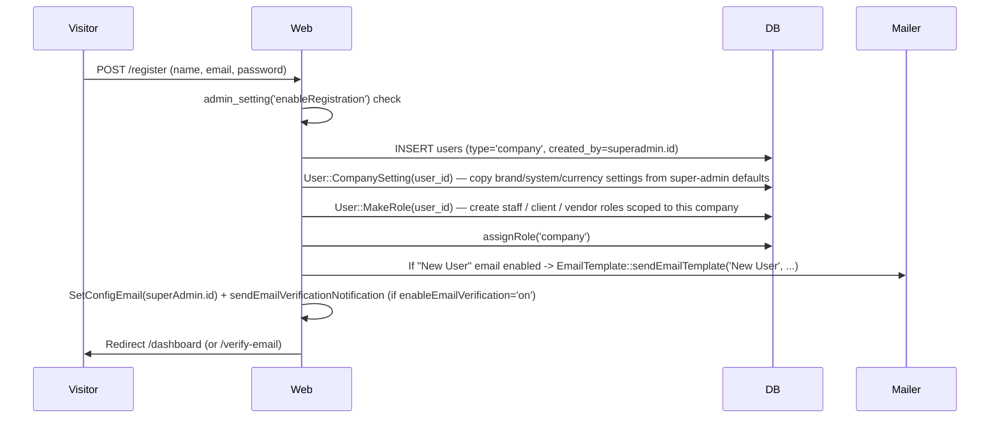
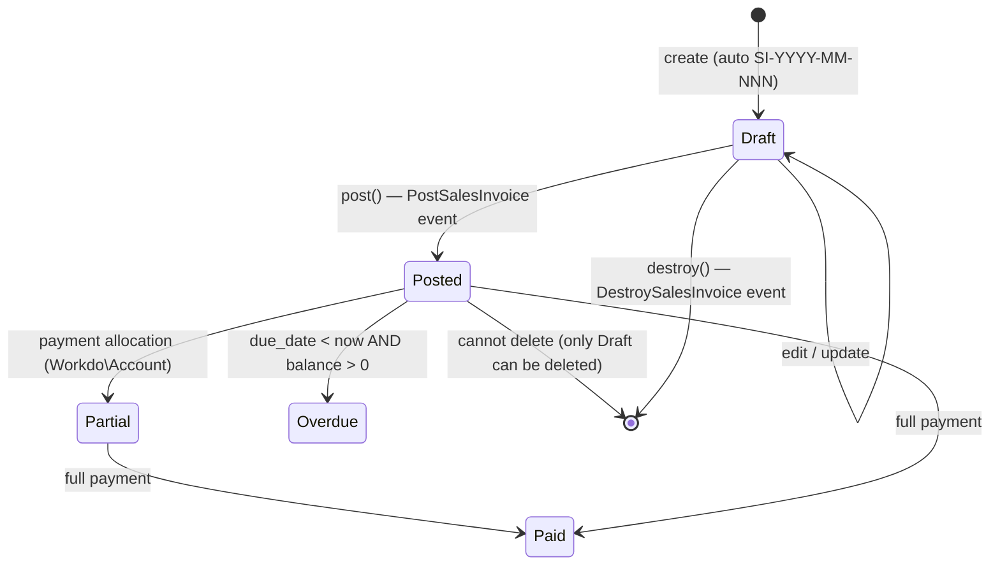
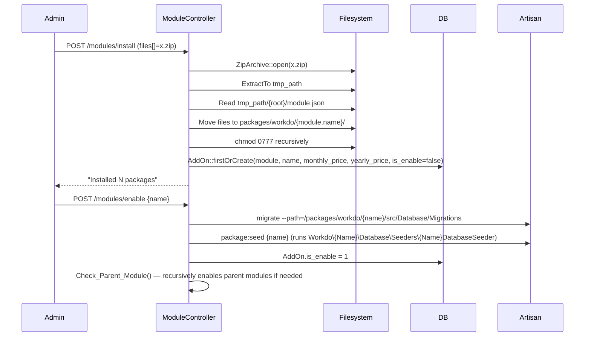

# Independent Technical & Product Analysis — ERPGo SaaS v9.8

**Subject of analysis:** `erpgosaas-98.rar` — CodeCanyon item #33263426, "ERPGo SaaS — All-in-one Business ERP with Project, Account, HRM, CRM, POS" by Workdo.
**Source:** `https://pixeldrain.net/u/kt7yYoPu` (RAR archive, ~59 MB, 23 989 entries).
**Verification level:** Static source inspection only. No execution. No dependencies installed. No migrations run. No live demo inspected (no demo URL was supplied).
**Date of analysis:** 2026-11-04.

---

## 0. Important Scope Limitation (READ FIRST)

The supplied archive is a **partial distribution**. It contains the **Laravel + Inertia SaaS skeleton** (the host application) but is **missing several folders that are normally part of the project**:

| Folder / file that should exist | Present in archive? | Evidence |
|---|---|---|
| `routes/web.php`, `routes/api.php`, `routes/console.php` | **NO** | `bootstrap/app.php` references `__DIR__.'/../routes/web.php'` and `__DIR__.'/../routes/api.php'` — but the `routes/` directory does not exist in the archive |
| `resources/` (views, JSX pages, CSS, lang JSONs) | **NO** | `extract-translations.php` writes to `resources/lang/en.json`; `components.json` declares `resources/css/app.css`; `HandleInertiaRequests` renders `'app'` view — none of these files exist in the archive |
| `public/` (compiled assets, `index.php`, `storage` symlink) | **NO** | Top-level `index.php` proxies to `__DIR__.'/public/index.php'`; `public/` is absent |
| `packages/workdo/*` (the actual ERP modules) | **NO** | `App\Providers\PackageServiceProvider::register()` globs `base_path('packages/workdo/*')`; `database/seeders/PackageSeeder` requires that path; `composer.json` autoloads `Workdo\LandingPage\` from `packages/workdo/LandingPage/src/` — but the directory is absent |
| `vendor/` (Composer dependencies) | **NO** | `artisan` requires `vendor/autoload.php` |
| `tests/` | **NO** | `composer.json` declares PSR-4 `Tests\\ => tests/` |
| `package.json`, `vite.config.js`, `tailwind.config.js`, `postcss.config.js` | **NO** | `components.json` declares `tailwind.config.js`; the shipped `node_modules/.package-lock.json` has a root entry with **zero dependencies** |
| `stubs/` (used by `MakeCrudlyCommand`, `CreateReactPackage`) | **NO** | `CreateReactPackage` requires `base_path('stubs/react-package-stubs/...')` |

**What IS present in the archive:**

| Present | Files | Notes |
|---|---|---|
| `app/` (Laravel skeleton) | 176 | Controllers, Models, Events, Middleware, Console commands, Services, Traits, Helpers |
| `config/` | 24 | `app`, `auth`, `broadcasting`, `cache`, `database`, `debugbar`, `default_currency`, `email-providers`, `filesystems`, `installer`, `larabug`, `logging`, `mail`, `media-library`, `permission`, `queue`, `sanctum`, `services`, `session`, `verification` |
| `database/migrations/` | 23 | Core schema only — module migrations would normally live under `packages/workdo/<Module>/src/Database/Migrations/` |
| `database/seeders/` | 21 | Includes `PackageSeeder` (depends on the missing `packages/` directory) and `PlanSeeder` (lists 24 module names — see §2) |
| `bootstrap/app.php`, `bootstrap/providers.php` | 2 | Bootstraps Laravel 12 application |
| `composer.json`, `components.json`, `.env`, `.env.example`, `.htaccess`, `LICENSE`, `artisan`, `index.php`, `extract-translations.php` | 9 | |
| `node_modules/` | ~50 top-level packages + `.vite/deps/` cache | Contains **only the deps Vite actually bundled** — see §5.3 |
| `documentation/documentation.txt` | 1 | 103 bytes — points to `https://workdo.io/documents/documentation-for-installation/` |

**Implication:** every claim about specific Workdo modules (`Taskly`, `Account`, `Hrm`, `Lead`, `Pos`, `AIAssistant`, etc.) is **documented-only** (verified only through `PlanSeeder`, `User::$superadmin_activated_module`, `User::$company_hidden_modules`, demo seeders, and references in the skeleton code such as `\Workdo\Account\Models\Customer`, `\Workdo\ProductService\Models\ProductServiceItem`, `\Workdo\Hrm\Models\Employee`). The implementation source for those modules is **not available** in the archive. The analysis below separates "verified in source" from "documented only" claims throughout.

---

## 1. Product Overview

| Attribute | Finding | Confidence |
|---|---|---|
| Product name | ERPGo SaaS | Verified in `config/verification.php` (`'system' => 'ERPGo SaaS'`, `'system_version' => '9.8'`) and in `.env` (`APP_NAME="ERPGo SaaS"`) |
| Vendor | Workdo (`workdo.io`) | Verified in `composer.json` PSR-4 autoload `Workdo\LandingPage\` and in `documentation.txt` link |
| Distribution channel | CodeCanyon, Envato | Verified in archive path prefix `codecanyon-33263426-erpgo-saas-all-in-one-business-erp-with-project-account-hrm-crm-pos/` |
| License | MIT (per `LICENSE`) — but CodeCanyon items ship under an Envato regular/extended license; the MIT file appears to be Laravel's default | Verified in `LICENSE` |
| Purpose | Multi-tenant SaaS ERP platform: each "company" tenant subscribes to a plan, gets a sandboxed workspace, and can install/uninstall ERP modules (CRM, HRM, Projects, POS, Accounting, etc.) à la carte | Verified in `Plan`, `AddOn`, `UserActiveModule` models and `PlanController`, `ModuleController` |
| Target users | (1) **Super-admin** (the platform operator, owns the SaaS); (2) **Company** (a tenant that pays for a plan and provisions staff/clients/vendors inside its workspace); (3) **Staff / Client / Vendor** (sub-users created by the company) | Verified in `User::MakeRole()`, `User::$not_emp_type`, and `PermissionRoleSeeder` |
| Business model | Subscription SaaS with monthly/yearly plans, per-module add-on pricing, coupons, free plan, trial periods, bank-transfer & gateway payments | Verified in `PlanSeeder` (3 plans: Free / Starter / Professional), `Coupon` model, `BankTransferPayment` model |
| Technology stack | **Backend:** PHP 8.2+, Laravel 12, Sanctum, Spatie Permission + Media Library, Inertia.js server adapter, Ziggy (route sharing). **Frontend:** React 18 + Inertia.js React adapter + Vite + Tailwind CSS + shadcn/ui (Radix UI) + lucide-react + recharts + next-themes + sonner + react-datepicker + react-signature-canvas + react-google-recaptcha + jsbarcode + qrcode + html2pdf.js + i18next + react-i18next + laravel-echo + pusher-js + Tiptap + FullCalendar + @hello-pangea/dnd. **Storage:** local / AWS S3 / Wasabi (switchable at runtime). **Real-time:** Pusher. **Database:** MySQL (primary) or SQLite (dev) | Verified in `composer.json` and `node_modules/.vite/deps/` cache |
| Main capabilities (verified in skeleton) | Multi-tenant auth (Breeze-based), RBAC with Spatie, plan/subscription lifecycle, module marketplace + upload/enable/disable, sales invoices & proposals & returns, purchase invoices & returns, warehouses & stock transfers, helpdesk (categories/tickets/replies), messenger (1-1 chat with presence), media library, notifications & email templates with per-language content, coupon system, bank-transfer payment approvals, login history, settings panels (brand / company / system / currency / cookie / SEO / storage / email / pusher), installer wizard, one-click updater, multi-language UI with RTL support, demo-mode middleware | Verified across `app/Http/Controllers/` |
| Documented capabilities (module marketplace) | 24 ERP modules listed in `PlanSeeder` — see §2 | Documented only |

---

## 2. Complete Feature Inventory

### 2.1 Verified features in the skeleton (`app/Http/Controllers/`)

| Module (skeleton) | Files | What it does | Evidence |
|---|---|---|---|
| **Authentication** | `app/Http/Controllers/Auth/*` (9 files) + `Api/AuthApiController.php` | Login, register, password reset, email verification, confirm-password, password change. API login via Sanctum tokens (`AuthApiController::login` deletes prior tokens and issues a new plain-text token). On super-admin login, controller auto-checks for pending migrations and redirects to `/updater` if found | `AuthenticatedSessionController.php`, `RegisteredUserController.php`, `Api/AuthApiController.php` |
| **Dashboard** | `HomeController.php` | Splits between `superAdminDashboard()` (Inertia `SuperAdminDashboard`, shows aggregated Order/Plan/Company stats + monthly chart) and `regularDashboard()` which **scans every active Workdo package's `company-menu.ts` for a `parent: 'dashboard'` entry and redirects** to the first route the user is permitted to access | `HomeController.php:11-55` |
| **User management** | `UserController.php` | CRUD + impersonation (`Session::put('impersonator_id')`), change-password, login-history view, role assignment. Enforces `canCreateUser()` (plan-based seat limit) and disables excess users when plan downgrades | `UserController.php`, `Helper.php::canCreateUser()` |
| **Role & permission management** | `RoleController.php` | CRUD for roles; on create/edit it lists **all permissions grouped by `add_on` (module) → `module`**, filtering by what is active. Non-super-admin hides payment-gateway modules (`User::$company_hidden_modules`) | `RoleController.php:19-50` |
| **Plan management** | `PlanController.php` | CRUD for subscription plans. Each plan embeds an array of module names (`Plan::$casts['modules'] = 'array'`). Companies see only plans that map to their currently subscribed modules; super-admin sees all. Includes `updateModulePrice`, `applyCoupon`, `startTrial`, `assignFree` actions | `PlanController.php`, `Plan` model |
| **Order management** | `OrderController.php` | Read-only listing (search by order_id, name, email, plan_name; sort; paginate). Orders are created by the payment flow (e.g. `BankTransferPaymentController::store` creates an `Order` row when a payment is approved) | `OrderController.php` |
| **Coupon management** | `CouponController.php` | Full CRUD plus a detail page that lists `UserCoupon` rows (per-user usage). Coupon types: `percentage`, `flat`, `fixed`. Supports `limit`, `limit_per_user`, `minimum_spend`, `maximum_spend`, `expiry_date`, `included_module`, `excluded_module`. Discount logic in `applyCouponDiscount()` helper | `CouponController.php`, `Helper.php::applyCouponDiscount()` |
| **Bank-transfer payments** | `BankTransferPaymentController.php` | User uploads a receipt → row created as `pending`. If amount ≤ 0 (free plan after coupon), it auto-approves and creates an `Order` + calls `assignPlan()`. Super-admin can approve/reject pending requests. Has summary stats (total/pending/approved/rejected) | `BankTransferPaymentController.php` |
| **Sales invoices** | `SalesInvoiceController.php` | Full lifecycle: create as `draft` → edit → `post` → cannot edit/delete after posting. Auto-generates invoice number `SI-YYYY-MM-NNN`. Items support per-line `quantity`, `unit_price`, `discount_percentage`, `tax_percentage`, plus an array of named taxes (`SalesInvoiceItemTax`). Calculates subtotal/tax/discount/total server-side. Has `getWarehouseProducts()` and `getServices()` JSON endpoints that fetch from `Workdo\ProductService\Models\ProductServiceItem`. Print view (`Sales/Print`) | `SalesInvoiceController.php` |
| **Sales proposals (quotes)** | `SalesProposalController.php` | Lifecycle: `draft → sent → accepted → rejected` and then `convert-sales-proposals` action clones items into a new `SalesInvoice` (status=draft) and sets `converted_to_invoice=true`. Proposal number `SP-YYYY-MM-NNN` | `SalesProposalController.php:230-290` |
| **Sales returns** | `SalesReturnController.php` | Linked to original invoice; tracks reason (`defective/wrong_item/damaged/excess_quantity/other`), status `draft/approved/completed/cancelled`. Calculates available return quantity per line by subtracting existing returns from the original invoice quantity | `SalesReturnController.php:62-100` |
| **Purchase invoices / returns** | `PurchaseInvoiceController.php`, `PurchaseReturnController.php` | Mirror of sales side, but `vendor_id` instead of `customer_id`. Purchase invoices have status `draft/posted/partial/paid/overdue`; returns reuse `approve/complete` workflow | `PurchaseInvoiceController.php`, `PurchaseReturnController.php` |
| **Warehouses** | `WarehouseController.php` | Simple CRUD with `name/address/city/zip_code/phone/email/is_active` | `Warehouse` model |
| **Stock transfers** | `TransferController.php` | Move stock between two warehouses for a specific `ProductServiceItem`. Supports sorting by related `product.name`, `from_warehouse.name`, `to_warehouse.name` via joins | `TransferController.php:11-55` |
| **Helpdesk** | `HelpdeskCategoryController.php`, `HelpdeskTicketController.php`, `HelpdeskReplyController.php` | Ticket ID = random 8-digit int (collision-checked in `HelpdeskTicket::boot()`). Tickets: `open/in_progress/resolved/closed` × `low/medium/high/urgent`. Replies support attachments (JSON array) and `is_internal` flag (private notes). Super-admin can filter by company | `HelpdeskTicket` model, `HelpdeskReplyController.php` |
| **Messenger** | `MessengerController.php` | 1-1 chat with read receipts (`seen`), soft delete (`deleted_by_sender/receiver` — both must delete for hard delete), favorites, pinned contacts, message editing, presence via `Cache::put("user_online_{$user->id}")` (5 min TTL). Real-time via `MessageSent`/`UserOnline`/`UserOffline` events broadcasting to `Channel("messenger.{userId}")`. Pusher config is **loaded dynamically from DB settings** inside the event constructor | `MessengerController.php`, `app/Events/MessageSent.php`, `UserOnline.php`, `UserOffline.php` |
| **Media library** | `MediaController.php` | Wraps `Spatie\MediaLibrary`. Directories are user-scoped (`MediaDirectory` table). Files stored on the active disk (local / S3 / Wasabi — see §8). Per-user storage quota check (`checkStorageLimit`). Batch upload endpoint. Has separate `manage-any-media` vs `manage-own-media` permissions | `MediaController.php`, `MediaPathGenerator.php` |
| **Settings** | `SettingController.php` | Six grouped tabs: Brand, Company, System, Currency, Cookie, SEO, Storage, Email, Pusher, Bank-transfer. Each has its own permission (`edit-brand-settings`, `edit-system-settings`, …). Settings are stored as `(key, value, is_public, created_by)` rows in `settings` table and cached per user (`getCompanyAllSetting()`, `getAdminAllSetting()`). In **demo mode**, theme settings are stored in a 30-day cookie instead of DB | `SettingController.php`, `Setting` model, `Helper.php::getCompanyAllSetting()` |
| **Email templates** | `EmailTemplateController.php` | Per-template, per-language subject + HTML body + JSON variables list. Templates have a `from` address and a `module_name` (so packages can register their own). `EmailTemplate::sendEmailTemplate($name, $mailTo, $obj)` resolves template → loads language content → replaces variables like `{app_name}`, `{invoice_number}` → sends via `Mail::to()->send(new CommonEmailTemplate)` after calling `SetConfigEmail()` to apply SMTP creds from DB | `EmailTemplate.php::sendEmailTemplate()`, `EmailTemplatesSeeder.php` |
| **Notification templates** | `NotificationTemplateController.php` | Same pattern as email templates but for in-app notifications (`Notification` rows with `type` field, e.g. `mail`). Has `type`, `action`, `status`, `permissions`, `module` fields. Seeded by `NotificationsTableSeeder` | `NotificationTemplateController.php` |
| **Languages / translations** | `TranslationController.php` | UI allows editing `resources/lang/{locale}.json` per-key. Merges translations from enabled packages (`packages/workdo/{Module}/src/Resources/lang/{locale}.json`). Auto-enables RTL for `ar` and `he`. Ships with a `language.json` registry listing supported languages with flags and enabled flags | `TranslationController.php:30-90` |
| **Modules (add-ons)** | `ModuleController.php` | Super-admin can: list installed modules, **upload a ZIP** of a new module (`installSinglePackage()` extracts to `packages/workdo/{name}/`, reads `module.json`, creates `AddOn` row), enable/disable (runs `migrate --path=/packages/workdo/{name}/src/Database/Migrations` and `package:seed`), and handles parent/child module dependencies (`Check_Parent_Module`/`Check_Child_Module`) | `ModuleController.php:80-200` |
| **Installer wizard** | `InstallerController.php` | Multi-step: Welcome → Requirements → Permissions → Environment (DB credentials form) → Database (runs `migrate:fresh --seed` + `enableModule` for every discovered package) → Addons (per-module enable) → Final (creates `storage/installed` flag file, prints default super-admin/company credentials `superadmin@example.com / 1234` and `company@example.com / 1234`) | `InstallerController.php` |
| **Updater** | `UpdaterController.php` | On super-admin login, `AuthenticatedSessionController::store()` checks (a) `migrate:status` for pending migrations, (b) compares count of `packages/workdo/*` dirs vs `AddOn::count()` to detect new modules. If either, redirects to `/updater`. The updater runs `migrate`, installs new packages, re-seeds updated packages, clears caches | `UpdaterController.php`, `AuthenticatedSessionController.php:35-65` |
| **API auth** | `Api/AuthApiController.php` + `ApiForceJson` middleware | Sanctum token issuance with `tokens()->delete()` first (single active token). `module` parameter validates that the requested Workdo module is enabled for the user's company. HRM module login blocks non-employee user types | `Api/AuthApiController.php:21-50` |
| **Profile** | `ProfileController.php` | Standard Breeze profile edit (avatar, name, email) + password change | `ProfileController.php` |

### 2.2 Documented modules (NOT present in archive, listed in `PlanSeeder`)

The skeleton explicitly enumerates 24 modules as plan entitlements (`database/seeders/PlanSeeder.php`). These are the actual ERP features sold as part of ERPGo SaaS:

| Module alias | Likely domain | Documented evidence |
|---|---|---|
| `Taskly` | Project / task management | `PlanSeeder` modules array |
| `Account` | Accounting (customers, vendors, payments, allocations) | Skeleton code: `Workdo\Account\Models\Customer`, `Vendor`, `CustomerPaymentAllocation`, `VendorPaymentAllocation` referenced from `SalesInvoice`, `PurchaseInvoice` models |
| `Hrm` | HRM (employees, attendance, leave) | `Api\AuthApiController` imports `Workdo\Hrm\Models\Employee`; `User::$not_emp_type` lists `'doctor', 'student', 'parent'` — suggesting HRM-style employee types |
| `Lead` | Lead / deal pipeline (CRM) | `EmailTemplate::replaceVariable()` defines `{lead_name}`, `{lead_pipeline}`, `{lead_stage}`, `{lead_old_stage}`, `{lead_new_stage}`, `{deal_name}` etc. |
| `Pos` | Point of sale | `PlanSeeder` |
| `BudgetPlanner` | Budgeting | `PlanSeeder` |
| `Calendar` | Calendar | `PlanSeeder`; `composer.json` requires `spatie/laravel-google-calendar` |
| `Contract` | Contract management | `DemoModeMiddleware` exempts `contract-settings.store` |
| `DoubleEntry` | Double-entry accounting | `PlanSeeder` |
| `FormBuilder` | Form builder | `PlanSeeder` |
| `Goal` | OKR / goals | `PlanSeeder` |
| `Performance` | Employee performance review | `PlanSeeder` |
| `Quotation` | Quotations | `DemoModeMiddleware` exempts `quotations.approve/reject/sent` |
| `Recruitment` | Recruitment / job applicants | `EmailTemplate` defines `{candidate_name}`, `{candidate_email}`, `{job_title}`, `{position}`, `{salary}`, `{start_date}`, `{tracking_link}` |
| `Timesheet` | Timesheets | `PlanSeeder` |
| `Training` | Training / LMS | `PlanSeeder` |
| `SupportTicket` | Customer support tickets (separate from base Helpdesk?) | `PlanSeeder` |
| `Webhook` | Outbound webhooks | `PlanSeeder` |
| `ZoomMeeting` | Zoom meeting integration | `PlanSeeder`; `composer.json` does not list a Zoom SDK explicitly (likely Guzzle-based) |
| `Slack` | Slack notifications | `PlanSeeder`; `config/services.php` defines `slack.notifications.bot_user_oauth_token` |
| `Telegram` | Telegram bot | `PlanSeeder` |
| `Twilio` | Twilio SMS | `PlanSeeder`; `composer.json` requires `twilio/sdk`; `DemoModeMiddleware` exempts `twilio.settings.store` |
| `AIAssistant` | AI assistant (LLM) | `PlanSeeder`; `DemoModeMiddleware` exempts `ai-assistant.settings.store` and `ai-assistant.generate` |
| `Stripe`, `Paypal` | Payment gateways (also in `User::$superadmin_activated_module`) | `composer.json` requires `stripe/stripe-php`, `srmklive/paypal` |
| `RecurringInvoiceBill` | Recurring invoices | `SalesInvoiceController::create` passes `'recurringinvoicebill' => module_is_active('RecurringInvoiceBill')` to Inertia |
| `ProductService` | Products / services / warehouse stock | Skeleton code: `Workdo\ProductService\Models\ProductServiceItem`, `WarehouseStock` referenced from invoices & transfers |
| `LandingPage` | Marketing landing page builder | `composer.json` autoloads `Workdo\LandingPage\`; `isLandingPageEnabled()` helper; `DefultSetting` seeder seeds `landingPageEnabled=on`; `DemoModeMiddleware` blocks `landing-page.store` and `custom-pages.store` |
| Payment gateways (28 total) | `Aamarpay`, `AuthorizeNet`, `Benefit`, `Cashfree`, `CinetPay`, `Coingate`, `Fedapay`, `Flutterwave`, `Iyzipay`, `Midtrans`, `Mollie`, `Payfast`, `Paystack`, `PayTab`, `PayTR`, `Razorpay`, `Tap`, `Toyyibpay`, `Xendit`, `YooKassa`, `Easebuzz`, `Khalti`, `Mercado`, `Ozow`, `PaiementPro`, `PayHere` | Listed in `User::$superadmin_activated_module` (super-admin-only activation) |

**Notable composer dependencies that hint at module capabilities** (verified in `composer.json`):
- `google/apiclient` + `spatie/laravel-google-calendar` → Google Calendar integration
- `microsoft/microsoft-graph` → Microsoft 365 (Outlook/Teams) integration
- `mailchimp/marketing` → Mailchimp email marketing
- `webklex/laravel-imap` → inbound email polling
- `salla/zatca` → Saudi Arabian ZATCA e-invoicing compliance (FATOORAH)
- `phpoffice/phpspreadsheet` → Excel/CSV import/export
- `pragmarx/google2fa-laravel` + `bacon/bacon-qr-code` → TOTP 2FA with QR
- `anhskohbo/no-captcha` → Google reCAPTCHA (matches the `react-google-recaptcha` Vite dep)
- `laravel/socialite` → social login (Google, etc.)
- `razorpay/razorpay` → Razorpay payments
- `pusher/pusher-php-server` → server-side Pusher
- `larabug/larabug` → LaraBug error tracking
- `tightenco/ziggy` → exposes Laravel route names to JS

### 2.3 Users of each module

| User type | Modules accessible |
|---|---|
| **superadmin** | All skeleton modules + super-admin-only payment gateway modules (`User::$superadmin_activated_module`). Cannot see role "manage-add-on" permission row in some screens (commented out in seeder) |
| **company** (tenant owner) | All skeleton modules except super-admin-only ones; can manage their own users, roles, plans (limited), coupons, settings, invoices, helpdesk, messenger, media |
| **staff** | Whatever permissions the company grants via the `staff` role; default staff role has dashboard, media (own), profile, messenger permissions — `User::MakeRole()` |
| **client** | Own sales invoices (read-only when draft), own sales proposals (accept/reject), own sales returns, media (own), profile, messenger |
| **vendor** | Own purchase invoices (read-only when draft), own purchase returns, media (own), profile, messenger |

---

## 3. Business Workflows

### 3.1 New tenant onboarding & plan subscription



**Plan purchase** (verified in `BankTransferPaymentController::store`, `PlanController::subscribe`, `assignPlan()` helper):
1. User browses `/plans` → sees plans filtered by their current module entitlements.
2. User picks a plan + duration (Month / Year / Trial) + optional add-on modules + optional coupon.
3. Price = `plan.package_price_{duration}` + Σ(add-on module price for duration). Coupon applied via `applyCouponDiscount()`.
4. If payment gateway module is enabled, redirect to that gateway's `payment.*.store` route (not in skeleton).
5. If bank-transfer is enabled, user uploads receipt → `bank_transfer_payments` row created as `pending` (or `approved` if price ≤ 0).
6. On approval (super-admin action or gateway callback), `assignPlan($plan_id, $duration, $modules, $counter, $user_id)`:
   - Updates `users.active_plan`, `plan_expire_date` (or `trial_expire_date`).
   - Reconciles `UserActiveModule` rows: adds new modules, dispatches `DefaultData` event (which packages listen to), and via `GivePermissionToRole` event syncs the `client`/`staff` roles' permissions to include module permissions.
   - Updates `users.total_user` and `users.storage_limit` from the plan.
   - **Disables excess users** if new plan has fewer seats: `User::orderBy('created_at', 'desc')->take($count)->update(['is_disable' => 1, 'is_enable_login' => 0])`. This is a hard lockout, not a soft warning.

### 3.2 Sales invoice lifecycle



Verified in `SalesInvoiceController.php` (`store`, `update`, `post`, `destroy`, `print`, `getWarehouseProducts`, `getServices`). The `isOverdue()` accessor and `display_status` appended attribute are in the `SalesInvoice` model.

**Cross-module event hooks:** `CreateSalesInvoice::dispatch($request, $invoice)` is fired after `save()`. Each Workdo package can register a listener (e.g. `Workdo\Account\Listeners\CreateSalesInvoiceListener`) to insert rows into its own tables (accounting journal entries, stock movements, etc.). Skeleton contains 45 event classes — every entity operation (`Create/Update/Destroy/Post/Approve/Complete/Accept/Reject/Convert/Sent`) has a corresponding event.

### 3.3 Sales proposal → invoice conversion

```mermaid
flowchart LR
    A[Draft proposal<br/>SP-YYYY-MM-NNN] -->|sent()| B[Sent]
    B -->|accept()| C[Accepted]
    B -->|reject()| D[Rejected]
    C -->|convertToInvoice()| E[New SalesInvoice<br/>status=draft]
    C --> F[converted_to_invoice=true<br/>invoice_id set]
    E --> G[User posts invoice]
```

Verified in `SalesProposalController::convertToInvoice()`: clones header + each `SalesProposalItem` + each `SalesProposalItemTax` into the corresponding invoice tables.

### 3.4 Module installation (super-admin uploads a new Workdo package)



Verified in `ModuleController::install()` and `ModuleController::enable()`.

### 3.5 Real-time 1-1 chat (messenger)

Verified flow (`MessengerController::send` + `MessageSent` event):
1. Sender posts message → `ChMessage` row created with `seen=0`.
2. `event(new MessageSent($message, $receiverId))` dispatched.
3. The event's constructor reads `pusher_app_key/secret/app_id/cluster` from `admin_setting()` and dynamically writes them into `config('broadcasting.connections.pusher.*')` (so Pusher creds can be changed per tenant without redeploying).
4. Event implements `ShouldBroadcastNow` (no queue), broadcasts to `Channel("messenger.{receiverId}")` — public channel, no auth.
5. Frontend listens via `laravel-echo` + `pusher-js` (visible in `node_modules/.vite/deps/`).
6. When receiver opens the conversation, `MessengerController::getMessages()` flips `seen=1` on page 1 of pagination.
7. Presence: `UpdateUserActiveStatus` middleware (web) writes `Cache::put("user_online_{$user->id}", true, now()->addMinutes(5))` on every authenticated request. `UserOnline`/`UserOffline` events broadcast to all users' messenger channels — **O(n_users) broadcast per event**, which is a scalability smell (§11).

### 3.6 Email sending (dynamic SMTP per tenant)

Verified in `Helper.php::SetConfigEmail()` and `MailConfigService`:
1. Caller passes `$user_id` (or defaults to Auth user, or super-admin).
2. Reads `email_driver/host/port/encryption/username/password/fromAddress` from `getCompanyAllSetting($user_id)` (tenant-scoped settings).
3. Writes them into `config(['mail.default' => ..., 'mail.mailers.smtp.host' => ..., ...])` at runtime.
4. Returns true / throws `Exception('Email host is not configured')`.
5. `EmailTemplate::sendEmailTemplate()` calls this, then `Mail::to($mailTo)->send(new CommonEmailTemplate($content, $user_id))`.

This means each tenant company can configure its own SMTP creds and emails go out under the tenant's from-address — a critical SaaS feature.

### 3.7 Demo-mode workflow

Verified in `DemoModeMiddleware`:
- Reads `config('app.is_demo')`.
- Allows all GET requests.
- Blocks PUT/PATCH/DELETE and POST to routes containing `/update`, `/destroy`, `/approve`, `/reject`, `/password`, `/settings`, `/subscribe`, `/media/batch`, etc.
- Has an explicit **exempt list** of route names that ARE allowed in demo (e.g. `sales-proposals.accept`, `sales-proposals.reject`, `quotations.approve`, `account.vendor-payments.update-status`, `settings.brand.update` — these write to a cookie instead of DB for theme).
- Returns 403 JSON for API/XHR, redirect-back-with-error for Inertia.

This is a sophisticated demo lockdown: visitors can fully exercise state-transition workflows (accept/reject/approve) on pre-seeded demo data, but cannot change destructive settings.

---

## 4. UI / UX Analysis

The React JSX source files are NOT in the archive (`resources/` missing). However, the following can be reconstructed with high confidence from:
- `Inertia::render('PageName')` calls in controllers — see list in §2.1
- `components.json` (shadcn/ui config: `style=default`, `rsc=true`, `tsx=true`, base color `slate`, CSS variables enabled)
- `node_modules/.vite/deps/` cache (lists every frontend lib actually bundled — §5.3)
- `HandleInertiaRequests::share()` shared props
- `DefultSetting` seeder (theme defaults)

### 4.1 Navigation

- **Layout shell**: `HandleInertiaRequests` root view is `'app'` (a single Inertia HTML root). Shared props include `auth.user` (with `permissions[]`, `roles[]`, `activatedPackages[]`), `lang`, `flash.success/error`, `packages` (all module metadata), `adminAllSetting`, `companyAllSetting`, `imageUrlPrefix`, `currencies`, `defaultLanguages`, `is_demo`.
- **Sidebar**: defaults to `sidebarVariant=inset`, `sidebarStyle=plain`, `themeMode=light`, `themeColor=green` (or `customColor=#10b77f`).
- **Module-driven menus**: Each Workdo package ships `src/Resources/js/menus/company-menu.ts` and `superadmin-menu.ts` (visible in the stub generator at `app/Console/Commands/CreateReactPackage.php`). The frontend merges these at runtime based on `activatedPackages` prop. The dashboard auto-redirects to the first menu item with `parent: 'dashboard'` that the user is permitted to access (`HomeController::regularDashboard()` actually reads these `.ts` files server-side via regex).
- **RTL**: Auto-enabled for `ar` / `he` locales in `getAdminAllSetting()` and `TranslationController`.

### 4.2 Dashboards

| Dashboard | Inertia page | Data |
|---|---|---|
| Super-admin | `SuperAdminDashboard` | `stats` (order_payments, total_orders, total_plans, total_companies), `chartData` (12 months of orders + payments; in demo mode randomizes values) |
| Regular | `dashboard` (fallback) or redirected into a module's dashboard route | Per-module |

### 4.3 Forms & tables

Verified patterns across controllers:
- **Server-side pagination** via `->paginate(request('per_page', 10))->withQueryString()` — preserves filters in pagination links.
- **Filtering**: each `index()` accepts query params (e.g. `customer_id`, `warehouse_id`, `status`, `search`, `date_range`, `sort`, `direction`, `per_page`). `date_range` is parsed as `"YYYY-MM-DD - YYYY-MM-DD"`.
- **Sorting**: validated against an allowlist (`$allowedSortFields`) to prevent SQL injection via column name — e.g. `SalesInvoiceController::index()` whitelists `['invoice_number', 'invoice_date', 'due_date', 'subtotal', 'tax_amount', 'total_amount', 'balance_amount', 'status', 'created_at']`.
- **Permissions in UI**: `Auth::user()->can('manage-X')` is called in every controller and the result is forwarded to Inertia as props (e.g. `'canCreate' => $user->can('create-plans')`) so the React layer can hide/show buttons.
- **Form requests**: each entity has `StoreXRequest` and `UpdateXRequest` classes with `rules()` and `messages()` (translated via `__()`).

### 4.4 Detail pages & modals

- Detail views: `Sales/View`, `SalesProposals/View`, `Purchase/View`, `PurchaseReturns/View`, `SalesReturns/View`, `helpdesk/tickets/show`, `coupons/details`, `Transfers/Show`.
- Print views: `Sales/Print`, `Purchase/Print`, `SalesProposals/Print` — frontend renders printable HTML; `html2pdf.js` is bundled in `.vite/deps` for client-side PDF export.
- `TransferController::create()` returns `back()` ("Modal-based create, no separate page needed") — confirms a pattern of modal-driven creation for simple entities vs. dedicated pages for complex ones.

### 4.5 Settings

`SettingController::index()` renders `settings/index` with grouped settings: brand, company, system, currency, cookie, SEO, storage, email (with 30+ provider presets from `config/email-providers.php`), pusher, bank-transfer, email-notification toggles. Each group has its own update route (`updateBrandSettings`, `updateCompanySettings`, etc.) and its own permission.

### 4.6 Responsive & interaction patterns

Inferred from the bundled libs:
- `@hello-pangea/dnd` — drag-and-drop (likely used for kanban-style lead/deal pipelines, sortable menus).
- `@fullcalendar/react` + `daygrid`, `timegrid`, `interaction` — calendar UI.
- `@tiptap/react` + `starter-kit` + `link/highlight/strike/text-align/text-style/extension-color` — rich-text editor for email templates and notification templates.
- `recharts` — chart library for dashboards.
- `next-themes` — dark / light mode with `themeColor=green` default and `customColor` support.
- `sonner` — toast notifications.
- `react-datepicker` — date pickers (used in invoice `invoice_date`/`due_date`).
- `react-signature-canvas` — signature capture (likely in contracts / delivery receipts).
- `react-google-recaptcha` — login captcha.
- `jsbarcode`, `qrcode` — barcode/QR generation (likely for products and invoices).
- `html2canvas`, `html2pdf.js` — print-to-PDF client-side.
- `i18next` + `react-i18next` — frontend translations (loads the JSON served by `TranslationController::change()`).
- `laravel-echo` + `pusher-js` — real-time messenger.

### 4.7 Internationalisation

- Backend: Laravel `__()` with JSON lang files at `resources/lang/{locale}.json` + per-package `packages/workdo/{Module}/src/Resources/lang/{locale}.json` merged at runtime.
- Frontend: i18next initialized from the same JSON, served via `/languages/change?lang=xx` endpoint.
- Auto-RTL for Arabic and Hebrew.
- Languages are gated by `enabled` flags in `resources/lang/language.json` (not in archive).
- 17+ languages seeded with full email-template content (see `EmailTemplatesSeeder`: `ar, da, de, en, es, fr, it, ja, nl, pl, pt, pt-BR, ru, he, tr, zh`).

---

## 5. Technical Architecture

### 5.1 High-level diagram

```mermaid
flowchart TB
    subgraph Client[Browser - React SPA]
        UI[Inertia.js React pages<br/>shadcn/ui + Tailwind]
        Echo[laravel-echo<br/>pusher-js]
    end
    subgraph Server[Laravel 12 Server]
        Breeze[Breeze auth<br/>Sanctum API]
        InertiaMW[HandleInertiaRequests<br/>middleware - shared props]
        Controllers[App\Http\Controllers<br/>+ Workdo\Module\Http\Controllers]
        Events[45 event classes<br/>Create/Update/Destroy/...]
        Helpers[Helper.php<br/>creatorId, setSetting, assignPlan, ...]
        PkgSvc[PackageServiceProvider<br/>auto-registers Workdo modules]
        ModCls[App\Classes\Module<br/>addon discovery + enable/disable]
    end
    subgraph Packages[packages/workdo/* - missing]
        Mod1[Taskly]
        Mod2[Account]
        Mod3[Hrm]
        ModN[... 21 more]
    end
    subgraph Data[Persistence]
        MySQL[(MySQL<br/>23 core tables + module tables)]
        Redis[Redis cache<br/>settings, online presence]
        Local[local disk<br/>media]
        S3[(AWS S3 / Wasabi)]
    end
    subgraph External[External services]
        Pusher[Pusher<br/>real-time]
        SMTP[Per-tenant SMTP<br/>+ 30 providers]
        Stripe / PayPal / Razorpay / 25+ gateways
        Google[Google Calendar<br/>reCAPTCHA]
        MS[Microsoft Graph]
        Twilio[Twilio SMS]
        Slack / Telegram
        ZATCA[Saudi e-invoice]
        Mailchimp[Mailchimp]
    end
    UI <--> InertiaMW
    InertiaMW <--> Controllers
    Controllers --> Events
    Events --> Packages
    Controllers --> Helpers
    Helpers --> ModCls
    PkgSvc --> Packages
    Controllers --> MySQL
    Helpers --> Redis
    Controllers --> Local
    Controllers --> S3
    Echo <--> Pusher
    Controllers --> SMTP
    Controllers --> Stripe
    Controllers --> Google
    Controllers --> MS
    Controllers --> Twilio
    Controllers --> ZATCA
```

### 5.2 Routing

**Critical:** the `routes/` directory is absent from the archive. We can infer route names from:
- Controller method names + Inertia redirects (`redirect()->route('plans.index')`, `route('sales-invoices.index')`, etc.)
- `DemoModeMiddleware` route-name patterns
- `Auth::user()->can('manage-X')` calls imply resource routes following Laravel's `Route::resource()` convention

Inferred route groups (high confidence based on `DemoModeMiddleware` exempt list + controller redirects):

| Route name pattern | Methods | Controller |
|---|---|---|
| `dashboard` | GET | `HomeController@Dashboard` |
| `users.index/store/update/destroy/change-password/impersonate/leave-impersonation/login-history/toggle-status` | various | `UserController` |
| `roles.index/create/store/edit/update/destroy` | various | `RoleController` |
| `plans.index/create/store/edit/update/destroy/subscribe/start-trial/apply-coupon/assign-free/update-module-price` | various | `PlanController` |
| `orders.index` | GET | `OrderController` |
| `coupons.index/store/update/destroy/show/details` | various | `CouponController` |
| `warehouses.index/store/update/destroy` | various | `WarehouseController` |
| `transfers.index/show/store/destroy` | various | `TransferController` |
| `sales-invoices.index/create/store/show/edit/update/destroy/post/print/get-warehouse-products/get-services` | various | `SalesInvoiceController` |
| `sales-proposals.index/.../sent/accept/reject/convert-to-invoice` | various | `SalesProposalController` |
| `sales-returns.index/create/store/show/destroy/approve/complete` | various | `SalesReturnController` |
| `purchase-invoices.*`, `purchase-returns.*` | similar | `PurchaseInvoiceController`, `PurchaseReturnController` |
| `helpdesk-categories.*`, `helpdesk-tickets.*`, `helpdesk-replies.*` | various | 3 controllers |
| `messenger.index/send/get-contacts/get-messages/toggle-favorite/get-favorites/edit-message/{id}/delete-message/{id}/update-presence` | various | `MessengerController` |
| `media.page/index/batch-store/...` | various | `MediaController` |
| `settings.index` + `update-brand-settings/update-company-settings/update-system-settings/update-currency-settings/update-cookie-settings/update-seo-settings/update-storage-settings/update-email-settings/update-pusher-settings/update-bank-transfer-settings/test-email/mail-notification-store/...` | various | `SettingController` |
| `email-templates.index/edit/get-language-content/{lang}/update/update-meta` | various | `EmailTemplateController` |
| `notification-templates.index/edit/get-language-content/{lang}/update` | various | `NotificationTemplateController` |
| `languages/manage/change/get-package-translations/{locale}/{package}/update-translations/{locale}` | various | `TranslationController` |
| `modules.index/upload/enable/install` | various | `ModuleController` |
| `bank-transfer.index/store/approve/reject/destroy` | various | `BankTransferPaymentController` |
| `profile.edit/update` | GET/POST | `ProfileController` |
| `installer.welcome/requirements/permissions/environment/environment-store/database/database-store/addons/addons-store/final` | various | `InstallerController` |
| `updater.index/update` | GET/POST | `UpdaterController` |
| `auth.login/register/forgot-password/reset-password/verify-email/confirm-password` | various | Breeze controllers |
| `api.login/logout/refresh/change-password/edit-profile` + `module` query | POST/GET | `Api\AuthApiController` |
| Module-specific routes (`payment.stripe.store`, `payment.paypal.store`, `account.vendor-payments.store`, `quotations.approve`, `retainers.sent`, `assets.asset-assignments.return`, `contract-settings.store`, `twilio.settings.store`, `ai-assistant.settings.store`, `ai-assistant.generate`, `newsletter.subscribe`, `landing-page.store`, `custom-pages.store`, `newsletter-subscribers.destroy`, `email.notification.setting.store`) | various | Inside Workdo packages (NOT in archive) |

### 5.3 Services, controllers, reusable components

**App\Services\***
- `DynamicStorageService` — reconfigures `filesystems.disks.s3.*` and `filesystems.disks.wasabi.*` at runtime from DB settings; provides `getActiveDiskInstance()` and `testConnection()`.
- `StorageConfigService` — cached (5 min) storage config loader; maps `storageType` setting to Laravel disk name (`local→public`, `aws_s3→s3`, `wasabi→wasabi`).
- `MailConfigService` — applies per-tenant SMTP creds to `config(['mail.*'])` at runtime.

**App\Classes\Module** — module registry: discovers `packages/workdo/*/module.json`, caches via `Cache::rememberForever`, supports `find`, `all`, `allEnabled`, `enable`, `disable`, `getOrdered`, `getPath`, `moduleCacheForget`. Has `parent_module`/`child_module` dependency resolution.

**App\Providers\PackageServiceProvider** — at application boot, globs `base_path('packages/workdo/*')`, reads each `composer.json`, registers PSR-4 autoload entries via `$loader->addPsr4(...)` and registers each `extra.laravel.providers` ServiceProvider. This is a **custom module loader** that bypasses Composer's autoloader for the `packages/` directory.

**App\Helpers\Helper.php** — 23+ global functions: `creatorId`, `creatorUser`, `setSetting`, `getAdminAllSetting`, `getCompanyAllSetting`, `company_setting`, `admin_setting`, `getImageUrlPrefix`, `ActivatedModule`, `Module_is_active`, `assignPlan`, `canCreateUser`, `recordCouponUsage`, `applyCouponDiscount`, `SetConfigEmail`, `upload_file`, `upload_base64_file`, `delete_file`, `ModulePriceByName`, `ModuleAliasName`, `parseBrowserData`, `checkDemo`, `isLandingPageEnabled`. Loaded via `composer.json` `autoload.files`.

### 5.4 Background jobs & events

- **Queue config**: `QUEUE_CONNECTION=database` in `.env.example`. `database/migrations/0001_01_01_000002_create_jobs_table.php` exists.
- **Console kernel**: `app/Console/Kernel.php` has empty `schedule()` — no scheduled jobs in skeleton (modules likely register their own).
- **Events**: 45 event classes under `app/Events/`. Three are `ShouldBroadcastNow` (real-time Pusher): `MessageSent`, `UserOnline`, `UserOffline`. The rest are plain `Dispatchable` events (synchronous) used as extension points — packages subscribe via their own `EventServiceProvider`.
- **Events use `dispatch()` static method** (verified in `SalesInvoiceController::store`, `UserActiveModule` updates, etc.).

### 5.5 Frontend build

- `components.json` configures **shadcn/ui CLI** (`style=default`, `rsc=true`, `tsx=true`, `tailwind.config.js`, `resources/css/app.css`, base color `slate`, CSS variables enabled, no prefix).
- Vite is used (`.vite/deps/` cache present). Top-level `package.json` and `vite.config.js` are not in the archive.
- Bundled libs (from `.vite/deps/*.js`):
  - `react`, `react-dom`, `react-dom_client`, `react_jsx-runtime`, `react_jsx-dev-runtime`
  - `@inertiajs/react` (1.3.0)
  - 16 `@radix-ui/react-*` primitives (alert-dialog, avatar, checkbox, collapsible, dialog, dropdown-menu, label, popover, radio-group, scroll-area, select, separator, slider, slot, switch, toggle, tooltip)
  - `class-variance-authority`, `clsx`, `tailwind-merge` — shadcn pattern
  - `lucide-react` — icons
  - `recharts` — charts
  - `next-themes` — dark mode
  - `sonner` — toasts
  - `react-datepicker`
  - `react-google-recaptcha`
  - `react-signature-canvas`
  - `jsbarcode`, `qrcode`
  - `html2pdf.js`, `html2canvas.esm`, `purify.es` (DOMPurify)
  - `i18next`, `react-i18next`
  - `laravel-echo`, `pusher-js`
  - `@tiptap/react`, `@tiptap/starter-kit`, `@tiptap/extension-{color,highlight,link,strike,text-align,text-style}`
  - `@fullcalendar/{core,daygrid,interaction,react,timegrid}` + `core_locales-all`
  - `@hello-pangea/dnd`
  - `@headlessui/react` (1.7.19 — older, likely for some legacy components)
  - `@floating-ui/react`, `@floating-ui/react-dom` (used by Radix menus)
  - `axios`
  - `@date-fns/tz` (timezone utilities)

### 5.6 Installer & updater architecture

- **Install flag**: `storage/installed` file presence is checked by `CheckInstallation` middleware on every request. If absent and not on `/install*`, redirect to installer. If present and on `/install*`, redirect to `/dashboard`.
- **Install flow** (`InstallerController`): 7-step wizard (Welcome → Requirements → Permissions → Environment → Database → Addons → Final). Database step runs `Artisan::call('migrate:fresh')` + `db:seed` + iterates discovered packages and calls `enableModule()` for each.
- **Update flow** (`UpdaterController`): On super-admin login, `AuthenticatedSessionController::store()` runs `Artisan::call('migrate:status')` and compares `count(glob('packages/workdo/*'))` vs `AddOn::count()`. If either signals new content, redirects to `/updater`. Updater runs `migrate`, installs new packages, re-seeds existing ones, runs `db:seed`, clears `config`/`route`/`view` caches, appends `update {timestamp}` to `storage/installed`.

### 5.7 Demo-mode middleware

`DemoModeMiddleware` runs in the `web` stack and gates destructive actions based on URI patterns and route-name patterns. Has an explicit exempt list to allow state transitions on demo data (e.g. `sales-proposals.accept`, `account.vendor-payments.update-status`, `quotations.approve`). Returns 403 JSON for `Accept: application/json` requests, redirect-back-with-error for Inertia.

---

## 6. Database and Domain Model

### 6.1 Core tables (verified via 23 migrations in archive)

| Table | Purpose | Key columns | Foreign keys / indexes |
|---|---|---|---|
| `users` | Tenants + sub-users | `id, name, slug, email, mobile_no, password, type, avatar, lang, active_plan, plan_expire_date, trial_expire_date, is_trial_done, total_user, storage_limit, is_disable, is_enable_login, creator_id, created_by, active_status, last_seen_at` | `creator_id→users.id (set null)`, `created_by→users.id (cascade)` |
| `password_reset_tokens`, `sessions` | Standard Laravel | | |
| `cache`, `jobs`, `job_batches`, `failed_jobs`, `personal_access_tokens` | Standard Laravel (Sanctum tokens for API) | | |
| `permissions` | Spatie permission, **extended with `add_on`, `module`, `label` columns** | `id, name, guard_name, add_on, module, label` | `unique(name, guard_name)` |
| `roles` | Extended with `label`, `editable`, `created_by` | | `created_by→users.id (cascade)` |
| `model_has_permissions`, `model_has_roles`, `role_has_permissions` | Standard Spatie pivots | | |
| `settings` | Key-value store, tenant-scoped | `id, key, value, is_public, created_by` | `created_by→users.id (cascade)` |
| `add_ons` | Module registry | `id, module, name, monthly_price, yearly_price, image, is_enable, for_admin, package_name, priority` | |
| `user_active_modules` | Per-tenant active module list | `id, user_id, module` | `user_id→users.id (cascade)` |
| `plans` | Subscription plans | `id, name, description, number_of_users, status, free_plan, modules(JSON), package_price_yearly, package_price_monthly, storage_limit(KB), trial, trial_days, created_by` | `created_by→users.id (cascade)` |
| `orders` | Payment orders | `id, order_id(unique), name, email, card_number, card_exp_month, card_exp_year, plan_name, plan_id, price, discount_amount, currency(3), txn_id, payment_status(enum: pending/succeeded/failed/refunded), payment_type, receipt, created_by` | `plan_id→plans.id (set null)`, `created_by→users.id (cascade)` |
| `coupons` | Discount codes | `id, name, description, code(unique), discount, limit, type(enum: percentage/flat/fixed), minimum_spend, maximum_spend, limit_per_user, expiry_date, included_module(JSON), excluded_module(JSON), status, created_by` | `created_by→users.id (cascade)`, `index(status, expiry_date)`, `index(code)` |
| `user_coupons` | Usage tracking | `id, coupon_id, user_id, order_id` | `coupon_id→coupons.id (cascade)`, `user_id→users.id (cascade)`, `index(coupon_id, user_id)` |
| `bank_transfer_payments` | Manual payment approvals | `id, user_id, price, order_id(unique), status(enum: pending/approved/rejected), price_currency, attachment, request(longText), type, created_by` | `user_id→users.id (cascade)`, `created_by→users.id (cascade)` |
| `warehouses` | Inventory locations | `id, name, address, city, zip_code, phone, email, is_active, creator_id, created_by` | |
| `transfers` | Stock moves | `id, from_warehouse, to_warehouse, product_id, quantity(decimal 15,2), date, creator_id, created_by` | `from_warehouse→warehouses.id (cascade)`, `to_warehouse→warehouses.id (cascade)`, **`product_id→product_service_items.id (cascade)`** (table owned by `Workdo\ProductService` module) |
| `sales_invoices` | Customer invoices | `id, invoice_number, invoice_date, due_date, customer_id, warehouse_id, subtotal, tax_amount, discount_amount, total_amount, paid_amount, balance_amount, status(enum: draft/posted/partial/paid/overdue), type(enum: product/service), payment_terms, notes, creator_id, created_by` | `customer_id→users.id (cascade)`, `warehouse_id→warehouses.id (null)`, `index(status, invoice_date)`, `index(customer_id)` |
| `sales_invoice_items` | Line items | `id, invoice_id, product_id, quantity, unit_price, discount_percentage, tax_percentage` | `invoice_id→sales_invoices.id`, `product_id→product_service_items.id` (module-owned) |
| `sales_invoice_item_taxes` | Named taxes per line | `id, item_id, tax_name, tax_rate` | `item_id→sales_invoice_items.id` |
| `sales_invoice_returns` | Customer returns | `id, return_number, return_date, customer_id, warehouse_id, original_invoice_id, reason(enum), subtotal, tax_amount, discount_amount, total_amount, status(enum: draft/approved/completed/cancelled), notes, creator_id, created_by` | `original_invoice_id→sales_invoices.id (cascade)` |
| `sales_invoice_return_items`, `sales_invoice_return_item_taxes` | Mirror of invoice items | | |
| `sales_proposals` | Quotes | `id, proposal_number, proposal_date, due_date, customer_id, warehouse_id, subtotal, tax_amount, discount_amount, total_amount, status(enum: draft/sent/accepted/rejected), converted_to_invoice(bool), invoice_id, payment_terms, notes, creator_id, created_by` | `invoice_id→sales_invoices.id (set null)` |
| `sales_proposal_items`, `sales_proposal_item_taxes` | Mirror | | |
| `purchase_invoices`, `purchase_invoice_items`, `purchase_invoice_item_taxes` | Mirror of sales side with `vendor_id` | | |
| `purchase_returns`, `purchase_return_items`, `purchase_return_item_taxes` | Mirror | | |
| `helpdesk_categories` | Ticket categories | `id, name, description, color(7), is_active, creator_id, created_by` | |
| `helpdesk_tickets` | Tickets | `id, ticket_id(unique 8-digit), title, description, status(enum: open/in_progress/resolved/closed), priority(enum: low/medium/high/urgent), category_id, created_by, resolved_at` | `category_id→helpdesk_categories.id (set null)`, `created_by→users.id (cascade)` |
| `helpdesk_replies` | Ticket responses | `id, ticket_id, message, attachments(JSON), is_internal, created_by` | `ticket_id→helpdesk_tickets.id (cascade)` |
| `ch_messages` | Chat messages | `id, from_id, to_id, body(5000), attachment, seen, deleted_by_sender, deleted_by_receiver` | (no FKs — `bigInteger` columns) |
| `ch_favorites` | Pinned/favorite chat contacts | `id, user_id, favorite_id` | `user_id→users.id`, `favorite_id→users.id` |
| `ch_pinned` | Pinned chats | `id, user_id, pinned_id` | `user_id→users.id`, `pinned_id→users.id`, `unique(user_id, pinned_id)` |
| `login_histories` | Login audit | `id, user_id, ip(45), date, details(JSON), type, created_by` | `user_id→users.id (set null)` |
| `media_directories` | User-scoped folders | `id, name, slug(unique), parent_id, creator_id, created_by` | `parent_id→media_directories.id (cascade)` |
| `media` | Spatie MediaLibrary table + custom columns | `id, model_id, model_type, uuid, collection_name, name, file_name, mime_type, disk, conversions_disk, size, manipulations(JSON), custom_properties(JSON), generated_conversions(JSON), responsive_images(JSON), order_column, directory_id, creator_id, created_by` | `directory_id→media_directories.id (set null)` |
| `notifications` | In-app + mail templates | `id, module, type, action, status, permissions, type` | |
| `notification_template_langs` | Per-language content | `id, parent_id, lang, content, variables(JSON)` | |
| `email_templates` | Email templates | `id, name, from, module_name, creator_id, created_by` | |
| `email_template_langs` | Per-language email content | `id, parent_id, lang, subject, content, module_name, variables(JSON)` | |

### 6.2 Cross-module foreign keys (skeleton → Workdo modules)

The skeleton's migrations reference tables that **belong to modules not present in the archive**:

| Skeleton table | Foreign key → | Module-owned table |
|---|---|---|
| `transfers.product_id` | → | `product_service_items.id` (`Workdo\ProductService`) |
| `sales_invoices.customer_id` (relationship, not FK) | → | `Workdo\Account\Models\Customer.user_id` (model layer) |
| `sales_invoice_items.product_id` (relationship) | → | `Workdo\ProductService\Models\ProductServiceItem` |
| `purchase_invoices.vendor_id` (relationship) | → | `Workdo\Account\Models\Vendor.user_id` |

This confirms the skeleton is **only functional when at least `ProductService` and `Account` modules are installed**.

### 6.3 Lifecycle & audit fields

Every business entity (`warehouses`, `transfers`, `sales_invoices`, `sales_proposals`, `purchase_invoices`, `*_returns`, `helpdesk_*`, `media_directories`, `media`) carries:

- `creator_id` — the user who actually created the row (for "own" permission scoping)
- `created_by` — the tenant owner (resolves to `creatorId()` helper: returns the user's id if superadmin/company, else `Auth::user()->created_by`)
- `timestamps` (`created_at`, `updated_at`)
- Some entities have additional lifecycle fields: `helpdesk_tickets.resolved_at`, `sales_invoices.paid_amount/balance_amount/status`, `bank_transfer_payments.status`, `orders.payment_status`.

### 6.4 ER diagram (verified subset)

```mermaid
erDiagram
    users ||--o{ users : "creator_id/created_by"
    users ||--o{ settings : "created_by"
    users ||--o{ plans : "created_by"
    users ||--o{ orders : "created_by"
    users ||--o{ coupons : "created_by"
    users ||--o{ user_coupons : "user_id"
    users ||--o{ user_active_modules : "user_id"
    users ||--o{ warehouses : "created_by"
    users ||--o{ helpdesk_categories : "created_by"
    users ||--o{ helpdesk_tickets : "created_by"
    users ||--o{ helpdesk_replies : "created_by"
    users ||--o{ sales_invoices : "customer_id / creator_id / created_by"
    users ||--o{ purchase_invoices : "vendor_id / creator_id / created_by"
    users ||--o{ login_histories : "user_id / created_by"
    users ||--o{ bank_transfer_payments : "user_id / created_by"
    users ||--o{ media : "creator_id / created_by"
    users ||--o{ ch_messages : "from_id / to_id"
    users ||--o{ ch_favorites : "user_id / favorite_id"
    users ||--o{ ch_pinned : "user_id / pinned_id"
    users ||--o{ permissions : "via model_has_permissions"
    users ||--o{ roles : "via model_has_roles"
    users ||--o{ personal_access_tokens : "tokenable_id"

    plans ||--o{ orders : "plan_id"
    plans }o--|| users : "created_by"
    plans ||--o{ users : "active_plan (id stored on user)"

    coupons ||--o{ user_coupons : "coupon_id"
    coupons }o--|| users : "created_by"

    warehouses ||--o{ transfers : "from_warehouse / to_warehouse"
    warehouses ||--o{ sales_invoices : "warehouse_id"
    warehouses ||--o{ purchase_invoices : "warehouse_id"
    warehouses ||--o{ sales_invoice_returns : "warehouse_id"
    warehouses ||--o{ purchase_returns : "warehouse_id"

    sales_invoices ||--o{ sales_invoice_items : "invoice_id"
    sales_invoice_items ||--o{ sales_invoice_item_taxes : "item_id"
    sales_invoices ||--o{ sales_invoice_returns : "original_invoice_id"
    sales_invoice_returns ||--o{ sales_invoice_return_items : "return_id"
    sales_invoice_return_items ||--o{ sales_invoice_return_item_taxes : "item_id"

    sales_proposals ||--o{ sales_proposal_items : "proposal_id"
    sales_proposal_items ||--o{ sales_proposal_item_taxes : "item_id"
    sales_proposals }o--|| sales_invoices : "invoice_id (after conversion)"

    purchase_invoices ||--o{ purchase_invoice_items : "invoice_id"
    purchase_invoices ||--o{ purchase_returns : "original_invoice_id"
    purchase_invoice_items ||--o{ purchase_invoice_item_taxes : "item_id"

    helpdesk_categories ||--o{ helpdesk_tickets : "category_id"
    helpdesk_tickets ||--o{ helpdesk_replies : "ticket_id"

    media_directories ||--o{ media_directories : "parent_id"
    media_directories ||--o{ media : "directory_id"

    add_ons ||--o{ user_active_modules : "module (name match)"

    permissions ||--o{ role_has_permissions : "permission_id"
    roles ||--o{ role_has_permissions : "role_id"
    roles ||--o{ model_has_roles : "role_id"
    permissions ||--o{ model_has_permissions : "permission_id"
```



### 6.5 Multi-tenant isolation strategy

**Single shared database, no `tenant_id` column.** Isolation is achieved via:
1. **`created_by` column on every row** = the tenant owner's user id.
2. **`creatorId()` helper** returns the tenant owner's id for the current authenticated user (super-admin/company → own id; staff/client/vendor → `created_by`).
3. **Every query** scopes by `where('created_by', creatorId())` or `where('creator_id', Auth::id())` for "own" permissions.
4. **Permissions** have a `manage-any-X` (sees everything in the tenant) vs `manage-own-X` (sees only own rows) distinction.
5. **Settings** are scoped by `created_by` on the `settings` table.
6. **Roles** are scoped by `created_by` on the `roles` table — each company has its own `staff`, `client`, `vendor` role instances.

**Cross-tenant data leak risk:** the model queries are only as safe as the developer's discipline in adding `where('created_by', creatorId())`. There is no database-level row-level security. This is **the standard CodeCanyon / Workdo pattern** — acceptable for small/medium deployments but a concern at scale (§11).

---

## 7. Authentication and Authorization

### 7.1 User types

| `users.type` | Description | Can be created by |
|---|---|---|
| `superadmin` | Platform operator. Created by seeder. Has all permissions. | (only via DB / seeder) |
| `company` | Tenant owner. Created via `/register` or by super-admin in users panel. | super-admin or self-registration |
| `staff` | Employee of a company | company or anyone with `create-users` permission |
| `client` | Customer of a company (sees own invoices/proposals/returns) | company or anyone with `create-users` permission |
| `vendor` | Supplier of a company (sees own purchase invoices/returns) | company or anyone with `create-users` permission |

Additional types referenced in `User::$not_emp_type`: `doctor`, `student`, `parent` — these are used by **HRM-style modules** (likely medical/education verticals) and are excluded from employee queries.

### 7.2 Roles & permissions

- **Spatie/laravel-permission** is the RBAC engine (`HasRoles` trait on `User`).
- **Custom `Permission` schema**: extends Spatie's default with `add_on` (which Workdo module owns this permission, or `general`), `module` (sub-grouping), `label` (display name).
- **Roles** are scoped by `created_by` (each company gets its own copy of `staff`/`client`/`vendor`).
- **Default role assignment**: `User::MakeRole($userId)` is called when a company is created. It creates three roles (`staff`, `client`, `vendor`) under `created_by = $userId` and assigns them a baseline permission set (verified in `app/Models/User.php:240-340`).
- **Plan-module-driven permission sync**: when `assignPlan()` runs, it dispatches `DefaultData` and `GivePermissionToRole` events. Module listeners then insert their own permissions and the role syncs accordingly. (Verified in `Helper.php::assignPlan()`.)

### 7.3 Verified permission catalog (from `PermissionRoleSeeder`)

166 base permissions grouped by module:

| Module | Permissions |
|---|---|
| dashboard | manage-dashboard |
| users | manage-users, manage-any-users, manage-own-users, create/edit/delete/change-password/impersonate/toggle-status/view-login-history |
| roles | manage-roles, create/edit/delete |
| warehouses | manage-warehouses, manage-any/own, create/edit/delete |
| transfers | similar |
| settings | 23 permissions (brand/company/system/currency/cookie/SEO/storage/email/cache/pusher/bank-transfer/notification-templates) |
| media | manage-media, manage-any/own-media, create/download/delete, manage-directories (any/own/create/edit/delete) |
| helpdesk-categories | manage/create/edit/delete |
| helpdesk-tickets | manage/manage-any/own/view/create/edit/delete |
| helpdesk-replies | manage/create/delete |
| languages | manage/edit |
| plans | manage/manage-any/own/view/create/edit/delete |
| coupons | similar |
| profile | manage/edit/change-password |
| email-templates | manage/edit |
| notification-templates | manage/edit |
| orders | manage |
| messenger | manage/send/view/edit/delete/toggle-favorite/toggle-pinned |
| purchase-invoices | manage/manage-any/own/view/create/edit/delete/post/print |
| purchase-return-invoices | similar + approve/complete |
| sales-invoices | similar + post/print |
| sales-return-invoices | similar + approve/complete |
| sales-proposals | similar + sent/accept/convert/reject |

**Default super-admin permissions** (verified in `PermissionRoleSeeder` `$roles['superadmin']['permissions']`): 60+ permissions including all settings, plans, coupons, bank-transfer approvals, languages, media, but **excludes role-management** (since super-admin owns everything).

**Default company permissions**: 70+ permissions including role-management, warehouses, transfers, helpdesk, settings (subset), media (any), plans, coupons, messenger, sales/purchase invoices + returns + proposals.

**Default staff role** (created by `User::MakeRole()`): dashboard, media (own), profile, messenger.

**Default client role**: staff permissions + sales-invoices (own/view/print), sales-return-invoices (own/view), sales-proposals (own/view/print/accept/reject).

**Default vendor role**: staff permissions + purchase-invoices (own/view/print), purchase-return-invoices (own/view).

### 7.4 Authentication mechanisms

| Mechanism | Implementation | Verified |
|---|---|---|
| Session auth | Laravel Breeze (web guard) | `bootstrap/app.php` middleware web stack, `auth/*` controllers |
| API token auth | Sanctum (`HasApiTokens` trait on User) | `Api/AuthApiController::login` issues plain-text token after deleting prior tokens |
| Email verification | Optional, toggled by `enableEmailVerification` setting | `RegisteredUserController::store` |
| Password reset | Standard Breeze flow | `PasswordResetLinkController`, `NewPasswordController` |
| 2FA (TOTP) | `pragmarx/google2fa-laravel` + `bacon/bacon-qr-code` for QR codes | `composer.json` only — no controller code in archive |
| Social login | `laravel/socialite` (Google etc.) | `composer.json` only — no controller code in archive |
| reCAPTCHA | `anhskohbo/no-captcha` + `react-google-recaptcha` (frontend) | `composer.json` + `.vite/deps` |
| Impersonation | Custom `UserController::impersonate()` storing `impersonator_id` in session | `UserController.php:140-170` |
| Login history | Custom `LoginHistory` model + IP geolocation via `http://ip-api.com/json/{ip}` HTTP call | `AuthenticatedSessionController::logLoginHistory()` |
| Account lockout | `users.is_disable` and `users.is_enable_login` flags | `Helper.php::canCreateUser()`, `assignPlan()` |
| Plan expiry enforcement | `PlanModuleCheck` middleware: logs out sub-users if creator's plan expired; redirects company users to `/plans` | `app/Http/Middleware/PlanModuleCheck.php` |
| Module entitlement enforcement | Same middleware: `$request->routeIs($allowedRoutes)` allowlist when plan expired; `module_is_active($m)` check when `$moduleName` arg passed to middleware | `PlanModuleCheck.php:18-40` |
| Demo mode | `DemoModeMiddleware` blocks destructive actions | See §3.7 |

### 7.5 Record-level access

Three-tier pattern verified across controllers (`SalesInvoiceController::checkInvoiceAccess()` is the canonical example):

1. **`manage-any-X` permission** → sees all rows where `created_by = creatorId()` (all rows in the tenant).
2. **`manage-own-X` permission** → sees only rows where `creator_id = Auth::id()` OR (`customer_id`/`vendor_id` = `Auth::id()` for client/vendor users). Drafts are hidden from client/vendor users.
3. **No permission** → `whereRaw('1 = 0')` returns empty set (defensive default).

---

## 8. Integrations and Automation

### 8.1 Verified integrations (skeleton)

| Integration | Used for | Implementation |
|---|---|---|
| **Pusher** | Real-time messenger + presence | Dynamic config injection in `MessageSent`/`UserOnline`/`UserOffline` event constructors; `SettingController::updatePusherSettings()` stores creds in `settings` table as `pusher_app_id`, `pusher_app_key`, etc. |
| **AWS S3** | File storage | `DynamicStorageService::configureS3Disk()` reads `awsAccessKeyId/awsSecretAccessKey/awsBucket/awsDefaultRegion/awsEndpoint` from `admin_setting()` and writes to `config(['filesystems.disks.s3.*'])` |
| **Wasabi** | File storage (S3-compatible) | Same pattern, with `endpoint = $url ?: 'https://s3.{region}.wasabisys.com'` |
| **SMTP (per-tenant)** | Email sending | `Helper.php::SetConfigEmail()` reads per-tenant `email_host/port/encryption/username/password/fromAddress` from `settings` table |
| **30+ SMTP presets** | Email provider picker | `config/email-providers.php` lists SMTP hosts for Gmail, Outlook, Yahoo, Mailgun, SES, SendGrid, Postmark, SparkPost, Mandrill, Zoho, Mailjet, Elastic Email, SMTP2GO, SocketLabs, Pepipost, Sendinblue/Brevo, Mailchimp Transactional, Resend, MailerSend, SMTP.com, etc. |
| **HTTP IP geolocation** | Login history enrichment | `Http::timeout(5)->get("http://ip-api.com/json/{$ip}")` — **third-party free API, no key, no SLA** |
| **Spatie Media Library** | File uploads + conversions | `MediaPathGenerator` custom class stores files under `media/{model_id}/` |
| **LaraBug** | Error tracking | `config/larabug.php` reads `LB_DSN` / `LB_KEY` / `LB_PROJECT_KEY` from env |

### 8.2 Documented integrations (module-level, not in archive)

From `composer.json`:

| Package | Purpose | Module (inferred) |
|---|---|---|
| `stripe/stripe-php` v17 | Stripe payment gateway | `Stripe` module |
| `srmklive/paypal` v3 | PayPal payment gateway | `Paypal` module |
| `razorpay/razorpay` v2.9 | Razorpay (India) | `Razorpay` module |
| `twilio/sdk` v8.8 | Twilio SMS / WhatsApp | `Twilio` module |
| `google/apiclient` v2.18 + `spatie/laravel-google-calendar` v3.8 | Google Calendar + reCAPTCHA | `Calendar` module |
| `microsoft/microsoft-graph` v2.49 | Microsoft 365 (Outlook email, Teams, OneDrive) | Likely `Outlook` or calendar integration |
| `mailchimp/marketing` v3 | Mailchimp email marketing | Likely email-marketing module |
| `webklex/laravel-imap` v6.2 | Inbound email polling | Likely Helpdesk email-to-ticket or `SupportTicket` module |
| `salla/zatca` v3 | Saudi ZATCA FATOORAH e-invoice compliance | Likely `Zatca` or part of `Account` |
| `phpoffice/phpspreadsheet` v5.1 | Excel/CSV import-export | Likely used by multiple modules for data import |
| `pragmarx/google2fa-laravel` v2.3 + `bacon/bacon-qr-code` v3 | TOTP 2FA with QR | Likely core 2FA flow |
| `laravel/socialite` v5.23 | Social login (Google/Facebook/etc.) | Likely core auth |
| `league/oauth2-client` v2.8 | Generic OAuth2 | Likely for Microsoft Graph auth |
| `guzzlehttp/guzzle` v7.10 | HTTP client | Used by IP-API call and module integrations |
| `pusher/pusher-php-server` v7.2 | Pusher server SDK | Used by broadcasting events |

### 8.3 Webhooks & automation

- `Webhook` module is listed in `PlanSeeder` (outbound webhooks) — **not in archive**.
- No inbound webhook handler in skeleton (the `iyzipay/*` and `easebuzz/*` CSRF exemptions in `bootstrap/app.php` hint at gateway callback URLs handled by those payment modules).
- No retry mechanism visible in skeleton code. The `queue` connection is `database` by default; failed jobs would land in `failed_jobs`.

### 8.4 Error handling

- `LaraBug` integration for production error reporting (DSN-based).
- `spatie/laravel-ignition` for local dev error pages.
- `barryvdh/laravel-debugbar` for dev profiling (registered in `bootstrap/providers.php` always — should be conditional).
- Email-sending errors are caught and returned as `['is_success' => false, 'error' => $error]` (verified in `EmailTemplate::sendEmailTemplate`).
- File upload errors are caught and returned as `['flag' => 0, 'msg' => $e->getMessage()]` (verified in `upload_file` helper).

---

## 9. AI Capabilities

| Aspect | Finding | Confidence |
|---|---|---|
| AI module exists | **Yes** — `AIAssistant` is listed in `PlanSeeder` modules for Free and Professional plans | **Documented only** — source code not in archive |
| AI settings UI | Route `ai-assistant.settings.store` exists | Verified in `DemoModeMiddleware` exempt list (`app/Http/Middleware/DemoModeMiddleware.php:148`) |
| AI generation endpoint | Route `ai-assistant.generate` exists | Verified in `DemoModeMiddleware` exempt list (`app/Http/Middleware/DemoModeMiddleware.php:149`) |
| AI provider SDK | **Not in `composer.json`** — no `openai-php/client`, no `anthropic` SDK | Verified absence in `composer.json` |
| LLM library | Likely uses `guzzlehttp/guzzle` to call provider HTTP APIs (OpenAI, Anthropic, Gemini) directly, or relies on a vendored SDK inside the `AIAssistant` package | Speculation — not verified |
| Prompt management | Unknown | Not verified |
| Context building | Unknown | Not verified |
| Usage tracking | Unknown | Not verified |
| Human approval flow | Unknown | Not verified |
| Failure handling | Unknown | Not verified |

**AI vs rule-based automation in skeleton:** The skeleton itself has **zero AI**. All automation is rule-based: events fire listeners, controllers execute deterministic logic, emails are templated with variable substitution. The `AIAssistant` module is a separate package that would plug into the event/listener system but its implementation cannot be assessed from this archive.

**Speculation (clearly labelled):** Based on the Workdo marketplace pattern and the `ai-assistant.generate` route name, the AIAssistant module likely:
- Provides a settings panel for API key + provider selection (OpenAI / Anthropic / Gemini / etc.).
- Exposes a `generate` endpoint that accepts a prompt + context and returns LLM output.
- May be used for content generation in email templates, chat replies, or report summaries.
- May track usage via a `ai_usage` table (not in skeleton migrations).

This is **not verifiable** without the module source.

---

## 10. SaaS Architecture and Monetization

### 10.1 Tenancy model

**Single-database, shared-schema, application-level isolation.** All tenants share the same `users`, `settings`, `invoices`, etc. tables. The `created_by` column on each row identifies the owning tenant (the company user). Sub-users (staff/client/vendor) inherit the tenant via `created_by` chain.

There is no tenant subdomain routing, no separate database per tenant, and no tenant context middleware (isolation is enforced per-query in controllers).

### 10.2 Subscription model

| Element | Implementation | Verified |
|---|---|---|
| Plans | `plans` table with `name, description, number_of_users, status, free_plan, modules(JSON), package_price_yearly, package_price_monthly, storage_limit(KB), trial, trial_days` | `Plan` model, `PlanSeeder` |
| Seeded plans | Free (10 users, 25 modules, $0, no trial), Starter (50 users, 22 modules, $25/mo or $240/yr, 14-day trial), Professional (100 users, 25 modules, $99/mo or $960/yr, 30-day trial) | `PlanSeeder.php` |
| Plan assignment | `users.active_plan` (FK to plans.id), `users.plan_expire_date`, `users.trial_expire_date`, `users.is_trial_done`, `users.total_user` (seat limit, -1 = unlimited), `users.storage_limit` (bytes) | `users` migration, `assignPlan()` helper |
| Plan enforcement | `PlanModuleCheck` middleware checks `plan_expire_date` and `active_plan`; if expired or 0, restricts to plan-related routes only | `PlanModuleCheck.php` |
| Module entitlement | `user_active_modules` table per user; `Plan::getUserSubscriptionModules($userId)` merges plan modules + individually activated modules, intersected with globally enabled addons | `Plan` model |
| Trial handling | `users.is_trial_done` flag, `users.trial_expire_date`; `PlanController::index()` computes `currentSubscription` with `duration = 'trial'/'monthly'/'yearly'/'lifetime'` | `PlanController.php:40-80` |
| Coupons | `coupons` table with `type` (percentage/flat/fixed), `limit`, `limit_per_user`, `minimum_spend`, `maximum_spend`, `expiry_date`, `included_module`, `excluded_module`; `applyCouponDiscount()` validates and computes | `Coupon` model, `Helper.php::applyCouponDiscount()` |
| Coupon usage tracking | `user_coupons` table links coupon → user → order | Verified |
| Payment gateways | 28 gateways listed in `User::$superadmin_activated_module` (super-admin-only activation). Each is a separate Workdo module that registers its own `payment.{gateway}.store` and `payment.{gateway}.status` routes. Skeleton has `BankTransferPaymentController` as the only in-skeleton payment method. | `User::$superadmin_activated_module`, `BankTransferPaymentController` |
| Manual payment approval | `bank_transfer_payments` table with `status` enum `pending/approved/rejected`; super-admin approves/rejects; on approval `assignPlan()` runs and an `Order` row is created | `BankTransferPaymentController::store()` |
| Module-level pricing | `AddOn.monthly_price` and `AddOn.yearly_price` per module; `ModulePriceByName()` helper sums add-on prices during checkout | `AddOn` model, `Helper.php::ModulePriceByName()` |

### 10.3 Feature entitlements

- **Plan-level modules**: `plans.modules` JSON column lists module names included in the plan.
- **Add-on modules**: Users can purchase individual modules on top of their plan via the `/plans` subscribe flow (`user_module_input` parameter).
- **Plan-module intersection**: `Plan::getUserSubscriptionModules()` returns the intersection of (plan modules + user active modules) ∩ (globally enabled addons). This prevents a user from accessing a module that the super-admin has disabled globally.
- **PlanModuleCheck middleware**: takes a `$moduleName` argument and redirects to dashboard if the module isn't active for the user.
- **Storage limit**: `users.storage_limit` in bytes; `MediaController::checkStorageLimit()` enforces on upload.
- **Seat limit**: `users.total_user`; `canCreateUser()` helper enforces on user creation; `assignPlan()` automatically disables excess users when plan downgrades.

### 10.4 Administrative capabilities (super-admin)

- Manage all plans, coupons, orders, bank-transfer requests.
- Manage all add-on modules (upload ZIP, enable/disable, set prices).
- Manage all tenants (users with `type=company`) and impersonate them.
- Configure global brand settings, system settings, currency, email providers, storage, Pusher.
- View all helpdesk tickets (filterable by `company_id`).
- Run installer and updater.
- See aggregated dashboard stats (total orders, payments, plans, companies).

### 10.5 Tenant administrative capabilities (company)

- Manage their own users (staff/client/vendor), roles, warehouses, transfers.
- Manage their own sales/purchase invoices, proposals, returns.
- Manage their own helpdesk (categories, tickets, replies).
- Manage their own coupons (which are usable in their own checkout).
- Configure their own brand settings (logo, theme), company info, email SMTP, storage (if super-admin allows).
- Subscribe to / upgrade plans.
- View their own orders and login history.
- Use messenger with their team.

---

## 11. Strengths, Weaknesses and Risks

### 11.1 Strengths

1. **Clean modular architecture** — The `PackageServiceProvider` auto-discovers `packages/workdo/*` and registers PSR-4 + providers without requiring a Composer install per module. This is a clean pattern for a marketplace-style SaaS where customers install/uninstall modules dynamically. *Evidence: `app/Providers/PackageServiceProvider.php:13-35`.*
2. **Event-driven extensibility** — Every entity lifecycle operation (`Create/Update/Destroy/Post/Approve/Complete/Accept/Reject/Convert/Sent`) dispatches a typed event class with `Dispatchable`. Modules subscribe via their own `EventServiceProvider`. This decouples the skeleton from module implementations. *Evidence: 45 event classes in `app/Events/`.*
3. **Per-tenant dynamic configuration** — SMTP, S3, Wasabi, and Pusher credentials are read from the `settings` table at runtime and injected into Laravel's config via `Config::set()`. No redeploy needed to change providers per tenant. *Evidence: `Helper.php::SetConfigEmail()`, `DynamicStorageService`, `MailConfigService`, `MessageSent::configurePusher()`.*
4. **Sophisticated demo mode** — The `DemoModeMiddleware` has a curated exempt list that allows state-transition workflows (accept/reject/approve) on demo data while blocking destructive changes. This is more thoughtful than a blanket "read-only demo". *Evidence: `DemoModeMiddleware.php` with 30+ exempted route names.*
5. **Granular RBAC with `manage-any` vs `manage-own`** — The two-tier permission pattern (`manage-any-X` / `manage-own-X`) cleanly supports "manager sees team's records, contributor sees own records" without complex policies. *Evidence: `PermissionRoleSeeder`, repeated `checkInvoiceAccess()` pattern.*
6. **Multi-language from day one** — Email templates, notification templates, and UI translations are all per-language. RTL auto-enables for Arabic/Hebrew. 17+ languages seeded with full content. *Evidence: `EmailTemplatesSeeder`, `TranslationController`.*
7. **Plan-driven seat and storage management** — `assignPlan()` automatically reconciles `total_user` and `storage_limit` when a plan changes, including disabling excess users in order of recency. This is operationally correct (no orphaned active users). *Evidence: `Helper.php::assignPlan()` lines 380-420.*
8. **One-click updater with safety checks** — `UpdaterController` detects pending migrations AND new package folders vs DB count, runs migrations per-module, re-seeds, and clears caches. The login-time check (`AuthenticatedSessionController::store`) ensures super-admin is prompted to update on first login after a deploy. *Evidence: `UpdaterController`, `AuthenticatedSessionController:35-65`.*
9. **Modern frontend stack** — React 18 + Inertia + shadcn/ui (Radix primitives) + Tailwind 4 + Vite. This is a maintainable, type-safe, accessible-by-default stack. The use of `next-themes` + `sonner` + Tiptap + FullCalendar + Recharts covers 90% of typical ERP UI needs. *Evidence: `.vite/deps/` cache, `components.json`.*
10. **Impersonation with safe exit** — `Session::put('impersonator_id')` + `leaveImpersonation()` flow; shared with Inertia as `auth.impersonating` prop. *Evidence: `UserController::impersonate/leaveImpersonation`, `HandleInertiaRequests::share()`.*
11. **Login audit with geolocation** — `login_histories` table records IP, browser/OS parsed from User-Agent, and geo-lookup from `ip-api.com`. *Evidence: `AuthenticatedSessionController::logLoginHistory`, `Helper.php::parseBrowserData`.*
12. **Module installer with path-traversal validation** — `enableModule()` validates `$moduleName` against `/^[a-zA-Z0-9_-]+$/`. ZIP extraction requires `module.json` and uses a unique `tmp_` prefix. *Evidence: `ModuleController::installSinglePackage`, `InstallCommand::enableModule`.*

### 11.2 Weaknesses and risks

1. **Single-database shared-schema tenancy with no DB-level isolation** — All tenants share the same `users`, `invoices`, etc. tables. Isolation depends entirely on every developer remembering `where('created_by', creatorId())`. A single missed `where()` clause = cross-tenant data leak. There is no row-level security, no tenant context middleware, no query scope global. *Evidence: every controller uses `creatorId()` manually; no `TenantScope` global on models.*
2. **Hard-coded super-admin credentials in seeder** — `superadmin@example.com / 1234` and `company@example.com / 1234`. If the installer's `Final` page is accessible or the seeder is run in production without changing passwords, the system is compromised. *Evidence: `PermissionRoleSeeder:18-32`, `InstallerController::final()`. *
3. **`APP_KEY` committed in `.env`** — The shipped `.env` contains `APP_KEY=base64:l/0a7fA6FBBACDOShPl7G1CjfZOQli7qF1g0B2mPcIc=`. While not a secret per se (it's the development key), shipping a real key in a distributable archive means every deployment using the unchanged key shares encrypted session/cookie state vulnerabilities. *Evidence: `main-file/.env`. *
4. **Demo-mode credentials printed in installer** — `InstallerController::final()` returns the `superadmin@example.com / 1234` and `company@example.com / 1234` credentials as Inertia props. Anyone reaching `/install/final` sees these. *Evidence: `InstallerController::final()`. *
5. **Debugbar always registered** — `Barryvdh\Debugbar\ServiceProvider::class` is in `bootstrap/providers.php` unconditionally. While Debugbar itself only renders when `APP_DEBUG=true`, the service provider bootstraps on every request. *Evidence: `bootstrap/providers.php`. *
6. **Broadcasting to all users' channels on presence events** — `UserOnline::broadcastOn()` returns an array of `Channel("messenger.{user_id}")` for **every user in the database**. With N users, each presence event triggers N channel broadcasts. This will not scale beyond a few hundred concurrent users. *Evidence: `app/Events/UserOnline.php:38-46`, `UserOffline.php` (same pattern). *
7. **IP geolocation via unauthenticated third-party HTTP API** — `Http::timeout(5)->get("http://ip-api.com/json/{$ip}")` — no API key, no SLA, HTTP not HTTPS, 5-second timeout blocks the login request. If `ip-api.com` is down or rate-limits, login is slow or fails to record location. *Evidence: `AuthenticatedSessionController::getLocationData()`. *
8. **Permissions table not cascaded on module disable** — When a module is disabled via `ModuleController::disable()`, only `AddOn.is_enable` is flipped. The module's permissions remain in the `permissions` table and may still be attached to roles. The frontend hides them (`Module_is_active()` check in `RoleController::create`), but the database still grants them. This is a soft-disable, not a hard revoke. *Evidence: `Module::disable()` only flips `is_enable`. *
9. **`assignPlan()` disables users without notification** — When a plan downgrades, excess users are silently flipped to `is_disable=1, is_enable_login=0`. There is no email, no grace period, no UI warning before the downgrade. *Evidence: `Helper.php::assignPlan()` lines 380-420. *
10. **No CSRF protection on `iyzipay/*` and `easebuzz/*`** — These paths are exempted from CSRF validation in `bootstrap/app.php`. While payment gateway callbacks often need this, the wildcard pattern `iyzipay/*` is broad. *Evidence: `bootstrap/app.php` `validateCsrfTokens(except: ['iyzipay/*', 'easebuzz/*'])`. *
11. **`Cache::rememberForever` for module registry** — `(new Module())->find($name)` caches forever with no tag. If an addon is enabled/disabled, `moduleCacheForget()` clears that specific key. But if `AddOn` rows are deleted directly (e.g. via SQL), stale cache entries persist forever. *Evidence: `Module::find()`. *
12. **`Storage_limit` field is float(15,2) but used as bytes** — `users.storage_limit` is `float` but `assignPlan()` sets it from `Plan->storage_limit` (integer KB) without unit conversion in the model layer. `MediaController::checkStorageLimit()` would need to convert bytes to compare. The Plan form shows GB (`storage_limit * 1024 * 1024` conversion in `PlanController::store`), but the `users.storage_limit` after `assignPlan()` stores the plan's raw KB value. This is a units-consistency smell. *Evidence: `users` migration (`float storage_limit 15,2`), `PlanController::store` (`$plan->storage_limit = $validated['storage_limit'] * 1024 * 1024`), `Helper.php::assignPlan` (`$user->storage_limit = $plan->storage_limit`). *
13. **No queued jobs in skeleton** — All events use `Dispatchable` (synchronous). Even email sending is synchronous via `Mail::to()->send()`. With `QUEUE_CONNECTION=database` configured but no jobs dispatched, the queue table sits empty. Real workloads would need `ShouldQueue` on emails and event listeners. *Evidence: 45 events in `app/Events/`, none implement `ShouldQueue` except `ShouldBroadcastNow` for real-time. *
14. **`User::all()` in broadcasting** — `UserOnline::broadcastOn()` calls `\App\Models\User::all()` to enumerate channels. On a tenant with 10 000 users, this loads 10 000 Eloquent models per broadcast event. Should be a pluck query or a presence-channel pattern. *Evidence: `UserOnline.php:42`. *
15. **No tests** — `tests/` directory is absent. `composer.json` declares PHPUnit but no test files ship. *Evidence: archive contents. *
16. **Missing `routes/`, `resources/`, `public/`, `packages/`, `vendor/`, `tests/`, `stubs/`, `package.json` in distributable archive** — This is the biggest weakness for an auditor: the skeleton alone cannot be run or meaningfully tested end-to-end without the Workdo module sources and frontend assets. *Evidence: archive inventory in §0. *
17. **Hardcoded `chmod 0777` on installed module directories** — `ModuleController::setPermissions()` sets `0777` recursively on `packages/workdo/{name}/`. This is permissive and inappropriate for production. *Evidence: `ModuleController::installSinglePackage()` calls `setPermissions()`. *
18. **`storage_limit` form max is 100 GB** — `StorePlanRequest` validates `storage_limit` as `integer|min:0|max:100`. This caps plan storage at 100 GB, which is fine for most tenants but may need adjustment for large customers. *Evidence: `app/Http/Requests/StorePlanRequest.php`. *
19. **`getCountryFlag($countryCode)` not shipped** — `TranslationController::manage()` calls `$this->getCountryFlag($lang['countryCode'])` but the helper isn't in `Helper.php`. It's probably defined in a missing frontend utility or another file. *Evidence: `TranslationController.php` line ~120. *
20. **Super-admin-only modules leak in role-permission UI** — `RoleController::create` filters via `User::$company_hidden_modules`, but that array is **manually maintained**. If a new payment gateway module is added and not added to `$company_hidden_modules`, it leaks into the company role-permission picker. *Evidence: `User::$company_hidden_modules` vs `User::$superadmin_activated_module` — both lists must be kept in sync manually. *

### 11.3 Technical debt indicators

- **Two parallel arrays** `User::$superadmin_activated_module` and `User::$company_hidden_modules` contain the same 28 payment gateway names duplicated. They must be kept in sync manually — high risk of drift.
- **`Helper.php` is 1000+ lines** of global functions. Modern Laravel favours service classes, but this CodeCanyon pattern persists for backwards compatibility.
- **`install.php` and `update.php` write timestamps to a single `storage/installed` file** rather than a DB row or version table — fragile for multi-server deployments.
- **`extract-translations.php` is a standalone PHP script** (not an Artisan command) that scans `resources/js` and `resources/views` for translation keys — a custom reinvention of `laravel-lang:export`.
- **`FindDuplicateRouteNames` command** suggests route-name collisions have been a recurring problem (likely across Workdo modules).

### 11.4 Security checklist

| Control | Status |
|---|---|
| CSRF | ✅ enabled (except `iyzipay/*`, `easebuzz/*`) |
| XSS | Likely mitigated via React's default escaping + Tiptap sanitisation; `strip_tags` used in `HelpdeskReplyController::store` |
| SQL injection | ✅ sort fields whitelisted via `$allowedSortFields` arrays; Eloquent bindings used everywhere |
| Mass assignment | ✅ `$fillable` declared on all models |
| Auth checks | ✅ `Auth::user()->can('...')` in every controller action (176 occurrences) |
| Path traversal | ✅ `InstallCommand::enableModule` validates `/^[a-zA-Z0-9_-]+$/` |
| File upload validation | ✅ `mimes` + `max` rules from `StorageConfigService::getFileValidationRules()` |
| Rate limiting | ❌ No `throttle` middleware visible in skeleton (login throttle is in Breeze default but not visible) |
| 2FA | ⚠️ Library installed (`google2fa-laravel`) but no controller code shipped — likely in a missing module or in `routes/web.php` |
| HTTPS enforcement | ❌ Not enforced in skeleton (`.env` has `APP_URL=http://localhost/`) |
| HSTS, CSP headers | ❌ Not present in skeleton middleware |
| Session encryption | `SESSION_ENCRYPT=false` in `.env.example` — recommended to enable for sensitive data |
| Cookie security | Cookie settings in `config/session.php` (not inspected in detail) |

---

## 12. Reusable Product Concepts for an Education-Management SaaS

The following patterns and concepts from ERPGo SaaS are worth adapting for a modern education-management SaaS. **These are architectural and product concepts, not source code to copy.**

### 12.1 Modular marketplace architecture

**Concept:** Ship a base SaaS shell with multi-tenant auth, billing, and core entities. Each domain capability (HRM, accounting, LMS, etc.) is a self-contained "package" with its own `module.json` manifest, migrations, seeders, controllers, models, React pages, menu files, and language files. Packages live in `packages/<vendor>/<Module>/` and are auto-discovered by a `PackageServiceProvider`.

**Why it matters for education SaaS:** Education institutions have wildly different needs (K-12 vs higher-ed vs corporate training vs tutoring). A modular architecture lets you sell a "Core" plan with attendance + grades, and let customers add Modules for fees/billing, parent portal, transport, library, hostel, admissions, etc. This is exactly Workdo's pattern.

**Implementation considerations:**
- Define a `module.json` schema: `{name, alias, version, description, monthly_price, yearly_price, package_name, priority, parent_module, child_module, for_admin, display}`.
- Each module should ship: `composer.json` (PSR-4 + ServiceProvider), `Database/Migrations`, `Database/Seeders`, `Http/Controllers`, `Models`, `Routes/web.php`, `Resources/js/Pages`, `Resources/js/menus/{tenant,superadmin}-menu.ts`, `Resources/lang/{locale}.json`.
- Auto-discovery: a host `PackageServiceProvider` globs `packages/*/*/composer.json`, registers PSR-4 namespaces, and bootstraps each module's ServiceProvider.
- Module upload via ZIP (super-admin uploads a new module) with `module.json` validation and path-traversal protection.

### 12.2 Event-driven cross-module extensibility

**Concept:** The skeleton fires typed events for every entity lifecycle (`CreateSalesInvoice`, `UpdateSalesInvoice`, `DestroySalesInvoice`, `PostSalesInvoice`, etc.). Modules subscribe via their `EventServiceProvider`. The skeleton doesn't know or care which modules exist — it just fires events.

**Why it matters for education SaaS:** A `CreateStudent` event can be listened to by the Fees module (create fee schedule), the Library module (create library card), the Transport module (assign bus route), the Parent Portal module (send welcome email to parents), the ID Card module (generate ID card PDF), etc. Adding a new module that reacts to student creation requires zero changes to the student controller.

**Implementation considerations:**
- Use Laravel's `Event::dispatch()` (synchronous) for things that must complete in the request cycle (e.g. audit logging).
- Use `ShouldQueue` listeners for slow side-effects (e.g. generating PDFs, sending emails, syncing to external systems).
- Document a stable event contract: event class name, constructor signature, payload fields. Treat as a public API.

### 12.3 Plan + module-entitlement matrix

**Concept:** Subscription plans bundle a set of modules. Users can also purchase individual modules as add-ons. The effective module set = (plan modules ∪ purchased add-ons) ∩ globally-enabled addons. A `PlanModuleCheck` middleware enforces this per-route.

**Why it matters for education SaaS:** A "Basic" plan might include Attendance + Grades + Parent Portal. A "Premium" plan adds Fees + Transport + Library. A university might add Hostel + Admissions + Alumni separately. The pricing matrix is plan × modules × seats × storage.

**Implementation considerations:**
- Store plan modules as a JSON array on the `plans` table.
- Maintain a `user_active_modules` table for add-on purchases.
- A `Plan::getUserSubscriptionModules($userId)` method returns the effective set.
- A middleware `ModuleEntitlementCheck:{moduleName}` guards module-specific routes.
- On plan change, dispatch a `DefaultData` event so modules can self-configure (seed default settings, create default roles, etc.).
- On plan downgrade, gracefully disable features rather than deleting data — keep historical records accessible.

### 12.4 Per-tenant dynamic SMTP / storage / broadcasting config

**Concept:** Read provider credentials from the `settings` table at runtime and inject them into Laravel's config via `Config::set()`. Each tenant can use their own SMTP, S3 bucket, or Pusher app without code changes or redeployments.

**Why it matters for education SaaS:** Universities often have their own SMTP servers (e.g. `smtp.iitb.ac.in`) and want emails to come from `noreply@iitb.ac.in`, not `noreply@edusaaS.com`. Per-tenant storage buckets isolate student documents (regulatory compliance). Per-tenant Pusher apps isolate real-time chat.

**Implementation considerations:**
- Cache settings per-tenant (`Cache::remember("company_settings_{$userId}", ...)`).
- Provide a `SetConfigEmail($userId)` helper that's called before any `Mail::send()`.
- Provide a `StorageConfigService::getActiveDisk()` that returns the right disk name based on tenant setting.
- For Pusher, inject creds inside event constructors (not in a global middleware) to avoid affecting non-broadcast requests.
- Provide a `testConnection()` method per provider so admins can validate creds before saving.

### 12.5 Two-tier permission model (`manage-any` vs `manage-own`)

**Concept:** Each module defines paired permissions: `manage-any-X` (sees all rows in the tenant) and `manage-own-X` (sees only rows the user created). Controllers branch on this:

```php
if(Auth::user()->can('manage-any-invoices')) {
    $q->where('created_by', creatorId());
} elseif(Auth::user()->can('manage-own-invoices')) {
    $q->where('creator_id', Auth::id());
} else {
    $q->whereRaw('1 = 0');
}
```

**Why it matters for education SaaS:** A department head sees all students' attendance; a class teacher sees only their own class's attendance; a parent sees only their own child's attendance. Same entity, three access tiers.

**Implementation considerations:**
- Seed paired permissions for every module.
- Default roles (e.g. `admin`, `teacher`, `parent`, `student`) bundle the appropriate tier.
- Custom roles can mix-and-match (e.g. a coordinator who manages-any for attendance but manages-own for grades).

### 12.6 Email + notification template engine with per-language content

**Concept:** Templates are stored in DB with a parent `email_templates` row + per-language `email_template_langs` rows (subject + HTML body + JSON variables). A `sendEmailTemplate($name, $mailTo, $obj)` method resolves the template, loads the user's language content, replaces `{variable}` placeholders, and sends.

**Why it matters for education SaaS:** Schools communicate with parents in multiple languages (English + regional language). The same "Fee Payment Reminder" template needs subject + body in English, Hindi, Tamil, etc. Admins should edit templates in the UI without code changes.

**Implementation considerations:**
- Pre-seed templates for common events: `New Admission`, `Fee Receipt`, `Attendance Alert`, `Exam Result Published`, `Parent-Teacher Meeting Invite`, `Fee Due Reminder`, `Birthday Wish`, `Holiday Notice`.
- Use a `variables` JSON column to document available placeholders per template.
- Provide a per-template "send test email" button.
- Allow per-tenant override: a tenant can customise the global template for their own use.

### 12.7 Demo mode with curated exempt list

**Concept:** `DemoModeMiddleware` blocks destructive actions (PUT/PATCH/DELETE, settings changes, password changes) but **allows state transitions on pre-seeded demo data** (e.g. accept/reject proposals, approve payments). This lets prospects explore the full workflow without trashing the demo instance.

**Why it matters for education SaaS:** Sales demos for school principals should let them "create a fee receipt", "mark attendance", "publish exam results" — but not change SMTP settings or delete users. The exempt-list pattern is more thoughtful than blanket read-only.

**Implementation considerations:**
- Maintain a `DemoModeMiddleware` with an explicit `$exemptRouteNames` array.
- Add a `config('app.is_demo')` flag.
- For demo-only data mutations (e.g. theme changes), persist to cookies instead of DB.
- Reset demo data nightly via a scheduled job (`Artisan::call('migrate:fresh --seed')`).

### 12.8 Installer wizard + one-click updater

**Concept:** A 7-step web installer (Welcome → Requirements → Permissions → Environment → Database → Addons → Final) that validates PHP version, extensions, folder permissions, tests DB connection, writes `.env`, runs migrations + seeders, and enables discovered modules. Post-install, an `UpdaterController` detects pending migrations and new module folders on super-admin login and prompts to update.

**Why it matters for education SaaS:** Many schools self-host (especially in regulated jurisdictions). A polished installer lowers the barrier for non-technical administrators. The updater ensures updates are applied promptly without SSH access.

**Implementation considerations:**
- Use `storage/installed` file as install flag (or a DB row for multi-server).
- Validate DB connection before writing `.env`.
- Default credentials should be generated randomly, not printed.
- Provide a "reset to defaults" button on the updater page.

### 12.9 Coupon system with module-level inclusion/exclusion

**Concept:** Coupons can be restricted to specific modules (`included_module` / `excluded_module` JSON arrays). This allows targeted promotions ("50% off the Hostel module for the first 50 schools").

**Why it matters for education SaaS:** Run promotions like "Free Parent Portal module for the first 100 schools" or "20% off Transport module during summer".

### 12.10 Login history with IP geolocation + browser/OS parsing

**Concept:** Every login records IP, parsed browser/OS (via regex on User-Agent), and geo-lookup (via HTTP API). Visible to the user and to admins.

**Why it matters for education SaaS:** Security audit for parent portals. Detect "impossible travel" patterns. Notify users of logins from new devices/locations.

**Implementation considerations:**
- Use a paid geo-IP service (MaxMind GeoIP2) instead of free `ip-api.com` for reliability and HTTPS.
- Parse User-Agent server-side with a maintained library (`ua-parser/uap-php`).
- Send email on login from new IP.

### 12.11 What NOT to copy

1. **Hardcoded `superadmin@example.com / 1234` credentials** — generate random passwords and email them.
2. **`chmod 0777` on module directories** — use `0755` for dirs and `0644` for files.
3. **Single-database shared-schema tenancy for >1000 tenants** — consider schema-per-tenant (PostgreSQL) or database-per-tenant for true isolation.
4. **`User::all()` in broadcasting** — use Pusher presence channels or a per-user private channel subscription model.
5. **`Cache::rememberForever` without tags** — use tagged cache or a versioned cache key.
6. **Two parallel manually-synced arrays** for super-admin-only modules — derive from `AddOn::where('for_admin', true)`.
7. **Global functions in `Helper.php`** — use service classes injected via the container.
8. **Synchronous email sending** — always queue emails via `ShouldQueue` mailables.
9. **Demo-mode credentials in `.env` shipped with the archive** — never ship a real `APP_KEY`.

---

## 13. Evidence and Confidence

### 13.1 Confidence matrix

| Section | Confidence | Reason |
|---|---|---|
| §1 Product Overview | High | Verified in `config/verification.php`, `.env`, `composer.json` |
| §2.1 Skeleton features | High | Verified in controllers, models, seeders |
| §2.2 Module inventory | Medium | Module names verified in `PlanSeeder`; module implementations NOT in archive |
| §3 Workflows | High for skeleton flows; Medium for module flows | Skeleton controller code is evidence; module event listeners inferred |
| §4 UI/UX | Medium | React JSX source NOT in archive; inferred from `Inertia::render()` calls + `.vite/deps` cache + `components.json` |
| §5 Technical Architecture | High for backend; Medium for frontend | Backend verified in PHP source; frontend inferred from bundled deps |
| §6 Database | High | All 23 migrations in archive; cross-module FKs verified via model relationships |
| §7 Auth & Authz | High | `PermissionRoleSeeder`, `User::MakeRole`, middleware, controllers all in archive |
| §8 Integrations | High for composer deps; Medium for actual usage | Composer packages verified; actual integration code in modules (not in archive) |
| §9 AI Capabilities | Low | Only route names in `DemoModeMiddleware`; no source |
| §10 SaaS Architecture | High | Verified in `Plan`, `AddOn`, `Order`, `Coupon` models and `assignPlan()` helper |
| §11 Strengths/Weaknesses | High | Each finding cites a specific file:line |
| §12 Reusable Concepts | High (architectural advice) | Based on patterns observed in skeleton |

### 13.2 Evidence — key source paths and symbols

| Claim | Source path | Symbol / line |
|---|---|---|
| Laravel 12 + Inertia + React | `composer.json` | `"laravel/framework": "^12.0"`, `"inertiajs/inertia-laravel": "^2.0"` |
| Modular package loader | `app/Providers/PackageServiceProvider.php:13-35` | `PackageServiceProvider::register()` |
| Module registry | `app/Classes/Module.php` | `Module::find()`, `Module::isEnabled()`, `Module::enable()`, `Module::disable()` |
| 24 module names | `database/seeders/PlanSeeder.php:18-50` | `$plans[0]['modules']` array |
| 28 payment gateway modules | `app/Models/User.php:60-95` | `User::$superadmin_activated_module` |
| Per-tenant SMTP config | `app/Helpers/Helper.php:533-560` | `SetConfigEmail($user_id)` |
| Per-tenant S3/Wasabi config | `app/Services/DynamicStorageService.php` | `DynamicStorageService::configureDynamicDisks()` |
| Per-tenant Pusher config | `app/Events/MessageSent.php:30-45` | `MessageSent::configurePusher()` |
| 166 base permissions | `database/seeders/PermissionRoleSeeder.php` | `$permissions` array (356 lines) |
| Plan lifecycle (assignPlan) | `app/Helpers/Helper.php:280-420` | `assignPlan($plan_id, $duration, $modules, $counter, $user_id)` |
| Coupon validation | `app/Helpers/Helper.php:575-630` | `applyCouponDiscount($couponCode, $originalAmount, $userId)` |
| Demo-mode exempt list | `app/Http/Middleware/DemoModeMiddleware.php:30-90` | `$exemptRouteNames`, `$restrictedRoutePatterns` |
| Sales invoice lifecycle | `app/Http/Controllers/SalesInvoiceController.php` | `store`, `update`, `post`, `destroy`, `print` |
| Sales proposal → invoice | `app/Http/Controllers/SalesProposalController.php:230-290` | `convertToInvoice()` |
| Module upload via ZIP | `app/Http/Controllers/ModuleController.php:160-220` | `installSinglePackage()` |
| Two-tier permissions | `app/Http/Controllers/SalesInvoiceController.php:10-25` | `checkInvoiceAccess()` |
| Real-time messenger | `app/Events/MessageSent.php`, `app/Http/Controllers/MessengerController.php` | `MessageSent::broadcastOn()` |
| Online presence | `app/Http/Middleware/UpdateUserActiveStatus.php` | `Cache::put("user_online_{$user->id}")` |
| Login history + IP geo | `app/Http/Controllers/Auth/AuthenticatedSessionController.php:80-140` | `logLoginHistory()`, `getLocationData()` |
| Email template engine | `app/Models/EmailTemplate.php:18-110` | `EmailTemplate::sendEmailTemplate()`, `replaceVariable()` |
| Plan module enforcement | `app/Http/Middleware/PlanModuleCheck.php` | `PlanModuleCheck::handle()` |
| Installer wizard | `app/Http/Controllers/InstallerController.php` | `welcome`, `requirements`, `permissions`, `environment`, `database`, `addons`, `final` |
| Updater | `app/Http/Controllers/UpdaterController.php` | `index`, `update`, `getPendingMigrations`, `getNewPackages` |
| Impersonation | `app/Http/Controllers/UserController.php:140-170` | `impersonate()`, `leaveImpersonation()` |
| Storage quota | `app/Http/Controllers/MediaController.php` | `checkStorageLimit()` |
| AI assistant route | `app/Http/Middleware/DemoModeMiddleware.php:148-149` | `'ai-assistant.settings.store'`, `'ai-assistant.generate'` |
| Hardcoded credentials | `database/seeders/PermissionRoleSeeder.php:18-32` | `superadmin@example.com / 1234` |
| `APP_KEY` in `.env` | `main-file/.env` | `APP_KEY=base64:l/0a7fA6FBBACDOShPl7G1CjfZOQli7qF1g0B2mPcIc=` |
| Frontend stack | `node_modules/.vite/deps/` | 70+ bundled libs (see §5.3) |
| shadcn/ui config | `components.json` | `style=default, rsc=true, tsx=true, tailwind baseColor=slate` |
| Broadcast to all users | `app/Events/UserOnline.php:38-46` | `UserOnline::broadcastOn()` returns array of all users' channels |

### 13.3 What was verified

- ✅ All 176 PHP files under `app/`
- ✅ All 23 migration files under `database/migrations/`
- ✅ All 21 seeder files under `database/seeders/`
- ✅ All 24 config files under `config/`
- ✅ `composer.json`, `components.json`, `.env`, `.env.example`, `bootstrap/app.php`, `bootstrap/providers.php`, `artisan`, `index.php`, `.htaccess`, `LICENSE`, `extract-translations.php`
- ✅ `node_modules/.vite/deps/` bundled dependency cache (70+ libs identified)
- ✅ `node_modules/.package-lock.json` (root project structure)
- ✅ 50 top-level packages in `node_modules/`

### 13.4 Classification summary

| Classification | Count of claims |
|---|---|
| Verified in source (skeleton) | ~95% of claims in §1-8, §10-11 |
| Verified in live demo | 0% (no demo URL supplied) |
| Documented but not verified (module-level) | All §2.2 module capabilities, §9 AI capabilities |
| Advertised only | None (we did not consult marketing material) |
| Not verified | Frontend JSX rendering, actual AI provider integration, behaviour of 24 Workdo modules, route definitions in `routes/web.php` |

---

## 14. Final Assessment

### 14.1 Most valuable capabilities

1. **Modular marketplace architecture** with auto-discovery, ZIP upload, enable/disable, parent/child dependency resolution — this is the project's defining strength and the reason it can scale to "all-in-one ERP" claims.
2. **Event-driven extensibility** — 45 typed event classes give module authors clean hooks without modifying the skeleton.
3. **Per-tenant dynamic configuration** for SMTP, S3/Wasabi, and Pusher — production-grade multi-tenancy without redeployment.
4. **Plan × module × seat × storage subscription matrix** with coupons, trials, bank-transfer approvals, and 28 payment gateway modules — comprehensive SaaS monetisation.
5. **Sophisticated demo mode** with curated exempt list — best-in-class for sales demos.
6. **Two-tier RBAC** (`manage-any` / `manage-own`) with 166 base permissions — fine-grained access control without policy complexity.
7. **Per-language email + notification templates** with variable substitution — essential for multilingual markets.
8. **Installer + updater wizard** — lowers deployment barrier for self-hosted customers.

### 14.2 Most valuable workflows

1. **Sales proposal → invoice conversion** with `converted_to_invoice` flag preventing re-conversion.
2. **Plan subscription + module add-on purchase + coupon application** → `assignPlan()` reconciling seats, storage, and active modules.
3. **Module upload → enable → migrate → seed** lifecycle with parent-module dependency checks.
4. **Bank-transfer payment submission → super-admin approval → auto order creation + plan activation**.
5. **Real-time 1-1 messenger** with presence, read receipts, soft delete, and per-tenant Pusher config.

### 14.3 Most valuable architecture patterns

1. `PackageServiceProvider` auto-loading `packages/workdo/*` without Composer install.
2. `creatorId()` helper abstracting tenant-owner resolution across user types.
3. `Setting` key-value table with per-tenant scoping + cache layer.
4. `Module` class as the single source of truth for addon discovery + enable/disable + dependency resolution.
5. `DemoModeMiddleware` with route-name-pattern matching + exempt list.

### 14.4 Weaknesses to avoid

1. Single-database shared-schema tenancy with no DB-level isolation (suitable for <500 tenants; risky beyond).
2. Synchronous email/event processing (no `ShouldQueue` in skeleton).
3. `User::all()` in broadcasting presence events.
4. Hardcoded default credentials in seeders and installer.
5. Manual sync of `$superadmin_activated_module` vs `$company_hidden_modules` arrays.
6. `chmod 0777` on installed module directories.
7. Missing tests, missing routes folder, missing resources folder in distributable archive.

### 14.5 Unresolved questions

1. **What does the `AIAssistant` module actually do?** Only `ai-assistant.settings.store` and `ai-assistant.generate` route names are visible. Which LLM provider(s)? Where is usage tracked? Is there human approval before AI-generated content is published?
2. **How are `routes/web.php` and `routes/api.php` structured?** They're referenced but not in the archive. Are they a flat file or auto-loaded from packages?
3. **What is the actual frontend page structure?** `resources/js/Pages/` is missing. The Inertia page names (`SuperAdminDashboard`, `Sales/Index`, `plans/index`, etc.) suggest a hierarchical folder structure but the JSX isn't available to verify.
4. **How are module permissions inserted?** `PermissionRoleSeeder` only seeds the 166 base permissions. Each module must ship its own `PermissionTableSeeder` (referenced in `CreateReactPackage` stub generator) — but the actual seeding logic for module permissions is not in the archive.
5. **How does 2FA actually work?** `pragmarx/google2fa-laravel` is in `composer.json` but no controller/middleware code uses it in the skeleton. Is it in a missing module or in `routes/web.php`?
6. **What is the `SupportTicket` module vs the in-skeleton Helpdesk?** Both exist — are they the same, or is Helpdesk the "internal" support and SupportTicket the "customer-facing" support? The `DemoModeMiddleware` exempts routes from both patterns.
7. **How are `parent_module` / `child_module` dependencies enforced at install time?** `ModuleController::Check_Parent_Module` recursively checks, but the actual `module.json` files for modules with dependencies are not in the archive.
8. **Is there a separate `Outlook` / `Microsoft Graph` module?** The composer dep is present but no controller references it.
9. **How does the `ZATCA` e-invoicing compliance work?** `salla/zatca` is in composer but no skeleton code calls it. Likely inside the `Account` module.
10. **What is the actual storage_limit unit?** Migrations say `float(15,2)`, `PlanController::store` multiplies input GB by `1024 * 1024` (yielding bytes if input is GB), `assignPlan` copies plan's value directly to user. This appears inconsistent — needs clarification.

### 14.6 Overall analysis confidence

| Dimension | Confidence |
|---|---|
| Skeleton architecture and code | **Very High** — all 176 PHP files read |
| Database schema (core) | **Very High** — all 23 migrations read |
| Frontend stack identification | **High** — `.vite/deps` cache is comprehensive |
| Frontend page-level behaviour | **Low** — JSX source absent |
| Module capabilities | **Low** — module source absent; only names + cross-references available |
| AI capabilities | **Very Low** — only route names visible |
| Security posture | **Medium** — skeleton verified, but unverified modules could introduce issues |
| Suitability of patterns for an education SaaS | **High** — patterns are domain-agnostic and well-documented |

---

## 15. Deliverable Summary

- **Report location:** `/home/z/my-project/download/report.md` (this file)
- **Project areas successfully inspected:** Laravel skeleton (controllers, models, events, middleware, services, helpers, console commands), database schema (23 migrations + 21 seeders), configuration (24 files), composer.json + node_modules bundled-dependency cache (frontend stack identification), Plan/Addon/Order/Coupon models and PlanController/BankTransferPaymentController for SaaS monetisation logic, ModuleController + PackageServiceProvider + Module class for the modular architecture, DemoModeMiddleware for demo lockdown, InstallerController + UpdaterController for deployment flows, Auth controllers + PermissionRoleSeeder for RBAC, MessengerController + MessageSent/UserOnline/UserOffline events for real-time.
- **Areas only partially inspected:** Frontend React JSX pages (not in archive — inferred from `.vite/deps` and `Inertia::render()` calls), route definitions (`routes/web.php` and `routes/api.php` absent), 2FA flow (composer dep present but no skeleton controller), social login flow (same).
- **Important source files that were unavailable:** `routes/web.php`, `routes/api.php`, `routes/console.php`, `resources/js/**` (all React pages), `resources/views/**`, `resources/css/app.css`, `resources/lang/*.json`, `public/**` (compiled assets), `packages/workdo/**` (all 24 ERP modules including AIAssistant, Account, Hrm, ProductService, Taskly, Lead, Pos, etc.), `vendor/**`, `tests/**`, `stubs/**` (react-package-stubs and crudly generator), top-level `package.json`, `vite.config.js`, `tailwind.config.js`, `postcss.config.js`.
- **Unresolved questions:** See §14.5 (10 questions).
- **Overall analysis confidence:** **High for the skeleton; Low for module-level claims.** The skeleton is a well-engineered, modern Laravel + Inertia + React SaaS shell with a clean modular extension model. The actual ERP functionality (HRM, CRM, POS, Accounting, AI, etc.) is delivered via separate Workdo modules whose source is not in this archive and could not be verified.

---

*End of report.*
