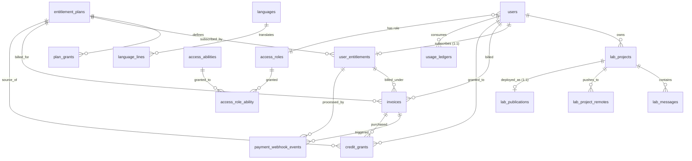
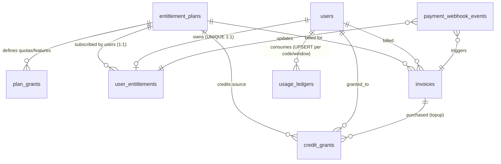
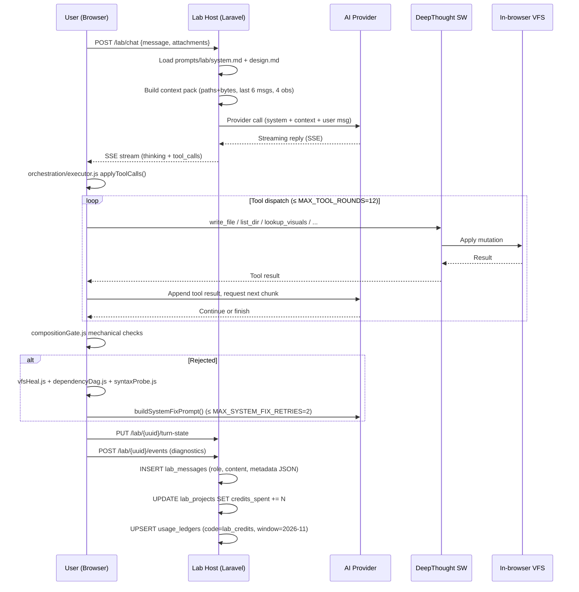

# Krikkit → Managora — Reference Project Analysis & Reusable Insights

> **Purpose**: Independent study of the Krikkit AI Website Builder SaaS (CodeCanyon item #65055559, by deep42) to extract architectural, product, and AI-orchestration insights relevant to Managora — an AI-first, multi-tenant education & institute-management SaaS.
>
> **Method**: Static analysis of supplied files only. No code execution, no dependency installation, no DB modifications.
> **Managora access**: None. No claims are made about Managora's current implementation. All Managora references are framed as recommendations or inferences.
> **Date**: 2026-11-04.

---

## 1. Executive Summary

Krikkit is a **self-hostable, single-tenant-per-user AI website builder SaaS** built on Laravel 13 + Livewire 4 + MySQL, sold one-time on CodeCanyon. Its standout capability is an in-browser WASM runtime ("DeepThought Engine", forked from `ye42/deepthought`) that compiles React/Vite projects entirely in the browser, plus an agentic chat loop with a defined tool catalog, mechanical quality gate, and auto-repair pipeline.

For Managora, the value of studying Krikkit lies in three areas:

1. **SaaS monetization primitives** — a clean three-layer model (`entitlement_plans` → `user_entitlements` → `plan_grants`) paired with an append-only credit ledger + windowed UPSERT usage counter, plus idempotent webhook processing. These are directly portable to education tiers (Free Teacher / Pro / District / Enterprise) with quota codes like `student_seats`, `ai_grading_credits`, `whatsapp_messages`.

2. **AI agent orchestration patterns** — explicit tool catalog with ordering rules, mechanical composition gate (rejects common LLM anti-patterns without a model call), auto-repair pipeline (AST DAG + esbuild parse + `buildSystemFixPrompt()` retry), diff-loop breaker, hard caps on tool rounds and autonomous turns, layered context pack with token discipline. These translate to education agents for rubric generation, lesson planning, AI grading, and tutoring.

3. **Anti-patterns to avoid** — misleading "workspace" naming without a real tenancy table, no soft deletes, no `created_by`/`updated_by` audit columns, raw HTML output (`{!! $html !!}`) creating stored XSS vectors, `postMessage(payload, '*')` to any origin, sandbox `allow-scripts allow-same-origin` combo, vendored runtime fork without verified license.

**Critical gap for Managora**: Krikkit is single-tenant-per-user. Managora needs true multi-tenancy (institute → branches → members) with row-level isolation. Krikkit's "workspace" naming is misleading and provides no multi-tenant pattern to copy — Managora must build this from scratch.

**Overall confidence**: HIGH for SaaS billing schema, AI orchestration code, and frontend architecture (all directly verified in source). MEDIUM for backend enforcement (no `app/` in bundle).

---

## 2. Product Overview

### What Krikkit is

Krikkit lets an operator resell AI-driven website generation. An end user describes a website in plain English; an AI agent (default: Claude Sonnet 4.5) generates a real React/Vite project via tool calls; the user previews in-browser, edits with visual Inspect mode, and publishes to a subdomain or custom domain. The operator monetizes via Stripe/PayPal subscriptions and credit packs.

### Tech stack (verified in source)

| Layer | Technology |
|---|---|
| Runtime | PHP 8.3+ |
| Backend | Laravel 13 |
| UI | Livewire 4 + Blade + Tailwind CSS v4 |
| Lab frontend | React + Vite + esbuild |
| Database | MySQL 8 / MariaDB 10.6+ (InnoDB, utf8mb4) |
| Queue/cache/session | `database` driver by default |
| In-browser runtime | DeepThought Engine — vendored fork of `ye42/deepthought`, browser-native Node.js |
| AI providers (8) | Anthropic, OpenAI, xAI, DeepSeek, Groq, Mistral, ZhipuAI, Google AI Studio |
| Payments | Stripe + PayPal (webhook-driven) |
| VCS / datastore | GitHub + Supabase (OAuth) |
| Stock photos | Unsplash + Pixabay |
| Mail | SMTP (any) |
| Permissions | spatie/laravel-permission (referenced) + custom `@allows()` Blade directive |
| 2FA | Laravel Fortify (TOTP) |

### Business model

- One-time B2B sale (CodeCanyon) of the platform to operators.
- Recurring B2C revenue for the operator: subscriptions + per-credit top-ups.
- Plan tiers seeded: Free ($0) / Pro ($29/mo or $290/yr) / Agency ("contact sales").
- Credit-based AI metering — every Lab turn consumes credits granted monthly by the plan or purchased as top-ups.

### Target users (four distinct audiences)

| Audience | Role |
|---|---|
| Operator | Buys CodeCanyon item, self-hosts, configures integrations, defines plans |
| End user | Customer of the operator; signs up, chats to AI, builds/publishes sites |
| Admin / staff | Operator's employees with role-based permissions |
| Anonymous visitor | Public web — sees marketing, blog, contact, published sites |

### Key differentiators

1. **In-browser WASM preview runtime** — compiles React/Vite projects entirely in browser (VFS, npm resolution, Vite/Next.js shims, HTTP server, WebSocket, WASI, SQLite). No Docker needed. Verified in `resources/js/lab/runtime/` (~940 files, ~150 test files).
2. **Agentic tool catalog with explicit ordering rules** — `lookup_visuals` MUST precede `write_file`; stock-photo safety enforced.
3. **Composition gate + auto-repair pipeline** — mechanical rejection of common LLM anti-patterns + AST DAG analysis + esbuild parse + model fix retry.
4. **Bundled SaaS operational layer** — credits, packs, RBAC, session audit, lab-admin failed-turn triage, finance dashboard.

### Domain mismatch with Managora

Krikkit's domain (AI website builder) is very different from Managora's (institute management). The reusable value is in **architecture and patterns**, not feature inventory. Section 11 (Reusable Concepts) is the heart of this report.

---

## 3. Complete Feature and Module Inventory

### 3.1 Public surface

| Module | Purpose | Business problem solved |
|---|---|---|
| Landing page (`/`) | Marketing site with hero, features, pricing, FAQ | Customer acquisition |
| Pricing (`/pricing`) | Public plan comparison, monthly/yearly toggle | Self-serve conversion |
| Checkout (`/checkout/start/{plan}`) | Stripe / PayPal driver picker | Payment initiation |
| Blog (`/blog`) | CMS blog for SEO + announcements | Content marketing |
| Contact (`/contact`) | Contact form with admin triage | Lead capture |
| Static pages (`/pages/{slug}`) | Marketing/legal static pages | Brand presence |
| Legal (`/privacy`, `/terms`, `/refund`, `/license`) | Per-locale legal toggles | Compliance |
| Newsletter (`POST /newsletter`) | Email capture with double opt-in | List building |

### 3.2 Auth surface

| Module | Purpose |
|---|---|
| Login / Register / Forgot / Reset / Verify email | Standard Laravel auth |
| Registration toggle | Admin can disable public signup via `SiteSettings::allowRegistration()` |
| 2FA (TOTP) | Enable / confirm / regenerate / disable; recovery codes; `two_factor_last_timestep` for replay protection |
| Sessions (DB driver) | Laravel DB session driver; admin can browse at `/dashboard/sessions` |

### 3.3 Studio (post-login user shell)

| Module | Purpose |
|---|---|
| Studio home (`/`) | Project list, hero/composer where user types a brief |
| Projects page | Paginated opened+edited lists with lazy scroll |
| Starred page | Favorites |
| Project export | ZIP download (entitlement-gated) |
| Studio composer | Plain-English brief → Lab handoff (Livewire + IndexedDB for file blobs) |

### 3.4 Lab (AI website builder) — the core product

| Module | Purpose |
|---|---|
| Lab IDE (`/lab/{uuid}`) | Three-pane: chat (left) + preview/code/database tabs (center/right) + optional terminal (bottom) |
| AI chat composer | Multi-line prompts, image attachments (vision), model picker |
| Streaming (SSE) | `GET /lab/chat/stream/{messageId}` for incremental reply + tool calls |
| Tool cards | Live tool execution UI (thinking, lookup_visuals, write_file) |
| In-browser preview | DeepThought WASM runtime under cross-origin isolation |
| Server-side Vite preview | Real Vite per project, ports 15000–15999, `proc_open` |
| Code editor | File tree + CodeMirror, multi-tab, Cmd/Ctrl+S |
| Terminal | Sandbox shell, 180s default timeout |
| Database panel | Supabase schema/SQL/rows + Allow/Skip migrations |
| Inspect mode | Element inspector + design chat + prompt chips + screenshot edit |
| Builds & auto-fix | Build sessions, auto-repair loop, thumbnails |
| Lab Console (admin) | Default model, model-selection toggle, notification sounds |
| Lab Admin (admin) | Browse all projects, usage, failed turns triage |

### 3.5 CMS / marketing modules (admin)

| Module | Purpose |
|---|---|
| Pages | Static CMS pages (title, slug, body, published) |
| Blogs | Marketing/announcement posts with author and excerpt |
| Contacts | Contact form submissions inbox with reply tracking |
| Newsletter | Email subscriber list with double opt-in |
| Languages | Locale registry + AI translation UI (uses `prompts/translate/system.md`) |
| SEO | Site-wide meta, OG image, Google/Bing verification |

### 3.6 SaaS / billing modules (admin)

| Module | Purpose |
|---|---|
| Packs | Subscription plan CRUD with quotas + features |
| Subscriptions | Active subscription records with status, interval, provider IDs |
| Invoices | Billing invoices with status lifecycle (open → paid → refunded) |
| Credits | Grant/debit credits per user with transaction history |
| Finance dashboard | MRR, subscription events, webhook events, refund actions |
| Payment gateways | Stripe + PayPal configuration with test/live mode |
| Webhook events | Idempotent inbound webhook log |

### 3.7 Admin / RBAC modules

| Module | Purpose |
|---|---|
| Dashboard home | KPIs, recent activity, attention items |
| Users | User CRUD with role assignment |
| Access Roles | Custom role creation with subset of 36 abilities |
| Sessions | Platform-wide session audit |
| General & Branding | Site name, logos, default theme/language/currency |
| Appearance | Admin UI theme/accent/density |
| Privacy & Legal | Per-locale legal content toggles |
| Integrations | AI provider keys, GitHub/Supabase OAuth, stock photo keys, per-model pricing |
| Publish settings | Publish feature toggle + DNS guidance |
| Lab Console | Default model, model-selection toggle |
| Mail (SMTP) | Env-driven, route exists in dashboard command palette |
| License / Permit | Envato license verification (deferred at install) |

### 3.8 User-facing settings modules

Profile, Password, Two-factor, General (theme + AI defaults), Subscription, Credits, Usage, Applications (linked accounts).

### 3.9 Reporting and analytics

Limited. The Lab admin shows:
- `/dashboard/lab/usage` — per-project AI spend (credits).
- `/dashboard/finance` — MRR, subscription events, webhook events.
- `/settings/usage` — per-user quota snapshot, per-project credits, per-model token counts.

There is no general-purpose report builder, no custom dashboard, no exportable analytics beyond CSV export of spending history ("when enabled").

---

## 4. Business Workflows

### 4.1 Workflow: New user → subscription → first AI website → publish

**Actors**: End user, Laravel backend, AI provider, DeepThought service worker, DNS provider.

**Steps**:

1. User signs up → `users` row created (`status='active'`, `access_role_id=2` member); `user_entitlements` row auto-created pointing at default plan (Free).
2. User enters a brief in Studio composer → Livewire `openLab(text, hasFiles)`:
   - Inserts `lab_projects` (`uuid`, `user_id`, `workspace_status='pending'`, `kit_version`, `stack`).
   - Scaffolds on-disk files under `storage/app/lab/projects/{uuid}/`.
   - Redirects to `/lab/{uuid}`.
3. Lab boots — registers DeepThought service worker (`/__krikkit_lab_sw__.js?v=host-vite-5173-29`) with scope `/`, mounts `<div id="lab-root">` with JSON bootstrap (`#lab-bootstrap`, `#lab-workspace`, `#lab-prefs`, `#lab-pulse`, `#lab-config`).
4. User sends a prompt → `useLabChat.sendLabChat()` POSTs to `/lab/chat`. Server constructs system prompt from `prompts/lab/system.md` + `prompts/lab/design.md` + a context pack built client-side by `orchestration/contextPack.js` (paths+bytes only, last 6 messages, last 4 observations truncated to 400 chars + 800-char snippets — **never the full VFS**).
5. Server streams AI reply via SSE at `/lab/chat/stream/{messageId}`.
6. Assistant returns tool calls; `orchestration/executor.js applyToolCalls()` dispatches via `orchestration/toolRuntime.js` (`write_file`, `list_dir`, `read_file`, `grep`, `file_search`, `scan_dir`, `lookup_visuals`, `survey_datastore`, `revise_datastore`, GitHub tools).
7. Tool results appended to conversation; model continues until lane complete or `MAX_TOOL_ROUNDS = 12` hit.
8. **Composition gate** (`compositionGate.js`) mechanically rejects common LLM anti-patterns (glow-only heroes, empty product tiles, name-only stubs).
9. If rejected, **auto-repair pipeline** runs: `vfsHeal.js` + `dependencyDag.js` + `syntaxProbe.js` run `esbuild` parse + DAG analysis, auto-stub missing modules, retry up to `MAX_SYSTEM_FIX_RETRIES = 2` with `buildSystemFixPrompt()`.
10. **Credit metering**: server updates `lab_projects.credits_spent` and UPSERTs into `usage_ledgers` (`code='lab_credits'`, `window_key='2026-11'`). Insufficient balance → upgrade drawer deep-linking to `/dashboard/billing`.
11. User previews (DeepThought WASM runtime or server Vite at `/preview-dev/{uuid}/`), toggles Inspect to tweak CSS or send design prompt + screenshot.
12. **Publish**: PublishProjectModal → Subdomain mode (`{sub}.{publish_root}`) or Custom domain (plan-gated, CNAME + TXT `_krikkit-lab.{host} = krikkit={token}` DNS verification). `lab_publications` row inserted with `status='queued'` → `'building'` → `'live'`.
13. Two composite indexes `(status, subdomain)` and `(status, custom_host)` power edge routing in `routes/published.php`.

**Records created**: `users`, `user_entitlements`, `lab_projects`, `lab_messages` (per turn), `usage_ledgers` (UPSERT), `lab_publications`.

**Status transitions**: `lab_projects.workspace_status` `pending` → `ready` → (optionally) `frozen`. `lab_publications.status` `idle` → `queued` → `building` → `live` → `error`.

**Validations**: composition gate (mechanical), auto-repair (AST DAG + esbuild), DNS verification for custom domain, entitlement check for publish.

**Notifications**: upgrade drawer on insufficient credits; `beforeunload` block during build; admin Lab admin failed-turn queue at `/dashboard/lab/turns`.

**Failure scenarios**: AI provider error (SSE terminates, user sees error, admin reviews); composition gate rejection (auto-repair retries 2× then hard-fails); diff-loop (3 near-identical writes → abort); auto-continue cap (`MAX_AUTONOMOUS_TURNS = 4`); webhook failure (`payment_webhook_events.status='failed'` with `last_error`).

### 4.2 Workflow: Subscription upgrade / credit top-up

1. User hits upgrade gate (insufficient credits/projects/storage/private-projects/publish-domains). Lab opens upgrade drawer deep-linking to `/dashboard/billing`.
2. `/dashboard/billing` shows current plan, renewal, credit balance, available plans (read from `entitlement_plans` where `is_active=1`).
3. User clicks Subscribe → `/checkout/start/{plan}?interval=&driver=`.
4. Stripe/PayPal checkout → webhook hits `/webhooks/stripe` or `/webhooks/paypal`:
   - INSERT `payment_webhook_events` (UNIQUE `(driver, provider_event_id)` for idempotency).
   - INSERT/update `invoices` (`status='paid'`, `paid_at`).
   - INSERT/update `user_entitlements` (`status='active'`, `driver`, `provider_subscription_id`, `interval`, `started_at`, `last_paid_at`).
   - If plan includes monthly credits, INSERT `credit_grants` (`kind='subscription'`, `entitlement_plan_id`, `amount`).
5. Scheduler `packs:refresh-subscriptions` reconciles `ends_at` with provider side.
6. Optional credit top-up via admin at `/dashboard/credits` — `credit_grants.kind='topup'`, `invoice_id` set if paid.

### 4.3 Workflow: Admin assigns roles

1. Admin opens `/dashboard/roles` (requires `roles.browse`).
2. Existing roles listed from `access_roles` (seeded: `owner` locked=1, 36 abilities; `member` locked=0, 2 abilities).
3. Admin clicks "Create role" → enters `title`, `summary`, toggles permission groups (Dashboard, Users, Roles, Builders, Credits, Packs, Pages, Blogs, Subscriptions, Payment gateways, Languages, AI providers).
4. Each toggle inserts/removes rows in `access_role_ability` (composite PK, CASCADE both sides).
5. Admin assigns role to user at `/dashboard/users` → user's `access_role_id` updated (single role per user — **no pivot table**).
6. Permission checks: client-side via `@allows('ability.code')` Blade directive (hides UI); server-side via route middleware + Laravel Gate (inferred; `app/` not in bundle).
7. System roles (`locked=1`) cannot be edited/deleted. Roles with assigned users cannot be deleted until reassigned.

### 4.4 Workflow: AI chat turn lifecycle (single turn, full detail)

State machine (`orchestration/turnMachine.js`):

```
INGRESS → ROUTING → {CHAT_LANE | BUILD_LANE | CLARIFY_LANE}
BUILD_LANE → EXECUTOR → COMPOSITION_GATE
  → VALIDATOR (pass) → COMMIT_BARRIER → PRESENT
  → HEAL (reject) → EXECUTOR (retry ≤ MAX_REPAIR_ROUNDS=4)
VALIDATOR (fail) → HEAL → EXECUTOR
COMMIT_BARRIER (error) → ROLLBACK
```

**Hard caps** (from `orchestration/constants.js`):

| Constant | Value | Purpose |
|---|---|---|
| `MAX_TOOL_ROUNDS` | 12 | Hard cap on tool dispatches per turn |
| `MAX_AUTONOMOUS_TURNS` | 4 | Max consecutive auto-continue turns |
| `MAX_REPAIR_ROUNDS` | 4 | Max model self-repair attempts |
| `MAX_SYSTEM_FIX_RETRIES` | 2 | Hard cap on auto-repair via `buildSystemFixPrompt` |
| `MAX_EXPLORE_TOOLS_PER_TURN` | 2 | Read tools before requiring a write |
| `DIFF_LOOP_IDENTICAL_AFTER` | 3 | Abort if 3 near-identical writes to same file |
| `PATH_CLAIMS_MAX` | 512 | SW LRU bound for path claims |

**Agent loop "system errors"** (`orchestration/agentLoop.js`): 14+ exact-string constants (`EXPLORE_ONLY_SYSTEM_ERROR`, truncated-output, missing-imports, page-assembly-incomplete, multi-page-routing-incomplete, etc.) appended verbatim to model context when misbehavior detected. **Fragile prompt-engineering surface** — depends on model taking literal text seriously.

### 4.5 Workflow: Custom domain DNS verification

1. User opens Publish modal → selects Custom Domain.
2. Server generates `verify_token` (varchar 64), inserts `lab_publications` (`kind='custom_domain'`, `custom_host`, `status='queued'`, `verify_token`).
3. UI shows DNS instructions: CNAME custom host to APP_URL host + TXT record `_krikkit-lab.{host} = krikkit={token}`.
4. Server polls DNS for TXT record containing the token.
5. On match: `custom_host_verified_at` set; `status` progresses `queued` → `building` → `live`.
6. Edge router uses composite index `(status, custom_host)` to dispatch incoming requests to the right publication.

---

## 5. Domain Model and Data Relationships

### 5.1 Schema overview

- 37 InnoDB tables, `utf8mb4` / `utf8mb4_unicode_ci`.
- JSON columns use `utf8mb4_bin` with `CHECK(json_valid(...))` constraints (MariaDB idiom).
- 38 migrations recorded, all batch 1.
- **Mixed ID strategy**: auto-increment `bigint` PKs for internal joins + ULID `public_id` (char 26) for customer-facing shareable IDs + true UUID `char(36)` for `lab_projects.uuid` (editor URL).
- **Soft deletes**: 🚫 NONE. No `deleted_at` on any table. Conceptual "delete" is `*_retire` ability + `status` lifecycle + `ON DELETE CASCADE`/`SET NULL`.
- **Audit columns** (`created_by`/`updated_by`): 🚫 NONE. Per-table ad-hoc (`granted_by`, `replied_by`, `refunded_by`, `author_id`).
- **JSON columns** (9 total): `lab_messages.metadata`, `payment_gateways.settings`, `payment_webhook_events.payload`, `site_settings.payload`, `users.appearance`, `users.preferences`, `user_datastore_links.settings`, `workspace_datastores.settings`, `workspace_oauth_apps.settings`.
- **No ENUM types** — all enumerated fields are `varchar` strings with application-level validation (Laravel convention).

### 5.2 Main entities and relationships



### 5.3 Multi-tenancy analysis (critical finding)

**There is NO `workspaces` table and NO `workspace_id` FK on any of the 37 tables.** Despite three tables prefixed `workspace_*` (`workspace_datastores`, `workspace_oauth_apps`, `ai_workspace_settings`), **none are per-workspace** — each is a singleton/global config table with UNIQUE on `kind`/`driver`/`default_model`.

The product is **single-tenant-per-user, single-instance shared DB**:
- `lab_projects.user_id` scopes projects to their owner.
- `credit_grants.user_id`, `usage_ledgers.user_id`, `invoices.user_id`, `contacts.user_id`, `user_entitlements.user_id` (UNIQUE — 1:1), `user_vcs_links.user_id`, `user_datastore_links.user_id` all scope to a single user.
- No `workspace_members` pivot; no `user_role` pivot. The `users.access_role_id` FK assigns a single role per user.

The `access_roles` seeded values (`owner`, `member`) are described in their `summary` text as "workspace roles", but the implementation is per-user — there is no workspace entity to be a member of.

### 5.4 RBAC model

- **3-table RBAC** (Spatie-style): `access_roles`, `access_abilities`, `access_role_ability` pivot.
- **One role per user** via `users.access_role_id` FK.
- **36 seeded abilities** across 13 clusters (Dashboard, Users, Roles, Security, AI, Packs, Payments, Finance, Projects, Settings, Contacts, Blog, Pages, Languages).
- **Verb vocabulary** (Krikkit's own): `browse` / `compose` / `revise` / `retire` (read/create/update/delete) + `self` action (`security.self`).
- **No per-row / per-resource permissions**, no role hierarchy, no ability-scope-to-workspace concept.
- **System roles locked**: `access_roles.locked=1` prevents editing/deletion of `owner`.

### 5.5 Billing model (3-layer)



- `entitlement_plans` (catalog) → `user_entitlements` (1:1 per user) → `plan_grants` (what the plan includes).
- **Append-only ledger pattern**: `credit_grants` is the credit-IN ledger (no negative rows; `kind` = `subscription`/`topup`/`promotional`); `usage_ledgers` is the consumption ledger (UPSERT-incremented per window). Current balance = `SUM(credit_grants.amount) - SUM(usage_ledgers.consumed WHERE code='lab_credits')`.
- **Quota enforcement pattern**: `usage_ledgers.consumed` for `(user_id, code, window_key)` is compared against `plan_grants.ceiling` for `(plan_id, code, window)`.
- **Feature flag pattern**: `plan_grants.allowed = 1` for `kind='feature'` codes.
- **18 seeded grants** across 3 plans (Free / Pro / Agency).

### 5.6 Important fields and statuses

| Table | Status fields | Lifecycle |
|---|---|---|
| `lab_projects` | `workspace_status` (`pending`/`ready`/`failed`/`frozen`); `frozen_at` | Pending → Ready → Frozen (on quota/billing issue) |
| `lab_publications` | `status` (`idle`/`queued`/`building`/`live`/`error`); `custom_host_verified_at`; `published_at` | Idle → Queued → Building → Live (or Error) |
| `invoices` | `status` (`open`/`paid`/`refunded`/`void`); `paid_at`; `refunded_at` | Open → Paid → Refunded/Void |
| `payment_webhook_events` | `status` (`received`/`processing`/`processed`/`failed`); `attempts` | Received → Processing → Processed/Failed |
| `user_entitlements` | `status` (`active`/`canceled`/`past_due`); `started_at`; `ends_at`; `last_paid_at` | Active → Canceled/Past_due |
| `users` | `status` (`active`); `email_verified_at`; `two_factor_confirmed_at` | (no formal lifecycle beyond active) |
| `blog_posts` / `site_pages` | `published` (bool); `published_on` (date) | Draft → Published |

### 5.7 Constraints and business rules

- UNIQUE `(driver, provider_event_id)` on `payment_webhook_events` — **idempotency key**.
- UNIQUE `(driver, provider_invoice_id)` on `invoices` — provider-side idempotency.
- UNIQUE `(user_id, code, window_key)` on `usage_ledgers` — UPSERT target.
- UNIQUE `user_entitlements.user_id` — single-plan-per-user (1:1).
- UNIQUE `lab_publications.lab_project_id` — 1:1 publication per project.
- UNIQUE `(lab_project_id, driver)` on `lab_project_remotes` — one remote per VCS driver.
- UNIQUE `access_abilities.code` — ability slug is authoritative.
- UNIQUE `entitlement_plans.slug`, `access_roles.slug`, `languages.code` — all use slug-based identification.
- `access_roles.locked=1` prevents editing/deletion of system roles.
- `payment_gateways.mode` defaults to `'test'` — safe-by-default.
- `entitlement_plans.price_monthly`/`price_yearly` nullable — used for "contact sales" tier (Agency).

### 5.8 Why the data model is structured this way

- **Append-only ledger + UPSERT counter** for credits/usage: enables a single indexed query for "current balance" without row-per-call explosion; supports monthly window roll by switching `window_key` (e.g. `2026-11` → `2026-12`) — old window rows remain for audit.
- **3-layer plan/entitlement/grant**: separates catalog (`entitlement_plans`) from what each plan includes (`plan_grants`) from the user's active subscription (`user_entitlements`) — lets admins change plan contents without touching active subscriptions.
- **No soft deletes**: intentional hard-delete with audit trail via `invoices` / `payment_webhook_events` / `usage_ledgers` — keeps schema simple, avoids "deleted but still here" edge cases.
- **Slug-based identification** (ULID `public_id` for customer-facing, UUID for editor URLs, auto-increment for internal joins): balances URL safety, sortability, and join performance.
- **JSON columns for flexible config** (`site_settings.payload`, `payment_gateways.settings`, `users.appearance`): trades queryability for schema flexibility.

---

## 6. UI/UX Patterns

### 6.1 Main navigation and module organization

| Surface | Layout |
|---|---|
| Public | Single marketing page with anchored sections + dedicated routes for `/pricing`, `/blog`, `/contact`, `/pages/{slug}` |
| Auth | Centered card on dark canvas |
| Studio (post-login user shell) | Fixed left sidebar + centered content column; soft radial-gradient top accent |
| Lab | Three-pane: chat (left) + preview chrome (center/right) + optional terminal (bottom) |
| Settings (user) | Two-column: nav rail (Profile / General / Applications / Subscription / Credits / Usage) + content |
| Dashboard (admin) | Sidebar with RBAC-gated groups + content; command palette (Cmd+K) |

### 6.2 Dashboards

- **Admin dashboard home** (`/dashboard`) — KPI cards, recent Lab activity, attention items (failed turns / pending invoices), quick links. 24.8 KB view.
- **Finance dashboard** — 17 KB; MRR, subscription events, webhook events, refund actions.
- **Lab admin** — `/dashboard/lab` (projects), `/dashboard/lab/usage` (AI spend), `/dashboard/lab/turns` (failed turns triage).
- **User usage** (`/settings/usage`) — quota snapshot, per-project credits, per-model token counts.

### 6.3 Forms and data-entry workflows

- Livewire `wire:model.live.debounce.250ms` for live validation everywhere.
- `<krikkit:input>`, `<krikkit:select>`, `<krikkit:modal>`, `<krikkit:confirm>`, `<krikkit:dropdown>` Blade components (consistent design system in `views/krikkit/*`).
- Decoy anti-autofill fields (`prevent_autofill_*` hidden inputs) in OAuth secret forms — hacky pattern.

### 6.4 Search, filtering, bulk operations

- `wire:model.live.debounce.250ms="search"` is ubiquitous.
- Pricing page uses Alpine `x-data="{ billing: 'monthly' }"` for monthly/yearly toggle.
- Studio has separate "Opened" and "Edited" project shelves with lazy pagination via `wire:intersect.once.margin.160px`.
- **No evidence of bulk operations** (no multi-select tables, no bulk delete/assign).

### 6.5 Detail pages

- `/dashboard/lab/{project}` — project detail with `Open in Lab` link, owner reassignment, freeze/delete.
- `/dashboard/invoices/{id}` — invoice detail with refund action.
- `/dashboard/finance/event/{id}` — webhook event detail with raw payload.

### 6.6 Role-specific interfaces

- Custom `@allows('ability.code')` Blade directive hides UI elements the user can't act on (e.g. `@allows('users.browse')`).
- Dashboard sidebar built dynamically via `App\Support\Navigation\WorkspaceNav::visibleGroups($user)`.
- Command palette (Cmd+K) filtered by `@allows(...)` — only items the user can act on appear.

### 6.7 Mobile and responsive behavior

- All views use Tailwind v4 with standard responsive prefixes (`sm:`/`md:`/`lg:`/`xl:`).
- The Lab IDE is **desktop-first** (three-pane) — no explicit mobile Lab experience documented.
- Studio is responsive (sidebar collapses).
- No PWA manifest beyond standard favicons.

### 6.8 Useful patterns to extract

| Pattern | Where | How |
|---|---|---|
| **IndexedDB handoff for large uploads** | Studio → Lab | `stashStudioHandoff(files)` writes file blobs to IndexedDB; Lab calls `takeStudioHandoff()` on boot — avoids Livewire snapshot bloat |
| **SSE streaming with tool chrome** | Lab chat | `sendLabChat()` opens an EventSource; thinking blocks + tool cards render incrementally |
| **Lazy pagination via `wire:intersect`** | Studio projects list | Triggered when sentinel enters viewport with 160px margin |
| **Command palette (Cmd+K)** | Dashboard | `<krikkit:command.item>` list filtered by `@allows('...')` |
| **Atomic VFS commits** | Lab build lane | `commitBarrier.atomicCommit` / `rollbackWorking` — pending writes staged then committed/rolled back atomically |
| **Composition gate (mechanical rejection)** | Lab build lane | Regex/DAG checks reject common LLM anti-patterns without spending a model call |
| **Auto-repair pipeline** | Lab build lane | `vfsHeal.js` + `dependencyDag.js` + `syntaxProbe.js` + `validator.js` retry up to 2× with `buildSystemFixPrompt()` |
| **Diff-loop breaker** | Lab build lane | After 3 near-identical writes to one file, abort the turn |
| **Service worker per-instance port routing** | Lab preview | SW maintains `instancePorts` map keyed by `instanceId` + bounded `pathClaims` LRU (max 512) — supports multi-tab without cross-contamination |
| **JSON bootstrap in `<script type="application/json">`** | Lab host | Avoids data attributes for large payloads; survives F5 reloads |
| **Database-backed i18n with AI translation** | Languages module | `languages` + `language_lines` tables (Spatie Laravel Translation Loader pattern); `wire:click="translatePage"` AI button uses `prompts/translate/system.md` |

---

## 7. Technical Architecture

### 7.1 Frameworks and technologies

Laravel 13 + Livewire 4 + Blade + Tailwind CSS v4 (backend/UI); React + Vite + esbuild (Lab frontend); MySQL 8 / MariaDB 10.6+ InnoDB (DB); Vite + esbuild (build); DeepThought Engine — vendored fork of `ye42/deepthought` browser-native Node.js runtime (in-browser preview); spatie/laravel-permission (RBAC, referenced); Laravel Fortify (2FA TOTP).

### 7.2 Application structure (as supplied)

```
ServerFiles/Krikkit/resources/
├── prompts/                4 AI prompt files (Markdown)
├── views/                  250 Blade templates
├── css/app.css             Tailwind v4 entry (33 KB)
└── js/
    ├── studio/             Studio composer (2 files)
    └── lab/
        ├── LabApp.jsx       Root React component (1001 lines)
        ├── hooks/            9 React hooks (172 KB)
        ├── lib/              65 utilities (536 KB)
        ├── orchestration/    28 files (318 KB) — AI turn state machine
        ├── preview/          2 files (17 KB)
        └── runtime/          DeepThought Engine (45 MB, 940 files)
```

**Missing Laravel folders** (not supplied): `app/`, `routes/`, `config/`, `database/migrations/`, `bootstrap/`, `public/`, `tests/`, `composer.json`, `package.json`, `vite.config.js`.

### 7.3 Module extensibility

- **Blade UI kit** (`views/krikkit/*`) provides 25+ composable components (button, input, select, modal, dropdown, card, table, pagination, editor, datePicker, timePicker, colorPicker, fileUpload, command, toast, tabs, slider, switch, radio, checkbox, pillbox, progress, skeleton, breadcrumbs, callout, confirm, context, dropdown, calendar).
- **Studio UI kit** (`views/components/studio/*`) — frame, hero, sidebar, header, footer, projects, projectCard, projectSkeleton, projectModals, pack, composerPlus, theme.
- **Lab frontend** is cleanly split: `orchestration/` (pure turn state machine + tool runtime, no React — testable in isolation), `hooks/` (React state), `lib/` (low-level utilities), `runtime/` (vendored sandbox).
- No plugin/extension mechanism documented — adding a new AI provider requires editing the integration admin form and adding the provider slug to the AI dispatcher (in `app/`, not supplied).

### 7.4 Service and controller organization

Backend services referenced from Blade (not in bundle):
- `App\Support\Site\SiteSettings` (singleton site config reader)
- `App\Support\Site\LandingCopy`
- `App\Support\Workspace\WorkspaceNav`, `WorkspacePulse`
- `App\Support\Ui\ThemePalette`, `Pulse`
- `App\Support\Account\DeskPreferences`
- `App\Support\Seo\PageSeo`
- `App\Support\Content\PublicIndex`
- `App\Integrations\Github\GithubLinkBroker`
- `App\Finance\FinanceCopy`

### 7.5 API architecture

- **Public REST**: `/lab/chat` (POST, SSE streaming), `/lab/{uuid}/workspace/files`, `/lab/{uuid}/workspace/terminal/execute`, `/lab/{uuid}/publish`, `/webhooks/stripe`, `/webhooks/paypal`, etc.
- **No public API for programmatic access to Krikkit itself** — no API tokens, no Sanctum/Passport evidence.
- **SSE streaming** for AI chat (not WebSocket) — simpler, works through proxies, but can't carry binary attachments (hence the IndexedDB handoff).

### 7.6 Background processing

- Laravel queue (`database` driver by default; Redis optional). Tables: `jobs`, `job_batches`, `failed_jobs`.
- Documented scheduler: `packs:refresh-subscriptions` (syncs `user_entitlements.ends_at` with provider side).
- **Documentation inconsistency**: `docs/updating.md` says "core Lab preview/publish flows do not require a worker"; `docs/installation.md` lists Supervisor as required; `docs/lab-integrations.md` says GitHub sync "requires real queue worker (not `sync`)".

### 7.7 Events and notifications

- **Inbound billing webhooks** → `payment_webhook_events` table with idempotent UNIQUE `(driver, provider_event_id)`, state machine (received → processing → processed / failed), retry counter, raw payload preserved.
- **Outbound AI generation webhooks**: 🚫 Not present.
- **Internal events**: Lab frontend posts diagnostics to `/lab/{uuid}/events` (fire-and-forget); Livewire events for project mutations.
- **Notifications**: upgrade drawer on insufficient credits; `beforeunload` block during build; admin Lab admin failed-turn queue.

### 7.8 Authentication and authorization

- Laravel auth scaffolding (Breeze/Fortify-style): login, register, forgot/reset password, confirm password, verify email, 2FA challenge.
- 2FA TOTP with `two_factor_last_timestep` (64-bit counter of last accepted timestep — TOTP replay protection).
- CSRF protection standard Laravel.
- RBAC: 3-table Spatie-style + custom `@allows()` Blade directive.

### 7.9 File management

- Per-project files under `storage/app/lab/projects/{uuid}/` on local disk.
- ZIP exports under `storage/app/exports` (retention `KRIKKIT_EXPORT_RETENTION_DAYS`).
- **No S3 / object storage documented** — horizontal scaling would require shared filesystem or migration to object storage.
- Lab build artifacts: max `LAB_PUBLISH_ARTIFACT_MAX_BYTES=52428800` (50 MB) / `LAB_PUBLISH_ARTIFACT_MAX_FILES=5000`.

### 7.10 Logging and error handling

- **Lab turn errors**: classified into 10 error classes (`ERROR_CLASSES` in `orchestration/constants.js`). Failed turns persisted server-side and surfaced in admin Lab admin failed-turn queue.
- **Webhook failures**: `payment_webhook_events.status='failed'` with `last_error` text; admin can manually retry from `/dashboard/finance/event/{id}`.
- **Auto-repair pipeline**: detects missing imports via AST DAG, auto-stubs, runs `esbuild` parse, retries with `buildSystemFixPrompt()` up to 2 times.
- No central log aggregation documented.

### 7.11 External integrations

| Integration | Type | Storage |
|---|---|---|
| 8 AI providers | API key | `ai_provider_credentials` |
| Stripe + PayPal | Payment | `payment_gateways` |
| GitHub | VCS OAuth | `workspace_oauth_apps` + `user_vcs_links` |
| Supabase | Datastore OAuth | `workspace_oauth_apps` + `user_datastore_links` |
| Unsplash + Pixabay | Stock photos | `ai_provider_credentials` |
| DuckDuckGo / Brave | Web search | Direct call / optional API key |
| SMTP (any) | Mail | `.env` |

### 7.12 Architecture trade-offs

**Advantages**:
- Clean separation of concerns in Lab frontend (orchestration vs. hooks vs. lib vs. runtime).
- SSE over WebSocket for AI chat — simpler, proxy-friendly.
- Vendored runtime enables in-browser preview without Docker.
- Spatie i18n loader pattern with AI translation.
- Idempotent webhook processing.

**Limitations**:
- Single-tenant-per-user — no real multi-tenancy.
- Vendored runtime fork — sync burden, license compliance must be verified.
- Massive bundle size (44 MB runtime dist, 1.27 MB `__worker__.js`).
- No public API for programmatic access.
- No tests for orchestration/hooks (only runtime has tests).
- Fragile prompt engineering (14+ exact-string "system errors").

---

## 8. SaaS and Commercial Model

### 8.1 Subscription plans

| Plan | Slug | Price monthly | Price yearly | Default? | Rank | Notes |
|---|---|---|---|---|---|---|
| Free | `free` | $0.00 | $0.00 | ✅ | 10 | 3 projects, 100 lab_credits monthly, no features |
| Pro | `pro` | $29.00 | $290.00 | – | 20 | 25 projects, 2500 lab_credits monthly, all features |
| Agency | `agency` | NULL | NULL | – | 30 | "Contact sales"; unlimited projects + lab_credits |

Schema: `entitlement_plans` (`slug` UNIQUE, `title`, `summary`, `rank`, `price_monthly`, `price_yearly`, `is_default`, `is_active`). Currency is per-invoice (`invoices.currency` varchar(3) default `USD`).

### 8.2 Feature entitlements

`plan_grants` defines what each plan includes:
- `entitlement_plan_id` FK CASCADE.
- `code` (controlled vocabulary: `projects`, `lab_credits`, `custom_subdomain`, `custom_domain`, `advanced_export`, `github_import`).
- `kind` (`quota`/`feature`).
- `allowed` tinyint (for features).
- `ceiling` int (for quotas).
- `window` (`lifetime`/`monthly`/`none`).
- UNIQUE `(entitlement_plan_id, code)`.

**18 seeded grants** across the 3 plans.

### 8.3 Usage quotas

- **Credits** are the metering unit for AI Lab usage.
- **Append-only ledger**: `credit_grants` (additive only — `kind` = `subscription`/`topup`/`promotional`/`adjustment`).
- **UPSERT counter**: `usage_ledgers` per `(user_id, code, window_key)` — `consumed` int.
- **Balance** = `SUM(credit_grants.amount) - SUM(usage_ledgers.consumed WHERE code='lab_credits')`.
- **Monthly reset**: `window_key` rolls monthly (e.g. `2026-11` → `2026-12`); a new row is UPSERTed.

### 8.4 Multi-tenant and multi-branch support

🚫 **Not present.** Single-tenant-per-user, single-instance shared DB. No `workspaces` table, no `workspace_id` FK on any table. The "workspace" naming is misleading.

### 8.5 Add-on modules

🚫 **Not present.** No add-on / module marketplace. Plans gate features via `plan_grants` flags, but there's no separate "module" entity — everything is bundled into the plan.

### 8.6 Billing and payment management

- Stripe + PayPal (configurable in `payment_gateways`).
- Checkout flow: `GET /checkout/start/{plan}?interval={monthly|yearly}&driver={stripe|paypal}` → provider checkout → redirect to `/billing/return` → webhook → update `invoices` + `user_entitlements` + `credit_grants`.
- **Invoices**: status lifecycle (`open` → `paid` → `refunded` → `void`); composite index `(status, paid_at)` for finance reports.
- **Webhook idempotency**: UNIQUE `(driver, provider_event_id)` on `payment_webhook_events` prevents duplicate processing; signature verification at the application layer (only verified events land in the table).
- **CSV export of spending history**: documented in `docs/billing.md` ("when enabled") — toggle not located in supplied bundle.

### 8.7 White-label functionality

🚫 **Not present.** No white-label / multi-instance mode documented. Single CodeCanyon purchase = single deployment.

### 8.8 Tenant provisioning

🚫 **Not applicable** (no multi-tenancy). New user signup is the only "provisioning" — creates `users` + `user_entitlements` rows pointing at default plan.

### 8.9 Account and organization management

- Single account per user (`users.email` UNIQUE, `users.username` UNIQUE).
- Profile management at `/settings/profile` (avatar, name, username, email, phone, country).
- 2FA at `/settings/profile/two-factor`.
- Linked accounts at `/settings/applications` (GitHub, Supabase, datastore).
- **No organization/team entity** — no `organizations`, no `team_members`, no `team_invitations` tables.

### 8.10 Commercial implications for Managora

- **The 3-layer plan/entitlement/grant model is portable** to education tiers (Free Teacher / Pro / District / Enterprise).
- **The credit ledger + UPSERT counter pattern is directly portable** for AI credits (AI grading credits, AI tutor turns, WhatsApp message credits).
- **Krikkit's single-tenant model is NOT portable** — Managora needs real multi-tenancy (institute → branches → members). This must be built from scratch.
- **No white-label / add-on marketplace** — Managora would need to design its own.

---

## 9. AI, Automation, and Integrations

### 9.1 AI integrations

Eight providers configured in `/dashboard/integration`:

| Provider | Slug | Default? |
|---|---|---|
| Anthropic Claude | `anthropic` | ✅ Default `claude-sonnet-4-5` |
| OpenAI | `openai` | |
| xAI (Grok) | `xai` | |
| DeepSeek | `deepseek` | |
| Groq | `groq` | |
| Mistral | `mistral` | |
| ZhipuAI | `zhipuai` | |
| Google AI Studio | `google` | |

Stored in `ai_provider_credentials` (one row per provider, UNIQUE on `provider`). No BYOK (Bring Your Own Key) — credentials are admin-level/global.

### 9.2 Prompts (4 prompt files in `resources/prompts/`)

| File | Size | Purpose | Format |
|---|---|---|---|
| `prompts/lab/system.md` | 7.8 KB | "Discovery" system prompt — turns LLM into product partner before any code is written. Forces `<thought>…</thought>` blocks before every visible reply. Ends with `<<<KRIKKIT_META {"propose_workspace":true} KRIKKIT_META` sentinel. | Plain Markdown. Dynamic context appended client-side by `contextPack.js`. |
| `prompts/lab/design.md` | 30.7 KB | "Void Precision" design language spec — appended when build workspace opens. Hero recipes, color ladder, type scale, motion rules, Tailwind v4 `@theme` skeleton. | Plain Markdown. Model produces JSX/CSS via `write_file` tool calls. |
| `prompts/title/system.md` | 892 B | Generates short product wordmark for new projects. | Plain text (1-3 word brand name). Returns "Untitled" for non-briefs. |
| `prompts/translate/system.md` | 595 B | Translates UI strings. | JSON object mapping original key → translated value. |

### 9.3 Prompt-engineering patterns

1. **Required structured reasoning blocks**: `<thought>…</thought>` before every visible reply (Anthropic/Claude-style chain-of-thought gating).
2. **Custom out-of-band meta protocol**: `<<<KRIKKIT_META {...} KRIKKIT_META` sentinel — custom, not OpenAI-style tool-calling.
3. **Heavy imperative policy phrasing**: `agentLoop.js` ships exact-string "system errors" appended verbatim when model misbehaves. Codebase explicitly notes "do not paraphrase at call sites" — fragile.
4. **No few-shot examples**: all four prompts are purely instructional.
5. **JSON-structured output** only in the translate prompt; Lab prompts rely on tool calls for structured mutation.
6. **Server-side prompt assembly**: prompts loaded as raw text, concatenated with conversation/tool context at request time.

### 9.4 Agent tool catalog (`LabToolCatalog`)

| Tool | Purpose | Ordering rule |
|---|---|---|
| `list_dir`, `file_search`, `grep`, `read_file`, `scan_dir` | VFS discovery | Discovery phase |
| `write_file` | Atomic full-file overwrite | Mutation (must run AFTER `lookup_visuals` when photos are needed) |
| `lookup_visuals` | Stock photo lookup (Unsplash/Pixabay) | MUST precede `write_file` when photos are needed |
| `survey_datastore` | Supabase schema inspection | When backend integration requested |
| `revise_datastore` | Apply Supabase migrations | After `survey_datastore` + user Allow |
| `create_github_repo`, `fork_github`, `link_github`, `pull_github`, `push_github`, `compare_github` | VCS workflow | |
| `SearchWeb` | Web search (DuckDuckGo default, Brave optional) | Research |
| `FetchFromWeb` | Fetch page text from URL | Research |

### 9.5 AI execution flow (per turn)



### 9.6 AI usage tracking

- **Per-turn**: `lab_messages.metadata` JSON (model, tokens_in/out, latency, tool calls).
- **Per-project running total**: `lab_projects.credits_spent` int.
- **Per-user per-window**: `usage_ledgers` UPSERTed with `code='lab_credits'`, `window_key=current_month`.
- **Per-model breakdown**: `/settings/usage` shows per-model `model`, `credits`, `turns`, `input_tokens`, `output_tokens`.
- **Per-provider cost estimator**: `dashboard/integration/options/edit.blade.php` accepts `unit_cost_usd`, `pricing`, `scenario`, `activeScenario` per model.

### 9.7 Human approval flows

- **Supabase migrations**: agent proposes SQL → user **Allow** or **Skip** via chat cards.
- **Build gate**: before committing a build lane, Lab shows a "ReplyShelf" UI; user accepts/skips with ⌘/Ctrl+Enter.
- **Failed-turn triage**: admins review failed AI turns at `/dashboard/lab/turns`.
- **No content moderation / approval queue** for published sites.

### 9.8 Workflow automation, triggers, scheduled actions

- **Documented scheduler**: `packs:refresh-subscriptions` only.
- **No trigger system** (no "when X happens, do Y" rules engine).
- **No scheduled actions** beyond the subscription sync.
- **Auto-fix loops** run client-side in the Lab frontend (`useLabChat.js` triggers `vfsHeal.js`), not as background jobs.

### 9.9 Webhooks

- **Inbound billing**: Stripe + PayPal → `payment_webhook_events` (idempotent UNIQUE `(driver, provider_event_id)`, state machine, retry counter, raw payload).
- **Outbound AI generation events**: 🚫 Not present.
- **Outbound user-configured webhooks** (e.g. "notify my system when a student enrolls"): 🚫 Not present.

### 9.10 WhatsApp / email / SMS communication automation

- **Email**: SMTP only (env-driven). Used for registration, password reset, billing notifications, system notifications from queued jobs. No marketing automation, no sequence builder.
- **WhatsApp**: 🚫 Not present.
- **SMS**: 🚫 Not present.
- **Newsletter**: simple email list with double opt-in; no automation sequence.

### 9.11 AI vs. rule-based automation (distinguishing)

| Capability | Type |
|---|---|
| Site generation | AI (LLM-driven via prompts + tool calls) |
| Project titling | AI (`prompts/title/system.md`) |
| UI translation | AI (`prompts/translate/system.md`) |
| Inspect mode design edits | AI (screenshot + prompt to LLM) |
| Stock photo lookup | Rule-based (Unsplash/Pixabay API call) |
| Web search | Rule-based (DuckDuckGo/Brave API call) |
| Composition gate | Rule-based (regex/DAG checks) |
| Auto-repair pipeline | Hybrid (DAG analysis + esbuild parse + LLM fix prompt) |
| Intent routing | Rule-based (regex scoring) |
| Turn state machine | Rule-based |
| Credit metering | Rule-based |
| Subscription sync | Rule-based (scheduler) |
| Webhook idempotency | Rule-based (UNIQUE constraint) |

### 9.12 Opportunities for intelligent agents (Managora-relevant)

Krikkit's agentic architecture is purpose-built for website generation. For Managora, similar patterns could power:

- **AI rubric generation agent** — `lookup_curriculum_standards` → `read_student_work` → `generate_rubric` → `validate_against_rubric`.
- **AI lesson planning agent** — `read_course_objectives` → `lookup_resources` → `generate_lesson_plan` → `validate_alignment`.
- **AI grading agent** — `read_rubric` → `read_submission` → `assign_score` → `generate_feedback` (with teacher approval before `submit_grade`).
- **AI tutor agent** — `read_student_history` → `diagnose_gap` → `generate_explanation` → `check_understanding`.
- **AI parent communication agent** — `read_attendance` → `read_grades` → `draft_message` → `human_review` → `send_whatsapp`.

---

## 10. Security, Reliability, and Scalability

### 10.1 Authentication and authorization design

- **Password hashing**: bcrypt cost 12 (verified: `$2y$12$` prefix in seed).
- **2FA TOTP**: Laravel Fortify-style. `two_factor_secret`, `two_factor_recovery_codes`, `two_factor_confirmed_at`, `two_factor_last_timestep` (64-bit counter — TOTP replay protection).
- **CSRF**: standard Laravel (`<meta name="csrf-token">` in `lab.blade.php:6`).
- **Session driver**: `database` — supports session-list admin audit at `/dashboard/sessions`.
- **Password reset**: standard Laravel `password_reset_tokens`.
- **Email verification**: `users.email_verified_at`.
- **Login rate limiting**: not explicitly documented; Laravel's built-in throttling presumed.
- **RBAC**: 3-table Spatie-style + custom `@allows()` Blade directive.
- **Webhook signature verification**: `payment_gateways.webhook_secret` used by driver class to verify Stripe/PayPal webhook signatures before INSERT.

### 10.2 Data isolation

- **Single-tenant-per-user, single-instance shared DB.** No `workspace_id` FK on any table. Each user's data scoped by `user_id` columns at the application layer.
- **No DB-level row-level security.**
- **Lab project isolation**: each project under `storage/app/lab/projects/{uuid}/` on disk; Lab frontend constructs runtime sandbox per-instance (SW `instancePorts` map + bounded `pathClaims` LRU).

### 10.3 Sensitive information handling

- **Plain `text` columns for secrets** (`api_key`, `api_secret`, `access_token`, `client_secret`, `webhook_secret`) — encryption at rest depends on Laravel's `encrypted` cast configured on the model.
- The Blade `integration/options/edit.blade.php` shows a `$unreadableStoredKey` callout — confirms that some keys cannot be re-decrypted after a key rotation, implying they ARE encrypted (good) but the rotation story is fragile.
- `payment_gateways.mode` defaults to `'test'` — safe-by-default.
- License verification endpoint `https://deep42.co/api/deepthought/verify` (deferred at install — `site_settings.payload` contains `{"permit":{"tone":"deferred",...}}`).

### 10.4 Credential storage

- `ai_provider_credentials`: one row per provider, `api_key`/`api_secret` as `text` (encrypted via Laravel cast).
- `payment_gateways`: `public_key`/`secret_key`/`webhook_secret` as `text` (encrypted via Laravel cast).
- `user_vcs_links.access_token`: `text` NOT NULL (encrypted via Laravel cast).
- `user_datastore_links`: `access_token`/`refresh_token`/`publishable_token`/`steward_token` as `text` (encrypted via Laravel cast).
- `workspace_oauth_apps.client_secret`: `text` (encrypted via Laravel cast).

### 10.5 Database integrity

- InnoDB on every table — ACID compliance.
- `utf8mb4_unicode_ci` everywhere; JSON columns use `utf8mb4_bin` with `CHECK(json_valid(...))`.
- Foreign keys with `ON DELETE CASCADE` (e.g. `lab_messages`, `lab_project_remotes`, `lab_publications` cascade from `lab_projects`) or `ON DELETE SET NULL` (most user-FK columns).
- UNIQUE constraints for idempotency (`(driver, provider_event_id)` on webhooks; `(driver, provider_invoice_id)` on invoices; `(user_id, code, window_key)` on usage_ledgers).

### 10.6 Input validation

- Livewire `wire:model.live.debounce.250ms` for live form validation.
- Laravel's built-in validation presumed in controllers (not in bundle).
- No evidence of server-side HTML sanitization for admin-authored content (the `{!! $html !!}` raw output in `views/pages/leaf/leaf.blade.php:11` is a stored XSS vector if `$html` is not sanitized before persistence).

### 10.7 Error handling

- **Lab turn errors**: 10 error classes in `orchestration/constants.js`; failed turns persisted server-side; admin triage queue at `/dashboard/lab/turns`.
- **Auto-repair pipeline**: AST DAG + esbuild parse + `buildSystemFixPrompt()` retry up to 2×.
- **Diff-loop breaker**: 3 near-identical writes → abort turn.
- **Auto-continue cap**: `MAX_AUTONOMOUS_TURNS = 4`.
- **Webhook failures**: `payment_webhook_events.status='failed'` with `last_error`; admin retry from `/dashboard/finance/event/{id}`.
- **No central log aggregation** documented.

### 10.8 Audit logging

- 🚫 **No `created_by`/`updated_by` audit columns** anywhere. Per-table ad-hoc: `contacts.replied_by`, `credit_grants.granted_by`, `invoices.refunded_by`, `blog_posts.author_id`.
- **Audit trail via append-only tables**: `invoices`, `payment_webhook_events`, `usage_ledgers`, `credit_grants` — all preserve history.
- **No soft deletes** — intentional hard-delete with audit trail via the append-only tables.

### 10.9 Performance and scalability risks

1. **Single-instance shared DB** — no sharding, no read replicas documented. The `database` queue/cache/session driver will not scale beyond a single server.
2. **In-browser runtime is per-tab** — each open Lab tab instantiates its own DeepThought runtime + SW + VFS in browser memory. Multi-tab use on low-RAM devices will struggle.
3. **Server-side Vite preview ports 15000–15999** — 1000 concurrent preview servers per host. Beyond that, horizontal scaling required.
4. **`storage/app/lab/projects/{uuid}/` on disk** — local filesystem per server; no S3 / object storage documented.
5. **`usage_ledgers` UPSERT pattern** correct for moderate scale but at very high write concurrency could see lock contention on UNIQUE constraint.
6. **No CDN guidance** for published sites.
7. **Service worker scope `/`** — the Lab SW intercepts ALL same-origin traffic on the Lab host. Operators should run Krikkit on a dedicated subdomain.
8. **Massive bundle size** — 44 MB runtime dist, 1.27 MB `__worker__.js`. Lab page load heavy on first paint.
9. **No tests supplied for the Lab orchestration or hooks** — only the runtime has tests.

### 10.10 Backup and recovery mechanisms

🚫 **Not documented.** `docs/updating.md` says "back up DB and `.env`" before updates — no automated backup, no point-in-time recovery, no disaster-recovery procedures documented.

### 10.11 Confirmed vulnerabilities vs. potential risks

| Issue | Severity | Status |
|---|---|---|
| **Stored XSS via `{!! $html !!}`** in leaf pages (`views/pages/leaf/leaf.blade.php:11`) | High | Confirmed in source (unverified sanitization) |
| **`postMessage(payload, '*')`** to any origin (`views/lab/oauth/popup/popup.blade.php:35`) | Medium | Confirmed in source |
| **Sandbox `allow-scripts allow-same-origin`** combo (`PreviewApp.jsx:210`) | Medium (acceptable for trusted code) | Confirmed in source |
| **Prompt injection surface** — system prompt instructs model to read `[ACTIVE RUNTIME ERRORS]` from user messages | Medium | Confirmed in source |
| **Plain `text` columns for secrets** | Low (if `encrypted` cast is consistently applied) | Confirmed in source; rotation story fragile |
| **`allowUnsafeEval: true` fallback** in Lab host (`engine-factory.ts:52-60`) | Medium | Confirmed in source |
| **Decoy anti-autofill** instead of `autocomplete="new-password"` | Low | Confirmed in source |
| **GitHub import SSRF surface** (unverified server-side validation) | Medium (unverified) | Inferred |
| **License compliance for vendored `ye42/deepthought` runtime** | Unknown | Not verified (no `LICENSE` file in bundle) |
| **No rate-limiting evidence for AI chat endpoint** | Low (Laravel throttle presumed) | Not verified |
| **`@allows(...)` enforcement unverified server-side** | Medium (if inconsistent) | Not verified (no `app/` in bundle) |
| **No backup/recovery** | High (operational risk) | Not documented |

---

## 11. Reusable Concepts for Managora

> These are **architecture and product patterns** from Krikkit that could inform Managora. They are ideas, not source code — the CodeCanyon license and the vendored `ye42/deepthought` runtime license would both need to be respected. Do not copy source code.

Each concept below follows the requested structure: Concept / Purpose / Reusable lesson / Potential Managora application / Suggested approach / Dependencies / Complexity / Priority / Classification (Adopt / Adapt / Avoid / Investigate).

### 11.1 Append-only credit ledger + windowed UPSERT counter

- **Concept**: `credit_grants` (append-only, additive — `kind` = `subscription`/`topup`/`promotional`/`adjustment`) paired with `usage_ledgers` (UPSERT-incremented per `(user_id, code, window_key)`). Balance = `SUM(grants) - SUM(consumed)`.
- **Purpose**: Metered usage billing without row-per-call explosion; supports monthly window roll without losing history.
- **Reusable lesson**: Separate the credit-IN ledger from the consumption counter. The credit-IN ledger is append-only (never negative); the consumption counter is UPSERTed per window. This makes "current balance" a single indexed query and preserves full audit history.
- **Potential Managora application**: AI credits (AI grading, AI tutor turns, AI lesson planning), WhatsApp/SMS message credits, storage quotas, per-student/per-course quotas.
- **Suggested approach**: Tables `credit_grants` (institute_id, amount, kind, reason, granted_by, plan_id, invoice_id) and `usage_ledgers` (institute_id, code, window_key, consumed, UNIQUE(institute_id, code, window_key)). Use controlled vocabulary for `code`: `ai_grading_credits`, `ai_tutor_turns`, `whatsapp_messages`, `sms_messages`, `storage_mb`. For per-course scope, add `course_id` column.
- **Dependencies**: Three-layer plan model (§11.2); billing integration (Stripe/Razorpay).
- **Complexity**: Low-Medium.
- **Priority**: Critical.
- **Classification**: **Adopt**.

### 11.2 Three-layer plan/entitlement/grant model

- **Concept**: `entitlement_plans` (catalog) → `user_entitlements` (user's active subscription, 1:1) → `plan_grants` (what each plan includes — quotas + features with `ceiling` and `window`).
- **Purpose**: Separates plan catalog from what each plan includes from the user's active subscription. Lets admins change plan contents without touching active subscriptions.
- **Reusable lesson**: Three distinct tables, three distinct concerns. Don't conflate "what plans exist" with "what's in a plan" with "who has which plan".
- **Potential Managora application**: Education tiers (Free Teacher / Pro / District / Enterprise). `plan_grants.code` vocabulary: `student_seats`, `teacher_seats`, `branches`, `ai_grading_credits`, `whatsapp_messages`, `custom_school_domain`, `advanced_reports`, `api_access`.
- **Suggested approach**: For Managora multi-tenancy, `user_entitlements` should be `institute_entitlements` (one active plan per institute, not per user). Add `branch_id` for branch-scoped entitlements if needed. The `user_entitlements.user_id UNIQUE` constraint in Krikkit (single-plan-per-user) should become `institute_entitlements.institute_id UNIQUE` (single-plan-per-institute) — but for multi-branch, you may want 1:many (a chain owner can have Pro at one branch and Enterprise at another).
- **Dependencies**: Multi-tenant institute/branch model (§11.3); billing integration.
- **Complexity**: Medium.
- **Priority**: Critical.
- **Classification**: **Adopt** (with multi-tenant adaptation).

### 11.3 Multi-tenancy (NOT from Krikkit — Krikkit's gap)

- **Concept**: Real multi-tenancy with `institutes` table, `branches` table, `institute_members` pivot, `branch_members` pivot, `institute_id` / `branch_id` FK on every resource table.
- **Purpose**: Tenant isolation at the data layer. Multiple institutes on one instance; each institute can have multiple branches; each branch can have multiple members with different roles.
- **Reusable lesson**: **Krikkit's "workspace" naming is misleading** — there is NO `workspaces` table and NO `workspace_id` FK on any of its 37 tables. The product is single-tenant-per-user despite the naming. Managora must build real multi-tenancy from scratch.
- **Potential Managora application**: Core to the entire product — institutes, branches, members, students, parents, teachers, staff all need tenancy scoping.
- **Suggested approach**:
  - `institutes` (id, slug, name, owner_user_id, status, created_at).
  - `branches` (id, institute_id FK, slug, name, address, phone, status).
  - `institute_members` (institute_id, user_id, role, joined_at) — pivot.
  - `branch_members` (branch_id, user_id, role, joined_at) — pivot.
  - Every resource table gets `institute_id` (required) and `branch_id` (nullable for institute-wide resources).
  - DB-level: consider PostgreSQL Row-Level Security or MySQL generated columns + views for isolation. At minimum, application-layer enforcement in every Eloquent query scope (`global scope` on `institute_id`).
- **Dependencies**: RBAC model (§11.4); user identity model.
- **Complexity**: High.
- **Priority**: Critical.
- **Classification**: **Adapt** (build from scratch, learn from Krikkit's mistake of NOT having it).

### 11.4 RBAC with ability registry (3-table Spatie-style)

- **Concept**: `access_roles`, `access_abilities` (slug-based, e.g. `users.browse`, `finance.revise`), `access_role_ability` pivot. One role per user via FK (no user_role pivot).
- **Purpose**: Granular, cluster-grouped permissions with UI for admin to compose custom roles.
- **Reusable lesson**: Use slug-based ability codes (not IDs) as the authoritative reference for code-level `can()` checks. Group abilities by `cluster` for UI display. Lock system roles. Use verbs `browse`/`compose`/`revise`/`retire` (read/create/update/delete) — clearer than CRUD.
- **Potential Managora application**: Institute admin, branch admin, teacher, parent, student, accountant, librarian, transport in-charge roles. Abilities scoped by module: `students.browse`, `fees.revise`, `grades.compose`, `attendance.retire`, `whatsapp.revise`, etc.
- **Suggested approach**: For Managora, role assignment is per-institute (a user can be admin in one institute, teacher in another). Replace `users.access_role_id` FK with an `institute_members.role_id` FK (one role per institute per user). For finer scope: `branch_members.role_id` for per-branch roles. Lock system roles per institute template.
- **Dependencies**: Multi-tenant model (§11.3).
- **Complexity**: Medium.
- **Priority**: Critical.
- **Classification**: **Adapt** (extend to per-institute/per-branch role assignment).

### 11.5 Idempotent webhook processing

- **Concept**: `payment_webhook_events` table with UNIQUE `(driver, provider_event_id)` — duplicate deliveries cannot create a second row. State machine (received → processing → processed / failed). Retry counter. Raw payload preserved in JSON.
- **Purpose**: Idempotent processing of third-party webhooks (Stripe, PayPal, etc.) that may be delivered multiple times.
- **Reusable lesson**: UNIQUE constraint on `(source, provider_event_id)` is the idempotency mechanism — not application-level dedup. Preserve raw payload for audit. Use a state machine + retry counter for visibility.
- **Potential Managora application**: Stripe/Razorpay/PayU tuition payments, Google Classroom / Microsoft Teams roster sync, SIS (Student Information System) grade passback, WhatsApp delivery receipts.
- **Suggested approach**: Generalize `driver` to `source` (e.g. `stripe`, `razorpay`, `google_classroom`, `clever`, `powerschool`, `whatsapp`). Add `processed_at` timestamp. For SIS grade passback, consider a separate `grade_sync_events` table since payload shape differs.
- **Dependencies**: Billing integration; signature verification at driver layer.
- **Complexity**: Low-Medium.
- **Priority**: Critical.
- **Classification**: **Adopt**.

### 11.6 Agentic AI with explicit tool catalog + ordering rules

- **Concept**: `LabToolCatalog` with explicit list of tools the agent can call; ordering rules enforced (e.g. `lookup_visuals` MUST precede `write_file`); mechanical composition gate (regex/DAG checks reject common anti-patterns without spending a model call); auto-repair pipeline (AST DAG + esbuild parse + `buildSystemFixPrompt()` retry); diff-loop breaker (after 3 near-identical writes, abort); hard caps (`MAX_TOOL_ROUNDS = 12`, `MAX_AUTONOMOUS_TURNS = 4`).
- **Purpose**: Safe, bounded agentic AI with quality enforcement and self-repair.
- **Reusable lesson**: Don't trust the model to behave — enforce ordering rules in code, mechanically reject anti-patterns before spending a model call, auto-repair with AST analysis, and cap autonomous behavior to prevent runaway loops.
- **Potential Managora application**: AI rubric generation (`lookup_curriculum_standards` → `read_student_work` → `generate_rubric` → `validate_against_rubric`); AI lesson planning; AI grading (with teacher approval before `submit_grade`); AI tutor; AI parent communication (with human review before `send_whatsapp`).
- **Suggested approach**: Use OpenAI-style function calling (or Anthropic tool use) instead of Krikkit's custom `<<<KRIKKIT_META ... KRIKKIT_META` sentinel — the standard format is more portable across providers. Add a human approval step for high-stakes tools (e.g. `submit_grade`, `send_whatsapp`). Track token usage per tool call (Krikkit's `lab_messages.metadata` JSON is the pattern) for cost attribution.
- **Dependencies**: AI provider integration; tool execution sandbox; human approval UI.
- **Complexity**: High.
- **Priority**: High.
- **Classification**: **Adopt** (with standard tool-calling instead of custom sentinel).

### 11.7 Layered context pack (token discipline)

- **Concept**: `orchestration/contextPack.js` builds per-turn context: VFS manifest (paths + byte counts only, never full contents), hot files (last 8, capped at 8 KB each), conversation window (last 6 messages + summarized older turns), observations (last 4 tool results, truncated to 400 chars + 800-char snippets). Explicit comment: "Never dumps full VFS into the model."
- **Purpose**: Stay within token limits while giving the model enough context to act.
- **Reusable lesson**: Tier your context. Tier 1 = always included (course objectives, rubric). Tier 2 = hot-loaded on demand (student work). Tier 3 = summarized (class performance history). Never dump the full data set — paths + byte counts only for the manifest, with content fetched on demand.
- **Potential Managora application**: AI tutor (student submission history + course materials); AI grading agent (rubric + student submissions + course standards); AI lesson planner (curriculum + standards + past lessons).
- **Suggested approach**: Build a `ContextPack` service per agent type. Manifest = list of available resources with byte counts. Hot files = top N most-recently-accessed. Conversation window = last K messages + summaries. Explicit byte budget per turn.
- **Dependencies**: AI provider integration; agent orchestration.
- **Complexity**: Medium.
- **Priority**: High.
- **Classification**: **Adopt**.

### 11.8 Mechanical quality gate before model calls

- **Concept**: `compositionGate.js` rejects common LLM page-generation anti-patterns (empty product tiles, glow-only heroes, custom router wrappers, hooks outside components, name-stub components) without spending a model call.
- **Purpose**: Save model cost and improve quality by mechanically rejecting predictable LLM failure modes.
- **Reusable lesson**: AI-generated outputs have predictable failure modes. A regex/AST-based gate that catches them before the model is called again saves cost and improves quality.
- **Potential Managora application**:
  - Lesson plans: reject if no learning objective stated, no assessment described, no materials list.
  - Rubrics: reject if no performance levels defined, no criteria listed.
  - AI feedback: reject if generic phrases ("good job", "needs work") appear without specific evidence from the student's work.
  - Report cards: reject if no specific examples cited.
- **Suggested approach**: Per-agent-type `CompositionGate` class with `validate(output, context)` method returning `{pass, reasons[]}`. Run before showing output to user and before the auto-repair loop.
- **Dependencies**: Agent orchestration (§11.6).
- **Complexity**: Low-Medium.
- **Priority**: High.
- **Classification**: **Adopt**.

### 11.9 Auto-repair pipeline (DAG + parse + retry)

- **Concept**: `vfsHeal.js` + `dependencyDag.js` + `syntaxProbe.js` + `validator.js` detect missing imports via AST DAG analysis, auto-stub missing modules, run `esbuild` parse for syntax errors, retry up to `MAX_SYSTEM_FIX_RETRIES = 2` times with `buildSystemFixPrompt()` requesting a model-level fix.
- **Purpose**: Self-healing when the model produces broken output.
- **Reusable lesson**: Don't just reject — analyze the failure mode, attempt a mechanical fix, then if needed request a model-level fix with a specific prompt. Cap retries to prevent infinite loops.
- **Potential Managora application**: AI grading that produces an invalid rubric match (auto-detect mismatch, request model fix). AI lesson plan that doesn't align with standards (auto-detect misalignment, request model fix). AI translation that breaks placeholders (auto-detect, request fix).
- **Suggested approach**: Per-agent-type `Healer` class. Step 1: structural validation (DAG/AST). Step 2: attempt mechanical fix. Step 3: request model fix with `buildSystemFixPrompt()`. Max 2 retries.
- **Dependencies**: Composition gate (§11.8); AI provider integration.
- **Complexity**: Medium-High.
- **Priority**: Medium.
- **Classification**: **Adapt**.

### 11.10 Hard caps on agent behavior

- **Concept**: Constants in `orchestration/constants.js`: `MAX_TOOL_ROUNDS = 12`, `MAX_AUTONOMOUS_TURNS = 4`, `MAX_REPAIR_ROUNDS = 4`, `MAX_SYSTEM_FIX_RETRIES = 2`, `MAX_EXPLORE_TOOLS_PER_TURN = 2`, `DIFF_LOOP_IDENTICAL_AFTER = 3`.
- **Purpose**: Prevent runaway agent loops.
- **Reusable lesson**: Every autonomous behavior needs a hard cap. The agent must not run forever, must not call the same tool forever, must not write the same file forever.
- **Potential Managora application**: AI tutor turns per session; AI grading calls per assignment; AI message generation per parent contact; AI report card generation per term.
- **Suggested approach**: Define per-agent-type constants. Make them configurable per institute plan (Free = lower caps, Enterprise = higher). Log when caps are hit for monitoring.
- **Dependencies**: Agent orchestration (§11.6).
- **Complexity**: Low.
- **Priority**: High.
- **Classification**: **Adopt**.

### 11.11 Diff-loop breaker

- **Concept**: After `DIFF_LOOP_IDENTICAL_AFTER = 3` near-identical writes to the same file, abort the turn.
- **Purpose**: Prevent the model from oscillating (writing the same thing slightly differently forever).
- **Reusable lesson**: LLMs can get stuck in loops. Detect near-identical outputs and abort.
- **Potential Managora application**: AI tutor that keeps generating the same explanation; AI grading that keeps producing the same feedback; AI report generator that keeps producing the same paragraph.
- **Suggested approach**: Hash each agent output; if 3 consecutive hashes match (with fuzzy matching for near-identical), abort turn and surface to user.
- **Dependencies**: Agent orchestration (§11.6).
- **Complexity**: Low.
- **Priority**: Medium.
- **Classification**: **Adopt**.

### 11.12 Per-instance service worker + IndexedDB handoff

- **Concept**: SW maintains `instancePorts` map keyed by `instanceId` + bounded `pathClaims` LRU (max 512) — supports multi-tab without cross-contamination. `stashStudioHandoff(files)` writes file blobs to IndexedDB; the next page reads them back via `takeStudioHandoff()`.
- **Purpose**: Multi-tab isolation for in-browser state; large file upload without Livewire snapshot bloat.
- **Reusable lesson**: When passing large data between pages, don't use the framework's state snapshot — use IndexedDB and a handoff token.
- **Potential Managora application**: Student uploading 100 MB video homework (stage to IndexedDB, then upload in chunks to object storage); teacher grading in one tab while composing a lesson in another (no state collision).
- **Suggested approach**: Generic `stashHandoff(key, blobs)` and `takeHandoff(key)` utility. Use for any cross-page binary transfer.
- **Dependencies**: Frontend framework with service worker support.
- **Complexity**: Medium.
- **Priority**: Medium.
- **Classification**: **Adopt**.

### 11.13 Database-backed i18n with AI translation

- **Concept**: `languages` table (registry: code, name, native_name, direction, enabled, is_default) + `language_lines` table (Spatie Laravel Translation Loader pattern: `language_id`, `group`, `key`, `value`, UNIQUE on `(language_id, group, key)`. Admin UI with `wire:click="translatePage"` AI button using `prompts/translate/system.md`.
- **Purpose**: Non-technical admins can edit translations in UI; AI-assisted batch translation.
- **Reusable lesson**: Don't use PHP/JSON file-based i18n if non-technical admins need to edit translations. Use the Spatie Laravel Translation Loader package directly. AI translation should preserve Laravel placeholders (`:name`, `:count`, `{page}`).
- **Potential Managora application**: Multi-region education SaaS (India, Latin America, Africa, Middle East with RTL support). Translate report card templates, fee receipts, parent communications.
- **Suggested approach**: Reuse Spatie package. Add a "needs review" flag for AI-translated strings (Krikkit doesn't have this — a teacher-reviewable translation queue is more appropriate for education). Add `direction` column for RTL support.
- **Dependencies**: AI provider integration; admin UI.
- **Complexity**: Low-Medium.
- **Priority**: Medium.
- **Classification**: **Adopt** (with review queue extension).

### 11.14 UUID + ULID + auto-increment ID strategy

- **Concept**: Auto-increment `bigint` PK for internal joins; ULID `public_id` (char 26) for customer-facing shareable IDs; true UUID `char(36)` for editor URLs (`lab_projects.uuid`).
- **Purpose**: URL safety (no enumerable IDs), sortability (ULID), performance (bigint joins).
- **Reusable Lesson**: Three ID types for three purposes. Don't expose auto-increment IDs in URLs (scraping risk). Don't use UUIDs for customer-facing UI (unwieldy).
- **Potential Managora application**: `course_id` (auto-increment, internal), `course_uuid` (UUID, for LMS deep links), `course_public_id` (ULID, for shareable course codes). Same for `student_id`, `institute_id`, `branch_id`, `enrollment_id`, `invoice_id`.
- **Suggested approach**: Standardize across all entity tables. Use ULID over UUID for shorter, sortable, URL-safe identifiers.
- **Dependencies**: None.
- **Complexity**: Low.
- **Priority**: High.
- **Classification**: **Adopt**.

### 11.15 Singleton JSON config table + dashboard override

- **Concept**: `site_settings` table with a single `payload` JSON column. Admin dashboard writes to the JSON; `App\Support\Site\SiteSettings` reads it. Env vars are fallbacks; dashboard values override `.env` when saved.
- **Purpose**: Flexible site-wide config without schema migrations.
- **Reusable lesson**: For site-wide settings that don't fit a rigid schema (school name, branding, default AI provider, feature toggles), use a singleton JSON table. Cache the parsed JSON in process memory to avoid re-parsing per request.
- **Potential Managora application**: Institute-level config (institute name, branding, default AI provider, feature toggles per institute). Branch-level config (branch name, address, timezone).
- **Suggested approach**: Use PostgreSQL `jsonb` or MySQL JSON with `CHECK(json_valid(...))`. Add `updated_by` and `updated_at` audit (Krikkit's `site_settings` has `updated_at` but no `updated_by` — fix this). For Managora, scope to `institute_id` (one JSON row per institute) and `branch_id` (one JSON row per branch).
- **Dependencies**: Multi-tenant model (§11.3).
- **Complexity**: Low.
- **Priority**: Medium.
- **Classification**: **Adopt** (with audit + multi-tenant scoping).

### 11.16 Host-based edge routing for published subdomains

- **Concept**: `lab_publications` table with `kind` (`subdomain`/`custom_domain`), `subdomain` UNIQUE, `custom_host` UNIQUE (RFC 1035 max 253 chars). Two composite indexes `(status, subdomain)` and `(status, custom_host)` power edge-router lookups by hostname. DNS verification for custom domains via TXT record `_krikkit-lab.{host} = krikkit={token}`.
- **Purpose**: Multi-tenant hosting of published sites on subdomains or custom domains.
- **Reusable lesson**: Two composite indexes on `(status, hostname_column)` let the edge router dispatch in O(log n). DNS TXT verification is the correct pattern for custom-domain ownership proof.
- **Potential Managora application**: Institute websites (`{institute-slug}.managora.app` or custom `school.com`); student portfolios; class blogs; school microsites.
- **Suggested approach**: `institute_publications` table with `kind`, `subdomain` UNIQUE, `custom_host` UNIQUE, `status`, `verify_token`, `verified_at`. Same two composite indexes. DNS TXT verification as-is. Add `cdn_cache_ttl` column for CDN integration (Krikkit doesn't have this).
- **Dependencies**: Web server config; DNS infrastructure.
- **Complexity**: Medium-High.
- **Priority**: Medium.
- **Classification**: **Adopt** (with CDN extension).

### 11.17 Custom `@allows()` Blade directive for RBAC UI gating

- **Concept**: Custom Blade `if` directive: `Blade::if('allows', fn($ability) => Gate::allows($ability))`. Used as `@allows('users.browse') ... @endallows` throughout the dashboard.
- **Purpose**: Concise, readable UI gating in Blade templates.
- **Reusable Lesson**: A custom directive is cleaner than `@if(Gate::allows('users.browse'))` everywhere.
- **Potential Managora application**: `@allows('students.browse')`, `@allows('fees.revise')`, `@allows('grades.compose')`, `@allows('roster.view')`, `@allows('whatsapp.send')`.
- **Suggested approach**: Register in `App\Providers\AppServiceProvider`. **Critical**: the directive is UI-only — you MUST also enforce server-side via route middleware and Livewire `mount()`. The biggest RBAC risk is hiding UI without enforcing on the backend.
- **Dependencies**: RBAC model (§11.4).
- **Complexity**: Low.
- **Priority**: Medium.
- **Classification**: **Adopt** (with server-side enforcement).

### 11.18 Command palette (Cmd+K) filtered by abilities

- **Concept**: `<krikkit:command.item>` list filtered by `@allows('...')` — only items the user can act on appear in the palette.
- **Purpose**: Fast keyboard navigation for power users.
- **Reusable Lesson**: Filter command palette by RBAC — don't show commands the user can't run.
- **Potential Managora application**: Admin command palette for institute admins: jump to any student, any class, any fee record, any report.
- **Suggested approach**: Index all routable admin actions; filter by `@allows`; add fuzzy search.
- **Dependencies**: RBAC model (§11.4); frontend command palette component.
- **Complexity**: Low-Medium.
- **Priority**: Low.
- **Classification**: **Adopt**.

### 11.19 SSE streaming for AI chat (not WebSocket)

- **Concept**: `sendLabChat()` opens an EventSource to `/lab/chat/stream/{messageId}`; thinking blocks + tool cards render incrementally.
- **Purpose**: Server-side streaming without WebSocket complexity.
- **Reusable Lesson**: SSE is simpler than WebSocket, works through proxies, and is sufficient for one-way streaming (server → client). Use SSE for AI chat; reserve WebSocket for true bidirectional needs.
- **Potential Managora application**: AI tutor chat; AI grading progress; AI report generation progress.
- **Suggested approach**: Standard Laravel SSE response. For bidirectional (e.g. real-time class chat), use WebSocket (Laravel Reverb or Pusher).
- **Dependencies**: Web server with SSE support.
- **Complexity**: Low.
- **Priority**: Medium.
- **Classification**: **Adopt**.

### 11.20 JSON bootstrap in `<script type="application/json">`

- **Concept**: `<script type="application/json" id="lab-bootstrap">@json($project)</script>` — server injects large JSON state into a script tag, frontend reads it on boot.
- **Purpose**: Avoids data attributes for large payloads; survives F5 reloads; `@json` escapes `</script>` sequences safely.
- **Reusable Lesson**: For large server-to-client state transfer, use `<script type="application/json">` instead of data attributes.
- **Potential Managora application**: Initial state for institute dashboard, student profile page, fee detail page.
- **Suggested approach**: Standard Laravel `@json()` directive. One bootstrap script per page.
- **Dependencies**: None.
- **Complexity**: Low.
- **Priority**: Low.
- **Classification**: **Adopt**.

### 11.21 Per-project UUID + storage path pattern

- **Concept**: `storage/app/lab/projects/{uuid}/` — one directory per project, named by UUID.
- **Purpose**: Filesystem isolation per project.
- **Reusable Lesson**: Use UUID (not auto-increment ID) for filesystem paths — prevents enumeration and matches the public identifier.
- **Potential Managora application**: `storage/app/institutes/{institute_uuid}/students/{student_uuid}/submissions/` for student work; `storage/app/institutes/{institute_uuid}/reports/` for generated reports.
- **Suggested approach**: Mirror the multi-tenancy in the filesystem. Use object storage (S3) for horizontal scalability — local filesystem won't scale.
- **Dependencies**: Object storage integration (recommended over local disk).
- **Complexity**: Low.
- **Priority**: High.
- **Classification**: **Adopt** (with object storage, not local disk).

### 11.22 Operator-first install UX (Hitchhiker wizard)

- **Concept**: `/install` wizard handles Requirements → Permissions → License (optional) → Environment → Migrations → Create Admin. License verification deferred (no hard gate at install).
- **Purpose**: Self-serve onboarding for operators.
- **Reusable Lesson**: A guided installer with deferred license verification reduces friction. Don't hard-gate on license at install — let admins bind it later.
- **Potential Managora application**: Managora is multi-tenant SaaS (not self-hosted), so this is less applicable. But the pattern of "guided onboarding with deferred hard gates" applies to institute signup flows.
- **Suggested approach**: For Managora, an institute signup wizard: Institute details → Branch details → Admin user → Invite staff → Configure AI provider (or use platform default) → Done. Defer payment verification until first invoice.
- **Dependencies**: Multi-tenant model (§11.3).
- **Complexity**: Medium.
- **Priority**: Medium.
- **Classification**: **Adapt**.

---

## 12. Concepts to Avoid

These are Krikkit design decisions Managora should NOT reproduce.

### 12.1 Misleading "workspace" naming without a tenancy table

- **Issue**: Three tables prefixed `workspace_*` are global singletons, not per-tenant. The product is single-tenant-per-user despite the naming.
- **Why avoid**: Confuses any future developer. Hides the multi-tenancy gap behind naming.
- **Managora implication**: Use clear naming. If you have `institutes` and `branches`, name tables accordingly. Don't use "workspace" as a generic catch-all.

### 12.2 No soft deletes anywhere

- **Issue**: No `deleted_at` column on any of the 37 tables. Every "delete" is a hard delete with `ON DELETE CASCADE`/`SET NULL`.
- **Why avoid**: Education records (student enrollments, fee receipts, grade records) often need to be retained for audit/compliance even after "deletion". Hard deletes lose data permanently.
- **Managora implication**: Use Laravel's `SoftDeletes` trait on critical entities (students, enrollments, fee records, invoices, grade records, staff). Archive instead of delete.

### 12.3 No `created_by` / `updated_by` audit columns

- **Issue**: Authorship captured ad-hoc (`granted_by`, `replied_by`, `refunded_by`, `author_id`). No consistent audit trail.
- **Why avoid**: Compliance (FERPA in US, GDPR in EU, RTEA in India) requires knowing who created/modified records.
- **Managora implication**: Add `created_by` and `updated_by` FK columns on all entity tables. Use Laravel's `Blameable` trait or a custom observer.

### 12.4 Raw HTML output `{!! $html !!}` (stored XSS vector)

- **Issue**: `views/pages/leaf/leaf.blade.php:11` outputs `{!! $html !!}` unescaped. Stored XSS if `$html` is admin-authored markdown that bypassed sanitization.
- **Why avoid**: Stored XSS allows admin (or attacker who compromised admin) to inject scripts into public pages viewed by all visitors.
- **Managora implication**: Always sanitize HTML before persistence and before rendering. Use `stevebauman/purify` (HTML Purifier wrapper) or similar. Render user-authored content via a sanitizing Markdown parser, not raw HTML.

### 12.5 `postMessage(payload, '*')` to any origin

- **Issue**: `views/lab/oauth/popup/popup.blade.php:35` posts Supabase OAuth result to any origin. A malicious opener could intercept.
- **Why avoid**: OAuth tokens leaked to malicious origins = account takeover.
- **Managora implication**: Always pin `postMessage` target origin. Use `window.opener.postMessage(payload, configuredOrigin)` or `BroadcastChannel` only.

### 12.6 Sandbox `allow-scripts allow-same-origin` combo

- **Issue**: `PreviewApp.jsx:210` uses `<iframe sandbox="allow-scripts allow-same-origin allow-forms allow-modals allow-popups">`. The `allow-scripts allow-same-origin` combo lets sandboxed scripts reach the parent.
- **Why avoid**: Well-known sandbox escape hatch. Sandbox becomes security theater.
- **Managora implication**: For sandboxed previews, use cross-origin iframe (no `allow-same-origin`) OR a dedicated preview domain. Don't combine `allow-scripts` and `allow-same-origin` on the same iframe.

### 12.7 Vendored runtime fork without verified license

- **Issue**: `resources/js/lab/runtime/` is a fork of `ye42/deepthought` synced via `scripts/sync-lab-runtime.sh`. The `NOTICE` says "Copyright (c) 2026 Deep42. All rights reserved. See LICENSE for license terms" but the `LICENSE` file is absent from the bundle.
- **Why avoid**: License compliance risk. If the upstream is GPL, redistribution on a commercial platform may violate the license. If proprietary, the fork may be unauthorized.
- **Managora implication**: Never vendor third-party code without verifying the license. If you fork an OSS project, document the upstream, the version, and the license in your `NOTICE` / `THIRD_PARTY_LICENSES.md`.

### 12.8 Plain `text` columns for secrets with fragile rotation

- **Issue**: `api_key`, `api_secret`, `access_token`, `client_secret`, `webhook_secret` stored as `text` (encrypted via Laravel cast, but rotation breaks decryption — `integration/options/edit.blade.php` shows a `$unreadableStoredKey` callout).
- **Why avoid**: Key rotation is operationally fragile. If the app key changes, all stored secrets become unreadable.
- **Managora implication**: Use Laravel's `encrypted` cast consistently. Document the key rotation procedure. Consider envelope encryption (AWS KMS, HashiCorp Vault) for high-security deployments. Never store secrets in plaintext.

### 12.9 Fragile prompt engineering (exact-string "system errors")

- **Issue**: `agentLoop.js` has 14+ exact-string "system errors" appended verbatim to model context when misbehavior detected. Codebase explicitly notes "do not paraphrase at call sites" — depends on the model taking literal text seriously.
- **Why avoid**: A model that paraphrases or ignores the literal text will break the gate. Fragile across model versions.
- **Managora implication**: Use structured tool-calling (OpenAI function calling, Anthropic tool use) instead of sentinel strings. Validate outputs with structured schemas (JSON Schema), not regex on free text.

### 12.10 Custom sentinel protocol instead of standard tool-calling

- **Issue**: `<<<KRIKKIT_META {"propose_workspace":true} KRIKKIT_META` sentinel is custom, not OpenAI-style tool-calling.
- **Why avoid**: Not portable across providers. Fragile to model updates.
- **Managora implication**: Use standard function-calling / tool-use APIs. Don't invent your own sentinel protocol.

### 12.11 Decoy anti-autofill fields

- **Issue**: `prevent_autofill_*` hidden inputs in OAuth secret forms to stop browsers from injecting saved credentials.
- **Why avoid**: Hacky pattern. Browsers increasingly ignore these.
- **Managora implication**: Use `autocomplete="new-password"` / `autocomplete="off"` (modern browsers respect this for secret fields). Don't add decoy fields.

### 12.12 Single-tenant-per-user (no real multi-tenancy)

- **Issue**: No `workspaces` table, no `workspace_id` FK on any table. Each user's data scoped by `user_id` only.
- **Why avoid**: Doesn't support the institute → branch → member hierarchy Managora needs.
- **Managora implication**: Build real multi-tenancy from day one (§11.3).

### 12.13 No public API / no API tokens

- **Issue**: No API tokens, no Sanctum/Passport evidence. No programmatic access to Krikkit itself.
- **Why avoid**: Education SaaS needs integrations with SIS, LMS, accounting software, etc. Without a public API, customers can't integrate.
- **Managora implication**: Design a public REST API from day one. Use Laravel Sanctum for token auth. Version the API (`/api/v1/`). Document with OpenAPI.

### 12.14 No backup / disaster recovery documented

- **Issue**: `docs/updating.md` says "back up DB and `.env`" before updates — no automated backup, no point-in-time recovery, no DR procedures documented.
- **Why avoid**: Education data loss = catastrophic.
- **Managora implication**: Automated daily DB backups with point-in-time recovery. Off-site replication. Documented DR runbook. Test restores quarterly.

### 12.15 Massive bundle size (44 MB runtime dist)

- **Issue**: `resources/js/lab/runtime/dist/` is 44 MB (mostly source maps + chunks). Single `__worker__.js` is 1.27 MB. Lab page load heavy on first paint.
- **Why avoid**: Slow page load = poor UX, especially on low-bandwidth connections common in education markets.
- **Managora implication**: Set bundle size budgets. Code-split aggressively. Tree-shake. Lazy-load heavy modules. Don't ship source maps to production.

### 12.16 No tests for orchestration/hooks (only runtime has tests)

- **Issue**: `orchestration/`, `hooks/`, `lib/`, `LabApp.jsx` have no `__tests__/` or `*.test.js` files. The `compositionGate.js` and `intentRouter.js` are pure functions that should be unit-tested.
- **Why avoid**: Untested critical code = production bugs.
- **Managora implication**: Write tests for all pure functions (intent routers, validators, gates). Integration tests for critical workflows (signup → subscription → first action). E2E tests for payment flows.

### 12.17 Documentation inconsistencies

- **Issue**: `docs/updating.md` says core Lab preview/publish "do not require a worker"; `docs/installation.md` lists Supervisor as required; `docs/lab-integrations.md` says GitHub sync "requires real queue worker (not `sync`)". `docs/lab-overview.md` references `/docs/templates` (doesn't exist). `docs/pages.md` references `/docs/contact-page` (doesn't exist).
- **Why avoid**: Operators can't trust docs that contradict themselves.
- **Managora implication**: Single source of truth for docs. CI check for broken doc links. Version the docs with the code.

### 12.18 No explicit version number

- **Issue**: No CHANGELOG, no `v1.x.y` anywhere. Operators have no way to know what version they're running.
- **Why avoid**: Impossible to track upgrades, bugs, security patches.
- **Managora implication**: Semantic versioning. CHANGELOG.md. Version stamp in dashboard footer. Migration to detect installed version.

---

## 13. New Opportunities and Recommendations

> These are **not** features in Krikkit. They are opportunities that become apparent from studying Krikkit's gaps and the Managora domain. Labeled as **[Recommendation]** or **[Inference]**.

### 13.1 [Recommendation] Multi-branch, multi-role tenancy model

Krikkit has no tenancy. Managora needs institute → branches → members with per-institute and per-branch roles. Build:
- `institutes` (id, slug, name, owner_user_id, status, plan_id, created_at).
- `branches` (id, institute_id FK, slug, name, address, phone, timezone, status).
- `institute_members` (institute_id, user_id, role_id, joined_at).
- `branch_members` (branch_id, user_id, role_id, joined_at).
- Every resource table gets `institute_id` (required) + `branch_id` (nullable for institute-wide resources).
- Eloquent global scope on `institute_id` to enforce isolation.

**Benefit**: True multi-tenant isolation; chain-of-schools support; per-branch reporting.
**Complexity**: High. **Priority**: Critical.

### 13.2 [Recommendation] Module-based entitlement system (vs. flat plan grants)

Krikkit's `plan_grants` is flat — every grant is a single `code`. Managora has many modules (Fees, HR, Payroll, Inventory, Transport, Hostel, Library, WhatsApp, etc.). Build a `modules` table and a `plan_module_grants` pivot:
- `modules` (id, slug, name, description, is_core).
- `plan_module_grants` (plan_id, module_id, allowed, ceiling, window).
- Institutes can purchase add-on modules beyond their plan.

**Benefit**: Modular upsell; per-institute customization.
**Complexity**: Medium. **Priority**: High.

### 13.3 [Recommendation] AI agent registry with per-agent tool catalog

Krikkit has one monolithic `LabToolCatalog`. Managora needs many AI agents (rubric generator, lesson planner, grader, tutor, parent communicator, report card generator). Build:
- `ai_agents` (id, slug, name, description, default_model, system_prompt_path, active).
- `ai_agent_tools` (agent_id, tool_slug, ordering_rule).
- `ai_agent_runs` (id, agent_id, institute_id, user_id, context_ref, status, tokens_in, tokens_out, cost_usd, started_at, completed_at).

**Benefit**: Composable AI agents per use case; per-agent cost attribution.
**Complexity**: Medium. **Priority**: High.

### 13.4 [Recommendation] Human-in-the-loop approval workflow

Krikkit has `Allow/Skip` for Supabase migrations only. Managora needs human approval for high-stakes AI actions:
- Submit grade → teacher approval required.
- Send WhatsApp to parent → staff approval required.
- Modify fee record → admin approval required.
- Generate report card → principal approval required.

Build an `ai_approvals` table: `ai_agent_run_id`, `approver_user_id`, `status` (pending/approved/rejected), `decision_at`, `decision_reason`.

**Benefit**: Trustworthy AI deployment in education.
**Complexity**: Medium. **Priority**: High.

### 13.5 [Recommendation] WhatsApp / SMS / Email unified communication ledger

Krikkit has only SMTP. Managora needs WhatsApp (Business API), SMS (Twilio/MSG91), and Email (SMTP/SES) with delivery tracking. Build:
- `communication_channels` (id, institute_id, driver, config, enabled).
- `messages` (id, institute_id, channel_id, direction, to, from, body, status, provider_message_id, sent_at, delivered_at, read_at, cost).
- `message_templates` (id, institute_id, channel, slug, body, variables).

**Benefit**: Unified communication audit; per-channel cost tracking; template-based automation.
**Complexity**: Medium-High. **Priority**: Critical (for Indian coaching institute market).

### 13.6 [Recommendation] Communication automation rules engine

Krikkit has no trigger system. Managora needs:
- "When student enrolls, send WhatsApp to parent."
- "When fees are overdue by 7 days, send reminder + email."
- "When attendance drops below 75%, alert class teacher."
- "On exam result publication, send SMS to all parents."

Build a `automation_rules` table: `trigger_event`, `condition` (JSON), `action` (channel + template + recipient resolver), `enabled`.

**Benefit**: Operational automation without code.
**Complexity**: High. **Priority**: High.

### 13.7 [Recommendation] Public REST API with API tokens

Krikkit has no public API. Managora needs:
- API tokens (Laravel Sanctum).
- Versioned endpoints (`/api/v1/`).
- OpenAPI documentation.
- Rate limiting per token.
- Webhook delivery for events (student.enrolled, fee.paid, exam.published).

**Benefit**: Integrations with SIS, LMS, accounting software; customer extensibility.
**Complexity**: Medium-High. **Priority**: Medium.

### 13.8 [Recommendation] Outbound webhooks for AI generation events

Krikkit has only billing webhooks. Managora could expose:
- `ai.agent.completed`
- `ai.approval.requested`
- `ai.approval.decided`
- `student.enrolled`
- `fees.paid`
- `exam.published`

**Benefit**: Customer automation; integration with Zapier/Make-style tools.
**Complexity**: Medium. **Priority**: Medium.

### 13.9 [Recommendation] Report builder + scheduled reports

Krikkit has limited reporting. Managora needs:
- Drag-and-drop report builder (students by branch, fees collected by month, attendance by class, etc.).
- Schedule reports (daily/weekly/monthly) → email/WhatsApp to admins.
- Export to PDF/Excel/CSV.

**Benefit**: District/chain-of-schools reporting; regulator compliance.
**Complexity**: High. **Priority**: High.

### 13.10 [Recommendation] Soft deletes with audit trail

Krikkit uses hard deletes. Managora needs soft deletes on:
- Students, parents, teachers, staff (FERPA-like compliance).
- Enrollments, fee records, invoices, payments (financial audit).
- Grade records, attendance, exam results (academic audit).

Use Laravel `SoftDeletes` trait + `deleted_by` and `deleted_at` columns.

**Benefit**: Compliance; data retention; recoverability.
**Complexity**: Low. **Priority**: Critical.

### 13.11 [Recommendation] Per-institute AI provider configuration (BYO Institute Key)

Krikkit has admin-only AI keys. Managora could allow:
- Per-institute AI provider credentials (institute admin enters their own OpenAI key).
- Per-institute default model.
- Per-institute cost cap (institute admin sets a monthly AI spend ceiling).

**Benefit**: Cost isolation; enterprise customer flexibility.
**Complexity**: Medium. **Priority**: Medium.

### 13.12 [Recommendation] AI cost attribution per student / per course

Krikkit tracks per-project. Managora needs:
- Per-student AI cost (e.g. AI tutor usage).
- Per-course AI cost (e.g. AI grading usage).
- Per-teacher AI cost (e.g. AI lesson planning usage).

Build `ai_cost_attribution` table: `agent_run_id`, `institute_id`, `branch_id`, `course_id`, `student_id`, `teacher_id`, `cost_usd`.

**Benefit**: Cost transparency; chargeback to departments; budget control.
**Complexity**: Medium. **Priority**: Medium.

### 13.13 [Inference] Lesson learned: don't ship without server-side RBAC enforcement

Krikkit's `@allows()` Blade directive hides UI client-side. Without `app/` in the bundle, we can't verify server-side enforcement. **Managora must enforce RBAC at three layers**:
1. Route middleware (abort 403 if `! Gate::allows($ability)`).
2. Livewire/Eloquent mount + query scope (filter by `institute_id` + role).
3. Blade directive (hide UI).

The biggest RBAC risk is hiding UI without enforcing on the backend.

### 13.14 [Inference] The "DeepThought Engine" pattern may not be needed for Managora

Krikkit's DeepThought runtime (browser-native Node.js) is purpose-built for in-browser React/Vite compilation. Managora's domain (institute management) doesn't need in-browser code compilation. **Don't try to port the runtime** — it's not relevant to the education domain.

### 13.15 [Recommendation] Audit log table for sensitive operations

Krikkit has ad-hoc audit (`granted_by`, `replied_by`). Managora needs a central `audit_logs` table:
- `actor_user_id`, `institute_id`, `branch_id`, `action` (create/update/delete/login/export/ai_run), `entity_type`, `entity_id`, `before` (JSON), `after` (JSON), `ip`, `user_agent`, `created_at`.

**Benefit**: Compliance; security forensics; change tracking.
**Complexity**: Low-Medium. **Priority**: High.

### 13.16 [Recommendation] Two-tier admin: platform admin + institute admin

Krikkit has one admin level. Managora needs:
- Platform admin (Managora staff) — manages plans, global config, all institutes.
- Institute admin (institute owner) — manages their institute, branches, members, billing.
- Branch admin — manages their branch only.

**Benefit**: SaaS operations vs. customer operations separation.
**Complexity**: Medium. **Priority**: High.

### 13.17 [Recommendation] Frictionless institute onboarding wizard

Krikkit has a Hitchhiker installer for self-hosted operators. Managora needs a frictionless signup wizard for institute admins:
1. Institute details (name, type, address).
2. Branch details (or "single branch, no chain").
3. Admin user (or SSO).
4. Plan selection (Free trial → Pro).
5. Invite staff (email invitations).
6. Configure AI provider (or use platform default).
7. Done → redirect to dashboard.

Defer payment until trial ends. Don't gate onboarding on license verification.

**Benefit**: Conversion; time-to-value.
**Complexity**: Medium. **Priority**: High.

### 13.18 [Recommendation] Per-institute feature flags with override

Krikkit's `plan_grants` are global per plan. Managora needs:
- Plan-level feature flags (default).
- Per-institute overrides (e.g. Enterprise customer gets `custom_feature_X` enabled even if not in standard plan).

Build `institute_feature_flags` (institute_id, flag, enabled, reason).

**Benefit**: Sales flexibility; custom enterprise deals.
**Complexity**: Low. **Priority**: Medium.

---

## 14. Prioritized Implementation Candidates

### 14.1 Top-priority reusable concepts (sorted by priority × benefit ÷ complexity)

| # | Concept | Classification | Managora Application | Benefit | Complexity | Priority |
|---|---|---|---|---|---|---|
| 1 | Real multi-tenancy (institutes + branches + members) | Adapt | Core to entire product | Critical | High | **Critical** |
| 2 | Soft deletes + `created_by`/`updated_by` audit | Avoid Krikkit's gap | Compliance; data retention | Critical | Low | **Critical** |
| 3 | Three-layer plan/entitlement/grant model | Adopt | Education tier pricing | Critical | Medium | **Critical** |
| 4 | Append-only credit ledger + UPSERT counter | Adopt | AI credits, WhatsApp/SMS credits | Critical | Low-Medium | **Critical** |
| 5 | Idempotent webhook processing | Adopt | Stripe/Razorpay, WhatsApp, SIS | Critical | Low-Medium | **Critical** |
| 6 | RBAC with ability registry (per-institute role assignment) | Adapt | Institute admin, teacher, parent, student roles | Critical | Medium | **Critical** |
| 7 | WhatsApp/SMS/Email unified communication ledger | Recommendation | Indian coaching institute market | Critical | Medium-High | **Critical** |
| 8 | UUID + ULID + auto-increment ID strategy | Adopt | URL safety, sortable shareable IDs | High | Low | **High** |
| 9 | Agentic AI with tool catalog + ordering rules | Adopt | AI rubric/lesson/grading/tutor agents | High | High | **High** |
| 10 | Mechanical quality gate before model calls | Adopt | Reject generic AI outputs | High | Low-Medium | **High** |
| 11 | Layered context pack (token discipline) | Adopt | AI tutor/grading agents | High | Medium | **High** |
| 12 | Hard caps on agent behavior | Adopt | Prevent runaway AI loops | High | Low | **High** |
| 13 | Module-based entitlement system | Recommendation | Modular upsell (Fees, HR, Library, etc.) | High | Medium | **High** |
| 14 | AI agent registry with per-agent tools | Recommendation | Composable AI agents | High | Medium | **High** |
| 15 | Human-in-the-loop approval workflow | Recommendation | Trustworthy AI in education | High | Medium | **High** |
| 16 | Communication automation rules engine | Recommendation | "When X, send Y" automation | High | High | **High** |
| 17 | Report builder + scheduled reports | Recommendation | District/chain reporting | High | High | **High** |
| 18 | Two-tier admin (platform + institute) | Recommendation | SaaS ops vs. customer ops | High | Medium | **High** |
| 19 | Audit log table for sensitive ops | Recommendation | Compliance, forensics | High | Low-Medium | **High** |
| 20 | Frictionless institute onboarding wizard | Recommendation | Conversion | High | Medium | **High** |
| 21 | Per-instance SW + IndexedDB handoff | Adopt | Multi-tab, large uploads | Medium | Medium | Medium |
| 22 | Auto-repair pipeline | Adapt | AI output self-healing | Medium | Medium-High | Medium |
| 23 | Diff-loop breaker | Adopt | Detect oscillating AI | Medium | Low | Medium |
| 24 | Database-backed i18n with AI translation | Adopt | Multi-region deployment | Medium | Low-Medium | Medium |
| 25 | Singleton JSON config + dashboard override | Adopt | Institute-level config | Medium | Low | Medium |
| 26 | Host-based edge routing for subdomains | Adopt | Institute websites | Medium | Medium-High | Medium |
| 27 | Custom `@allows()` Blade directive | Adopt | Concise RBAC UI | Medium | Low | Medium |
| 28 | SSE streaming for AI chat | Adopt | AI tutor/grading progress | Medium | Low | Medium |
| 29 | Per-project UUID + storage path | Adopt | Per-institute/per-student file storage | High | Low | High |
| 30 | Public REST API + API tokens | Recommendation | SIS/LMS integrations | Medium | Medium-High | Medium |
| 31 | Outbound webhooks for AI generation events | Recommendation | Customer automation | Medium | Medium | Medium |
| 32 | Per-institute AI provider config (BYO Institute Key) | Recommendation | Enterprise flexibility | Medium | Medium | Medium |
| 33 | AI cost attribution per student/course | Recommendation | Cost transparency | Medium | Medium | Medium |
| 34 | Per-institute feature flags with override | Recommendation | Sales flexibility | Medium | Low | Medium |
| 35 | Command palette (Cmd+K) filtered by abilities | Adopt | Admin UX | Low | Low-Medium | Low |
| 36 | JSON bootstrap in `<script type="application/json">` | Adopt | Large server-to-client state | Low | Low | Low |

### 14.2 Critical-path recommendations

For an MVP targeting Indian coaching institutes, build in this order:

1. **Multi-tenancy** (institutes + branches + members) — foundation.
2. **RBAC** (per-institute roles, abilities) — security.
3. **Soft deletes + audit columns** — compliance.
4. **Three-layer plan + credit ledger** — monetization.
5. **WhatsApp/SMS/Email unified ledger** — core communication for Indian market.
6. **Idempotent webhooks** (Razorpay/Stripe) — billing reliability.
7. **Communication automation rules engine** — operational automation.
8. **AI agent registry + tool catalog + composition gate** — AI-first differentiator.
9. **Report builder + scheduled reports** — institute admin value.
10. **Audit log table** — compliance and forensics.

---

## 15. Evidence Limitations and Unverified Findings

### 15.1 Evidence classification summary

| Status | Count | Notes |
|---|---|---|
| ✅ Verified in source | Most code/schema claims | SQL schema, Blade views, frontend JS/TS, prompts directly inspected |
| ✅ Verified in DB seed | Seeded plan/role/ability data | 102 seeded rows inspected |
| 📖 Documented by vendor | Some workflow details | Workflow steps that depend on `app/` controllers; queue worker necessity |
| 🚫 Not present in supplied bundle | `app/`, `routes/`, `config/`, `database/migrations/`, `composer.json`, `package.json`, `vite.config.js` | All backend behavior beyond what's inferable from Blade + frontend fetch calls |
| ⚠️ Not verified | License for vendored `ye42/deepthought` runtime; server-side RBAC enforcement; HTML sanitization; SSRF validation | No `LICENSE` file; no `app/` to verify enforcement |

### 15.2 Important source files that were unavailable

| File / directory | Why important | Status |
|---|---|---|
| `app/Http/Controllers/*` | Route handlers for all endpoints | 🚫 Not in bundle |
| `app/Livewire/*` | Livewire component PHP classes (server side of every `wire:` call) | 🚫 Not in bundle |
| `app/Models/*` | Eloquent models — would reveal `$casts`, `$fillable`, relationships | 🚫 Not in bundle |
| `app/Support/*` | `SiteSettings`, `WorkspaceNav`, etc. | 🚫 Not in bundle |
| `app/Integrations/*` | `GithubLinkBroker`, etc. | 🚫 Not in bundle |
| `app/Finance/*` | `FinanceCopy` | 🚫 Not in bundle |
| `routes/web.php`, `routes/published.php` | Route definitions | 🚫 Not in bundle |
| `config/krikkit.php`, `config/magic_themes.php` | Env-driven config | 🚫 Not in bundle |
| `composer.json`, `package.json` | Dependencies | 🚫 Not in bundle |
| `database/migrations/*` | Migration PHP source | 🚫 Not in bundle |
| `tests/` | PHPUnit / Jest tests | 🚫 Not in bundle |
| `resources/js/lab/runtime/LICENSE` | License terms for vendored runtime | 🚫 Not in bundle |

### 15.3 Unresolved questions

1. **Upstream license for `ye42/deepthought`** — is it MIT/Apache (safe to redistribute on CodeCanyon) or GPL/proprietary? The `NOTICE` says "Copyright (c) 2026 Deep42. All rights reserved. See LICENSE for license terms" but the `LICENSE` file is absent.
2. **Server-side RBAC enforcement** — does `@allows('...')` enforcement extend to route middleware and Livewire `mount()`? Without `app/`, can't verify.
3. **HTML sanitization for `{!! $html !!}`** — is `$html` sanitized before persistence? Without `app/`, can't verify.
4. **SSRF validation on `/lab/{uuid}/github/fork`** — server-side validation of GitHub URL/repo? Without `app/`, can't verify.
5. **Queue worker necessity** — docs are inconsistent (`docs/updating.md` vs `docs/installation.md` vs `docs/lab-integrations.md`).
6. **Migration #38 anomaly** — `add_unsplash_fields_to_ai_provider_credentials` logged but columns missing.
7. **`user_api_keys` flag** — what does this enable? BYOK? Not modeled in schema.
8. **AI cost estimator formula** — `dashboard/integration/options/edit.blade.php` accepts `unit_cost_usd`/`pricing`/`scenario`/`activeScenario`; calculation is in `app/`.
9. **CSV export of spending history** — toggle location not located.
10. **Starter template authoring** — referenced but no template files in bundle.

### 15.4 Managora verification needed

For each recommendation in §11 and §13, Managora's team should verify:
- Does Managora already have a similar concept implemented? (Don't assume yes or no.)
- What is Managora's current tenancy model?
- What is Managora's current RBAC model?
- What is Managora's current billing/credit model?
- What AI providers does Managora currently integrate?
- What communication channels does Managora currently support?
- What is Managora's current audit log strategy?

This report makes no claims about Managora's current state.

---

## 16. Final Assessment

### 16.1 What to learn from this project

Krikkit demonstrates three things Managora should learn from:

1. **SaaS monetization primitives done right** — the three-layer plan/entitlement/grant model + append-only credit ledger + UPSERT counter + idempotent webhook processing. These are clean, scalable, and directly portable to education tiers.

2. **AI agent orchestration done right** — explicit tool catalog with ordering rules, mechanical composition gate (reject common LLM anti-patterns without a model call), auto-repair pipeline (AST DAG + esbuild parse + model fix retry), diff-loop breaker, hard caps on autonomous behavior. These translate directly to education AI agents.

3. **What NOT to do** — misleading "workspace" naming without real multi-tenancy, no soft deletes, no audit columns, raw HTML output (XSS), `postMessage` to any origin, sandbox escape combo, vendored runtime without verified license, fragile prompt engineering with exact-string "system errors".

### 16.2 What concepts could improve Managora

Top 5 concepts that would most improve Managora:

1. **Real multi-tenancy** (institutes + branches + members) — Krikkit doesn't have it; Managora must build it.
2. **Three-layer plan + append-only credit ledger + UPSERT counter** — for clean education tier monetization with AI credits, WhatsApp credits, SMS credits.
3. **Agentic AI with tool catalog + composition gate + auto-repair + hard caps** — for AI rubric generation, AI grading, AI tutoring, AI parent communication.
4. **Soft deletes + `created_by`/`updated_by` audit + central `audit_logs` table** — for compliance, data retention, forensics.
5. **WhatsApp/SMS/Email unified communication ledger + automation rules engine** — for the Indian coaching institute market.

### 16.3 How to adapt them

- **Multi-tenancy**: Build from scratch with `institutes` + `branches` + `institute_members` + `branch_members` tables; `institute_id` FK on every resource; Eloquent global scope for isolation.
- **Plan/credit/ledger**: Adopt Krikkit's schema directly with `entitlement_plans` + `plan_grants` + `institute_entitlements` + `credit_grants` + `usage_ledgers`; extend `code` vocabulary for education (student_seats, ai_grading_credits, whatsapp_messages).
- **AI agents**: Adopt the tool catalog + composition gate + auto-repair + hard caps pattern; use standard OpenAI/Anthropic tool-calling instead of Krikkit's custom sentinel; add human approval for high-stakes tools.
- **Audit/soft deletes**: Use Laravel `SoftDeletes` + `Blameable` trait; central `audit_logs` table with `actor_user_id`, `action`, `entity_type`, `entity_id`, `before`, `after`.
- **Communication ledger**: Build `communication_channels` + `messages` + `message_templates` tables; integrate WhatsApp Business API, MSG91/Twilio for SMS, SMTP/SES for email; add automation rules engine for "When X, send Y" workflows.

### 16.4 What to avoid

- Don't reproduce Krikkit's misleading "workspace" naming without real tenancy tables.
- Don't use raw HTML output (`{!! $html !!}`) without sanitization.
- Don't use `postMessage(payload, '*')` to any origin.
- Don't combine `allow-scripts` and `allow-same-origin` on sandboxed iframes.
- Don't vendor third-party code without verifying the license.
- Don't use fragile exact-string prompt engineering; use structured tool-calling and JSON Schema validation.
- Don't use decoy anti-autofill fields; use `autocomplete="off"`.
- Don't ship without server-side RBAC enforcement.
- Don't use hard deletes on compliance-sensitive records.
- Don't ship without backup/DR documentation.

### 16.5 Central question answered

**What should we learn from this project, which concepts could improve Managora, how should we adapt them, and what should we avoid?**

Learn:
- SaaS monetization primitives (plan/entitlement/grant + credit ledger + idempotent webhooks).
- AI agent orchestration patterns (tool catalog + composition gate + auto-repair + hard caps + token discipline).
- Anti-patterns to avoid (no tenancy, no soft deletes, no audit, raw HTML, fragile prompt engineering).

Adopt directly:
- Three-layer plan model with `code`/`kind`/`allowed`/`ceiling`/`window`.
- Append-only credit ledger + UPSERT usage counter.
- Idempotent webhook processing with UNIQUE `(source, provider_event_id)`.
- Mechanical quality gate before model calls.
- Hard caps on agent behavior.
- UUID + ULID + auto-increment ID strategy.
- Per-instance service worker + IndexedDB handoff.
- Database-backed i18n with AI translation (Spatie pattern).
- Singleton JSON config table.
- Custom `@allows()` Blade directive (with server-side enforcement).

Adapt (rework for Managora's domain):
- Real multi-tenancy (institutes + branches + members) — Krikkit's gap.
- RBAC with per-institute/per-branch role assignment (Krikkit has single role per user).
- AI agents for education use cases (rubric, grading, tutoring, parent comms) — Krikkit's are for website generation.
- Human-in-the-loop approval for high-stakes AI actions — Krikkit has only Allow/Skip for Supabase migrations.
- Auto-repair pipeline for education outputs (rubrics, lesson plans) — Krikkit's is for React/Vite code.
- Per-institute AI cost attribution.

Avoid:
- Krikkit's misleading "workspace" naming without real tenancy.
- No soft deletes / no audit columns.
- Raw HTML output (`{!! $html !!}`).
- `postMessage(payload, '*')`.
- Sandbox `allow-scripts allow-same-origin` combo.
- Vendored runtime without verified license.
- Fragile exact-string prompt engineering.
- Custom sentinel protocol instead of standard tool-calling.
- Decoy anti-autofill fields.
- Hard deletes on compliance-sensitive records.
- No public API / no API tokens.
- No backup/DR documentation.
- Massive bundle size.
- No tests for critical orchestration code.
- Documentation inconsistencies.
- No explicit version number.

### 16.6 Overall confidence

**Overall confidence: HIGH (with documented gaps).**

The supplied bundle directly verifies:
- The complete MySQL schema (37 tables, 1,505 lines) — the single most authoritative source of truth for the data model.
- A complete offline documentation set (42 markdown files + 2 llms files).
- All 4 AI prompt files.
- The complete Lab frontend orchestration (28 files, 318 KB).
- The complete Lab hooks (9 files, 172 KB).
- The complete Studio composer.
- The architecture of the DeepThought runtime (45 MB, 940 files).
- 250 Blade views covering auth, public, studio, lab, settings, dashboard.

The supplied bundle does NOT verify:
- `app/` (controllers, models, Livewire component PHP classes, middleware, service classes).
- `routes/` (reconstructed from frontend fetch calls).
- `config/` (referenced in docs).
- `database/migrations/` (only `migrations` table rows in SQL).
- `tests/`.

For SaaS billing schema, AI orchestration code, and frontend architecture, confidence is very high — these are directly verified in source. For backend behavior (RBAC enforcement, HTML sanitization, SSRF validation, queue worker behavior), confidence is medium — inferred from Blade directives and frontend fetch calls but not verified against actual implementation.

The analysis is sufficient to inform architectural decisions for Managora without needing access to the missing backend code, because the reusable patterns (multi-tenancy design, three-layer plan/entitlement/grant, append-only credit ledger, idempotent webhook processing, layered context pack, mechanical quality gate, per-instance service worker, database-backed i18n) are all directly observable in the supplied frontend + schema.

The analysis is also sufficient to identify what Managora should NOT reproduce: Krikkit's multi-tenancy gap, soft-delete gap, audit gap, raw HTML output, fragile prompt engineering, and vendored runtime license risk are all directly observable in the supplied files.

---

*End of report.*
