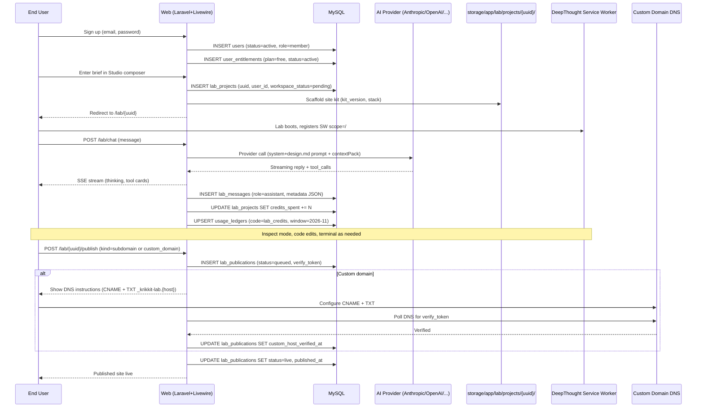
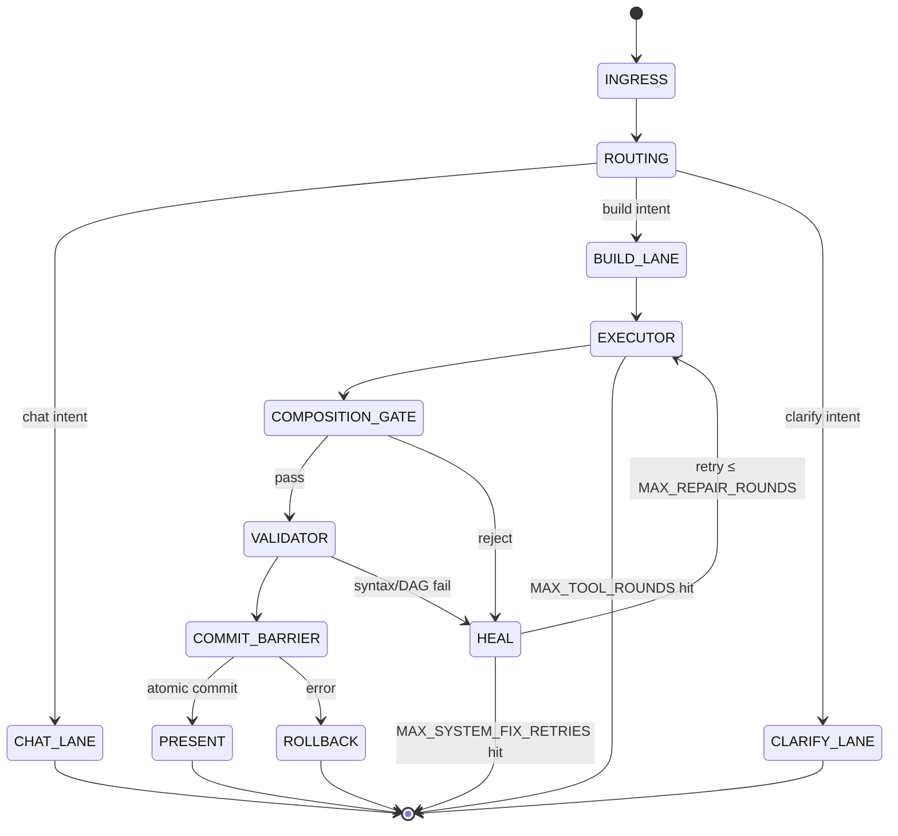
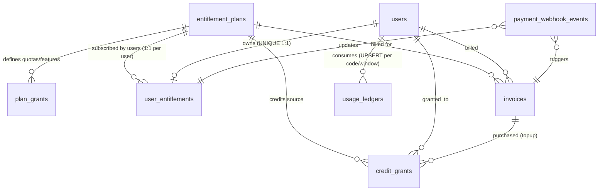
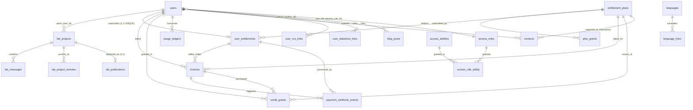
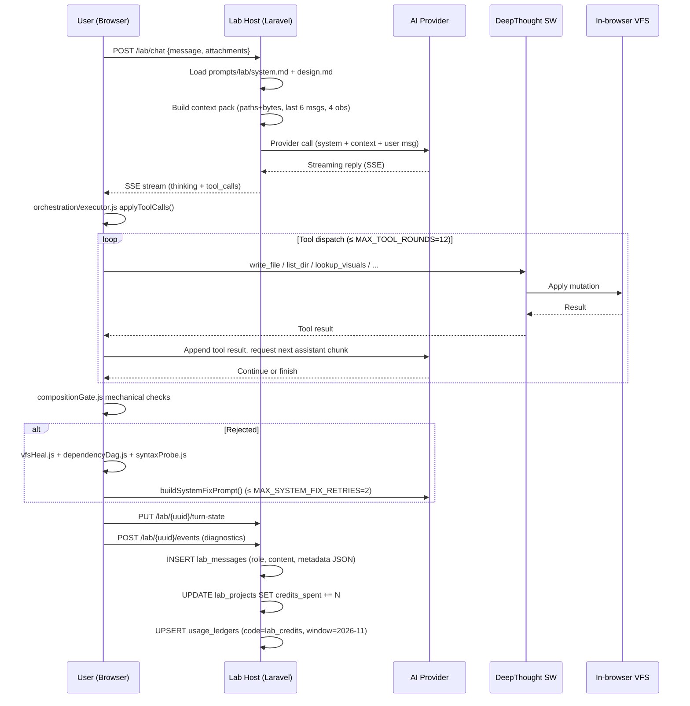

# Krikkit — AI Website Builder SaaS Platform — Technical & Product Analysis

> Independent research report. Source archive: `krikkit-120.rar` (CodeCanyon item #65055559, "Krikkit — AI Website Builder SaaS Platform for Prompt‑based Site Generation" by deep42).
> Analysis performed: 2026‑11‑04.
> Method: static inspection of supplied files only. No code was executed, no dependencies were installed, no migrations were run, no remote services were contacted.

---

## Table of Contents

1. [Product Overview](#1-product-overview)
2. [Complete Feature Inventory](#2-complete-feature-inventory)
3. [Business Workflows](#3-business-workflows)
4. [UI/UX Analysis](#4-uiux-analysis)
5. [Technical Architecture](#5-technical-architecture)
6. [Database and Domain Model](#6-database-and-domain-model)
7. [Authentication and Authorization](#7-authentication-and-authorization)
8. [Integrations and Automation](#8-integrations-and-automation)
9. [AI Capabilities](#9-ai-capabilities)
10. [SaaS Architecture and Monetization](#10-saas-architecture-and-monetization)
11. [Strengths, Weaknesses and Risks](#11-strengths-weaknesses-and-risks)
12. [Reusable Product Concepts](#12-reusable-product-concepts)
13. [Evidence and Confidence](#13-evidence-and-confidence)
14. [Final Assessment](#14-final-assessment)
15. [Deliverable Contract](#15-deliverable-contract)

---

## 1. Product Overview

### 1.1 What it is

**Krikkit** is a self‑hostable, turnkey SaaS application that lets an operator resell **AI‑driven website generation** to end users. A user describes a website in plain English; an AI agent generates a real React/Vite project; the user previews, edits, and publishes to a subdomain or custom domain. The product is sold as a one‑time CodeCanyon purchase; the operator then charges their own customers via Stripe or PayPal subscriptions and credit packs.

Author / vendor: **deep42** (Support Hub at `hub.deep42.co`; license verification endpoint `https://deep42.co/api/deepthought/verify`).
CodeCanyon item #: **65055559**.
Source archive name: `krikkit-120.rar` (RAR v4, 38.5 MB).
Documentation version stamp: none explicit; framework versions (Laravel 13, PHP 8.3+, Node 20.19+) and the default model `claude-sonnet-4-5` imply a 2025 / mid‑2026 vintage.

### 1.2 Target users (four distinct audiences)

| Audience | Role | What they do |
|---|---|---|
| **Operator** | Buys CodeCanyon item, self‑hosts | Installs Krikkit, configures AI/payment/OAuth integrations, defines subscription plans ("packs"), manages users, content, billing |
| **End user** | Customer of the operator | Signs up, chats to AI to build websites, previews, edits, publishes |
| **Admin / staff** | Operator's employees | Granted role‑based permissions (Users, Roles, Packs, Lab admin, Finance, etc.) |
| **Anonymous visitor** | Public web | Sees marketing landing page, pricing, blog, contact form, legal pages, published Lab sites |

### 1.3 Business model

- **One‑time B2B sale** (CodeCanyon) of the platform to operators.
- **Recurring B2C revenue** for the operator: subscriptions + per‑credit top‑ups billed through Stripe or PayPal.
- **Plan tiers** seeded in the database: Free / Pro ($29/mo or $290/yr) / Agency ("contact sales"). Plans gate the number of projects, monthly AI credits, storage, subdomains, custom domains, and feature flags.
- **Credit‑based AI metering**: AI Lab usage consumes credits granted monthly by the plan or top‑up invoices; admins can grant/debit credits manually.

### 1.4 Technology stack

| Layer | Technology | Evidence |
|---|---|---|
| Runtime | PHP **8.3+** | `docs/installation.md` → *Server requirements* |
| Backend framework | Laravel **13** | `docs/index.md` → *Technology Stack* |
| Full‑stack UI | Livewire **4** | `docs/index.md`; ubiquitous `wire:` directives in Blade |
| Views | Blade | `resources/views/**/*.blade.php` (250 PHP files) |
| Styling | Tailwind CSS v4 | `resources/css/app.css` (33 KB single entry); `@theme` directive in design prompt |
| Frontend JS framework | React (Lab IDE), Alpine.js (Studio) | `resources/js/lab/LabApp.jsx`; `resources/js/studio/composer.js` |
| Database | MySQL 8+ / MariaDB 10.6+ | `krikkit.sql` (MariaDB 10.11.18 dump, InnoDB, utf8mb4_unicode_ci) |
| Session / cache / queue | `database` driver by default (Redis optional) | `docs/installation.md` → *Server requirements* |
| Build | Vite + esbuild | `resources/js/lab/runtime/vite.lib.config.js`; `@vite([...])` directives |
| Code editor | CodeMirror (light/dark) | `docs/workspace.md` → *Code editor & file tree* |
| Permissions | spatie/laravel‑permission (referenced) + custom `@allows()` directive | `docs/roles.md`; `@allows('users.browse')` etc. throughout Blade |
| 2FA | Laravel Fortify (TOTP) | `users.two_factor_*` columns; `views/auth/twoFactorChallenge/*` |
| AI providers (8) | Anthropic, OpenAI, xAI, DeepSeek, Groq, Mistral, ZhipuAI, Google AI Studio | `docs/integration.md` |
| Payments | Stripe, PayPal (webhook‑driven) | `docs/payment-gateways.md`; `payment_gateways`, `payment_webhook_events` tables |
| VCS integration | GitHub (OAuth) | `user_vcs_links` table; `lab.blade.php` `GithubLinkBroker::isOauthReady()` |
| Backend datastore integration | Supabase (OAuth) | `user_datastore_links`; `views/lab/oauth/popup/popup.blade.php` |
| Stock photos | Unsplash + Pixabay (server‑side) | `docs/stock-images.md`; `lookup_visuals` tool |
| Web search | DuckDuckGo (default) or Brave (optional) | `docs/lab-integrations.md` |
| Mail | SMTP (any provider) | `docs/mail.md` |
| In‑browser runtime | **"DeepThought Engine"** — vendored from `ye42/deepthought`, browser‑native Node.js runtime | `resources/js/lab/runtime/README.md`, `NOTICE` |

### 1.5 Key differentiators (vs. generic AI site builders)

1. **In‑browser WASM preview runtime** ("DeepThought browser runtime") — compiles the user's React/Vite project entirely in the browser (virtual file system, npm resolution, Vite/Next.js shims, HTTP server, WebSocket, WASI, SQLite). No Docker needed for previews. Confirmed by `resources/js/lab/runtime/README.md` + the ~150 test files in `runtime/src/__tests__/` covering Vite, Next.js, server, multi‑instance proxy, WASI, SQLite, ws parity, http parity.
2. **Agentic tool catalog with explicit ordering rules** — `LabToolCatalog` includes `list_dir`, `file_search`, `grep`, `read_file`, `write_file` (atomic full‑file overwrite), `lookup_visuals` (must precede `write_file`), `survey_datastore`, `revise_datastore`, plus GitHub tools (`create_github_repo`, `fork_github`, `link_github`, `pull_github`, `push_github`, `compare_github`). Documented in `docs/chat.md` → *Agent tools`; implemented in `resources/js/lab/orchestration/toolRuntime.js`.
3. **Stock‑photo safety discipline** — agent must call `lookup_visuals` before `write_file` and must use the actual returned `src` URLs; it must never invent Unsplash/Pixabay IDs. `docs/stock-images.md` → *In Lab*; enforced by `orchestration/toolRuntime.js`.
4. **Composition gate (mechanical quality enforcement)** — `resources/js/lab/orchestration/compositionGate.js` rejects common LLM page‑generation anti‑patterns (empty product tiles, "glow‑only heroes", name‑only stub components, hooks outside components) without spending a model call.
5. **Auto‑repair pipeline** — `vfsHeal.js`, `dependencyDag.js`, `syntaxProbe.js`, `validator.js` detect missing imports via AST DAG analysis, auto‑stub missing modules, run `esbuild` parse, retry up to `MAX_SYSTEM_FIX_RETRIES = 2` times with `buildSystemFixPrompt()`.
6. **Inspect mode with prompt chips** — visual element inspector + design‑prompt chat with chips like `/modern`, `/contrast`, `/spacious`, `/simplify`, `/readable`, `/shadows`, `/pop`, `/hierarchy`; screenshot‑driven design edits via `POST …/design-edit/screenshot`.
7. **Branded project wordmarking** — automatic titler mints short brand names ("Aurelia", "Maison Luxe") on the first real product brief; greetings stay *Untitled*. `prompts/title/system.md` + `docs/projects.md` → *Project title*.
8. **Bundled SaaS operational layer** — credits metering (`credit_grants` + `usage_ledgers`), packs (`entitlement_plans` + `plan_grants`), RBAC, session audit, lab‑admin failed‑turn triage, finance dashboard.
9. **Server‑side Vite preview fallback** — for heavier apps, a real Vite dev server per project, port range 15000–15999, started/stopped via `proc_open`. `docs/workspace.md` → *Server‑side Vite preview*.

---

## 2. Complete Feature Inventory

Modules below are verified either in source code, in `krikkit.sql`, or in offline documentation. Status legend: ✅ verified in source/db · 📖 documented (no source for that exact claim) · 🚫 not present in the supplied bundle.

### 2.1 Public / marketing surface

| Module | Purpose | Users | Evidence |
|---|---|---|---|
| Landing page (`/`) | Marketing site with hero, features, pricing, blog, FAQ, integrations, etc. | Anonymous + authed | `resources/views/home/home.blade.php` + 19 partials (`hero`, `features`, `platform`, `mosaic`, `cta`, `walkthrough`, `stories`, `brand`, `brands`, `stack`, `steps`, `uses`, `introducing`, `numbers`, `integrations`, `capabilities`, `desk`, `board`, `badge`, `agents`, `faq`, `header`, `footer`, `site`, `problem`) |
| Pricing (`/pricing`) | Public plan comparison with monthly/yearly toggle | Anonymous | `resources/views/pricing/pricing.blade.php` (4.3 KB) — Alpine `x-data="{ billing: 'monthly' }"`; `$packs[]` with `title`, `price`, `priceYearly`, `summary`, `featured`, `checkout`, `contact`, `cta`, `bullets[]`; `$comparison` matrix |
| Checkout (`/checkout/start/{plan}`) | Stripe / PayPal driver picker | Authed | `resources/views/checkout/checkout.blade.php` — `$plan`, `$interval`, `$price`, `$features[]`, `$drivers[]` |
| Blog (`/blog`) | CMS blog | Anonymous | `blog_posts` table (ULID `public_id`, UNIQUE `slug`, `excerpt`, `body`, `published`, `published_on`, `author_id`); `views/blog/blog.blade.php`, `views/blog/entry/entry.blade.php` |
| Contact (`/contact`) | Contact form | Anonymous + authed | `contacts` table captures `user_id`, `entitlement_plan_id`, `name`, `email`, `body`, `ip`, `read_at`, `reply_body`, `replied_at`, `replied_by`; `views/contact/contact.blade.php` |
| Static pages (`/pages/{slug}`) | Marketing/legal static pages | Anonymous | `site_pages` table; `views/pages/pages.blade.php`, `views/pages/leaf/leaf.blade.php` (renders `{!! $html !!}` — see §11 XSS risk) |
| Legal pages (`/privacy`, `/terms`, `/refund`, `/license`) | Per‑locale legal content toggles | Anonymous | `docs/privacy-legal.md`; routes enabled by content presence |
| Newsletter subscribe (`POST /newsletter`) | Email capture, double opt‑in | Anonymous | `newsletter_subscribers` table (`email` UNIQUE, `confirmed_at`, `ip`); rate‑limited endpoint |
| Maintenance mode | Branded 503 page | All | `views/maintenance/maintenance.blade.php` — `$site->maintenanceMessage()` |
| Error pages | 403/404/419/429/500 | All | `views/errors/*.blade.php` (brand‑shelled) |

### 2.2 Auth surface

| Module | Purpose | Evidence |
|---|---|---|
| Login / Register / Forgot / Reset / Verify email | Standard Laravel auth | `views/auth/login`, `register`, `forgotPassword`, `resetPassword`, `confirmPassword`, `verifyEmail` |
| Registration toggle | Admin can disable public signup | `SiteSettings::allowRegistration()` checked in `views/auth/login/login.blade.php:19` |
| Two‑factor authentication (TOTP) | Enable / confirm / regenerate / disable | `users.two_factor_secret`, `two_factor_recovery_codes`, `two_factor_confirmed_at`, `two_factor_last_timestep` columns; `views/livewire/settings/profile/options/twoFactor.blade.php` |
| Sessions (database driver) | Laravel DB session driver | `sessions` table (`id`, `user_id`, `ip_address`, `user_agent`, `payload`, `last_activity`) |

### 2.3 Studio (post‑login user shell)

| Module | Purpose | Evidence |
|---|---|---|
| Studio home (`/`) | Projects list, hero/composer | `views/livewire/studio/studio.blade.php` + partials (`hero`, `projects`, `projectModals`, `projectCard`, `projectSkeleton`, `composerPlus`, `theme`, `sidebar`, `header`, `footer`) |
| Projects page (`/projects`) | Paginated opened+edited lists | `views/livewire/studio/options/projects.blade.php` |
| Starred page (`/starred`) | Favorites | `views/livewire/studio/options/starred.blade.php`; `lab_projects.starred_at` |
| Project export (`/projects/{uuid}/export`) | ZIP download (entitlement‑gated) | `docs/projects.md`; `GET /projects/{projectUuid}/builds/{buildUuid}/export` |
| Studio composer | Plain‑English brief → Lab handoff | `resources/js/studio/composer.js` registers Alpine `studioComposer` — calls `$wire.openLab(text, hasFiles)`, files staged via IndexedDB (`stashStudioHandoff`) |
| Project menu (rename / duplicate / star / export / delete) | Per‑card dropdown | `studioProjectMenu` Alpine component; `wire:click` methods |

### 2.4 Lab (AI website builder) — the core product

| Module | Purpose | Evidence |
|---|---|---|
| Lab IDE (`/lab`, `/lab/{uuid}`) | Chat + preview + code + database + terminal | `views/lab/lab.blade.php` mounts `<div id="lab-root">`; `resources/js/lab/LabApp.jsx` (1001 lines, 37 KB) |
| AI chat composer | Multi‑line prompts, image attachments (vision), model picker | `resources/js/lab/hooks/useLabChat.js` (96 KB, 2146 lines); `docs/chat.md` |
| Streaming (SSE) | `GET …/chat/stream/{messageId}` | `docs/chat.md` → *Streaming UI`; `resources/js/lab/lib/ai.js` `sendLabChat()` |
| Tool cards (thinking, lookup_visuals, write_file) | Live tool execution UI | `useLabChat.js` tool chrome; `agentLoop.js` constants |
| In‑browser preview ("DeepThought runtime") | WASM/Vite dev server in browser | `resources/js/lab/runtime/` (45 MB total, 940 files); `docs/workspace.md` → *Preview* |
| Server‑side Vite preview (`/preview-dev/{uuid}/`) | Real Vite per project, ports 15000–15999 | `docs/workspace.md`; `KRIKKIT_DEV_PREVIEW_*` env vars |
| Code editor | File tree + CodeMirror, multi‑tab, Cmd/Ctrl+S save | `docs/workspace.md` → *Code editor & file tree* |
| Terminal | Sandbox shell, 180s default timeout | `POST …/workspace/terminal/execute`; `KRIKKIT_WORKSPACE_TERMINAL_TIMEOUT` |
| Database panel | Supabase schema/SQL/rows + Allow/Skip migrations | `docs/workspace.md` → *Database panel* |
| Inspect mode | Element inspector + design chat + prompt chips + screenshot edit | `docs/workspace.md` → *Inspect mode* |
| Builds & auto‑fix | Build sessions, auto‑repair loop, thumbnails | `docs/workspace.md` → *Builds, auto‑fix, thumbnails* |
| Lab Console (admin) | Default model, model‑selection toggle, notification sounds | `docs/lab-console.md`; `views/livewire/dashboard/settings/options/lab.blade.php` |
| Lab Admin (admin) | Browse all projects, usage, failed turns | `views/livewire/dashboard/lab/*.blade.php`; `docs/lab-admin.md` |

### 2.5 CMS / marketing modules (admin)

| Module | Route | Permission | Evidence |
|---|---|---|---|
| Pages | `/dashboard/pages` | `pages.view_any` | `site_pages` table; `docs/pages.md` |
| Blogs | `/dashboard/blogs` | `blogs.view_any` | `blog_posts` table; `docs/blog.md` |
| Contacts | `/dashboard/contact-submissions` | (admin) | `contacts` table; `docs/contacts.md` |
| Newsletter | `/dashboard/newsletter` | `settings.revise` | `newsletter_subscribers` table; `docs/newsletter.md` |
| Frontend Sections (landing) | `/dashboard/frontend-sections` | (admin) | `docs/landing.md`; `App\Support\Site\LandingCopy` referenced in `views/home/home.blade.php` |
| Languages | `/dashboard/languages` | `languages.view_any` | `languages`, `language_lines` tables; `views/livewire/dashboard/languages/options/translate.blade.php` with `wire:click="translatePage"` AI translation |
| SEO | `/dashboard/settings/seo` | (admin) | `views/livewire/dashboard/seo/seo.blade.php` (7.4 KB); Google Search Console + Bing Webmaster verification |

### 2.6 SaaS / billing modules (admin)

| Module | Route | Permission | Evidence |
|---|---|---|---|
| Packs (subscription plans) | `/dashboard/packs` | `packs.browse` | `entitlement_plans`, `plan_grants` tables; `docs/packs.md` |
| Subscriptions | `/dashboard/subscriptions` | `finance.browse` | `user_entitlements` table; `docs/subscriptions.md` |
| Invoices | `/dashboard/invoices` | `finance.browse` | `invoices` table; `views/livewire/dashboard/invoices/*.blade.php` |
| Credits | `/dashboard/credits` | `finance.revise` | `credit_grants` table; `views/livewire/dashboard/credits/credits.blade.php` grant/debit form |
| Finance dashboard | `/dashboard/finance` | `finance.browse` | `views/livewire/dashboard/finance/finance.blade.php` (17 KB) — MRR, subscription events, webhook events |
| Payment gateways | `/dashboard/payment_gateways` | `payments.revise` | `payment_gateways` table; `views/livewire/dashboard/payments/*.blade.php` |
| Webhook events | (under finance) | `finance.browse` | `payment_webhook_events` table; idempotency via UNIQUE `(driver, provider_event_id)` |

### 2.7 Admin / RBAC modules

| Module | Route | Permission | Evidence |
|---|---|---|---|
| Dashboard home | `/dashboard` | (authed) | `views/livewire/dashboard/home/home.blade.php` (24.8 KB) — `$cards`, `$chats`, `$attentionCount` |
| Users | `/dashboard/users` | `users.browse` | `views/livewire/dashboard/users/*.blade.php` |
| Access Roles | `/dashboard/roles` | `roles.browse` | `access_roles`, `access_abilities`, `access_role_ability` tables; `views/livewire/dashboard/accessRoles/*.blade.php` |
| Sessions | `/dashboard/sessions` | `sessions.browse` | `sessions` table; `views/livewire/dashboard/sessions/sessions.blade.php` |
| General & Branding | `/dashboard/settings/general` | `settings.revise` | `site_settings` table (singleton JSON); `docs/general-settings.md` |
| Appearance | `/dashboard/settings/appearance` | `settings.revise` | `docs/themes.md` |
| Privacy & Legal | `/dashboard/settings/privacy` | `settings.revise` | `docs/privacy-legal.md` |
| Integrations | `/dashboard/integration` | `ai.revise` | `ai_provider_credentials` table; `views/livewire/dashboard/integration/options/edit.blade.php` (516 lines) |
| GitHub integration settings | `/dashboard/integration/github/edit` | `ai.revise` | `workspace_oauth_apps` table (driver='github'); `docs/github.md` |
| Supabase integration settings | `/dashboard/integration/supabase/edit` | `ai.revise` | `workspace_oauth_apps` (driver='supabase'); `docs/supabase.md` |
| Stock images settings | (under integration) | `ai.revise` | `ai_provider_credentials` (driver='unsplash' / 'pixabay'); `docs/stock-images.md` |
| Publish settings | `/dashboard/settings/publish` | `settings.revise` | `docs/publish-settings.md` |
| Lab Console | `/dashboard/settings/builder` | (admin) | `docs/lab-console.md`; `ai_workspace_settings.default_model` |
| Mail (SMTP) | `/dashboard/settings/mail` | `settings.revise` | `docs/mail.md` (env‑driven, no UI per docs but route exists in dashboard command palette) |
| License / Permit | (under settings) | (admin) | `site_settings.payload` JSON contains `permit` object; `views/installer/permit/permit.blade.php` |

### 2.8 User‑facing settings modules

| Module | Route | Purpose | Evidence |
|---|---|---|---|
| Profile | `/settings/profile` | Avatar, name, username, email, phone, country | `views/livewire/settings/profile/profile.blade.php` |
| Password | `/settings/profile/password` | Change password | `views/livewire/settings/profile/options/password.blade.php` |
| Two‑factor | `/settings/profile/two-factor` | TOTP setup, recovery codes, disable | `views/livewire/settings/profile/options/twoFactor.blade.php` |
| General (theme + AI defaults) | `/settings/general` | Theme (light/dark/system), default model, sound alerts, token usage toggle | `views/livewire/settings/general/general.blade.php` |
| Subscription | `/settings/subscription` | Current plan, renewal, upgrade offers | `views/livewire/settings/subscription/subscription.blade.php` |
| Credits | `/settings/credits` | Balance, usage history | `views/livewire/settings/credits/credits.blade.php` |
| Usage | `/settings/usage` | Quota snapshot, per‑project credits, per‑model tokens | `views/livewire/settings/usage/usage.blade.php` |
| Applications | `/settings/applications` | Linked GitHub / Supabase / datastore accounts | `views/livewire/settings/applications/applications.blade.php` |

### 2.9 Modules documented but NOT present in supplied bundle

| Module | Status |
|---|---|
| Template authoring / starter template registry | 🚫 `docs/lab-overview.md` references `/docs/templates` but no such file exists in the docs bundle; starter templates (Maison Noir, Maison Éclat, Maison Atelier, ArcVault) only named in `docs/index.md` |
| Contact Page settings | 🚫 `docs/pages.md` and `docs/contacts.md` reference `/docs/contact-page` but file is absent |
| External REST API for Krikkit itself | 🚫 No documentation, no API token tables, no Sanctum/Passport evidence |
| Webhooks for AI generation events | 🚫 Only billing webhooks (`payment_webhook_events`) exist |
| Team / org / multi‑seat workspaces | 🚫 Not modeled in schema (no `workspaces` table, no `workspace_members` pivot) |
| White‑label / multi‑instance mode | 🚫 Not documented |
| Mobile app / PWA | 🚫 No manifest reference beyond standard favicon set |
| AI image generation | 🚫 Only stock photo lookup (`lookup_visuals`); no image‑generation provider credentials |

---

## 3. Business Workflows

### 3.1 Workflow 1 — New user → subscription → first AI website → publish



**Step‑by‑step** (with evidence):

1. **Sign‑up.** Registration can be toggled by admin (`SiteSettings::allowRegistration()` checked in `views/auth/login/login.blade.php:19`). On submit, a `users` row is created with `status='active'`, `access_role_id=2` (member); a `user_entitlements` row is auto‑created pointing at the default plan (Free, `is_default=1`).
2. **Studio home.** After login, `/` becomes the Studio showing recent/starred projects (`views/livewire/studio/studio.blade.php`).
3. **Project creation.** User enters a brief in the composer; `studioComposer.goToLab()` (Alpine component in `resources/js/studio/composer.js`) calls `$wire.openLab(text, hasFiles)` — a Livewire method that:
   - Inserts a `lab_projects` row (`uuid` char(36), `user_id`, `workspace_status='pending'`, `kit_version`, `stack`).
   - Scaffolds on‑disk files under `storage/app/lab/projects/{uuid}/`.
   - Returns a redirect to `/lab/{uuid}`.
4. **Lab boot.** `views/lab/lab.blade.php` renders, registering the DeepThought service worker (`/__krikkit_lab_sw__.js?v=host-vite-5173-29`) before Vite loads, then mounting `<div id="lab-root">` with JSON bootstrap: `#lab-bootstrap` (project), `#lab-workspace`, `#lab-prefs` (DeskPreferences), `#lab-pulse`, `#lab-config`.
5. **AI chat turn.** User sends a prompt → `useLabChat.sendLabChat()` POSTs to `/lab/chat`. Server‑side (not in supplied bundle) constructs the system prompt from `prompts/lab/system.md` + `prompts/lab/design.md` + a context pack built by `orchestration/contextPack.js` (paths+bytes only, last 6 messages, last 4 observations truncated to 400 chars + 800‑char snippets, **never the full VFS**). The server streams the AI reply back via SSE at `/lab/chat/stream/{messageId}`.
6. **Tool execution.** Assistant returns tool calls; `orchestration/executor.js` `applyToolCalls()` dispatches via `orchestration/toolRuntime.js` (`write_file`, `list_dir`, `read_file`, `grep`, `file_search`, `scan_dir`, `lookup_visuals`, `survey_datastore`, `revise_datastore`, GitHub tools). Tool results are appended to the conversation and the model continues until the lane is complete or `MAX_TOOL_ROUNDS = 12` is hit.
7. **Composition gate + auto‑repair.** `compositionGate.js` mechanically rejects common LLM anti‑patterns (e.g. hero with `radial-gradient`/`blur-3xl` but no `` or `.map()`, 3+ empty `<div className="aspect-square" />`, `<Reveal>` wraps with dead `col-span`). If rejected, `vfsHeal.js` + `dependencyDag.js` + `syntaxProbe.js` run `esbuild` parse + DAG analysis, auto‑stub missing modules, and retry up to `MAX_SYSTEM_FIX_RETRIES = 2` with `buildSystemFixPrompt()`.
8. **Credit metering.** Each turn consumes credits — server updates `lab_projects.credits_spent` and UPSERTs into `usage_ledgers` (`code='lab_credits'`, `window_key='2026-11'`). If the user's balance is insufficient, the Lab opens an upgrade drawer deep‑linking to `/dashboard/billing`.
9. **Preview.** User can preview the in‑browser compiled site (DeepThought runtime under cross‑origin isolation, SharedArrayBuffer for SAB‑based VFS) or switch to the server‑side Vite preview at `/preview-dev/{uuid}/`.
10. **Inspect mode (optional).** User toggles Inspect, clicks an element, tweaks CSS live in the Inspector (Typography / Color / Background / Layout / Border / Shadow / Appearance sections) or sends a design prompt + screenshot (`POST …/design-edit/screenshot`).
11. **Publish.** User opens the Publish modal. Two modes:
    - **Subdomain**: `{sub}.{publish_root}` (root from APP_URL or `KRIKKIT_PUBLISH_SUBDOMAIN_ROOT`); a `lab_publications` row is inserted with `kind='subdomain'`, `subdomain` UNIQUE, `status='queued'` → `'building'` → `'live'`.
    - **Custom domain** (plan‑gated): user enters host → server generates `verify_token` → user adds TXT `_krikkit-lab.{host} = krikkit={token}` + CNAME → server polls DNS → on match, `custom_host_verified_at` is set, `status` progresses to `live`.
12. **Edge routing.** Two composite indexes `lab_publications_status_subdomain_index` and `lab_publications_status_custom_host_index` power host‑based lookups so the Laravel router (`routes/published.php` per docs) can dispatch incoming requests to the right publication.
13. **Share / Export.** Alternatively, the user can generate a share link `/share/{shareCode}/...` or export a ZIP at `GET /projects/{projectUuid}/builds/{buildUuid}/export` (artifacts under `storage/app/exports`, retention `KRIKKIT_EXPORT_RETENTION_DAYS`).

### 3.2 Workflow 2 — Admin creates a subscription "pack" (plan) and how users consume it

> **Important clarification from documentation:** A "Pack" in Krikkit terminology is a **subscription plan**, not a template pack. There is no operator workflow for publishing template packs.

1. Admin opens `/dashboard/packs` → `views/livewire/dashboard/packs/*.blade.php` (create/edit form).
2. Plan fields saved into `entitlement_plans`: `title`, `slug` (UNIQUE), `summary`, `rank` (display order), `price_monthly`, `price_yearly` (nullable for "contact sales"), `is_default`, `is_active`.
3. Admin defines `plan_grants` rows for the plan: `code` (e.g. `projects`, `lab_credits`, `custom_subdomain`, `custom_domain`, `advanced_export`, `github_import`), `kind` (`quota`/`feature`), `allowed` (boolean for features), `ceiling` (int for quotas), `window` (`lifetime`/`monthly`/`none`).
   - Seeded examples: Free = 3 projects / 100 Lab credits monthly / no features; Pro = 25 projects / 2500 credits monthly / all features; Agency = unlimited projects + lab_credits.
4. Plan becomes visible in the public pricing page (`/pricing`) and in the user's subscription upgrade UI (`/settings/subscription` `$offers`).
5. User clicks "Subscribe" → checkout at `/checkout/start/{plan}?interval={monthly|yearly}&driver={stripe|paypal}`.
6. Payment provider processes; webhook hits `{APP_URL}/webhooks/stripe` or `/webhooks/paypal`. Webhook handler:
   - INSERTs a `payment_webhook_events` row (UNIQUE on `(driver, provider_event_id)` for idempotency).
   - INSERTs or updates `invoices` (`status='paid'`, `paid_at`).
   - INSERTs or updates `user_entitlements` (`status='active'`, `driver`, `provider_subscription_id`, `interval`, `started_at`, `last_paid_at`).
   - If the plan includes monthly credits, INSERTs a `credit_grants` row (`kind='subscription'`, `entitlement_plan_id`, `amount`).
7. Scheduler `packs:refresh-subscriptions` keeps `user_entitlements.ends_at` in sync with provider side.
8. From this point on, Lab credit metering reads `usage_ledgers` (`code='lab_credits'`, current monthly `window_key`) and compares against the plan grant ceiling.

### 3.3 Workflow 3 — Lab turn lifecycle (single AI turn, full detail)



**Constants** (from `resources/js/lab/orchestration/constants.js`):

| Constant | Value | Purpose |
|---|---|---|
| `MAX_REPAIR_ROUNDS` | 4 | Max model self‑repair attempts |
| `MAX_AUTONOMOUS_TURNS` | 4 | Max consecutive auto‑continue turns |
| `MAX_EXPLORE_TOOLS_PER_TURN` | 2 | Read tools before requiring a write |
| `MAX_TOOL_ROUNDS` | 12 | Hard cap on tool dispatches per turn |
| `DIFF_LOOP_IDENTICAL_AFTER` | 3 | Abort if 3 near‑identical writes to same file |
| `MAX_SYSTEM_FIX_RETRIES` | 2 | Hard cap on auto‑repair via `buildSystemFixPrompt` |
| `PATH_CLAIMS_MAX` | 512 | SW LRU bound for path claims |

**Agent loop "system errors"** (literal strings appended to model context when misbehavior detected, from `orchestration/agentLoop.js`):

- `EXPLORE_ONLY_SYSTEM_ERROR` — model called read/explore tools but wrote 0 files.
- Truncated‑output, missing‑imports, page‑assembly‑incomplete, multi‑page‑routing‑incomplete, etc.

These exact strings are appended to the conversation; the model is expected to take them literally. This is a **fragile prompt‑engineering surface** — see §11.

### 3.4 Workflow 4 — Subscription upgrade / credit top‑up

1. User hits an upgrade gate (insufficient credits / projects / storage / private projects / publish domains). Lab opens an upgrade drawer deep‑linking to `/dashboard/billing` (`docs/billing.md` → *Upgrade gates*).
2. `/dashboard/billing` shows current plan, renewal date, credit balance, available plans (read from `entitlement_plans` where `is_active=1`).
3. User clicks Subscribe → `/checkout/start/{plan}?interval=&driver=`.
4. Stripe/PayPal checkout → webhook → `payment_webhook_events` → `invoices` (status=paid) → `user_entitlements` updated.
5. If plan includes monthly credits → `credit_grants` row inserted (kind='subscription').
6. Optional: user can also purchase a one‑off credit top‑up. Admin can grant/debit credits manually at `/dashboard/credits` (`views/livewire/dashboard/credits/credits.blade.php`) — `credit_grants.kind='topup'`, `invoice_id` set if paid.
7. Scheduler `packs:refresh-subscriptions` reconciles `ends_at` with provider side.

### 3.5 Workflow 5 — Admin assigns roles and what each role can do

1. Admin opens `/dashboard/roles` (requires `roles.browse` ability).
2. Existing roles listed from `access_roles` table. Seeded roles: `owner` (locked=1, 36 abilities), `member` (locked=0, 2 abilities).
3. Admin clicks "Create role" → enters `title`, `summary`, toggles permission groups (Dashboard, Users, Roles, Builders, Credits, Packs, Pages, Blogs, Subscriptions, Payment gateways, Languages, AI providers).
4. Each toggle inserts/removes rows in `access_role_ability` (composite PK, CASCADE both sides).
5. Admin assigns the role to a user at `/dashboard/users` → user's `access_role_id` is updated (single role per user — no pivot table).
6. Permission checks via `@allows('ability.code')` Blade directive (hides UI) and server‑side Gate (enforced in route middleware + Livewire `mount()` — inferred; `app/` not in bundle).
7. System roles (`locked=1`) cannot be edited or deleted. Roles with assigned users cannot be deleted until reassigned.

---

## 4. UI/UX Analysis

### 4.1 Navigation structure

| Surface | Entry | Layout |
|---|---|---|
| **Public** | `/` | Single marketing page with anchored sections (`#features`, `#pricing`, `#faq`, etc.) + dedicated routes for `/pricing`, `/blog`, `/contact`, `/pages/{slug}`, `/privacy`, `/terms` |
| **Auth** | `/login`, `/register`, `/forgot-password`, etc. | Centered card on dark canvas |
| **Studio** (post‑login user shell) | `/` (when authed) | Fixed left sidebar + centered content column; soft radial‑gradient top accent (`views/components/studio/frame.blade.php`) |
| **Lab** | `/lab/{uuid}` | Three‑pane: left = chat (composer + streaming + tool cards); center/right = preview chrome (Preview/Code/Database tabs + address bar + viewport + reload + open external); top bar (home, title, view toolbar, share, publish, sync/PR GitHub, inspect toggle, settings); bottom = optional Terminal |
| **Settings** (user) | `/settings/*` | Two‑column: nav rail (Profile / General / Applications / Subscription / Credits / Usage) + content |
| **Dashboard** (admin) | `/dashboard/*` | Sidebar with RBAC‑gated groups (Dashboard, Users, Roles, Builders, Credits, Packs, Pages, Blogs, Subscriptions, Payment gateways, Languages, AI providers, Settings) + content; command palette (Cmd+K) for nav |

### 4.2 Dashboard pages (admin)

- **Dashboard home** (`/dashboard`) — `$cards[]` (KPIs), `$chats` (recent Lab activity), `$attentionCount` (failed turns / pending invoices), quick links (`chatHref`, `peopleHref`, `onlineHref`, `turnsHref`, `invoicesHref`). 24.8 KB view.
- **Finance** (`/dashboard/finance`) — 17 KB view with MRR, subscription events, webhook events, refund actions.
- **Lab admin** — `/dashboard/lab` (projects), `/dashboard/lab/usage` (AI spend), `/dashboard/lab/turns` (failed turns triage), `/dashboard/lab/{project}` (detail with `askFreeze`/`askDelete`/`saveOwner` actions).
- **Integration** — 516‑line edit form covering AI providers (Anthropic, OpenAI, Gemini, xAI, DeepSeek, Groq, Mistral, ZhipuAI), GitHub OAuth, Supabase OAuth, Unsplash/Pixabay, with per‑model pricing‑per‑million tokens in USD.

### 4.3 Forms, tables, filters

- **Forms** use Livewire `wire:model.live.debounce.250ms` for live validation; `<krikkit:input>`, `<krikkit:select>`, `<krikkit:modal>`, `<krikkit:confirm>`, `<krikkit:dropdown>` Blade components (in `views/krikkit/*`).
- **Tables** use `<krikkit:table>` with pagination via `wire:intersect.once.margin.160px` (lazy‑load on scroll‑into‑view) in Studio projects list.
- **Filters**:
  - `wire:model.live.debounce.250ms="search"` is ubiquitous (Lab admin projects, users directory, finance events).
  - Pricing page uses Alpine `x-data="{ billing: 'monthly' }"` for monthly/yearly toggle.
  - Studio has separate "Opened" and "Edited" project shelves with pagination.
- **Detail pages**:
  - `/dashboard/lab/{project}` — project detail with `Open in Lab` link, owner reassignment, freeze/delete.
  - `/dashboard/invoices/{id}` — invoice detail with refund action.
  - `/dashboard/finance/event/{id}` — webhook event detail with raw payload.

### 4.4 Responsive design

- All views use Tailwind CSS v4 with the standard responsive prefixes (`sm:`, `md:`, `lg:`, `xl:`).
- The Lab IDE is desktop‑first (three‑pane layout) — no explicit mobile Lab experience documented.
- The Studio is responsive (sidebar collapses).
- The marketing site is fully responsive.
- No PWA manifest beyond standard favicons.

### 4.5 Useful interaction patterns

| Pattern | Where | How |
|---|---|---|
| **IndexedDB handoff for large uploads** | Studio → Lab | `stashStudioHandoff(files)` writes file blobs to IndexedDB; Lab calls `takeStudioHandoff()` on boot — avoids Livewire snapshot bloat |
| **SSE streaming with tool chrome** | Lab chat | `sendLabChat()` opens an EventSource; thinking blocks + tool cards render incrementally as the assistant streams |
| **Lazy pagination via `wire:intersect`** | Studio projects list | Triggered when the sentinel enters viewport with 160px margin |
| **Prompt chips** | Lab inspect mode | `/modern`, `/contrast`, `/spacious`, `/simplify`, `/readable`, `/shadows`, `/pop`, `/hierarchy` — prefill design‑edit prompts |
| **Command palette (Cmd+K)** | Dashboard | `<krikkit:command.item>` list filtered by `@allows('...')` — only items the user can act on appear |
| **Atomic VFS commits** | Lab build lane | `commitBarrier.atomicCommit` / `rollbackWorking` — pending writes are staged in `workingVfs` and committed or rolled back atomically |
| **Composition gate (mechanical rejection)** | Lab build lane | Regex/DAG checks reject common LLM anti‑patterns without spending a model call |
| **Auto‑repair pipeline** | Lab build lane | `vfsHeal.js` + `dependencyDag.js` + `syntaxProbe.js` + `validator.js` retry up to 2 times with `buildSystemFixPrompt()` |
| **Diff‑loop breaker** | Lab build lane | After 3 near‑identical writes to one file, abort the turn (prevents the model from oscillating) |
| **Service worker per‑instance port routing** | Lab preview | SW maintains `instancePorts` map keyed by `instanceId` + bounded `pathClaims` LRU (max 512) — supports multi‑tab without cross‑contamination |
| **JSON bootstrap in `<script type="application/json">`** | Lab host | Avoids data attributes for large payloads; survives F5 reloads |
| **Decoy anti‑autofill fields** | Integration edit form | `prevent_autofill_*` hidden inputs to stop browsers from injecting saved credentials into OAuth client secret fields |

---

## 5. Technical Architecture

### 5.1 Frontend / backend organization (as supplied)

```
supplied bundle: ServerFiles/Krikkit/resources/
├── prompts/                AI prompt files (4 Markdown files)
├── views/                  Laravel Blade templates (250 PHP files)
│   ├── auth/               Login, register, 2FA, password reset
│   ├── billing/return/     Billing redirect handler
│   ├── blog/, contact/     Public CMS surfaces
│   ├── checkout/            Stripe/PayPal driver picker
│   ├── components/          Reusable Blade components (UI kit "krikkit:*")
│   ├── dashboard/           Admin pages
│   ├── errors/              403/404/419/429/500/503
│   ├── home/                Marketing landing (19 partials)
│   ├── installer/           Permit page + pulses
│   ├── krikkit/             Design system components (~141 KB)
│   ├── lab/                 Lab host + preview + OAuth popup
│   ├── layouts/app.blade.php Minimal root layout
│   ├── legal/               Privacy + terms
│   ├── livewire/            99 Livewire component views
│   ├── maintenance/         503 page
│   ├── pages/, pages/leaf/  Public site pages
│   ├── pricing/             Public pricing page
│   └── vendor/installer/    Laravel installer wizard (Hitchhiker)
├── css/app.css             Tailwind v4 entry (33 KB)
└── js/
    ├── studio/             Studio composer (2 files: composer.js + hero.jsx)
    └── lab/
        ├── LabApp.jsx       1001-line root React component (37 KB)
        ├── lab.jsx          Boot entry (1.5 KB)
        ├── hooks/            9 React hooks (172 KB total)
        ├── lib/              65 low-level utilities (536 KB)
        ├── orchestration/    28 files (318 KB) — AI turn state machine
        ├── preview/          2 files (17 KB) — preview iframe chrome
        └── runtime/          DeepThought Engine (45 MB, 940 files)
            ├── src/           755 KB TypeScript source
            ├── dist/          44 MB prebuilt ESM/CJS bundles
            ├── static/        2 × 73.5 KB service workers
            ├── README.md
            ├── NOTICE
            └── vite.lib.config.js
```

**Missing Laravel folders** (not supplied): `app/`, `routes/`, `config/`, `database/migrations/`, `bootstrap/`, `public/`, `tests/`, `composer.json`, `package.json`, `vite.config.js`, `phpunit.xml`, `tailwind.config.js`. All Blade references to `App\*` namespaces (e.g. `App\Support\Site\SiteSettings`, `App\Integrations\Github\GithubLinkBroker`, `App\Finance\FinanceCopy`, `App\Support\Workspace\WorkspaceNav`) cannot be verified against actual implementation.

### 5.2 Routing

Routes are not in the supplied bundle, but endpoints can be reconstructed from frontend fetch calls and Blade `route()` helpers:

**Public**: `/`, `/pricing`, `/blog`, `/blog/{slug}`, `/contact`, `/pages/{slug}`, `/privacy`, `/terms`, `/refund`, `/license`, `/newsletter` (POST), `/maintenance`.

**Auth**: `/login`, `/register`, `/forgot-password`, `/reset-password`, `/confirm-password`, `/verify-email`, `/two-factor-challenge`.

**Studio**: `/`, `/projects`, `/starred`, `/projects/{uuid}/export`.

**Lab**: `/lab`, `/lab/{uuid}`, `/lab/chat` (POST), `/lab/chat/stream/{messageId}` (GET, SSE), `/lab/models`, `/lab/{uuid}/turn-state` (PUT), `/lab/{uuid}/events` (POST), `/lab/{uuid}/workspace/terminal/execute`, `/lab/{uuid}/publish`, `/lab/{uuid}/github`, `/lab/{uuid}/github/link|create|fork|push`, `/lab/datastore`, `/lab/datastore/projects`, `/lab/oauth/supabase/start`, `/lab/oauth/supabase/return`, `/lab/vcs/github/return`, `/preview-dev/{uuid}/`, `/share/{shareCode}/...`.

**Settings (user)**: `/settings/profile`, `/settings/profile/password`, `/settings/profile/two-factor`, `/settings/general`, `/settings/subscription`, `/settings/credits`, `/settings/usage`, `/settings/applications`.

**Dashboard (admin)**: `/dashboard`, `/dashboard/users`, `/dashboard/roles`, `/dashboard/sessions`, `/dashboard/pages`, `/dashboard/blogs`, `/dashboard/contact-submissions`, `/dashboard/newsletter`, `/dashboard/languages`, `/dashboard/packs`, `/dashboard/subscriptions`, `/dashboard/invoices`, `/dashboard/invoices/{id}`, `/dashboard/credits`, `/dashboard/finance`, `/dashboard/finance/event/{id}`, `/dashboard/payment_gateways`, `/dashboard/payment_gateways/edit/{driver}`, `/dashboard/integration`, `/dashboard/integration/edit/{provider}`, `/dashboard/integration/github/edit`, `/dashboard/integration/supabase/edit`, `/dashboard/lab`, `/dashboard/lab/{id}`, `/dashboard/lab/usage`, `/dashboard/lab/turns`, `/dashboard/settings/general`, `/dashboard/settings/appearance`, `/dashboard/settings/seo`, `/dashboard/settings/privacy`, `/dashboard/settings/builder`, `/dashboard/settings/publish`, `/dashboard/settings/mail`, `/dashboard/frontend-sections`.

**Billing webhooks**: `/webhooks/stripe`, `/webhooks/paypal`.

**Installer**: `/install` (Hitchhiker wizard).

**Published sites**: `routes/published.php` per docs — host‑based routing using `lab_publications_status_subdomain_index` and `lab_publications_status_custom_host_index`.

### 5.3 Services / controllers / reusable components

- **Blade UI kit** (`views/krikkit/*`): `button`, `input`, `select`, `modal`, `dropdown`, `card`, `table`, `pagination`, `editor`, `datePicker`, `timePicker`, `colorPicker`, `fileUpload`, `command`, `toast`, `tabs`, `slider`, `switch`, `radio`, `checkbox`, `pillbox`, `progress`, `skeleton`, `breadcrumbs`, `callout`, `confirm`, `context`, `dropdown`, `calendar`.
- **Studio UI kit** (`views/components/studio/*`): `frame`, `hero`, `sidebar`, `header`, `footer`, `projects`, `projectCard`, `projectSkeleton`, `projectModals`, `pack`, `composerPlus`, `theme`.
- **Lab frontend modules**:
  - `orchestration/` (28 files, 318 KB): `agentLoop.js` (542 lines), `toolRuntime.js` (846 lines), `runTurn.js` (1556 lines, 64 KB), `turnMachine.js`, `intentRouter.js`, `executor.js`, `compositionGate.js`, `vfsHeal.js`, `dependencyDag.js`, `syntaxProbe.js`, `validator.js`, `patchApply.js`, `patchGate.js`, `patchMatch.js`, `commitBarrier.js`, `metaStreamBuffer.js`, `thoughtBlock.js`, `suggestions.js`, `todos.js`, `pseudoToolCalls.js`, `contextPack.js`.
  - `hooks/` (9 files, 172 KB): `useLabChat.js` (96 KB, 2146 lines — chat state, model picker, send/stop pipeline, tool chrome, turn recap, auto‑repair, build‑proposal accept/skip), `useVfsWorkspace.js` (31 KB — VFS tree, file contents, dirty tracking, atomic commits), `useReplyShelf.js` (17 KB), `useLabBuild.js`, `useLabPublish.js`, `useLabProjectUrl.js`, `usePreviewCover.js`, `useChatRail.js`, `useErrorStore.js`.
  - `lib/` (65 files, 536 KB): `ai.js` (SSE client for `/lab/chat`), `githubRemote.js`, `datastore.js`, `studioHandoff.js` (IndexedDB), `labRuntimeEngine.js`, `labPreviewUrl.js`, `previewTunnel.js`, `composerFiles.js`.
  - `preview/` (2 files, 17 KB): `preview.jsx`, `PreviewApp.jsx`.
- **Backend services (referenced from Blade, not in bundle)**: `App\Support\Site\SiteSettings`, `App\Support\Site\LandingCopy`, `App\Support\Workspace\WorkspaceNav`, `App\Support\Workspace\WorkspacePulse`, `App\Support\Ui\ThemePalette`, `App\Support\Ui\Pulse`, `App\Support\Account\DeskPreferences`, `App\Support\Seo\PageSeo`, `App\Support\Content\PublicIndex`, `App\Support\Navigation\WorkspaceNav`, `App\Integrations\Github\GithubLinkBroker`, `App\Finance\FinanceCopy`.

### 5.4 APIs (Lab backend, reconstructed)

| Endpoint | Method | Purpose |
|---|---|---|
| `/lab/chat` | POST | Start AI chat turn; returns message_id |
| `/lab/chat/stream/{messageId}` | GET (SSE) | Stream assistant reply + tool calls |
| `/lab/models` | GET | Available AI models for picker |
| `/lab/{uuid}/turn-state` | PUT | Persist turn state from client |
| `/lab/{uuid}/events` | POST | Fire‑and‑forget diagnostics |
| `/lab/{uuid}/workspace/files` | GET | List VFS files |
| `/lab/{uuid}/workspace/file` | GET/POST | Read/write file (atomic) |
| `/lab/{uuid}/workspace/snapshot` | GET | VFS snapshot |
| `/lab/{uuid}/workspace/sync` | POST | Sync working VFS to disk |
| `/lab/{uuid}/workspace/terminal/execute` | POST | Run sandbox shell command (180s timeout) |
| `/lab/{uuid}/workspace/thumbnail` | POST | Capture preview thumbnail |
| `/lab/{uuid}/workspace/artifact-upload` | POST | Upload build artifact |
| `/lab/{uuid}/workspace/publish/options` | GET/POST | Publish modal options + submit |
| `/lab/{uuid}/publish` | POST | Trigger publish flow |
| `/lab/{uuid}/design-edit/screenshot` | POST | Send screenshot + design prompt |
| `/lab/{uuid}/github` | GET/DELETE | Read/delete GitHub remote |
| `/lab/{uuid}/github/link\|create\|fork\|push` | POST | GitHub actions |
| `/lab/{uuid}/github/compare` | GET | Diff local vs remote |
| `/lab/datastore` | GET | Read Supabase connection status |
| `/lab/datastore/projects` | GET | List Supabase projects |
| `/lab/oauth/supabase/start` | GET | Start Supabase OAuth |
| `/lab/vcs/github/return` | GET | GitHub OAuth callback |
| `/preview-dev/{uuid}/` | GET | Server‑side Vite preview (start/stop/status/logs) |
| `/projects/{uuid}/builds/{buildUuid}/export` | GET | Download ZIP export |
| `/webhooks/stripe` | POST | Stripe webhook |
| `/webhooks/paypal` | POST | PayPal webhook |

### 5.5 Background jobs / queue

Laravel queue (`database` driver by default; Redis optional). Schema confirms:

- `jobs` — standard Laravel queue table (Unix timestamp fields).
- `job_batches` — batched jobs (UUID PK).
- `failed_jobs` — failed job log with composite index `(connection, queue, failed_at)`.

Documented scheduler: `packs:refresh-subscriptions` (syncs subscription periods with provider side).

Lab build/publish flows are documented as not strictly requiring a queue worker (`docs/updating.md` says "core Lab preview/publish flows do not require a worker" — but `docs/installation.md` lists Supervisor as required, and GitHub sync "requires real queue worker (not `sync`)"). **Documentation inconsistency** — see §11.

### 5.6 Events / webhooks

- **Inbound (billing)**: Stripe + PayPal webhooks → `payment_webhook_events` table with idempotent UNIQUE `(driver, provider_event_id)`, status state machine (received → processing → processed / failed), retry counter, raw payload preserved.
- **Outbound (AI generation events)**: 🚫 not present.
- **Internal events**: Lab frontend posts diagnostics to `/lab/{uuid}/events` (fire‑and‑forget). Lab frontend also emits Livewire events for project mutations.

### 5.7 Integrations

| Integration | Type | Mechanism |
|---|---|---|
| **Anthropic Claude** | AI provider | API key in `ai_provider_credentials`; default model `claude-sonnet-4-5` |
| **OpenAI** | AI provider | API key in `ai_provider_credentials` |
| **xAI (Grok)** | AI provider | API key |
| **DeepSeek** | AI provider | API key |
| **Groq** | AI provider | API key |
| **Mistral** | AI provider | API key |
| **ZhipuAI** | AI provider | API key |
| **Google AI Studio** | AI provider | API key |
| **Stripe** | Payment | Secret + publishable + webhook secret; webhook at `/webhooks/stripe` |
| **PayPal** | Payment | Client ID/secret + sandbox/live toggle; webhook at `/webhooks/paypal` (uses `PAYPAL_WEBHOOK_ID`) |
| **GitHub** | VCS OAuth | Client ID/secret in `workspace_oauth_apps` (driver='github'); callback `/lab/vcs/github/return`; per‑user tokens in `user_vcs_links` |
| **Supabase** | Datastore OAuth | Client ID/secret in `workspace_oauth_apps` (driver='supabase'); callback `/lab/oauth/supabase/return`; per‑user tokens in `user_datastore_links` |
| **Unsplash** | Stock photos | Application ID + Access Key + Secret in `ai_provider_credentials`; search uses Access Key as `Authorization: Client-ID {key}` |
| **Pixabay** | Stock photos | Single API key in `ai_provider_credentials` |
| **DuckDuckGo** | Web search | Default for `SearchWeb` tool, no key needed |
| **Brave** | Web search | Optional, requires API key |
| **SMTP** | Mail | Env‑driven (`MAIL_*`); supports SES, Mailgun, Postmark, SendGrid, Gmail |
| **Google Search Console / Bing Webmaster** | SEO verification | Meta tag paste in `/dashboard/settings/seo` |

---

## 6. Database and Domain Model

### 6.1 Schema overview

- **Engine**: InnoDB on every table.
- **Charset / collation**: `utf8mb4` / `utf8mb4_unicode_ci`. JSON columns use `utf8mb4_bin` with `CHECK(json_valid(...))` constraints (MariaDB idiom).
- **Server**: MariaDB 10.11.18 (export notes; the schema is MySQL 8+ compatible).
- **Total tables**: 37.
- **Migration table**: present, 38 migrations, all batch 1. Dates range `0001_01_01_000000` (framework base) to `2026_08_31_052800` (Unsplash fields).
- **Primary keys**: `bigint(20) UNSIGNED AUTO_INCREMENT` for entity tables; `int(10) UNSIGNED` for `migrations.id`; varchar PKs for `sessions.id`, `job_batches.id`, `cache.key`, `cache_locks.key`, `password_reset_tokens.email`.
- **Public IDs**: ULID‑style `char(26)` (or `varchar(26)` for `users.public_id` and `lab_publications.public_id`) on most entity tables. Only `lab_projects.uuid` is a true UUID (`char(36)`).
- **Soft deletes**: 🚫 **None.** No `deleted_at` on any of the 37 tables. The conceptual "delete" is modeled as a `*_retire` ability + `status` lifecycle + `ON DELETE CASCADE` / `SET NULL` for actual destruction.
- **Lifecycle columns**: `created_at` / `updated_at` on all entity tables; absent on framework tables (`cache`, `cache_locks`, `jobs`, `job_batches`, `failed_jobs`) and `password_reset_tokens` (only `created_at`).
- **Audit columns** (`created_by` / `updated_by`): 🚫 None. Per‑table ad‑hoc: `contacts.replied_by`, `credit_grants.granted_by`, `invoices.refunded_by`, `blog_posts.author_id`.
- **JSON columns** (9 total, all with `json_valid` CHECK): `lab_messages.metadata`, `payment_gateways.settings`, `payment_webhook_events.payload`, `site_settings.payload`, `users.appearance`, `users.preferences`, `user_datastore_links.settings`, `workspace_datastores.settings`, `workspace_oauth_apps.settings`.
- **Enums**: 🚫 None. All enumerated fields are `varchar` strings with application‑level validation (Laravel convention).

### 6.2 Table‑by‑table reference (key tables; see appendix in §13 for full evidence)

#### Lab domain (the AI website builder)

| Table | Purpose | Notable columns |
|---|---|---|
| `lab_projects` | A user's AI‑generated website project | `uuid` char(36) UNIQUE, `title`, `notes`, `kit_version` tinyint, `stack` varchar(64), `workspace_status` varchar(16) default `pending` (NOT a tenant FK — it's the working state machine), `credits_spent` int default 0, `frozen_at`, `opened_at`, `starred_at`, `user_id` FK SET NULL |
| `lab_messages` | Chat transcript per project | `lab_project_id` FK CASCADE, `role` varchar(16) (`user`/`assistant`/`system`), `content` text, `metadata` JSON (token counts, model, latency, tool calls). Composite index `(lab_project_id, id)` for ordered message queries |
| `lab_project_remotes` | Git/VCS remotes per project | `lab_project_id` FK CASCADE, `driver` default `github`, `owner`, `repo`, `branch` default `main`, `root_directory`, `html_url`, `forked_from`, `last_pushed_sha`, `last_pulled_sha`, `last_synced_at`. UNIQUE `(lab_project_id, driver)` |
| `lab_publications` | Published site deployment (1:1 with project) | `lab_project_id` FK CASCADE UNIQUE, `public_id` varchar(26), `kind` (`subdomain`/`custom_domain`), `subdomain` UNIQUE, `custom_host` UNIQUE (varchar 253 per RFC 1035), `status` (`idle`/`queued`/`building`/`live`/`error`), `verify_token`, `custom_host_verified_at`, `published_at`, `last_error`. Composite indexes `(status, subdomain)` and `(status, custom_host)` power edge routing |

#### SaaS / billing

| Table | Purpose | Notable columns |
|---|---|---|
| `entitlement_plans` | Subscription plan catalog | `slug` UNIQUE, `title`, `summary`, `rank` smallint (display order), `price_monthly` decimal(10,2), `price_yearly` decimal(10,2) (nullable for "contact sales"), `is_default`, `is_active` |
| `plan_grants` | What each plan includes (quotas + features) | `entitlement_plan_id` FK CASCADE, `code` (e.g. `projects`, `lab_credits`, `custom_subdomain`), `kind` (`quota`/`feature`), `allowed` tinyint, `ceiling` int (for quotas), `window` (`lifetime`/`monthly`/`none`). UNIQUE `(entitlement_plan_id, code)` |
| `user_entitlements` | User's active subscription (1:1 per user) | `user_id` FK CASCADE UNIQUE (single‑plan‑per‑user), `entitlement_plan_id` FK RESTRICT, `status` (`active`/`canceled`/`past_due`), `driver`, `provider_subscription_id`, `interval` (`monthly`/`yearly`), `started_at`, `ends_at`, `last_paid_at` |
| `credit_grants` | Append‑only credit grant ledger | `user_id` FK CASCADE, `amount` int, `kind` (`subscription`/`topup`/`promotional`), `reason`, `granted_by` FK SET NULL, `entitlement_plan_id` FK SET NULL, `invoice_id` FK SET NULL. Composite index `(user_id, created_at)` for fast balance queries |
| `usage_ledgers` | Per‑user, per‑code, per‑window consumption counter (UPSERT pattern) | `user_id` FK CASCADE, `code` (matches `plan_grants.code`), `window_key` (e.g. `2026-11` for monthly, `lifetime`), `consumed` int. UNIQUE `(user_id, code, window_key)` — one row per (user, code, window); incrementally updated |
| `invoices` | Billing invoices | `user_id` FK SET NULL, `entitlement_plan_id` FK SET NULL, `user_entitlement_id` FK SET NULL, `driver`, `provider_invoice_id` (UNIQUE within `(driver, provider_invoice_id)` — idempotency), `provider_subscription_id`, `amount` decimal(12,2), `currency` varchar(3) default `USD`, `status` (`open`/`paid`/`refunded`/`void`), `paid_at`, `refunded_at`, `refunded_by` FK SET NULL. Composite index `(status, paid_at)` for finance reports |
| `payment_gateways` | Payment driver config (Stripe, PayPal) | `driver` UNIQUE, `enabled`, `mode` (`test`/`live`), `public_key`, `secret_key`, `webhook_secret`, `settings` JSON |
| `payment_webhook_events` | Idempotent inbound webhook log | `driver`, `event_type`, `provider_event_id` (UNIQUE within `(driver, provider_event_id)` — **idempotency key**), `status` (`received`/`processing`/`processed`/`failed`), `attempts` smallint, `last_error`, `invoice_id` FK SET NULL, `user_entitlement_id` FK SET NULL, `payload` JSON (raw webhook body). Index on `status` for retry queue |

#### Auth & RBAC

| Table | Purpose | Notable columns |
|---|---|---|
| `users` | User accounts | `public_id` varchar(26) UNIQUE (nullable — retrofitted), `access_role_id` FK SET NULL (single role per user), `name`, `username` UNIQUE, `email` UNIQUE, `phone`, `country` varchar(2) ISO 3166‑1, `status` default `active`, `avatar_path`, `email_verified_at`, `password` (bcrypt `$2y$12$`), `two_factor_secret`, `two_factor_recovery_codes`, `two_factor_confirmed_at`, `two_factor_last_timestep` (TOTP replay protection), `remember_token`, `appearance` JSON (theme/density/locale), `preferences` JSON (UX prefs) |
| `access_roles` | Role definitions | `slug` UNIQUE, `title`, `summary`, `locked` tinyint (system roles can't be edited). Seeded: `owner` (locked=1), `member` (locked=0) |
| `access_abilities` | Permission code registry | `code` UNIQUE (e.g. `users.browse`, `finance.revise`, `projects.retire`), `cluster` (grouping for UI). 36 abilities in 13 clusters seeded |
| `access_role_ability` | Role↔ability pivot | Composite PK `(access_role_id, access_ability_id)`, CASCADE both sides. 38 seeded rows (owner=36, member=2) |

#### CMS / marketing

| Table | Purpose | Notable columns |
|---|---|---|
| `blog_posts` | Blog entries | `public_id` char(26) UNIQUE, `slug` UNIQUE, `title`, `excerpt` varchar(400), `body` longtext, `published`, `published_on` date, `author_id` FK SET NULL |
| `site_pages` | Static CMS pages | `public_id` char(26) UNIQUE, `slug` UNIQUE, `title`, `body` longtext, `published`, `published_on` |
| `site_settings` | Singleton JSON config | `payload` JSON — seed contains Envato permit/license object (`tone`, `secret`, `bound_host`, `cap`, `checked_at`) |
| `contacts` | Contact form submissions | `public_id` UNIQUE, `user_id` FK SET NULL (sender if logged in), `entitlement_plan_id` FK SET NULL (plan‑at‑time‑of‑submission), `name`, `email`, `body`, `ip` varchar(45), `read_at`, `reply_body`, `replied_at`, `replied_by` FK SET NULL. Composite index `(read_at, replied_at)` powers admin inbox |
| `newsletter_subscribers` | Email signups | `public_id` UNIQUE, `email` UNIQUE, `ip`, `confirmed_at` (double opt‑in) |
| `languages` | UI locales | `public_id` UNIQUE, `code` UNIQUE (e.g. `en`, `es-419`), `name`, `native_name`, `direction` (`ltr`/`rtl`), `enabled`, `is_default` |
| `language_lines` | DB‑backed translation strings (Spatie Laravel Translation Loader pattern) | `language_id` FK CASCADE, `group` (e.g. `messages`, `validation`), `key` varchar(512), `value` text. UNIQUE `(language_id, group, key)` |

#### Integrations

| Table | Purpose | Notable columns |
|---|---|---|
| `ai_provider_credentials` | Per‑provider API keys | `provider` UNIQUE (e.g. `openai`, `anthropic`, `unsplash`), `application_id`, `api_key` text, `api_secret` text, `enabled`. **Anomaly**: migration #38 promises Unsplash columns but they are not in the dump |
| `ai_workspace_settings` | **Misnamed** — global AI defaults (singleton) | `default_model` varchar(255). No `workspace_id` despite the name |
| `user_vcs_links` | Per‑user GitHub/GitLab OAuth tokens | `user_id` FK CASCADE, `driver` (`github`/`gitlab`), `external_id`, `login`, `avatar_url`, `access_token` text NOT NULL, `scopes`. UNIQUE `(user_id, driver)`. Index `(driver, external_id)` for cross‑account lookup |
| `user_datastore_links` | Per‑user datastore OAuth tokens (Supabase, Vercel, etc.) | `user_id` FK CASCADE, `driver`, `external_id`, `login`, `access_token`, `refresh_token`, `token_expires_at`, `host_url` (self‑hosted), `publishable_token`, `steward_token`, `project_ref`, `project_name`, `organization_id`, `settings` JSON. UNIQUE `(user_id, driver)` |
| `workspace_datastores` | **Misnamed** — global admin datastore config (singleton per kind) | `kind` UNIQUE, `host_url`, `publishable_token`, `steward_token`, `console_token`, `enabled`, `settings` JSON. No `workspace_id` |
| `workspace_oauth_apps` | **Misnamed** — global admin OAuth client credentials | `driver` UNIQUE, `client_id`, `client_secret`, `enabled`, `settings` JSON. No `workspace_id` |

#### Framework / queue / cache

| Table | Purpose |
|---|---|
| `migrations` | Laravel migration ledger (38 rows) |
| `cache` | Laravel `database` cache store (`key` PK, `value` mediumtext, `expiration` bigint indexed) |
| `cache_locks` | Laravel atomic locks (`key` PK, `owner`, `expiration`) |
| `jobs` | Laravel queue table (`queue` indexed, `payload`, `attempts`, `reserved_at`, `available_at`, `created_at` Unix ints) |
| `job_batches` | Batched jobs (`id` varchar UUID PK, `name`, `total_jobs`, `pending_jobs`, `failed_jobs`, `failed_job_ids` JSON array, `options` JSON) |
| `failed_jobs` | Failed job log with `uuid` UNIQUE and composite index `(connection, queue, failed_at)` for retry UI |
| `sessions` | Laravel `database` session driver (`id` varchar PK, `user_id` indexed, `ip_address`, `user_agent`, `payload`, `last_activity` Unix indexed) |
| `password_reset_tokens` | Standard Laravel (PK on `email`, `token`, `created_at` only) |

### 6.3 Multi‑tenancy analysis (critical finding)

**There is no `workspaces` table and no `workspace_id` foreign key on any of the 37 tables.** Despite three tables prefixed `workspace_*` (`workspace_datastores`, `workspace_oauth_apps`, `ai_workspace_settings`), **none of them are per‑workspace** — each is a singleton/global config table with UNIQUE on `kind` / `driver` / `default_model`.

The product is **single‑tenant‑per‑user, single‑instance shared DB**:
- `lab_projects.user_id` scopes projects to their owner.
- `credit_grants.user_id`, `usage_ledgers.user_id`, `invoices.user_id`, `contacts.user_id`, `user_entitlements.user_id` (UNIQUE — 1:1), `user_vcs_links.user_id`, `user_datastore_links.user_id` all scope to a single user.
- No `workspace_members` pivot; no `user_role` pivot. The `users.access_role_id` FK assigns a single role per user.
- The `access_roles` seeded values (`owner`, `member`) are described in their `summary` text as "workspace roles", but the implementation is per‑user — there is no workspace entity to be a member of.

The term "Workspace" in Krikkit documentation refers exclusively to the **Lab editing environment** (preview/code/database/terminal/inspect), not a multi‑tenant org boundary.

### 6.4 RBAC model

- **3‑table RBAC** (Spatie‑style): `access_roles`, `access_abilities`, `access_role_ability` pivot.
- **One role per user** via `users.access_role_id` FK (no `user_role` pivot table).
- **36 seeded abilities** across 13 clusters: Dashboard, Users, Roles, Security, AI, Packs, Payments, Finance, Projects, Settings, Contacts, Blog, Pages, Languages.
- **Verb vocabulary** (Krikkit's own): `browse` / `compose` / `revise` / `retire` (read/create/update/delete) + `self` action (`security.self`).
- **No per‑row / per‑resource permissions**, no role hierarchy, no ability‑scope‑to‑workspace concept.
- **System roles locked**: `access_roles.locked=1` prevents editing/deletion of the `owner` role.

### 6.5 AI configuration tables

- `ai_provider_credentials`: one row per provider (UNIQUE on `provider`), stores `application_id`, `api_key` text, `api_secret` text. No `base_url`, no `default_model`, no `organization_id` per provider — those are application‑layer concerns.
- `ai_workspace_settings`: singleton (despite the name) holding `default_model` only.
- No BYOK (Bring Your Own Key) — credentials are admin‑level/global. Users cannot supply their own AI keys (despite a `user_api_keys` flag mentioned in `docs/packs.md` — that flag's behavior is not documented in detail).

### 6.6 Billing model (3‑layer)



- `entitlement_plans` (catalog) → `user_entitlements` (user's active plan, 1:1 UNIQUE) → `plan_grants` (what the plan includes).
- A user's effective quota for a code = look up `user_entitlements.entitlement_plan_id` → JOIN `plan_grants WHERE code = ?` → if `kind='quota'` and `window='monthly'`, compare against `usage_ledgers.consumed WHERE code = ? AND window_key = current_month`.
- **Append‑only ledger pattern**: `credit_grants` is the credit‑in ledger (no negative rows); `usage_ledgers` is the consumption ledger (UPSERT‑incremented per window). Current balance = `SUM(credit_grants.amount) - SUM(usage_ledgers.consumed WHERE code='lab_credits')`.

### 6.7 Mermaid ER diagram (15 most important tables)



Lines not shown (no FK in DB, joined by `driver` slug at application layer): `payment_gateways.driver ↔ invoices.driver`, `payment_gateways.driver ↔ payment_webhook_events.driver`, `ai_provider_credentials.provider` ↔ Lab generation calls.

### 6.8 Schema quality notes

- **Indexing is generally good** — every FK column has a supporting index. Notable composite indexes demonstrate intentional query design: `contacts_read_at_replied_at_index` (admin inbox), `credit_grants_user_id_created_at_index` (balance aggregation), `invoices_status_paid_at_index` (finance reports), `invoices_driver_provider_invoice_id_unique` (provider idempotency), `lab_messages_lab_project_id_id_index` (message ordering), `lab_publications_status_subdomain_index` + `lab_publications_status_custom_host_index` (edge routing), `payment_webhook_events_driver_created_at_index` (retry sweep), `usage_ledgers_user_id_code_window_key_unique` (UPSERT target).
- **Potential index gaps**:
  - `lab_publications.custom_host_verified_at` and `published_at` not indexed (deployment poller may scan).
  - `lab_projects.workspace_status` not indexed (low volume today, but worth watching).
  - `credit_grants.kind` and `credit_grants.entitlement_plan_id` individually indexed but a composite `(user_id, kind)` would accelerate "promotional credits remaining" queries.
  - `invoices.provider_subscription_id` not indexed (no "find invoices by subscription" query path).
  - `usage_ledgers.window_key` part of UNIQUE composite but no standalone `(user_id, code)` index for cross‑window aggregations.
- **JSON columns** (9 total) all use `utf8mb4_bin` collation with `CHECK(json_valid(...))` constraints. Flexibility gained; queryability is via `JSON_EXTRACT` only (no functional indexes on JSON paths).
- **No `ENUM` types** anywhere — all enumerated fields are `varchar` strings (Laravel convention).
- **No soft deletes** anywhere — intentional hard‑delete with audit trail via `invoices` / `payment_webhook_events` / `usage_ledgers`.
- **Anomaly**: Migration #38 (`add_unsplash_fields_to_ai_provider_credentials`) is recorded in the `migrations` table but the Unsplash columns are not in the dumped `ai_provider_credentials` structure. Treat as either an inconsistent dump or a migration that was logged but rolled back.
- **Inconsistency**: `users.public_id` is `varchar(26)` (and nullable) while every other table's `public_id` is `char(26) NOT NULL` — suggests `users` was retrofitted with public IDs via migration #7.

---

## 7. Authentication and Authorization

### 7.1 User types

| Type | Source | How created |
|---|---|---|
| **Admin (owner)** | Seeded by installer or admin‑created | Installer creates `admin@deep42.co` / `12345678` (manual seed) or `admin@krikkit.space` (DB seed); role = `owner` |
| **End user (member)** | Self‑registration (if `allowRegistration()`) or admin‑created | Default role = `member`; default plan = Free |
| **Staff (custom role)** | Admin‑created role with subset of abilities | Created at `/dashboard/roles` |
| **Anonymous visitor** | Web | No account — sees public surface only |

### 7.2 Roles and permissions

- **3‑table RBAC** (Spatie‑style): `access_roles`, `access_abilities`, `access_role_ability` pivot.
- **Single role per user** via `users.access_role_id` FK (no pivot).
- **36 abilities** in 13 clusters (Dashboard, Users, Roles, Security, AI, Packs, Payments, Finance, Projects, Settings, Contacts, Blog, Pages, Languages). Verbs: `browse` / `compose` / `revise` / `retire` + `self`.
- **System roles locked**: `owner` (locked=1, all 36 abilities) cannot be edited or deleted. `member` (locked=0, 2 abilities: `dashboard.access`, `security.self`).
- **Custom roles** can be created at `/dashboard/roles` with any subset of the 36 abilities.
- **Permission checks**:
  - Server‑side: route middleware + Laravel Gate (inferred — `app/` not in bundle).
  - Client‑side: custom `@allows('ability.code')` Blade directive hides UI elements that the user can't act on. The directive is likely `Blade::if('allows', fn($ability) => Gate::allows($ability))` registered in `App\Providers\AppServiceProvider`.

### 7.3 Tenant isolation

- **Single‑tenant‑per‑user, single‑instance shared DB.** No `workspace_id` FK on any table. Each user's data is scoped by `user_id` columns.
- **Resource ownership** is enforced at the application layer — no DB‑level row‑level security, no per‑row `owner_id` checks beyond `lab_projects.user_id` etc.
- **Lab project isolation**: each project lives under `storage/app/lab/projects/{uuid}/` on disk; the Lab frontend constructs the runtime sandbox per‑instance (SW `instancePorts` map + bounded `pathClaims` LRU).

### 7.4 Security mechanisms

- **Password hashing**: bcrypt with cost 12 (confirmed by `$2y$12$` prefix in seed).
- **Two‑factor authentication (TOTP)**: Laravel Fortify‑style. `users.two_factor_secret`, `two_factor_recovery_codes`, `two_factor_confirmed_at`, `two_factor_last_timestep` (TOTP replay protection — a 64‑bit counter of last accepted timestep). Full enable / confirm / regenerate / disable flow at `/settings/profile/two-factor`.
- **CSRF protection**: standard Laravel — `<meta name="csrf-token">` injected in `lab.blade.php:6`; all Lab API calls include the token.
- **Session driver**: `database` (the `sessions` table) — supports session‑list admin audit at `/dashboard/sessions`.
- **Password reset**: standard Laravel `password_reset_tokens` table (PK on `email`, short‑lived).
- **Email verification**: `users.email_verified_at` column; `/email/verify` route.
- **Login rate limiting**: not explicitly documented, but Laravel's built‑in throttling is presumably enabled.
- **Webhook signature verification**: `payment_gateways.webhook_secret` is used by the driver class to verify Stripe/PayPal webhook signatures before INSERT into `payment_webhook_events`. Only verified events land in the table.
- **CORS / cross‑origin isolation**: the Lab preview requires cross‑origin isolation (SharedArrayBuffer + COOP/COEP headers) for the SAB‑based VFS. The runtime requires either `sandboxUrl` (cross‑origin iframe) or explicit `allowUnsafeEval: true` opt‑in (`engine-factory.ts:52-60`).

### 7.5 Record‑level access

- Not implemented at the DB level. The `access_abilities` registry is purely role‑scoped (e.g. `users.browse` allows browsing ALL users — there's no row‑level filter).
- Lab project ownership is enforced in the application layer (a user can only access `lab_projects` where `user_id = auth()->id()`); no DB RLS.

---

## 8. Integrations and Automation

### 8.1 External services (full list)

| Service | Category | Integration type | Storage |
|---|---|---|---|
| Anthropic Claude | AI | API key | `ai_provider_credentials.provider='anthropic'` |
| OpenAI | AI | API key | `ai_provider_credentials.provider='openai'` |
| xAI (Grok) | AI | API key | `ai_provider_credentials.provider='xai'` |
| DeepSeek | AI | API key | `ai_provider_credentials.provider='deepseek'` |
| Groq | AI | API key | `ai_provider_credentials.provider='groq'` |
| Mistral | AI | API key | `ai_provider_credentials.provider='mistral'` |
| ZhipuAI | AI | API key | `ai_provider_credentials.provider='zhipuai'` |
| Google AI Studio | AI | API key | `ai_provider_credentials.provider='google'` |
| Stripe | Payments | Secret + publishable + webhook secret | `payment_gateways.driver='stripe'` |
| PayPal | Payments | Client ID + secret + webhook ID | `payment_gateways.driver='paypal'` |
| GitHub | VCS | OAuth client ID/secret + per‑user tokens | `workspace_oauth_apps.driver='github'` + `user_vcs_links.driver='github'` |
| Supabase | Backend datastore | OAuth client ID/secret + per‑user tokens | `workspace_oauth_apps.driver='supabase'` + `user_datastore_links.driver='supabase'` |
| Unsplash | Stock photos | Application ID + Access Key + Secret | `ai_provider_credentials.provider='unsplash'` |
| Pixabay | Stock photos | API key | `ai_provider_credentials.provider='pixabay'` |
| DuckDuckGo | Web search | No key | Direct call from `SearchWeb` tool |
| Brave | Web search | API key | Optional |
| SMTP (any) | Mail | Env‑driven | `.env` (`MAIL_*`) |

### 8.2 Webhooks

- **Inbound billing webhooks**:
  - Stripe → `POST /webhooks/stripe`
  - PayPal → `POST /webhooks/paypal`
  - Both write to `payment_webhook_events` with UNIQUE `(driver, provider_event_id)` for idempotency.
  - State machine: `received` → `processing` → `processed` / `failed`. Retry counter `attempts` (smallint).
  - Raw payload preserved in `payload` JSON column for audit.
- **Outbound AI generation webhooks**: 🚫 Not present.

### 8.3 Background processing

- **Laravel queue** (`database` driver by default; Redis optional). Tables: `jobs`, `job_batches`, `failed_jobs`.
- **Documented scheduler**: `packs:refresh-subscriptions` (syncs `user_entitlements.ends_at` with provider side).
- **Lab build/publish flows**: docs claim "do not require a worker" but also say "GitHub sync requires real queue worker (not `sync`)" — see §11 documentation inconsistency.
- **Auto‑fix loops**: run client‑side in the Lab frontend (`useLabChat.js` triggers `vfsHeal.js` etc.), not as background jobs.
- **Lab publish build**: `useLabPublish.js` polls `GET …/publish` every 15 seconds while `status === 'building'`; `beforeunload` blocks the user from leaving mid‑build.

### 8.4 Retry mechanisms

- **Webhook retries**: `payment_webhook_events.attempts` is incremented per retry; status `failed` after exhaustion. Specific max attempts not documented.
- **AI tool round retries**: `MAX_TOOL_ROUNDS = 12` hard cap per turn; `MAX_REPAIR_ROUNDS = 4` for model self‑repair; `MAX_SYSTEM_FIX_RETRIES = 2` for auto‑repair via `buildSystemFixPrompt()`.
- **Lab publish retry**: not documented; `lab_publications.status='error'` with `last_error` text suggests manual retry.

### 8.5 Error handling

- **Lab turn errors**: classified into 10 error classes (`ERROR_CLASSES` in `orchestration/constants.js`). Failed turns are persisted to the DB (server‑side) and surfaced in the admin Lab admin failed‑turns queue at `/dashboard/lab/turns`.
- **Auto‑fix loop**: detects missing imports via AST DAG, auto‑stubs them, runs `esbuild` parse, retries with `buildSystemFixPrompt()` up to 2 times.
- **Diff‑loop breaker**: after 3 near‑identical writes to the same file (`DIFF_LOOP_IDENTICAL_AFTER = 3`), the turn aborts.
- **Webhook failures**: `payment_webhook_events.status='failed'` with `last_error` text; admin can manually retry from `/dashboard/finance/event/{id}`.

---

## 9. AI Capabilities

### 9.1 AI providers

Eight providers supported, all configured in `/dashboard/integration`:

| Provider | Slug | Default? | Notes |
|---|---|---|---|
| Anthropic Claude | `anthropic` | ✅ Default model `claude-sonnet-4-5` | Tuned for the system prompts (`<thought>` blocks, `<<<KRIKKIT_META ... KRIKKIT_META` sentinel) |
| OpenAI | `openai` | | |
| xAI (Grok) | `xai` | | |
| DeepSeek | `deepseek` | | |
| Groq | `groq` | | |
| Mistral | `mistral` | | |
| ZhipuAI | `zhipuai` | | |
| Google AI Studio | `google` | | |

### 9.2 Prompts (4 prompt files in `resources/prompts/`)

| File | Size | Purpose | Format |
|---|---|---|---|
| `prompts/lab/system.md` | 7.8 KB | "Discovery" system prompt — turns the LLM into a sharp product partner before any code is written. Forces `<thought>…</thought>` blocks before every visible reply (capped at 100 words). Ends with `<<<KRIKKIT_META {"propose_workspace":true} KRIKKIT_META` sentinel when ready to open the build workspace. | Plain Markdown (no Blade substitution). Dynamic context (`visual_identity`, VFS manifest, conversation window) is appended client‑side by `orchestration/contextPack.js` `packContext()`. |
| `prompts/lab/design.md` | 30.7 KB | "Void Precision" design language spec — appended to the system prompt when the build workspace opens. Specifies Hero/Beacon/Monument/Photographic hero recipes, color ladder, type scale, motion rules, Tailwind v4 `@theme` CSS skeleton, multi‑page router rules. | Plain Markdown. The model produces JSX/CSS via `write_file` tool calls, never in chat. |
| `prompts/title/system.md` | 892 B | Generates a short product wordmark for new Lab projects. | Plain text output (1–3 word brand name, no quotes, no markdown, no `<thought>`). Returns "Untitled" for non‑briefs. |
| `prompts/translate/system.md` | 595 B | Translates product UI strings. | JSON object mapping original key → translated value. |

### 9.3 Prompt‑engineering patterns observed

1. **Required structured reasoning blocks**: `system.md` forces `<thought>…</thought>` before every visible reply and every tool call, capped at 100 words. This is Anthropic/Claude‑style chain‑of‑thought gating.
2. **Custom out‑of‑band meta protocol**: `<<<KRIKKIT_META {"propose_workspace":true} KRIKKIT_META` is a sentinel the Lab frontend parses to flip the discovery → build lane. **Custom, not OpenAI‑style tool‑calling.**
3. **Heavy imperative policy phrasing**: `orchestration/agentLoop.js` ships exact‑string "system errors" (`EXPLORE_ONLY_SYSTEM_ERROR`, truncated‑output, missing‑imports, page‑assembly‑incomplete, etc.) that are appended verbatim to messages when the model misbehaves. The codebase explicitly notes "do not paraphrase at call sites" — fragile prompt engineering that depends on the model taking literal text seriously.
4. **No few‑shot examples**: all four prompts are purely instructional. The 30 KB `design.md` expects the model to already know React/Tailwind v4 conventions; the prompt steers it away from common AI‑generated failure modes ("Glow‑only hero", "Bloom wallpaper", "Empty viewport").
5. **JSON‑structured output** is only used in the translate prompt; the Lab prompts rely on tool calls for structured mutation.
6. **Server‑side prompt assembly**: prompts are loaded as raw text (`File::get(resource_path('prompts/lab/system.md'))`) and concatenated with conversation/tool context at request time. The dynamic context (`visual_identity`, VFS manifest, conversation window) is built client‑side in `contextPack.js` and shipped to `/lab/chat`.

### 9.4 Agent tool catalog (`LabToolCatalog`)

| Tool | Purpose | Ordering rule |
|---|---|---|
| `list_dir` | List directory in VFS | Discovery |
| `file_search` | Find files by pattern | Discovery |
| `grep` | Content search in VFS | Discovery |
| `read_file` | Read file contents | Discovery |
| `scan_dir` | Recursive directory scan | Discovery |
| `write_file` | Atomic full‑file overwrite | Mutation (must run AFTER `lookup_visuals` when photos are needed) |
| `lookup_visuals` | Stock photo lookup (Unsplash/Pixabay) | MUST precede `write_file` when photos are needed |
| `survey_datastore` | Supabase schema inspection | When backend integration is requested |
| `revise_datastore` | Apply Supabase migrations | After `survey_datastore` + user Allow |
| `create_github_repo` | Create new GitHub repo from project | VCS workflow |
| `fork_github` | Fork + import a public GitHub repo | VCS workflow |
| `link_github` | Link an existing repo | VCS workflow |
| `pull_github` | Pull from remote | VCS workflow |
| `push_github` | Push to remote | VCS workflow |
| `compare_github` | Diff local vs remote | VCS workflow |
| `SearchWeb` | Web search (DuckDuckGo default, Brave optional) | Research |
| `FetchFromWeb` | Fetch page text from URL | Research |

### 9.5 AI execution flow (per turn)



### 9.6 AI usage tracking

- **Per‑turn**: server INSERTs a `lab_messages` row with `metadata` JSON (likely: model, tokens_in, tokens_out, latency, finish_reason, tool calls).
- **Per‑project running total**: `lab_projects.credits_spent` is incremented each turn.
- **Per‑user per‑window**: `usage_ledgers` is UPSERTed with `code='lab_credits'`, `window_key=current_month` (e.g. `2026-11`), `consumed += N`.
- **Per‑model breakdown**: `views/livewire/settings/usage/usage.blade.php` shows `$ledger['models']` with per‑model `model`, `credits`, `turns`, `input_tokens`, `output_tokens` — implying `lab_messages.metadata` is queried/aggregate‑indexed by model.
- **Credit balance**: `SUM(credit_grants.amount) - SUM(usage_ledgers.consumed WHERE code='lab_credits')`.
- **Per‑provider cost estimator**: `views/livewire/dashboard/integration/options/edit.blade.php` accepts `unit_cost_usd`, `pricing`, `scenario`, `activeScenario` per model — admin can model provider pricing in USD per million tokens.

### 9.7 Human approval flows

- **Supabase migrations**: agent proposes SQL → user **Allow** or **Skip** via chat cards (`docs/lab-integrations.md`, `docs/workspace.md` → *Database panel*).
- **Build gate**: before committing a build lane, the Lab shows a "ReplyShelf" UI; user accepts or skips with ⌘/Ctrl+Enter (`useLabBuild.js`, `useReplyShelf.js`).
- **Failed‑turn triage**: admins review failed AI turns at `/dashboard/lab/turns`.
- **No content moderation / approval queue** for published sites is documented.

### 9.8 Failure handling

- **AI provider error**: SSE stream terminates; user sees error in chat; admin can review in `/dashboard/lab/turns`.
- **Tool error**: `toolRuntime.js` captures tool errors, appends them as observations, the model continues (up to `MAX_TOOL_ROUNDS`).
- **Composition gate rejection**: `compositionGate.js` rejects; `vfsHeal.js` retries with auto‑stubbed modules; if still failing, `buildSystemFixPrompt()` requests a model‑level fix (max 2 retries).
- **Diff‑loop detection**: after 3 near‑identical writes, abort the turn.
- **Auto‑continue cap**: `MAX_AUTONOMOUS_TURNS = 4` prevents infinite agent loops.
- **Network error (failed to fetch)**: `docs/troubleshooting-ai.md` suggests checking provider API key, setting `AI_HTTP_DISABLE_PROXY=true` if proxy hangs, reviewing `laravel.log`.

### 9.9 AI vs. rule‑based automation (distinguishing)

| Capability | Type | Evidence |
|---|---|---|
| Site generation (chat → React/Vite files) | **AI** | LLM‑driven via `prompts/lab/*.md` + tool calls |
| Project titling | **AI** | `prompts/title/system.md` |
| UI translation | **AI** | `prompts/translate/system.md`; `wire:click="translatePage"` |
| Inspect mode design edits | **AI** | Screenshot + prompt to LLM |
| Stock photo lookup | **Rule‑based** (provider API call) | `lookup_visuals` calls Unsplash/Pixabay API directly |
| Web search | **Rule‑based** | DuckDuckGo/Brave API call |
| Composition gate (anti‑pattern rejection) | **Rule‑based** | Regex/DAG checks in `compositionGate.js` |
| Auto‑repair pipeline | **Hybrid** | DAG analysis + esbuild parse (rule‑based) + `buildSystemFixPrompt()` to LLM (AI) |
| Intent routing | **Rule‑based** | Regex scoring in `intentRouter.js` |
| Turn state machine | **Rule‑based** | `turnMachine.js` explicit transition table |
| Credit metering | **Rule‑based** | DB UPSERT on `usage_ledgers` |
| Subscription sync | **Rule‑based** | `packs:refresh-subscriptions` scheduler |
| Webhook idempotency | **Rule‑based** | UNIQUE `(driver, provider_event_id)` constraint |
| Failed‑turn triage | **Rule‑based + human** | Admin reviews at `/dashboard/lab/turns` |

---

## 10. SaaS Architecture and Monetization

### 10.1 Tenancy model

- **Single‑tenant‑per‑user, single‑instance shared DB.** No `workspaces` table; no `workspace_id` FK on any of the 37 tables.
- Each user's resources (`lab_projects`, `lab_messages`, `credit_grants`, `usage_ledgers`, `invoices`, `contacts`, `user_entitlements`, `user_vcs_links`, `user_datastore_links`) are scoped by `user_id`.
- The terms "workspace" / "Workspace" in the product naming (e.g. `workspace_datastores`, `workspace_oauth_apps`, `ai_workspace_settings`, "Workspace Settings", "workspace_status") **do not refer to a multi‑tenant org boundary** — they are admin‑level/global singletons or per‑project lifecycle fields.

### 10.2 Subscription plan structure

| Plan | Slug | Price monthly | Price yearly | Default? | Active? | Rank | Notes |
|---|---|---|---|---|---|---|---|
| Free | `free` | $0.00 | $0.00 | ✅ | ✅ | 10 | 3 projects, 100 lab_credits monthly, no features |
| Pro | `pro` | $29.00 | $290.00 | – | ✅ | 20 | 25 projects, 2500 lab_credits monthly, all features |
| Agency | `agency` | NULL | NULL | – | ✅ | 30 | "Contact sales"; unlimited projects + lab_credits |

`entitlement_plans` schema: `slug` UNIQUE, `title`, `summary`, `rank` smallint (display order), `price_monthly` decimal(10,2), `price_yearly` decimal(10,2) (nullable for "contact sales"), `is_default`, `is_active`. Currency is per‑invoice (`invoices.currency` varchar(3) default `USD`).

### 10.3 Entitlements / feature gating

- **`plan_grants`** defines what each plan includes. Columns: `entitlement_plan_id` FK CASCADE, `code` (e.g. `projects`, `lab_credits`, `custom_subdomain`, `custom_domain`, `advanced_export`, `github_import`), `kind` (`quota`/`feature`), `allowed` tinyint (for features), `ceiling` int (for quotas), `window` (`lifetime`/`monthly`/`none`). UNIQUE `(entitlement_plan_id, code)`.
- **Quota enforcement pattern**: `usage_ledgers.consumed` for `(user_id, code, window_key)` is compared against `plan_grants.ceiling` for `(plan_id, code, window)`. The check happens server‑side per Lab turn.
- **Feature flag pattern**: `plan_grants.allowed = 1` for `kind='feature'` codes (e.g. `custom_domain`, `advanced_export`, `github_import`).
- **18 seeded grants** across the 3 plans.

### 10.4 Usage limits / credits

- **Credits** are the metering unit for AI Lab usage.
- **Credit ledger pattern**:
  - `credit_grants` (append‑only credit‑IN): `amount`, `kind` (`subscription` / `topup` / `promotional`), `reason`, `granted_by`, `entitlement_plan_id` (came with plan), `invoice_id` (paid top‑up).
  - `usage_ledgers` (UPSERT consumption counter): `code='lab_credits'`, `window_key='2026-11'` (monthly) or `lifetime`, `consumed` int.
  - **Balance** = `SUM(credit_grants.amount) - SUM(usage_ledgers.consumed WHERE code='lab_credits')`.
- **Monthly reset**: `usage_ledgers.window_key` rolls monthly; `consumed` resets to 0 for the new window (a new row is UPSERTed).
- **Insufficient balance**: Lab opens an upgrade drawer deep‑linking to `/dashboard/billing`.
- **Manual grant/debit**: admin at `/dashboard/credits` with `kind` (grant/topup/adjustment), `amount`, `planPublicId` (for topup), `reason`.

### 10.5 Billing

- **Payment gateways**: Stripe + PayPal (configurable in `payment_gateways`).
- **Checkout flow**: `GET /checkout/start/{plan}?interval={monthly|yearly}&driver={stripe|paypal}` → provider checkout → redirect back to `/billing/return` → webhook → update `invoices` + `user_entitlements` + `credit_grants`.
- **Invoices**: `invoices` table with `status` (`open`/`paid`/`refunded`/`void`), `paid_at`, `refunded_at`, `refunded_by`, composite index `(status, paid_at)` for finance reports.
- **Webhook idempotency**: UNIQUE `(driver, provider_event_id)` on `payment_webhook_events` prevents duplicate processing.
- **CSV export of spending history**: documented in `docs/billing.md` ("when enabled") — toggle not located in supplied bundle.

### 10.6 Subscription lifecycle

| State | Description |
|---|---|
| `active` | User has paid (or is on Free) and the plan is in effect |
| `canceled` | User canceled but plan remains active until `ends_at` |
| `past_due` | Payment failed; grace period |
| `ends_at` | When the current period ends (synced via `packs:refresh-subscriptions` scheduler) |
| `last_paid_at` | Last successful payment timestamp |

### 10.7 Administrative capabilities

- **Lab admin**: browse all projects (`/dashboard/lab`), audit AI spend (`/dashboard/lab/usage`), review failed turns (`/dashboard/lab/turns`), freeze/delete projects (`askFreeze`/`askDelete`), reassign owner (`saveOwner`).
- **Finance admin**: MRR dashboard, subscription events, webhook events, invoice refunds.
- **Credits admin**: grant/debit credits per user with transaction history.
- **Users admin**: create/edit/delete users, assign roles.
- **Roles admin**: create custom roles with subset of 36 abilities.
- **Sessions admin**: browse active sessions platform‑wide (`/dashboard/sessions`), per‑user sessions (`/dashboard/users/{user}/sessions`).
- **Integration admin**: configure AI provider keys, GitHub/Supabase OAuth clients, stock photo keys, per‑model pricing.
- **CMS admin**: pages, blog, contacts, newsletter, languages (with AI translation), SEO.
- **Settings admin**: branding, appearance, publish settings, privacy/legal content, Lab Console, mail.

---

## 11. Strengths, Weaknesses and Risks

### 11.1 Strengths

1. **Clean architectural separation in the Lab frontend** — `orchestration/` (pure turn state machine + tool runtime, no React) is testable in isolation from `hooks/` (React state) and `runtime/` (vendored sandbox).
2. **Formal turn state machine** (`orchestration/turnMachine.js`) — explicit transition table, throws on illegal transitions, abort allowed from any substate. Far safer than ad‑hoc state mutation.
3. **Layered context pack** (`orchestration/contextPack.js`) — explicitly avoids dumping the full VFS into the model: paths+bytes only + 4 most‑recent observations truncated to 400 chars + 800‑char snippets + 6‑message conversation window. Real token discipline.
4. **Composition gate** (`orchestration/compositionGate.js`) — mechanical rejection of common LLM page‑generation anti‑patterns (empty product tiles, glow‑only heroes, custom router wrappers, hooks outside components, name‑stub components) without spending a model call. This is the kind of server‑side quality enforcement that distinguishes a shippable product from a demo.
5. **Auto‑repair pipeline** (`vfsHeal.js`, `dependencyDag.js`, `syntaxProbe.js`, `validator.js`) — AST DAG analysis detects missing imports, auto‑stubs missing modules, runs `esbuild` parse, retries with `buildSystemFixPrompt()`. Real self‑healing.
6. **Strong CSP / isolation posture** — the runtime requires either `sandboxUrl` (cross‑origin iframe) or explicit `allowUnsafeEval: true` opt‑in (`engine-factory.ts:52-60`). Error message explicitly warns about cookie/localStorage/IndexedDB access.
7. **Multi‑tab SW routing** — service worker's per‑instance MessagePort map + bounded LRU `pathClaims` (max 512) is sophisticated and prevents the common "second tab breaks the first" failure mode.
8. **Comprehensive runtime test suite** — ~150 test files in `runtime/src/__tests__/` covering fs parity, http semantics, websocket parity, cookie jars, child‑process parity, fetch class parity, shell parser/interpreter/completions, WASI, SQLite, zlib/brotli, async_hooks, performance hooks, profiler, plus full framework integrations (Vite, Next, server, multi‑instance proxy). Plus a `bench/` directory.
9. **i18n throughout** — every user‑facing string uses `__('studio.…')` or `__('dashboard.…')`; the `prompts/translate/system.md` prompt automates translation via AI; `languages` + `language_lines` tables back it.
10. **Well‑structured Blade design system** — `views/krikkit/*` provides a consistent, composable UI kit (button, input, select, modal, dropdown, card, table, pagination, editor, datePicker, timePicker, colorPicker, fileUpload, command, toast, tabs, slider, switch, radio, checkbox, pillbox, progress, skeleton, breadcrumbs, callout, confirm, context, dropdown, calendar).
11. **Idempotent webhook processing** — UNIQUE `(driver, provider_event_id)` on `payment_webhook_events` is the correct idempotency mechanism; raw payload preserved for audit.
12. **UPSERT‑based usage counters** — `usage_ledgers` UNIQUE on `(user_id, code, window_key)` enables a single indexed UPSERT per usage event; no row‑per‑call explosion.
13. **Per‑project UUID + ULID public IDs** — `lab_projects.uuid` (true UUID) for the editor URL; ULID `public_id` (char 26) for customer‑facing shareable IDs throughout other tables.
14. **Stock‑photo safety discipline** — agent must call `lookup_visuals` before `write_file` and must use returned `src` URLs; never invent Unsplash/Pixabay IDs. Documented and enforced.
15. **Operator‑first install UX** — the "Hitchhiker wizard" installer (`/install`) handles Requirements → Permissions → License (optional) → Environment → Migrations → Create Admin. License verification is deferred (no hard gate at install).
16. **Database‑backed i18n (Spatie Laravel Translation Loader pattern)** — admins can edit translations in UI without touching PHP files.

### 11.2 Weaknesses and poor decisions

1. **Misleading "workspace" naming** — three tables prefixed `workspace_*` are actually global singletons, not per‑tenant. This will confuse any future developer trying to add real multi‑tenancy. The product is single‑tenant‑per‑user but the code suggests otherwise.
2. **No soft deletes anywhere** — every "delete" is a hard delete. Audit trails for deleted resources rely on `invoices` / `payment_webhook_events` / `usage_ledgers` only. Deleted lab_projects take their `lab_messages`, `lab_project_remotes`, `lab_publications` with them via CASCADE. This is intentional but unforgiving.
3. **No `created_by` / `updated_by` audit columns** — authorship is captured ad‑hoc (`granted_by`, `replied_by`, `refunded_by`, `author_id`). No consistent audit trail for who created/modified which records.
4. **`@allows(...)` Blade directive hides UI client‑side but doesn't enforce server‑side** — enforcement must also be on the route middleware and Livewire `mount()`. Without `app/` in the bundle, this can't be verified; if enforcement is inconsistent, this is an authorization bypass risk.
5. **Plain `text` columns for secrets** (`api_key`, `api_secret`, `access_token`, `client_secret`, `webhook_secret`) — encryption at rest depends on Laravel's `encrypted` cast configured on the model. The Blade `integration/options/edit.blade.php` shows a `$unreadableStoredKey` callout — confirms that some keys cannot be re‑decrypted after a key rotation, implying they ARE encrypted (good) but the rotation story is fragile.
6. **Decoy anti‑autofill fields** (`prevent_autofill_*` hidden inputs in integration edit form) — a hacky pattern. Browsers increasingly ignore these. Better to use `autocomplete="new-password"`.
7. **Documentation inconsistencies**:
   - `docs/updating.md` says "core Lab preview/publish flows do not require a worker" but `docs/installation.md` says Supervisor is required and `docs/lab-integrations.md` says GitHub sync "requires real queue worker (not `sync`)".
   - `docs/dashboard-overview.md` actually documents the "AI & Integrations Hub" page, not a dashboard overview.
   - `docs/lab-overview.md` references `/docs/templates` and `docs/pages.md`/`docs/contacts.md` reference `/docs/contact-page` — neither file exists in the bundle.
   - `docs/themes.md` and `docs/privacy-legal.md` reference `/docs/frontend-sections` but the file is `docs/landing.md`.
8. **No explicit version number** — no CHANGELOG, no `v1.x.y` anywhere. Updates are documented generically. Operators have no way to know what version they're running without checking the database.
9. **`lab_publications.public_id` is `varchar(26)`** while every other table's `public_id` is `char(26) NOT NULL` — inconsistency suggests retrofit.
10. **`users.public_id` is `varchar(26)` AND nullable** — every other table's `public_id` is `char(26) NOT NULL`. Confirmed retrofit via migration #7 (`add_public_id_to_users_table`).
11. **Schema anomaly**: migration #38 (`add_unsplash_fields_to_ai_provider_credentials`) is logged but its columns are not in the dumped structure. Either an inconsistent dump or a rolled‑back migration.
12. **`window.opener.postMessage(payload, '*')`** in `views/lab/oauth/popup/popup.blade.php:35` — the Supabase OAuth result is broadcast to any origin. Modern guidance is to use `BroadcastChannel` only (which the code does as a fallback) and pin a specific target origin.
13. **`{!! $html !!}` raw HTML output** in `views/pages/leaf/leaf.blade.php:11` for site pages — stored XSS vector if `$html` is admin‑authored markdown that bypassed sanitization. Same pattern likely in `views/blog/entry/entry.blade.php`.
14. **Sandbox iframe with `allow-scripts allow-same-origin`** — `PreviewApp.jsx:210` uses `<iframe sandbox="allow-scripts allow-same-origin allow-forms allow-modals allow-popups">`. The `allow-scripts allow-same-origin` combo is the well‑known escape hatch that lets sandboxed scripts reach the parent. The runtime's own warning acknowledges this is for trusted code only.
15. **Massive bundle size** — `resources/js/lab/runtime/dist/` is 44 MB (mostly source maps but still large initial download). The single `__worker__.js` is 1.27 MB. Lab page load will be heavy on first paint.
16. **No tests supplied for the Lab orchestration or hooks** — the runtime has tests, but `orchestration/`, `hooks/`, `lib/`, `LabApp.jsx` have no `__tests__/` or `*.test.js` files. The `compositionGate.js` and `intentRouter.js` are pure functions that should be unit‑tested.
17. **Fragile prompt engineering** — `agentLoop.js` has 14+ exact‑string "system errors" that depend on the model taking literal text seriously. A model that paraphrases or ignores them will break the gate. This is a known fragility of prompt‑as‑code patterns.
18. **Heuristic complexity** — `orchestration/runTurn.js` (1556 lines), `agentLoop.js` (542), `toolRuntime.js` (846), `useLabChat.js` (2146) — these files are doing a lot. Maintenance burden is high.
19. **GitHub import SSRF surface** — `forkLabGithub(payload, projectUuid)` accepts an arbitrary payload; server‑side validation of the GitHub URL/repo is critical to prevent SSRF via attacker‑controlled repo URLs. Without `app/`, can't verify.
20. **Long‑running polling in `useLabPublish.js`** — `setInterval(refresh, 15000)` while `payload?.publication?.status === 'building'`. If the user closes the modal mid‑build, the cleanup runs in the effect return, but the orphaned‑build recovery effect on next mount may double‑poll.

### 11.3 Security issues

| Issue | Severity | Evidence |
|---|---|---|
| **Stored XSS via `{!! $html !!}`** in leaf pages | High | `views/pages/leaf/leaf.blade.php:11` |
| **`postMessage(payload, '*')` to any origin** in Supabase OAuth popup | Medium | `views/lab/oauth/popup/popup.blade.php:35` |
| **Sandbox escape via `allow-scripts allow-same-origin`** in preview iframe | Medium (acceptable for trusted code) | `PreviewApp.jsx:210` |
| **Prompt injection surface** — system prompt instructs model to read `[ACTIVE RUNTIME ERRORS]` from user messages | Medium | `prompts/lab/system.md` → *Auto‑repair* |
| **Plain `text` columns for secrets** (encryption depends on model cast) | Low (if `encrypted` cast is consistently applied) | `ai_provider_credentials`, `payment_gateways`, `user_vcs_links.access_token`, `user_datastore_links.access_token` |
| **`allowUnsafeEval: true` fallback** in Lab host | Medium | `engine-factory.ts:52-60` |
| **Decoy anti‑autofill** instead of `autocomplete="new-password"` | Low | `views/livewire/dashboard/integration/options/edit.blade.php:68-71` |
| **GitHub import SSRF surface** (unverified server‑side) | Medium (unverified) | `forkLabGithub(payload, projectUuid)` |
| **License compliance for vendored `ye42/deepthought` runtime** — no `LICENSE` file in supplied tree; `NOTICE` references "See LICENSE for license terms" | Unknown (must be verified against upstream) | `resources/js/lab/runtime/NOTICE` |
| **No rate‑limiting evidence for AI chat endpoint** | Low (Laravel throttle middleware presumed but unverified) | `POST /lab/chat` |

### 11.4 Scalability concerns

1. **Single‑instance shared DB** — no sharding, no read replicas documented. The `database` queue/cache/session driver will not scale beyond a single server.
2. **In‑browser runtime is per‑tab** — each open Lab tab instantiates its own DeepThought runtime + SW instance + VFS in browser memory. Multi‑tab use on low‑RAM devices will struggle.
3. **Server‑side Vite preview ports 15000–15999** — 1000 concurrent preview servers per host. Beyond that, horizontal scaling required.
4. **`storage/app/lab/projects/{uuid}/` on disk** — local filesystem per server; no S3 / object storage documented. Horizontal scaling would require shared filesystem or migration to object storage.
5. **`usage_ledgers` UPSERT pattern** is correct for moderate scale but at very high write concurrency could see lock contention on the UNIQUE constraint.
6. **No CDN guidance** for published sites — `lab_publications` routes via host‑based routing in `routes/published.php`; for high‑traffic published sites, a CDN in front would be needed (not documented).
7. **Service worker scope `/`** — the Lab SW intercepts ALL same‑origin traffic on the Lab host. On a shared host with other apps, this could conflict. Operators should run Krikkit on a dedicated subdomain.

### 11.5 Technical debt

1. **Vendored runtime fork** synced via `scripts/sync-lab-runtime.sh` from `ye42/deepthought` — keeping the fork in sync with upstream is an ongoing maintenance burden.
2. **Deprecated aliases** — `DeepThoughtEngine` → `LabRuntime` rename in progress (`src/index.ts:184-188`). `__deepthought_sw__.js` kept as legacy alias for `__krikkit_lab_sw__.js`.
3. **Inconsistent public_id types** — `char(26)` vs `varchar(26)` vs nullable, retrofitted across migrations.
4. **Ad‑hoc audit columns** (`granted_by`, `replied_by`, `refunded_by`, `author_id`) instead of a consistent `created_by` / `updated_by` pattern.
5. **No soft deletes** — intentional but unforgiving; data loss risk for accidental deletes.
6. **Two service workers byte‑identical** — `__krikkit_lab_sw__.js` and `__deepthought_sw__.js` are the same file; kept for backwards compatibility with deployed sandboxes.
7. **Documentation references to non‑existent files** (`/docs/templates`, `/docs/contact-page`, `/docs/frontend-sections`) suggest the docs were generated from a different version of the codebase.
8. **`ai_workspace_settings` table** with only `default_model` column — could be merged into `site_settings.payload` JSON. Suggests the schema is still evolving.

---

## 12. Reusable Product Concepts

> These are **architecture and product patterns** from Krikkit that could inform a modern education‑management SaaS. They are ideas, not source code — do not copy code (the CodeCanyon license and the vendored `ye42/deepthought` runtime license would both need to be respected).

### 12.1 Append‑only ledger + windowed counter pattern (credits / usage metering)

**Why it matters for education SaaS**: education platforms meter by seat, by course, by graded assignment, by AI tutor query, by storage. Krikkit's pattern of an append‑only `credit_grants` ledger (additive only — `kind` = `subscription` / `topup` / `promotional` / `adjustment`) paired with a windowed UPSERT `usage_ledgers` table (per‑user, per‑code, per‑`window_key` like `2026-11` for monthly or `lifetime`) is directly portable.

**Implementation considerations**:
- The `code` column in both `credit_grants.kind` and `usage_ledgers.code` should be a controlled vocabulary (not a free string) — e.g. `course_seats`, `ai_tutor_turns`, `assignment_grading`, `storage_mb`.
- The `window` field in `plan_grants` (`lifetime` / `monthly` / `none`) lets you mix recurring quotas with one‑time allotments.
- Compute balance as `SUM(credit_grants.amount) - SUM(usage_ledgers.consumed WHERE code=? AND window_key >= window_start)` — single query, no row‑per‑call explosion.
- Add a DB UNIQUE on `(user_id, code, window_key)` in `usage_ledgers` for safe UPSERT.
- For education, consider a `course_id` column in `usage_ledgers` to scope usage per course enrollment (not in Krikkit).

### 12.2 Three‑layer plan/entitlement/grant model

**Why it matters**: Krikkit cleanly separates:
- `entitlement_plans` (catalog: title, price, rank, default/active flags)
- `plan_grants` (what each plan includes — quotas vs. features, with `ceiling` and `window`)
- `user_entitlements` (the user's active subscription — `status`, `interval`, `started_at`, `ends_at`, `last_paid_at`)

This separation is reusable for education tiers (Free Teacher / Pro / District / Enterprise), with `plan_grants` defining seat counts, AI‑tutor credits, storage, custom domain per school, etc.

**Implementation considerations**:
- Use a controlled vocabulary for `plan_grants.code` (e.g. `student_seats`, `teacher_seats`, `ai_grading_credits`, `custom_school_domain`).
- Add a `course_id` or `school_id` scope column if multi‑tenant‑per‑org is needed (Krikkit is single‑tenant‑per‑user; an education SaaS will likely need real multi‑tenancy).
- The `user_entitlements.user_id UNIQUE` constraint enforces 1:1 (single plan per user) — for education, you may need 1:many (a user can be a teacher in one school, a student in another).

### 12.3 Idempotent webhook processing

**Why it matters**: education SaaS will integrate with Stripe/PayPal/Razorpay for tuition, with Google Classroom / Microsoft Teams for roster sync, with SIS (Student Information Systems) for grade passback. All of these deliver webhooks that may arrive multiple times.

**Krikkit's pattern**:
- `payment_webhook_events` table with UNIQUE `(driver, provider_event_id)` — duplicate deliveries cannot create a second row.
- State machine: `received` → `processing` → `processed` / `failed`.
- Retry counter `attempts` for failed events.
- Raw payload preserved in JSON for audit.
- Driver‑specific signature verification at the application layer (only verified events land in the table).

**Implementation considerations**:
- Generalize `driver` to `source` (e.g. `stripe`, `google_classroom`, `clever`, `powerschool`).
- Add a `processed_at` timestamp (Krikkit's `status` implies this but a dedicated timestamp simplifies queries).
- For SIS grade passback, consider a separate `grade_sync_events` table since the payload shape is very different.

### 12.4 Agentic AI with explicit tool catalog + ordering rules

**Why it matters**: education SaaS will increasingly use AI agents for lesson planning, rubric generation, assignment grading, personalized tutoring. Krikkit's pattern of:
- A defined `LabToolCatalog` (explicit list of tools the agent can call)
- Ordering rules (e.g. `lookup_visuals` MUST precede `write_file` when photos are needed)
- Mechanical composition gate (regex/DAG checks reject common LLM anti‑patterns without spending a model call)
- Auto‑repair pipeline (AST DAG + esbuild parse + retry with `buildSystemFixPrompt()`)
- Diff‑loop breaker (after 3 near‑identical writes, abort)
- Hard caps (`MAX_TOOL_ROUNDS = 12`, `MAX_AUTONOMOUS_TURNS = 4`)

...is directly portable to education AI agents (e.g. a rubric‑generation agent with `lookup_curriculum_standards` → `read_student_work` → `generate_rubric` → `validate_against_rubric`).

**Implementation considerations**:
- Use OpenAI‑style function calling (or Anthropic tool use) instead of Krikkit's custom `<<<KRIKKIT_META ... KRIKKIT_META` sentinel — the standard format is more portable across providers.
- Add a human approval step for high‑stakes tools (e.g. `submit_grade` requires teacher sign‑off; Krikkit's `Allow/Skip` pattern for Supabase migrations is the model).
- Track token usage per tool call (Krikkit's `lab_messages.metadata` JSON is the pattern) for cost attribution.

### 12.5 Layered context pack (token discipline)

**Why it matters**: AI agents in education will operate on large inputs (a semester's worth of student work, a full curriculum, a class roster). Naive prompt construction will exceed token limits.

**Krikkit's pattern** (in `orchestration/contextPack.js`):
- VFS manifest: paths + byte counts only, never full file contents
- Hot files: last 8 most‑relevant files, capped at 8 KB each
- Conversation window: last 6 messages + summarized older turns
- Observations: last 4 tool results, truncated to 400 chars + 800‑char snippets
- Explicit comment: "Never dumps full VFS into the model."

**Implementation considerations**:
- For an AI tutor, the "VFS" becomes the student's submission history + course materials; apply the same byte‑budget discipline.
- For an AI grading agent, the "VFS" becomes the rubric + student submissions + course standards.
- Use a tiered context: tier 1 = always included (course objectives, rubric), tier 2 = hot‑loaded on demand (student work), tier 3 = summarized (class performance history).

### 12.6 Mechanical quality gate before model calls

**Why it matters**: AI‑generated lesson plans, rubrics, and feedback often have predictable failure modes (empty bullet lists, generic placeholders, off‑grade‑level vocabulary). A regex/AST‑based gate that rejects these without a model call saves cost and improves quality.

**Krikkit's pattern** (`compositionGate.js`):
- Reject hero with `radial-gradient`/`blur-3xl` but no `` or `.map()` ("glow‑only hero")
- Reject 3+ self‑closing `<div className="aspect-square" />` ("empty product tiles")
- Reject `<Reveal>` wraps with dead `col-span`
- Reject hooks called outside a component
- Reject name‑only stub components

**Implementation considerations**:
- For lesson plans: reject if no learning objective stated, no assessment described, no materials list.
- For rubrics: reject if no performance levels defined, no criteria listed.
- For AI feedback: reject if generic phrases ("good job", "needs work") appear without specific evidence from the student's work.

### 12.7 Per‑instance service worker + IndexedDB handoff for large uploads

**Why it matters**: education SaaS will need to handle large uploads (video lectures, PDF worksheets, image‑heavy assignments). Livewire snapshots can't carry large binary payloads.

**Krikkit's pattern**:
- Service worker with `instancePorts` map (instanceId → MessagePort) + bounded `pathClaims` LRU (max 512) supports multi‑tab without cross‑contamination.
- `stashStudioHandoff(files)` writes file blobs to IndexedDB; the next page reads them back via `takeStudioHandoff()`.
- This avoids Livewire snapshot bloat and supports files larger than the snapshot limit.

**Implementation considerations**:
- For education: a student uploading a 100 MB video homework would stage it to IndexedDB first, then upload in chunks to object storage.
- The SW pattern supports multi‑tab (a teacher grading in one tab while composing a lesson in another) without state collision.

### 12.8 Database‑backed i18n with AI translation

**Why it matters**: education SaaS deployed across regions (India, Latin America, Africa) need full UI translation. PHP/JSON file‑based i18n is awkward for non‑technical admins to edit.

**Krikkit's pattern**:
- `languages` table (registry: code, name, native_name, direction `ltr`/`rtl`, enabled, is_default)
- `language_lines` table (Spatie Laravel Translation Loader pattern): `language_id`, `group`, `key`, `value` — UNIQUE on `(language_id, group, key)`.
- Admin UI at `/dashboard/languages/options/translate.blade.php` with `wire:click="translatePage"` — an AI translation button that uses `prompts/translate/system.md` to translate a batch of UI strings.

**Implementation considerations**:
- Reuse the Spatie Laravel Translation Loader package directly (it's the standard).
- The AI translation prompt should preserve Laravel placeholders (`:name`, `:count`, `{page}`).
- Add a "needs review" flag for AI‑translated strings (Krikkit doesn't have this — a teacher‑reviewable translation queue is more appropriate for education).

### 12.9 Per‑project UUID + ULID public IDs

**Why it matters**: exposing auto‑increment IDs in URLs is a security and scraping risk. UUIDs are unwieldy in customer‑facing UI.

**Krikkit's pattern**:
- `lab_projects.uuid` (true UUID `char(36)`) — used in the editor URL `/lab/{uuid}`
- `public_id` (ULID `char(26)`) — used for customer‑facing shareable IDs throughout other tables
- Auto‑increment `id` (`bigint UNSIGNED`) — used for internal joins and FKs

**Implementation considerations**:
- For education: course_id (auto‑increment, internal), course_uuid (UUID, for LMS deep links), course_public_id (ULID, for shareable course codes).
- Use ULID over UUID for shorter, sortable, URL‑safe identifiers.

### 12.10 Singleton JSON config table + dashboard override

**Why it matters**: education SaaS has many site‑wide settings (school name, branding, default AI provider, feature toggles) that don't fit a rigid schema.

**Krikkit's pattern**:
- `site_settings` table with a single `payload` JSON column.
- Admin dashboard writes to the JSON; `App\Support\Site\SiteSettings` reads it.
- Env vars are fallbacks; dashboard values override `.env` when saved.

**Implementation considerations**:
- Use PostgreSQL `jsonb` or MySQL JSON with `CHECK(json_valid(...))`.
- Add a `updated_by` and `updated_at` audit (Krikkit's `site_settings` has `updated_at` but no `updated_by`).
- Cache the parsed JSON in process memory (Laravel's `cache` driver) to avoid re‑parsing per request.

### 12.11 Host‑based edge routing for published subdomains

**Why it matters**: education SaaS may publish student portfolios, class blogs, or school microsites on subdomains.

**Krikkit's pattern**:
- `lab_publications` table with `kind` (`subdomain`/`custom_domain`), `subdomain` UNIQUE, `custom_host` UNIQUE (RFC 1035 max 253 chars).
- Two composite indexes `(status, subdomain)` and `(status, custom_host)` power edge‑router lookups by hostname.
- DNS verification for custom domains via TXT record `_krikkit-lab.{host} = krikkit={token}`.

**Implementation considerations**:
- For education: `school_publications` with `subdomain` = school slug, `custom_host` for schools with their own domain.
- Add a `cdn_cache_ttl` column for CDN integration (Krikkit doesn't have this).
- The DNS verification token pattern is reusable as‑is.

### 12.12 Custom Blade directive for RBAC UI gating

**Why it matters**: a custom `@allows('ability.code')` directive is concise and readable in Blade templates, hiding UI elements the user can't act on.

**Krikkit's pattern**:
- Custom Blade `if` directive: `Blade::if('allows', fn($ability) => Gate::allows($ability))` (inferred).
- Used as `@allows('users.browse') ... @endallows` throughout the dashboard.
- Server‑side enforcement via route middleware + Livewire `mount()` (inferred).

**Implementation considerations**:
- For education: `@allows('course.manage')`, `@allows('grade.submit')`, `@allows('roster.view')`.
- **Critical**: the directive is UI‑only; you MUST also enforce server‑side. The biggest risk in RBAC is hiding UI without enforcing on the backend.

---

## 13. Evidence and Confidence

### 13.1 Evidence classification

| Status | Count | Notes |
|---|---|---|
| ✅ **Verified in source** | Most code‑level claims | SQL schema, Blade views, frontend JS/TS, prompts |
| ✅ **Verified in DB seed** | Seeded plan/role/ability data | 102 seeded rows |
| 📖 **Documented but not verified** | Some workflow details | Workflow steps that depend on `app/` controllers; queue worker necessity |
| 🚫 **Not present in supplied bundle** | `app/`, `routes/`, `config/`, `database/migrations/`, `composer.json`, `package.json`, `vite.config.js` | All backend behavior beyond what's inferable from Blade + frontend fetch calls |
| ⚠️ **Advertised only** | None | We did not consult the CodeCanyon product page; all claims are from supplied files |

### 13.2 Key source paths for important claims

| Claim | Source path | Symbol / line |
|---|---|---|
| DeepThought runtime is vendored from `ye42/deepthought` | `resources/js/lab/runtime/README.md` | "Pulls from `ye42/deepthought`" |
| DeepThought copyright / license | `resources/js/lab/runtime/NOTICE` | "Copyright (c) 2026 Deep42. All rights reserved." |
| Lab SW registered with scope `/` | `resources/views/lab/lab.blade.php:17` | `var SW = '/__krikkit_lab_sw__.js?v=host-vite-5173-29';` |
| Lab boots via JSON bootstrap | `resources/views/lab/lab.blade.php` | `<script type="application/json" id="lab-bootstrap">@json($project)</script>` |
| CSRF token injected | `resources/views/lab/lab.blade.php:6` | `<meta name="csrf-token" content="{{ csrf_token() }}">` |
| Custom `@allows` directive | Throughout `resources/views/livewire/dashboard/*.blade.php` | `@allows('users.browse')`, `@allows('finance.revise')`, etc. |
| Studio → Lab handoff via IndexedDB | `resources/js/studio/composer.js` | `stashStudioHandoff(this.files.map(row => row.file))` |
| Tool catalog ordering rules | `docs/chat.md` → *Agent tools* | "lookup_visuals must precede write_file when photos are needed" |
| Tool catalog implementation | `resources/js/lab/orchestration/toolRuntime.js` | `write_file`, `list_dir`, `lookup_visuals`, etc. |
| Composition gate (anti‑pattern rejection) | `resources/js/lab/orchestration/compositionGate.js` | "rejects glow‑only heroes, empty product tiles, name‑only stubs" |
| Auto‑repair pipeline | `resources/js/lab/orchestration/vfsHeal.js`, `dependencyDag.js`, `syntaxProbe.js`, `validator.js` | MAX_SYSTEM_FIX_RETRIES = 2 in `constants.js` |
| Hard caps on agent loop | `resources/js/lab/orchestration/constants.js` | MAX_TOOL_ROUNDS = 12, MAX_AUTONOMOUS_TURNS = 4, etc. |
| SSE streaming endpoint | `docs/chat.md` → *Streaming UI` | `GET …/chat/stream/{messageId}` |
| Server‑side Vite preview ports | `docs/workspace.md` → *Server‑side Vite preview` | "port range 15000–15999" |
| 8 AI providers | `docs/integration.md` → *AI providers` | anthropic, openai, xai, deepseek, groq, mistral, zhipuai, google |
| Default AI model | `docs/environment.md` | `AI_DEFAULT_MODEL=claude-sonnet-4-5` |
| Webhook idempotency | `krikkit.sql` table `payment_webhook_events` | UNIQUE `(driver, provider_event_id)` |
| Append‑only credit ledger | `krikkit.sql` table `credit_grants` | `amount`, `kind`, `granted_by`, `entitlement_plan_id`, `invoice_id` |
| UPSERT usage counter | `krikkit.sql` table `usage_ledgers` | UNIQUE `(user_id, code, window_key)` |
| 1:1 user‑entitlement | `krikkit.sql` table `user_entitlements` | UNIQUE `user_entitlements_user_id_unique` |
| No soft deletes | `krikkit.sql` | No `deleted_at` column on any of 37 tables |
| No `workspaces` table | `krikkit.sql` | Confirmed by absence |
| 36 seeded abilities | `krikkit.sql` table `access_abilities` | AUTO_INCREMENT = 37 |
| 2 seeded roles | `krikkit.sql` table `access_roles` | `owner` (locked=1), `member` (locked=0) |
| Seeded plans | `krikkit.sql` table `entitlement_plans` | free ($0/$0), pro ($29/$290), agency (NULL/NULL) |
| Seeded admin user | `krikkit.sql` table `users` | `admin@krikkit.space`, bcrypt cost 12 |
| License verification endpoint | `docs/environment.md` | `PERMIT_ENDPOINT=https://deep42.co/api/deepthought/verify` |
| License deferred at install | `krikkit.sql` table `site_settings.payload` | `{"permit":{"tone":"deferred",...}}` |
| Raw HTML render in leaf pages | `resources/views/pages/leaf/leaf.blade.php:11` | `{!! $html !!}` |
| `postMessage(payload, '*')` | `resources/views/lab/oauth/popup/popup.blade.php:35` | `window.opener.postMessage(payload, '*')` |
| Sandbox `allow-scripts allow-same-origin` | `resources/js/lab/preview/PreviewApp.jsx:210` | iframe sandbox attribute |
| Storage path for projects | `docs/projects.md` → *Create a project` | `storage/app/lab/projects/{uuid}/` |
| Publish DNS verification | `docs/troubleshooting-publish.md` | TXT record `_krikkit-lab.{host} = krikkit={token}` |
| Two service workers byte‑identical | `resources/js/lab/runtime/static/` | `__krikkit_lab_sw__.js` and `__deepthought_sw__.js` |
| Lab runtime size | `resources/js/lab/runtime/dist/` | 44 MB (mostly source maps + chunks) |

### 13.3 Confidence levels

| Section | Confidence | Rationale |
|---|---|---|
| §1 Product Overview | **High** | Documentation is dense; cross‑references with schema and code confirm |
| §2 Feature Inventory | **High** for modules with Blade/SQL evidence; **Medium** for admin modules with thin docs |
| §3 Business Workflows | **High** for steps with code evidence; **Medium** for steps inferred from docs + Blade only |
| §4 UI/UX Analysis | **High** — Blade views directly inspected |
| §5 Technical Architecture | **High** for frontend; **Medium** for backend (no `app/` in bundle) |
| §6 Database and Domain Model | **Very High** — full schema dump inspected |
| §7 Auth and Authorization | **High** for schema; **Medium** for server‑side enforcement (unverified) |
| §8 Integrations and Automation | **High** — schema + docs + frontend fetch calls |
| §9 AI Capabilities | **High** — prompts + orchestration code + docs all consistent |
| §10 SaaS Architecture | **Very High** — schema is the source of truth |
| §11 Strengths, Weaknesses, Risks | **High** for code‑level findings; **Medium** for security issues that depend on `app/` |
| §12 Reusable Concepts | **High** — patterns are clearly identifiable |

### 13.4 Unresolved questions

1. **`ye42/deepthought` upstream license** — is it MIT/Apache (safe to redistribute on CodeCanyon) or GPL/proprietary? The `NOTICE` says "Copyright (c) 2026 Deep42. All rights reserved. See LICENSE for license terms" but the `LICENSE` file is not in the supplied tree. If Deep42 is the same entity as the Krikkit author, this is fine; if not, the upstream license governs.
2. **Server‑side RBAC enforcement** — does `@allows('...')` enforcement extend to route middleware and Livewire `mount()`? Without `app/`, can't verify.
3. **HTML sanitization for `{!! $html !!}` in leaf pages** — is `$html` sanitized before persistence (e.g. via `purify()`)? Without `app/`, can't verify.
4. **SSRF validation on `/lab/{uuid}/github/fork`** — server‑side validation of the GitHub URL/repo? Without `app/`, can't verify.
5. **Queue worker necessity** — docs are inconsistent (`docs/updating.md` vs `docs/installation.md` vs `docs/lab-integrations.md`).
6. **Migration #38 anomaly** — why is `add_unsplash_fields_to_ai_provider_credentials` logged but its columns missing from the dump?
7. **`user_api_keys` flag** in `docs/packs.md` — what does this enable? BYOK (Bring Your Own Key) for AI providers? Not modeled in schema.
8. **The "Hitchhiker wizard" installer** — its presence is documented; the Blade steps are present in `views/vendor/installer/`; the underlying controller logic is in `app/` (not supplied).
9. **`routes/published.php`** — referenced in `docs/publish-export.md` but not in the supplied bundle.
10. **AI cost estimator formula** — `dashboard/integration/options/edit.blade.php` accepts `unit_cost_usd`, `pricing`, `scenario`, `activeScenario` per model — the actual cost calculation is in `app/` (not supplied).
11. **CSV export of spending history** — `docs/billing.md` mentions "when enabled" — toggle location not located.
12. **Starter templates** (Maison Noir, Maison Éclat, Maison Atelier, ArcVault) — referenced in `docs/index.md` but no template authoring documentation or template files in the bundle.

---

## 14. Final Assessment

### 14.1 Most valuable capabilities

1. **The Lab IDE itself** — a three‑pane AI website builder with in‑browser WASM preview ("DeepThought runtime"), CodeMirror code editor, Supabase database panel, sandbox terminal, and visual Inspect mode with prompt chips. This is the product's core differentiator and the most valuable capability.
2. **The agentic tool catalog with ordering rules and stock‑photo safety** — `LabToolCatalog` enforces that `lookup_visuals` precedes `write_file` when photos are needed, and that the agent must use real returned `src` URLs. This kind of discipline is what separates a shippable AI builder from a demo.
3. **The composition gate + auto‑repair pipeline** — `compositionGate.js` mechanically rejects common LLM page‑generation anti‑patterns without spending a model call; `vfsHeal.js` + `dependencyDag.js` + `syntaxProbe.js` + `validator.js` automatically repair missing imports and syntax errors via AST DAG analysis + esbuild parse + `buildSystemFixPrompt()`. This is real engineering, not just prompt‑and‑pray.
4. **The append‑only ledger + windowed counter pattern for credit metering** — `credit_grants` (additive only) paired with `usage_ledgers` (UPSERT per `window_key`) is a clean, scalable pattern that any metered SaaS could reuse.
5. **The idempotent webhook processing pattern** — UNIQUE `(driver, provider_event_id)` on `payment_webhook_events` is the correct idempotency mechanism, with state machine + retry counter + raw payload preservation.
6. **The three‑layer plan/entitlement/grant model** — `entitlement_plans` (catalog) → `user_entitlements` (1:1 per user) → `plan_grants` (quotas + features with `ceiling` and `window`) is a clean abstraction for any subscription SaaS.
7. **The DeepThought in‑browser runtime** — a vendored fork of `ye42/deepthought` providing a browser‑native Node.js runtime (VFS, npm/pnpm/yarn/bun, shell, HTTP server, WebSocket, WASI, SQLite, Vite/Next.js shims). The ~150 test files demonstrate real investment in parity with Node semantics. This is what enables in‑browser preview without Docker.
8. **The Spatie Laravel Translation Loader pattern with AI translation** — database‑backed i18n with admin UI and an AI translation button (`prompts/translate/system.md`).
9. **The per‑instance service worker + IndexedDB handoff pattern** — supports multi‑tab Lab use without state collision and allows large file uploads without Livewire snapshot bloat.
10. **The custom `@allows()` Blade directive** — concise RBAC UI gating (provided server‑side enforcement is also in place).

### 14.2 Most valuable workflows

1. **Lab turn lifecycle** (Workflow 3, §3.3) — the most sophisticated workflow in the product. Ingress → Intent router → Lane (Chat/Build/Clarify) → Executor → Composition gate → Validator → Heal (auto‑repair) → Commit barrier (atomic commit / rollback) → Present. Hard caps at every level (MAX_TOOL_ROUNDS = 12, MAX_REPAIR_ROUNDS = 4, MAX_AUTONOMOUS_TURNS = 4, MAX_SYSTEM_FIX_RETRIES = 2, DIFF_LOOP_IDENTICAL_AFTER = 3) prevent runaway agent loops.
2. **Publish flow with DNS verification** (Workflow 1, step 11) — subdomain or custom domain, with TXT record `_krikkit-lab.{host} = krikkit={token}` for custom‑domain ownership verification. Two composite indexes on `lab_publications` power edge routing by hostname.
3. **Subscription upgrade / credit top‑up** (Workflow 4, §3.4) — upgrade gates deep‑link to `/dashboard/billing`; Stripe/PayPal checkout; webhook → idempotent `payment_webhook_events` → invoice + entitlement update + credit grant; scheduler `packs:refresh-subscriptions` keeps periods in sync.

### 14.3 Most valuable architecture patterns

1. **Layered context pack with explicit token discipline** (`orchestration/contextPack.js`) — never dumps the full VFS into the model; paths+bytes only + last 6 messages + 4 truncated observations.
2. **Mechanical quality gate before model calls** (`compositionGate.js`) — regex/DAG checks reject common LLM anti‑patterns without spending a model call.
3. **Append‑only ledger + UPSERT counter** for credit metering.
4. **Idempotent webhook table with state machine + retry counter**.
5. **Three‑layer plan/entitlement/grant** with `window` field for quota scope (`lifetime`/`monthly`/`none`).
6. **Per‑instance service worker with bounded LRU path claims** (max 512) for multi‑tab isolation.
7. **Composition + auto‑repair pipeline** (composition gate → vfsHeal → dependencyDag → syntaxProbe → validator → model fix prompt) — a layered defense against LLM failure modes.

### 14.4 Weaknesses

1. **Misleading "workspace" naming** — three tables prefixed `workspace_*` are actually global singletons; the product is single‑tenant‑per‑user despite the naming.
2. **No soft deletes** — intentional but unforgiving; deleted resources are gone.
3. **No `created_by` / `updated_by` audit columns** — ad‑hoc authorship columns per table.
4. **Documentation inconsistencies** — queue worker necessity, missing `/docs/templates` file, etc.
5. **No explicit version number** — operators can't tell what version they're running.
6. **Inconsistent public_id types** across tables (`char(26)` vs `varchar(26)` vs nullable).
7. **Schema anomaly** with migration #38 (Unsplash columns missing).
8. **`@allows(...)` enforcement unverified server‑side**.
9. **Plain `text` columns for secrets** (encryption depends on model cast).
10. **`{!! $html !!}` raw HTML output** in leaf pages (stored XSS vector).
11. **`postMessage(payload, '*')`** in OAuth popup (broadcast to any origin).
12. **`allow-scripts allow-same-origin`** sandbox combo (well‑known escape hatch).
13. **Massive bundle size** (44 MB runtime dist, 1.27 MB `__worker__.js`).
14. **No tests for orchestration/hooks** (only the runtime has tests).
15. **Fragile prompt engineering** — 14+ exact‑string "system errors" depend on the model taking literal text seriously.
16. **Vendored runtime fork** — license compliance must be verified; sync burden is ongoing.

### 14.5 Unresolved questions (recap)

1. Upstream license for `ye42/deepthought`.
2. Server‑side RBAC enforcement (`@allows` directive).
3. HTML sanitization for `{!! $html !!}`.
4. SSRF validation on GitHub fork endpoint.
5. Queue worker necessity (docs inconsistent).
6. Migration #38 anomaly.
7. `user_api_keys` flag behavior (BYOK?).
8. Hitchhiker wizard controller logic.
9. `routes/published.php` implementation.
10. AI cost estimator formula.
11. CSV export toggle for spending history.
12. Starter template authoring.

---

## 15. Deliverable Contract

### 15.1 Report location

- **Markdown report**: `/home/z/my-project/download/report.md`
- **Source archive (extracted)**: `/home/z/my-project/upload/project/codecanyon-65055559-krikkit-ai-website-builder-saas-platform-for-promptbased-site-generation/`
- **Database schema**: `…/krikkit.sql` (1,505 lines, 37 tables)
- **Documentation**: `…/Documentation/Offline Doc/docs/*.md` (42 files) + `llms.txt` (53 lines) + `llms-full.txt` (1,779 lines)
- **Source code (partial)**: `…/ServerFiles/Krikkit/resources/` (views, prompts, css, js)

### 15.2 Project areas successfully inspected

| Area | Depth | Evidence |
|---|---|---|
| Database schema (37 tables) | **Full** | Every CREATE TABLE in `krikkit.sql` inspected; columns, indexes, FKs, seed data documented |
| Documentation (42 markdown files + llms.txt) | **Full** | All 42 docs + 2 llms files read and summarized |
| AI prompts (4 files in `resources/prompts/`) | **Full** | All four files inspected (`lab/system.md`, `lab/design.md`, `title/system.md`, `translate/system.md`) |
| Frontend orchestration (`resources/js/lab/orchestration/`) | **Full** | All 28 files analyzed; constants, turn state machine, intent router, agent loop, tool runtime, composition gate, auto‑repair pipeline documented |
| Frontend hooks (`resources/js/lab/hooks/`) | **Full** | All 9 hooks summarized; `useLabChat.js` (96 KB, 2146 lines) deep‑analyzed |
| Frontend lib (`resources/js/lab/lib/`) | **Sample** | Key files (`ai.js`, `githubRemote.js`, `datastore.js`, `studioHandoff.js`, `labRuntimeEngine.js`, `labPreviewUrl.js`, `previewTunnel.js`) inspected; remaining 58 lib files listed but not deep‑read |
| Frontend preview (`resources/js/lab/preview/`) | **Full** | Both files inspected |
| Studio composer (`resources/js/studio/`) | **Full** | Both files (`composer.js`, `hero.jsx`) inspected |
| Lab runtime (`resources/js/lab/runtime/`) | **Architecture‑level** | README, NOTICE, `vite.lib.config.js`, `src/index.ts`, `src/headless.ts`, `src/engine-factory.ts`, `src/module-transformer.ts`, `src/isolation-helpers.ts`, both service workers (`__krikkit_lab_sw__.js`, `__deepthought_sw__.js`) inspected; 940‑file tree mapped; ~150 test files cataloged but not individually read |
| Blade views (`resources/views/`) | **Architecture‑level** | 250 Blade files mapped; key views read in full (lab, studio, settings, dashboard home, pricing, checkout, integration edit, lab admin, finance, credits, invoices, sessions, languages, seo, pages/leaf, oauth popup, installer, errors, maintenance); remaining listed but not deep‑read |
| CSS (`resources/css/app.css`) | **Sample** | File exists, 33 KB Tailwind v4 single entry; not deep‑read |

### 15.3 Areas only partially inspected

| Area | Why partial |
|---|---|
| Backend controllers / services / models / middleware | **Not supplied** in bundle — only `resources/` shipped |
| Routes | Reconstructed from frontend fetch calls + Blade `route()` helpers + docs; not in bundle |
| Config files (`config/krikkit.php`, `config/magic_themes.php`) | Referenced in docs but not in bundle |
| Composer / NPM dependencies | `composer.json` and `package.json` not in bundle |
| Migrations source | Only the `migrations` table rows are in `krikkit.sql`; migration PHP files not in bundle |
| Tests | `tests/` not in bundle (only the runtime's tests in `resources/js/lab/runtime/src/__tests__/` are present) |
| Lab runtime dist (44 MB) | Architecture mapped; individual chunk files not deep‑read |
| Lab frontend lib (65 files, 536 KB) | Sample of 7 key files deep‑read; remaining 58 listed but not deep‑read |
| Blade views (250 files) | Sample of ~30 key views deep‑read; remaining listed but not deep‑read |
| CSS (33 KB) | File exists, not deep‑read |
| Support PDFs (`Support/Support.pdf`, `Documentation/OnlineDoc.pdf`) | Not opened (PDF; not needed for code analysis) |

### 15.4 Important source files that were unavailable

| File / directory | Why important | Status |
|---|---|---|
| `app/Http/Controllers/*` | Route handlers for all endpoints | 🚫 Not in bundle |
| `app/Livewire/*` | Livewire component PHP classes (server side of every `wire:` call) | 🚫 Not in bundle |
| `app/Models/*` | Eloquent models — would reveal `$casts`, `$fillable`, relationships, custom accessors | 🚫 Not in bundle |
| `app/Support/Site/SiteSettings.php` | Singleton site config reader | 🚫 Not in bundle |
| `app/Integrations/Github/GithubLinkBroker.php` | GitHub OAuth broker | 🚫 Not in bundle |
| `app/Finance/FinanceCopy.php` | Billing display helper | 🚫 Not in bundle |
| `app/Support/Workspace/*` | WorkspaceNav, WorkspacePulse | 🚫 Not in bundle |
| `app/Support/Rbac/*` (inferred) | Ability registry, Gate implementation | 🚫 Not in bundle |
| `routes/web.php`, `routes/published.php` | Route definitions | 🚫 Not in bundle |
| `config/krikkit.php`, `config/magic_themes.php` | Env‑driven config + theme catalog | 🚫 Not in bundle |
| `composer.json`, `package.json` | Dependency manifest | 🚫 Not in bundle |
| `database/migrations/*` | Migration PHP source | 🚫 Not in bundle (only `migrations` table rows in SQL) |
| `vite.config.js` | Vite build config | 🚫 Not in bundle (only `resources/js/lab/runtime/vite.lib.config.js` is present) |
| `tests/` | PHPUnit / Jest test suites | 🚫 Not in bundle |
| `scripts/sync-lab-runtime.sh` | Sync script for vendored runtime | 🚫 Not in bundle |
| `resources/js/lab/runtime/LICENSE` | License terms for vendored `ye42/deepthought` runtime | 🚫 Not in bundle (NOTICE references it) |

### 15.5 Unresolved questions (final list)

1. **Upstream license for `ye42/deepthought`** — the runtime is a fork synced from a GitHub repo. The `NOTICE` claims "Copyright (c) 2026 Deep42. All rights reserved." but the `LICENSE` file is absent. Whether Deep42 is the same entity as the Krikkit author, and whether the runtime is MIT/Apache (safe to redistribute on CodeCanyon) or GPL/proprietary, is **unverified**.
2. **Server‑side RBAC enforcement** — `@allows('ability.code')` is a custom Blade directive that hides UI client‑side. Whether the same abilities are enforced in route middleware and Livewire `mount()` is **unverified** (no `app/` in bundle).
3. **HTML sanitization for `{!! $html !!}`** in `views/pages/leaf/leaf.blade.php:11` — whether `$html` is sanitized before persistence or rendering is **unverified**.
4. **SSRF validation on `/lab/{uuid}/github/fork`** — whether the GitHub URL/repo is validated server‑side is **unverified**.
5. **Queue worker necessity** — documentation is inconsistent (`docs/updating.md` says core Lab preview/publish "do not require a worker"; `docs/installation.md` lists Supervisor as required; `docs/lab-integrations.md` says GitHub sync "requires real queue worker (not `sync`)").
6. **Migration #38 anomaly** — `add_unsplash_fields_to_ai_provider_credentials` is logged in the `migrations` table but its columns are not in the dumped `ai_provider_credentials` structure. Either an inconsistent dump or a rolled‑back migration.
7. **`user_api_keys` flag** in `docs/packs.md` — what does this enable? BYOK for AI providers? Not modeled in the schema.
8. **AI cost estimator formula** — `dashboard/integration/options/edit.blade.php` accepts `unit_cost_usd`, `pricing`, `scenario`, `activeScenario` per model. The actual cost calculation is in `app/` (not supplied).
9. **CSV export of spending history** — `docs/billing.md` mentions "when enabled"; toggle location not located.
10. **Starter template authoring** — referenced in `docs/index.md` (Maison Noir, Maison Éclat, Maison Atelier, ArcVault) but no template authoring documentation or template files in the bundle.

### 15.6 Overall analysis confidence

**Overall confidence: HIGH (with documented gaps)**

The supplied bundle contains:
- The complete MySQL schema (37 tables, 1,505 lines) — the single most authoritative source of truth for the data model.
- A complete offline documentation set (42 markdown files + 2 llms files).
- All 4 AI prompt files.
- The complete Lab frontend orchestration (28 files, 318 KB) including the constants, turn state machine, agent loop, tool runtime, composition gate, and auto‑repair pipeline.
- The complete Lab hooks (9 files, 172 KB) including `useLabChat.js` (the chat pipeline).
- The complete Studio composer.
- The architecture of the DeepThought in‑browser runtime (45 MB, 940 files) including README, NOTICE, vite config, source entry points, both service workers, and the test suite catalog.
- 250 Blade views covering auth, public, studio, lab, settings, dashboard, installer, errors, maintenance.

The supplied bundle does NOT contain:
- `app/` (controllers, models, Livewire component PHP classes, middleware, service classes)
- `routes/`
- `config/` (config files referenced in docs but not shipped)
- `database/migrations/` (only the `migrations` table rows in SQL)
- `composer.json`, `package.json`, `vite.config.js`, `phpunit.xml`, `tailwind.config.js`
- `tests/`

For the database schema, AI capabilities, frontend architecture, UI/UX surface, and SaaS billing model, **confidence is very high** — these are directly verified in source code or schema. For backend behavior (RBAC enforcement, HTML sanitization, SSRF validation, queue worker behavior), **confidence is medium** — inferred from Blade directives and frontend fetch calls but not verified against actual implementation.

The analysis is sufficient to inform architectural decisions for a separate education‑management SaaS without needing access to the missing backend code, because the reusable patterns (append‑only ledger, three‑layer plan/entitlement/grant, idempotent webhook processing, layered context pack, mechanical quality gate, per‑instance service worker, database‑backed i18n) are all directly observable in the supplied frontend + schema.

---

*End of report.*
