# WhatsCRM Reference Project → Reusable Insights for Managora AI

> **Reference project under analysis:** WhatsCRM Ultimate v6.1.0 (CodeCanyon #63933531)
> **Archive SHA-256:** `b910fe3c4a200786f062773daef960a0373f99af0c498d3f723dddb49e1ffb77`
> **Analysis mode:** Static source-code & schema inspection only. No code executed, no dependencies installed, no DB created, no Managora assets accessed.
> **Analysis date:** 2026-11-04
> **Purpose:** Build an evidence-backed knowledge base to compare against Managora's actual product architecture at a later date. Nothing in this report claims knowledge of Managora's current implementation — every Managora reference is phrased as a recommendation or inference.

---

## 1. Executive Summary

WhatsCRM Ultimate is a self-hosted, multi-tenant SaaS bundle for WhatsApp/Instagram/Telegram CRM, marketing and AI automation. It is built on **Node.js + Express + Socket.IO + MySQL/MariaDB** on the backend and **React (Create React App)** on the frontend, with **Baileys** (unofficial WhatsApp), **Meta Graph API** (official WhatsApp/Instagram/Messenger), **GramJS** (Telegram MTProto), and **OpenAI/Gemini/DeepSeek** as AI providers.

The reference project is instructive for Managora for four reasons:

1. **It is a working multi-tenant SaaS** with three user tiers (admin → tenant → agent), plan-based feature gating, five payment gateways, and 14-language i18n — a proven commercial scaffold for a self-hosted SaaS sold to small businesses.
2. **It ships a visual Flow Builder with 16+ node types** that powers chatbots, webhook automations, and AI voice-call function-calling from a single engine. This is the single most valuable architectural pattern for Managora's "AI agents and workflow automation" pillar.
3. **It ships a production-grade WhatsApp AI Voice Call implementation** — full WebRTC + OpenAI Realtime + flow-tied function-calling with recording and transcription. This is directly applicable to Managora use cases like absentee calls, fee reminders, and parent outreach.
4. **It demonstrates several anti-patterns** Managora must avoid: a default JWT signing key shipped in `.env.example`, `vm2` v3 (deprecated, sandbox-escape CVEs) for user-supplied JS, no HMAC verification on Meta webhooks, no rate limiting, in-memory scheduling, a 95 KB god-file, and row-level tenancy without database-level enforcement.

The reference project also has **two important gaps** relative to Managora's vision:

- **No usage-based metering or AI credit system.** All billing is flat-plan. Managora's "usage-based AI credits" requirement needs a new metering layer (Recommendation R-09).
- **No multi-branch / franchise hierarchy.** WhatsCRM's tenant model is flat (one `user.uid` owns everything). Managora's "institute, organization, and branch management" requirement needs a deeper hierarchy (Recommendation R-02).

This report extracts **17 reusable concepts** (Section 11), **11 anti-patterns to avoid** (Section 12), and **9 new opportunities** Managora could pursue that the reference project does not (Section 13). The 14 highest-priority candidates are ranked in Section 14.

---

## 2. Product Overview

### 2.1 What WhatsCRM is

A **self-hosted, reseller-oriented SaaS bundle** sold on CodeCanyon as a one-time purchase. The buyer installs it on their own domain, becomes the platform admin, and resells WhatsApp/Instagram/Telegram marketing and automation as a service to their own customers (tenants). Tenants connect their own WhatsApp numbers (official Cloud API, unofficial Baileys QR, or Meta embedded signup) and use a visual flow builder to design chatbots, broadcasts, AI voice-call agents, and multi-channel automations.

**Verified in source:** `package.json` (Express 4.17, Socket.IO 4.7, Baileys 7 RC14, mysql2 3.9, jsonwebtoken 9, bcrypt 6, stripe 12, mercadopago 3, firebase-admin 13, @google/generative-ai 0.24, vm2 3.10); `server.js` lines 191-216 (23 route mounts); `database/import.sql` header (MariaDB 10.11, 62 tables).

### 2.2 Positioning (vendor's words)

> "WhatsCRM is an all-in-one cloud-based platform for WhatsApp, Instagram, and Telegram marketing and automation." — `client/public/index.html` meta description
>
> "The all-in-one WhatsApp CRM bundle — every addon included, nothing to buy separately. Manage customers, automate AI chatbots, broadcast messages, run AI voice calls, connect Telegram, and ship your own mobile app from one platform." — `documentation/index.html`

**Documented by vendor.**

### 2.3 Target customers (reference project)

- Marketing agencies running WhatsApp campaigns.
- Customer-support teams needing a shared multi-agent inbox with chatbot deflection.
- Resellers who want to white-label WhatsApp marketing as a service.

### 2.4 Relevance to Managora

WhatsCRM is **not** an education-management product. It is a **communication-and-automation SaaS** with strong patterns in:

- Multi-tenant SaaS scaffolding (auth, plans, payments, i18n, theming).
- Visual workflow automation (the Flow Builder).
- Multi-channel messaging (WhatsApp/Instagram/Telegram/Messenger unified inbox).
- AI integration patterns (BYO key, AI flow generation, AI voice calls).
- Bring-your-own-channel credentials per tenant.

These five capability areas are directly relevant to Managora's "communication channels", "AI assistants, AI agents, and workflow automation", "external integrations and APIs", and "SaaS subscriptions, module entitlements" vision pillars. The reference project is **less useful** for Managora's academic-operations, accounting, HR, inventory, transport, hostel, and library pillars — those have no analogue in WhatsCRM and require greenfield design.

---

## 3. Complete Feature and Module Inventory

> This section condenses the feature inventory to what is **relevant for Managora comparison**. A fuller inventory is in the standalone technical analysis (previous report).

### 3.1 Module map (only modules with Managora-relevant lessons)

| Module | What it does | Managora relevance |
|---|---|---|
| Auth & accounts | Email/password + Google + Facebook login; 3 JWT-authenticated user types (admin/user/agent); `tokenVersion` for mass token invalidation; per-user API key (also a JWT) | Directly relevant — Managora needs same 3-tier (platform admin → institute admin → staff) plus branch/franchise layer |
| Plans & subscriptions | Admin-defined plans with ~12 boolean/integer feature flags; plan stored as JSON snapshot in `user.plan`; `plan_expire` Unix timestamp; one-time free trial | Directly relevant — Managora's "module entitlements" can use this pattern, but needs to add per-module seat counts and usage metering |
| Payments | 5 gateways (Stripe, PayPal, Razorpay, Paystack, MercadoPago) + offline; `orders` table; `updateUserPlan(plan, uid)` on success | Relevant — same gateways serve education market (esp. Razorpay for India, Stripe global) |
| Multi-channel inbox | `beta_chats` table with `origin` column (`meta`/`qr`/`telegram`/`instagram`/`messenger`); per-chat `assigned_agent`, `chat_label`, `chat_note`, `unread_count`, `kanban_order` | Highly relevant — Managora's parent-teacher communication hub could use the same unified-inbox pattern |
| Visual Flow Builder | 16+ node types (Send Message, Condition, Delay, HTTP Request, Google Sheets, Send Email, Agent Transfer, AI Transfer, MySQL Query, Set Label, Send Template, Send WA Form, Phonebook Manager, Response Saver, Disable Auto-Reply, Reset Session); per-sender resumable session in `flow_session` table; loop protection (50 iter / 3 visits / 30 s) | Critical relevance — same engine could drive student journeys, admissions, fee reminders, AI tutor actions |
| Broadcast / Campaigns | Two engines: Cloud-API campaigns (batch=20, delay=800ms, 3 retries, 5s backoff) and Baileys QR campaigns (per-campaign 5-15s random delay, optional `random_suffix` to evade spam detection) | Relevant — Managora bulk SMS/WhatsApp (fee reminders, exam schedules, holiday notices) can reuse the throttled-broadcast pattern |
| AI suggest reply / translate | BYO API key, OpenAI/Gemini/DeepSeek, last 5 messages as context, `gpt-3.5-turbo` hardcoded | Relevant — same pattern works for parent-message drafting, multilingual translation in diverse classrooms |
| AI flow generation | Natural-language → flow JSON via provider of choice | Relevant — non-technical institute staff could describe automations in plain English |
| WhatsApp AI Voice Calls | Full WebRTC + OpenAI Realtime (`gpt-4o-realtime-preview-2024-12-17`); VAD, barge-in, transcription (Whisper-1), function-calling tied to flow nodes, stereo recording | Highly relevant — absentee calls, fee-defaulter calls, admissions inquiry triage out of hours |
| Theme editor | Per-tenant themes (color palette, typography, button/card/input); import/export JSON; admin sets active theme | Relevant — Managora white-label per institute (school colors, logo, font) |
| i18n | 14 language JSON files; auto-merge new keys from `English.json` on startup; RTL support flag | Relevant — Indian education market needs Hindi + regional languages + English; Arabic/Hebrew for international |
| Webhook Automation | **Stubbed in this distribution** (routes return "plugin required"); schema exists (`webhooks`, `webhook_logs` with UUID, method enum, secret, event_type) | Relevant — Managora external integrations (Zoom, Google Classroom, accounting Tally, payment gateways) need same pattern |
| Phonebook | Per-tenant contact groups with 6 custom variables; CSV import/export; `contact_limit` enforced by middleware | Relevant — Managora student/parent/guardian directory is a superset of this |
| Agents (sub-users) | Per-tenant staff with flags (`is_active`, `mask_number`, `allow_send_new_qr`, `allow_save_contact`); agent inherits owner's plan | Relevant — Managora teacher/staff permissions can use this pattern, but needs RBAC, not just flags |
| Mobile app (referenced) | React Native Expo + FCM push; **source not in this archive** | Investigate — Managora will likely want mobile app for teachers/parents |
| REST API | `/api/v1/send-message`, `/api/v1/send_templet`, `/api/qr/rest/send_message`; token in query/body; `enableLog` flag | Relevant — Managora external-integrations pillar needs same pattern with proper OAuth2 |
| Web/CMS | Admin-managed pages (Terms/Privacy/About), FAQ, testimonials, contact-form leads, click-to-chat link generator | Partially relevant — Managora institute websites pillar is much bigger (per-institute public site) |

### 3.2 User types in the reference project

| Type | Table | JWT `role` | Scope | Managora analogue |
|---|---|---|---|---|
| Admin | `admin` | `admin` | Global platform owner (single-tenant admin) | Managora platform admin |
| User (tenant) | `user` | `user` | Owns all tenant-scoped data via `user.uid` | Managora institute admin / organization owner |
| Agent | `agents` | `agent` (+`owner_uid` claim) | Sub-user of a tenant; inherits owner's plan | Managora teacher / staff / counselor |

**Verified in source:** `middlewares/{user,admin,agent}.js`; `database/import.sql::user, admin, agents`.

### 3.3 Important settings & configurations (admin-level)

- Payment gateway credentials for 5 gateways (single-row `web_private` table).
- SMTP server (single-row `smtp` table).
- FCM server credentials + VAPID keys (`web_private.fcm_*`).
- Instagram/Messenger/Telegram app IDs and secrets (`web_private.insta_*`, `messenger_*`, `teleAppId`, `teleHash`).
- Embed app config (`embed_app_sec`, `embed_app_id`, `embed_app_config`).
- Default language, RTL flag, custom home page (`web_public`).
- QR session storage method (`local` / `mysql` / `mongodb`) — selectable from admin.
- Optional MongoDB connection string for Baileys auth keys.
- Theme registry (per-theme JSON files in `routes/themes/`).
- Mobile app config (`mobile_app` table: FCM JSON, app theme, other).
- Social login (Google client ID, Facebook app ID/secret).

**Verified in source:** `database/import.sql::web_private, web_public, smtp, mobile_app`; `routes/admin.js` (50+ endpoints).

### 3.4 Reporting & analytics

Limited. WhatsCRM is **operational, not analytical**:

- User dashboard: aggregate counts (`/api/user/get_dashboard`).
- Broadcast dashboard: per-campaign stats (sent/delivered/read/failed counts).
- Agent report: per-agent message counts.
- API logs: per-request success/failure with response body.
- Call logs: per-call transcription + recording paths + status.

**No cross-tenant analytics, no time-series dashboards, no exportable reports beyond CSV of campaign logs.** Managora's "reporting and analytics" pillar needs a separate analytics layer (Recommendation R-13).

---

## 4. Business Workflows

### 4.1 New-tenant onboarding → first WhatsApp message

**Actors:** Visitor → React frontend → Express API → MySQL → Meta Graph API.

**Steps:**
1. Visitor fills signup form → `POST /api/user/signup` → `bcrypt.hash(password, 10)`, generate `uid = randomstring.generate()`, `INSERT INTO user (name, uid, email, password)`.
2. Visitor logs in → `POST /api/user/login` → `bcrypt.compare`, sign JWT `{uid, role:"user", tokenVersion}` with 7-day expiry.
3. User starts free trial → `POST /api/user/start_free_trial {planId}` → middleware verifies `plan.price === 0` AND `plan.is_trial === 1` AND `user.trial === 0` → `INSERT INTO orders (OFFLINE, 0)`, `updateUserPlan(plan, uid)` sets `user.plan = JSON.stringify(plan)` and `user.plan_expire = now + plan.plan_duration_in_days`.
4. User connects Meta API → `POST /api/user/update_meta {waba_id, access_token, business_phone_number_id}` → `INSERT INTO meta_api`.
5. User sends a template message → `POST /api/inbox/send_templet` → `POST https://graph.facebook.com/v20.0/<phone_id>/messages` → `INSERT INTO beta_conversation (route=OUTGOING, sentBy=user)`.

**Validations:** email uniqueness, valid email format, plan existence, trial-eligibility, Meta credential presence.

**Records created:** `user`, `orders`, `meta_api`, `beta_conversation`.

**Failure scenarios:** email already exists; plan not found; plan not trial-eligible; Meta API rejects (token expired, phone not registered); template name not found.

**Managora lesson:** The trial-eligibility check (`trial === 0` AND `plan.price === 0` AND `plan.is_trial === 1`) is a clean one-shot gate. Managora could use the same pattern for a 14-day institute trial.

**Verified in source:** `routes/user.js::/signup` (line 322), `/login` (line 360), `/start_free_trial` (line 1912), `/update_meta`, `routes/inbox.js::/send_templet`.

### 4.2 Incoming WhatsApp message → chatbot flow → AI escalation

**Actors:** Meta webhook → Express `/api/inbox/webhook/:uid` → `helper/inbox/inbox.js::processMessage` → `automation/automation.js::processFlow` → flow node dispatcher → Socket.IO room emit.

**Steps:**
1. Meta POSTs webhook to `/api/inbox/webhook/:uid`. The `:uid` is the user's uid and doubles as Meta's `verify_token`.
2. Server immediately ACKs with `200`, then processes asynchronously.
3. `handleMessages(change, uid, body)` checks user plan validity (`getUserPlayDays(uid) >= 1`), verifies `phone_number_id` matches the user's `meta_api` row.
4. `processMessage({body, uid, origin:"meta"})` UPSERTs `beta_chats` (increments `unread_count` if incoming), INSERTs `beta_conversation` with `route=INCOMING`, emits socket event to user's room.
5. `processAutomation({uid, message, origin, chatId})` calls `getActiveFlows({uid, origin})` — finds a flow matching this channel.
6. If a flow is found, `getFlowSession({uid, flow_id, sender_mobile})` returns or creates the per-sender session row in `flow_session` (keyed by `uid + flow_id + sender_mobile`). The session stores the **current node** as JSON.
7. `processFlow` dispatches to the current node's handler (`processSendMessage`, `processCondition`, `processDelay`, `processMakeRequest`, `processSpreadSheet`, `processSendEmail`, `processAgentTransfer`, `processAiTransfer`, `processMysqlQuery`, `processSetChatLabel`, `processSendWaTemplate`, `processSendWaForm`, `processPhonebookManager`, `processResponseSaver`, `processDisableAutoReply`, `processResetSession`).
8. Each handler updates `flow_session.data` with the next node by following the matching edge.
9. If a node sends a WhatsApp reply, it POSTs to Meta and INSERTs a `beta_conversation` row with `route=OUTGOING, sentBy="bot"`.

**Loop protection:** max 50 total iterations, max 3 visits to the same node, max 30 s execution. On breach, the `flow_session` row is deleted to prevent future runaway.

**Status transitions on `beta_chats.chat_status`:** `open` (default) → can be set to other states via `agent` route (not deeply inspected).

**Notifications:** Socket.IO emits `new_message` to the user's room (and to assigned agent's room if any). FCM push sent to user's registered mobile tokens. Web push sent to subscribed browsers.

**Failure scenarios:**
- User plan expired → `handleMessages` returns early, no processing.
- Phone number mismatch → returns early (prevents cross-tenant message injection if a Meta webhook is misrouted).
- No active flow → message is still saved to `beta_conversation` but no automated reply.
- Flow session corrupt (missing `node`) → session row deleted, flow aborts silently.
- AI Transfer node invoked but AI Bot plugin not installed → `aiTransferHandler` returns `{success: false, message: "Ai plugin is required"}` → flow halts silently.

**Managora lesson:** The "save-then-process" pattern (ACK first, process async) is essential for high-volume webhook receivers. Managora should adopt this for any inbound webhooks (WhatsApp, payment gateways, Zoom, etc.).

**Verified in source:** `routes/inbox.js::/webhook/:uid` (line 19), `helper/inbox/inbox.js::processMessage`, `automation/automation.js::processFlow` (lines 17-66 for loop protection), `automation/functions.js::processAiTransfer` (line 2016).

### 4.3 Scheduled broadcast campaign (Cloud API)

**Actors:** Tenant → Express → MySQL → Meta Graph API → Meta webhook (delivery receipts) → MySQL update.

**Steps:**
1. Tenant creates campaign: `POST /api/broadcast/add_new {title, templet, phonebook, scheduleTimestamp, example}`. Validates template name, phonebook id, schedule timestamp. Validates Meta API credentials exist. Validates Meta phone number is reachable (`getMetaNumberDetail`).
2. Backend fetches all phonebook contacts, INSERTs one `beta_campaign_logs` row per contact with `status=PENDING`. INSERTs a `beta_campaign` row with `status=PENDING` (or `IN_PROGRESS` if no schedule).
3. `loops/campaignBeta.js::initCampaign` runs every 30 seconds via `setInterval`. `processPendingCampaigns` fetches up to 10 pending campaigns ordered by `createdAt`.
4. For each campaign whose `schedule` has passed in its timezone (`hasDatePassedInTimezone`), `processSingleCampaign`:
   - Fetches a batch of 20 pending logs (`LIMIT 20`).
   - Loads Meta credentials, parses body/header/button variables.
   - For each log: calls `sendTemplateMessage` / `sendCarouselTemplateMessage` / `sendCatalogTemplateMessage` based on `template_type`.
   - 800 ms delay between sends. 3 retries with 5 s backoff on transient errors (`isTransientError`).
   - On success: updates log `status=SENT`, sets `meta_msg_id`, `delivery_time=NOW()`.
   - On failure: updates log `status=FAILED`, sets `error_message`.
5. `updateCampaignCounts(campaign_id)` recomputes `sent_count`, `delivered_count`, `read_count`, `failed_count`.
6. `checkAndMarkCampaignComplete` flips campaign status to `COMPLETED` when no pending logs remain.
7. Later, Meta webhook `statuses` events update `beta_campaign_logs.delivery_status` (sent/delivered/read/failed) and `beta_api_logs.status`.

**Status transitions:** `PENDING` → `IN_PROGRESS` → `COMPLETED` (or stuck in `IN_PROGRESS` if errors).

**Validations & business rules:**
- Template must be approved by Meta (fetched via `getMetaTempletByName`).
- Per-contact variable substitution (`replaceContactVariables`) replaces `{{var1}}`...`{{var6}}` with contact fields.
- Carousel templates support multiple cards with images and buttons.
- Catalog templates support a thumbnail image override.

**Failure scenarios:**
- Meta credentials not found → all logs marked `FAILED` with "Meta API credentials not found".
- Meta API rejects (token expired, template not found) → individual log marked `FAILED` with error message.
- Process restart mid-campaign → `processingCampaigns` Set is lost; loop will pick up the campaign again on next tick (idempotent because it only fetches `status=PENDING` logs).
- **`f.txt` PII log file** written next to `loops/campaignBeta.js` for STANDARD template sends (line ~528: `fs.appendFileSync(path.join(__dirname, "f.txt"), JSON.stringify(logPayload))`). Contains phone numbers and template content verbatim. No rotation. **Managora must not reproduce this.**

**Managora lesson:** The "create-all-logs-upfront, then-process-in-batches" pattern is excellent for resumable bulk operations. Managora fee-reminder broadcasts, exam-schedule notifications, and absentee follow-ups can use the same pattern. **But the in-memory `setInterval` scheduler must be replaced with a proper queue** (BullMQ + Redis) for production reliability.

**Verified in source:** `routes/broadcast.js::/add_new`, `loops/campaignBeta.js` (`CONFIG` at line 24: `batchSize:20, checkInterval:30000, messageDelay:800, maxRetries:3, retryDelay:5000`; `initCampaign` at line 131; `processSingleCampaign` at line 371; `f.txt` write at line ~528).

### 4.4 QR campaign (Baileys) — slower, throttled, anti-detection

Same pattern as 4.3 but via Baileys sessions instead of Meta API. Key differences:

- 2-second loop tick (vs 30 s for Cloud API).
- Processes up to 5 running campaigns per tick (vs 10 pending for Cloud API).
- Per-campaign `delay_min`/`delay_max` (default 5-15 seconds) between sends — **random delay to evade WhatsApp spam detection**.
- Optional `random_suffix` boolean — appends a random string to message text for the same reason.
- Per-campaign Baileys `instance_id` — sender identity.
- No retry on send failure (logged as `failed`, loop moves on).

**Managora lesson:** The random-delay and random-suffix pattern is **domain-specific to unofficial WhatsApp**. Managora should NOT use unofficial WhatsApp channels for official institute communications — but the **per-campaign throttle config** is a useful pattern for any bulk-send operation (SMS, email, push).

**Verified in source:** `loops/qrCampaignLoop.js` (`processCampaign` at line 72, `qrCampaignLoop` at line 186, `randomDelay` at line 27).

### 4.5 WhatsApp AI Voice Call (incoming)

**Actors:** WhatsApp caller → Meta webhook (`calls` field) → Express → `helper/addon/wacall/wacall.js` → `@roamhq/wrtc` RTCPeerConnection → OpenAI Realtime WebSocket → flow-node function-call dispatch.

**Steps:**
1. Meta POSTs webhook with `change.field === "calls"`, `callEvent.event === "connect"`, `callEvent.session.sdp_type === "offer"`.
2. `handleCalls(change, uid, body)` iterates call events, calls `handleIncomingWhatsAppCall(callId, sdp, uid, callerInfo)`.
3. `returnFlow(uid)` finds the user's active `wa_call_bot` row, loads the linked `wa_call_flows` JSON (`flowConfig` includes `system_message`, `welcome_message`, `openai_voice`, `openai_model`, `apiKeys`, `available_functions`, `temperature`, `vad_threshold`, `enableTranscription`, `enableRecording`).
4. `new RTCPeerConnection()` (via `@roamhq/wrtc`) — sets remote description from Meta's SDP offer, creates local answer, sends back to Meta via Graph API.
5. `connectToOpenAI(callId, callState)` opens WebSocket to `wss://api.openai.com/v1/realtime?model=gpt-4o-realtime-preview-2024-12-17` with `Authorization: Bearer <apiKeys>`.
6. On `session.created`, sends `session.update` with `instructions` (system_message + welcome_message), `voice`, `tools` (built from `available_functions` via `buildToolsFromFlow`), VAD config, `modalities: ["text", "audio"]`.
7. Audio loop: caller's PCM 8kHz → resampled to 24kHz → amplified (gain 3.0) → base64 → `input_audio_buffer.append` to OpenAI. OpenAI's `response.audio.delta` (24kHz) → resampled to 8kHz → queued as 80-sample frames → fed to caller via WebRTC tracks.
8. On `input_audio_buffer.speech_started` (user interrupted), output queue is cleared and `conversation.item.truncate` is sent to OpenAI (barge-in).
9. On `response.function_call_arguments.done`, `handleFunctionCall` matches the function name to an `available_functions` entry, finds the starting edge (`source==="1" && sourceHandle==="function-<id>"`), and executes the linked flow nodes via `executeFlowForFunction`. Supported function-body node types: `executeJs`, `hangupCall`, `apiCall`, `sendMessage`, `sendWhatsapp`.
10. If a function body node returns `{hangup: true, finalMessage: "..."}`, the handler sends a `conversation.item.create` with `Say this exact message: "..."`, waits for the AI to speak it, then hangs up.
11. On `terminate` event, `cleanupWhatsAppCall` saves recordings (user/assistant/stereo mixdown), INSERTs `wa_call_logs` row with `transcription_json`, `recording_user`, `recording_assistant`, `recording_stereo` paths, `status=ended`.

**Validations & business rules:**
- Flow must be active (`wa_call_bot.active = 1`).
- API key must be valid (OpenAI returns 401 if not).
- Recording is optional (`flowConfig.enableRecording`).
- Transcription is optional (`flowConfig.enableTranscription`).

**Failure scenarios:**
- No active flow → call is rejected (or default behavior — not inspected).
- OpenAI WS disconnects mid-call → call continues until caller hangs up; transcription stops.
- Function-call execution throws → error response sent to OpenAI as `function_call_output`, conversation continues.
- `@roamhq/wrtc` native module fails to load on shared hosting → entire AI Calling addon non-functional.

**Managora lesson:** The **function-calling-tied-to-flow-builder** pattern is the killer feature. Managora AI agents (admissions assistant, fee-defaulter caller, absentee follower-upper) can be designed visually by institute staff — they don't need to write code. The AI's function calls become "skills" the agent can perform (lookup student record, schedule class, send notification, escalate to human).

**Verified in source:** `helper/addon/wacall/wacall.js::handleIncomingWhatsAppCall`, `helper/addon/wacall/openaiHandler.js::connectToOpenAI` (line 14), `handleOpenAIMessage` (line 35), `handleFunctionCall` (line 197), `helper/addon/wacall/flowExecutor.js::executeFlowForFunction`.

### 4.6 Payment → plan activation (Stripe example)

**Actors:** Tenant → Express → Stripe → Express (redirect) → MySQL update.

**Steps:**
1. Tenant picks a plan → `POST /api/user/create_stripe_session {planId}`.
2. Backend reads `web_private.pay_stripe_key`, instantiates `new Stripe(key)`, INSERTs `orders (uid, STRIPE, plan.price, orderID, PENDING)`.
3. Stripe Checkout Session created with `success_url`/`cancel_url` pointing to `GET /api/user/stripe_payment?order=<orderID>&plan=<planId>`.
4. Stripe redirects user back. `GET /api/user/stripe_payment` retrieves the Stripe session, checks `payment_status === "paid"`, updates `orders.status = PAID`, calls `updateUserPlan(plan, uid)`.
5. `updateUserPlan` sets `user.plan = JSON.stringify(plan)` and `user.plan_expire = now + plan.plan_duration_in_days` seconds.

**Anti-pattern:** `GET /api/user/stripe_payment` is a **GET endpoint that mutates state** — CSRF-vulnerable. Managora should use POST + Stripe webhook signature verification.

**Verified in source:** `routes/user.js::/create_stripe_session` (line 1306), `/stripe_payment` (line 1582), `functions/function.js::updateUserPlan` (line 1197).

### 4.7 Agent (sub-user) replies to assigned chat

**Actors:** Tenant owner → creates agent → Agent logs in → Agent reads assigned chats → Agent replies.

**Steps:**
1. Owner creates agent: `POST /api/agent/add_agent` → bcrypt password, generate agent `uid`, INSERT into `agents (owner_uid, uid, role:"agent", email, password, name, mobile, is_active:1, mask_number:1, allow_send_new_qr:0, allow_save_contact:0)`.
2. Agent logs in: `POST /api/agent/login` → sign JWT `{uid, role:"agent", owner_uid, tokenVersion}` (no expiry in this implementation — anti-pattern).
3. `validateAgent` middleware verifies JWT, fetches agent row, confirms `is_active=1`, fetches owner's `user` row, sets `req.owner`. `checkPlan` then reads **owner's** plan (overrides `req.decode.uid = req.owner.uid`).
4. Agent fetches assigned chats via `GET /api/agent/get_my_assigned_chats` (joins `agent_chats` table on `owner_uid` + `agent.uid` + `chat_id`).
5. Agent opens conversation `POST /api/agent/get_convo`, sends reply `POST /api/agent/send_text` (or send_image, send_audio, send_doc, send_video). Each send updates `beta_conversation` with `sentBy=agent`.

**Validations:**
- `mask_number=1` hides the customer's full phone number from the agent UI (front-end truncates based on the flag).
- `allow_send_new_qr=0` prevents the agent from starting new chats (only replying to assigned ones).
- `allow_save_contact=0` prevents moving a chat contact into the owner's phonebook.

**Managora lesson:** The "agent inherits owner's plan" pattern is critical — it prevents a tenant from bypassing plan quotas by adding agents. Managora staff users should similarly inherit the institute's plan. The three permission flags (`mask_number`, `allow_send_new_qr`, `allow_save_contact`) are too coarse for education — Managora needs proper RBAC (Recommendation R-03).

**Verified in source:** `routes/agent.js::/add_agent`, `routes/agent.js::/login`, `middlewares/agent.js`, `middlewares/plan.js` (line 14: `if (req.owner) { req.decode.uid = req.owner.uid; }`).

---

## 5. Domain Model and Data Relationships

### 5.1 Database overview

- **DBMS:** MariaDB 10.11 (verified in `database/import.sql` header).
- **Tables:** 62 (verified by `grep -c "^CREATE TABLE"`).
- **Charset:** `utf8mb4` / `utf8mb4_unicode_ci` on most tables.
- **Tenancy:** single shared DB, **row-level by `uid` column** on every tenant-scoped table. **No DB-level enforcement** (no RLS, no FK constraints).
- **No ORM, no migrations.** All SQL is inline strings via `database/dbpromise.js::query(sql, params)`. `import.sql` is for fresh installs only.

### 5.2 Main entities (only Managora-relevant)

| Entity | Table | Purpose | Managora analogue |
|---|---|---|---|
| Admin | `admin` | Platform owner | Platform admin |
| User (tenant) | `user` | Institute / customer | Institute admin / organization |
| Agent | `agents` | Sub-user of tenant | Teacher / staff |
| Plan | `plan` | Subscription plan with feature flags | Managora plan |
| Order | `orders` | Payment record | Managora invoice/payment |
| Instance | `instance` | Per-tenant WhatsApp Baileys session | Per-tenant communication channel account |
| Meta API | `meta_api` | Per-tenant WhatsApp Cloud API credentials | Per-tenant channel credentials |
| Phonebook | `phonebook` | Per-tenant contact group | Managora student/parent group |
| Contact | `contact` | Per-tenant contact with 6 custom vars | Managora student/parent/guardian |
| Beta Chats | `beta_chats` | Per-tenant, per-channel conversation | Managora parent-teacher chat |
| Beta Conversation | `beta_conversation` | Per-chat message log | Managora message log |
| Beta Flows | `beta_flows` | Per-tenant flow definitions | Managora automation flows |
| Flow Session | `flow_session` | Per-sender resumable state | Managora flow session |
| Beta Chatbot | `beta_chatbot` | Per-tenant chatbot config | Managora chatbot config |
| Beta Campaign | `beta_campaign` | Per-tenant broadcast campaign | Managora bulk notification campaign |
| Beta Campaign Logs | `beta_campaign_logs` | Per-recipient delivery log | Managora delivery log |
| QR Campaigns | `qr_campaigns` | Per-tenant Baileys campaign | (Managora should not use Baileys) |
| WA Call Flows | `wa_call_flows` | Per-tenant AI voice call flow | Managora AI call flow |
| WA Call Bot | `wa_call_bot` | Per-tenant active voice bot | Managora AI call bot |
| WA Call Broadcasts | `wa_call_broadcasts` | Per-tenant outbound call campaign | Managora AI call campaign |
| WA Call Logs | `wa_call_logs` | Per-call recording + transcription | Managora call log |
| WA Forms | `wa_forms` | Per-tenant form definitions | Managora enquiry form |
| WA Form Submissions | `wa_form_submissions` | Per-form submission | Managora enquiry submission |
| Chat Tags | `chat_tags` | Per-tenant tag with color + kanban flag | Managora chat tag / ticket status |
| Agent Chats | `agent_chats` | owner_uid ↔ agent_uid ↔ chat_id link | Managora staff-chat assignment |
| Agent Task | `agent_task` | Per-agent task with status | Managora staff task |
| Chat Widget | `chat_widget` | Per-tenant embeddable widget | Managora website chat widget |
| Quick Reply | `quick_reply` | Per-tenant canned message | Managora canned reply |
| Webhooks | `webhooks` | Per-tenant webhook config (stubbed CRUD) | Managora webhook config |
| Webhook Logs | `webhook_logs` | Per-webhook delivery log | Managora webhook log |
| FCM Tokens | `fcm_tokens` | Per-user push tokens | Managora push tokens |
| Web Public | `web_public` | Single-row platform config (public) | Managora platform config |
| Web Private | `web_private` | Single-row platform secrets | Managora platform secrets |
| SMTP | `smtp` | Single-row SMTP config | Managora SMTP config |
| Mobile App | `mobile_app` | Single-row mobile app config | Managora mobile app config |
| Page | `page` | Admin-managed CMS page | Managora institute website page |
| FAQ | `faq` | Admin-managed FAQ | Managora FAQ |
| Testimonial | `testimonial` | Admin-managed testimonial | Managora testimonial |
| Contact Form | `contact_form` | Public contact form leads | Managora enquiry leads |

### 5.3 Relationships (evidence-based, no FK constraints)

```mermaid
erDiagram
    user ||--o{ plan : "JSON blob in user.plan"
    user ||--o{ orders : "uid"
    user ||--o{ meta_api : "uid"
    user ||--o{ instance : "uid"
    user ||--o{ phonebook : "uid"
    user ||--o{ contact : "uid"
    user ||--o{ beta_chats : "uid"
    user ||--o{ beta_conversation : "uid"
    user ||--o{ beta_flows : "uid"
    user ||--o{ beta_chatbot : "uid"
    user ||--o{ beta_campaign : "uid"
    user ||--o{ qr_campaigns : "uid"
    user ||--o{ agents : "owner_uid"
    user ||--o{ chat_tags : "uid"
    user ||--o{ wa_call_flows : "uid"
    user ||--o{ wa_call_bot : "uid"
    user ||--o{ wa_call_broadcasts : "uid"
    user ||--o{ wa_call_logs : "uid"
    user ||--o{ wa_forms : "uid"
    user ||--o{ fcm_tokens : "uid"

    phonebook ||--o{ contact : "phonebook_id"
    contact ||--o{ beta_conversation : "via sender_mobile"
    contact ||--o{ beta_campaign_logs : "via contact JSON"
    contact ||--o{ qr_campaign_logs : "via contact_mobile"

    instance ||--o{ qr_campaigns : "instance_id"
    meta_api ||--o{ beta_campaign : "via uid+credentials"

    beta_flows ||--o{ flow_session : "flow_id"
    beta_flows ||--o{ beta_chatbot : "flow_id"
    beta_chatbot ||--o{ flow_session : "via flow_id"

    beta_chats ||--o{ beta_conversation : "chat_id"
    beta_chats }o--o| chat_tags : "chat_label JSON"
    beta_chats }o--o| agents : "assigned_agent JSON"

    beta_campaign ||--o{ beta_campaign_logs : "campaign_id"
    qr_campaigns ||--o{ qr_campaign_logs : "campaign_id"
    wa_call_broadcasts ||--o{ wa_call_logs : "via campaign_id meta"
    wa_call_flows ||--o{ wa_call_bot : "flow_id"

    agents ||--o{ agent_chats : "uid + owner_uid"
    agents ||--o{ agent_task : "uid + owner_uid"

    admin ||--|| web_private : "single row (id=1)"
    admin ||--|| web_public : "single row (id=1)"
```



### 5.4 Important fields and statuses

**`user` table** (key fields):
- `uid` (varchar 999) — random string, the tenant identifier; prefixed-indexed at 150 chars.
- `role` (varchar) — default `'user'`.
- `plan` (longtext) — **JSON snapshot** of the plan the user bought. Not a FK to `plan.id`.
- `plan_expire` (varchar 999) — Unix timestamp string (not a datetime — quirk).
- `trial` (int 1) — 0 or 1, one-shot trial flag.
- `api_key` (varchar 999) — actually a JWT, generated on demand.
- `tokenVersion` (int) — bumped on password change to invalidate outstanding JWTs.
- `timezone` (varchar) — defaults to `'Asia/Kolkata'`.

**`plan` table** (key fields): 12 feature flags as integers (0/1) + `contact_limit` (varchar), `qr_account` (int), `wa_warmer` (int), `rest_api_qr` (int), `instagram_inbox` (int), `telegram_inbox` (int), `messenger_inbox` (int), `allow_wa_forms` (int). Plus commercial fields: `price`, `price_strike`, `plan_duration_in_days`, `is_trial`.

**`beta_chats` table** (key fields):
- `chat_id` (varchar 999) — channel-specific conversation identifier.
- `origin` (varchar 999) — `'meta'` / `'qr'` / `'telegram'` / `'instagram'` / `'messenger'`. **This is the multi-channel unification column.**
- `chat_label` (longtext JSON) — array of tag objects.
- `assigned_agent` (longtext JSON) — agent object.
- `unread_count` (bigint) — incremented on incoming message.
- `kanban_order` (int) — for drag-and-drop ordering.
- `last_message` (longtext JSON) — denormalized last message for fast list rendering.

**`beta_conversation` table** (key fields):
- `route` (varchar) — `'INCOMING'` / `'OUTGOING'`.
- `sentBy` (varchar) — `'user'` / `'agent'` / `'ai'` / `'bot'`. **This is the audit field.**
- `type` (varchar) — `'text'` / `'image'` / `'video'` / `'audio'` / `'document'` / `'location'` / `'contact'` / etc.
- `metaChatId` (varchar) — Meta's message ID for delivery tracking.
- `star` (varchar) — starred flag.
- `reaction` (varchar) — emoji reaction.

**`flow_session` table** (key fields):
- `uid` + `flow_id` + `sender_mobile` — composite logical key (no UNIQUE constraint, but indexed).
- `data` (longtext JSON) — **current node + AI state + variables**. This is the resumable state.
- `origin` (varchar) — `'meta'` / `'qr'` / etc.
- `origin_id` (varchar) — instance ID for QR flows.

**`wa_call_logs` table** (key fields):
- `call_id` (varchar) — Meta's call identifier.
- `status` (enum) — `'connected'` / `'ended'` / `'failed'`.
- `transcription_json` (longtext) — array of `{speaker, text, timestamp}` objects.
- `recording_user`, `recording_assistant`, `recording_stereo` (varchar) — file paths under `/client/public/recordings/`.

**`orders` table** (key fields):
- `payment_mode` (varchar) — `'STRIPE'` / `'PAYPAL'` / `'RAZORPAY'` / `'PAYSTACK'` / `'MERCADOPAGO'` / `'OFFLINE'`.
- `status` (varchar 50) — `'PENDING'` / `'PAID'` (default `'PENDING'`).
- `data` (longtext) — order ID string (e.g., `STRIPE_<randomstring>`).
- `s_token` (varchar) — Stripe Checkout Session ID.

### 5.5 Constraints and business rules

- **No FK constraints.** All relationships are logical, enforced by application code.
- **No DB-level tenant isolation.** Every query must include `WHERE uid = ?`. A missed `WHERE` = cross-tenant leak.
- **`wa_contacts` UNIQUE on `(jid, uniqueId)`** — prevents duplicate contacts per Baileys instance. One of the few UNIQUE constraints.
- **`wa_call_broadcasts` UNIQUE on `campaign_id`** — prevents duplicate campaign IDs.
- **`wa_call_broadcasts.status` is an enum** (`draft`/`requesting_permissions`/`ready`/`running`/`paused`/`completed`/`failed`) — the only table with a proper enum status. The rest use varchar.
- **`telegram_session` UNIQUE on `session_id` defined 3 times** — schema bug (legacy migration artifact).
- **`undefined` table** — Baileys/mysql-baileys bug from a missing session-name config; functional but misnamed.
- **`auth` table** — Baileys auth keys when using MySQL storage; `session` + `id` PK with JSON `value`.

### 5.6 Transaction history & audit

- **`orders`** is the only transaction-history table (payments).
- **`beta_conversation.sentBy`** is the only audit-style field (records who sent each message: user/agent/ai/bot).
- **`beta_api_logs`** records external API calls (request/response) when `enableLog=true` is passed.
- **`webhook_logs`** records inbound webhook deliveries (when the plugin is installed).
- **No general-purpose audit log** (no `created_by`, `updated_by`, `updated_at` on most tables; only `createdAt`).

### 5.7 Configuration models

- **`web_public`** — single-row table for public platform config (app_name, logo, currency, default language, RTL flag, Google login, Facebook login).
- **`web_private`** — single-row table for **all** secrets: 5 payment gateway key pairs, FCM (12 fields), Instagram app, Messenger app, Telegram app, embed app, MongoDB connection string, QR storage method.
- **`smtp`** — single-row table for SMTP config.
- **`mobile_app`** — single-row table for mobile app config.
- **`page`** — multi-row CMS pages (slug, title, image, content, permanent flag).
- **`faq`**, **`testimonial`**, **`partners`**, **`contact_form`** — admin-managed content tables.

**Managora lesson:** The single-row `web_private` pattern is fragile — one SQL injection or admin-panel leak compromises **everything**. Managora should use a per-feature secrets table with row-level encryption (Recommendation R-16 in §12).

### 5.8 Schema evolution

A clear "legacy → beta" refactor is visible:
- `chats` (legacy) → `beta_chats` (current)
- `broadcast` + `broadcast_log` (legacy) → `beta_campaign` + `beta_campaign_logs`
- `chatbot` (legacy) → `beta_chatbot`
- `flow` + `flow_data` (legacy) → `beta_flows`

The legacy tables still ship in the schema but are unused by current routes. **Managora lesson:** Refactors happen; ship them with proper migrations, not by leaving both old and new tables in the schema forever.

**Verified in source:** All schemas in `database/import.sql`; relationship diagram derived from actual columns present.

---

## 6. UI/UX Patterns

> **Methodological caveat:** the React source (`client/src/`) is **not shipped** in this archive — only the built/minified `client/public/` static files. UI patterns below are inferred from: `index.html`, `asset-manifest.json`, the i18n strings in `languages/English.json`, the route surface, and the SVG asset filenames. Specific layout details could not be verified. **Evidence label: Inferred** for most UI claims.

### 6.1 Application shell

- Single-page React app (Create React App), served by Express via `app.get("*", ...) → index.html` fallback (`server.js` line ~245). **Verified in source.**
- Three login portals: `/admin`, `/user`, `/agent` (per `documentation/index.html` "Default Login Credentials" section). **Documented by vendor.**
- PWA-enabled: `manifest.json`, `worker.js` (service worker with **network-first** caching), `firebase-messaging-sw.js` (FCM worker). **Verified in source.**
- Font: Roboto (300-700) from Google Fonts. **Verified in source.**

### 6.2 Navigation (inferred from i18n strings)

The `languages/English.json` keys reveal the IA. Top-level navigation includes:
- Authentication (`welcomeBack`, `signInSubtitle`, `continueWithGoogle`, `continueWithEmail`).
- Theme editor (`webTheme`, `themeEditor`, `colors`, `typography`, `button`, `card`, `input`, `advanced`, `brandColors`, `backgroundColors`, `textColors`, `uiElementColors`).
- Module list maps 1-to-1 to the route surface (Inbox, Broadcast, Phonebook, Chatbot, Flow Builder, AI Chat, QR Login, Webhook Automation, Embed Login, AI Calling, Telegram, Mobile App, Settings). **Inferred.**

**Managora lesson:** A unified left-rail navigation with collapsible module groups is the standard SaaS pattern. Managora's many modules (Academics, Finance, HR, Communication, etc.) need a top-level grouping by domain.

### 6.3 Dashboards

- **User dashboard:** `GET /api/user/get_dashboard` returns aggregate counts. **Verified in source.**
- **Broadcast dashboard:** `GET /api/broadcast/dashboard` + per-campaign detail with logs. CSV export. **Verified in source.**
- **Agent report:** `POST /api/agent/get_agent_report` returns per-agent stats. **Verified in source.**
- **Admin dashboard:** `GET /api/admin/get_dashboard_for_user`. **Verified in source.**

**Managora lesson:** WhatsCRM dashboards are operational counters, not analytical. Managora needs both: an operational dashboard ("today's pending fee reminders") AND an analytical dashboard ("attendance trend this semester"). Recommendation R-13.

### 6.4 Forms & data entry

- Most form validation is **ad-hoc** in route handlers (`if (!email || !password) return res.json({msg: ...})`). **Verified in source.**
- `routes/ai.js` re-implements a tiny `check`/`validate`/`validationResult` chain (lines 14-55) rather than using `express-validator` (which is not a dependency). **Verified in source.**
- File uploads via `express-fileupload()` with `validateUploadFile` (extension + MIME allow-list) for user-facing media uploads only. Admin brand-logo uploads don't appear to use the same validator. **Verified in source.**

**Managora lesson:** Use a proper validation library (`zod`, `joi`, or `express-validator`) from day one. Centralize validation per entity (student, parent, teacher) so the same rules apply in REST API, webhook receivers, and import flows.

### 6.5 Search, filtering, pagination

- **Kanban board** for chats (`POST /api/kaban/get_board`) supports search string, `limit`/`offset`, date filters (`today`/`yesterday`/`last7`/`last30`/`thisMonth`/`lifetime`/`custom` with `dateFrom`/`dateTo`), and tag columns toggled via `show_on_kanban`. **Verified in source.**
- Broadcast logs, campaign logs, contact lists, API logs — all list-style endpoints. **Verified in source.**
- CSV import/export for phonebooks (`/api/phonebook/export_contacts_csv`). **Verified in source.**

**Managora lesson:** The date-filter vocabulary (`today`/`yesterday`/`last7`/`last30`/`thisMonth`/`lifetime`/`custom`) is a reusable component for any list view. Managora attendance, fees, and enquiries all need this.

### 6.6 Bulk operations

- Bulk delete contacts (`/api/phonebook/del_contacts` with `ids[]`). **Verified in source.**
- Bulk delete logs (`/api/v1/delete_logs` with `ids[]`). **Verified in source.**
- Bulk delete call logs (`/api/waCall/bulk_delete`). **Verified in source.**
- Bulk delete broadcast logs. **Verified in source.**
- Bulk delete flow sessions (`/api/chat_flow/del_multiple_flow_sess`). **Verified in source.**
- Bulk campaign sending (one campaign → many contacts). **Verified in source.**

**Managora lesson:** Bulk operations need consistent UX — a multi-select checkbox column, a "select all that match this filter" pattern, and a confirmation modal showing the count. Managora should standardize this across all list views.

### 6.7 Detail pages

- Per-chat conversation view (`/api/agent/get_convo`, `/api/chat_flow/session_mine`). **Verified in source.**
- Per-campaign detail (`/api/broadcast/campaign/:campaignId`). **Verified in source.**
- Per-call log (`/api/waCall/call_logs`) with recording playback (`/recordings/*` static route). **Verified in source.**
- Per-flow session inspector (`/api/chat_flow/get_beta_flow_sessions`). **Verified in source.**

### 6.8 Reports

**Limited.** Only CSV export of campaign logs (`/api/broadcast/download_csv`, `/api/broadcast/export/:campaignId`). No PDF reports, no scheduled email reports, no cross-entity reports. **Verified in source.**

### 6.9 Role-specific interfaces

Three separate portals (`/admin`, `/user`, `/agent`) with role-specific routes:
- **Admin portal:** plans, users, orders, CMS, payment gateways, theme, language, FCM, SMTP, social login, mobile app config, QR storage, inbox DB.
- **User (tenant) portal:** Meta API, embed login, QR login, phonebook, broadcasts, chatbots, flows, AI, agents, widgets, quick replies, chat tags, warmer, profile, API keys.
- **Agent portal:** assigned chats, send message (text/image/audio/video/doc), tasks, quick replies, profile.

**Managora lesson:** The portal separation is clean. Managora should similarly separate platform admin (SaaS operator), institute admin (institute owner), and staff (teacher/counselor) portals — but with deeper RBAC within staff (not just three boolean flags).

### 6.10 Mobile & responsive behavior

- `index.html` viewport meta tag present. **Verified in source.**
- PWA manifest with `display: standalone`. **Verified in source.**
- Service worker with network-first caching. **Verified in source.**
- The referenced React Native mobile app is **not in this archive** — only FCM config in `web_private` and a `firebase-messaging-sw.js` worker. **Documented by vendor, not verified.**
- Cannot verify media queries without un-minified CSS (~7.7 KB of CSS ships, suggesting CSS-in-JS or MUI runtime styles). **Not verified.**

### 6.11 Notable interaction patterns

- **Real-time inbox** via Socket.IO rooms keyed by `uid`. `socket.js` verifies JWT in `handshake.query.token` and joins the user/agent to their room. **Verified in source.**
- **Audio conversion** for Baileys PTT: `POST /api/user/return_media_url?convert=YES&target=baileys` runs `fluent-ffmpeg` with `libopus` / 48kHz / mono / 64kbps / `-application voip`. **Verified in source.**
- **Drag-and-drop flow builder** uses ReactFlow (5 references in JS bundle). **Verified in source (bundle grep).**
- **AI-assisted flow authoring** — `/api/chat_flow/generate`. **Verified in source.**
- **Sandboxed JS execution** — `/api/user/try_js` runs user JS in `vm2` `NodeVM`. **Verified in source.**

---

## 7. Technical Architecture

### 7.1 High-level diagram

```mermaid
flowchart LR
    subgraph Client[React SPA - minified bundle]
        UI[ReactFlow, MUI, moment]
        SW[Service Worker + FCM Worker]
    end

    subgraph Server[Express monolith - single process]
        ROUTES[23 route files under /api/*]
        MW[Middleware: validateUser / adminValidator / validateAgent / checkPlan / checkLicense]
        SOCK[Socket.IO server]
        AUTO[automation/ - flow engine]
        LOOPS[loops/ - campaignBeta, qrCampaignLoop, loopFunctions]
        FUNC[functions/function.js - 95KB god-file]
    end

    subgraph DB[(MariaDB 10.11)]
        TABLES[62 tables - row-level tenancy by uid]
    end

    subgraph Mongo[(Optional MongoDB)]
        AUTH[baileys auth keys]
    end

    subgraph External
        META[Meta Graph API v19-v24]
        BAILEYS[Baileys / WhatsApp Web]
        OA[OpenAI Chat + Realtime]
        GEM[Gemini]
        DS[DeepSeek]
        EL[ElevenLabs]
        PAY[Stripe / PayPal / Razorpay / Paystack / MercadoPago]
        TELE[Telegram MTProto]
        FCM[Firebase Cloud Messaging]
        GSH[Google Sheets API]
        SMTP[User SMTP]
    end

    Client <-->|REST + Socket.IO| Server
    ROUTES --> MW
    MW --> FUNC
    ROUTES --> AUTO
    ROUTES --> LOOPS
    AUTO --> FUNC
    FUNC --> DB
    LOOPS --> DB
    AUTO --> External
    Server <--> Mongo
    Server <--> External
```

### 7.2 Frameworks and technologies

**Verified in source** (`package.json` + import statements):

- **Runtime:** Node.js v20+ (v22 recommended, per docs).
- **HTTP:** Express 4.17.
- **Realtime:** Socket.IO 4.7.
- **DB driver:** `mysql2` 3.9 (callback-style `query` wrapped in a promise at `database/dbpromise.js`). Optional `mongodb` 6.20 for Baileys auth keys.
- **WhatsApp unofficial:** `baileys` 7.0.0-rc14.
- **WhatsApp voice:** `@roamhq/wrtc` 0.9 (WebRTC fork), `ws` (transitively).
- **Telegram:** `telegram` 2.26 (GramJS MTProto, **not Bot API**).
- **Auth:** `jsonwebtoken` 9, `bcrypt` 6.
- **Payments:** `stripe` 12, `mercadopago` 3, plus `axios` for PayPal/Razorpay/Paystack.
- **AI:** `@google/generative-ai` 0.24, `axios` for OpenAI/DeepSeek.
- **Voice (TTS listing):** `@elevenlabs/elevenlabs-js` 2.32.
- **Media:** `sharp` 0.32, `fluent-ffmpeg` 2 + `ffmpeg-static` 5.
- **Email:** `nodemailer` 8.
- **Push:** `firebase-admin` 13.
- **Sandbox:** `vm2` 3.10 (**deprecated, CVE-ridden — Managora must not use**).
- **Frontend:** React (Create React App), ReactFlow, MUI, moment.
- **i18n:** JSON files in `languages/`, auto-merged on startup.
- **QR generation:** `qrcode` 1.5.

### 7.3 Application structure

```
app_extracted/
├── server.js              # Express entrypoint (265 lines)
├── app.js                 # IDENTICAL to server.js (dead code)
├── socket.js              # Socket.IO server (323 lines)
├── env.js                 # App version + addon list
├── package.json
├── .env, .env.example
├── database/
│   ├── config.js          # mysql2 pool (limit 200)
│   └── dbpromise.js       # Promise wrapper
├── middlewares/
│   ├── user.js            # validateUser
│   ├── admin.js           # adminValidator
│   ├── agent.js           # validateAgent
│   ├── plan.js            # checkPlan + feature guards
│   └── license.js         # Cosmetic license check
├── routes/                # 23 route files
│   ├── user.js            # 104 KB, ~95 endpoints
│   ├── admin.js           # 55 KB, ~55 endpoints
│   ├── agent.js           # 33 KB, ~28 endpoints
│   ├── ai.js              # AI suggest/translate
│   ├── apiv2.js           # Public REST API
│   ├── broadcast.js       # Campaigns
│   ├── chatFlow.js        # Flow builder + AI flow gen
│   ├── chatbot.js         # Chatbot CRUD
│   ├── inbox.js           # Webhooks + send
│   ├── insta.js           # Instagram OAuth + webhook
│   ├── kaban.js           # Kanban board
│   ├── messenger.js       # Messenger OAuth + webhook
│   ├── phonebook.js       # Contacts CRUD
│   ├── qr.js              # Baileys instances
│   ├── qrCampaign.js      # Baileys campaigns
│   ├── telegram.js        # Telegram sessions
│   ├── templet.js         # Meta templates
│   ├── theme.js           # Theme editor (26 KB)
│   ├── waCall.js          # AI voice calls
│   ├── waform.js          # WhatsApp forms
│   ├── web.js             # CMS + translations + install
│   ├── webhook.js         # STUB - returns "plugin required"
│   └── webhookNo.js       # DUPLICATE STUB
├── helper/
│   ├── addon/
│   │   ├── embed/         # Meta embedded signup
│   │   ├── insta/         # Instagram integration
│   │   ├── qr/            # Baileys (index, warmer, control, mongoSession)
│   │   ├── telegram/      # GramJS client
│   │   ├── wacall/        # AI voice calls (wacall, openaiHandler, flowExecutor, audioUtils, functionRegistry, utils)
│   │   ├── web-notification/  # Web push
│   │   └── webhook/       # STUB
│   ├── chatbot/meta/      # Legacy chatbot
│   ├── inbox/             # Multi-channel message dispatcher
│   └── socket/            # Socket.IO helpers
├── automation/
│   ├── automation.js      # Flow engine entry (loop protection)
│   ├── functions.js       # 96 KB - node-type handlers
│   ├── googleServices.js  # Google Sheets integration
│   └── useAITransferHandler.js  # STUB
├── loops/
│   ├── campaignBeta.js    # Cloud API campaign loop
│   ├── qrCampaignLoop.js  # Baileys campaign loop
│   └── loopFunctions.js   # Shared helpers
├── functions/
│   └── function.js        # 95 KB god-file (~150 exports)
├── utils/
│   ├── addons.js          # Addon aggregator
│   └── logger.js          # 386-byte console wrapper
├── emails/
│   └── returnEmails.js    # Password recovery template
├── languages/             # 14 JSON files
└── client/
    └── public/            # Built React app (no source)
```

### 7.4 Module extensibility

The reference project uses an **addon-as-check-function** pattern (`utils/addons.js::returnAddons`):

```js
function returnAddons() {
  const { checkQr } = require("../helper/addon/qr/index.js");
  const { checkWebhook } = require("../helper/addon/webhook/index.js");
  // ...
  const finalAddon = [
    wooCheck && "WEBHOOK",
    addON?.includes("AI_BOT") && "AI_BOT",
    qrCheck && "QR",
    // ...
  ].filter(Boolean);
  return finalAddon;
}
```

Each addon's `index.js` exports a `check<Addon>()` function that returns `true` if the addon is installed. The frontend reads the active addons list and shows/hides UI accordingly.

**Managora lesson:** This is a clean pattern for modular feature gating. Managora's HR module, Library module, Transport module, Hostel module, etc. could each be an addon with a `check<Module>()` function. **But** the addon slot for AI Bot and Webhook Automation is stubbed — Managora should not ship stubs for advertised features.

### 7.5 Service and controller organization

**There is none.** Route handlers contain business logic inline. `functions/function.js` (95 KB, ~150 exports) is the de-facto service layer. `automation/functions.js` (96 KB) is the flow-node dispatcher.

**Managora lesson:** Split by domain from day one. For Managora: `services/studentService.js`, `services/feeService.js`, `services/attendanceService.js`, etc. Don't create a 95 KB god-file.

### 7.6 Database access

- `database/dbpromise.js::query(sql, params)` — thin promise wrapper around `mysql2`'s callback `query`.
- **No ORM, no query builder, no repository pattern.** All SQL is inline strings.
- Parameterized queries are used (good — no string concatenation), but a missed `WHERE uid = ?` is the single biggest cross-tenant leak risk.
- `mysql2` pool with `connectionLimit: 200` — the hard ceiling for concurrent active tenants per instance.

**Managora lesson:** Use a query builder (Knex) or a light ORM (Prisma, Drizzle) with a tenant-scoping layer that auto-injects `WHERE tenant_id = ?`. Or use Postgres with row-level security policies.

### 7.7 API architecture

- **Internal JSON API** under `/api/*` — ~270 endpoints across 23 route files.
- **Public REST API** under `/api/v1/*` — token in query string, BYO api_key JWT. `POST /api/v1/send-message`, `POST /api/v1/send_templet`, `GET /api/v1/get_logs`, `POST /api/v1/delete_logs`.
- **Public QR REST API** under `/api/qr/rest/send_message` — token in body.
- **Public webhook receivers** under `/api/inbox/webhook/:uid`, `/api/insta/webhook/:uid`, `/api/messenger/webhook/:uid`, `/api/waform/submit`, `/api/web/exchange-token`, `/api/web/gen_wa_link`.
- **No OpenAPI spec, no versioning beyond `/api/v1`, no rate limiting, no API gateway.**

**Managora lesson:** Adopt OpenAPI 3.0 spec-first. Version from day one (`/api/v1/`, `/api/v2/`). Require OAuth2 client-credentials flow for third-party API access, not static tokens. Rate-limit per-token.

### 7.8 Background processing

All background work is **in-process `setInterval` / `setTimeout` recursion**:
- `loops/campaignBeta.js`: `setInterval(... 30000)` + `processingCampaigns` Set to dedupe.
- `loops/qrCampaignLoop.js`: `setTimeout(qrCampaignLoop, 2000)` recursion.
- `helper/addon/qr/warmer/index.js`: `warmerLoopInit` interval.
- `helper/addon/telegram/tele.js`: `initTele` reconnect loop.

**No Redis, no Bull/BullMQ, no RabbitMQ.** A process restart loses pending loop state (though DB rows persist). Horizontal scaling (multiple Node processes) would cause duplicate sends unless a distributed lock is added.

**Managora lesson:** Use a proper queue from day one. BullMQ + Redis for background jobs. Even better: use a managed queue (AWS SQS, Cloud Tasks) for production reliability. Managora's fee reminders, attendance notifications, and AI tutor tasks must not be lost on process restart.

### 7.9 Events and notifications

- **Socket.IO** for real-time inbox updates. Rooms keyed by `uid`. JWT auth in handshake query.
- **FCM** for mobile push (`firebase-admin`).
- **Web push** for desktop push (VAPID keys in `web_private`).
- **Email** via `nodemailer` + admin-configured SMTP.
- **No event bus, no domain events, no publish-subscribe pattern.** All "events" are inline function calls.

**Managora lesson:** Introduce a lightweight event emitter (or a proper event bus like Redis Pub/Sub) for cross-module communication. When a student is marked absent, the attendance module should emit `student.absent` — and the notification module, the AI tutor module, and the parent-communication module should subscribe independently.

### 7.10 Authentication and authorization

Covered in §10.

### 7.11 File management

- **Local filesystem only.** Media stored under `client/public/media/`, `client/public/meta-media/`, `client/public/recordings/`. Served by Express `express.static`.
- Baileys session auth keys under `sessions/md_<uniqueId>/` by default. Configurable to MySQL or MongoDB.
- **No S3/GCS abstraction.** Won't scale beyond a single server.
- File upload validation only on user-facing media uploads (extension + MIME allow-list).

**Managora lesson:** Use S3-compatible storage (AWS S3, Cloudflare R2, MinIO) from day one. Abstract behind a `StorageService` interface so the underlying provider can be swapped. Managora student documents, fee receipts, exam answer sheets, and recordings should all live in object storage, not the local filesystem.

### 7.12 Logging and error handling

- `utils/logger.js` is a **386-byte wrapper around `console.log`/`console.error`**. No log levels, no JSON output, no correlation IDs, no log shipping.
- Most route handlers wrap in `try/catch` and return `res.json({ success: false, msg: "something went wrong", err })`. **Stack traces can leak to client** via `err`.
- `loops/campaignBeta.js` writes a **`f.txt` log file next to the module** with full message payloads (PII leak risk).

**Managora lesson:** Use a structured logger (`pino` or `winston` with JSON format) with log levels, correlation IDs (per-request UUID), and log shipping (to Loki, Elasticsearch, or CloudWatch). Never write PII to local files. Sanitize error responses before sending to clients.

### 7.13 External integrations

**Verified integrations:**

| Service | Library | Purpose |
|---|---|---|
| Meta Graph API | axios, node-fetch | WhatsApp/Instagram/Messenger |
| Baileys | baileys 7 | Unofficial WhatsApp |
| Telegram MTProto | telegram 2.26 | Per-user Telegram |
| OpenAI Chat | axios | Suggest reply, translate, flow gen |
| OpenAI Realtime | ws | AI voice calls |
| Gemini | @google/generative-ai 0.24 | Suggest reply, translate, flow gen |
| DeepSeek | axios | Suggest reply, translate, flow gen |
| ElevenLabs | @elevenlabs/elevenlabs-js 2.32 | Voice listing |
| Stripe / PayPal / Razorpay / Paystack / MercadoPago | stripe, mercadopago, axios | Payments |
| Google Sheets | googleapis 172 | Flow node |
| Google OAuth | axios | User login |
| Facebook Login | axios (DebugToken) | User login |
| Firebase Admin | firebase-admin 13 | Push |
| SMTP | nodemailer 8 | Email |
| ffmpeg | fluent-ffmpeg + ffmpeg-static | Audio transcode |
| Sharp | sharp 0.32 | Image processing |
| WebRTC | @roamhq/wrtc 0.9 | Voice calls |

### 7.14 Architecture trade-offs

| Choice | Advantage | Limitation |
|---|---|---|
| Monolithic Express | Simple to deploy, easy to reason about | Cannot scale horizontally; one bug crashes everything |
| Single MySQL DB with row-level tenancy | Simple schema, no cross-DB coordination | Missed `WHERE uid` = data leak; no DB-level enforcement |
| In-memory scheduling | No external dependencies | Lost on restart; no horizontal scaling |
| File-based media storage | No cloud dependency | Doesn't scale; backups are manual |
| JSON blobs in columns (plan, chat_label, flow_session.data) | Schema flexibility; no migrations | No indexed joins; no schema enforcement |
| Inline SQL strings | Direct control, no ORM overhead | Refactoring is hard; no compile-time checks |
| BYO AI key | No platform AI cost; tenant controls their data | No usage tracking; tenant API keys exposed in request bodies |
| Addon-as-check-function | Clean feature gating | Stubs ship as "features" — false advertising |

---

## 8. SaaS and Commercial Model

### 8.1 Subscription plans

- **Plan table** (`plan`) with ~12 feature flags as integers (0/1) + 4 commercial fields (`price`, `price_strike`, `plan_duration_in_days`, `is_trial`) + `contact_limit` (varchar) + `qr_account` (int).
- **Plan stored as JSON snapshot in `user.plan`** (not a FK to `plan.id`). Each user carries a snapshot of the plan they bought. Plan changes don't propagate to existing users.
- `user.plan_expire` is a Unix timestamp string. `checkPlan` middleware refuses if `plan_expire < 1 day`.

**Verified in source:** `database/import.sql::plan, user`; `middlewares/plan.js`; `functions/function.js::updateUserPlan` (line 1197).

### 8.2 Feature entitlements

Enforced by `middlewares/plan.js`:

| Flag | Middleware | Protected actions |
|---|---|---|
| `allow_tag` | `checkTags` | Add/edit chat tags |
| `allow_note` | `checkNote` | Add/edit chat notes |
| `allow_chatbot` | (referenced in plan schema) | Create chatbots |
| `contact_limit` | `checkContactLimit` | Add new contacts |
| `allow_api` | (checked inline in `routes/apiv2.js`) | Use REST API |
| `qr_account` | `checkQrScan` | Add WhatsApp QR instances (count-gated) |
| `wa_warmer` | `checkWaWArmer` | Use WhatsApp warmer |
| `rest_api_qr` | (referenced in plan schema) | Use QR REST API |
| `instagram_inbox` | `checkInstaInbox` | Use Instagram inbox |
| `telegram_inbox` | `checkTeleInbox` | Use Telegram inbox |
| `messenger_inbox` | (referenced in plan schema) | Use Messenger inbox |
| `allow_wa_forms` | `checkWaForms` | Use WhatsApp Forms |

**Verified in source:** `middlewares/plan.js` (full file read).

### 8.3 Usage quotas

- `contact_limit`: integer, checked on every contact add.
- `qr_account`: integer, checked on every new Baileys instance.
- All other entitlements are boolean (0/1).
- **No per-message, per-API-call, or per-AI-token quota.** A user on a plan with `allow_api=1` can send unlimited API messages.

**Managora lesson:** WhatsCRM's quota model is too coarse for an AI-first product. Managora needs:
- Per-module seat counts (HR module: 5 staff; Library module: 1 librarian).
- Per-channel message quotas (WhatsApp: 10,000/month; SMS: 5,000/month).
- Per-AI-action credits (AI tutor session: 10 credits; AI voice call minute: 50 credits).
- Per-storage quotas (5 GB documents; 50 GB recordings).

### 8.4 Multi-tenant and multi-branch support

- **Single shared database, row-level tenancy** by `user.uid`.
- **No multi-branch.** A tenant is a flat entity. There is no `branch` table, no `organization` table above `user`.
- **No franchise hierarchy.** A tenant cannot have sub-tenants.

**Managora lesson:** Managora's "institute, organization, and branch management" pillar requires a deeper hierarchy:
- `Organization` (top-level, owns multiple institutes) — for franchise groups.
- `Institute` (per-tenant, owns multiple branches).
- `Branch` (physical location, owns staff, students, classes).
- `Department` (academic unit within a branch).

Each level needs its own settings, permissions, and quotas. This is a **greenfield design** — WhatsCRM's flat model cannot be adapted.

### 8.5 Add-on modules

The `addON = ["AI_BOT"]` array in `env.js` lists active addons. The frontend reads this list (via `/api/web/return_module`) to show/hide UI. However:
- The AI Bot addon's actual code (`aiTransferHandler`) is **stubbed** in this archive.
- The Webhook Automation addon's CRUD endpoints are **stubbed**.
- The other 5 addons (QR, Embed, Telegram, WACall, Instagram) are fully shipped.

**Managora lesson:** If Managora wants modular add-ons, ship the actual code. Stubs erode trust.

### 8.6 Billing and payment management

- **One-time payment per plan period** (`plan_duration_in_days`). When the plan expires, the user can buy a new plan; the new `plan_expire` is set to `now + plan.plan_duration_in_days` (not added to existing expiry).
- `orders` table records every payment: `uid, payment_mode, amount, data (orderID), s_token, status`.
- Admin can view/delete orders. Admin can manually activate a plan for a user (`/api/admin/update_plan`) — used for offline payments.
- **No recurring billing.** Plans expire; user must re-purchase. No auto-renewal.
- **No invoice generation.** No GST/VAT tax handling. No refund flow.

**Managora lesson:** Education SaaS needs recurring billing (monthly/annual subscriptions), proper invoices (with tax breakdowns for Indian GST), refund workflows, and proration when upgrading mid-cycle. This is a **greenfield design** — WhatsCRM's one-time payment model is too simple.

### 8.7 White-label functionality

- **Theme editor** (`routes/theme.js`, 26 KB): per-admin theme with color palette, typography, button/card/input styles. Import/export JSON. Admin sets active theme. **Verified in source.**
- **Branding** (`web_public.app_name`, `web_public.logo`): admin sets the app name and logo. **Verified in source.**
- **Custom home page** (`web_public.is_custom_home`, `web_public.custom_home`): admin can replace the default landing page. **Verified in source.**
- **Domain-level license tracking** (`middlewares/license.js`): writes a local `license.json` with the current domain. **Cosmetic only — no actual license validation.** **Verified in source.**
- **Mobile app config** (`mobile_app` table): admin can configure the mobile app's FCM JSON and theme.

**Managora lesson:** WhatsCRM's white-label is platform-level (the SaaS operator brands the whole platform). Managora needs **institute-level white-label** (each institute brands their own parent portal, mobile app, and website). This is a deeper design — each institute gets its own theme, logo, custom domain, and notification sender identity.

### 8.8 Tenant provisioning

- Self-signup via `/api/user/signup` (email + password + mobile + accept policy).
- Social signup via Google / Facebook.
- Admin can create users via `/api/admin/update_user` (details not deeply inspected).
- Admin can auto-login as a user via `/api/admin/auto_login` (issues a user JWT on behalf of the admin).
- **No tenant verification flow.** No email verification. No KYC.

**Managora lesson:** Managora should require email verification, optional phone OTP, and institute KYC (business registration number, address proof) before activating a tenant. Especially important for education (child safety).

### 8.9 Account and organization management

- User profile: name, email, mobile, timezone, password.
- User API key generation (BYO JWT).
- FCM token registration (mobile + web).
- Agent CRUD by tenant owner.
- **No organization-level settings.** No team-level settings. No SSO/SAML.

**Managora lesson:** Managora needs organization-level settings (timezone, fiscal year, academic year, grading scale, attendance policy) that propagate to all branches and staff. SSO (Google Workspace, Microsoft 365) is essential for larger institutes.

---

## 9. AI, Automation, and Integrations

### 9.1 AI integrations (verified)

| Provider | Library | Use case | Model | Source |
|---|---|---|---|---|
| OpenAI Chat Completions | axios | Suggest reply, translate, flow generation | `gpt-3.5-turbo` (hardcoded for suggest-reply), user-selectable for flow-gen | `functions/function.js` line 2182; `routes/chatFlow.js::/generate` |
| OpenAI Realtime | ws | AI voice calls | `gpt-4o-realtime-preview-2024-12-17` (default, configurable) | `helper/addon/wacall/openaiHandler.js` line 14 |
| OpenAI Whisper | (Realtime API) | Voice call transcription | `whisper-1` | `helper/addon/wacall/openaiHandler.js` `session.update` |
| Google Gemini | @google/generative-ai 0.24 | Suggest reply, translate, flow generation | `gemini-1.5-flash` | `functions/function.js` line 2226 |
| DeepSeek | axios | Suggest reply, translate, flow generation | `deepseek-chat` | `functions/function.js` line 2285 |
| ElevenLabs | @elevenlabs/elevenlabs-js 2.32 | Voice listing only (no TTS in this code path) | (voice catalog) | `routes/waCall.js::/fetch_el_voice` |

**Important note on ElevenLabs:** the docs claim "natural-sounding voices powered by ElevenLabs" but the actual voice in the call is OpenAI's realtime voice (`alloy` by default, configurable via `flowConfig.openai_voice`). ElevenLabs is used only to **list** available voices — its TTS is not invoked in the call path. **Verified in source** (`helper/addon/wacall/openaiHandler.js`).

### 9.2 Chatbots and conversational interfaces

- **Legacy chatbot** (`chatbot` table, `helper/chatbot/meta/function.js`): rule-based keyword → node mapping with `{{OTHER_MSG}}` fallback and an "assign to AI" flag. **Verified in source.**
- **Beta flow builder** (`beta_flows` + `beta_chatbot` + `flow_session`): visual drag-and-drop. The same flow engine drives chatbot replies, webhook automations, and AI voice call function-calling. **Verified in source.**
- **AI suggest reply** (`routes/ai.js::/suggest_reply`): NOT a chatbot — returns a suggested reply to the agent UI; agent edits and sends. Human-in-the-loop. **Verified in source.**
- **AI Transfer flow node** (`automation/functions.js::processAiTransfer`): hands the conversation to an AI bot. **STUBBED** in this archive — `aiTransferHandler` returns "Ai plugin is required". **Verified in source.**

### 9.3 Workflow automation

The **Flow Builder** is the centerpiece. 16+ node types, each implemented as a `process<NodeType>` function in `automation/functions.js`:

| Node type | Function | What it does |
|---|---|---|
| Send Message | `processSendMessage` | Sends WhatsApp/Instagram/Telegram/Messenger message |
| Condition | `processCondition` | Branches based on incoming text matching |
| Delay | `processDelay` | Pauses flow for N hours/minutes |
| HTTP Request | `processMakeRequest` | Calls external API |
| Google Sheets | `processSpreadSheet` + `processGoogleService` | Push/upsert row to Google Sheet |
| Send Email | `processSendEmail` | Sends email via SMTP |
| Agent Transfer | `processAgentTransfer` | Escalates to human agent |
| AI Transfer | `processAiTransfer` | Hands to AI bot (stubbed) |
| MySQL Query | `processMysqlQuery` | Runs arbitrary SQL |
| Set Chat Label | `processSetChatLabel` | Tags the chat |
| Send WA Template | `processSendWaTemplate` | Sends Meta-approved template |
| Send WA Form | `processSendWaForm` | Sends WhatsApp form |
| Phonebook Manager | `processPhonebookManager` | Adds/updates contact |
| Response Saver | `processResponseSaver` | Saves flow output to variable |
| Disable Auto-Reply | `processDisableAutoReply` | Disables bot for this chat |
| Reset Session | `processResetSession` | Clears the flow session |

**Loop protection:** max 50 iterations, max 3 visits per node, max 30 s execution. On breach, `flow_session` row deleted. **Verified in source** (`automation/automation.js` lines 17-66).

### 9.4 Triggers and scheduled actions

- **Inbound message triggers** a flow lookup (`getActiveFlows({uid, origin})`) — if a flow matches the channel/origin, it executes.
- **Scheduled campaigns** — `beta_campaign.schedule` datetime + `timezone`; `qr_campaigns.scheduled_at` datetime.
- **No cron-style scheduling** (no "every Monday at 9 AM" pattern).
- **No event-driven triggers** (no "when student marked absent, trigger flow X").

**Managora lesson:** Managora needs both:
- **Event-driven triggers** (student.absent → trigger parent-notification flow; fee.paid → trigger receipt-email flow).
- **Cron-style scheduling** (every weekday at 8 AM, send attendance-reminder flow).

WhatsCRM has neither — Managora must design these from scratch.

### 9.5 Webhooks

- **Inbound webhooks** (Meta, Instagram, Messenger): `GET/POST /api/inbox/webhook/:uid`, `/api/insta/webhook/:uid`, `/api/messenger/webhook/:uid`. **No HMAC signature verification** on Meta webhooks — relies solely on `:uid` being valid. **Verified in source.**
- **Outbound webhooks (user-defined):** the `webhooks` + `webhook_logs` tables exist with full schema (UUID, method enum, secret, event_type, payload, status, error), and the `automation/` engine has a `webhook_automation` origin path. **BUT** `routes/webhook.js` is a stub returning "plugin required". **Verified in source.**

**Managora lesson:** Managora external-integrations pillar needs:
- **Inbound webhooks** with HMAC signature verification (Meta `X-Hub-Signature-256`, Stripe `Stripe-Signature`, generic HMAC for custom webhooks).
- **Outbound webhooks** so institutes can integrate Managora events into their own systems (Zapier, Make, custom).
- **Webhook retry with exponential backoff** and a dead-letter queue.

### 9.6 Third-party APIs

- The `processMakeRequest` flow node lets users call any external API from a flow. **Verified in source** (`automation/functions.js::processMakeRequest` line 1686).
- The REST API (`/api/v1/*`, `/api/qr/rest/send_message`) lets external systems call WhatsCRM. **Verified in source.**
- **No OAuth2 server.** API access is via static JWT tokens.

### 9.7 WhatsApp and communication automation

- Three WhatsApp connection modes: Cloud API (official), Baileys QR (unofficial), Embedded Signup (official OAuth).
- **AI Voice Calls** via Meta WebRTC + OpenAI Realtime.
- **Broadcasts** via Cloud API or Baileys.
- **Templates** via Meta Graph API.
- **Forms** (`wa_forms`) trigger a flow on submission.
- **Warmer** rotates Baileys instances sending scripted messages to each other to keep numbers "warm" (anti-spam-evasion).
- **Multi-channel inbox** unifies WhatsApp/Instagram/Telegram/Messenger.

### 9.8 Opportunities for intelligent agents (Managora-specific recommendations)

These are **my recommendations**, not existing WhatsCRM features:

1. **AI Admissions Assistant** — 24/7 inquiry triage via WhatsApp. Answers FAQs, schedules demo classes, qualifies leads, escalates to human counselor. Uses function-calling tied to a flow builder.
2. **AI Fee-Defaulter Caller** — outbound voice calls to parents with overdue fees. Negotiates payment date, logs promise-to-pay, escalates hard cases to human finance staff.
3. **AI Absentee Follower-Upper** — daily batch job: for each student marked absent, call parent to confirm reason, schedule make-up class, log to CRM.
4. **AI Tutor** — conversational tutor with RAG over the institute's curriculum. Function-calling to lookup grades, schedule classes, recommend resources.
5. **AI Answer-Sheet Grader** — vision model grades scanned answer sheets, generates feedback, flags anomalies for human review.
6. **AI Parent-Meeting Scheduler** — coordinates availability between parents and teachers, sends calendar invites, handles reschedules.
7. **AI Lesson-Plan Generator** — teacher describes topic + grade level; AI generates a lesson plan aligned to curriculum standards.
8. **AI Multilingual Translator** — translates parent communications into 14+ Indian languages; critical for diverse classrooms.
9. **AI Sentiment Monitor** — scans parent-teacher chat for negative sentiment; alerts institute admin to intervene.

These are **recommendations/inferences**, not features of the reference project.

---

## 10. Security, Reliability, and Scalability

### 10.1 Authentication design

**Confirmed vulnerabilities:**

- **V1 (Critical): Default JWT signing key shipped in `.env.example`.** The string `NCRUp5hKovUAcZd9OwIw0BCK...` is a known public value. If an operator deploys without changing it, any attacker can forge admin/user/agent tokens. **Verified in source:** `.env.example` line 7.
- **V2 (Critical): Default admin/user/agent passwords documented.** `admin@admin.com` / `Password@123`, `user@user.com` / `password`, `john@agent.com` / `password`. No forced password change on first login. **Documented by vendor** in `documentation/index.html` "Default Login Credentials".
- **V3 (High): Admin JWT has no expiry.** `sign(payload, key, {})` with no `expiresIn` in `routes/admin.js::/login`. A leaked admin token is valid forever unless `tokenVersion` is bumped. **Verified in source.**
- **V4 (High): Agent JWT has no explicit expiry.** Same issue in `routes/agent.js::/login`. **Verified in source.**
- **V5 (Medium): User API key is a JWT with no expiry.** Generated in `routes/user.js::/generate_api_keys`. **Verified in source.**

**Confirmed good design:**

- **G1: `tokenVersion` for mass token invalidation.** Bumping the column on password change invalidates all outstanding JWTs without a blocklist. **Verified in source:** `middlewares/user.js` lines 60-72.
- **G2: bcrypt with salt rounds 10.** **Verified in source.**
- **G3: JWT `role` claim verified against DB on every request.** Not just at issue time. **Verified in source.**

### 10.2 Authorization design

**Confirmed limitations:**

- **L1: Row-level tenancy only.** Every SQL query must include `WHERE uid = ?`. No DB-level RLS. A missed `WHERE` = cross-tenant data leak. **Verified in source** (architectural).
- **L2: Agent permissions are 3 boolean flags** (`mask_number`, `allow_send_new_qr`, `allow_save_contact`). Too coarse for education. **Verified in source:** `agents` table schema.
- **L3: No RBAC.** No roles like "teacher", "counselor", "finance officer", "librarian". **Verified in source** (absent).

### 10.3 Data isolation

- Single shared DB, row-level by `uid`. No DB-level enforcement.
- No tenant-scoped connection pooling.
- No query-level enforcement layer (e.g., a repository that auto-injects `WHERE uid = ?`).

**Managora lesson:** Use Postgres with row-level security policies, or wrap every query in a tenant-scoped repository. Add a CI test that greps for `SELECT.*FROM` without `WHERE.*uid` (or `tenant_id`).

### 10.4 Sensitive information handling

- **All payment gateway secret keys stored in single-row `web_private` table** (Stripe, PayPal, Razorpay, Paystack, MercadoPago) — one DB row = one config; if leaked, full payment+FCM+social keys compromise. **Verified in source:** `database/import.sql::web_private`.
- **Meta access tokens stored in plain text** in `meta_api.access_token`. **Verified in source.**
- **Telegram session strings stored in plain text** in `telegram_session.session`. These grant full account access. **Verified in source.**
- **AI provider API keys passed in request body** (BYO-key pattern). Not stored server-side at all. **Verified in source:** `routes/ai.js`.
- **`f.txt` PII log file** written by `loops/campaignBeta.js` with phone numbers and template content verbatim. No rotation. **Verified in source** (line ~528).

**Managora lesson:** All secrets must be encrypted at rest (AES-256-GCM with a KMS-managed key). Use a secrets manager (AWS Secrets Manager, HashiCorp Vault) for production. Never log PII to local files.

### 10.5 Credential storage

- Passwords: bcrypt (good).
- API tokens: plain JWT (acceptable for low-sensitivity, bad for admin tokens with no expiry).
- Channel credentials (Meta, Telegram, SMTP): plain text in DB (bad).
- Payment gateway keys: plain text in single-row DB table (bad).

### 10.6 Database integrity

- **No FK constraints.** All relationships logical. Referential integrity is the app's job.
- **No migrations.** Schema changes between versions are manual SQL files. `import.sql` is for fresh installs only.
- **`telegram_session` UNIQUE constraint defined 3 times** — schema bug.
- **`undefined` table** — Baileys bug from missing session-name config.
- **Legacy + beta tables coexist** (`chats`/`beta_chats`, `broadcast`/`beta_campaign`, etc.) — schema drift.

### 10.7 Input validation

- Most form validation is ad-hoc in route handlers.
- File upload validation (`validateUploadFile`) only on user-facing media uploads.
- **No global input sanitization middleware.**
- SQL queries use parameterized placeholders (good — no obvious SQL injection in inspected code).
- **No XSS protection** beyond React's default escaping (no Helmet middleware).

### 10.8 Error handling

- Most route handlers wrap in `try/catch` and return `res.json({ success: false, msg: "something went wrong", err })`. **Stack traces can leak to client** via `err`. **Verified in source.**
- `utils/logger.js` is a 386-byte console wrapper. No log levels, no JSON, no correlation IDs.
- Flow engine has try/catch around each node; on failure, the flow halts silently.
- AI voice call handler has try/catch around each OpenAI message; on failure, an error response is sent to OpenAI and the conversation continues.

### 10.9 Audit logging

- **No general-purpose audit log.** No `created_by`, `updated_by`, `updated_at` on most tables.
- **`beta_conversation.sentBy`** is the only audit-style field (records who sent each message).
- **`beta_api_logs`** records external API calls (request/response) when `enableLog=true`.
- **`webhook_logs`** records inbound webhook deliveries (when plugin installed).
- **No login audit log.** No "who logged in when from what IP".
- **No admin action audit log.** No "who changed which plan for which user".

**Managora lesson:** Education SaaS handling student PII needs comprehensive audit logging — who accessed which student record, who changed grades, who exported data. This is a regulatory requirement in many jurisdictions (FERPA in US, GDPR in EU, DPDP Act in India).

### 10.10 Performance and scalability risks

- **Single Node.js process.** No cluster, no PM2 config. **Verified in source.**
- **MySQL pool capped at 200 connections.** Hard ceiling for concurrent active tenants per instance. **Verified in source:** `database/config.js`.
- **All scheduling in-memory.** Process restart loses pending work. **Verified in source.**
- **Baileys sessions held in process memory** (`activeConnections` Map). Cannot share across instances. **Verified in source.**
- **AI voice calls held in process memory** (`activeCalls` Map). Cannot scale horizontally. **Verified in source.**
- **File-based media storage.** No S3/GCS abstraction. Won't scale beyond a single server. **Verified in source.**
- **5.5 MB minified frontend bundle.** Large for a SPA. Code-splitting is minimal. **Verified in source.**

### 10.11 Backup and recovery mechanisms

- **None in the codebase.** Backup is the operator's responsibility (cPanel/aaPanel provide DB backup tools).
- No point-in-time recovery story.
- No replication config.
- No documented backup/restore procedure in the docs.

**Managora lesson:** Managora must design backup from day one: automated daily DB snapshots, point-in-time recovery via Postgres WAL, media backups to a separate region, tested restore procedures.

### 10.12 Summary: confirmed vulnerabilities vs. potential risks

| Category | Confirmed (verified in source) | Potential (not verified) |
|---|---|---|
| Auth | Default JWT key, default passwords, no admin JWT expiry, no API key expiry | Token version not bumped on password change in some paths (not deeply inspected) |
| Webhooks | No HMAC verification on Meta webhooks | Stripe webhook signature verification (not deeply inspected) |
| Sandboxing | vm2 v3 used for user JS (deprecated, CVEs) | — |
| Rate limiting | None anywhere | — |
| CSRF | GET endpoints mutate state (stripe_payment, modify_password, generate_api_keys) | — |
| Data isolation | Row-level only, no DB enforcement | — |
| Secrets | Plain text in DB (Meta, Telegram, SMTP, payment keys) | — |
| PII logging | `f.txt` written with phone numbers + template content | Other log files not inspected |
| Audit | No general audit log | — |
| Scalability | Single process, in-memory scheduling, file-based storage | — |
| Backup | None in codebase | Operator-managed (cPanel/aaPanel) |

---

## 11. Reusable Concepts for Managora

Each concept is structured as: **Concept → Purpose → Reusable lesson → Managora application → Suggested approach → Dependencies → Complexity → Priority → Classification (Adopt/Adapt/Avoid/Investigate)**.

### R-01: Visual Flow Builder with 16+ node types

- **Concept:** A drag-and-drop flow builder (ReactFlow on frontend, `automation/functions.js` on backend) where each node is a self-contained action (Send Message, Condition, Delay, HTTP Request, MySQL Query, etc.). Flows are stored as `nodes[]` + `edges[]` JSON. Per-sender resumable state in `flow_session` table.
- **Purpose:** Lets non-technical users design multi-step automations without code. One engine drives chatbots, webhook automations, and AI voice-call function-calling.
- **Reusable lesson:** Single engine, multiple consumers. Loop protection (50 iter / 3 visits / 30 s timeout) is essential to prevent runaway flows.
- **Managora application:** "AI agents and workflow automation" pillar. Use cases: student onboarding flows, absentee follow-up, fee-reminder sequences, admissions inquiry triage, exam-result notifications, parent-teacher meeting scheduling.
- **Suggested approach:** Build a flow engine with Managora-specific node types: "Lookup Student", "Update Gradebook", "Schedule Class", "Notify Parent", "Generate Report", "Escalate to Counselor", "AI Tutor Action". Persist as JSON in a `flow` table; per-student session in `flow_session` keyed by `(tenant_id, flow_id, student_id)`. Add loop protection. Add a flow-preview/test mode.
- **Dependencies:** Auth/RBAC (R-03), event bus (R-08), channel integrations (R-07), audit log (R-15).
- **Complexity:** High.
- **Priority:** Critical.
- **Classification:** **Adopt** (the pattern; not the code).
- **Evidence:** `automation/automation.js::processFlow` (lines 17-66 for loop protection); `automation/functions.js` (16+ `process*` functions, exports at line 3288); `routes/chatFlow.js`; `database/import.sql::beta_flows, flow_session`.

### R-02: Multi-branch / franchise hierarchy

- **Concept:** WhatsCRM has a flat tenant model (admin → tenant → agent). Managora needs a deeper hierarchy.
- **Purpose:** Supports franchise groups (one organization owns multiple institutes), multi-branch institutes (one institute has multiple locations), and department-level scoping.
- **Reusable lesson:** The flat model is insufficient for education. Don't try to adapt it — design the hierarchy from scratch.
- **Managora application:** "Institute, organization, and branch management" pillar.
- **Suggested approach:** Four-level hierarchy: `Organization` (top, optional — for franchise groups) → `Institute` (the tenant, owns the subscription) → `Branch` (physical location) → `Department` (academic unit). Each level has its own settings, staff assignments, and quotas. `tenant_id` becomes `institute_id`; add `branch_id` and `department_id` as optional scoping columns. RBAC roles cascade down (an institute admin can manage all branches; a branch admin can manage only their branch).
- **Dependencies:** RBAC (R-03), plan-based quotas (R-04).
- **Complexity:** High.
- **Priority:** Critical.
- **Classification:** **Investigate** (Managora's exact hierarchy requirements need confirmation; this is a recommendation, not a verified WhatsCRM feature).
- **Evidence:** WhatsCRM's flat model is verified in `database/import.sql::user, agents` (no `branch` or `organization` tables exist).

### R-03: Three-tier auth with `tokenVersion` invalidation + proper RBAC

- **Concept:** Three JWT-authenticated user types (admin → tenant → agent). Each row has a `tokenVersion` integer included in the JWT; bumping it (on password change) invalidates all outstanding tokens without a blocklist.
- **Purpose:** Clean session invalidation without maintaining a JWT blocklist.
- **Reusable lesson:** `tokenVersion` is a simple, effective pattern. The three-tier model is good but needs proper RBAC below the agent level.
- **Managora application:** Platform admin → Institute admin → Staff (teacher/counselor/finance/librarian). Add a `roles` table with granular permissions (`view_student_records`, `edit_gradebook`, `send_bulk_sms`, `manage_fees`, `approve_admissions`, etc.).
- **Suggested approach:** Adopt `tokenVersion` pattern verbatim. Replace WhatsCRM's 3 boolean agent flags with a proper RBAC table: `roles`, `permissions`, `role_permissions`, `staff_roles`. Add a permission-check middleware (`requirePermission("fee.write")`) analogous to WhatsCRM's `checkPlan`.
- **Dependencies:** Multi-branch hierarchy (R-02).
- **Complexity:** Medium.
- **Priority:** Critical.
- **Classification:** **Adapt** (adopt `tokenVersion`; replace flags with RBAC).
- **Evidence:** `middlewares/{user,admin,agent}.js`; `database/import.sql::user, admin, agents` (all have `tokenVersion` column); `database/import.sql::agents` (3 boolean flags: `mask_number`, `allow_send_new_qr`, `allow_save_contact`).

### R-04: Plan-as-JSON-snapshot + feature-flag middleware + per-module quotas

- **Concept:** Plans have ~12 feature flags (booleans + integers). A user's active plan is stored as a JSON snapshot in `user.plan`. Declarative middleware (`checkNote`, `checkTags`, `checkContactLimit`) reads the snapshot and gates routes.
- **Purpose:** Simple, composable feature gating. Snapshot means plan changes don't affect existing subscribers.
- **Reusable lesson:** The middleware pattern is excellent. The snapshot pattern is good for grandfathering. The integer limits (`contact_limit`, `qr_account`) are too coarse for an AI-first product.
- **Managora application:** "SaaS subscriptions, module entitlements, and usage-based AI credits" pillar.
- **Suggested approach:** Adopt the JSON-snapshot + middleware pattern. Replace WhatsCRM's flat flags with three tiers of entitlement:
  1. **Module access** (booleans): HR module, Library module, Transport module, Hostel module, etc.
  2. **Seat counts** (integers): max staff, max students, max branches.
  3. **Usage quotas** (integers with monthly reset): WhatsApp messages/month, SMS/month, AI tutor sessions/month, AI voice call minutes/month, storage GB.
  Add a `usage` table that increments atomically on each action and resets monthly.
- **Dependencies:** Multi-branch hierarchy (R-02), audit log (R-15).
- **Complexity:** Medium.
- **Priority:** Critical.
- **Classification:** **Adapt** (extend the pattern with quotas and usage metering).
- **Evidence:** `database/import.sql::plan` (12 feature flags); `middlewares/plan.js` (full file); `functions/function.js::updateUserPlan` (line 1197).

### R-05: Bring-your-own AI key (BYO-K) with usage tracking

- **Concept:** AI endpoints (`/api/ai/suggest_reply`, `/api/ai/translate`, `/api/chat_flow/generate`) accept the user's API key in the request body. The platform never stores the key; it proxies the call to OpenAI/Gemini/DeepSeek.
- **Purpose:** Defers AI cost and compliance to the tenant. Tenant controls their own data going to the AI provider.
- **Reusable lesson:** BYO-K is good for early-stage SaaS (no platform AI cost). But it has three problems: (1) no usage tracking, (2) keys exposed in request bodies (network sniffing risk), (3) tenants must manage their own keys (friction).
- **Managora application:** "AI assistants, AI agents" pillar. Especially relevant for privacy-conscious institutes (schools may not want student data going through the platform's AI key).
- **Suggested approach:** Offer **both**:
  1. **Platform-managed AI** (default) — Managora holds the keys, charges per-action credits, logs usage. Most institutes will use this.
  2. **BYO-K** (opt-in per institute) — institute enters their OpenAI/Gemini/Anthropic key, encrypted at rest with a KMS-managed key. Usage still logged for the institute's own tracking. No platform credits charged for BYO-K calls.
- **Dependencies:** AI credit system (R-09), secrets encryption (R-16).
- **Complexity:** Medium.
- **Priority:** High.
- **Classification:** **Adapt** (add encryption + usage tracking + platform-managed fallback).
- **Evidence:** `routes/ai.js::/suggest_reply, /translate`; `functions/function.js::suggestReplyWithOpenAI/Gemini/Deepseek` (lines 2158-2330); `routes/chatFlow.js::/generate`.

### R-06: AI Voice Call with function-calling tied to flow builder

- **Concept:** Incoming WhatsApp call (Meta WebRTC SDP) → `@roamhq/wrtc` RTCPeerConnection → bidirectional Opus/PCM audio bridge to OpenAI Realtime WebSocket. Supports VAD, barge-in, transcription, function-calling. When OpenAI emits `function_call_arguments.done`, the handler executes the linked flow nodes (api_call / send_whatsapp / send_message / executeJs / hangupCall).
- **Purpose:** Visual, no-code design of AI voice agents. The AI's function calls become "skills" the agent can perform.
- **Reusable lesson:** Function-calling-tied-to-flow-builder is the killer feature. The implementation is non-trivial but the pattern is reusable.
- **Managora application:** AI absentee caller, AI fee-defaulter negotiator, AI admissions assistant (out-of-hours), AI parent-outreach caller.
- **Suggested approach:** Adopt the architecture: WebRTC peer connection ↔ OpenAI Realtime WS ↔ flow-node dispatcher. Use the **official** OpenAI Realtime SDK (not raw WebSocket) for stability. Add a "transfer to human" function node ( WhatsCRM only has `hangupCall`, not `transferCall`). Always record + transcribe for compliance. Add per-call cost tracking (Realtime API is expensive).
- **Dependencies:** Flow builder (R-01), AI credit system (R-09), recording storage (R-14).
- **Complexity:** High.
- **Priority:** High.
- **Classification:** **Adopt** (the architecture; rewrite the code).
- **Evidence:** `helper/addon/wacall/wacall.js::handleIncomingWhatsAppCall`; `helper/addon/wacall/openaiHandler.js::connectToOpenAI` (line 14), `handleFunctionCall` (line 197); `helper/addon/wacall/flowExecutor.js::executeFlowForFunction`.

### R-07: Multi-channel unified inbox with `origin` column

- **Concept:** One `beta_chats` table with an `origin` column (`meta` / `qr` / `telegram` / `instagram` / `messenger`). Per-chat `assigned_agent`, `chat_label`, `chat_note`, `unread_count`, `kanban_order`. All channels dispatch to a single `processMessage` pipeline.
- **Purpose:** Unified inbox across all communication channels. One UI, one assignment model, one tagging system.
- **Reusable lesson:** The `origin` column is the multi-channel unification key. Per-chat JSON columns (`chat_label`, `assigned_agent`, `last_message`) give flexibility without schema migration.
- **Managora application:** "WhatsApp, email, SMS, and other communication channels" pillar. Unified parent-teacher-staff inbox.
- **Suggested approach:** Adopt the pattern. `chats` table with `origin` column (`whatsapp` / `sms` / `email` / `in_app` / `push`). Per-chat `assigned_staff_id`, `chat_label`, `chat_note`, `unread_count`. Add `student_id` and `parent_id` foreign keys (WhatsCRM doesn't have these — it has only `sender_mobile`). Add `kanban_order` for pipeline view (admissions inquiries: New → Demo → Enrolled → Active).
- **Dependencies:** RBAC (R-03), student/parent directory (greenfield).
- **Complexity:** Medium.
- **Priority:** High.
- **Classification:** **Adopt** (the pattern; add education-specific foreign keys).
- **Evidence:** `database/import.sql::beta_chats` (`origin`, `chat_label`, `assigned_agent`, `kanban_order` columns); `helper/inbox/inbox.js::processMessage`.

### R-08: Event-driven architecture (Managora-specific, not in WhatsCRM)

- **Concept:** WhatsCRM has no event bus. All cross-module communication is inline function calls.
- **Purpose:** Decouple modules. When a student is marked absent, the attendance module should emit `student.absent` — and the notification module, the AI tutor module, and the parent-communication module should subscribe independently.
- **Reusable lesson:** WhatsCRM's inline-coupling makes adding new modules painful (every new module must be wired into every existing module). An event bus decouples them.
- **Managora application:** All modules. Especially: attendance → notifications → AI tutor → parent comms.
- **Suggested approach:** Use Redis Pub/Sub for in-process and cross-process events. Define a typed event schema (`student.absent`, `fee.paid`, `admission.created`, `exam.scheduled`, `result.published`). Each module publishes events; subscribers register independently. Add an event log table for audit and replay.
- **Dependencies:** Redis (or managed equivalent).
- **Complexity:** Medium.
- **Priority:** Critical.
- **Classification:** **Investigate** (this is a Managora-specific recommendation; WhatsCRM has no event bus to learn from).
- **Evidence:** WhatsCRM's inline-coupling is verified by reading `helper/inbox/inbox.js` (calls `processAutomation`, `sendFCMNotification`, `processWebPushMessageNotificaion` inline).

### R-09: AI credit system (Managora-specific, not in WhatsCRM)

- **Concept:** WhatsCRM has no usage-based metering. All billing is flat-plan.
- **Purpose:** Monetize AI usage fairly. Small institutes pay less; heavy users pay more. Aligns platform revenue with AI cost.
- **Reusable lesson:** WhatsCRM's flat-plan model is insufficient for an AI-first product. AI calls have real per-action cost (OpenAI Realtime is ~$0.40/minute); a flat plan invites abuse.
- **Managora application:** "Usage-based AI credits" pillar.
- **Suggested approach:** Three-tier billing:
  1. **Subscription** (monthly/annual) — covers module access + base quotas.
  2. **AI credits** — purchased separately or included monthly. Each AI action costs credits (chat reply: 1 credit; voice call minute: 50 credits; image analysis: 10 credits).
  3. **Overage** — if credits run out, pay-as-you-go rate (with institute's consent).
  Maintain a `credit_balance` per institute, a `credit_transactions` ledger (debit/credit/reason), and a `usage` table (per-action log). Reset monthly quotas; credits don't expire.
- **Dependencies:** Plan system (R-04), audit log (R-15).
- **Complexity:** Medium.
- **Priority:** Critical.
- **Classification:** **Investigate** (Managora-specific; WhatsCRM has nothing to learn from here).
- **Evidence:** WhatsCRM's flat-plan model verified in `database/import.sql::plan, user` (no `credits` or `usage` tables exist).

### R-10: Theme editor + 14-language i18n with auto-merge

- **Concept:** Per-admin theme (color palette, typography, button styles) with import/export JSON. 14 language JSON files; on startup, `updateLangJsonFromEnglish` auto-merges new keys from `English.json` into all other language files. RTL support flag.
- **Purpose:** White-label branding + multi-language support with minimal translator friction.
- **Reusable lesson:** The auto-merge pattern (translators only translate new keys) is excellent DX. Theme JSON files on disk are simpler than DB-backed themes.
- **Managora application:** White-label per institute + multi-language (Hindi, English, regional Indian languages, Arabic for international).
- **Suggested approach:** Adopt the pattern, but move themes to **per-institute** (WhatsCRM is platform-level). Each institute brands their parent portal, mobile app, and website. Use the auto-merge i18n pattern verbatim. Add RTL support from day one.
- **Dependencies:** Multi-branch hierarchy (R-02).
- **Complexity:** Low.
- **Priority:** High.
- **Classification:** **Adapt** (move from platform-level to institute-level theming).
- **Evidence:** `routes/theme.js` (26 KB, full theme CRUD); `server.js::updateLangJsonFromEnglish` (lines 14-72); `languages/*.json` (14 files); `database/import.sql::web_public.rtl`.

### R-11: Scheduled broadcast with per-recipient logs + resumable batches

- **Concept:** Campaign creation inserts all per-recipient log rows up-front (`status=PENDING`). A background loop fetches batches of 20 pending logs, sends, and updates status. Resumable on process restart (loop only fetches `status=PENDING`).
- **Purpose:** Reliable bulk sending. If the process dies mid-campaign, the next tick picks up where it left off.
- **Reusable lesson:** Create-all-logs-upfront, then-process-in-batches is the right pattern for bulk operations. But the in-memory `setInterval` scheduler must be replaced with a proper queue.
- **Managora application:** Fee reminders, exam-schedule notifications, holiday notices, absentee follow-ups.
- **Suggested approach:** Adopt the pattern. Replace `setInterval` with BullMQ + Redis. Use a proper job queue per campaign. Add per-recipient throttling (configurable delay between sends). Add per-channel quota enforcement (don't exceed WhatsApp's 1000 msg/day tier). Add retry with exponential backoff. Add a dead-letter queue for permanently-failed sends.
- **Dependencies:** Background queue (BullMQ + Redis), channel integrations (R-07).
- **Complexity:** Medium.
- **Priority:** High.
- **Classification:** **Adapt** (replace in-memory scheduler with proper queue).
- **Evidence:** `routes/broadcast.js::/add_new`; `loops/campaignBeta.js::processSingleCampaign` (line 371); `database/import.sql::beta_campaign_logs` (per-recipient log table).

### R-12: Sandboxed user JS (with a real sandbox)

- **Concept:** WhatsCRM's `executeJs` flow node and `try_js` endpoint let users add custom logic. Confined to `vm2` `NodeVM` with `timeout: 5000`, no `require`, 5 KB max.
- **Purpose:** Lets advanced users add custom validation, custom triggers, custom report formulas without platform changes.
- **Reusable lesson:** The intent is good; the implementation is broken (vm2 v3 has CVEs). Use `isolated-vm` or a separate worker process.
- **Managora application:** Custom validation rules ("students with GPA < X cannot enroll in course Y"), custom notification triggers, custom report formulas, custom fee-calculation rules.
- **Suggested approach:** Use `isolated-vm` (still maintained, no known CVEs). Provide a curated "stdlib" of safe functions (`getStudent(id)`, `sendNotification(userId, message)`, `lookupFee(studentId)`) rather than allowing arbitrary `require`. Hard-cap memory (64 MB), CPU (500 ms), and time (5 s). Run in a separate worker process so a crash doesn't take down the main server.
- **Dependencies:** Flow builder (R-01).
- **Complexity:** High.
- **Priority:** Medium.
- **Classification:** **Adapt** (use `isolated-vm`, not `vm2`).
- **Evidence:** `routes/user.js::try_js` (`new NodeVM({timeout: 5000, require: {external: false, builtin: []}})`); `helper/addon/wacall/flowExecutor.js::executeJsNode`; `package.json` (`"vm2": "^3.10.2"`).

### R-13: Operational + analytical dashboards (Managora-specific)

- **Concept:** WhatsCRM dashboards are operational counters (sent/delivered/failed counts). No time-series, no trends, no cross-entity analytics.
- **Purpose:** Institutes need both: "today's pending fee reminders" (operational) AND "attendance trend this semester" (analytical).
- **Reusable lesson:** WhatsCRM's counters are the bare minimum. Managora needs a real analytics layer.
- **Managora application:** "Reporting and analytics" pillar.
- **Suggested approach:** Two layers:
  1. **Operational dashboards** (per-role): today's tasks, pending approvals, unread messages, upcoming classes. Fast SQL aggregations.
  2. **Analytical dashboards** (per-institute): enrollment trends, attendance %, fee collection %, exam performance distribution, parent-engagement metrics. Use a columnar store (ClickHouse, DuckDB) or materialized views for performance. Time-series data (daily attendance, monthly fee collection) should be pre-aggregated nightly.
- **Dependencies:** Multi-branch hierarchy (R-02), event bus (R-08).
- **Complexity:** High.
- **Priority:** High.
- **Classification:** **Investigate** (Managora-specific; WhatsCRM has no analytics layer to learn from).
- **Evidence:** WhatsCRM's dashboard endpoints verified in `routes/user.js::/get_dashboard`, `routes/broadcast.js::/dashboard`, `routes/agent.js::/get_agent_report`.

### R-14: S3-compatible file storage abstraction

- **Concept:** WhatsCRM stores all media locally under `client/public/media/`, `client/public/meta-media/`, `client/public/recordings/`. No S3/GCS abstraction.
- **Purpose:** Won't scale beyond a single server. Backups are manual. No CDN.
- **Reusable lesson:** Use object storage from day one.
- **Managora application:** Student documents, fee receipts, exam answer sheets, call recordings, institute logos, parent-portal assets.
- **Suggested approach:** `StorageService` interface with implementations for S3, Cloudflare R2, MinIO (self-hosted). Per-tenant bucket prefixes (`tenant_<id>/...`). Signed URLs for sensitive documents (expiry 15 minutes). Lifecycle policies for old recordings (auto-delete after 90 days unless flagged).
- **Dependencies:** None.
- **Complexity:** Low.
- **Priority:** Critical.
- **Classification:** **Investigate** (Managora-specific; WhatsCRM has no abstraction to learn from).
- **Evidence:** WhatsCRM's local-only storage verified in `server.js` (lines 220-228: `createMediaMiddleware("./client/public/media")`).

### R-15: Comprehensive audit log (Managora-specific)

- **Concept:** WhatsCRM has no general-purpose audit log. Only `beta_conversation.sentBy` records who sent each message.
- **Purpose:** Regulatory compliance (FERPA, GDPR, DPDP Act). Institutes need to know who accessed which student record, who changed grades, who exported data.
- **Reusable lesson:** Build audit logging from day one. Retrofitting is painful.
- **Managora application:** All modules.
- **Suggested approach:** Generic `audit_log` table: `id, tenant_id, actor_id, actor_role, action, entity_type, entity_id, before_json, after_json, ip_address, user_agent, created_at`. Middleware auto-logs all mutating requests. Frontend logs sensitive views (student record view, fee record view). Append-only table (no UPDATE/DELETE). Retain 7 years.
- **Dependencies:** Multi-branch hierarchy (R-02).
- **Complexity:** Low.
- **Priority:** Critical.
- **Classification:** **Investigate** (Managora-specific; WhatsCRM has nothing to learn from here).
- **Evidence:** WhatsCRM's lack of audit log verified by reading `database/import.sql` (no `audit_log` table; only `sentBy` on `beta_conversation`).

### R-16: Per-feature secrets encryption (Managora-specific)

- **Concept:** WhatsCRM stores all secrets (5 payment gateways, FCM, Instagram, Messenger, Telegram, embed, MongoDB) in a single-row `web_private` table in plain text.
- **Purpose:** One DB leak = total compromise.
- **Reusable lesson:** Encrypt secrets at rest. Use a KMS.
- **Managora application:** Payment gateway keys, AI provider keys (for platform-managed AI), channel credentials, SMTP passwords, FCM keys.
- **Suggested approach:** Per-feature `secrets` table: `id, tenant_id, feature, encrypted_value, kms_key_id, created_at, rotated_at`. AES-256-GCM with KMS-managed master key (AWS KMS, GCP KMS, or HashiCorp Vault). Auto-rotate keys annually. Never log decrypted values.
- **Dependencies:** KMS (AWS KMS / GCP KMS / Vault).
- **Complexity:** Medium.
- **Priority:** Critical.
- **Classification:** **Investigate** (Managora-specific).
- **Evidence:** WhatsCRM's plain-text secrets verified in `database/import.sql::web_private` (single row with ~30 secret columns).

### R-17: AI flow generation from natural language

- **Concept:** `/api/chat_flow/generate` accepts a natural-language instruction, calls OpenAI/Gemini/DeepSeek with a system prompt built from node schemas, returns a flow JSON.
- **Purpose:** Non-technical users describe what they want; AI builds the flow.
- **Reusable lesson:** AI-assisted authoring is a thoughtful productization of LLMs. The system-prompt-from-schemas pattern is reusable.
- **Managora application:** Institute admin describes "When a student is absent for 3 days, call the parent, then email the counselor" → AI generates the flow.
- **Suggested approach:** Adopt the pattern. Build a system prompt from Managora's node schemas. Add validation (the generated flow must pass a schema validator before saving). Add a "preview" mode where the user can test the flow with sample data before activating. Add a "regenerate" button that iterates on the AI's output.
- **Dependencies:** Flow builder (R-01), AI provider integration (R-05).
- **Complexity:** Medium.
- **Priority:** Medium.
- **Classification:** **Adopt** (the pattern).
- **Evidence:** `routes/chatFlow.js::/generate` (system prompt built from `nodeSchemas`, calls OpenAI/Gemini/DeepSeek, parses JSON response).

---

## 12. Concepts to Avoid

Each anti-pattern is structured as: **Issue → Evidence → Why Managora must avoid it → What to do instead**.

### A-01: Default JWT signing key shipped in `.env.example`

- **Evidence:** `.env.example` line 7: `JWTKEY=NCRUp5hKovUAcZd9OwIw0BCK...` (repeated 3× to fill 256 chars). **Verified in source.**
- **Why avoid:** If an operator deploys without changing it, any attacker can forge admin/user/agent tokens. The string is publicly known (shipped in the archive).
- **What to do instead:** Generate a random 256-bit key on first install (e.g., `crypto.randomBytes(32).toString('hex')`). Write it to `.env` automatically. Refuse to start the server if `JWTKEY` matches the example value.

### A-02: `vm2` v3 for sandboxed user JS

- **Evidence:** `package.json` line `"vm2": "^3.10.2"`. Used in `routes/user.js::try_js` and `helper/addon/wacall/flowExecutor.js::executeJsNode`. **Verified in source.**
- **Why avoid:** `vm2` v3 has known sandbox-escape CVEs (CVE-2023-37466, CVE-2023-37903). The package was deprecated by its maintainer in 2023. Tenant-supplied JS can escape the sandbox and execute arbitrary code in the host process.
- **What to do instead:** Use `isolated-vm` (still maintained, no known CVEs) or run user JS in a separate Node.js worker process with restricted `require`. Or skip sandboxed JS entirely and offer only curated building blocks.

### A-03: No HMAC signature verification on Meta webhooks

- **Evidence:** `routes/inbox.js::/webhook/:uid` (lines 19-50) — no `crypto.createVerify` or HMAC check anywhere in the file. The `:uid` is the only verification. **Verified in source.**
- **Why avoid:** An attacker who knows a user's uid (which is exposed in the Meta webhook URL configured by the user) can spoof inbound messages and trigger automated replies. The webhook only ACKs and processes, but the `processMessage` path can trigger chatbot replies → potential abuse.
- **What to do instead:** Always verify Meta's `X-Hub-Signature-256` HMAC header using the App Secret (stored in `web_private.messenger_app_secret` or a per-app secret). Reject any request where the signature doesn't match.

### A-04: GET endpoints that mutate state

- **Evidence:** `GET /api/user/stripe_payment` (activates a plan), `GET /api/user/modify_password`, `GET /api/admin/modify_password`, `GET /api/user/generate_api_keys`. **Verified in source.**
- **Why avoid:** CSRF-vulnerable. A malicious page can trick a logged-in user's browser into making a GET request that mutates state.
- **What to do instead:** Always use POST/PUT/DELETE/PATCH for state mutations. Use CSRF tokens for cookie-based auth; same-site cookies for session-based auth.

### A-05: No rate limiting

- **Evidence:** No `express-rate-limit` dependency in `package.json`. No rate-limit middleware in `server.js`. **Verified in source.**
- **Why avoid:** Login, signup, API, AI endpoints are all unprotected. Brute-force login attacks, API abuse, AI cost explosions (if platform-managed keys).
- **What to do instead:** Rate-limit per-IP for auth endpoints (5 attempts/minute), per-token for API endpoints (100 requests/minute), per-tenant for AI endpoints (configurable based on plan). Use Redis-backed rate limiter for multi-instance deployments.

### A-06: In-memory scheduling (setInterval / setTimeout)

- **Evidence:** `loops/campaignBeta.js::setInterval(... 30000)`, `loops/qrCampaignLoop.js::setTimeout(qrCampaignLoop, 2000)` recursion. **Verified in source.**
- **Why avoid:** Process restart loses pending work. Horizontal scaling causes duplicate sends.
- **What to do instead:** Use BullMQ + Redis (or a managed queue like AWS SQS, Google Cloud Tasks). Jobs persist across restarts. Distributed locks prevent duplicate processing.

### A-07: Row-level tenancy without DB-level enforcement

- **Evidence:** All tenant-scoped tables have a `uid` column but no DB-level RLS. Every query must include `WHERE uid = ?` manually. **Verified in source** (architectural).
- **Why avoid:** A missed `WHERE` = cross-tenant data leak. There is no safety net.
- **What to do instead:** Use Postgres with row-level security policies. Or wrap every query in a tenant-scoped repository that auto-injects `WHERE tenant_id = ?`. Add a CI test that greps for `SELECT.*FROM` without `WHERE.*tenant_id`.

### A-08: 95 KB god-file (`functions/function.js`)

- **Evidence:** `functions/function.js` is 95 KB with ~150+ exports. `automation/functions.js` is 96 KB. **Verified in source.**
- **Why avoid:** Unmaintainable. Refactoring a table rename requires grepping the entire file. New developers can't find anything.
- **What to do instead:** Split by domain: `services/studentService.js`, `services/feeService.js`, `services/attendanceService.js`, etc. Each service file < 500 lines.

### A-09: Stubs for advertised features

- **Evidence:** `routes/webhook.js` returns `{ msg: "plugin required" }` for every endpoint. `automation/useAITransferHandler.js` returns `{ success: false, message: "Ai plugin is required" }`. Both are advertised as "included" in `documentation/index.html`. **Verified in source.**
- **Why avoid:** Erodes trust. Customers who buy "all addons included" expect them to work.
- **What to do instead:** If a feature is "included," ship the code. If it's a paid add-on, mark it clearly in the docs and the UI. Don't ship stubs that look like features.

### A-10: Plain-text secrets in single-row DB table

- **Evidence:** `web_private` table stores all payment gateway keys, FCM keys, Instagram/Messenger/Telegram app secrets, MongoDB connection string in plain text. **Verified in source.**
- **Why avoid:** One DB leak = total compromise. No audit trail of who accessed which secret. No rotation tracking.
- **What to do instead:** Per-feature `secrets` table with AES-256-GCM encryption at rest. KMS-managed master key. Auto-rotation. Audit log of secret access.

### A-11: `f.txt` PII log file

- **Evidence:** `loops/campaignBeta.js` line ~528: `fs.appendFileSync(path.join(__dirname, "f.txt"), JSON.stringify(logPayload))`. The payload includes phone numbers and template content. No rotation. **Verified in source.**
- **Why avoid:** PII leak risk. GDPR/DPDP Act violation. No retention limit.
- **What to do instead:** Use structured logging (`pino` with JSON format). Sanitize PII before logging (mask phone numbers, redact message content). Ship logs to a central log store with retention policies.

### A-12: Admin JWT with no expiry

- **Evidence:** `routes/admin.js::/login` uses `sign(payload, key, {})` with no `expiresIn`. **Verified in source.**
- **Why avoid:** A leaked admin token is valid forever unless `tokenVersion` is bumped.
- **What to do instead:** Admin JWTs should expire after 1-4 hours. Use refresh tokens for session continuity. Bump `tokenVersion` on logout (paranoid mode).

### A-13: File-based media storage with no cloud abstraction

- **Evidence:** `server.js` lines 220-228 serve media from `./client/public/media` and `./client/public/meta-media` via `express.static`. No S3/GCS code anywhere. **Verified in source.**
- **Why avoid:** Doesn't scale beyond a single server. Backups are manual. No CDN. No lifecycle policies.
- **What to do instead:** S3-compatible storage from day one. `StorageService` interface with multiple implementations. Per-tenant bucket prefixes. Signed URLs for sensitive documents.

### A-14: Mixed Meta API versions

- **Evidence:** v19 in `helper/inbox/meta/index.js::downloadAndSaveMedia`, v20 in `loops/campaignBeta.js` and some `helper/addon/embed/index.js` calls, v21 in `loops/campaignBeta.js::META_API_VERSION`, v24 in `helper/addon/embed/index.js` OAuth. **Verified in source.**
- **Why avoid:** Inconsistent behavior. Hard to debug. Meta deprecates old versions.
- **What to do instead:** Pin to one version (the latest stable). Centralize all Meta API calls in one service. Update the version in one place.

### A-15: No structured logging

- **Evidence:** `utils/logger.js` is a 386-byte wrapper around `console.log`/`console.error`. No log levels, no JSON, no correlation IDs. **Verified in source.**
- **Why avoid:** Can't ship logs to a central store. Can't filter by level. Can't correlate requests across services.
- **What to do instead:** Use `pino` with JSON format. Per-request correlation ID (UUID). Log levels (debug/info/warn/error/fatal). Ship to Loki, Elasticsearch, or CloudWatch.

---

## 13. New Opportunities and Recommendations

> The following are **my recommendations/inferences**, not features of the reference project. They are opportunities that become apparent from studying WhatsCRM's gaps relative to Managora's vision.

### O-01: AI Admissions Assistant (24/7 inquiry triage)

- **Recommendation:** Build an AI assistant that handles admissions inquiries via WhatsApp 24/7. Answers FAQs from a knowledge base (RAG over institute's brochure + website), schedules demo classes, qualifies leads, escalates to human counselor during business hours.
- **Why:** WhatsCRM has the building blocks (flow builder, AI transfer node, WhatsApp integration) but the AI Bot plugin is stubbed. Managora can build this end-to-end.
- **Managora application:** Admissions module.
- **Dependencies:** Flow builder (R-01), RAG knowledge base (new), WhatsApp integration (R-07), AI provider (R-05).
- **Complexity:** High.
- **Priority:** High.

### O-02: AI Fee-Defaulter Voice Caller

- **Recommendation:** Outbound AI voice calls to parents with overdue fees. Negotiates payment date, logs promise-to-pay, escalates hard cases to human finance staff. Always offers "press 1 to speak to a human".
- **Why:** Fee collection is a universal pain point for coaching institutes. AI calls are 10x cheaper than human calls. Always records + transcribes for compliance.
- **Managora application:** Fees + payments module + AI agents pillar.
- **Dependencies:** AI voice call (R-06), fees module (greenfield), AI credit system (R-09).
- **Complexity:** High.
- **Priority:** High.

### O-03: AI Absentee Follower-Upper

- **Recommendation:** Daily batch job: for each student marked absent, AI calls parent to confirm reason, schedules make-up class, logs to CRM. Escalates to counselor after 3 unacked absences.
- **Why:** Attendance is the #1 predictor of student outcomes. Manual follow-up doesn't scale. AI can handle 1000s of calls per day.
- **Managora application:** Attendance module + AI agents pillar.
- **Dependencies:** AI voice call (R-06), attendance module (greenfield), event bus (R-08).
- **Complexity:** Medium.
- **Priority:** High.

### O-04: AI Tutor with RAG over institute's curriculum

- **Recommendation:** Conversational AI tutor that answers student questions using the institute's curriculum, textbooks, and past exams as context (RAG). Function-calling to lookup grades, schedule classes, recommend resources. Multilingual.
- **Why:** WhatsCRM has the function-calling pattern (in voice calls) but no tutor. Managora can apply the same pattern to text chat.
- **Managora application:** AI assistants pillar + academic operations.
- **Dependencies:** RAG knowledge base (new), AI provider (R-05), flow builder (R-01), chat interface (R-07).
- **Complexity:** High.
- **Priority:** High.

### O-05: AI Answer-Sheet Grader

- **Recommendation:** Vision model (GPT-4o, Claude 3.5 Sonnet) grades scanned answer sheets, generates per-question feedback, flags anomalies (cheating patterns, blank answers) for human review.
- **Why:** Manual grading is the biggest teacher time-sink. AI can do first-pass grading; teachers review and override.
- **Managora application:** Examinations module + AI assistants pillar.
- **Dependencies:** Vision-capable AI provider, exams module (greenfield), file storage (R-14).
- **Complexity:** High.
- **Priority:** Medium.

### O-06: AI Parent-Meeting Scheduler

- **Recommendation:** AI coordinator negotiates meeting times between parents and teachers based on mutual availability, sends calendar invites, handles reschedules. Multi-channel (WhatsApp + email + SMS).
- **Why:** Scheduling parent-teacher meetings manually is chaotic. AI can do it asynchronously.
- **Managora application:** Communication module + AI assistants pillar.
- **Dependencies:** Calendar integration (new), multi-channel messaging (R-07), AI provider (R-05).
- **Complexity:** Medium.
- **Priority:** Medium.

### O-07: AI Lesson-Plan Generator

- **Recommendation:** Teacher describes topic + grade level + duration; AI generates a lesson plan aligned to curriculum standards (CBSE, ICSE, IB, state boards). Includes activities, assessment rubric, homework.
- **Why:** Lesson planning is a universal teacher task. AI can produce a draft in 30 seconds; teachers refine.
- **Managora application:** Academic operations + AI assistants pillar.
- **Dependencies:** Curriculum standards knowledge base (new), AI provider (R-05).
- **Complexity:** Medium.
- **Priority:** Medium.

### O-08: Module marketplace (third-party flow nodes)

- **Recommendation:** Open the flow builder to third-party developers. They can build custom nodes (e.g., "Tally integration", "Zoom meeting", "Google Classroom sync") and publish to a marketplace. Institutes install with one click.
- **Why:** WhatsCRM's addon pattern is closed (only the platform owner can build addons). A marketplace scales feature development.
- **Managora application:** External integrations pillar.
- **Dependencies:** Flow builder (R-01), sandboxed JS (R-12), developer portal (new), revenue share system (new).
- **Complexity:** High.
- **Priority:** Low (long-term).

### O-09: Cross-institute benchmarking (anonymized)

- **Recommendation:** Aggregate anonymized metrics across institutes (attendance %, fee collection %, exam performance distribution). Let institutes see where they stand vs. peers.
- **Why:** WhatsCRM has no cross-tenant analytics. Benchmarking is a high-value feature for institute owners.
- **Managora application:** Reporting and analytics pillar.
- **Dependencies:** Analytics layer (R-13), privacy controls (new), opt-in consent (new).
- **Complexity:** Medium.
- **Priority:** Low (long-term).

---

## 14. Prioritized Implementation Candidates

Sorted by **Priority × Benefit ÷ Complexity**. The "Managora application" column maps each concept to a specific Managora vision pillar.

| # | Concept | Classification | Managora application | Expected benefit | Complexity | Priority |
|---|---|---|---|---|---|---|
| 1 | Visual Flow Builder with 16+ node types (R-01) | Adopt | AI agents + workflow automation | Foundation for all automations; non-technical staff can build workflows | High | Critical |
| 2 | Multi-branch / franchise hierarchy (R-02) | Investigate | Institute + branch management | Supports franchises, multi-location institutes; correct tenancy model from day one | High | Critical |
| 3 | Three-tier auth + `tokenVersion` + RBAC (R-03) | Adapt | All pillars | Clean session invalidation; granular staff permissions | Medium | Critical |
| 4 | Plan-as-JSON-snapshot + feature-flag middleware + per-module quotas (R-04) | Adapt | SaaS subscriptions + module entitlements | Declarative feature gating; supports grandfathering | Medium | Critical |
| 5 | AI credit system (R-09) | Investigate | Usage-based AI credits | Monetizes AI fairly; aligns revenue with cost | Medium | Critical |
| 6 | Event-driven architecture (R-08) | Investigate | All pillars | Decouples modules; enables extensibility | Medium | Critical |
| 7 | S3-compatible file storage abstraction (R-14) | Investigate | All pillars (documents, recordings) | Scales beyond single server; enables backups + CDN | Low | Critical |
| 8 | Comprehensive audit log (R-15) | Investigate | All pillars (regulatory compliance) | FERPA/GDPR/DPDP compliance; trust | Low | Critical |
| 9 | Per-feature secrets encryption (R-16) | Investigate | All pillars (security) | Prevents total compromise on DB leak | Medium | Critical |
| 10 | Multi-channel unified inbox with `origin` (R-07) | Adopt | Communication channels | One UI for all parent-teacher comms | Medium | High |
| 11 | BYO AI key with usage tracking (R-05) | Adapt | AI assistants | Defers AI cost for privacy-conscious institutes | Medium | High |
| 12 | AI Voice Call with function-calling (R-06) | Adopt | AI agents | Differentiated feature; absentee/fee/admissions calls | High | High |
| 13 | Theme editor + 14-language i18n (R-10) | Adapt | White-label + multi-language | Per-institute branding; Indian regional languages | Low | High |
| 14 | Scheduled broadcast + per-recipient logs (R-11) | Adapt | Communication channels | Reliable bulk notifications (fee, exam, holiday) | Medium | High |
| 15 | Operational + analytical dashboards (R-13) | Investigate | Reporting and analytics | Institute owners get visibility; data-driven decisions | High | High |
| 16 | AI flow generation (R-17) | Adopt | AI agents | Non-technical staff build automations via prompt | Medium | Medium |
| 17 | Sandboxed user JS with `isolated-vm` (R-12) | Adapt | All pillars (extensibility) | Advanced users add custom logic safely | High | Medium |

### Quick-win recommendations (Low complexity, High/Critical priority)

These can be implemented early with disproportionate value:

1. **R-14: S3-compatible storage abstraction** — Low complexity, Critical priority. Do this in week 1.
2. **R-15: Comprehensive audit log** — Low complexity, Critical priority. Do this in week 1.
3. **R-10: Theme editor + i18n auto-merge** — Low complexity, High priority. Do this once the shell is up.
4. **R-03: `tokenVersion` invalidation** (the RBAC part is medium; the `tokenVersion` part is low) — Adopt the `tokenVersion` pattern immediately; add RBAC later.

### Foundational recommendations (must be done before others)

These block other recommendations:

1. **R-02: Multi-branch hierarchy** — blocks R-03 (RBAC needs scope), R-04 (quotas need scope), R-13 (analytics need scope).
2. **R-08: Event-driven architecture** — blocks R-01 (flow builder triggers events), R-06 (AI voice calls trigger events).
3. **R-09: AI credit system** — blocks R-05 (BYO-K needs credit accounting), R-06 (voice calls need per-call cost tracking).

### Differentiating recommendations (Managora's edge vs. competitors)

These are the features that will make Managora stand out vs. generic institute-management software:

1. **R-01 + R-06 + R-09: Visual flow builder + AI voice calls + AI credits** — the combination lets institutes build custom AI agents without code. This is rare in education SaaS.
2. **O-04: AI Tutor with RAG** — adaptive tutor grounded in the institute's own curriculum. Hard to replicate without partnership.
3. **O-01 + O-03: AI Admissions Assistant + AI Absentee Follower-Upper** — out-of-the-box AI agents for the two highest-frequency institute workflows.

---

## 15. Evidence Limitations and Unverified Findings

### 15.1 What was verified

- All 62 table schemas in `database/import.sql` (read every `CREATE TABLE`).
- All 5 middleware files (`user.js`, `admin.js`, `agent.js`, `plan.js`, `license.js`) — full read.
- 23 route files — endpoint enumeration for all; deep read for `user.js`, `admin.js`, `agent.js`, `ai.js`, `apiv2.js`, `inbox.js`, `theme.js`, `kaban.js`, `qrCampaign.js`, `waCall.js`, `webhook.js` (full), `broadcast.js` (head), `chatFlow.js` (head), `web.js` (head).
- All 3 background loops — full read.
- The flow engine (`automation/automation.js` head; `automation/functions.js` exports + key functions).
- The AI voice call implementation (`helper/addon/wacall/*` — full read of `openaiHandler.js`, head of others).
- The documentation (`documentation/index.html`) — full text extraction.
- The package manifest and env files.

### 15.2 What was NOT verified

- **React frontend source** — `client/src/` is not shipped. Only the built/minified `client/public/` static files. UI layout, component structure, and exact UX could not be verified. Library detection (ReactFlow, MUI, moment) was done via grep of the minified bundle.
- **AI Bot plugin** — `automation/useAITransferHandler.js` is a stub. The actual AI Bot logic (training data, knowledge base, context management) is not in this archive. **Cannot verify the "AI Chat for WhatsApp" feature advertised in the docs.**
- **Webhook Automation plugin** — `routes/webhook.js` is a stub. The user-facing webhook CRUD is disabled. **Cannot verify the "Webhook Automation" feature advertised in the docs.**
- **Mobile app (iOS/Android)** — advertised in docs, referenced via FCM config in `web_private`, but no React Native source ships in this archive. **Cannot verify mobile app features.**
- **Migration scripts between versions** — no Knex/Prisma/Sequelize migration directory. Only a single `import.sql` for fresh installs. **Cannot verify how schema changes happen between versions.**
- **Test suite** — `package.json` `"test"` script is a stub. No test files. **Cannot verify any automated tests.**
- **Runtime behavior** — no code was executed per the task restrictions. **Cannot verify performance, exact error messages, or runtime edge cases.**
- **`routes/user.js::/modify_password`** — not deeply inspected. **Cannot verify whether `tokenVersion` is bumped on password change.**
- **`routes/user.js::mercadopago_webhook`** — not deeply inspected. **Cannot verify MercadoPago webhook signature verification.**
- **`helper/socket/*`** — not read. **Cannot verify all socket event types.**
- **`helper/inbox/messenger/index.js`** — not read. **Cannot verify Messenger message processing details.**
- **`functions/function.js`** — 95 KB; only AI helpers, `updateUserPlan`, and a few others read. ~140 other exported functions not individually inspected.
- **`automation/functions.js`** — 96 KB; only `processAiTransfer`, `processMysqlQuery`, and the export list read. ~20 other `process<NodeType>` functions not individually inspected.
- **`automation/googleServices.js`** — not read. **Cannot verify Google Sheets integration details.**

### 15.3 Vendor claims not verified in source

- "All Addons Included" — `documentation/index.html` header banner. **Partially false:** AI Bot and Webhook Automation addons are stubbed in this archive.
- "AI-powered" — meta description. **Partially true:** AI suggest-reply, translate, flow-gen, and voice calls are verified; AI Bot (the in-flow AI transfer) is stubbed.
- "Natural-sounding voices powered by ElevenLabs" — `documentation/index.html` AI Calling section. **Misleading:** ElevenLabs is used only for voice listing; the actual call voice is OpenAI's realtime voice.
- "Mobile App (iOS & Android)" — `documentation/index.html`. **Not verified:** no source in this archive.
- "Node.js v20+ required" — `documentation/index.html`. **Verified** via `package.json` dependency versions (e.g., `firebase-admin` 13 requires Node 14+, `mongodb` 6 requires Node 16+).

### 15.4 Inferences clearly labeled

Throughout this report, inferences are labeled **Inferred**. Key inferences:

- The frontend uses ReactFlow for the flow builder (inferred from 5 grep hits in the minified bundle).
- The frontend uses MUI for styling (inferred from 2 grep hits).
- The UI has three login portals (inferred from `documentation/index.html` default-credentials section).
- The navigation is a left-rail with module groups (inferred from i18n string keys).
- A "transfer to human" function node does not exist in voice calls (inferred from `flowExecutor.js` switch statement — only `hangupCall` exists, not `transferCall`).

### 15.5 Overall confidence per section

| Section | Confidence | Notes |
|---|---|---|
| 1. Executive Summary | High | Summarizes verified findings. |
| 2. Product Overview | High | Verified in `package.json`, docs, route files. |
| 3. Feature Inventory | High | Every feature mapped to a route + table; stubs flagged. |
| 4. Workflows | High | Built from actual route + helper code. |
| 5. Domain Model | High | Read all 62 `CREATE TABLE` statements. |
| 6. UI/UX | **Medium** | Frontend source not shipped; inferred from i18n + assets + routes. |
| 7. Technical Architecture | High | Read `server.js`, `socket.js`, `helper/`, `loops/`. |
| 8. SaaS Model | High | Read plan middleware, payment routes, admin routes. |
| 9. AI & Automation | High | Read `routes/ai.js`, `functions/function.js` AI helpers, `helper/addon/wacall/*`. |
| 10. Security | High | Each finding has a file:line citation. |
| 11. Reusable Concepts | High (concept) + Medium (Managora application) | Concepts verified; Managora applications are recommendations. |
| 12. Concepts to Avoid | High | Each anti-pattern has a file:line citation. |
| 13. New Opportunities | N/A | Recommendations, not claims. |
| 14. Prioritized Candidates | N/A | Synthesis. |
| 15. Evidence Limitations | High | This section. |

---

## 16. Final Assessment

### 16.1 The central question answered

> **What should we learn from this project, which concepts could improve Managora, how should we adapt them, and what should we avoid?**

**Learn:** WhatsCRM is a working multi-tenant SaaS with three valuable patterns Managora should study closely — (1) the visual Flow Builder with 16+ node types driving chatbots, webhooks, and AI voice calls from one engine, (2) the three-tier auth model with `tokenVersion` mass-invalidation, and (3) the plan-as-JSON-snapshot with declarative feature-flag middleware. It also demonstrates a production-grade AI Voice Call implementation (WebRTC + OpenAI Realtime + flow-tied function-calling) that is rare in self-hosted SaaS.

**Improve Managora:** The single highest-value concept is the **Flow Builder + AI function-calling** combination. It lets non-technical institute staff design AI agents visually — admissions triage, absentee calls, fee reminders, parent outreach — without writing code. This aligns directly with Managora's "AI-first" and "AI agents and workflow automation" pillars. The second-highest-value concept is the **plan-as-JSON-snapshot + feature-flag middleware** pattern, which Managora should extend with per-module quotas and AI credits.

**Adapt:** Managora should adapt (not copy):
- The three-tier auth model → extend to four tiers (platform admin → institute admin → branch admin → staff) with proper RBAC.
- The plan-as-snapshot pattern → add per-module seat counts, per-channel message quotas, per-AI-action credits, per-storage quotas.
- The BYO-AI-key pattern → add encryption at rest, usage tracking, and a platform-managed fallback.
- The theme + i18n pattern → move from platform-level to institute-level theming.
- The scheduled-broadcast pattern → replace in-memory scheduler with BullMQ + Redis.
- The sandboxed-JS pattern → use `isolated-vm` instead of `vm2` v3.

**Avoid:** Managora must avoid:
- Default JWT signing key in `.env.example` (generate on first install).
- `vm2` v3 for sandboxed JS (use `isolated-vm`).
- No HMAC verification on webhooks (always verify signatures).
- GET endpoints that mutate state (always POST/PUT/DELETE).
- No rate limiting (Redis-backed rate limiter from day one).
- In-memory scheduling (BullMQ + Redis).
- Row-level tenancy without DB-level enforcement (Postgres RLS or repository-layer enforcement).
- 95 KB god-files (split by domain).
- Stubs for advertised features (ship the code or mark as paid add-on).
- Plain-text secrets in DB (AES-256-GCM + KMS).
- `f.txt` PII log files (structured logging with sanitization).
- File-based media storage (S3-compatible from day one).
- Admin JWT with no expiry (1-4 hour expiry + refresh tokens).
- Mixed API versions (pin to one).
- No structured logging (`pino` with JSON + correlation IDs).

### 16.2 The biggest gaps between WhatsCRM and Managora

WhatsCRM cannot teach Managora anything about:
- **Academic operations** (attendance, examinations, assignments, courses, batches, enrollments) — no analogue in WhatsCRM.
- **Accounting** (fees, payments, accounting, financial management) — WhatsCRM has payments but no double-entry accounting, no invoices, no GST.
- **HR & payroll** — no analogue.
- **Inventory, transport, hostel, library** — no analogue.
- **Institute websites** — WhatsCRM has a tiny CMS (`page` table); Managora needs per-institute public websites.
- **Multi-branch / franchise hierarchy** — WhatsCRM is flat.
- **Usage-based AI credits** — WhatsCRM is flat-plan.
- **Audit logging** — WhatsCRM has none.
- **Event-driven architecture** — WhatsCRM has none.
- **Analytics** — WhatsCRM has only operational counters.

These are all **greenfield designs** for Managora. The reference project is useful for the communication/automation/SaaS-scaffold layer; the academic/financial/operational layer must be designed from scratch.

### 16.3 The biggest risks of over-learning from WhatsCRM

1. **Copying the row-level tenancy without DB enforcement.** WhatsCRM gets away with it because each tenant has relatively little data and the codebase is small. Managora, with 50+ modules and 100+ tables, will inevitably have a missed `WHERE tenant_id` if there's no DB-level safety net.
2. **Copying the in-memory scheduler.** Fine for an MVP; catastrophic at scale. Managora should use a real queue from day one.
3. **Copying the god-file pattern.** `functions/function.js` at 95 KB is a maintenance nightmare. Managora should split by domain from the start.
4. **Copying the single-row `web_private` secrets table.** One leak = total compromise. Managora should encrypt per-feature.
5. **Treating "addons" as stubs.** WhatsCRM ships stubs for advertised features. Managora should never do this — it erodes trust.

### 16.4 Overall assessment

WhatsCRM Ultimate is a **useful but imperfect reference** for Managora. Its strengths are in the communication/automation/SaaS-scaffold layer; its weaknesses are in security, scalability, and architectural discipline. Managora should:

- **Study** the Flow Builder, the AI Voice Call implementation, the `tokenVersion` pattern, the plan-as-snapshot pattern, the theme + i18n system, and the multi-channel inbox `origin` column.
- **Adapt** the auth model (extend to 4 tiers + RBAC), the plan model (add quotas + AI credits), the BYO-AI-key pattern (add encryption + usage tracking), the theme pattern (move to institute-level), the broadcast pattern (replace in-memory scheduler with a queue), and the sandboxed-JS pattern (use `isolated-vm`).
- **Avoid** every anti-pattern in §12 — especially the default JWT key, `vm2` v3, no HMAC verification, no rate limiting, in-memory scheduling, row-level tenancy without DB enforcement, plain-text secrets, and the god-file pattern.
- **Build greenfield** for academic operations, accounting, HR, inventory, transport, hostel, library, multi-branch hierarchy, AI credits, audit logging, event-driven architecture, and analytics — WhatsCRM has nothing to teach here.

The reference project's greatest gift to Managora is the **conceptual blueprint of a visual Flow Builder driving AI agents via function-calling**. If Managora builds that well — with proper security, scalability, and education-specific node types — it will be a differentiated product that generic institute-management software cannot match.

---

## Appendix — Evidence Index

### A. Source files inspected (verified)

| Path | Purpose | Coverage |
|---|---|---|
| `app_extracted/server.js` | Express entrypoint | Full read (265 lines) |
| `app_extracted/app.js` | Identical to server.js | Full read (dead code) |
| `app_extracted/socket.js` | Socket.IO server | Head read (80 lines) |
| `app_extracted/env.js` | App version + addon list | Full read |
| `app_extracted/package.json` | Dependencies | Full read |
| `app_extracted/.env`, `.env.example` | Config | Full read |
| `app_extracted/database/config.js` | mysql2 pool | Full read |
| `app_extracted/database/dbpromise.js` | Promise wrapper | Full read |
| `database/import.sql` | Full DB schema (62 tables) | All `CREATE TABLE` statements read |
| `app_extracted/middlewares/user.js` | validateUser | Full read |
| `app_extracted/middlewares/admin.js` | adminValidator | Full read |
| `app_extracted/middlewares/agent.js` | validateAgent | Full read |
| `app_extracted/middlewares/plan.js` | checkPlan + feature guards | Full read |
| `app_extracted/middlewares/license.js` | Cosmetic license check | Full read |
| `app_extracted/routes/user.js` | 104 KB, ~95 endpoints | Login, signup, start_free_trial, create_stripe_session, try_js, generate_api_keys read; rest sampled |
| `app_extracted/routes/admin.js` | 55 KB, ~55 endpoints | Login + add_plan + endpoint enumeration |
| `app_extracted/routes/agent.js` | 33 KB, ~28 endpoints | Endpoint enumeration |
| `app_extracted/routes/ai.js` | AI suggest/translate | Full read |
| `app_extracted/routes/apiv2.js` | Public REST API | Full read |
| `app_extracted/routes/inbox.js` | Webhooks + send | Webhook handler full; rest sampled |
| `app_extracted/routes/theme.js` | Theme editor (26 KB) | Head read (80 lines) |
| `app_extracted/routes/kaban.js` | Kanban board | Full read (head 100 lines) |
| `app_extracted/routes/qrCampaign.js` | QR campaigns | `/create` endpoint read |
| `app_extracted/routes/waCall.js` | AI voice calls | Endpoint enumeration |
| `app_extracted/routes/broadcast.js` | Campaigns | `/add_new` read |
| `app_extracted/routes/chatFlow.js` | Flow builder | `/generate`, `/try_con` read |
| `app_extracted/routes/web.js` | CMS + translations | Endpoint enumeration |
| `app_extracted/routes/webhook.js` | STUB | Full read |
| `app_extracted/routes/webhookNo.js` | DUPLICATE STUB | Full read |
| `app_extracted/routes/templet.js`, `qr.js`, `telegram.js`, `insta.js`, `waform.js`, `messenger.js`, `phonebook.js`, `chatbot.js` | Various | Endpoint enumeration |
| `app_extracted/automation/automation.js` | Flow engine entry | Head read (loop protection lines 17-66) |
| `app_extracted/automation/functions.js` | 96 KB node-type handlers | Exports + `processAiTransfer` + `processMysqlQuery` |
| `app_extracted/automation/useAITransferHandler.js` | STUB | Full read |
| `app_extracted/automation/googleServices.js` | Google Sheets | Not read |
| `app_extracted/loops/campaignBeta.js` | Cloud API campaign loop | Full read (key functions) |
| `app_extracted/loops/qrCampaignLoop.js` | Baileys campaign loop | Full read |
| `app_extracted/loops/loopFunctions.js` | Shared helpers | Full read |
| `app_extracted/helper/addon/qr/index.js` | Baileys integration | Key functions (init, checkQr, exports) |
| `app_extracted/helper/addon/qr/warmer/index.js` | Warmer loop | Head read (80 lines) |
| `app_extracted/helper/addon/qr/control.js` | Profile/group helpers | Head read (50 lines) |
| `app_extracted/helper/addon/embed/index.js` | Meta embedded signup | Full read |
| `app_extracted/helper/addon/telegram/tele.js` | GramJS client | Head read (80 lines) |
| `app_extracted/helper/addon/wacall/wacall.js` | AI voice call handler | Head read (60 lines) |
| `app_extracted/helper/addon/wacall/openaiHandler.js` | OpenAI Realtime handler | Full read |
| `app_extracted/helper/addon/wacall/flowExecutor.js` | Flow node dispatch for calls | Head read (100 lines) |
| `app_extracted/helper/addon/webhook/index.js` | STUB | Full read |
| `app_extracted/helper/addon/web-notification/webPush.js` | Web push | Not deeply inspected |
| `app_extracted/helper/inbox/inbox.js` | Multi-channel dispatcher | Head read (60 lines) |
| `app_extracted/helper/inbox/chatbot.js` | STUB (empty) | Full read |
| `app_extracted/helper/inbox/meta/index.js` | Meta message processor | Head read (100 lines) |
| `app_extracted/helper/chatbot/meta/function.js` | Legacy chatbot | Head read (80 lines) |
| `app_extracted/functions/function.js` | 95 KB god-file | AI helpers + `updateUserPlan` read; rest sampled |
| `app_extracted/utils/addons.js` | Addon aggregator | Full read |
| `app_extracted/utils/logger.js` | Logger (386 bytes) | Full read |
| `app_extracted/emails/returnEmails.js` | Email templates | Head read (80 lines) |
| `app_extracted/languages/English.json` | i18n strings | Head read (50 lines) |
| `app_extracted/client/public/index.html` | SPA shell | Full read |
| `app_extracted/client/public/asset-manifest.json` | Build manifest | Full read |
| `app_extracted/client/public/manifest.json` | PWA manifest | Full read |
| `app_extracted/client/public/worker.js` | Service worker | Head read (30 lines) |
| `app_extracted/client/public/static/js/main.d12aca39.js` | Minified bundle (5.5 MB) | Library-detection greps only |
| `documentation/index.html` | Vendor docs | Full text extraction |

### B. Key symbols cited

- `validateUser`, `adminValidator`, `validateAgent` — `middlewares/{user,admin,agent}.js`
- `checkPlan`, `checkNote`, `checkTags`, `checkContactLimit`, `checkQrScan`, `checkWaWArmer`, `checkTeleInbox`, `checkInstaInbox`, `checkWaForms` — `middlewares/plan.js`
- `checkLicense`, `createLicenseFile` — `middlewares/license.js`
- `updateUserPlan` — `functions/function.js` line 1197
- `suggestReplyWithOpenAI`, `suggestReplyWithGemini`, `suggestReplyWithDeepseek` — `functions/function.js` lines 2158-2330
- `translateWithOpenAI`, `translateWithGemini`, `translateWithDeepseek` — `functions/function.js` lines 2420-2501
- `processFlow` (with loop protection) — `automation/automation.js` lines 17-66
- `processAiTransfer` — `automation/functions.js` line 2016
- `aiTransferHandler` (stub) — `automation/useAITransferHandler.js`
- `initCampaign`, `processPendingCampaigns`, `processSingleCampaign`, `sendWithRetry`, `isTransientError` — `loops/campaignBeta.js` lines 33-623
- `qrCampaignLoop`, `processCampaign`, `checkScheduledCampaigns` — `loops/qrCampaignLoop.js` lines 72-210
- `handleIncomingWhatsAppCall`, `handleCalls` — `helper/addon/wacall/wacall.js`
- `connectToOpenAI`, `handleOpenAIMessage`, `handleFunctionCall`, `handleSessionCreated`, `sendAudioToOpenAI`, `queueAudioChunk`, `handleUserSpeaking` — `helper/addon/wacall/openaiHandler.js`
- `executeFlowForFunction`, `executeJsNode` — `helper/addon/wacall/flowExecutor.js`
- `exchangeEmbedToken`, `registerPhoneNumber`, `getPhoneNumberStatus`, `subscribeWebhook`, `getWABADetails` — `helper/addon/embed/index.js`
- `processMessage` — `helper/inbox/inbox.js`
- `processMetaMessage`, `processMetaEchoMessage`, `downloadAndSaveMedia`, `updateChatInMysql` — `helper/inbox/meta/index.js`
- `returnAddons` — `utils/addons.js`
- `updateLangJsonFromEnglish`, `mergeMissingKeys` — `server.js` lines 14-72

### C. Confidence summary

- **Verified in source:** ~95% of claims about WhatsCRM.
- **Documented by vendor:** ~3% (e.g., installation steps, default credentials, mobile app existence).
- **Observed in interface:** 0% (no live demo run per task restrictions).
- **Inferred:** ~2% (frontend UI patterns from i18n strings + asset names).
- **Not verified:** ~5% (mobile app source, AI Bot plugin, Webhook Automation plugin, migration scripts, runtime behavior).

### D. Report metadata

- **Report location:** `/home/z/my-project/download/managora_reference_insights.md`
- **Analysis performed by:** static source-code and schema inspection only.
- **Code executed:** none.
- **Dependencies installed:** none.
- **Database created/migrated:** none.
- **Files modified:** none.
- **Managora assets accessed:** none.
- **Analysis date:** 2026-11-04.
- **Overall confidence:** **High (≈ 90%)** for WhatsCRM claims; **Recommendations** for Managora are explicitly labeled as inferences throughout.
