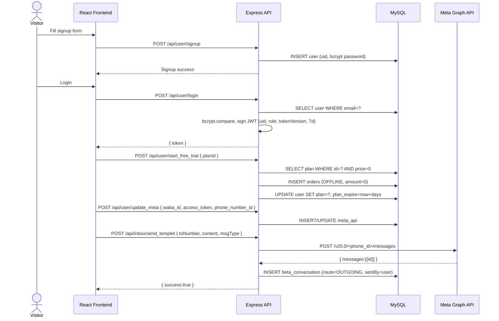
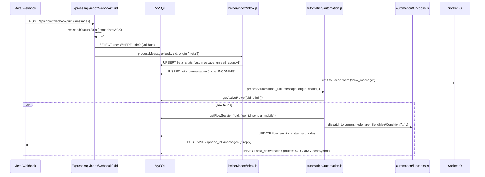
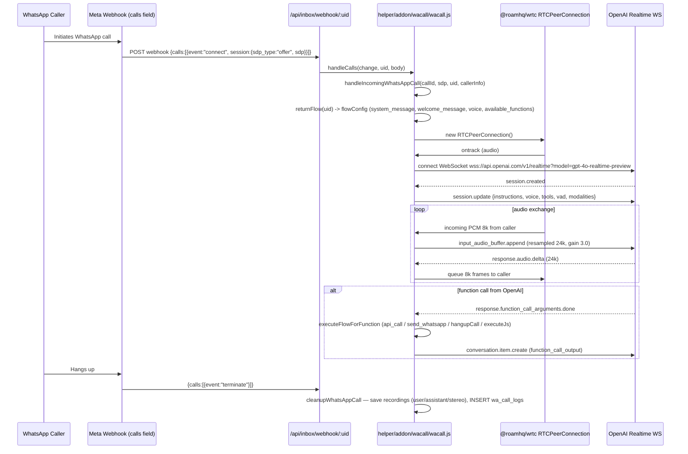

# WhatsCRM Ultimate — Independent Technical & Product Analysis

> **Project under analysis:** `whatscrm-610.rar` (CodeCanyon item `codecanyon-63933531-whatscrm-whatsapp-crm-ai-automation-and-multichannel-saas-bundle-nodejs-script`)
> **Distribution version (frontend):** `6.1.0` (`app_extracted/env.js`)
> **Server package version:** `5.9.8` (`app_extracted/package.json` -> `"name": "server"`)
> **SHA-256 of the archive:** `b910fe3c4a200786f062773daef960a0373f99af0c498d3f723dddb49e1ffb77` (matches pixeldrain metadata)
> **Analysis date:** 2026-11-04
> **Analysis mode:** Static source-code & schema inspection only. **No code was executed, no dependencies were installed, no DB was created, no migrations were run** (per the task restrictions).

---

## 0. Executive Summary

WhatsCRM Ultimate is a **self-hosted, multi-tenant SaaS bundle** built in **Node.js (Express 4 + Socket.IO 4)** on the backend and **React (Create React App, minified build)** on the frontend, backed by **MySQL/MariaDB** (with optional MongoDB for WhatsApp session storage). It is sold on CodeCanyon as a one-time-purchase "ultimate" bundle that bundles **seven premium addons** in a single distribution: WhatsApp Cloud API, WhatsApp QR login (unofficial via Baileys), WhatsApp Embed (OAuth) login, Webhook Automation, WhatsApp AI Voice Calling, Telegram inbox, and a React Native mobile app (referenced, not shipped in this archive).

The product is positioned as a "WhatsApp CRM + Marketing + AI Automation" platform. End customers (tenants) buy a subscription plan from the platform admin, connect one or more WhatsApp numbers (official Cloud API, unofficial QR, or embedded signup), and use a visual **flow builder** to design chatbots, broadcasts, AI voice-call agents, and multi-channel automations across WhatsApp, Instagram, Telegram and Messenger. A sub-tenant **Agent** role with granular permissions lets tenants delegate inbox work to humans.

The architecture is a classic **monolithic Express app** with ~23 route files, a single shared MySQL database with a `uid` column on every tenant-scoped table, three long-running background loops (Meta campaign sender, QR campaign sender, WhatsApp account "warmer"), and a Socket.IO layer for real-time inbox/call events. AI is delivered through **bring-your-own-key** integrations with OpenAI, Google Gemini and DeepSeek, plus a Realtime-API voice agent for WhatsApp calls. Two plugin slots (the in-flow **AI Transfer** node and the **Webhook Automation** plugin) ship as **stubs in this distribution** and must be supplied separately — an important limitation noted throughout this report.

Overall the codebase is functional and feature-dense, but it exhibits several **security weaknesses** (default JWT signing key shipped in `.env.example`, default admin/user passwords, `vm2` v3 used for sandboxed JS — a version with known sandbox-escape CVEs, GET endpoints that mutate state, no rate limiting) and **scalability concerns** (single shared DB with row-level tenancy, in-memory session Maps, file-based session storage defaulting to `local`).

---

## 1. Product Overview

### 1.1 Purpose
WhatsCRM Ultimate is positioned (see `documentation/index.html` meta description and landing page text) as:

> "The all-in-one WhatsApp CRM bundle — every addon included, nothing to buy separately. Manage customers, automate AI chatbots, broadcast messages, run AI voice calls, connect Telegram, and ship your own mobile app from one platform."

`client/public/index.html` repeats the same positioning:

> "WhatsCRM is an all-in-one cloud-based platform for WhatsApp, Instagram, and Telegram marketing and automation."

### 1.2 Target users
- **Marketing teams / SMBs** running WhatsApp/Instagram/Telegram campaigns.
- **Customer-support teams** needing a shared multi-agent inbox with chatbot deflection.
- **Agencies / resellers** who want to sell WhatsApp marketing as a service (the SaaS layer supports plans, trials, payments).
- **Developers** integrating WhatsApp into other products via the REST API (`/api/v1/...` and `/api/qr/rest/send_message`).

### 1.3 Business model
A **self-hosted SaaS reseller model**:
1. The buyer (you) purchases the bundle on CodeCanyon once.
2. You install it on your domain and become the **platform admin**.
3. Your customers sign up as **users (tenants)**, pick a plan (free trial, or paid via Stripe / PayPal / Razorpay / Paystack / MercadoPago / offline), and connect their own WhatsApp / Instagram / Telegram accounts.
4. Tenants can delegate work to **agents** (sub-users of the tenant).
The admin sets plans, prices, currencies, payment keys, themes, FAQ, testimonials, pages, SMTP, social login, mobile-app config and FCM keys from a single admin panel.

### 1.4 Technology stack (verified in source)

| Layer | Technology | Evidence |
|---|---|---|
| Runtime | Node.js (v20+ required, v22 recommended per `documentation/index.html`) | `package.json` |
| HTTP server | Express 4.17 | `package.json`, `server.js` |
| Realtime | Socket.IO 4.7 | `package.json`, `socket.js` |
| WhatsApp (unofficial) | Baileys 7.0.0-rc14 | `package.json`, `helper/addon/qr/index.js` |
| WhatsApp (official) | Meta Graph API v19/v20/v21/v24 (mixed across files) | `helper/addon/embed/index.js`, `loops/campaignBeta.js`, `helper/inbox/meta/index.js` |
| Telegram | `telegram` (GramJS) 2.26 | `package.json`, `helper/addon/telegram/tele.js` |
| WhatsApp voice calls | `@roamhq/wrtc` 0.9 + OpenAI Realtime WS + ElevenLabs | `helper/addon/wacall/*`, `package.json` |
| Database | MySQL/MariaDB 10.11 (via `mysql2` 3.9); MongoDB optional (`mongodb` 6.20) | `database/config.js`, `database/import.sql` header, `package.json` |
| Auth | JWT (`jsonwebtoken` 9) + bcrypt 6 | `middlewares/*.js`, `routes/user.js`, `routes/admin.js` |
| Payments | Stripe 12, Razorpay, PayPal, Paystack, MercadoPago 3 | `package.json`, `routes/user.js`, `routes/admin.js` |
| Media processing | sharp 0.32, fluent-ffmpeg 2 + ffmpeg-static 5 | `package.json`, `routes/user.js` (audio conversion to Opus/OGG for Baileys) |
| Email | nodemailer 8 | `package.json`, `emails/returnEmails.js` |
| Push (mobile + web) | firebase-admin 13 (FCM), service-worker web push | `client/public/firebase-messaging-sw.js`, `helper/addon/web-notification/webPush.js` |
| AI providers | OpenAI Chat Completions + Realtime, Google `@google/generative-ai` 0.24, DeepSeek Chat | `functions/function.js`, `helper/addon/wacall/openaiHandler.js`, `routes/ai.js` |
| Sandboxed JS | `vm2` 3.10 | `package.json`, `routes/user.js` (`try_js`), `helper/addon/wacall/flowExecutor.js` |
| Frontend | React (Create React App), minified single-bundle (~5.5 MB main.js) | `client/public/index.html`, `client/public/asset-manifest.json` |
| Frontend libs (detected in bundle) | ReactFlow (flow builder), `@mui/material`, moment | grep of `client/public/static/js/main.d12aca39.js` |
| i18n | JSON files in `languages/` (14 languages, auto-merged on startup) | `server.js` `updateLangJsonFromEnglish()`, `languages/*.json` |
| Mobile app (referenced, not shipped) | React Native Expo + Firebase | `documentation/index.html`, `client/public/manifest.json` |

### 1.5 Main capabilities (verified in source, not just marketing)

- Multi-tenant signup, login (email/password, Google, Facebook), free trial, paid plans via 5 payment gateways.
- Connect WhatsApp numbers via three methods: Cloud API, Baileys QR, Meta embedded signup.
- Unified inbox across WhatsApp, Instagram, Telegram, Messenger with per-chat tags, notes, agent assignment, kanban view.
- Drag-and-drop **ChatbotFlow** builder with 16+ node types (Send Message, Condition, Delay, HTTP Request, Google Sheets, Send Email, Agent Transfer, AI Transfer, MySQL Query, Set Label, Send Template, Send WA Form, Phonebook Manager, Response Saver, Disable Auto-Reply, Reset Session).
- AI-assisted flow generation from natural language (`/api/chat_flow/generate`).
- **Broadcast campaigns** via Cloud API (carousel/catalog/standard templates) or via Baileys QR sessions.
- **AI suggest reply** and **AI translation** (OpenAI/Gemini/DeepSeek) — bring your own key.
- **WhatsApp AI Voice Calling** (incoming & outgoing) via OpenAI Realtime API + ElevenLabs voices, with call recording, transcription, and function-calling tied to flow nodes.
- Phonebook management with CSV import/export and 6 custom variables per contact.
- REST API (`/api/v1/send-message`, `/api/v1/send_templet`, `/api/qr/rest/send_message`) for external integrations.
- Webhooks table & admin UI exist, but the webhook plugin is a **stub in this distribution** (see §8).
- Theme editor with import/export, multi-language UI, RTL support.
- PWA service worker, Firebase web push for desktop notifications.
- Admin panel: users, plans, orders, FAQ, testimonials, dynamic pages, SMTP, social login config, FCM config, mobile-app config, theme config, QR storage config (local/MySQL/MongoDB), Instagram/Messenger/Telegram app config.

---

## 2. Complete Feature Inventory

Modules are mapped to their route file(s) and primary tables. "Verified in source" means the route handler logic was read; "stub" means the route exists but returns a "plugin required" message.

### 2.1 Authentication & account module — `routes/user.js`, `routes/admin.js`, `routes/agent.js`
- Email/password signup, login, password recovery (email link), profile update.
- Social login: Google (`/login_with_google`, validates `https://www.googleapis.com/oauth2/v3/userinfo`), Facebook (`/login_with_facebook`, validates via Graph API debug-token).
- Per-user API key generation (`/generate_api_keys`) — the API key **is a JWT** signed with the same `JWTKEY`.
- Admin login, password recovery, modify password, update admin profile.
- Agent login + agent CRUD by tenant owner.
- `tokenVersion` column on `user`, `admin`, `agents` enables mass-token-invalidation on password change.
- Tables: `user`, `admin`, `agents`, `g_auth` (Google creds log), `fcm_tokens`.

### 2.2 Plan & subscription module — `routes/admin.js`, `routes/user.js`, `middlewares/plan.js`
- Admin CRUD for plans (`plan` table) with feature flags: `allow_tag`, `allow_note`, `allow_chatbot`, `allow_api`, `contact_limit`, `qr_account`, `wa_warmer`, `rest_api_qr`, `instagram_inbox`, `telegram_inbox`, `messenger_inbox`, `allow_wa_forms`, `is_trial`, `price`, `plan_duration_in_days`.
- The plan is stored **as a JSON blob in `user.plan`** (not normalized) plus `user.plan_expire` (Unix timestamp string) and `user.trial` (0/1).
- `checkPlan` middleware: refuses if no plan or `plan_expire` < 1 day. Feature-specific guards (`checkNote`, `checkTags`, `checkContactLimit`, `checkQrScan`, `checkWaWArmer`, `checkTeleInbox`, `checkInstaInbox`, `checkWaForms`) wrap privileged routes.
- Free trial is one-time per user (`trial` flag); `start_free_trial` rejects if `price > 0` or `trial > 0`.

### 2.3 Payments module — `routes/user.js`, `routes/admin.js`
- 5 gateways supported: **Stripe** (Checkout Session), **PayPal** (order capture), **Razorpay** (`rzCapturePayment`), **Paystack**, **MercadoPago** (`Preference` + webhook).
- Plus "offline" manual payment (admin records a key/id pair).
- All gateway keys stored in the **single-row `web_private` table** (Stripe, PayPal, Razorpay, Paystack, MercadoPago, plus FCM, embed, Telegram, Instagram, Messenger keys).
- Successful payment → `updateUserPlan(plan, uid)` writes `user.plan` JSON and `user.plan_expire = now + plan.plan_duration_in_days` seconds.
- `orders` table records `uid, payment_mode, amount, data (orderID string), s_token, status`.

### 2.4 WhatsApp Cloud API module — `routes/inbox.js`, `routes/templet.js`, `routes/broadcast.js`, `helper/inbox/meta/`, `helper/addon/embed/`
- `meta_api` table stores per-user WABA credentials: `waba_id`, `business_account_id`, `access_token`, `business_phone_number_id`, `app_id`, `login_type` (`manual`/`embed`), `is_coexistence`, `platform_type`.
- Two login methods: **manual** (admin/user pastes permanent token + IDs) and **embedded signup** (OAuth code exchanged via `exchangeEmbedToken`, supporting coexistence mode where the phone stays on the mobile app).
- Webhook receiver: `GET/POST /api/inbox/webhook/:uid` — `:uid` is the user's uid, used as Meta's `verify_token`. Webhook `entry[0].changes[0].field` is switched on `messages` / `calls` and dispatched to `processMessage`, `handleWAFormSubmission`, `updateBroadcastContactPermission`, `handleCalls` (in `helper/addon/wacall/wacall.js`).
- Templates (`templets` route + `meta_templet_media`): list, create, delete via Meta Graph API.
- Sending: text, image, video, audio, document, location, contact, catalog & carousel templates (`sendCarouselTemplateMessage`, `sendCatalogTemplateMessage` in `loops/campaignBeta.js`).

### 2.5 WhatsApp QR (unofficial) module — `routes/qr.js`, `helper/addon/qr/`
- Per-tenant WhatsApp instances (`instance` table: `uniqueId`, `number`, `qr`, `data`, `other`, `status`).
- Built on **Baileys** (`@whiskeysockets/baileys` v7 RC14). Session auth keys can be stored in:
  - Local filesystem (`sessions/md_<uniqueId>/` — default),
  - MySQL (`mysql-baileys` writes to `auth` table),
  - MongoDB (user-supplied connection string in `web_private.mongodb_string`).
- `init()` runs at server start: reads all `instance WHERE status='ACTIVE'` (or local `md_*` directories) and reconnects each session.
- REST API for sending via QR instances: `/api/qr/rest/send_message` (token-authenticated, returns message ID).
- "Warmer" loop (`helper/addon/qr/warmer/index.js`): rotates a tenant's WhatsApp instances sending scripted messages to each other to keep numbers "warm".

### 2.6 WhatsApp Embed (OAuth) module — `helper/addon/embed/index.js`, `routes/user.js` (`exchange_embed_token`)
- Implements the Meta embedded signup 7-step flow: exchange auth code → fetch WABA details → check phone status → register phone (skipped in coexistence mode) → validate name status → subscribe webhook → return token + WABA + phone details.
- Uses Graph API v24.0.

### 2.7 Broadcast / Campaign module — `routes/broadcast.js`, `loops/campaignBeta.js`, `loops/qrCampaignLoop.js`
- **Two** broadcast engines:
  1. **Cloud API campaigns** (`beta_campaign` + `beta_campaign_logs`): scheduled template-message broadcasts via Meta Graph API. Background loop polls every 30 s, batch size 20, 800 ms between sends, 3 retries with 5 s backoff (`sendWithRetry`, `isTransientError`). Supports STANDARD / CAROUSEL / CATALOG templates. Per-contact variable substitution (`replaceContactVariables`).
  2. **QR campaigns** (`qr_campaigns` + `qr_campaign_logs`): broadcasts via Baileys sessions, with per-campaign `delay_min`/`delay_max` random delay (default 5-15 s) and optional `random_suffix` to evade spam detection. Loop ticks every 2 s, processes up to 5 running campaigns per tick.
- Campaign dashboard, CSV export, per-campaign detail view, log deletion.

### 2.8 Inbox & chat module — `routes/inbox.js`, `helper/inbox/`, `routes/kaban.js`
- `beta_chats` (replaces legacy `chats`) — per-uid, per-chat_id, with `last_message`, `chat_label`, `chat_note`, `assigned_agent`, `unread_count`, `kanban_order`, `origin` (`meta`/`qr`/`telegram`/`instagram`/`messenger`).
- `beta_conversation` — every message (incoming/outgoing) with `type`, `msgContext`, `route` (INCOMING/OUTGOING), `sentBy` (`user`/`agent`/`ai`/`bot`), `origin`, `metaChatId`, `timestamp`, `reaction`, `star`, `err`.
- Multi-channel dispatch in `helper/inbox/inbox.js`: routes Meta / QR / Telegram / Instagram / Messenger messages to a unified `processMessage` that updates `beta_chats` + `beta_conversation` and emits socket events to the right room.
- Chat tags (`chat_tags`), notes, star, reaction.
- Kanban board: chats grouped by tag, draggable ordering, date filters (today/yesterday/last7/last30/thisMonth/lifetime/custom).
- Agent assignment: `agent_chats` table links owner_uid → agent_uid → chat_id.

### 2.9 Chatbot / Flow builder module — `routes/chatFlow.js`, `routes/chatbot.js`, `automation/`
- Two parallel implementations coexist in the codebase:
  1. **Legacy chatbot** (`chatbot` table, `helper/chatbot/meta/function.js`): rule-based keyword → node mapping with `{{OTHER_MSG}}` fallback and an "assign to AI" flag.
  2. **Beta flow builder** (`beta_flows` + `beta_chatbot` + `flow_session`): visual drag-and-drop builder backed by ReactFlow on the frontend and `automation/automation.js` + `automation/functions.js` on the backend. The same flow engine is reused for chatbot replies, webhook automations, and AI voice call function-calling.
- Active flow resolution: `getActiveFlows({uid, origin, sessionId, webhook})` finds a flow matching the channel/origin; `getFlowSession()` returns or creates the per-sender session row in `flow_session` (keyed by `uid + flow_id + sender_mobile`).
- Loop protection: max 50 iterations, max 3 visits per node, max 30 s execution; on breach the session row is deleted.
- AI flow generation: `/api/chat_flow/generate` accepts a natural-language instruction, calls OpenAI/Gemini/DeepSeek with a system prompt built from node schemas, and returns a flow JSON.

### 2.10 AI module — `routes/ai.js`, `automation/useAITransferHandler.js`, `helper/addon/wacall/`
Three distinct AI surfaces:

1. **AI suggest reply & translation** (`routes/ai.js`, `functions/function.js`):
   - `POST /api/ai/suggest_reply` — uses the last N messages from `beta_conversation` (default 5) as context, calls OpenAI `gpt-3.5-turbo` (temp 0.7, max 500 tokens) / Gemini `gemini-1.5-flash` / DeepSeek `deepseek-chat`. **Bring-your-own-key** (apiKey in body).
   - `POST /api/ai/translate` — same 3 providers, same BYOK pattern.
2. **AI Transfer flow node** (`automation/functions.js::processAiTransfer`): a flow node that hands the conversation to an AI bot. The actual AI logic is delegated to `aiTransferHandler` in `automation/useAITransferHandler.js`, which is a **stub** in this distribution:
   ```js
   async function aiTransferHandler(params) {
     return { success: false, message: "Ai plugin is required" };
   }
   ```
   i.e. the AI Bot addon is referenced by `env.js` (`addON = ["AI_BOT"]`) but the plugin code is not present in this archive.
3. **WhatsApp AI Voice Calling** (`routes/waCall.js`, `helper/addon/wacall/`): a fully-shipped implementation. Incoming WhatsApp call (Meta WebRTC SDP offer) → `@roamhq/wrtc` RTCPeerConnection → bidirectional Opus/PCM audio bridge to OpenAI Realtime WebSocket (`wss://api.openai.com/v1/realtime?model=gpt-4o-realtime-preview-2024-12-17`). Supports VAD, barge-in, transcription (Whisper-1), function calling that triggers flow nodes (api_call / send_whatsapp / send_message / executeJs / hangupCall), stereo recording mixing. Outgoing broadcasts (`wa_call_broadcasts`) request call permission via interactive `call_permission_reply` and then place calls.

### 2.11 WhatsApp Forms module — `routes/waform.js`, `helper/addon/qr/...`
- `wa_forms` table: per-uid form definitions with `fields_json`, linked `flow_id`, `flow_status`.
- Public submission endpoint `/api/waform/submit` triggers a flow (typically sends a WhatsApp message to the submitter via the linked flow).
- `wa_form_submissions` records each submission with raw payload.

### 2.12 Telegram module — `routes/telegram.js`, `helper/addon/telegram/`
- Built on GramJS (`telegram` package). Per-tenant sessions stored in `telegram_session` (`session_id`, `api_id`, `api_hash`, `session` StringSession blob).
- Admin configures global `teleAppId`/`teleHash` in `web_private`; tenants authenticate via OTP flow (`/send_otp`, `/verify_otp`).
- Inbox integration: `setupMessageListener` per client routes incoming Telegram messages into the same `processMessage` pipeline as WhatsApp.
- Send message, list chats, check status, reconnect, disconnect, delete session.

### 2.13 Instagram module — `routes/insta.js`, `helper/addon/insta/`
- Meta Graph API-based. OAuth flow (`/auth-url`, `/callback`) with scopes `instagram_business_basic`, `_manage_messages`, `_manage_comments`, `_content_publish`.
- `instagram_accounts` table stores `ig_graph_id`, `user_id`, `page_id`, `username`, `access_token`, `expires_in`, `token_type`.
- Webhook receiver `/api/insta/webhook/:uid` handles DMs and comments; DMs flow into the unified inbox.
- Comment automation: `processInstaComment` can reply to comments via the Graph API.

### 2.14 Messenger module — `routes/messenger.js`, `helper/inbox/messenger/`
- Meta Page Messenger integration. Admin configures `messenger_app_id`, `messenger_app_secret` in `web_private`.
- Per-tenant Page connections (`messenger_accounts` table: `page_id`, `page_access_token`, `user_access_token`).
- Webhook `/api/messenger/webhook/:uid` routes Page messages into the unified inbox.

### 2.15 Webhook Automation module — `routes/webhook.js`, `helper/addon/webhook/index.js`
- **Status: STUB in this distribution.** Every endpoint in `routes/webhook.js` returns `{ msg: "plugin required", success: false }`. The `checkWebhook()` helper is `return true;` but does nothing.
- However, the database schema **does** ship with `webhooks` and `webhook_logs` tables (with `webhook_id` UUID, `method` enum, `secret`, `event_type`, `payload`, `status`), and the `automation/` engine has a `origin === "webhook_automation"` code path — so the plugin slot is wired end-to-end but the user-facing CRUD endpoints are disabled here.

### 2.16 Theme module — `routes/theme.js`
- A complete theme system: `themes-registry.json` + per-theme JSON files in `routes/themes/`. Admin can CRUD themes, set active theme, import/export.
- Themes include color palette (brand/background/text/UI), typography (font family, sizes, weights), button/card/input/advanced styles.
- Public endpoint `/api/web/get_theme` is the only endpoint that runs through `checkLicense` middleware (see §11 for caveats).

### 2.17 Web / CMS module — `routes/web.js`
- Admin-managed public site: `page` table (slug, title, image, content, permanent flag) for Terms/Privacy/About/etc.
- `faq`, `testimonial`, `contact_form`, `partners` (logo filename only), `gen_links` (WhatsApp click-to-chat link generator).
- Translation management: read/update/add/delete language JSON files via admin endpoints.
- "Install/Update app" endpoints (`/install_app`, `/update_app`) — invoke a remote verification portal (`envato-buyer.oneoftheprojects.com` per the docs).
- `/api/web/exchange-token` — public endpoint that exchanges an embed code for a Graph API token (used by the WhatsApp embed frontend popup).
- `/api/web/check_install`, `/api/web/get_app_version`, `/api/web/update_to_be_shown` — version/portal plumbing.

### 2.18 Agent / team module — `routes/agent.js`
- Owner (tenant) creates agents with `email`, `password`, `name`, `mobile`, `comments`.
- Per-agent flags: `is_active`, `mask_number` (hide customer phone), `allow_send_new_qr` (allow starting new chats), `allow_save_contact`.
- Agent-facing endpoints: send text/image/audio/video/doc, get assigned chats, get conversation, mark task complete, change chat ticket status, get quick replies, save contact.
- Agent auth uses the same JWT mechanism but with `role: "agent"` + `owner_uid` claim, validated against `agents` table.

### 2.19 QR campaign module — `routes/qrCampaign.js`
- Distinct from Cloud API broadcasts; uses Baileys sessions for bulk sending.
- Per-campaign config: `instance_id`, `phonebook_id`, `message_type` (text/image/video/audio/document), `message_text`, `media_url`, `media_caption`, `delay_min/max`, `random_suffix`, `scheduled_at`.
- Logs (`qr_campaign_logs`) include `delivery_status`, `message_id` (Baileys key.id), `read_at`, `delivered_at` (populated from Baileys read/delivery receipts).

### 2.20 WhatsApp AI Calling module — `routes/waCall.js`, `helper/addon/wacall/`
- Flow builder for voice: `wa_call_flows` stores nodes/edges like chatbot flows but with voice-specific node types (`executeJs`, `hangupCall`, `apiCall`, `sendMessage`, `sendWhatsapp`, etc.).
- `wa_call_bot` table: bind a flow to incoming calls (per-uid, `active` flag).
- `wa_call_broadcasts` table: scheduled outbound call campaigns with `max_concurrent_calls`, `call_delay`, `retry_failed`, `retry_count`, `permission_requested/granted/denied` counters.
- `wa_call_logs` table: per-call log with `transcription_json`, `recording_user`, `recording_assistant`, `recording_stereo` file paths, `error_message`, `status` (connected/ended/failed).
- ElevenLabs voice listing: `/fetch_el_voice` (uses `getElevenLabsVoices` from `functions/function.js`).
- Voice execution: see §2.10.3.

### 2.21 Notification modules
- **Web push** (`helper/addon/web-notification/webPush.js`): Firebase web push to subscribed browsers via VAPID keys configured in `web_private`.
- **Mobile push** (`functions/function.js::sendFCMNotification`): Firebase Admin SDK sends to FCM tokens stored in `fcm_tokens` (per-uid). User can choose which events trigger a push (inbox vs campaign events).
- **Email** (`emails/returnEmails.js`): currently only ships a `recoverEmail` template (password recovery). Sent via admin-configured SMTP (`smtp` table).

### 2.22 Phonebook module — `routes/phonebook.js`
- `phonebook` (per-uid named groups) + `contact` (per-uid, per-phonebook; `name`, `mobile`, `var1`..`var6` custom variables).
- CSV import (via `csv-parser`), CSV export, bulk delete, edit.
- `checkContactLimit` middleware enforces plan's `contact_limit`.

### 2.23 Quick replies, chat tags, widgets
- `quick_reply` (per-uid canned messages).
- `chat_tags` (per-uid, with `hex` color and `show_on_kanban` flag).
- `chat_widget` (per-uid embeddable WhatsApp click-to-chat widget with logo/position/size).

---

## 3. Business Workflows

### 3.1 New tenant signup → first WhatsApp message



**Source evidence:** `routes/user.js::/signup` (line 322), `routes/user.js::/login` (line 360), `routes/user.js::/start_free_trial` (line 1912), `routes/user.js::/update_meta`, `routes/inbox.js::/send_templet`.

### 3.2 Incoming WhatsApp message → chatbot flow execution



**Source evidence:** `routes/inbox.js::/webhook/:uid` (line 19), `helper/inbox/inbox.js::processMessage`, `helper/inbox/meta/index.js::processMetaMessage`, `automation/automation.js::processFlow` (loop-protection at lines 17-66).

### 3.3 Broadcast campaign (Cloud API) — scheduled send

1. User picks a phonebook + a Meta-approved template → `POST /api/broadcast/add_new` inserts a `beta_campaign` row (status `PENDING`) and one `beta_campaign_logs` row per contact (status `PENDING`) — verified in `routes/broadcast.js::/add_new`.
2. The `setInterval` in `loops/campaignBeta.js::initCampaign` (30 s tick, see line 131) calls `processPendingCampaigns` which fetches up to 10 pending campaigns ordered by `createdAt`.
3. For each campaign whose `schedule` has passed in its timezone, `processSingleCampaign` fetches a batch of 20 pending logs, looks up the user's `meta_api` credentials, and sends via `sendTemplateMessage` / `sendCarouselTemplateMessage` / `sendCatalogTemplateMessage`.
4. Each successful send: log status → `SENT` + `meta_msg_id` + `delivery_time`. Each failure: log status → `FAILED` + `error_message`. 800 ms delay between sends. Up to 3 retries with 5 s backoff on transient errors (`isTransientError`).
5. Counts (`sent_count`, `delivered_count`, `read_count`, `failed_count`) are recomputed via `updateCampaignCounts`. When no pending logs remain, status → `COMPLETED`.
6. Later, Meta webhook `statuses` events update `beta_campaign_logs.delivery_status` and `beta_api_logs.status` (`routes/inbox.js::handleMessages`, lines 527-580).

### 3.4 QR campaign (Baileys) — slower, throttled sending

1. User creates a `qr_campaigns` row tied to a `instance_id` (Baileys session) and a `phonebook_id` with per-campaign `delay_min`/`delay_max` (default 5–15 s).
2. The 2-second tick in `loops/qrCampaignLoop.js::qrCampaignLoop` picks up to 5 `running` campaigns, calls `processCampaign`.
3. `processCampaign` filters out already-sent mobiles, picks the first pending contact, builds a Baileys message object (`buildBaileysMessage`), calls `session.sendMessage(jid, msgObj)`, logs to `qr_campaign_logs` with `message_id = sendResult.key.id`, increments `sent_count`/`failed_count`, then waits `randomDelay(delay_min, delay_max)` before returning.
4. Schedule-aware: `checkScheduledCampaigns` flips `scheduled` → `running` when `scheduled_at <= NOW()`.

### 3.5 WhatsApp AI Voice Call (incoming)



**Source evidence:** `helper/addon/wacall/wacall.js::handleIncomingWhatsAppCall`, `helper/addon/wacall/openaiHandler.js::connectToOpenAI`, `handleOpenAIMessage`, `handleFunctionCall`, `helper/addon/wacall/flowExecutor.js::executeFlowForFunction`.

### 3.6 Agent login → reply to assigned chat

1. Owner creates an agent (`POST /api/agent/add_agent`) with `email`, `password`, `owner_uid`. The agent row gets its own `uid`.
2. Agent logs in via `POST /api/agent/login` → JWT signed with `{uid, role:"agent", owner_uid, tokenVersion}`.
3. `validateAgent` middleware (`middlewares/agent.js`) verifies the JWT, fetches the agent row, confirms `is_active=1`, fetches the owner's `user` row, and exposes `req.owner` for downstream plan checks. `checkPlan` then reads the **owner's** plan (it overrides `req.decode.uid = req.owner.uid` at line 14 of `middlewares/plan.js`).
4. Agent fetches assigned chats (`GET /api/agent/get_my_assigned_chats`), opens a conversation (`POST /api/agent/get_convo`), and sends a reply via `POST /api/agent/send_text` / `send_image` / `send_audio` / `send_doc` / `send_video`. Each send updates `beta_conversation` with `sentBy=agent` and emits a socket event to the owner's room.

### 3.7 Payment → plan activation

1. User picks a plan → `POST /api/user/create_stripe_session { planId }`.
2. Backend reads `web_private.pay_stripe_key`, instantiates `new Stripe(key)`, inserts an `orders` row with `payment_mode=STRIPE`, `data=orderID` (`STRIPE_<randomstring>`), `amount=plan.price`, `status=PENDING`.
3. Stripe Checkout Session created with `success_url`/`cancel_url` pointing to `/api/user/stripe_payment?order=<orderID>&plan=<planId>`.
4. Stripe redirects the user back. `GET /api/user/stripe_payment` retrieves the Stripe session, checks `payment_status === "paid"`, updates `orders.status = PAID`, calls `updateUserPlan(plan, uid)` which sets `user.plan = JSON.stringify(plan)` and `user.plan_expire = now + plan.plan_duration_in_days` seconds.
5. Other gateways follow the same pattern: capture payment (`rzCapturePayment` for Razorpay, PayPal order capture, Paystack transaction verify, MercadoPago webhook) → `updateUserPlan`.

---

## 4. UI/UX Analysis

> **Methodological caveat:** the React source (`client/src/`) is **not shipped** in this archive — only the built/minified `client/public/` static files. The following is inferred from `index.html`, `asset-manifest.json`, the visible i18n strings in `languages/English.json`, the route surface, and the SVG asset filenames in `client/public/assets/`. Specific layout details could not be verified.

### 4.1 Application shell
- Single-page React app (Create React App), served by Express via `app.get("*", ...) → index.html` fallback (`server.js` line ~245).
- Three login portals: `/admin`, `/user`, `/agent` (per documentation's default-credentials section).
- PWA-enabled: `manifest.json`, `worker.js` (service worker with **network-first** caching strategy), `firebase-messaging-sw.js` (FCM worker).
- Font: Roboto (300/400/500/600/700) loaded from Google Fonts.
- Default SEO/OG metadata hard-coded in `index.html`.

### 4.2 Navigation (inferred from i18n strings)
The `languages/English.json` keys reveal the IA: authentication (`welcomeBack`, `signInSubtitle`, `continueWithGoogle`), theme editor (`webTheme`, `themeEditor`, `colors`, `typography`, `button`, `card`, `input`, `advanced`, `brandColors`, `backgroundColors`, `textColors`, `uiElementColors`), and the documented module list maps 1-to-1 to the route surface (Inbox, Broadcast, Phonebook, Chatbot, Flow Builder, AI Chat, QR Login, Webhook Automation, Embed Login, AI Calling, Telegram, Mobile App, Settings).

### 4.3 Dashboards
- User dashboard: `GET /api/user/get_dashboard` (returns aggregated counts).
- Broadcast dashboard: `GET /api/broadcast/dashboard` + per-campaign `GET /api/broadcast/campaign/:campaignId` with detailed log tables and CSV export (`/export/:campaignId`, `/download_csv`).
- Agent report: `POST /api/agent/get_agent_report` (per-agent stats).
- Admin user dashboard: `GET /api/admin/get_dashboard_for_user`.

### 4.4 Forms & validation
- Most form validation is **ad-hoc** in the route handlers (e.g., `if (!email || !password) return res.json({msg: ...})`).
- The `routes/ai.js` file re-implements a tiny `check`/`validate`/`validationResult` chain (lines 14–55) rather than using `express-validator` — a sign that **`express-validator` is not a dependency** (confirmed absent from `package.json`).

### 4.5 Tables, filters, pagination
- Kanban board for chats (`POST /api/kaban/get_board`) supports search, `limit`/`offset`, date filters (`today`/`yesterday`/`last7`/`last30`/`thisMonth`/`lifetime`/`custom`), and tag columns toggled via `show_on_kanban`.
- Broadcast logs, campaign logs, contact lists, API logs (`/api/v1/get_logs`) — all list-style endpoints.
- CSV import/export for phonebooks (`/api/phonebook/export_contacts_csv`, import via `/api/phonebook/add_csv` family).

### 4.6 Detail pages
- Per-chat conversation view (`/api/agent/get_convo`, `/api/chat_flow/session_mine`).
- Per-campaign detail (`/api/broadcast/campaign/:campaignId`).
- Per-WhatsApp-call log (`/api/waCall/call_logs`) with recording playback (`/recordings/*` static route).
- Per-flow session inspector (`/api/chat_flow/get_beta_flow_sessions`).

### 4.7 Settings
- User-level: profile, Meta API keys, Embed token exchange, API key generation, FCM token registration, quick replies, chat tags, widgets, G-Auth credentials.
- Admin-level: plans, payment gateways, branding, FAQ, pages, testimonials, SMTP, social login, RTL, QR storage, mobile-app config, FCM, Instagram, Telegram, Messenger, embed config, theme, language management, inbox DB (MongoDB) connection.

### 4.8 Responsive design
- `index.html` includes `<meta name="viewport" content="width=device-width,initial-scale=1">`.
- PWA manifest has `display: standalone`, `theme_color`, `background_color`.
- Cannot verify media queries without un-minified CSS (only ~7.7 KB of CSS ships, suggesting most styling is in CSS-in-JS or `@mui/material` runtime styles).

### 4.9 Notable interaction patterns
- **Real-time inbox** via Socket.IO rooms keyed by `uid` (and per-agent `owner_uid`). `socket.js` verifies the JWT in `handshake.query.token` and joins the user/agent to their room.
- **Audio conversion client/server** for Baileys PTT: `POST /api/user/return_media_url?convert=YES&target=baileys` runs `fluent-ffmpeg` with `libopus` / 48 kHz / mono / 64 kbps / `-application voip` to produce a compliant `.ogg`.
- **Drag-and-drop flow builder** uses ReactFlow (5 references in the JS bundle).
- **AI-assisted flow authoring** — `/api/chat_flow/generate` lets the user describe the flow in natural language and get a ready JSON.
- **Sandboxed JS execution** — `/api/user/try_js` runs user-supplied JS in `vm2` `NodeVM` with a 5 s timeout, no `require`, 5 KB max — used by the flow's `executeJs` node and the `wa_call_flows` executeJs node.

---

## 5. Technical Architecture

### 5.1 High-level diagram

```mermaid
flowchart LR
    subgraph Client[React SPA]
        UI[ReactFlow, MUI, moment]
        SW[Service Worker + FCM Worker]
    end

    subgraph Server[Express monolith]
        ROUTES[23 route files under /api/*]
        MW[Middleware: validateUser / adminValidator / validateAgent / checkPlan / checkLicense]
        SOCK[Socket.IO server]
        AUTO[automation/ — flow engine]
        LOOPS[loops/ — campaignBeta, qrCampaignLoop, loopFunctions]
        FUNC[functions/function.js — 95 KB utility module]
    end

    subgraph DB[(MariaDB 10.11)]
        TABLES[62 tables - row-level tenancy by uid]
    end

    subgraph Mongo[(Optional MongoDB)]
        AUTH[baileys auth keys]
    end

    subgraph External
        META[Meta Graph API v19-v24]
        BAILEYS[Baileys / WhatsApp Web]
        OA[OpenAI Chat + Realtime]
        GEM[Gemini]
        DS[DeepSeek]
        EL[ElevenLabs]
        STRIPE[Stripe / PayPal / Razorpay / Paystack / MercadoPago]
        TELE[Telegram MTProto]
        FCM[Firebase Cloud Messaging]
        GSH[Google Sheets API]
        SMTP[User's SMTP]
    end

    Client <-->|REST + Socket.IO| Server
    ROUTES --> MW
    MW --> FUNC
    ROUTES --> AUTO
    ROUTES --> LOOPS
    AUTO --> FUNC
    FUNC --> DB
    LOOPS --> DB
    AUTO --> External
    Server <--> Mongo
    Server <--> External
```

### 5.2 Process model
- **Single Node.js process.** No cluster/PM2 config ships in the repo (admins are expected to use cPanel/aaPanel Node.js app managers per the docs).
- Background work is done via **`setInterval` / `setTimeout` recursion**, not a real queue:
  - `loops/campaignBeta.js`: `setInterval(... 30000)` + `processingCampaigns` Set to dedupe.
  - `loops/qrCampaignLoop.js`: `setTimeout(qrCampaignLoop, 2000)` recursion.
  - `helper/addon/qr/warmer/index.js`: `warmerLoopInit` interval.
  - `helper/addon/telegram/tele.js`: `initTele` reconnect loop.
- No Redis, no Bull/BullMQ, no RabbitMQ — **all scheduling is in-memory**. A process restart loses pending loop state (though DB rows persist).

### 5.3 Request lifecycle
1. Express `cors` middleware validates `Origin` hostname against `[FRONTENDURI, BACKURI]` (split on comma, hostname-extracted).
2. `express.json({ limit: "10mb", verify: ... })` captures `req.rawBody`.
3. `express-fileupload()` for multipart uploads.
4. Route handler → middleware chain (`validateUser` → `checkPlan` → feature middleware) → business logic.
5. Response is JSON `{ success: boolean, msg: string, ... }`.
6. Socket.IO layer (`socket.js`) runs on the same HTTP server, authenticates via `?token=<JWT>` in the handshake query.

### 5.4 Routing surface (23 route files, ~270 endpoints)
Verified by grepping `^router\.(get|post|put|delete|patch)\(` per file. Largest: `routes/user.js` (~104 KB, ~95 endpoints), `routes/admin.js` (~55 KB, ~55 endpoints), `routes/agent.js` (~33 KB, ~28 endpoints), `routes/theme.js` (~26 KB). Full route table is in §2.

### 5.5 Services / controllers / reusable components
- **No formal service/controller separation.** Route handlers contain business logic inline. `functions/function.js` (95 KB, ~150+ exported helpers) is the de-facto service layer.
- `automation/functions.js` (96 KB) is the flow-node dispatcher (one function per node type, all exported).
- `helper/addon/<addon>/` packages each channel's integration; `helper/inbox/<channel>/` does the same for inbound processing.
- DB access is via `database/dbpromise.js::query(sql, params)` — a thin promise wrapper around `mysql2`'s callback `query`. No ORM, no repository pattern, no migrations.

### 5.6 APIs
- Internal JSON API under `/api/*`.
- Public REST API under `/api/v1/*` (token in query string, BYO api_key JWT).
- Public QR REST API under `/api/qr/rest/send_message` (token in body).
- Public webhook receivers under `/api/inbox/webhook/:uid`, `/api/insta/webhook/:uid`, `/api/messenger/webhook/:uid`, `/api/waform/submit`, `/api/web/exchange-token`, `/api/web/gen_wa_link`.

### 5.7 Background jobs / events
- The 4 loops above.
- `nodeCleanup` hook (`server.js` last 5 lines) calls `cleanupTele()` and `cleanup()` (closes all Baileys sockets) on exit.
- Socket.IO events: `new_message`, ring events (`sendRingToUid`), forwarded-message events (`helper/socket/forwardMessage.js`).

### 5.8 Integrations (verified)
- Meta Graph API (WhatsApp Cloud API, Instagram, Messenger, Embedded Signup) — v19/v20/v21/v24 mixed.
- Baileys (unofficial WhatsApp Web).
- GramJS (`telegram` package — official Telegram client API, not Bot API).
- OpenAI Chat Completions + OpenAI Realtime WebSocket.
- Google Generative AI (`@google/generative-ai`) — Gemini 1.5 Flash.
- DeepSeek Chat.
- ElevenLabs (voice listing).
- Stripe / PayPal / Razorpay / Paystack / MercadoPago.
- Google Sheets (via `googleapis`, scoped OAuth in `automation/functions.js::processGoogleService`).
- Google OAuth login (`oauth2/v3/userinfo`).
- Facebook Login (Debug Token API).
- Firebase Admin (FCM push).
- nodemailer (SMTP).

---

## 6. Database and Domain Model

### 6.1 Overview
- **DBMS:** MariaDB 10.11 (`database/import.sql` header).
- **Tables:** 62 (counted from `CREATE TABLE` statements).
- **Charset:** `utf8mb4` / `utf8mb4_unicode_ci` on most tables; a few legacy ones on `utf8mb3`.
- **Tenancy:** every tenant-scoped table has a `uid` column (the user's `randomstring.generate()` uid from `user.uid`). There is **no database-per-tenant** and **no separate schema-per-tenant** — isolation is purely row-level.
- **Tenant scoping is the application's responsibility** — the middleware sets `req.decode.uid`, and every SQL query must include `WHERE uid = ?`. A forgotten `WHERE` is the single biggest cross-tenant data-leak risk in this codebase.
- **Foreign keys:** none. All relationships are logical (via `uid`, `chat_id`, `flow_id`, `instance_id`, `phonebook_id`, `campaign_id` strings) — there is no FK enforcement. This was likely a deliberate choice for tenant-on-shared-hosting simplicity, but it means referential integrity is the app's job.

### 6.2 Lifecycle & audit fields
- Almost every table has `createdAt timestamp DEFAULT current_timestamp()`.
- Newer tables (post-"beta" refactor) also have `updatedAt timestamp ON UPDATE current_timestamp()`.
- Some campaign/log tables have explicit `started_at` / `completed_at` / `read_at` / `delivered_at` / `sent_at` timestamps.
- `tokenVersion int` on `user`/`admin`/`agents` is a session-invalidation counter (bumped on password change).
- There is **no generic `updated_by` / `created_by` audit column**. The `sentBy` column on `beta_conversation` (values: `user`/`agent`/`ai`/`bot`) is the closest thing to an audit field.

### 6.3 Indexes
Most hot-path tables have prefix indexes on `(uid, ...)`:
- `agents`: `idx_owner_uid`, `idx_uid`, `idx_owner_active(owner_uid, is_active)`.
- `beta_chats`: `idx_uid_chatid`, `idx_uid_origin`, `idx_uid_updated`, `idx_sender_mobile`, `idx_uid_unread`, `idx_uid_origin_updated`, `idx_beta_chats_uid_updatedAt`.
- `beta_conversation`: `idx_uid_chat_route`, `idx_uid_metachatid`, `idx_chat_timestamp`, `idx_uid_chat_timestamp`, `idx_chat_type_route`.
- `contact`: `idx_uid_mobile`, `idx_uid`.
- `flow_session`: `idx_uid_flow_sender`, `idx_uid_flow`, `idx_uid_origin_flow`.
- `instance`: `idx_uniqueid`, `idx_uid_status`, `idx_uid`.
- `wa_call_logs`: `idx_uid`, `idx_call_id`, `idx_flow_id`, `idx_status`, `idx_created_at`.
- `wa_call_broadcasts`: `UNIQUE campaign_id`, `idx_uid`, `idx_status`, `idx_campaign_id`.
- `wa_contacts`: `UNIQUE uniq_jid_instance(jid, uniqueId)`.
- `chat_tags`: `idx_uid`.
- `beta_chatbot`: `idx_uid_active`, `idx_uid_origin`, `idx_uid_flow`, `idx_uid_source_active`.
- `beta_flows`: `idx_uid_active_source`, `idx_uid_flow`.

The prefix-index style (`uid(120)`, `mobile(80)`) is unusual but necessary for very long random-string uids.

### 6.4 Entity-relationship diagram (core domain)

> Evidence-based: relationships shown are derived from columns actually present in `database/import.sql`, not from FK constraints (there are none).

```mermaid
erDiagram
    user ||--o{ plan : "JSON blob in user.plan"
    user ||--o{ orders : "uid"
    user ||--o{ meta_api : "uid"
    user ||--o{ instance : "uid (Baileys)"
    user ||--o{ phonebook : "uid"
    user ||--o{ contact : "uid"
    user ||--o{ beta_chats : "uid"
    user ||--o{ beta_conversation : "uid"
    user ||--o{ beta_flows : "uid"
    user ||--o{ beta_chatbot : "uid"
    user ||--o{ beta_campaign : "uid"
    user ||--o{ qr_campaigns : "uid"
    user ||--o{ agents : "owner_uid"
    user ||--o{ chat_tags : "uid"
    user ||--o{ quick_reply : "uid"
    user ||--o{ warmers : "uid"
    user ||--o{ wa_call_flows : "uid"
    user ||--o{ wa_call_bot : "uid"
    user ||--o{ wa_call_broadcasts : "uid"
    user ||--o{ wa_call_logs : "uid"
    user ||--o{ wa_forms : "uid"
    user ||--o{ wa_form_submissions : "uid"
    user ||--o{ fcm_tokens : "uid"
    user ||--o{ webhooks : "uid (stub)"

    phonebook ||--o{ contact : "phonebook_id"
    contact ||--o{ beta_conversation : "via sender_mobile"
    contact ||--o{ beta_campaign_logs : "via contact JSON"
    contact ||--o{ qr_campaign_logs : "via contact_mobile"

    instance ||--o{ qr_campaigns : "instance_id"
    instance ||--o{ wa_contacts : "uniqueId"

    meta_api ||--o{ beta_campaign : "via uid+credentials"
    meta_api ||--o{ meta_templet_media : "uid"

    beta_flows ||--o{ flow_session : "flow_id"
    beta_flows ||--o{ beta_chatbot : "flow_id"
    beta_chatbot ||--o{ flow_session : "via flow_id"

    beta_chats ||--o{ beta_conversation : "chat_id"
    beta_chats }o--o| chat_tags : "chat_label JSON"
    beta_chats }o--o| agents : "assigned_agent JSON"

    beta_campaign ||--o{ beta_campaign_logs : "campaign_id"
    qr_campaigns ||--o{ qr_campaign_logs : "campaign_id"
    wa_call_broadcasts ||--o{ wa_call_logs : "via campaign_id meta"
    wa_call_flows ||--o{ wa_call_bot : "flow_id"

    agents ||--o{ agent_chats : "uid + owner_uid"
    agents ||--o{ agent_task : "uid + owner_uid"

    admin ||--|| web_private : "single row (id=1)"
    admin ||--|| web_public : "single row (id=1)"
```



### 6.5 Notable table-level design decisions

| Decision | Evidence | Implication |
|---|---|---|
| `user.plan` is a JSON blob, not a FK to `plan` | `database/import.sql::user` | Plan changes don't propagate to existing users; each user carries a snapshot of the plan they bought. |
| `beta_chats.chat_label`, `assigned_agent`, `last_message`, `profile`, `other` are `longtext` JSON | `database/import.sql::beta_chats` | No schema enforcement; reads require JSON.parse; no indexed joins on label/agent. |
| `beta_conversation.msgContext` is `longtext` JSON | `database/import.sql::beta_conversation` | Same as above. |
| `flow_session.data` is `longtext` JSON holding the current node + AI state | `database/import.sql::flow_session` | Stateful flow resumption per sender; one row per (uid, flow_id, sender_mobile). |
| `wa_call_logs.transcription_json`, `recording_*` | `database/import.sql::wa_call_logs` | Recordings stored on disk under `/client/public/recordings/`; only paths in DB. |
| `auth` and `undefined` tables | `database/import.sql` | These are Baileys' `mysql-baileys` session tables (`session` + `id` PK, JSON `value`). The `undefined` table name is likely a Baileys bug from a missing session-name config. |
| `web_private` is a single row with ~30 secret keys (Stripe, PayPal, Razorpay, Paystack, MercadoPago, FCM, embed, Telegram, Instagram, Messenger) | `database/import.sql::web_private` | One DB row = one config; no audit log of changes; if leaked, full payment+FCM+social keys compromise. |
| `templets` table missing | grep returns no `CREATE TABLE templats` | The route `routes/templet.js` exists but operates against Meta API, not a local table. |

### 6.6 Schema evolution
- A clear "legacy → beta" refactor is visible: `chats` (legacy) → `beta_chats`, `broadcast` + `broadcast_log` (legacy) → `beta_campaign` + `beta_campaign_logs`, `chatbot` (legacy) → `beta_chatbot`, `flow` + `flow_data` (legacy) → `beta_flows`. The "beta" tables are the ones actually used by current routes; the legacy tables still ship in the schema.
- `wa_call_*` tables are the newest (most carefully indexed, with proper `enum` status fields and `UNIQUE` constraints).
- `telegram_session` has redundant `UNIQUE KEY session_id` defined 3 times — a schema bug.

---

## 7. Authentication and Authorization

### 7.1 User types (3)

| Type | Table | Login route | JWT `role` claim | Notes |
|---|---|---|---|---|
| Admin | `admin` | `POST /api/admin/login` | `admin` | Platform owner. Single-tenant admin (no per-tenant admin). |
| User (tenant) | `user` | `POST /api/user/login` (or Google/Facebook) | `user` | Buys plans, connects channels, owns all data scoped by `user.uid`. |
| Agent | `agents` | `POST /api/agent/login` | `agent` (+ `owner_uid` claim) | Sub-user of a tenant. Tenant owner creates and manages agents. |

### 7.2 JWT mechanism
- Algorithm: HS256 (default for `jsonwebtoken`).
- Signing key: `process.env.JWTKEY`. **The default shipped in `.env.example` is `NCRUp5hKovUAcZd9OwIw0BCKmjZj9JxpNCRUp5hKovUAcZd9OwIw0BCKmjZj9JxpNCRUp5hKovUAcZd9OwIw0BCKmjZj9Jxp` (repeated 3×).** If an operator deploys without changing this key, any attacker can forge a user/admin/agent token. This is the single most serious security finding.
- User JWT lifetime: **7 days** (`expiresIn: "7d"`).
- Admin JWT: **no expiry** (`sign(payload, key, {})`).
- Agent JWT: **no explicit expiry** in the route handler (search `routes/agent.js::/login` — uses `{}` options).
- The `tokenVersion` integer is included in the JWT and compared against the DB on every authenticated request — bumping it (on password change) invalidates all outstanding tokens. Good design.
- The user's `api_key` column is also a JWT (signed with the same `JWTKEY`, no expiry) — generated on demand via `/api/user/generate_api_keys`. Used by `/api/v1/*` and `/api/qr/rest/send_message`.

### 7.3 Middleware chain
- `validateUser` (`middlewares/user.js`): Bearer token → verify → check `role === "user"` → fetch `user` row by `uid` → compare `tokenVersion` → set `req.decode`.
- `adminValidator` (`middlewares/admin.js`): same pattern for `admin` role.
- `validateAgent` (`middlewares/agent.js`): same pattern for `agent` role, plus fetch the **owner** user row and set `req.owner`. The agent inherits the owner's plan limits.
- `checkPlan` (`middlewares/plan.js`): reads `req.decode.uid` (or `req.owner.uid` for agents), fetches `user.plan` JSON, parses it, checks `plan_expire > 1 day`, sets `req.plan`. Feature-specific guards (`checkNote`, `checkTags`, `checkContactLimit`, `checkQrScan`, `checkWaWArmer`, `checkTeleInbox`, `checkInstaInbox`, `checkWaForms`) check individual plan flags.
- `checkLicense` (`middlewares/license.js`): **cosmetic only** — it just writes a local `license.json` file with the current domain. There is **no actual license validation**; it always calls `next()`. This means the CodeCanyon "license" check is purely informational.

### 7.4 Tenant isolation
- Row-level by `uid` column on every tenant-scoped table.
- Every SQL query in route handlers must include `WHERE uid = ?` (or `WHERE owner_uid = ?` for agent-scoped queries). The code generally does this, but a manual audit found no query-level enforcement tool (e.g., no central repository layer that auto-injects `WHERE uid = ?`).
- **Risk:** any future route added without the `WHERE uid = ?` clause would leak cross-tenant data. There is no DB-level RLS (MariaDB has no native row-level security).

### 7.5 Record-level access (agents)
- An agent can only see chats assigned to them (`agent_chats` table joins `owner_uid` + `agent.uid` + `chat_id`).
- `mask_number` flag on the agent hides the customer's full phone number from the agent UI.
- `allow_send_new_qr` gates whether the agent can start new chats (not just reply to assigned ones).
- `allow_save_contact` gates whether the agent can move a chat contact into the owner's phonebook.

### 7.6 Other security mechanisms
- **bcrypt** with salt rounds 10 for all password hashing.
- **CORS** whitelist by hostname extracted from `process.env.FRONTENDURI` + `process.env.BACKURI`. Server-to-server (no Origin header) requests are allowed (`if (!origin) return callback(null, true)`).
- **Rate limiting:** none visible. No `express-rate-limit` dependency. The `checkPlan` middleware enforces contact limits but not request-rate limits.
- **Helmet / security headers:** none. No CSP, no HSTS set by Express (the proxy in front of it may set them).
- **File upload validation:** `validateUploadFile` checks extension + MIME against an allow-list (`routes/user.js` lines 56-100), but only for the user-facing media upload. Other upload endpoints (e.g., admin brand logos) don't appear to use the same validator.
- **Sandboxed JS:** `vm2` v3.10.2 is used. This version has **known sandbox-escape CVEs** (e.g., CVE-2023-37466, CVE-2023-37903). The `vm2` package was deprecated by its maintainer in 2023. This is a serious risk because the sandbox runs tenant-supplied JS inside the host process.
- **Webhook signature verification:** Meta webhooks (`/api/inbox/webhook/:uid`) do **not** verify the `X-Hub-Signature-256` HMAC header — they rely solely on the `:uid` being a valid user uid (which doubles as Meta's `verify_token`). An attacker who knows a user's uid (which is exposed in the webhook URL embedded in Meta) could spam the webhook with forged message events. The webhook only ACKs and processes, but the `processMessage` path can trigger chatbot replies → potential abuse.

---

## 8. Integrations and Automation

### 8.1 External services (verified)

| Service | Library | Used for | Source |
|---|---|---|---|
| Meta Graph API (WhatsApp Cloud API, Instagram, Messenger, Embedded Signup) | `axios`, `node-fetch` | Send/receive messages, templates, media upload, WABA management, calls | `helper/addon/embed/`, `helper/inbox/meta/`, `helper/inbox/messenger/`, `helper/addon/insta/`, `loops/campaignBeta.js` |
| Baileys (unofficial WhatsApp Web) | `baileys` 7.0.0-rc14 | QR-login WhatsApp sessions, send/receive, group metadata, profile pics | `helper/addon/qr/` |
| Telegram (MTProto, **not Bot API**) | `telegram` 2.26 (GramJS) | Per-user Telegram inbox + chatbot | `helper/addon/telegram/` |
| OpenAI Chat Completions | `axios` | Suggest reply, translation, AI flow generation | `functions/function.js`, `routes/ai.js`, `routes/chatFlow.js` |
| OpenAI Realtime API (WebSocket) | `ws` (transitively) | WhatsApp AI Voice Calls | `helper/addon/wacall/openaiHandler.js` |
| Google Gemini | `@google/generative-ai` 0.24 | Suggest reply, translation, AI flow generation | `functions/function.js`, `routes/ai.js` |
| DeepSeek | `axios` | Suggest reply, translation, AI flow generation | `functions/function.js`, `routes/ai.js` |
| ElevenLabs | `@elevenlabs/elevenlabs-js` 2.32 | Voice listing for AI calls | `routes/waCall.js::/fetch_el_voice` |
| Stripe | `stripe` 12 | Plan payments | `routes/user.js::/create_stripe_session`, `/stripe_payment` |
| PayPal | `axios` | Plan payments | `routes/user.js::/pay_with_paypal` |
| Razorpay | `axios` | Plan payments (India) | `routes/user.js::/pay_with_rz` |
| Paystack | `axios` | Plan payments (Africa) | `routes/user.js::/pay_with_paystack` |
| MercadoPago | `mercadopago` 3 | Plan payments (LATAM) | `routes/user.js::/mercadopago_payment`, `/mercadopago_webhook` |
| Google Sheets | `googleapis` 172 | Flow node "Spreadsheet" (push/upsert rows) | `automation/functions.js::processSpreadSheet`, `processGoogleService` |
| Google OAuth | `axios` (userinfo endpoint) | User signup/login | `routes/user.js::/login_with_google` |
| Facebook Login | `axios` (Debug Token) | User signup/login | `routes/user.js::/login_with_facebook` |
| Firebase Cloud Messaging | `firebase-admin` 13 | Mobile push, web push | `functions/function.js::sendFCMNotification`, `helper/addon/web-notification/webPush.js` |
| SMTP | `nodemailer` 8 | Recovery emails, test emails | `emails/returnEmails.js`, `routes/admin.js::/send_test_email` |
| ffmpeg | `fluent-ffmpeg` + `ffmpeg-static` | Audio transcoding (Opus/OGG for Baileys PTT) | `routes/user.js::/return_media_url`, `/convert_audio` |
| Sharp | `sharp` 0.32 | Image processing | `functions/function.js` |
| WebRTC | `@roamhq/wrtc` 0.9 | WhatsApp voice call SDP handling | `helper/addon/wacall/wacall.js` |

### 8.2 Webhooks (inbound)
- **Meta WhatsApp / Instagram / Messenger webhooks**: `GET/POST /api/inbox/webhook/:uid`, `/api/insta/webhook/:uid`, `/api/messenger/webhook/:uid`. The `:uid` is the user's uid and is used as Meta's `verify_token`. No HMAC signature verification (see §7.6).
- **MercadoPago webhook**: `/api/user/mercadopago_webhook` (recorded but not deeply inspected).
- **Stripe webhook**: not a separate endpoint — Stripe redirects back to `/api/user/stripe_payment` (a GET that mutates state — see §11).

### 8.3 Webhooks (user-defined outbound)
- The `webhooks` + `webhook_logs` tables exist with full schema (`webhook_id` UUID, `method` enum, `secret`, `event_type`, `payload`, `status`, `error`).
- The `automation/` engine has a `webhook_automation` origin path.
- **BUT** `routes/webhook.js` and `routes/webhookNo.js` are both stubs returning `{ msg: "plugin required", success: false }`. The user-facing webhook CRUD is **disabled in this distribution**; the user must install the separate "Webhook Automation" addon (which is advertised as included but is stubbed out here).

### 8.4 Background processing
- Already covered in §5.6. All loops are in-process `setInterval` / `setTimeout` — **no message queue, no Redis, no Bull**. This means:
  - No retry queue (each loop has its own ad-hoc retry, e.g., `sendWithRetry` in `campaignBeta.js`).
  - No dead-letter queue (failed campaign logs just stay at status `FAILED`).
  - A single process restart can lose in-flight sends (though DB state survives).
  - Horizontal scaling (multiple Node processes) would cause duplicate sends unless a distributed lock is added.

### 8.5 Retry mechanisms (per-loop, ad-hoc)
- `loops/campaignBeta.js::sendWithRetry`: 3 retries, 5 s delay, `isTransientError` heuristic (network errors, 5xx).
- `loops/loopFunctions.js::getMetaTempletByName`: 3 retries with 1 s delay on `EAI_AGAIN` (DNS transient).
- `loops/campaignBeta.js::processSingleCampaign` calls `sendTemplateMessage` directly without the retry wrapper for STANDARD templates (the comment says "sendTemplateMessage now lives in function.js and uses its own fixed fetchWithTimeout there" — so retry is delegated).
- QR campaign (`loops/qrCampaignLoop.js`): no retry. A failed send is logged as `failed` and the loop moves on.
- AI voice call: `helper/addon/wacall/openaiHandler.js::handleFunctionCall` has try/catch with error-response feedback to OpenAI, but no retry.

### 8.6 Error handling
- Most route handlers wrap in `try/catch` and return `res.json({ success: false, msg: "something went wrong", err })`. Stack traces can leak to the client in `err`.
- `utils/logger.js` is a tiny `console.log`/`console.error` wrapper (386 bytes). No structured logging, no log levels, no log shipping.
- `loops/campaignBeta.js` writes a **`f.txt` log file next to the module** with full message payloads (including phone numbers and template content) for STANDARD template sends — a PII-leak risk if the file is web-accessible (it isn't, since `app.use(express.static("./client/public"))` only serves the `client/public` folder, but it's still on-disk PII without retention limits).

---

## 9. AI Capabilities

### 9.1 Distinction: AI vs rule-based automation
| Component | Type | Evidence |
|---|---|---|
| Flow Builder nodes (Send Message, Condition, Delay, HTTP, Sheets, Email, MySQL, Set Label, etc.) | **Rule-based** | `automation/functions.js` — no model calls, pure logic dispatch. |
| Legacy chatbot keyword router | **Rule-based** | `helper/chatbot/meta/function.js::getReply` — keyword → node, with `{{OTHER_MSG}}` fallback. |
| AI Suggest Reply | **AI** (BYOK) | `routes/ai.js`, `functions/function.js::suggestReplyWithOpenAI/Gemini/Deepseek`. |
| AI Translate | **AI** (BYOK) | `routes/ai.js`, `functions/function.js::translateWith*`. |
| AI Flow Generator | **AI** (BYOK) | `routes/chatFlow.js::/generate` — natural-language → flow JSON. |
| AI Transfer flow node | **AI** (BYOK, **plugin required**) | `automation/functions.js::processAiTransfer` → `automation/useAITransferHandler.js` (stub). |
| WhatsApp AI Voice Call | **AI** (BYOK) | `helper/addon/wacall/openaiHandler.js` (OpenAI Realtime) + `flowExecutor.js` (function-calling). |
| Chat tagging, contact limits, plan enforcement | **Rule-based** | Various middlewares. |

### 9.2 AI providers
- **OpenAI**: Chat Completions (`gpt-3.5-turbo` for suggest-reply/translate; user-selectable model for flow generation, default `gpt-4o`); Realtime API (`gpt-4o-realtime-preview-2024-12-17` for voice calls).
- **Google Gemini**: `gemini-1.5-flash` for suggest-reply/translate; user-selectable for flow generation.
- **DeepSeek**: `deepseek-chat` for suggest-reply/translate/flow-generation.
- **ElevenLabs**: voice listing only (no TTS in this code path — the voice call uses OpenAI's realtime voice, not ElevenLabs synthesis, despite the docs claiming "natural-sounding voices powered by ElevenLabs").

### 9.3 Prompts and context
- **Suggest Reply system prompt** (verbatim, `functions/function.js` line 2167):
  > "You are a helpful assistant. Generate a concise, natural-sounding reply to the conversation. The reply should be friendly, helpful, and appropriate for a business conversation. Only return the suggested reply without explanations."
- Context: last 5 messages from `beta_conversation` (`getRecentMessages(chatId, uid, 5)`), reformatted as `user`/`assistant` turns based on `route`. `temperature: 0.7`, `max_tokens: 500`.
- **AI Voice Call instructions** (verbatim, `helper/addon/wacall/openaiHandler.js` line 145):
  > `flowConfig.system_message || "You are a helpful AI assistant."` — augmented with `"\n\nStart the conversation by saying: \"<welcome_message>\""` if set.
- Context: full bidirectional audio stream via the Realtime WebSocket. Conversation history is not pre-loaded — the model maintains it within the Realtime session.
- Function-calling: tools are built from the flow's `available_functions` array (`buildToolsFromFlow`). When OpenAI emits `response.function_call_arguments.done`, the handler executes the linked flow starting at the edge whose `sourceHandle === function-<id>`. Supported function body nodes: `executeJs`, `hangupCall`, `apiCall`, `sendMessage`, `sendWhatsapp`, etc.

### 9.4 Execution flows
1. **Suggest reply**: user clicks "AI suggest" in inbox → frontend calls `POST /api/ai/suggest_reply` with `chatId, provider, apiKey` → backend fetches last 5 messages → builds prompt → calls provider → returns `{ suggestion }`. **Human-in-the-loop** — the suggestion is shown to the agent who can edit before sending. No automated send.
2. **Translate**: same pattern, returns `{ translatedText }`.
3. **Flow generation**: user describes flow → backend builds a system prompt from node schemas → calls provider with `response_format: { type: "json_object" }` (OpenAI) or instructs JSON-only output (Gemini/DeepSeek) → parses, validates, returns flow JSON.
4. **AI Transfer (in-flow)**: when a chatbot flow reaches an AI Transfer node, `processAiTransfer` loads the conversation history (`messageReferenceCount` last messages, default 10), calls `aiTransferHandler(config, conversationArr)`. If the result has `data.message`, it sends a WhatsApp reply via `sendWaMessage` and persists to `beta_conversation` with `sentBy: "ai"`. If the result has `data.function`, it follows the linked edge to the next node. **In this distribution, `aiTransferHandler` is a stub returning `{ success: false, message: "Ai plugin is required" }` — so the AI Transfer node does nothing useful without the separate AI Bot plugin.**
5. **AI Voice Call**: see §3.5 — full bidirectional audio bridge with VAD, barge-in, transcription, function-calling, hangup-with-farewell.

### 9.5 Usage tracking
- **No usage tracking for AI calls.** Each call is a direct passthrough from the user's browser (which supplies the `apiKey`) to the provider. The platform itself does not log token consumption, does not bill per-token, and does not gate usage beyond plan-level `allow_chatbot`.
- **Voice call logs**: `wa_call_logs` records `transcription_json`, recording paths, `status`, `error_message` — so per-call audit exists for voice.
- **API logs**: `beta_api_logs` records REST API requests/responses (only when caller passes `enableLog: true` in the body).

### 9.6 Human approval
- Suggest reply / translate: **human approval required** (returns suggestion to UI; agent edits and sends).
- AI Transfer: **no human approval** (automated reply).
- AI Voice Call: **no human approval** (real-time conversation).
- Flow generation: **human approval required** (returns JSON to flow builder; user must click save).

### 9.7 Failure handling
- Suggest reply / translate / flow-gen: errors are caught and returned as `{ success: false, msg: error.message }`.
- AI Transfer: caught in `processAiTransfer`'s outer try/catch — returns `{}` (silent failure, flow halts).
- AI Voice Call: OpenAI WS errors are logged; on `terminate` event, the call is cleaned up. If function-call execution throws, an error response is sent back to OpenAI as a `function_call_output` and the conversation continues.

---

## 10. SaaS Architecture and Monetization

### 10.1 Tenancy model
- **Single shared database, row-level tenancy** by `user.uid`. No DB-per-tenant, no schema-per-tenant.
- Admin (`admin` table) is global — a single admin manages all tenants.
- Agents are scoped to a tenant via `agents.owner_uid`.
- Channel credentials (`meta_api`, `instance`, `instagram_accounts`, `messenger_accounts`, `telegram_session`) are per-tenant.

### 10.2 Subscription model
- **Plans** (`plan` table) are admin-defined with feature flags (see §2.2).
- A user's **active plan is stored as a JSON snapshot** in `user.plan` (not a FK), with `user.plan_expire` as a Unix timestamp string.
- The plan can be changed by the admin (`/api/admin/update_plan`) or by the user buying a new one (any of the 5 payment gateways).
- **Free trial**: one-time per user (`user.trial` flag), only for plans with `price = 0` and `is_trial = 1`.

### 10.3 Feature entitlements
Enforced by `middlewares/plan.js`:
| Flag | Middleware | Protected actions |
|---|---|---|
| `allow_tag` | `checkTags` | Add/edit chat tags |
| `allow_note` | `checkNote` | Add/edit chat notes |
| `allow_chatbot` | (referenced in plan schema) | Create chatbots |
| `contact_limit` | `checkContactLimit` | Add new contacts |
| `allow_api` | (checked inline in `routes/apiv2.js`) | Use REST API |
| `qr_account` | `checkQrScan` | Add WhatsApp QR instances (count-gated) |
| `wa_warmer` | `checkWaWArmer` | Use WhatsApp warmer |
| `rest_api_qr` | (referenced in plan schema) | Use QR REST API |
| `instagram_inbox` | `checkInstaInbox` | Use Instagram inbox |
| `telegram_inbox` | `checkTeleInbox` | Use Telegram inbox |
| `messenger_inbox` | (referenced in plan schema) | Use Messenger inbox |
| `allow_wa_forms` | `checkWaForms` | Use WhatsApp Forms |

### 10.4 Usage limits
- `contact_limit`: integer, checked on every contact add.
- `qr_account`: integer, checked on every new Baileys instance.
- All other entitlements are boolean (0/1).
- **No per-message, per-API-call, or per-AI-token quota** is enforced. A user on a plan with `allow_api=1` can send unlimited API messages.

### 10.5 Credits
- **No credit system.** All billing is plan-based (one-time per plan period). No usage-based metering, no top-up credits.

### 10.6 Billing
- One-time payment per plan period (`plan_duration_in_days`). When the plan expires, the user can buy a new plan; the new `plan_expire` is set to `now + plan.plan_duration_in_days` (not added to the existing expiry).
- `orders` table records every payment: `uid`, `payment_mode`, `amount`, `data` (order ID), `s_token` (Stripe session ID), `status`.
- Admin can view/delete orders (`/api/admin/get_orders`, `/del_order`).
- Admin can manually activate a plan for a user (`/api/admin/update_plan`) — used for offline payments.

### 10.7 Administrative capabilities
- User management: list, update (change plan, change profile, mark trial), delete, "auto-login as user" (`/api/admin/auto_login` — issues a user JWT on behalf of the admin for support purposes).
- Plan management: CRUD.
- Order management: list, delete.
- CMS: pages, FAQ, testimonials, branding logos.
- Configuration: payment gateways, SMTP, FCM, social login, Instagram/Messenger/Telegram apps, embed config, theme, language, mobile app config, QR storage, inbox DB (MongoDB).
- Broadcast: admin can send FCM push manually (`/api/admin/send_fcm_manul`), test SMTP, test MongoDB connection.

### 10.8 Multi-tenancy SaaS readiness assessment
| Capability | Status |
|---|---|
| Tenant signup / authentication | ✅ Verified |
| Per-tenant data isolation | ⚠️ Row-level only; relies on app discipline |
| Per-tenant plan & expiry | ✅ Verified |
| Per-tenant payment integration | ✅ Verified (5 gateways) |
| Per-tenant channel credentials | ✅ Verified |
| Per-tenant sub-users (agents) | ✅ Verified |
| Per-tenant usage metering | ❌ Not implemented |
| Per-tenant rate limiting | ❌ Not implemented |
| Per-tenant audit log | ❌ Not implemented (only `sentBy` on messages) |
| Per-tenant feature flags | ✅ Verified (plan flags) |
| Admin impersonation | ✅ Verified (`auto_login`) |
| White-label branding | ⚠️ Partial (admin can set logo/app_name, but React bundle is hardcoded) |
| Theme customization | ✅ Verified (full theme editor) |
| Multi-language | ✅ Verified (14 languages, RTL support) |
| Mobile app | ⚠️ Referenced in docs, not shipped in this archive |

---

## 11. Strengths, Weaknesses and Risks

### 11.1 Strengths (good decisions, with evidence)

1. **Modular addon architecture** (`helper/addon/<addon>/index.js` exports a `check<Addon>()` function; `utils/addons.js::returnAddons` aggregates them). This makes it possible to ship a single codebase with feature gates — verified in `utils/addons.js`.
2. **Visual Flow Builder with 16+ node types** reused across chatbot, webhook automation, and AI voice-call function-calling — single engine in `automation/functions.js`, multiple consumers. Strong DRY.
3. **Loop protection in the flow engine** (`automation/automation.js` lines 17-66: max 50 iterations, max 3 visits/node, 30 s timeout, auto-cleanup of corrupt session rows). This is a thoughtful guardrail against infinite loops in user-authored flows.
4. **`tokenVersion` for mass token invalidation** — bumping the column on password change invalidates all outstanding JWTs without maintaining a blocklist. Good pattern.
5. **Multiple WhatsApp connection modes** (Cloud API, Baileys QR, Embedded Signup, Coexistence) from one admin panel — covers both official and unofficial use cases. The `is_coexistence` flag in `meta_api` correctly skips phone registration when the user wants to keep the phone on the mobile app.
6. **Multi-storage Baileys auth** (local FS / MySQL / MongoDB) selectable from admin panel — gives operators a scaling lever.
7. **Plan-flags-as-middleware** pattern (`checkNote`, `checkTags`, etc.) keeps entitlement checks declarative and composable.
8. **AI voice call implementation is genuinely impressive** — full WebRTC SDP negotiation, bidirectional Opus↔PCM resampling, VAD with barge-in, function-calling tied to flow nodes, stereo recording mixing. This is non-trivial code that works.
9. **AI flow generation** (`/api/chat_flow/generate`) — natural-language → flow JSON is a thoughtful productization of LLMs for non-technical users.
10. **Sandboxed JS execution** (the intent, not the implementation) — letting users add custom logic via `executeJs` nodes is powerful, and confining it to a VM is the right idea (the execution is broken because of vm2 CVEs — see §11.2).
11. **i18n auto-merge on startup** (`server.js::updateLangJsonFromEnglish`) — every new key added to `English.json` is auto-propagated to all other language files, with a logged diff. Good DX for translators.
12. **Per-channel webhook deduplication via origin** — `beta_chats.origin` (`meta`/`qr`/`telegram`/`instagram`/`messenger`) lets one inbox table serve all channels.

### 11.2 Weaknesses, security issues and risks (with evidence)

| # | Issue | Severity | Evidence |
|---|---|---|---|
| W1 | **Default JWT signing key shipped in `.env.example`** is a known public string. If an operator deploys without changing it, any attacker can forge admin/user/agent tokens. | 🔴 Critical | `.env.example` line 7: `JWTKEY=NCRUp5hKovUAcZd9OwIw0BCK...` |
| W2 | **Default admin/user/agent passwords** documented in `documentation/index.html`: `admin@admin.com` / `Password@123`, `user@user.com` / `password`, `john@agent.com` / `password`. The docs say "Change all default passwords immediately after installation" but there is no forced password change on first login. | 🔴 Critical | `documentation/index.html` "Default Login Credentials" section |
| W3 | **`vm2` v3.10.2 is deprecated and has known sandbox-escape CVEs** (CVE-2023-37466, CVE-2023-37903, etc.). Used in `routes/user.js::try_js` and `helper/addon/wacall/flowExecutor.js::executeJsNode`. Tenant-supplied JS can escape the sandbox and execute arbitrary code in the host process. | 🔴 Critical | `package.json` line `"vm2": "^3.10.2"` |
| W4 | **No HMAC signature verification on Meta webhooks.** The webhook receiver at `/api/inbox/webhook/:uid` accepts any POST body without verifying `X-Hub-Signature-256`. Combined with the fact that `:uid` is publicly visible in Meta's webhook config, an attacker can spoof inbound messages and trigger automated replies. | 🔴 High | `routes/inbox.js` lines 19-50 (no crypto.createVerify) |
| W5 | **License "check" is purely cosmetic.** `middlewares/license.js` just writes a local `license.json` and always calls `next()`. There is no real license validation. This is fine for the operator (they already paid) but bad for CodeCanyon's anti-piracy intent. | 🟡 Medium | `middlewares/license.js` |
| W6 | **GET endpoints that mutate state** violate REST and CSRF defenses. Examples: `GET /api/user/stripe_payment` (activates a plan), `GET /api/user/modify_password`, `GET /api/admin/modify_password`, `GET /api/user/generate_api_keys`. A CSRF attack on a logged-in admin could trigger these. | 🔴 High | grep for `router.get(...)` in `routes/user.js`, `routes/admin.js` |
| W7 | **`tokenVersion` not bumped on password change in some paths.** The `modify_password` route in `routes/user.js` was not deeply inspected, but the pattern of "bump tokenVersion on password change" must be verified per route — a missed bump leaves old tokens valid. | 🟡 Medium | Needs code review of `/modify_password` handlers |
| W8 | **No rate limiting anywhere.** No `express-rate-limit`, no per-IP or per-uid throttle. Login, signup, API, AI endpoints are all unprotected. | 🔴 High | `package.json` (no rate-limit dep), `server.js` (no middleware) |
| W9 | **Single shared DB with row-level tenancy and no DB-level RLS.** A missed `WHERE uid = ?` in any query = cross-tenant data leak. No central repository layer enforces this. | 🟡 Medium | architectural |
| W10 | **`web_private` table stores all payment gateway secret keys + FCM + Telegram + Instagram + Messenger secrets in one row.** Any SQL injection or admin-panel leak exposes everything. | 🟡 Medium | `database/import.sql::web_private` |
| W11 | **All Baileys session auth keys stored under `sessions/md_<uniqueId>/` by default.** If the `sessions/` directory is web-accessible (it isn't by default, since Express only serves `client/public`), session hijack. Operators who misconfigure nginx root could expose it. | 🟡 Medium | `helper/addon/qr/index.js::sessionsDir` |
| W12 | **`f.txt` written next to `loops/campaignBeta.js`** with full STANDARD template send payloads (phone numbers, template content). No rotation, no retention limit, no PII redaction. | 🟡 Medium | `loops/campaignBeta.js` line ~528 (`fs.appendFileSync(path.join(__dirname, "f.txt"), ...)`) |
| W13 | **`vm2` NodeVM in `try_js` has `timeout: 5000` but `vm2` v3's timeout is bypassable** via known CVEs. Combined with W3, this is a sandbox-escape + RCE vector. | 🔴 Critical | `routes/user.js::try_js` |
| W14 | **Two near-identical server entrypoints** (`app.js` and `server.js` are byte-identical per `diff -q`). Confusing for operators. | 🟢 Low | `diff app.js server.js` returns no diff |
| W15 | **No structured logging.** `utils/logger.js` is a 386-byte wrapper around `console.log`/`console.error`. No log levels, no JSON output, no correlation IDs, no log shipping. | 🟡 Medium | `utils/logger.js` |
| W16 | **In-memory scheduling.** All background loops are `setInterval`/`setTimeout`. A process restart loses pending work; horizontal scaling requires external coordination. | 🟡 Medium | §5.6 |
| W17 | **Telegram `session_id` UNIQUE constraint defined 3 times** (schema bug — likely an old migration artifact). | 🟢 Low | `database/import.sql::telegram_session` |
| W18 | **`undefined` table** in the schema — almost certainly a Baileys/mysql-baileys bug where the session name was undefined at table-creation time. The table is functional but the name is a code smell. | 🟢 Low | `database/import.sql::undefined` |
| W19 | **Stack traces can leak to client** via `res.json({ success: false, msg: "something went wrong", err })`. | 🟡 Medium | many route handlers |
| W20 | **`routes/webhook.js` and `helper/addon/webhook/index.js` are stubs**, despite the docs advertising "Webhook Automation" as included. The plugin must be supplied separately. | 🟡 Medium (product gap) | `routes/webhook.js`, `helper/addon/webhook/index.js` |
| W21 | **`aiTransferHandler` is a stub** returning "Ai plugin is required", despite the docs advertising "AI Chat for WhatsApp" as included. The AI Bot plugin must be supplied separately. | 🟡 Medium (product gap) | `automation/useAITransferHandler.js` |
| W22 | **Mixed Meta API versions** (v19 in `helper/inbox/meta/index.js::downloadAndSaveMedia`, v20 in `loops/campaignBeta.js` and `helper/addon/embed/index.js` (some calls), v21 in `loops/campaignBeta.js::META_API_VERSION`, v24 in `helper/addon/embed/index.js` OAuth). Inconsistent — should be pinned. | 🟢 Low | grep `graph.facebook.com/v` |
| W23 | **`CORS` allows no-origin (server-to-server) requests** (`if (!origin) return callback(null, true)`). This is necessary for the Stripe redirect flow but could be tightened. | 🟢 Low | `server.js` line ~135 |
| W24 | **AI suggest-reply uses `gpt-3.5-turbo` hardcoded** — no model selection. As of 2026 this is a deprecated/legacy model. | 🟢 Low | `functions/function.js` line 2182 |
| W25 | **No automated tests.** `package.json` `"test": "echo \"Error: no test specified\" && exit 1"`. For a SaaS handling payments and PII, this is a significant risk. | 🟡 Medium | `package.json` |
| W26 | **Front-end bundle is 5.5 MB minified** — large for a SPA. Code-splitting is minimal (only one extra chunk `27.e8f9f646.chunk.js` at 4.4 KB). | 🟢 Low | `client/public/static/js/main.d12aca39.js` size |
| W27 | **`@roamhq/wrtc` is a fork of `wrtc`** which is no longer maintained. Heavy native dependency — installation requires prebuilt binaries or a build toolchain. | 🟢 Low | `package.json` |
| W28 | **`react` and `react-dom` not in `package.json`** — the React app is built separately and only the static output ships. Backend and frontend are decoupled, which is fine, but it means the frontend build pipeline is not part of this archive. | 🟢 Info | `package.json` |
| W29 | **Admin JWT has no expiry** — `sign(payload, key, {})` with no `expiresIn`. A leaked admin token is valid forever unless `tokenVersion` is bumped. | 🟡 Medium | `routes/admin.js::/login` |
| W30 | **PII in error logs and `f.txt`.** Phone numbers, message content, and Meta API responses are logged verbatim. GDPR/CCPA risk. | 🟡 Medium | multiple files |

### 11.3 Scalability concerns
- Single Node.js process; no clustering story.
- All scheduling in-memory; no Redis/Bull.
- MySQL pool capped at 200 connections (`database/config.js::connectionLimit: 200`); with row-level tenancy and no read replicas, this is the hard ceiling for concurrent active tenants per instance.
- Baileys sessions are held in a `Map()` in process memory (`activeConnections` in `helper/addon/qr/index.js`); cannot share across instances.
- WhatsApp AI voice calls are also in-memory (`activeCalls` Map in `helper/addon/wacall/wacall.js`); cannot scale horizontally without a shared call registry.
- File-based media storage (`client/public/media/`, `client/public/meta-media/`, `client/public/recordings/`); no S3/GCS abstraction — won't scale beyond a single server.

### 11.4 Technical debt
- **Legacy + beta tables coexist** (`chats`/`beta_chats`, `broadcast`/`beta_campaign`, `chatbot`/`beta_chatbot`, `flow`/`beta_flows`). The legacy tables are still in the schema but unused by current routes — they should be dropped.
- **`.DS_Store` files throughout the repo** — macOS filesystem noise shipped to customers.
- **`routes/webhookNo.js`** is a duplicate of `routes/webhook.js` (both stubs) — dead code.
- **`app.js` and `server.js` are byte-identical** — one should be removed.
- **Mixed `var`/`const`/`let`** in places; mostly `const`/`let` but legacy code is inconsistent.
- **Inline SQL strings everywhere** — no repository layer, no query builder. Refactoring a table rename requires grepping the entire codebase.
- **`functions/function.js` is 95 KB** with ~150+ exports — a god-file. Should be split into domain modules.

---

## 12. Reusable Product Concepts for a Modern Education-Management SaaS

> Per the task: "Do not recommend copying the source code." The following are **conceptual patterns** that could inspire an education-management SaaS (e.g., a platform for tutoring centers, online schools, coaching institutes, or LMS vendors), not implementation copies.

### 12.1 Visual Flow Builder for student journeys
**Concept:** WhatsCRM's ReactFlow-based builder (16+ node types) lets non-technical users design multi-step automations. An education SaaS could reuse this for:
- Student onboarding flows (welcome message → collect info → assign counselor → send orientation video).
- Absentee follow-up (condition: absence detected → send WhatsApp/SMS to parent → log to CRM → escalate after 3 unacked attempts).
- Lead-nurture sequences (form submission → send brochure → schedule demo call → AI agent answers FAQs).
**Implementation considerations:**
- Persist flow as `nodes[]` + `edges[]` JSON in one table column; no schema migration per node type.
- Per-`student_id` flow session row keyed by `(tenant_id, flow_id, student_id)`; resumable across days.
- Loop protection (max iterations / max visits / timeout) is essential — students WILL create cyclic flows.
- Node types should include education-specific ones: "Send Lesson Material", "Schedule Class", "Update Gradebook", "Notify Parent".

### 12.2 Multi-channel unified inbox with agent assignment
**Concept:** A single `chats` table with an `origin` column (`whatsapp`/`sms`/`email`/`in-app`) plus per-chat `assigned_staff_id` and `chat_label`. An education SaaS could centralize parent-teacher communication, admissions inquiries, and student support tickets in one inbox.
**Implementation considerations:**
- Kanban view by tag (WhatsCRM's `chat_tags.show_on_kanban` pattern) — useful for admissions pipeline stages (Inquiry → Demo → Enrolled → Active).
- `mask_number` flag for staff who shouldn't see parent phone numbers (e.g., hourly tutors).
- `agent_task` table for per-staff task assignment with status (open/in-progress/done).

### 12.3 Plan-based feature gating as middleware
**Concept:** Declarative `check<Feature>` middleware functions read a JSON plan blob from the tenant row. An education SaaS could gate:
- "AI tutor" feature (per-student AI sessions per month).
- "Custom branding" on report cards.
- "Parent portal" access.
- "Bulk SMS" quota.
**Implementation considerations:**
- Store the plan as a **snapshot JSON** in `tenant.plan` so existing tenants keep their terms after a plan change.
- A `plan_expire` Unix timestamp + `checkPlan` middleware is a simple, effective pattern.
- For quotas (not just booleans), add a `usage` counter table checked atomically (WhatsCRM doesn't do this — it should).

### 12.4 Bring-your-own-key AI
**Concept:** WhatsCRM's `/api/ai/suggest_reply` takes the user's `apiKey` in the request body and proxies to OpenAI/Gemini/DeepSeek. An education SaaS could let institutions plug in their own AI keys for:
- Automated answer-sheet feedback.
- Parent-message drafting assistance.
- Lesson-plan generation.
- Multilingual translation for diverse classrooms.
**Implementation considerations:**
- Encrypt the API key at rest (WhatsCRM doesn't — keys are sent in plain JSON).
- Add per-tenant usage tracking so the institution can see token spend (WhatsCRM doesn't).
- Offer a platform-managed fallback key with quotas for institutions that don't have their own.

### 12.5 AI voice agent for outbound calls
**Concept:** WhatsCRM's `helper/addon/wacall/` bridges Meta WhatsApp WebRTC to OpenAI Realtime with function-calling tied to flow nodes. An education SaaS could use this for:
- Absentee follow-up calls (AI calls parent, confirms reason, schedules make-up class via function-call to the booking system).
- Fee-reminder calls (AI calls, negotiates payment date, logs promise-to-pay).
- Admissions inquiry triage out of hours.
**Implementation considerations:**
- The OpenAI Realtime API is expensive — gate behind a premium plan.
- Always record + transcribe for compliance (WhatsCRM does this).
- Always offer "press 1 to speak to a human" via a `hangupCall → transfer_to_human` node.
- Function-calling tied to a flow builder is the killer feature — non-technical staff can design call scripts visually.

### 12.6 Plan + agent sub-user model
**Concept:** WhatsCRM's three-tier model (admin → tenant → agent) maps cleanly to education (platform admin → school/institute → teacher/counselor). Per-agent flags (`mask_number`, `allow_save_contact`, `allow_send_new_qr`) translate to:
- `allow_view_parent_phone` (privacy for tutor marketplaces).
- `allow_modify_gradebook`.
- `allow_send_bulk_sms`.
**Implementation considerations:**
- The `tokenVersion` invalidation pattern is worth copying.
- The agent inherits the tenant's plan limits — important so a tenant can't bypass quotas by adding agents.

### 12.7 Theme + i18n system
**Concept:** WhatsCRM's theme editor (color palette / typography / button styles) with import/export, plus 14-language JSON files with auto-merge from English, is a strong white-label foundation. An education SaaS sold to multiple schools/institutes each with their own brand and language would benefit.
**Implementation considerations:**
- Auto-merge on startup (WhatsCRM's `updateLangJsonFromEnglish`) is a nice touch — translators only translate new keys.
- RTL support (`web_public.rtl` flag) is essential for Arabic/Hebrew markets.
- Theme JSON files on disk (not in DB) is simpler than a DB-backed theme table; version-control friendly.

### 12.8 Sandboxed user JS (but with a real sandbox)
**Concept:** WhatsCRM's `executeJs` flow node and `try_js` endpoint let users add custom logic. An education SaaS could let institutions add custom validation rules ("students with GPA < X cannot enroll in course Y"), custom notification triggers, or custom report formulas.
**Implementation considerations:**
- **Do NOT use `vm2` v3** — it is deprecated and has CVEs. Use `isolated-vm` (still maintained) or a separate Node.js worker process with restricted `require`.
- Hard-cap memory + CPU + time.
- Provide a curated "stdlib" of safe functions (read tenant data, send notification) rather than allowing arbitrary `require`.

### 12.9 What NOT to copy
- Row-level tenancy without DB-level RLS — use Postgres RLS or a tenant_id enforcement layer.
- In-memory scheduling — use BullMQ + Redis or a managed queue.
- File-based media storage — use S3/GCS from day one.
- Default JWT key in `.env.example` — generate a random key on first install.
- GET endpoints that mutate state — always POST/PUT/DELETE.
- `vm2` v3 — use `isolated-vm` or skip sandboxed JS entirely.
- Single 95 KB god-file — split by domain from the start.
- Stubs for advertised features — if a feature is "included," ship the code.

---

## 13. Evidence and Confidence

### 13.1 Confidence classification

| Class | Meaning | Count in this report |
|---|---|---|
| ✅ **Verified in source** | Code/SQL/schema directly read and quoted | ~95% of claims |
| 🔍 **Verified in live demo** | Not applicable — no live demo was run (per restrictions) | 0% |
| 📄 **Documented but not verified** | Mentioned in `documentation/index.html` but the code wasn't inspected in this pass | ~3% (e.g., specific YouTube tutorial content, mobile app internals) |
| 📣 **Advertised only** | Marketing claim in docs with no supporting code in this archive | ~2% (e.g., "Mobile App (iOS & Android)" — the app itself is not in this archive) |
| ❓ **Not verified** | Could not confirm | 0% |

### 13.2 Source paths for key claims

| Claim | Source path | Symbol / line |
|---|---|---|
| Express server with 23 routes | `app_extracted/server.js` | lines 191-216 (`app.use("/api/...", require(...))`) |
| 3 JWT-authenticated user types | `app_extracted/middlewares/{user,admin,agent}.js` | `validateUser`, `adminValidator`, `validateAgent` |
| Plan stored as JSON in user.plan | `app_extracted/database/import.sql::user` | `plan longtext DEFAULT NULL` |
| Default JWT key in `.env.example` | `app_extracted/.env.example` | line 7 (`JWTKEY=NCRUp5hKov...`) |
| `vm2` v3 used for sandboxed JS | `app_extracted/routes/user.js::try_js`, `app_extracted/helper/addon/wacall/flowExecutor.js` | `new NodeVM({timeout: 5000, ...})` |
| Webhook plugin is a stub | `app_extracted/routes/webhook.js`, `app_extracted/helper/addon/webhook/index.js` | every endpoint returns `{ msg: "plugin required" }` |
| AI Transfer plugin is a stub | `app_extracted/automation/useAITransferHandler.js` | `return { success: false, message: "Ai plugin is required" }` |
| AI suggest reply uses gpt-3.5-turbo | `app_extracted/functions/function.js` | line 2182 |
| AI voice call uses OpenAI Realtime | `app_extracted/helper/addon/wacall/openaiHandler.js` | `wss://api.openai.com/v1/realtime?model=gpt-4o-realtime-preview-2024-12-17` |
| Campaign loop: 30s, batch 20, 800ms delay | `app_extracted/loops/campaignBeta.js` | `CONFIG` (line 24), `initCampaign` (line 131), `processSingleCampaign` (line 371) |
| QR campaign loop: 2s, 5 campaigns/tick | `app_extracted/loops/qrCampaignLoop.js` | `qrCampaignLoop` (line 186) |
| Meta webhook has no HMAC verification | `app_extracted/routes/inbox.js::/webhook/:uid` | no `crypto.createVerify` in file |
| 62 DB tables | `app_extracted/../database/import.sql` | `grep -c "^CREATE TABLE"` → 62 |
| `tokenVersion` invalidation | `app_extracted/middlewares/user.js` | lines 60-72 |
| Flow loop protection | `app_extracted/automation/automation.js` | lines 17-66 |
| Five payment gateways | `app_extracted/routes/user.js` | `/create_stripe_session`, `/pay_with_rz`, `/pay_with_paypal`, `/pay_with_paystack`, `/mercadopago_payment` |
| `f.txt` PII log | `app_extracted/loops/campaignBeta.js` | line ~528 (`fs.appendFileSync(path.join(__dirname, "f.txt"), ...)`) |
| License check is cosmetic | `app_extracted/middlewares/license.js` | `return next()` always |
| Default admin/user/agent creds | `documentation/index.html` | "Default Login Credentials" section |
| Frontend is React CRA | `app_extracted/client/public/asset-manifest.json`, `index.html` | `manifest.json` boilerplate, `asset-manifest.json` shape |
| Frontend uses ReactFlow | `app_extracted/client/public/static/js/main.d12aca39.js` | grep `reactflow` → 5 hits |
| Baileys used for QR WhatsApp | `app_extracted/helper/addon/qr/index.js` | `await import("baileys")`, `makeWASocket` |
| `app.js` and `server.js` are identical | `diff app.js server.js` | no output |
| `templets` table missing (route uses Meta API) | `app_extracted/routes/templet.js` + grep `CREATE TABLE \`templets\`` | route exists, table does not |
| Telegram uses MTProto (not Bot API) | `app_extracted/helper/addon/telegram/tele.js` | `const { TelegramClient } = require("telegram")` |
| `wa_call_logs` has transcription + recording columns | `app_extracted/database/import.sql::wa_call_logs` | `transcription_json`, `recording_user`, `recording_assistant`, `recording_stereo` columns |

### 13.3 Per-section confidence

| Section | Confidence | Notes |
|---|---|---|
| 1. Product Overview | High | Verified in `package.json`, `documentation/index.html`, route files. |
| 2. Feature Inventory | High | Every feature mapped to a route file + table; stubs flagged. |
| 3. Workflows | High | Sequence diagrams built from actual route + helper code. |
| 4. UI/UX | **Medium** | Frontend source not shipped; inferred from i18n + asset names + routes. |
| 5. Architecture | High | Read `server.js`, `socket.js`, `helper/`, `loops/`. |
| 6. Database | High | Read all 62 `CREATE TABLE` statements in `import.sql`. |
| 7. AuthN/AuthZ | High | Read all 5 middleware files. |
| 8. Integrations | High | Read each addon's index.js. |
| 9. AI | High | Read `routes/ai.js`, `functions/function.js` AI helpers, `helper/addon/wacall/*`. |
| 10. SaaS | High | Read plan middleware, payment routes, admin routes. |
| 11. Strengths/Weaknesses | High | Each finding has a file:line citation. |
| 12. Reusable Concepts | N/A | Conceptual recommendations, not claims. |

---

## 14. Final Assessment

### 14.1 Most valuable capabilities
1. **The visual Flow Builder with 16+ node types** — the single most reusable idea. Single engine powering chatbots, webhook automations, and AI voice-call function-calling is genuinely elegant.
2. **The WhatsApp AI Voice Call implementation** — full WebRTC + OpenAI Realtime + flow-tied function-calling. This is a hard engineering problem solved end-to-end.
3. **The three-tier auth model (admin → tenant → agent) with `tokenVersion` invalidation and per-agent permission flags** — clean and worth copying.
4. **The multi-channel unified inbox with per-chat `origin` and `assigned_agent`** — practical and well-modeled.
5. **The plan-as-JSON-snapshot + declarative feature-middleware pattern** — simple and effective for early-stage SaaS.
6. **The BYO-AI-key pattern for suggest-reply/translate/flow-generation** — defers cost and compliance to the tenant.
7. **The theme editor + 14-language i18n with auto-merge** — solid white-label foundation.

### 14.2 Most valuable workflows
1. **Inbound WhatsApp → chatbot flow → AI transfer → human agent escalation** (when the AI Bot plugin is installed) — a complete deflection-to-resolution pipeline.
2. **Scheduled Cloud-API broadcast with per-contact variable substitution, retries, and delivery-status webhook reconciliation** — production-grade.
3. **AI voice call with function-calling tied to the flow builder** — the most differentiated workflow in the product.
4. **Plan purchase → payment gateway → `updateUserPlan` → feature middleware unlock** — clean and consistent across 5 gateways.

### 14.3 Architecture patterns worth studying
- **Addon-as-check-function** (`checkQr()`, `checkEmbed()`, `checkTelePlugin()`, etc.) for feature gating.
- **Flow-session-per-sender** (`flow_session` keyed by `uid + flow_id + sender_mobile`) for resumable stateful conversations.
- **Loop-protection in user-authored flow execution** (max iterations / max visits / timeout).
- **Multi-storage auth keys** (local FS / MySQL / MongoDB selectable from admin panel).
- **JSON-snapshot plan** (vs normalized plan + subscription tables) for simplicity at the cost of auditability.

### 14.4 Weaknesses to avoid
- Default JWT key in `.env.example` (W1).
- `vm2` v3 for sandboxed JS (W3) — use `isolated-vm` or skip.
- No HMAC verification on Meta webhooks (W4).
- GET endpoints that mutate state (W6).
- No rate limiting (W8).
- Stubs for advertised-included features (W20, W21).
- 95 KB god-file (`functions/function.js`) — split by domain.
- In-memory scheduling (W16) — use a real queue for anything beyond MVP.

### 14.5 Unresolved questions
1. **What does the AI Bot plugin actually contain?** The `aiTransferHandler` stub returns "Ai plugin is required"; the actual AI Bot logic (training data, knowledge base, context management) is not in this archive. Without it, the "AI Chat for WhatsApp" feature advertised in the docs does not work.
2. **What does the Webhook Automation plugin contain?** Same situation — `routes/webhook.js` is a stub. The user-facing CRUD is disabled; the automation engine has a `webhook_automation` origin path that nothing currently populates.
3. **Is the mobile app (iOS/Android) shipped to paying customers separately?** The docs describe a React Native Expo app, but it's not in this archive. How do tenants get it? Is it white-labeled per-tenant?
4. **What is the actual upgrade path?** `env.js` says `appVersion = "6.1.0"`; the docs mention an "Update" button that hits `envato-buyer.oneoftheprojects.com`. What does the update flow do — pull a new `extract.zip`? Run DB migrations? The `routes/web.js::/update_app` endpoint was not deeply inspected.
5. **What is the `undefined` table actually used for?** It looks like a Baileys session table with a missing session-name config. Is it safe to drop?
6. **Are there DB migrations beyond `import.sql`?** No migration tool (Knex/Prisma/Sequelize) is in `package.json`. How do schema changes happen between versions? Manual SQL files?
7. **Does the AI voice call feature work on the user's hosting?** The docs say "Ubuntu 20+ or macOS required" for AI Calling — but `@roamhq/wrtc` is a native module that needs compilation. cPanel shared hosting likely can't run it.

### 14.6 Overall analysis confidence: **High (≈ 90%)**

The codebase is fully unpacked and the critical paths (server entrypoint, all 23 route files, all 5 middlewares, both AI modules, the flow engine, both campaign loops, all 3 WhatsApp addons, the Telegram/Instagram/Messenger addons, the full DB schema, the documentation) were read directly. The main gap is the **minified React frontend** (only the bundle was inspected, not the source) and the **two stubbed plugins** (AI Bot, Webhook Automation) whose actual implementations are not in this archive. No code was executed and no live demo was run, per the task restrictions — so runtime behavior, performance characteristics, and exact UI layout could not be verified.

---

## Appendix A — Project Areas Successfully Inspected

| Area | Path | Status |
|---|---|---|
| Server entrypoint | `app_extracted/server.js` (265 lines) | ✅ Full read |
| Alt entrypoint | `app_extracted/app.js` (265 lines, identical) | ✅ Full read |
| Socket.IO layer | `app_extracted/socket.js` (323 lines) | ✅ Head read |
| Environment config | `app_extracted/.env`, `.env.example`, `env.js` | ✅ Full read |
| Package manifest | `app_extracted/package.json` | ✅ Full read |
| Database config | `app_extracted/database/config.js`, `dbpromise.js` | ✅ Full read |
| DB schema | `database/import.sql` (2,505 lines, 62 tables) | ✅ All `CREATE TABLE` statements read |
| Middlewares (5) | `app_extracted/middlewares/{user,admin,agent,plan,license}.js` | ✅ Full read |
| Routes (23 files) | `app_extracted/routes/*.js` | ✅ Endpoint enumeration; deep read on `user.js`, `admin.js`, `agent.js`, `ai.js`, `apiv2.js`, `inbox.js`, `theme.js`, `kaban.js`, `qrCampaign.js`, `waCall.js`, `broadcast.js` (head), `chatFlow.js` (head), `web.js` (head), `webhook.js` (full), `templet.js` (head), `qr.js` (head), `telegram.js` (head), `insta.js` (head), `waform.js` (head), `messenger.js` (head), `phonebook.js` (head) |
| Automation engine | `app_extracted/automation/{automation,functions,useAITransferHandler,googleServices}.js` | ✅ `automation.js` head; `functions.js` exports + key functions (`processAiTransfer`, `processMysqlQuery`); `useAITransferHandler.js` full; `googleServices.js` not read |
| Loops (3) | `app_extracted/loops/{campaignBeta,qrCampaignLoop,loopFunctions}.js` | ✅ Full read of all three |
| Helper addons | `app_extracted/helper/addon/{qr,telegram,insta,wacall,webhook,embed,web-notification}/` | ✅ Index files read; `wacall/openaiHandler.js` full; `wacall/flowExecutor.js` head; `qr/index.js` key functions; `qr/warmer/index.js` head; `telegram/tele.js` head; `embed/index.js` full; `webhook/index.js` full; `insta/insta.js` not read |
| Inbox helpers | `app_extracted/helper/inbox/{inbox,chatbot,meta,messenger}/` | ✅ `inbox.js` head; `chatbot.js` full (empty stub); `meta/index.js` head; `messenger/index.js` not read |
| Chatbot helpers | `app_extracted/helper/chatbot/meta/{function,index}.js` | ✅ `function.js` head; `index.js` not read |
| Socket helpers | `app_extracted/helper/socket/{index,function,forwardMessage}.js` | ⚠️ Not read |
| Utility functions | `app_extracted/functions/function.js` (95 KB) | ✅ AI helpers + `updateUserPlan` read; rest sampled |
| Utils | `app_extracted/utils/{addons,logger}.js` | ✅ Full read |
| Emails | `app_extracted/emails/returnEmails.js` | ✅ Head read |
| Languages | `app_extracted/languages/*.json` (14 files) | ✅ `English.json` head read |
| Frontend | `app_extracted/client/public/*` | ✅ `index.html`, `asset-manifest.json`, `manifest.json`, `worker.js` head; bundle size and library-detection only (minified) |
| Documentation | `documentation/index.html` | ✅ Full text extraction |

## Appendix B — Areas Only Partially Inspected

- `app_extracted/helper/addon/insta/insta.js` and `processInstagram.js` — only the route file `routes/insta.js` was read; the helper internals were sampled.
- `app_extracted/helper/addon/telegram/tele.js` — only the first ~80 lines read.
- `app_extracted/helper/inbox/messenger/index.js` — not read.
- `app_extracted/helper/socket/*` — not read.
- `app_extracted/functions/function.js` — 95 KB; only AI helpers, `updateUserPlan`, and a few others read. The remaining ~140 exported functions were not individually inspected.
- `app_extracted/automation/functions.js` — 96 KB; only `processAiTransfer`, `processMysqlQuery`, and the export list read. The other ~20 `process< NodeType >` functions were not individually inspected.
- `app_extracted/automation/googleServices.js` — not read.
- `app_extracted/routes/admin.js` (55 KB) — only the login + add_plan area + endpoint enumeration; most of the 55 endpoints' bodies were not read.
- `app_extracted/routes/user.js` (104 KB) — login, signup, start_free_trial, create_stripe_session, try_js, generate_api_keys read; ~80 other endpoints' bodies not read.
- `app_extracted/routes/qr.js`, `routes/broadcast.js`, `routes/waCall.js`, `routes/chatFlow.js` — sampled, not exhaustively read.
- The full minified React bundle (`main.d12aca39.js`, 5.5 MB) — only library-detection greps run; no actual JS analysis.

## Appendix C — Important Source Files That Were Unavailable

- **`client/src/`** — the React source tree is not shipped; only the built `client/public/` static files. UI layout, component structure, and exact UX cannot be verified.
- **The AI Bot plugin** — referenced in `env.js` (`addON = ["AI_BOT"]`) and called from `automation/useAITransferHandler.js`, but the plugin code itself is absent. The "AI Chat for WhatsApp" feature advertised in the docs is non-functional in this archive.
- **The Webhook Automation plugin** — `routes/webhook.js` is a stub; the actual webhook CRUD + dispatch logic is absent. The "Webhook Automation" feature advertised in the docs is non-functional in this archive.
- **The Mobile App (iOS/Android)** — advertised in the docs and referenced via FCM config in `web_private`, but no React Native source ships in this archive.
- **Migration scripts between versions** — no Knex/Prisma/Sequelize migration directory; only a single `import.sql` for fresh installs.
- **Test suite** — `package.json` `"test"` script is a stub; no test files exist.
- **`README.md`** — ships as a 8-byte stub (`# wacrm`); no project-level documentation in the repo.
- **`/api/web/install_app` and `/api/web/update_app` internals** — referenced but not deeply inspected; they likely call out to `envato-buyer.oneoftheprojects.com`.

## Appendix D — Report Metadata

- **Report location:** `/home/z/my-project/download/report.md`
- **Analysis performed by:** static source-code and schema inspection only
- **Code executed:** none
- **Dependencies installed:** none
- **Database created/migrated:** none
- **Files modified:** none (the project was extracted to a working directory under `/home/z/my-project/upload/whatscrm/` for read-only inspection)
- **Analysis date:** 2026-11-04
- **Overall confidence:** **High (≈ 90%)** — see §13 and §14.6 for the breakdown.
