# Combined Analysis Report — Project 1 (Smart School) + Project 2 (Addon Bundle Pack)

**Scope:** This report analyses the **combined system** formed when Project 1 (Smart School — School Management System v7.2.0, CodeCanyon item 19426018) is installed together with all 11 addons from Project 2 (Smart School Addon Modules Bundle Pack, CodeCanyon item 50933268). It builds on the two standalone reports and focuses on the **interactions, integration points, and combined-system behaviour** that the standalone reports do not cover in isolation.

**Analysis method:** Static source-code review of both packages plus their intersection. No code was executed. No live demo was available.

---

## 1. How the Two Projects Fit Together

### Distribution relationship
- Project 1 is the **core product**. Sold separately on CodeCanyon.
- Project 2 is the **addon bundle**. Sold as one discounted package of 11 addons, each also sold separately.
- Project 1's `controllers/install/database.sql` seeds an `addons` table with 11 rows whose `product_id`s exactly match the 11 addons shipped in Project 2. All 11 rows ship with `current_stage=0` ("not yet purchased") and `current_version=NULL`.

| # | Project 1 seed (product_id, short_name) | Project 2 addon file | Bundle's addon_info.json product_id | Match? |
|---|---|---|---|---|
| 1 | 47443722, sscbse | smart_school_cbse_examination.zip | 47443722 | ✅ |
| 2 | 44278049, sstfa | smart_school_two_factor_authentication.zip | 44278049 | ✅ |
| 3 | 44277916, ssmb | smart_school_multi_branch.zip | 44277916 | ✅ |
| 4 | 44247532, ssbr | smart_school_behaviour_records.zip | 44247532 | ✅ |
| 5 | 33101540, ssoclc | smart_school_online_course.zip | 33101540 | ✅ |
| 6 | 27492043, sszlc | smart_school_zoom_live_class.zip | 27492043 | ✅ |
| 7 | 28941973, ssglc | smart_school_gmeet_live_class.zip | 28941973 | ✅ |
| 8 | 50336584, ssqra | smart_school_qr_code_attendance.zip | 50336584 | ✅ |
| 9 | 57220011, ssqfc | smart_school_quick_fees_create.zip | 57220011 | ✅ |
| 10 | 57219905, sstpa | smart_school_thermal_print.zip | 57219905 | ✅ |
| 11 | **61574315**, sswm | smart_school_whatsapp_messaging.zip | **999999999** | ❌ mismatch |

**Discrepancy:** The WhatsApp addon's `addon_info.json` declares `product_id=999999999` (a placeholder), but Project 1's `addons` seed expects `61574315`. **Packaging bug** in the bundle.

### Filesystem overlay (verified contract)
Each addon's `installer/install/files/` tree overlays Project 1's tree:
```
addons/{name}/                          ← extracted ZIP from Project 2
application/controllers/{...}            ← new controllers added to Project 1
application/models/{...}                 ← new models added to Project 1
application/views/{...}                  ← new views added to Project 1
application/libraries/{...}              ← new libraries added to Project 1
application/core/MY_Addon_*.php          ← new base controllers
application/config/{addon}-config.php    ← new config files
application/helpers/{addon}_helper.php   ← new helpers
application/language/{Language}/app_files/{addon}_lang.php  ← 78 languages × 11 addons = 858 lang files
backend/{addon}_pdf_style.css            ← new PDF styles
backend/dist/css/{addon}.css             ← new admin CSS
uploads/{addon}/                         ← new upload directories
```

### Schema overlay
Project 1 ships 196 tables. Each addon's `installer/install/db/db.sql` runs via `helpers/addon_helper.php::execute_sql()` (which uses `mysqli::multi_query()`). Combined table count when all 11 addons are installed: **196 + 77 = 273 tables**. The addon SQL also seeds:
- `permission_group` — module-level toggle (high IDs: 800, 1000, 1100, 1200, 1300, 1400, 1500)
- `permission_category` — sub-feature permissions
- `roles_permissions` — default grants per role
- `sidebar_menus` / `sidebar_sub_menus` — admin sidebar entries with `addon_permission='{slug}'`
- `notification_setting` — new event types

### Licensing chain
1. School admin buys Project 1 → receives Envato purchase code → registers it via Project 1's `admin/admin/updatePurchaseCode` → Project 1 posts to QDOCS licensing server → server writes `$config['SSLK']` to `license.php`.
2. School admin buys Project 2 bundle → receives bundle Envato purchase code → registers it via Project 1's `admin/admin/updatePurchaseCode` → Project 1 posts bundle code + addon product_ids to QDOCS server → server returns encrypted `addon_prod`/`addon_ver` pairs bound to `base_url()` → Project 1 writes them to `license.php`.
3. At runtime, each addon controller constructor calls `$this->auth->addonchk('{slug}', $return_url)` which decrypts `addon_ver` with `addon_prod` (AES) and checks `"slug!!base_url()"` matches.

### Combined capability surface
When fully installed, the combined system covers:
- Core ERP (students, staff, fees, attendance, exams, transport, hostel, library, front-office, payroll, accounting, alumni, online admissions, online examinations, public CMS) — Project 1.
- CBSE-specific exam workflow with co-scholastic observations — Project 2 #1.
- MOOC-style paid/free online course platform with AWS S3 media — Project 2 #5.
- Behaviour/incident tracking with point-based ranking — Project 2 #4.
- Multi-branch federation with cross-branch reports — Project 2 #3.
- Self-scan QR attendance — Project 2 #6.
- Zoom & Google Meet live classes with OAuth — Project 2 #7, #8.
- TOTP 2FA for staff + students + parents — Project 2 #2.
- Thermal-print fee receipts — Project 2 #9.
- One-click per-student fee installment plans — Project 2 #10.
- WhatsApp notification channel (Meta Cloud + Twilio) — Project 2 #11.

---

## 2. Verified Integration Points (P1 ↔ P2)

### 2.1 Forward-compatible `module_lib->hasModule` / `hasActive` checks
Project 1 contains **22 explicit addon-awareness checks** across 7 controllers:

| Project 1 file:line | Addon checked | Action |
|---|---|---|
| `controllers/Site.php:56,456` | `google_authenticator` | If active, redirect login to `gauthenticate/login` (TFA addon) |
| `controllers/Welcome.php:71,96,242,297,820,836,1453,1564` | `online_course` | Load `course_model` + `course_setting` (Online Course addon) |
| `controllers/Welcome.php:265` | `online_admission` | Show online-admission form (Project 1 module) |
| `controllers/user/User.php:313,328` | `behaviour_records` | Show behaviour tab on student dashboard |
| `controllers/user/User.php:347` | `cbseexam` | Show CBSE exam tab on student dashboard |
| `controllers/Studentfee.php:27` | `thermal_print` | Render thermal-print-format receipt instead of A4 |
| `controllers/Student.php:120` | `behaviour_records` | Show behaviour tab on student profile |
| `controllers/admin/Admin.php:1083` | `fees_collection` (core, not addon) | Render quick-fees link |

These checks are the **"good" integration pattern** — Project 1 explicitly probes the addon state before touching addon code.

### 2.2 Leaky addon boundary (the "bad" pattern)
**Critical finding:** Project 1's `controllers/Welcome.php::cbseexam()` (line 1551) loads CBSE addon models (`cbseexam/cbseexam_exam_model`, `cbseexam/cbseexam_assessment_model`) **without first checking** `module_lib->hasActive('sscbse')`. The same is true for `Site.php::download_cbseexam_marksheet_token()` (line 740) and `download_cbseexam_marksheet_pdf()` (line 752).

The route `cbseexam` is registered in `routes.php` unconditionally, so a request to `/cbseexam` on a Project 1 install **without** the CBSE addon will throw a fatal error:
> "Unable to load the requested class: cbseexam_exam_model"

This is a **leaky addon boundary**: Project 1 has source-code references to addon classes that don't exist in the base install. **Severity: Medium** (only triggered by direct URL access without addon).

### 2.3 WhatsApp library pre-wiring
Project 1's `libraries/Mailsmsconf.php` contains **20 direct calls** to `$this->CI->whatsappgateway->{method}()`:
- `sentRegisterWhatsapp`, `sentAddGroupFeeWhatsapp`, `sentAddFeeWhatsapp`, `sentFeeProcessingNotification`, `sentfeesreminderNotification`, `sendStudentLoginCredential`, `sendStaffLoginCredential`, `student_apply_leave`, `sentExamResultWhatsapp`, `sendPresentAttendancenotification`, `sentPresentStaffWhatsapp`, `sentAbsentStaffWhatsapp`, `sendAbsentAttendancenotification`, `sendstudentlhomework`, `sentOnlineexamStudentWhatsapp` (and 5 more).

The `whatsappgateway` library class does **not exist** in Project 1 — it is provided by Project 2's WhatsApp Messaging addon. The calls are guarded by `if ($chk_mail_sms['template'] != "" && $chk_mail_sms['whatsapp'])` — i.e. they only fire when an admin has set `notification_setting.is_whatsapp=1` for an event.

**Net effect:** Project 1's Mailsmsconf dispatcher is **forward-compatible** with the WhatsApp addon — when the addon is installed and the admin enables WhatsApp per event, the existing dispatcher picks up the new channel without code changes. **Good pattern.**

### 2.4 Notification-matrix extension
Project 1's `notification_setting` table ships with channel toggles (`is_mail`, `is_sms`, `is_whatsapp`, `is_notification`), `whatsapp_template_id`, recipient-class toggles, and `{{var}}`-templated body. Project 2 addons seed new rows:
- Behaviour Records addon seeds `notification_setting.type='behaviour_incident_assigned'`.
- Zoom addon implicitly uses existing `online_classes`, `online_meeting` event types and adds `zoom_online_classes_start`, `zoom_online_meeting_start`.
- GMeet addon adds `gmeet_online_classes_start`, `gmeet_online_meeting_start`.
- Online Course addon reuses `online_admission_fees_submission`, `online_admission_fees_processing`.

**Net effect:** The notification matrix scales cleanly — adding a new addon just adds new rows to `notification_setting`.

### 2.5 Sidebar menu extension
Project 1's `views/layout/sidebar.php` iterates `sidebar_menus` and `sidebar_sub_menus` tables (dynamic from DB) and gates each menu item by:
1. `$this->rbac->hasPrivilege($cat, $perm)` (RBAC check)
2. `$this->module_lib->hasModule($short_code) && $this->module_lib->hasActive($short_code)` (module-toggle check)
3. `$this->auth->addonchk($addon_permission, false)` (addon license check, only if `addon_permission != ""`)

Each Project 2 addon seeds rows into these tables with `addon_permission='{slug}'`. The sidebar view automatically renders or hides addon menu items. **Cleanest integration point in the entire system.**

### 2.6 RBAC seed extension
Each Project 2 addon seeds:
- One `permission_group` row (module-level toggle).
- N `permission_category` rows (sub-features).
- M `roles_permissions` rows (default grants for system roles).

Project 1's `Rbac::hasPrivilege($category, $permission)` queries against `roles_permissions`. Addon-defined permissions are enforced by the same RBAC system as core permissions.

### 2.7 Authentication extension (TFA)
Project 1's `Site::login()` (admin) and `Site::userlogin()` (student/parent) both check at the top:
```php
if ($this->module_lib->hasModule('google_authenticator') && $this->module_lib->hasActive('google_authenticator')) {
    redirect('gauthenticate/login');
}
```
The `gauthenticate` controller is provided by Project 2's TFA addon. Without the addon, `module_lib->hasModule('google_authenticator')` returns false, so the redirect is skipped.

### 2.8 Payment-settings reuse
Project 2's Online Course addon ships 27 payment-gateway controllers. These mirror Project 1's 28 `controllers/onlineadmission/` gateway controllers almost verbatim. Both share:
- The same `payment_settings` table (one active gateway at a time)
- The same `paymentsetting_model->getActiveMethod()` lookup
- The same gateway libraries

So a school that configures Stripe for online-admission fees automatically has Stripe configured for online-course purchases.

### 2.9 ID-card QR code reuse (QR Attendance)
Project 1's ID-card module already generates QR codes on ID cards (encoding the `admission_no` or `employee_id`). Project 2's QR Attendance addon does **not** generate new QR codes — it scans the existing ones. Clean integration: addon leverages existing output.

### 2.10 Audit log integration
Project 1's `MY_Model::log()` writes to `logs`. Project 2 addon models extend `MY_Model`, so every CUD operation on addon tables is audited via the same `logs` table.

### 2.11 Cron dispatcher reuse
Project 1's `Cron::index($secret_key)` runs `autobackup`, `feereminder`, `eventreminder`, `schedulesmsemails`. Project 2 addons do **not** ship their own cron jobs — they rely on the existing `schedulesmsemails` job to dispatch WhatsApp messages via the same `Mailsmsconf::mailsms()` event dispatcher.

### 2.12 Theme/CSS integration
Each Project 2 addon ships a `backend/{addon}_pdf_style.css` and may ship `backend/dist/css/{addon}.css`. These are loaded by Project 1's existing view-layer.

### 2.13 Language-file extension
Each Project 2 addon ships `application/language/{Language}/app_files/{addon}_lang.php` for **all 78 languages**. The language loader in `MY_Controller::__construct()` iterates `directory_map(APPPATH . "./language/" . $language . "/app_files")` and loads every `*_lang.php` file — so addon language files are automatically loaded. **11 addons × 78 languages = 858 additional language files** when all addons are installed.

---

## 3. End-to-End Combined-System Workflows

### 3.1 Multi-branch + Multi-addon scenario
1. Super Admin installs Project 1 + all 11 addons on master DB.
2. Super Admin registers the bundle Envato purchase code → `license.php` populated with 11 encrypted `addon_prod`/`addon_ver` pairs bound to `master.example.com`.
3. Super Admin installs Project 1 separately on `school_branch2` DB.
4. Super Admin registers Project 1's purchase code on `branch2.example.com` (separate license needed because base_url differs).
5. Super Admin registers the bundle purchase code on `branch2.example.com` — **but this fails**, because the bundle's `addon_ver` entries are bound to `master.example.com`. The branch install needs its own bundle purchase.
6. On the master, Super Admin opens `admin/multibranch/branch` → enters branch2 DB credentials → `multi_branch` row created with `is_verified=1`.
7. Super Admin manually edits master's `application/config/database.php` to add `$db['branch_1']` group with branch2 credentials.
8. From master, Super Admin clicks "Switch Branch" → `branch_cookie=branch_1` set → master now queries branch2 DB.

**Risk:** Branch2's addons are licensed under `branch2.example.com`, not `master.example.com`. So when the master switches to branch2's DB, the `Auth::addonchk('{slug}')` check on the master install (whose `license.php` has master-bound entries) will fail for addon controllers — because the addon is licensed to the master URL, but the data is in the branch DB. **Architectural flaw.**

### 3.2 CBSE + WhatsApp notification on result publication
1. Teacher enters CBSE marks via `admin/cbseexam/result` (Project 2 #1) → writes `cbse_student_subject_marks`.
2. Admin generates ranks via `Exam::examrankgenerate()` → writes `cbse_student_exam_ranks`.
3. Admin publishes the exam → `cbse_exams.is_publish=1`.
4. CBSE addon's `Cbse_mail_sms::mailsms('exam_result', $sender_details)` is called.
5. Project 1's `notification_setting` row for `type='exam_result'` is read; if `is_whatsapp=1`, `Mailsmsconf::sendResult()` calls `Whatsappgateway::sentExamResultWhatsapp()` (Project 2 #11).
6. `Whatsappgateway::sentExamResultWhatsapp()` loads `whatsapp_config` (Project 2 #11), dispatches via Meta Cloud API or Twilio WhatsApp.
7. Parent receives WhatsApp message with student's CBSE result.
8. The same `exam_result` event also dispatches SMS (Project 1's `Smsgateway`), Email (Project 1's `Mailgateway`), Push (Project 1's `Pushnotification`).

**Integration depth:** 3 projects' code paths fire for a single notification event.

### 3.3 Online Course purchase + Admission workflow
1. Public visitor browses `welcome/online_course` (Project 2 #5).
2. `Welcome::admission()` (Project 1) checks `module_lib->hasModule('online_course')` before loading `course_model`.
3. Visitor adds a paid course to cart (`controllers/Cart.php`).
4. On checkout, visitor is redirected to `students/online_course/{ActiveGateway}.php::index()` (Project 2 #5).
5. The active gateway is determined by `paymentsetting_model->getActiveMethod()` (Project 1's model).
6. Gateway processes payment; on success, `online_course_payment` and `online_course_processing_payment` are written.
7. `Mailsmsconf::mailsms('online_admission_fees_submission', $sender_details)` fires (reuses Project 1's event key).
8. Per the `notification_setting` matrix, SMS/Email/Push/WhatsApp channels fire — including WhatsApp if Project 2 #11 is installed and enabled.

### 3.4 TFA login + Multi-Branch switch
1. Super Admin (role 7) opens `site/login` (Project 1).
2. Project 1's `Site::login()` checks `module_lib->hasModule('google_authenticator')` → true (Project 2 #2 installed) → redirects to `gauthenticate/login`.
3. Super Admin enters username + password → `Gauthenticate::login()` (Project 2 #2) verifies credentials via Project 1's `Staff_model::checkLogin()`.
4. `Gauthenticate::login()` prompts for TOTP code → Super Admin enters 6-digit code.
5. `Gauthenticate::login()` calls `google_authenticator->verifyQR($gauth->secret_code, $code)` → on success, sets Project 1's `admin` session.
6. Super Admin opens `admin/multibranch/branch` (Project 2 #3).
7. Super Admin clicks "Switch Branch" → `Branch::switch()` sets `branch_cookie` and updates session's `db_array.db_group`.

### 3.5 QR Attendance + WhatsApp parent notification
1. Student opens `admin/qrattendance/attendance` (Project 2 #6) on phone.
2. JS QR scanner decodes the QR → POSTs `admission_no` to `Attendance::getProfileDetail()`.
3. `Qrsetting_model::qrcode_attendance($admission_no, $date)` (Project 2 #6) looks up student via Project 1's `student_model`.
4. `Attendance::saveAttendance()` inserts row in Project 1's `student_attendences` with `qrcode_attendance=1` flag.
5. `Mailsmsconf::sendPresentAttendance(...)` fires (Project 1).
6. If `is_whatsapp=1` for `student_present_attendence` event, `Whatsappgateway::sendPresentAttendancenotification()` (Project 2 #11) fires.
7. Parent receives WhatsApp message: "Your child {{student_name}} was marked present on {{date}}".

### 3.6 Behaviour incident + Multi-channel notification + Parent comment
1. Teacher assigns incident via `admin/behaviour/studentincidents` (Project 2 #4) → writes `student_incidents`.
2. The addon's db.sql seed added `notification_setting.type='behaviour_incident_assigned'` with template.
3. `Mailsmsconf::mailsms('behaviour_incident_assigned', $sender_details)` (Project 1) fires → SMS/Email/Push/WhatsApp channels dispatch.
4. Parent opens `user/Studentincidentcomments` (Project 2 #4) → views the incident + adds a comment.

### 3.7 Quick Fees + Thermal Print
1. Accountant opens `admin/customfeesmaster` (Project 2 #10) → selects student → enters installment plan.
2. `Customfeesmaster::savecustomfeesmaster()` writes rows in Project 1's `fee_groups`, `feetype`, `fee_groups_feetype`, `fee_session_groups`, `student_fees_master`.
3. Student pays at counter via `Studentfee::addstudentfee()` (Project 1).
4. `Studentfee::printFeesByName()` (Project 1) at line 27 checks `module_lib->hasModule('thermal_print') && hasActive('thermal_print')` (Project 2 #9).
5. If true, the thermal-print view partial is rendered instead of A4 receipt.

---

## 4. Combined Data Model

When all 11 addons are installed, the combined schema is **273 tables** organised into domains:

```mermaid
graph TB
    subgraph "Project 1 Core (196 tables)"
        P1_Student[Student Information<br/>students, student_session, ...]
        P1_Fees[Fees Collection<br/>fee_groups, student_fees, ...]
        P1_Attend[Attendance<br/>student_attendences, staff_attendance]
        P1_Exam[Examinations<br/>exams, exam_groups, marks]
        P1_HR[HR/Payroll<br/>staff, staff_payslip]
        P1_Lib[Library<br/>books, book_issues]
        P1_Hostel[Hostel & Transport<br/>hostel, vehicles, routes]
        P1_Notif[Notifications<br/>notification_setting, send_notification]
        P1_RBAC[RBAC<br/>roles, roles_permissions, sidebar_menus]
        P1_CMS[Front CMS<br/>front_cms_pages, menus, programs]
        P1_Finance[Finance<br/>expenses, income]
        P1_System[System<br/>sch_settings, sessions, addons, logs]
    end

    subgraph "Project 2 Addons (77 tables)"
        P2_CBSE[CBSE Exam<br/>28 tables: cbse_exams, terms, grades, observations, templates]
        P2_OC[Online Course<br/>29 tables: online_courses, sections, lessons, quizzes, exams, payments]
        P2_BR[Behaviour Records<br/>4 tables: student_behaviour, incidents, comments]
        P2_MB[Multi Branch<br/>1 table: multi_branch]
        P2_ZOOM[Zoom Live Class<br/>5 tables: conferences, history, settings]
        P2_GMEET[GMeet Live Class<br/>5 tables: gmeet, history, settings]
        P2_QR[QR Attendance<br/>1 table: QR_code_settings]
        P2_QF[Quick Fees<br/>0 tables: reuses P1 fee tables]
        P2_TP[Thermal Print<br/>1 table: thermal_print_settings]
        P2_TFA[Two Factor Auth<br/>2 tables: google_authenticator, user_google_authenticate_codes]
        P2_WA[WhatsApp<br/>1 table: whatsapp_config]
    end

    P2_CBSE --> P1_Exam
    P2_CBSE --> P1_Student
    P2_OC --> P1_CMS
    P2_OC --> P1_RBAC
    P2_BR --> P1_Student
    P2_BR --> P1_Notif
    P2_MB --> P1_System
    P2_ZOOM --> P1_Student
    P2_ZOOM --> P1_Notif
    P2_GMEET --> P1_Student
    P2_GMEET --> P1_Notif
    P2_QR --> P1_Attend
    P2_QF --> P1_Fees
    P2_TP --> P1_Fees
    P2_TFA --> P1_System
    P2_WA --> P1_Notif
```



### Cross-project foreign-key relationships (verified)
- `cbse_exam_students.student_session_id` → conceptually references Project 1's `student_session.id`.
- `cbse_template_class_sections.cls_section_id` → references Project 1's `class_sections.id` (FK constraint verified).
- `conferences.staff_id`, `conferences.created_id` → references Project 1's `staff.id` (FK CASCADE).
- `conference_staff.staff_id`, `conference_sections.cls_section_id`, `conferences_history.student_id` → references Project 1's `staff.id`, `class_sections.id`, `students.id` (FK CASCADE).
- `gmeet_*` tables mirror `conferences_*` FK pattern.
- `user_google_authenticate_codes.user_id` → references Project 1's `users.id` (FK CASCADE).
- `user_google_authenticate_codes.staff_id` → references Project 1's `staff.id` (FK CASCADE).
- `student_incidents.student_id` → conceptually references Project 1's `students.id`.
- `student_incidents.session_id` → conceptually references Project 1's `sessions.id`.
- `multi_branch` → no FK constraints (it's a directory of external DB credentials).

### Combined RBAC model
Project 1's `permission_group` table starts with system rows. Project 2 addons seed new rows with high IDs (800, 1000, 1100, 1200, 1300, 1400, 1500). After all 11 addons are installed, `permission_group` has ~17 module-level toggles.

### Combined notification matrix
Project 1 ships 24 event types. Project 2 addons add new event types via `notification_setting` inserts. The combined matrix has ~30 distinct notification events.

### Combined sidebar
Project 1 ships ~30 sidebar_menus + ~150 sidebar_sub_menus. Project 2 addons add ~11 top-level menus and ~30 sub-menus. The sidebar view iterates the DB and renders all of them, gated by RBAC + module + addon-license checks.

---

## 5. Combined Authentication & Authorization

### Login flow (with all addons)
1. User visits `site/login` (admin) or `site/userlogin` (student/parent).
2. Project 1's `Site::login()` checks `module_lib->hasModule('google_authenticator') && hasActive()` → true → redirects to `gauthenticate/login` (Project 2 #2).
3. User enters username + password.
4. `Gauthenticate::login()` calls Project 1's `Staff_model::checkLogin()` (bcrypt) or `User_model::checkLogin()` (**plain-text comparison** for students/parents — critical finding).
5. On credential match, `Gauthenticate::login()` prompts for TOTP code.
6. User enters 6-digit code; `google_authenticator->verifyQR()` verifies via TOTP.
7. On success, Project 1's `admin` or `student` session is set; user redirected to dashboard.

### Authorisation flow
1. Every admin controller constructor extends `Admin_Controller` → calls `$this->auth->is_logged_in()` + `$this->check_license()`.
2. Addon controllers additionally extend `MY_Addon_{Slug}Controller` → calls `$this->auth->addonchk('{slug}', $return_url)`.
3. Every method calls `$this->rbac->hasPrivilege('{category}', '{can_view|can_add|can_edit|can_delete}')`.
4. Sidebar items are gated by `module_lib->hasModule()` + `hasActive()` + `auth->addonchk()`.
5. Super Admin (role 7) bypasses all RBAC checks.

### Multi-Branch auth complication
When a Super Admin switches branches, the admin session's `db_array.db_group` is updated to `branch_{id}`. All subsequent model queries route through the branch's DB. However:
- The admin session itself is **not** re-initialised from the branch's DB.
- The `Auth::addonchk()` check still uses the master's `license.php` (file, not DB row). So if the master has addons licensed, the addon controllers work even when switched to a branch.
- However, the branch's `addons` table might show `current_stage=0` for all addons.

---

## 6. Combined Security Posture

### Combined severity matrix
| Severity | Finding | Project |
|---|---|---|
| Critical | Student/parent passwords stored in plain text (`users.password varchar(50)`, `==` comparison) | P1 |
| Critical | Multi Branch stores branch DB credentials in plain text in `multi_branch` table | P2 #3 |
| High | Hardcoded AES keys in `Enc_lib` (`ss@pubkey`, `ss@pvtkey`) | P1 |
| High | Hardcoded Zoom bearer token in `App::zoom()` (`sY6xc8tAS7Wj8-MXyXxheg`) | P1 |
| High | `multi_query()` executes untrusted SQL in addon installer | P1 (used by P2) |
| High | WhatsApp API credentials plain-text in `whatsapp_config.authkey` | P2 #11 |
| High | AWS S3 credentials plain-text in `aws_s3_settings.api_key`/`api_secret` | P2 #5 |
| Medium | SQL string concatenation in `Module_model::getPermissionByModulename()` | P1 |
| Medium | SMS failures silently swallowed in `Smsgateway::sendSMS()` | P1 |
| Medium | TOTP secrets stored plain-text in `user_google_authenticate_codes.secret_code` | P2 #2 |
| Medium | GMeet OAuth tokens stored in session, not DB | P2 #7 |
| Medium | Quick Fees uses raw `$_POST` instead of `$this->input->post()` | P2 #10 |
| Medium | AES-derived addon license is reversible (anyone with source can decrypt) | P1 (used by P2) |
| Medium | Leaky addon boundary: `Welcome::cbseexam()` loads CBSE addon classes without `hasActive` guard | P1 |
| Medium | `users_authentication` token table stores tokens without hashing | P1 |
| Low | utf8mb3 collation throughout | P1 + P2 |
| Low | Inconsistent `is_active` typing | P1 + P2 |
| Low | CBSE/Zoom `created_at ON UPDATE CURRENT_TIMESTAMP` quirk | P2 |
| Low | GMeet hardcoded `location='Jabalpur'` in calendar events | P2 #7 |
| Low | WhatsApp `product_id` mismatch (999999999 vs 61574315) | P2 #11 |
| Low | Thermal Print seed has real customer data ("Mount/ Carmel /School" + phone number) | P2 #9 |

### Combined attack surface
With all 11 addons installed:
- ~286 controllers (~206 in P1 + ~80 new in P2).
- ~205 models (~155 in P1 + ~50 new in P2).
- 273 DB tables.
- ~858 language files (78 languages × 11 addons).
- 28 payment-gateway integrations.
- 11 SMS providers + 2 WhatsApp providers = 13 messaging providers.
- 2 live-class integrations (Zoom + GMeet).
- 1 cloud-storage integration (AWS S3).
- 1 OAuth2 integration (Zoom + Google Calendar).
- 1 TOTP integration (Google Authenticator).
- 1 biometric integration (P1).
- 1 QR-scanner integration (P2 #6).

### Security recommendations (combined)
1. **Hash student/parent passwords immediately** using `password_hash(PASSWORD_DEFAULT)`. Migrate existing plain-text passwords on next login.
2. **Move all addon DB credentials** to a secrets manager or encrypted at rest with a per-tenant key.
3. **Replace `multi_query()` installer** with a proper migration framework.
4. **Fix the leaky addon boundary**: wrap all addon-class references in Project 1 with `if (module_lib->hasActive('{slug}'))` guards.
5. **Encrypt TOTP secrets at rest** with a per-user key.
6. **Persist GMeet OAuth tokens in DB** (encrypted) instead of session.
7. **Sanitize addon seed data** (remove real customer info from Thermal Print seed).
8. **Move AES keys** to environment variables.
9. **Replace URL-bound AES licensing** with signed JWT licenses.
10. **Parameterise all SQL**.

---

## 7. Combined Reusable Concepts for a Modern Education-Management SaaS

### 7.1 Forward-compatible dispatcher + provider plugins
**Pattern:** Core ships a dispatcher that calls `{$channel}gateway->{method}()` for each channel. Each channel's gateway class is provided by a separate addon.
**Example:** Project 1's `Mailsmsconf::mailsms()` calls `Whatsappgateway::*`; the `Whatsappgateway` class is provided by Project 2 #11.
**Implementation consideration:** In a modern SaaS, use a **service-locator pattern** that returns null if the channel isn't registered. Plugins register their channel implementation on boot.

### 7.2 Schema-overlay addon installation with DB-seeded permissions
**Pattern:** Addon ships a `db.sql` that creates tables AND seeds `permission_group`, `permission_category`, `roles_permissions`, `sidebar_menus`, `sidebar_sub_menus`. Core's sidebar view iterates the DB.
**Implementation consideration:** In a modern SaaS, replace raw SQL with **migration files**. Permission seeds should be code (`Plugin::permissions(): array`) rather than SQL.

### 7.3 URL-bound licensing with reversible AES
**Pattern:** Vendor's licensing server returns AES-encrypted `addon_ver` entries that decrypt to `"slug!!base_url()"`.
**Implementation consideration:** Replace with **signed JWT licenses** (RS256/ES256) carrying `{slug, base_url, expiry, plan}`. Verify with vendor's public key. Add online revocation via short expiry.

### 7.4 Multi-channel event-driven notifications
**Pattern:** Each event has a row in `notification_setting` with per-channel toggles, per-recipient-class toggles, a `{{var}}`-templated body, and a `variables` CSV list.
**Implementation consideration:** In a modern SaaS, use a `NotificationTemplate` model with `(event, channel, locale, body, dlt_template_id, active)`. Dispatch via a queue per channel.

### 7.5 Per-year enrollment as the unit of scope
**Pattern:** `student_session` table links `student → session → class → section → hostel → transport route`. All operational queries filter by `session_id = current_session`.
**Implementation consideration:** Use a composite `(student_id, academic_year_id)` FK on every operational table. Provide a "promote students to next session" admin action.

### 7.6 Hierarchical exam model
**Pattern:** `exam_group → exam → schedule → marks → result → rank` with multiple grading schemes.
**Implementation consideration:** Generalise into `Assessment → AssessmentComponent → AssessmentComponentSubject → StudentScore`. Add a `grading_scheme` reference table.

### 7.7 Module-toggle + sub-feature permission matrix
**Pattern:** `permission_group` (module-level toggle) + `permission_category` (sub-features with `can_view/add/edit/delete`) + `roles_permissions`.
**Implementation consideration:** Plugins declare `PermissionGroup` and `PermissionCategory` in code. Runtime checks use a `Policy` class per resource.

### 7.8 Addon-installer ZIP-overlay contract
**Pattern:** Addon ZIP contains `addon_info.json` + `installer/install/files/` + `installer/install/db/db.sql` + `installer/uninstall/db.sql` + `installer/uninstall/unistall_directory.json`.
**Implementation consideration:** Replace ZIP-overlay with a **plugin registry + service-provider pattern**. Plugins ship as Composer/NPM packages with a `PluginManifest`.

### 7.9 Cross-cutting audit log
**Pattern:** `MY_Model::log()` writes to `logs(message, record_id, user_id, action, ip_address, platform, agent, time)`. Addon models inherit this via `extends MY_Model`.
**Implementation consideration:** Use structured event logging (OpenTelemetry logs → Loki/Elasticsearch) with searchable JSON.

### 7.10 Tokenised shareable document links
**Pattern:** `enc_lib->encrypt(implode(",", [$id1, $id2, ...]))` becomes a URL token.
**Implementation consideration:** Use **signed JWTs** with short expiry, bound to document + tenant + intent.

### 7.11 Multi-database federation (with caveats)
**Pattern:** A master install's `multi_branch` table stores DB credentials per branch. Master can switch branches via cookie + DB group.
**Implementation consideration:** Prefer **true multi-tenancy** (single DB, `tenant_id` column, RLS). If multi-database is required, use a tenant-resolver middleware + secrets manager.

### 7.12 Per-teacher OAuth for third-party services
**Pattern:** Each teacher can connect their own Zoom/Google account via OAuth; the school's global account is the fallback.
**Implementation consideration:** Same pattern, but store tokens encrypted per-user in DB. Implement a token-refresh job.

### 7.13 Co-scholastic observation framework (CBSE)
**Pattern:** `parameters → subparameters → terms → per-student per-term scores` for non-academic assessment.
**Implementation consideration:** Generalise into a `Rubric` system: `Rubric → RubricCriterion → RubricAssessment → RubricScore`. Can model CBSE observations, IB ATL skills, Montessori competencies.

### 7.14 LMS-style course structure with paid checkout
**Pattern:** `course → section → lesson/quiz/exam/assignment → progress → certificate` with cart-based checkout and 27-gateway payment.
**Implementation consideration:** Use SCORM/xAPI for content packaging. Implement content versioning. Add drip scheduling and cohort-based courses.

### 7.15 Self-scan QR attendance leveraging existing ID cards
**Pattern:** Student/staff ID card already has a QR (generated by core's ID-card module). Addon scans the QR via browser camera.
**Implementation consideration:** Use a PWA with offline QR scanning. Use signed JWTs in the QR to prevent forgery.

---

## 8. Combined System — Strengths, Weaknesses, Risks

### Strengths (combined)
1. **Comprehensive K-12 + LMS + multi-branch + 2FA + WhatsApp in one stack**.
2. **Clean notification-matrix extension**.
3. **Clean sidebar extension**.
4. **Clean RBAC extension**.
5. **Forward-compatible dispatcher**.
6. **Per-year enrollment scoping**.
7. **Hierarchical exam model**.
8. **TOTP 2FA done right** (mostly).
9. **OAuth2 with refresh tokens** for Zoom + Google Calendar.
10. **Cross-project audit log**.
11. **Tokenised PDF links**.
12. **78 languages × 11 addons** = 858 language files.

### Weaknesses (combined)
1. **Critical: plain-text student/parent passwords**.
2. **Critical: Multi Branch stores DB credentials in plain text**.
3. **High: `multi_query()` installer**.
4. **High: Multiple addons store API credentials in plain text**.
5. **High: Hardcoded AES keys**.
6. **Medium: Leaky addon boundary**.
7. **Medium: Multi Branch license complication**.
8. **Medium: GMeet OAuth tokens in session**.
9. **Medium: Inconsistent audit fields**.
10. **Medium: WhatsApp `product_id` mismatch**.
11. **Low: Code duplication**.
12. **Low: GMeet hardcoded `location='Jabalpur'`**.
13. **Low: Thermal Print seed has real customer data**.
14. **Low: utf8mb3 collation** throughout.
15. **Low: ~286 controllers, ~205 models, 273 tables, 858 language files** — maintenance burden.

### Risks (combined)
1. **CodeIgniter 3 EOL** (October 2025).
2. **Addon ecosystem trust** — schools install third-party PHP code that runs `multi_query()` SQL.
3. **Multi-branch federation doesn't scale** past ~10 branches.
4. **TEXT-stored JSON** doesn't scale past a few thousand students per school.
5. **No queue for email/SMS/WhatsApp**.
6. **No proper test suite**.
7. **No CI/CD pipeline**.
8. **Vendor lock-in** to QDOCS's licensing server.

### Combined technical debt
- ~286 controllers, many fat (Welcome.php 1715 lines, Site.php 1003, CBSE Exam.php 1600+, Smsgateway.php 3145, Mailsmsconf.php 78KB).
- Copy-paste SMS provider dispatch (9 providers × ~10 methods = ~90 near-identical code blocks).
- Copy-paste payment gateway controllers (28 in P1 + 27 in P2 #5 = 55 near-identical files).
- The `unistall_directory.json` misspelling preserved across all 11 addons.
- Mixed coding style across addons.
- The whole `application/controllers/install/` directory should be deleted after install but is shipped.
- 10 of 11 addons ship `*_update_X.0_to_Y.0/` delta packages with no incremental migration framework.

---

## 9. Areas Successfully Inspected vs Partially Inspected

### Successfully inspected (high confidence)
- Project 1's `application/` directory (controllers, models, libraries, helpers, views, config).
- Project 1's `controllers/install/database.sql` — all 196 CREATE TABLE statements parsed.
- Project 1's key config files (`routes.php`, `app-config.php`, `mailsms.php`, `saas-config.php`, `license.php`, `database.php`, `payroll.php`).
- Project 1's `core/MY_Controller.php`, `core/MY_Model.php`, `libraries/Auth.php`, `libraries/Enc_lib.php`, `libraries/Rbac.php`, `libraries/Role.php`, `libraries/Module_lib.php`, `libraries/Customlib.php` (sampled), `libraries/Mailsmsconf.php` (sampled), `libraries/Smsgateway.php` (sampled), `libraries/Pushnotification.php`.
- Project 1's `controllers/Site.php`, `controllers/Cron.php`, `controllers/Webhooks.php`, `controllers/App.php`, `controllers/admin/Admin.php` (sampled), `controllers/admin/Addons.php`, `controllers/Welcome.php` (sampled).
- Project 1's `controllers/onlineadmission/Stripe.php` (sample payment gateway).
- Project 1's `models/User_model.php`, `models/Staff_model.php::checkLogin()`.
- All 11 Project 2 addon ZIPs — extracted, `addon_info.json` parsed, `db.sql` parsed, controller/model/library lists generated.
- Cross-project integration points verified via grep (22 `module_lib->hasModule/hasActive` checks in P1, 20 `whatsappgateway->` calls in P1's Mailsmsconf).

### Partially inspected (moderate confidence)
- Project 1's `libraries/Customlib.php` (2493 lines) — sampled key methods only.
- Project 1's `libraries/Mailsmsconf.php` (78 KB) — sampled WhatsApp dispatch points only.
- Project 1's `libraries/Smsgateway.php` (138 KB, 3145 lines) — sampled provider dispatch only.
- Project 2 CBSE addon's `controllers/cbseexam/Exam.php` (1600+ lines) and `Result.php` (2400+ lines) — method list only.
- Project 2 Online Course addon's 27 gateway controllers — file list only.
- Project 2 Zoom/GMeet addon's library internals — sampled OAuth flow only.
- Per-addon `documentation/index.html` — title-only check.

### Important source files that were unavailable
- **Vendor's licensing server** — not reachable from analysis environment.
- **Mobile app source** (Flutter) — not in either package; only the PHP backend.
- **Project 1's `documentation/` folder** — referenced in `readme.txt` but not present in the RAR archive.
- **Per-addon installer's file-copier script** — exact mechanism by which `installer/install/files/application/*` lands in host's `application/` not verified end-to-end.
- **Project 1's `smart_school_update_7.1.0_to_7.2.0/`** delta package — not deeply analysed.
- **10 of 11 addon `*_update_X.0_to_Y.0/` packages** — delta SQL only, not deeply analysed.

---

## 10. Unresolved Questions

1. **Does the vendor's licensing server validate `base_url` against the Envato purchase code, or trust the client?**
2. **Are the 10 `*_update_X.0_to_Y.0/` packages safe to apply on top of an existing install?**
3. **Does the Multi Branch addon's `database.php` manual-edit requirement block automated provisioning?** Verified yes.
4. **Does the WhatsApp `product_id=999999999` mismatch cause real installation failures?** Cannot verify without running the installer.
5. **Are addon installer SQL files audited by anyone before publication?** The Thermal Print seed contains real customer data — suggests no sanitisation review.
6. **Does Project 1's `Welcome::cbseexam()` fatal-error when CBSE addon is not installed?** Verified yes.
7. **Does the Multi Branch license check pass when switched to a branch?** Not verified end-to-end.
8. **What happens if a school buys the bundle but installs only some addons?** Likely a redirect loop or 404 for uninstalled addon controllers.
9. **Does the QR Attendance addon work without Project 1's ID-card module having generated QR codes?** Yes, but only if the school has generated ID cards with QR codes.
10. **Does the GMeet addon persist refresh tokens?** No — only the access token is stored in session.

---

## 11. Final Assessment (Combined)

### Most valuable capabilities of the combined system
1. **End-to-end K-12 + LMS + multi-branch + 2FA + WhatsApp in one stack**.
2. **CBSE-specific exam workflow** with co-scholastic observations.
3. **Online Course LMS** with paid checkout, AWS S3 media, 27 gateways.
4. **Per-event × per-channel × per-recipient notification matrix**.
5. **Per-year enrollment (`student_session`)**.
6. **Hierarchical exam model** with 5 grading schemes.
7. **TOTP 2FA** (mostly) done right.
8. **OAuth2 with refresh tokens** for Zoom + Google Calendar.
9. **Cross-project audit log**.
10. **Tokenised PDF links**.
11. **78 languages × 11 addons** = 858 language files.
12. **Multi-branch federation** (conceptually right, implementation flawed).
13. **QR attendance leveraging existing ID cards**.
14. **Quick Fees installment builder**.
15. **Thermal-print fee receipts**.

### Most significant weaknesses
1. **Plain-text student/parent passwords**.
2. **Multi Branch plain-text DB credentials**.
3. **`multi_query()` installer**.
4. **Multiple addons store API credentials in plain text**.
5. **Hardcoded AES keys**.
6. **Leaky addon boundary**.
7. **No true multi-tenancy**.
8. **No AI capabilities**.
9. **CodeIgniter 3 EOL**.
10. **Heavy code duplication**.
11. **No test suite, no CI/CD**.
12. **No queue for email/SMS/WhatsApp**.

### Unresolved questions (high-priority)
- Does the vendor's licensing server validate `base_url` against Envato?
- Does the WhatsApp `product_id` mismatch cause real installation failures?
- Are addon installer SQL files audited before publication?
- Does the Multi Branch license check pass when switched to a branch?

### Overall analysis confidence
- **High** for static code analysis of both packages and their intersection.
- **Moderate** for runtime behaviour (no execution, no live demo).
- **Low** for the vendor's licensing server behaviour and the mobile app's API consumption patterns.

The critical findings (plain-text passwords, plain-text DB credentials, `multi_query()` installer, no AI, no true multi-tenancy, leaky addon boundary) are **certain** — they are directly visible in source.

### Recommended next steps for a SaaS builder learning from this system
1. Adopt the **per-event × per-channel × per-recipient notification matrix** — best idea here.
2. Adopt the **`student_session` per-year enrollment** pattern.
3. Adopt the **hierarchical exam model** but refactor the verbose rank-generation code.
4. Adopt the **module-toggle + sub-feature permission matrix** as code, not SQL.
5. Adopt the **forward-compatible dispatcher + provider plugin** pattern.
6. Adopt the **tokenised PDF links** but use signed JWTs.
7. **Do not adopt** the plain-text password storage, the multi-DB multi-branch pattern, the `multi_query()` installer, the hardcoded AES keys, or the leaky addon boundary.
8. **Do not adopt** the code-duplication pattern — build a proper abstraction layer.
9. **Plan for AI** — the system has zero AI; a modern education SaaS should at minimum support AI-powered question generation, automated descriptive-answer scoring, and personalised learning paths.
10. **Plan for true multi-tenancy** from day one — single DB, `tenant_id` column, row-level security, secrets manager for per-tenant credentials.

---

## 12. Deliverable Summary

This combined report is the third of three Markdown files produced for this analysis:

| File | Path | Content |
|---|---|---|
| `report_project1.md` | `/home/z/my-project/download/report_project1.md` | Project 1 (Smart School core) standalone analysis |
| `report_project2.md` | `/home/z/my-project/download/report_project2.md` | Project 2 (Addon Bundle Pack) standalone analysis |
| `report_combined.md` | `/home/z/my-project/download/report_combined.md` | This file — combined system analysis |

All three reports are self-contained and can be read independently.

---

*End of Combined Analysis Report.*
