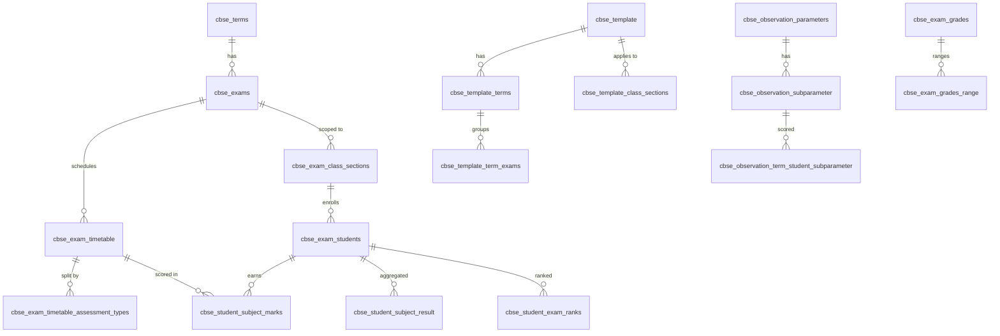
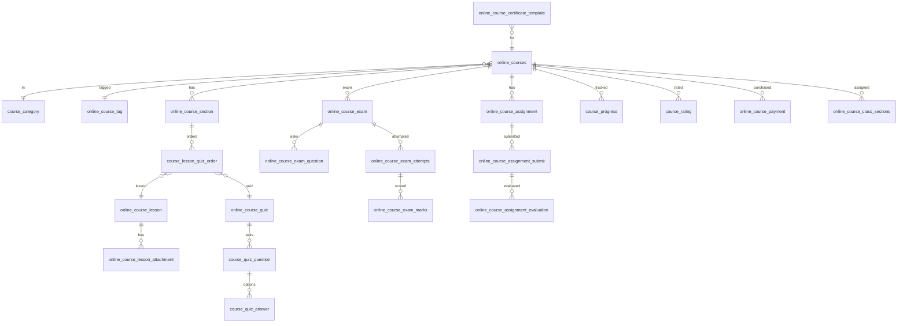
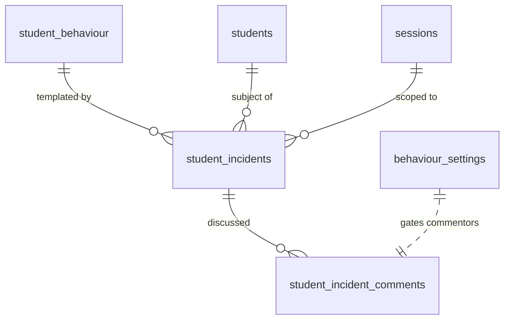

# Project 2 — Technical & Product Analysis Report

**Project name (verified in source):** Smart School Addon Modules Bundle Pack (CodeCanyon item ID 50933268)
**Vendor:** QDOCS (`smart-school.in`, `support@qdocs.net`)
**Distribution:** Bundle of 11 separately-sold CodeCanyon add-on ZIPs for Smart School (Project 1)
**Package analysed:** `codecanyon-50933268-smart-school-addon-modules-bundle-pack/smart_school_addon_bundle_pack/` containing 11 addon ZIPs:
1. `smart_school_behaviour_records.zip`
2. `smart_school_cbse_examination.zip`
3. `smart_school_gmeet_live_class.zip`
4. `smart_school_multi_branch.zip`
5. `smart_school_online_course.zip`
6. `smart_school_qr_code_attendance.zip`
7. `smart_school_quick_fees_create.zip`
8. `smart_school_thermal_print.zip`
9. `smart_school_two_factor_authentication.zip`
10. `smart_school_whatsapp_messaging.zip`
11. `smart_school_zoom_live_class.zip`

Plus per-addon `documentation/` (HTML user manuals), `licensing/` (GPL), `readme.txt`, and for ten of the eleven a `*_update_X.0_to_Y.0/` delta package (WhatsApp has no update folder — it is v1.0).

**Relationship to Project 1:** Project 2 is the add-on ecosystem for Project 1. The 11 addons here match exactly the 11 rows seeded in Project 1's `controllers/install/database.sql → INSERT INTO addons` (product IDs 47443722, 44278049, 44277916, 44247532, 33101540, 27492043, 28941973, 50336584, 57220011, 57219905, 61574315). One discrepancy: WhatsApp's `addon_info.json` declares `product_id=999999999` (a placeholder) while Project 1's seed expects `61574315` — packaging inconsistency.

**Analysis scope:** Source code + DB schema for each addon's `installer/install/files/` and `installer/install/db/db.sql`. No live demo was available. No code was executed.

---

## 1. Product Overview

### Purpose
Each addon extends Smart School (Project 1) with a discrete capability. The bundle sells all 11 addons at a discount; schools can also buy them individually on CodeCanyon. Addons are installed via Project 1's `admin/addons` ZIP uploader, which extracts the ZIP to `./addons/{name}/`, reads `addon_info.json`, executes `installer/install/db/db.sql` via `mysqli::multi_query()`, and copies the addon's `application/*`, `backend/*`, `uploads/*` files into the host install.

### Target users
Same user base as Project 1 (Admin / Super Admin / Teacher / Student / Parent / Accountant / Librarian / Receptionist). Each addon typically extends one or two roles' workflows.

### Business model
- **One-time purchase per addon** on CodeCanyon (separate product IDs per addon).
- **Bundle pack discount** — one purchase code registers all 11 addons in Project 1 via `Auth::addonchk()` and the encrypted `addon_prod`/`addon_ver` arrays in Project 1's `config/license.php`.
- **URL-bound licensing** — `Auth::addonchk($slug, $return_url)` decrypts `license.php` `addon_ver` entries with `Aes::decode()` using `addon_prod` keys, then checks `"slug!!base_url()"`. So an addon is licensed only for the install URL it was registered against.
- **No usage-based pricing** — no metering, no API-call caps, no tenant quotas.

### Technology stack (per addon)
- Same as Project 1: CodeIgniter 3, PHP 7/8, MySQL, jQuery + AdminLTE, mPDF, Omnipay / Google API client / AWS SDK / PHPMailer via `application/third_party/omnipay/vendor/autoload.php`.
- Addons **do not ship their own `system/` or `index.php`** — they live entirely inside Project 1's `application/`, `backend/`, and `uploads/` trees after install.
- Each addon follows the same install/uninstall contract:
  - `installer/install/files/...` → files copied into Project 1's directories
  - `installer/install/db/db.sql` → schema + seed
  - `installer/uninstall/db.sql` → `DROP TABLE` for every addon table
  - `installer/uninstall/unistall_directory.json` → list of files/dirs to remove (note consistent misspelling "unistall")
  - `addon_info.json` → `{product_id, name, version, description, version_list[]}`

### Main capabilities (high level)
- **CBSE Examination (v4.0)** — India-specific CBSE board exam workflow.
- **Online Course (v5.0)** — paid/free MOOC-style course platform with AWS S3 media storage and 27 payment-gateway integrations.
- **Behaviour Records (v4.0)** — incident-based student discipline with positive/negative points.
- **Multi Branch (v4.0)** — multi-database branch management.
- **QR Code Attendance (v3.0)** — self-scan attendance via student/staff QR-coded ID cards.
- **Zoom Live Class (v8.0)** — OAuth-based Zoom.us integration.
- **GMeet Live Class (v7.0)** — Google Calendar API + Hangouts Meet.
- **Two Factor Authentication (v4.0)** — Google Authenticator (TOTP).
- **Thermal Print (v2.0)** — POS-style small receipt printing for fee collection.
- **Quick Fees Create (v2.0)** — one-click student-wise fee master creation with installment plan builder.
- **WhatsApp Messaging (v1.0)** — adds WhatsApp as a notification channel via Twilio or Meta Cloud API.

---

## 2. Complete Feature Inventory

### 2.1 Smart School CBSE Examination (sscbse, product_id 47443722, v4.0)
**Files:** 14 controllers in `cbseexam/`, 13 models, core `MY_Addon_CBSEController.php`
**DB tables (28):** `cbse_exams`, `cbse_exam_assessments`, `cbse_exam_assessment_types`, `cbse_exam_class_sections`, `cbse_exam_grades`, `cbse_exam_grades_range`, `cbse_exam_observations`, `cbse_exam_students`, `cbse_exam_student_subject_rank`, `cbse_exam_timetable`, `cbse_marksheet_type`, `cbse_observation_class_section`, `cbse_observation_parameters`, `cbse_observation_subparameter`, `cbse_observation_terms`, `cbse_observation_term_student_subparameter`, `cbse_student_exam_ranks`, `cbse_student_subject_marks`, `cbse_student_subject_result`, `cbse_student_template_rank`, `cbse_template`, `cbse_template_class_sections`, `cbse_template_terms`, `cbse_template_term_exams`, `cbse_terms`, `cbse_exam_timetable_assessment_types`, `cbse_category`, `cbse_template_admitcards`
**Features:**
- Term-based exam workflow: `cbse_terms → cbse_exams → cbse_exam_timetable → cbse_student_subject_marks → cbse_student_subject_result → cbse_student_exam_ranks → cbse_exam_student_subject_rank`.
- Assessment types: written + practical with separate max marks.
- Observations framework for "co-scholastic" assessment (e.g. teamwork, discipline) — a CBSE regulatory requirement.
- Grade ranges for letter-grade computation.
- Rank generation with multiple strategies (`term_wise`, `all_term`, `multi_exam_without_term`, `exam_wise_rank`).
- Marksheet template system with `orientation`, `header_image`, `left_logo`, `right_logo`, `signs`, `marksheet_type`.
- Admit card templates with per-field visibility booleans.

### 2.2 Smart School Online Course (ssoclc, product_id 33101540, v5.0)
**Files:** 12 admin controllers in `onlinecourse/` + 27 payment-gateway controllers in `students/online_course/` + `Cart.php` + `user/Studentcourse.php`. 15 models.
**DB tables (29):** `aws_s3_settings`, `course_category`, `course_lesson_quiz_order`, `course_progress`, `course_quiz_answer`, `course_quiz_question`, `course_rating`, `guest`, `online_courses`, `online_course_class_sections`, `online_course_lesson`, `online_course_payment`, `online_course_processing_payment`, `online_course_quiz`, `online_course_section`, `online_course_settings`, `student_quiz_status`, `online_course_assignment`, `online_course_assignment_evaluation`, `online_course_assignment_submit`, `online_course_exam`, `online_course_exam_attempts`, `online_course_exam_marks`, `online_course_exam_question`, `online_course_exam_result`, `online_course_lesson_attachment`, `online_course_tag`, `online_course_certificate_template`, `online_course_start_date`
**Features:**
- LMS-style course structure: `online_courses → online_course_section → course_lesson_quiz_order → online_course_lesson / online_course_quiz`.
- Lessons: video / audio / document content; `online_course_lesson_attachment` for additional files.
- Quizzes with questions + answers; `student_quiz_status` tracks per-student completion; `course_progress` records section completion.
- Exams (separate from quizzes): attempts, marks, results.
- Assignments: submit + evaluation.
- Ratings: per-student per-course star rating.
- Tags & categories with slug for SEO-friendly URLs.
- Free vs Paid: `free_course` flag + `price` + `discount`.
- Cart-based checkout using CodeIgniter's `cart` library; multiple courses together.
- Payment: 27 gateway controllers. Successful payment writes `online_course_payment`; processing state writes `online_course_processing_payment` (idempotency).
- Course assignment via `online_course_class_sections` — courses auto-assigned to specific class-sections.
- Certificate: `online_course_certificate_template` for completion certificates.
- AWS S3 storage for media: `aws_s3_settings` (api_key, api_secret, bucket_name, region).
- Guest users: `guest` table for non-student purchases (public MOOC sales).

### 2.3 Smart School Behaviour Records (ssbr, product_id 44247532, v4.0)
**Files:** 6 controllers in `behaviour/` + `user/Studentincidentcomments.php`. 2 models.
**DB tables (4):** `behaviour_settings`, `student_incidents`, `student_incident_comments`, `student_behaviour`
**Features:**
- `student_behaviour` is the master incident catalog (e.g. "Late to class" → -1 point, "Helped peer" → +2 points).
- `student_incidents` is the assignment table.
- `student_incident_comments` allows multi-party commenting (student + parent + staff) — gated by `behaviour_settings.comment_option` JSON list.
- Notification on incident assignment: seed adds `notification_setting.type='behaviour_incident_assigned'` with template `A new {{incident_title}} behaviour incident with {{incident_point}} point is assigned on you. {{student_name}} {{class}} {{section}} {{admission_no}} {{mobileno}} {{email}} {{guardian_name}} {{guardian_phone}} {{guardian_email}}`.
- Reports: 7 report types — Student Incident, Student Behaviour Rank, Class Wise Rank, Class Section Wise Rank, House Wise Rank, Incident Wise, Behaviour Records Setting.

### 2.4 Smart School Multi Branch (ssmb, product_id 44277916, v4.0)
**Files:** 2 controllers (`admin/multibranch/{Branch,Finance}.php`). 7 models. Core `MY_Addon_MBController.php`.
**DB tables (1):** `multi_branch`
**Features:**
- Each "branch" row stores: `branch_name`, `branch_url`, `hostname`, `username`, `password`, `database_name`, `directory_path`, `is_verified`. **DB credentials stored in plain text.**
- `Branch::add()` validates DB connectivity via `multibranch_model->verify_branch($insert_Arr)`.
- `Branch::switch()` sets a 2-year `branch_cookie` and loads the branch's DB group via `$this->load->database($branch_group, TRUE)` where `$branch_group = 'branch_' . $branch->id`. **Requires the school admin to manually add a `branch_{id}` group to `application/config/database.php`** — branches are not auto-provisioned.
- Cross-branch reports: `Finance.php` exposes Daily Collection, Payroll, Income, Expense, User Log reports by aggregating across all branches.
- `Branch::overview()` is the dashboard: aggregates 12 KPIs per branch (staff payslip counts, student counts, fees collected, transport fees, staff attendance, online + offline admissions, library members/issues, alumni, user logs).
- New branch must be created externally (separate install of Project 1 on a different DB) and then registered via the Multi Branch admin panel.

### 2.5 Smart School QR Code Attendance (ssqra, product_id 50336584, v3.0)
**Files:** 3 controllers (`admin/qrattendance/{Attendance,Setting,Qrsetting}.php`). 1 model. Core `MY_Addon_QRAttendanceController.php`.
**DB tables (1):** `QR_code_settings` (`camera_type`, `auto_attendance`, `machine_type`)
**Features:**
- `Attendance::index()` renders the QR-scanner view; `Attendance::scannergun()` renders a separate view for hardware scanner guns.
- `Attendance::getProfileDetail()` — POST handler that takes a scanned `text` (decoded admission_no from QR), looks up the student, validates the attendance time-window.
- `Attendance::saveAttendance()` — inserts a row in Project 1's `student_attendences` (or `staff_attendance`) with `qrcode_attendance=1` flag.
- `auto_attendance` setting allows immediate marking without operator confirmation.
- Uses the student/staff ID card's QR code (already generated by Project 1's ID-card module). No new ID-card infrastructure needed.

### 2.6 Smart School Zoom Live Class (sszlc, product_id 27492043, v8.0)
**Files:** 2 controllers (`admin/Conference.php`, `user/Conference.php`). 3 models. Libraries: `Zoom_api.php` (Guzzle + OAuth), `Zoom_mail_sms.php`.
**DB tables (5):** `conferences`, `conference_staff`, `conferences_history`, `zoom_settings`, `conference_sections`
**Features:**
- OAuth flow: `Conference::generatetoken()` is the OAuth callback URL `https://zoom.us/oauth/authorize?...&redirect_uri={base_url}admin/conference/generatetoken`. Access + refresh tokens stored server-side.
- Per-school or per-teacher Zoom credentials: `zoom_settings.use_teacher_api` flag — when ON, each teacher uses their own OAuth flow; when OFF, school's global Zoom account is used.
- Meeting creation via `Zoom_api::createMeeting(...)` POSTs to `https://api.zoom.us/v2/users/{userId}/meetings`.
- `conferences` table records: `purpose`, `class_id`, `section_id`, `subject`, `host_video`, `client_video`, `password`, `timezone`, `duration`, `return_response` (raw Zoom JSON), `api_type` ('global'|'self'), `status`.
- Multi-section classes: `conference_sections`. Multi-teacher: `conference_staff`.
- Attendance tracking: `conferences_history.total_hit` counts how many times each student/staff clicked "Join".
- Notifications: `Zoom_mail_sms::mailsms('online_classes', …)`. Also adds events `zoom_online_classes_start` and `zoom_online_meeting_start`.

### 2.7 Smart School GMeet Live Class (ssglc, product_id 28941973, v7.0)
**Files:** 2 controllers (`admin/Gmeet.php`, `user/Gmeet.php`). 3 models. Libraries: `Google.php` (Google Client + Google_Service_Calendar), `Gmeet_mail_sms.php`.
**DB tables (5):** `gmeet`, `gmeet_history`, `gmeet_sections`, `gmeet_settings`, `gmeet_staff`
**Features:**
- OAuth2 with Google Calendar API scope `https://www.googleapis.com/auth/calendar`; access + refresh tokens stored in CodeIgniter session (`google_token` session key). **Tokens not persisted to DB — weakness**.
- Meeting creation: `Google::createEvent($event_data)` POSTs a `Google_Service_Calendar_Event` with `conferenceData.createRequest.conferenceSolutionKey.type = 'hangoutsMeet'` — Google auto-generates the Meet URL.
- `gmeet_settings.api_key`/`api_secret` are Google OAuth client ID + secret.
- Class-teacher mode: `Gmeet::addByClassTeacher()` lets a teacher schedule a meeting for their own class-section.
- Reports: `Gmeet::meeting_report()` and `Gmeet::class_report()`.
- History tracking: `gmeet_history`.
- Hardcoded `location='Jabalpur'` in `Google::createEvent()` — every Google Calendar event created by every school is geo-located to Jabalpur, India (vendor's HQ city).

### 2.8 Smart School Two Factor Authentication (sstfa, product_id 44278049, v4.0)
**Files:** 3 controllers (`Gauthenticate.php`, `admin/gauthenticate/Admin.php`, `user/gauthenticate/Setup.php`). 2 models. Core `MY_Addon_GAController.php` + `MY_Addon_GAUserController.php`. Library: `Google_authenticator.php`.
**DB tables (2):** `google_authenticator` (`use_authenticator` flag), `user_google_authenticate_codes` (`user_id`, `guest_id`, `staff_id`, `secret_code`, `is_active`) — FK constraints `ON DELETE CASCADE` to `users.id` and `staff.id`.
**Features:**
- TOTP-based 2FA using Google Authenticator (RFC 6238).
- Setup flow: `Admin::setup()` generates a per-user 16-char base32 secret via `Google_authenticator::createSecret()` (uses `random_bytes()`), then renders a QR code for the user to scan.
- Verification: `Admin::verify_setup()` takes the user-entered 6-digit code + secret and calls `Google_authenticator::verifyQR($secret, $code)`.
- Login gating: Project 1's `Site::login()` and `Site::userlogin()` check `module_lib->hasModule('google_authenticator') && hasActive()` and redirect to `gauthenticate/login`.
- Per-user opt-in: even when `google_authenticator.use_authenticator=1`, individual users must complete `Setup` to activate.
- Self-disable: `Admin::delete_setup()`.

### 2.9 Smart School Thermal Print (sstpa, product_id 57219905, v2.0)
**Files:** 1 controller (`admin/Thermalprint.php`). 1 model.
**DB tables (1):** `thermal_print_settings` (`is_print`, `school_name`, `address`, `footer_text`)
**Features:**
- When enabled, Project 1's fee receipt PDF generation checks `thermal_print_settings.is_print` and renders a small-format (58mm/80mm) receipt instead of A4.
- School name, address, and footer text configurable; supports HTML in address.
- Seed data has a typo ("Mount/ Carmel /School" with stray slashes) — suggests the seed was copied from a real customer's data without sanitisation.

### 2.10 Smart School Quick Fees Create (ssqfc, product_id 57220011, v2.0)
**Files:** 1 controller (`admin/Customfeesmaster.php`). 1 model.
**DB tables (0):** Adds no new tables; reuses Project 1's `fee_groups`, `feetype`, `fee_groups_feetype`, `fee_session_groups`, `student_fees_master`.
**Features:**
- Student-wise fee master creation screen.
- `Customfeesmaster::createInstallment()` — installment-plan builder: enter `total_fees`, `down_payment`, `balance_fees`, `no_of_installment`, `amount`, `day`, `fine_type`, `fine_type_value`. Returns preview.
- `Customfeesmaster::savecustomfeesmaster()` writes rows into Project 1's `fee_groups` (named `{student_id}-{admission_no}-{firstname}`), `feetype` (one per installment), `fee_groups_feetype`, `fee_session_groups`, `student_fees_master` in a single transaction.
- Unassign fees: `Customfeesmaster::unassignfees()`.
- Uses raw `$_POST` access instead of CodeIgniter's `$this->input->post()` — bypasses xss_clean.

### 2.11 Smart School WhatsApp Messaging (sswm, product_id 999999999 in bundle, 61574315 in Project 1 seed, v1.0)
**Files:** 1 controller (`Whatsappconfig.php`). 1 model. Libraries: `Whatsappgateway.php`, `Meta_whatsapp.php`, `Twilio_whatsapp.php`.
**DB tables (1):** `whatsapp_config` (`type`, `language`, `name`, `api_id`, `authkey` TEXT, `senderid`, `contact`, `username`, `password`, `is_active`) — same shape as Project 1's `sms_config`.
**Features:**
- Two provider integrations:
  - **Meta Cloud API** (WhatsApp Business) — uses Meta's Graph API with `access_token` (stored in `authkey`) and `phone_number_id` (stored in `contact`). Supports template messages with body parameters.
  - **Twilio WhatsApp API** — uses Twilio's WhatsApp sandbox/production with `username`/`password` (Twilio SID/token) and `contact` (Twilio WhatsApp sender number).
- `Whatsappgateway` mirrors the same event-dispatch pattern as Project 1's `Smsgateway.php` and `Mailgateway.php` — the addon extends the existing `notification_setting.type` rows with a new `is_whatsapp` channel.
- Project 1's `notification_setting` table already has `is_whatsapp`, `display_whatsapp`, `whatsapp_template_id` columns — so WhatsApp templates are managed per-event from the existing notification-setting UI; the addon just adds the dispatch implementation and a `whatsapp_config` provider picker.
- Template IDs required for Meta (per WhatsApp Business policy) and Twilio.

---

## 3. Business Workflows (end-to-end)

### 3.1 Addon installation (cross-cutting)
1. Super Admin buys the bundle (or individual addon) on CodeCanyon; receives an Envato purchase code.
2. In Project 1, admin opens `admin/addons` and uploads the addon ZIP.
3. Project 1's `Addons::index()` extracts to `./addons/temp/{name}`, validates the ZIP contains an `installer/` subfolder, then re-extracts to `./addons/{name}`.
4. `addon_info.json` is read; `addons_model::addAddonSetupDetails()` updates the `addons` table row matching `product_id` (so `current_stage` transitions from 0 → 1 → 2).
5. Admin registers the addon via `admin/admin/updatePurchaseCode()` which posts the Envato purchase code + addon product_id to QDOCS's licensing server; the server returns an encrypted `addon_prod`/`addon_ver` pair bound to the install's `base_url()`, written to Project 1's `config/license.php`.
6. The admin then runs the addon's `installer/install/db/db.sql` via the in-app "Install Database" button — `helpers/addon_helper.php::execute_sql()` uses `$CI->db->conn_id->multi_query($sql)` to execute all CREATE/INSERT statements at once.
7. Addon files under `installer/install/files/application/...`, `installer/install/files/backend/...`, `installer/install/files/uploads/...` are copied into Project 1's corresponding directories.
8. The addon's `MY_Addon_*Controller` autoloader (registered in Project 1's `config/routes.php` via `spl_autoload_register('my_autoloader')`) loads the addon's base controller on demand.
9. The new `sidebar_menus` and `sidebar_sub_menus` rows appear in the admin sidebar — gated by `Rbac::hasPrivilege()` and `Module_lib::hasActive()`.
10. Every addon controller constructor calls `$this->auth->addonchk('{slug}', $return_url)` to verify the license at runtime.

### 3.2 CBSE marksheet generation (CBSE addon)
1. Admin creates `cbse_terms` (e.g. "Term 1", "Term 2").
2. Admin creates `cbse_exam_grades` with `cbse_exam_grades_range`.
3. Admin creates `cbse_exam_assessments` and `cbse_exam_assessment_types`.
4. Admin creates `cbse_exams` linked to a term + assessment + grade.
5. Admin creates `cbse_exam_timetable` rows per subject per exam.
6. Admin maps class-sections via `cbse_exam_class_sections`; students auto-enrolled into `cbse_exam_students`.
7. Teacher enters marks via `admin/cbseexam/result` → writes `cbse_student_subject_marks`.
8. Admin clicks "Generate Rank" → `Exam::examrankgenerate()` computes `cbse_student_subject_result` and `cbse_student_exam_ranks`.
9. For co-scholastic: teacher fills `cbse_observation_term_student_subparameter`.
10. Admin picks a `cbse_template` + `cbse_template_class_sections` mapping, then `Result::printmarksheet()` generates the PDF via mPDF using `backend/cbse_pdf_style.css`.

### 3.3 Online Course purchase (Online Course addon)
1. Admin creates `course_category` and `online_course_tag`.
2. Admin creates `online_courses` with `free_course` flag, `price`, `discount`, `course_category_id`, `thumbnail`.
3. Admin adds sections (`online_course_section`) and reorders them.
4. Admin adds lessons (`online_course_lesson` with video/audio/document URLs — local or S3) or quizzes (`online_course_quiz`).
5. Admin may add `online_course_exam`, `online_course_assignment`, and `online_course_certificate_template`.
6. Course is published via `Course::publish_unpublish()`.
7. Public visitor (or student) browses `welcome/online_course` and adds paid courses to cart.
8. On checkout, user selects a gateway → redirected to `students/online_course/{Gateway}.php::index()`.
9. Gateway processes payment; on success writes `online_course_payment` and `online_course_processing_payment` (idempotency).
10. Student gains course access; `course_progress` updated as they complete sections.
11. On course completion, certificate is generated from `online_course_certificate_template`.

### 3.4 Multi Branch switch (Multi Branch addon)
1. Super Admin installs Project 1 separately on a second database.
2. In the primary branch's Multi Branch admin panel, Super Admin clicks "Add Branch" and enters branch_name, hostname, database_name, username, password, plus the Envato purchase code.
3. `Branch::add()` calls `multibranch_model->verify_branch($insert_Arr)` which opens a test mysqli connection. If successful, the row is inserted into `multi_branch` with `is_verified=1`.
4. Super Admin must **manually edit `application/config/database.php`** in the primary branch to add a new `$db['branch_{id}']` group.
5. Super Admin clicks "Switch Branch" → `Branch::switch()` sets `branch_cookie=branch_{id}` (2-year expiry) and updates admin session's `db_array.db_group`.
6. To return to primary branch, switch back.

### 3.5 TFA login flow (Two Factor Authentication addon)
1. Admin enables 2FA globally via `admin/gauthenticate/admin` → sets `google_authenticator.use_authenticator=1`.
2. Each staff user visits `admin/gauthenticate/admin/setup` → `Admin::setup()` calls `google_authenticator->generateQR($staff['employee_id'])` which creates a 16-char base32 secret and returns a QR URL.
3. User scans the QR with Google Authenticator / Authy / 1Password etc.
4. User enters the 6-digit code → `Admin::verify_setup()` calls `google_authenticator->verifyQR($secret, $code)`.
5. Next login: Project 1's `Site::login()` redirects to `gauthenticate/login`.
6. User enters username + password (first factor). `Gauthenticate::login()` verifies credentials, then prompts for 6-digit TOTP code.
7. On success the admin session is set.

### 3.6 QR Attendance scan (QR Code Attendance addon)
1. Student/staff opens `admin/qrattendance/attendance`.
2. The view renders the camera via a JS QR-scanner library.
3. JS decodes the QR (which encodes the `admission_no`) and POSTs to `Attendance::getProfileDetail()`.
4. `Qrsetting_model::qrcode_attendance($admission_no, $date)` looks up the student and checks if they've already been marked present today.
5. If `auto_attendance=1`, attendance is saved immediately; otherwise the operator clicks "Confirm".
6. `Attendance::saveAttendance()` inserts a row in Project 1's `student_attendences` with `qrcode_attendance=1` flag, then triggers `Mailsmsconf::sendPresentAttendance(...)` if configured.

### 3.7 Zoom live class start (Zoom Live Class addon)
1. Admin (or teacher if `use_teacher_api=1`) connects Zoom account via OAuth at `admin/conference/generatetoken`.
2. `Zoom_api::token($code, $redirect)` exchanges the OAuth code for access + refresh tokens.
3. Admin/teacher creates a class: title, date, duration, password, class_id, section_id, host_video, client_video, subject, timezone.
4. `Conference::add()` calls `Zoom_api::createMeeting(...)` POSTing to `https://api.zoom.us/v2/users/{userId}/meetings`; the returned `join_url` is stored in `conferences.return_response`.
5. Students see the upcoming class in `user/conference` and click "Join".
6. Each "Join" click increments `conferences_history.total_hit`.
7. When the meeting starts, `Zoom_mail_sms::mailsms('zoom_online_classes_start', …)` fires if configured.

### 3.8 Behaviour incident assignment (Behaviour Records addon)
1. Admin/teacher creates `student_behaviour` incidents with positive or negative point values via `admin/behaviour/incidents`.
2. Teacher assigns an incident to a student via `admin/behaviour/studentincidents`.
3. The seed in this addon's db.sql adds `notification_setting.type='behaviour_incident_assigned'`.
4. Project 1's `Mailsmsconf::mailsms('behaviour_incident_assigned', $sender_details)` fires → SMS/Email/Push/WhatsApp dispatch per the matrix.
5. Student/parent can add comments via `user/Studentincidentcomments`.

### 3.9 Quick Fees installment creation (Quick Fees Create addon)
1. Accountant opens `admin/customfeesmaster` → selects class → section → student.
2. Accountant clicks "Quick Create" → enters total_fees, down_payment, no_of_installment, day, fine_type, fine_type_value.
3. `Customfeesmaster::createInstallment()` validates inputs and renders a preview.
4. On confirm, `Customfeesmaster::savecustomfeesmaster()` writes one `fee_groups`, N `feetype`, N `fee_groups_feetype`, one `fee_session_groups`, N `student_fees_master` rows in a transaction.

### 3.10 Thermal print receipt (Thermal Print addon)
1. Admin configures `thermal_print_settings.is_print=1`, school_name, address (HTML), footer_text.
2. When Project 1's `Studentfee::printFeesByName()` renders the fee receipt, the view checks `thermal_print_settings.is_print`; if enabled, it includes the thermal-print view partial instead of the A4 layout.
3. Browser print dialog opens with the thermal printer as default.

### 3.11 WhatsApp notification dispatch (WhatsApp Messaging addon)
1. Admin configures `whatsapp_config` with provider type (`twilio` or `meta`), credentials, sender ID.
2. Admin sets `is_whatsapp=1` per event in `notification_setting` and enters a `whatsapp_template_id`.
3. When Project 1's `Mailsmsconf::mailsms($event, $sender_details)` runs, for WhatsApp it calls `Whatsappgateway->{eventMethod}(...)`.
4. `Whatsappgateway` loads the active `whatsapp_config` row and dispatches to `Meta_whatsapp::sendTemplate($to, $template_id, $language, $components)` or `Twilio_whatsapp::send($from, $to, $msg)`.
5. Meta requires pre-approved templates with parameter substitution; Twilio requires the message body to match an approved template.

---

## 4. UI / UX Analysis

### Navigation
Each addon extends Project 1's sidebar by seeding rows in `sidebar_menus` (top-level) and `sidebar_sub_menus` (sub-items). Verified menu additions:
- **CBSE Exam** → top-level "CBSE Exam" (permission_group id 1000).
- **Multi Branch** → top-level id 33 with sub-menus Overview / Report / Setting.
- **Online Course** → typically nests under "Academics" or as a separate top-level.
- **Behaviour Records** → "Behaviour Records" top-level with sub-menus Assign Incident / Incident / Reports / Setting.
- **QR Code Attendance** → top-level id 35 with sub-menus Attendance / Setting.
- **Zoom Live Class** → typically under "Communicate" → "Live Classes".
- **GMeet Live Class** → typically under "Communicate" → "Live Classes".
- **Two Factor Authentication** → top-level id 32 with sub-menus Setup 2FA / Setting.
- **Thermal Print** → under "System Settings".
- **Quick Fees Create** → sub-menu under "Fees Collection".
- **WhatsApp Messaging** → sub-menu under "System Settings" → "WhatsApp Config".

### Dashboards
- `Branch::overview()` is a cross-branch dashboard showing 12 KPIs per branch.
- CBSE Exam has its own per-exam dashboard via `Chart.php`.
- Online Course has course sales + progress reports via `Coursereport.php`.

### Forms
- All addon forms follow Project 1's pattern: `form_validation->set_rules()` with callbacks, CSRF token, xss_clean filter.
- QR Attendance form uses an `<input type="hidden" name="text">` populated by the JS QR scanner.
- TFA Setup renders a QR code image and an OTP input field.
- Online Course lesson upload uses `Course::handle_upload()` with file MIME/extension validation.
- Quick Fees installment builder is AJAX-driven with live preview.

### Tables & filters
- CBSE Exam uses DataTables server-side via `Exam::exam_ajax_rank()` and `Result::test_multi*()` methods.
- Behaviour Records uses `Studentincidents::dtassignincidentlist($class_id, $section_id)`.
- Online Course uses `Course::getcourselist()`.

### Responsive design
- Addons inherit Project 1's theme system (6 themes + dark/light + container-fluid + sidebar collapse).
- QR Attendance scanner view uses `getUserMedia` for camera access — works on desktop and mobile.
- Thermal Print view is intentionally narrow (58/80mm) and not responsive.

---

## 5. Technical Architecture

### Addon controller autoloader pattern
Each addon ships a `application/core/MY_Addon_{Slug}Controller.php` that extends Project 1's `Admin_Controller` (or `Student_Controller`). Project 1's `config/routes.php` registers `spl_autoload_register('my_autoloader')` which loads any class starting with `MY_Addon_` from `application/core/`. Some addons (CBSE, Multi Branch, QR, TFA, Behaviour) use this pattern; others (Zoom, GMeet, Online Course, Quick Fees, Thermal Print, WhatsApp) embed the addonchk call directly in their controller constructor.

### Addon licensing gate (`Auth::addonchk`)
Every addon controller constructor calls `$this->auth->addonchk('{short_code}', $return_url)`. Project 1's `Auth::addonchk($prod, $return_url)` decrypts each `addon_ver` entry in `config/license.php` with the matching `addon_prod` key (AES), parses `"slug!!base_url"`, and returns true only if both match.

### External integrations
| Addon | Integration | Library / SDK |
|---|---|---|
| CBSE | none external | — |
| Online Course | AWS S3 | `Aws3.php` (uses `Aws\S3\S3Client`) |
| Online Course | 27 payment gateways | mirrors Project 1's gateway set |
| Multi Branch | none (just DB) | — |
| Zoom Live Class | Zoom.us REST API v2 | `Zoom_api.php` (Guzzle HTTP client + OAuth2) |
| GMeet Live Class | Google Calendar API + Hangouts Meet | `Google.php` (`Google_Client`, `Google_Service_Calendar`) |
| TFA | none external (TOTP) | `Google_authenticator.php` wraps `Google\Authenticator\GoogleAuthenticator` |
| Behaviour Records | none external | — |
| QR Code Attendance | none external (uses browser camera) | JS QR scanner library |
| Quick Fees Create | none external | — |
| Thermal Print | none external | — |
| WhatsApp Messaging | Meta Cloud API + Twilio WhatsApp | `Meta_whatsapp.php`, `Twilio_whatsapp.php` |

### Background jobs & events
- Addons do **not** ship their own cron jobs. They reuse Project 1's `Cron::index($key)`.
- Addons extend Project 1's `notification_setting` matrix with new event keys:
  - Behaviour Records adds `behaviour_incident_assigned`.
  - Zoom adds `online_classes`, `online_meeting`, `zoom_online_classes_start`, `zoom_online_meeting_start`.
  - GMeet adds `gmeet_online_classes_start`, `gmeet_online_meeting_start`.
  - Online Course reuses `online_admission_fees_submission`, `online_admission_fees_processing` from Project 1.

### Mobile API
- Addons do not ship dedicated mobile API endpoints; the Flutter mobile app accesses addon data via Project 1's existing API surface.

---

## 6. Database & Domain Model

### Schema size added by Project 2
Project 1 has 196 tables. The 11 addons add **77 new tables** (28 CBSE + 29 Online Course + 4 Behaviour + 1 Multi Branch + 5 Zoom + 5 GMeet + 1 QR + 0 Quick Fees + 1 Thermal + 2 TFA + 1 WhatsApp = 77). **Combined total: 273 tables** when all 11 addons are installed.

### Per-addon schema highlights

#### CBSE (28 tables)

Notable: `cbse_template.header_image` is `varbinary(500)` (binary blob) — most other image fields across Project 1 are TEXT paths. Inconsistency.

#### Online Course (29 tables)

#### Multi Branch (1 table)
The `multi_branch` table has no FK constraints to any other table. Branch rows are looked up by `id` and matched against `$db['branch_{id}']` groups in `config/database.php`. **No DB-level tenancy enforcement.**

#### Zoom (5 tables) and GMeet (5 tables)
Both follow the same shape: a main table for meetings, a staff table for multi-teacher mapping, a sections table for multi-section mapping, a history table for join-tracking, and a settings table for credentials. FK constraints `ON DELETE CASCADE` to `staff.id`, `students.id`, `class_sections.id` are present.

#### Behaviour Records (4 tables)

#### Two Factor Authentication (2 tables)
`google_authenticator` (1 row, global toggle) + `user_google_authenticate_codes` (per-user secret). FK constraints `ON DELETE CASCADE` to `users.id` and `staff.id`.

#### QR Code Attendance (1 table)
`QR_code_settings` (1 row) — `camera_type`, `auto_attendance`, `machine_type` JSON.

#### Thermal Print (1 table)
`thermal_print_settings` (1 row) — `is_print`, `school_name`, `address`, `footer_text`.

#### Quick Fees Create (0 tables)
Adds no schema — reuses Project 1's `fee_groups`, `feetype`, `fee_groups_feetype`, `fee_session_groups`, `student_fees_master`.

#### WhatsApp Messaging (1 table)
`whatsapp_config` — same shape as Project 1's `sms_config`.

### Lifecycle & audit fields
- CBSE tables mostly have only `created_at` (no `updated_at`) — inconsistent. `cbse_exam_timetable` is the worst case: `created_at` defaults to `CURRENT_TIMESTAMP ON UPDATE CURRENT_TIMESTAMP`, so it actually serves as both.
- Online Course tables have neither `created_at` nor `updated_at` on `aws_s3_settings` and `online_course_settings`.
- Zoom and GMeet `created_at` defaults to `CURRENT_TIMESTAMP ON UPDATE CURRENT_TIMESTAMP` (same quirk).
- Multi Branch `multi_branch` has only `created_at` (set on UPDATE too).
- None of the addon tables have `is_active` consistently.

### Indexes
Addons create PRIMARY KEY on `id` and a few FK indexes. The CBSE rank tables lack composite indexes on `(cbse_exam_id, student_id)` — likely hot paths during rank generation.

---

## 7. Authentication & Authorization

### Addon-specific RBAC seeds
Each addon's `db.sql` seeds:
- One row in `permission_group` with a high ID (800 for Behaviour, 1000 for Multi Branch, 1100 for TFA, 1200 for QR, 1300 for Quick Fees, 1400 for Thermal, 1500 for WhatsApp) — module-level toggle.
- Multiple rows in `permission_category` for sub-features.
- Multiple rows in `roles_permissions` granting default permissions to roles 1, 2, 3, 4, 7.
- One or more rows in `sidebar_menus` and `sidebar_sub_menus` with `addon_permission='{short_code}'`.

### User types
Addons do not introduce new user types. They extend existing roles. Online Course adds a Guest role (`guest` table) for non-student MOOC buyers.

### Tenant isolation
- **Multi Branch is the only addon that touches tenancy.** Its approach is multi-database (one MySQL DB per branch) with credentials in `multi_branch` table. There is **no row-level isolation within a single DB** — each branch is a completely separate install of Project 1.
- Other addons inherit Project 1's single-tenant model.

### Security mechanisms
- TFA addon uses RFC 6238 TOTP with 16-char base32 secrets. CodeIgniter session stores the post-login user_id pending second-factor verification.
- Zoom addon uses OAuth2 with `client_id` + `client_secret` stored in `zoom_settings`; refresh tokens obtained with `setAccessType('offline')` + `setApprovalPrompt('force')`.
- GMeet addon uses Google OAuth2 with Calendar API scope; tokens stored in session (not in DB) — **weakness**: if session expires, teacher must re-authenticate.
- WhatsApp addon stores `authkey` (Meta access token or Twilio password) as TEXT in `whatsapp_config` — **plain-text storage of API credentials**.

### Addon licensing mechanism (URL-bound AES)
The `Auth::addonchk($slug)` flow:
1. Admin enters Envato purchase code in `admin/admin/updatePurchaseCode` for the bundle pack.
2. Project 1 posts to QDOCS's licensing server along with `base_url()`.
3. Server returns an array of `addon_prod`/`addon_ver` pairs, AES-encrypted with the install's base_url baked into the plaintext.
4. Project 1 writes these to `config/license.php` as `$config['addon_prod']` and `$config['addon_ver']` arrays.
5. At runtime, `Auth::addonchk($slug)` iterates the arrays, decrypts each `addon_ver` with the matching `addon_prod` key (via `Aes::decode`), parses `"slug!!base_url"`, and returns true only if both match.

This means:
- The license is bound to a specific URL (changing the domain requires re-registration).
- The crypto key (AES) is in `libraries/Aes.php` — anyone with the source can decrypt the license entries, but since the base_url is baked in, the practical attack is limited to running the same install under a different domain.

---

## 8. Integrations & Automation

### External services (per addon)
| Addon | Service | Auth method | Library |
|---|---|---|---|
| Online Course | AWS S3 | access key + secret in `aws_s3_settings` | `Aws3.php` |
| Online Course | 27 payment gateways | varies | reuses Project 1's gateway libs |
| Zoom Live Class | Zoom.us REST API v2 | OAuth2 (access + refresh token) | `Zoom_api.php` (Guzzle) |
| GMeet Live Class | Google Calendar API | OAuth2 (offline access) | `Google.php` (`Google_Client`) |
| TFA | none | TOTP local | `Google_authenticator.php` |
| WhatsApp Messaging | Meta Cloud API | access token in `whatsapp_config.authkey` | `Meta_whatsapp.php` |
| WhatsApp Messaging | Twilio WhatsApp API | SID + auth token in `username`/`password` | `Twilio_whatsapp.php` |
| Others | none | — | — |

### Webhooks
- **Zoom webhook**: not directly handled by this addon.
- **Meta WhatsApp webhook**: not present in this bundle; inbound WhatsApp replies are not handled.

### Cron
- No addon ships its own cron job. Project 1's `Cron::index($key)` runs `feereminder`, `eventreminder`, `schedulesmsemails` — these would also dispatch WhatsApp messages via the WhatsApp addon if `is_whatsapp=1` is set.

### Retry & error handling
- `Zoom_api::token()` uses try/catch around Guzzle requests.
- `Google::createEvent()` handles token expiry via `$client->isAccessTokenExpired()` and refreshes.
- `Meta_whatsapp::sendTemplate()` returns the HTTP response; `Whatsappgateway` callers don't consistently check the return value — same pattern as Project 1's SMS gateway (fire-and-forget).
- `Aws3::uploadFile()` has no retry; on failure the upload is lost.

---

## 9. AI Capabilities

**There are no AI capabilities in any of the 11 addons.**

Verification: `grep -rli "openai|chatgpt|gpt-|anthropic|claude|gemini|ai_assist|ai_generate|llm"` over every addon's `application/` returned **zero hits**.

- Online Course quiz/exam questions are authored by teachers; no AI generation.
- CBSE Exam marksheet grading uses rule-based grade ranges, not AI.
- Behaviour Records incident assignment is manual; no AI-based detection.
- WhatsApp Messaging templates are pre-approved by Meta/Twilio; no AI generation.

The entire bundle is **rule-based**.

---

## 10. SaaS Architecture & Monetization

### Multi Branch addon = the "SaaS-enabler"
- The Multi Branch addon is the closest Project 2 gets to SaaS. It allows a single Project 1 install to be the "master" with N "branch" installs, each on its own MySQL DB.
- However, Multi Branch is **multi-database, not multi-tenant**:
  - Each branch is a complete separate install of Project 1 (separate `application/config/database.php`, separate `license.php`, separate purchase-code registration).
  - The master install's `multi_branch` table is just a directory of branch DB credentials.
  - The master can run cross-branch reports by iterating branches and loading each DB group.
- No subscription, plan, quota, or billing tables are introduced.
- No row-level isolation within a single DB.

### Plan / entitlement model
- The 11 addons themselves form a **feature-entitlement catalogue**: each addon is a separately-purchasable feature that, once registered, unlocks its `permission_group` and sidebar entries.
- The bundle pack is a flat-rate all-11-addons purchase — no per-seat or per-student pricing.

### Quotas / limits
- Project 1's `SaasValidation` library is stubbed (returns TRUE everywhere). No addon overrides it.
- No `plans` or `subscriptions` tables exist in any addon.

### Administrative capabilities
- Super Admin (role 7) manages addon installation and licensing via Project 1's `admin/addons` and `admin/admin/updatePurchaseCode`.
- Admin (role 1) manages addon settings.
- There is no tenant-admin vs platform-admin distinction.

---

## 11. Strengths, Weaknesses & Risks

### Strengths
1. **Consistent installer contract** — every addon ships the same `addon_info.json` + `installer/install/{db,files}` + `installer/uninstall/{db.sql,unistall_directory.json}` structure.
2. **Clean RBAC integration** — every addon seeds its own `permission_group` + `permission_category` + `roles_permissions` rows.
3. **Notification-matrix extension** — addons that introduce new events seed rows into Project 1's existing `notification_setting` table.
4. **TOTP done right** — TFA uses `random_bytes()` for secret generation, base32 encoding, RFC 6238 verification, FK CASCADE-delete.
5. **OAuth2 with refresh tokens** for Zoom and Google Calendar.
6. **Per-teacher Zoom account** option.
7. **CBSE observation framework** — properly models the Indian CBSE co-scholastic assessment.
8. **Online Course idempotent payment** — `online_course_processing_payment` table.
9. **AWS S3 option for lesson media**.

### Weaknesses
1. **Multi Branch stores DB credentials in plain text** in the `multi_branch` table. Any admin with `multi_branch_overview` permission can read every branch's DB credentials. **Critical.**
2. **Multi Branch requires manual `database.php` edit** — adding a new branch group is not automated.
3. **WhatsApp API credentials stored in plain text** in `whatsapp_config.authkey`. **High.**
4. **GMeet tokens stored only in session** — if the session expires, the teacher must re-authenticate Google. **Medium-High.**
5. **`multi_query()` SQL execution** — every addon's `installer/install/db/db.sql` is executed via `mysqli::multi_query()`. A malicious or buggy SQL file can DROP tables, INSERT admin users, or escalate privileges. **High.**
6. **`Auth::addonchk` URL-bound licensing is reversible** — anyone with the Project 1 source can decrypt the `addon_ver` entries. **Medium.**
7. **Inconsistent `created_at` semantics** — CBSE and Zoom tables use `created_at DEFAULT CURRENT_TIMESTAMP ON UPDATE CURRENT_TIMESTAMP`, which means `created_at` actually reflects the last update, not creation. **Medium.**
8. **GMeet hardcoded `location = 'Jabalpur'`** in `Google::createEvent()`. **Low (cosmetic) but embarrassing.**
9. **WhatsApp `product_id=999999999` placeholder** doesn't match the `61574315` seeded in Project 1's `addons` table — installation would fail or register incorrectly. **Packaging bug.**
10. **No addon ships a test suite.**
11. **Online Course's 27 gateway controllers** duplicate Project 1's 28 online-admission gateway controllers almost verbatim.
12. **CBSE `Exam.php` is 1600+ lines** with methods like `term_wise`, `all_term`, `multi_exam_without_term`, `exam_wise_rank` — each is a slight variation of the others.
13. **TFA secret_code stored in plain text** in `user_google_authenticate_codes.secret_code`. **Medium.**
14. **No addon handles inbound WhatsApp replies** (Meta webhook).
15. **No addon-specific rate limiting** on outbound notifications.
16. **Online Course AWS S3 credentials stored in plain text**. **High.**
17. **Thermal Print seed data has a typo** ("Mount/ Carmel /School" with stray slashes) — suggests the seed was copied from a real customer's data without sanitisation.
18. **Quick Fees Create uses raw `$_POST` access** instead of CodeIgniter's `$this->input->post()` — bypasses xss_clean. **Medium (security).**

### Security issues summary
| Severity | Finding | Evidence |
|---|---|---|
| Critical | Multi Branch DB credentials stored in plain text | `<MB>/installer/install/db/db.sql` `multi_branch` table |
| High | WhatsApp API credentials plain-text | `<WA>/installer/install/db/db.sql` `whatsapp_config.authkey` |
| High | AWS S3 credentials plain-text | `<OC>/installer/install/db/db.sql` `aws_s3_settings.api_key`/`api_secret` |
| High | `multi_query()` executes untrusted SQL | Project 1's `helpers/addon_helper.php::execute_sql()` |
| Medium | TOTP secrets plain-text | `<TFA>/installer/install/db/db.sql` `user_google_authenticate_codes.secret_code` |
| Medium | GMeet tokens not persisted to DB | `<GMEET>/application/libraries/Google.php` |
| Medium | Quick Fees uses raw `$_POST` | `<QF>/application/controllers/admin/Customfeesmaster.php` |
| Low | GMeet hardcoded `location='Jabalpur'` | `<GMEET>/application/libraries/Google.php::createEvent()` |

### Scalability concerns
- Multi Branch's cross-branch reports load each branch's DB in turn — at 50+ branches this would be very slow (no parallel query, no caching).
- CBSE rank generation is O(students × subjects × exams) per template; for a 1000-student school with 10 subjects and 4 exams, that's 40,000 mark aggregations per rank-generate click — all in PHP.
- Online Course with S3 media works at scale, but `online_course_processing_payment` table has no TTL — grows unbounded.
- Zoom/GMeet meeting histories accumulate forever; no archival.

### Technical debt
- Each addon duplicates the `MY_Addon_*Controller` boilerplate.
- The `unistall_directory.json` misspelling ("unistall") is preserved across all 11 addons.
- Update packages for each addon duplicate the entire installer structure with delta SQL — there's no incremental migration framework.
- 10 of 11 addons ship a `*_update_X.0_to_Y.0/` folder; WhatsApp (v1.0) does not — no upgrade path yet.

---

## 12. Reusable Product Concepts (for an Education-Management SaaS)

### 12.1 Addon-as-ZIP with installer/install + installer/uninstall contract
**Why it matters:** Allows a third-party ecosystem to extend the core product without forking.
**How this bundle does it:** Every addon ships `addon_info.json`, `installer/install/files/`, `installer/install/db/db.sql`, `installer/uninstall/db.sql`, `installer/uninstall/unistall_directory.json`.
**Implementation consideration:** In a modern SaaS, replace ZIP-overlay with a **plugin registry + service-provider pattern**. Plugins should ship as Composer/NPM packages with a `PluginManifest`. SQL execution should be replaced with proper migration files (Phinx, Liquibase, Prisma migrate).

### 12.2 URL-bound AES licensing
**Why it matters:** Cheap, no-phone-home licensing for self-hosted software.
**How this bundle does it:** `Auth::addonchk($slug)` decrypts `addon_ver` entries with `addon_prod` keys (AES), parses `"slug!!base_url"`, validates both.
**Implementation consideration:** Replace with **signed JWT licenses** (HMAC-SHA256 with vendor private key) carrying `{slug, base_url, expiry, plan}`. No shared AES secret in source code. Add online revocation via short-lived JWT.

### 12.3 Module-level + sub-feature-level permission matrix as seed data
**Why it matters:** Lets each addon declare its own RBAC model declaratively.
**How this bundle does it:** Each addon's `db.sql` seeds `permission_group`, `permission_category`, `roles_permissions`.
**Implementation consideration:** Replace with a `PermissionCatalog` that plugins declare in code. Default grants go in a migration. Runtime checks use a `Policy` class per resource.

### 12.4 Multi-Branch as multi-database directory
**Why it matters:** Some customers want a "federated" view of multiple schools they own.
**How this bundle does it:** `multi_branch` table stores DB credentials per branch; master install can switch branches via cookie + DB group.
**Implementation consideration:** In a modern SaaS, prefer **true multi-tenancy** (single DB, `tenant_id` column, row-level security). For cross-tenant aggregation, use read replicas + a separate analytics warehouse. If multi-database is required (data-residency), use a **tenant-resolver middleware** and store credentials in a secrets manager.

### 12.5 TOTP 2FA with per-user secrets and admin toggle
**Why it matters:** NIST 800-63B AAL2 requires a second factor.
**How this bundle does it:** Global `google_authenticator.use_authenticator` toggle; per-user `user_google_authenticate_codes` row with 16-char base32 secret; QR code generated from `otpauth://` URL.
**Implementation consideration:** Same pattern, but (a) encrypt the secret at rest, (b) support WebAuthn / FIDO2, (c) support backup codes.

### 12.6 OAuth2 with refresh tokens for third-party services
**Why it matters:** Lets users connect their own third-party accounts without sharing passwords.
**How this bundle does it:** Zoom addon's `Conference::generatetoken()` is the OAuth callback; tokens stored server-side. GMeet uses Google Client with `setAccessType('offline')`.
**Implementation consideration:** Same pattern, but (a) store tokens encrypted in DB (not in session), (b) implement a token-refresh job, (c) handle revocation.

### 12.7 QR-code-based self-scan attendance
**Why it matters:** Cheap hardware (any phone camera) vs biometric devices.
**How this bundle does it:** Each student/staff ID card has a QR code. A web view uses `getUserMedia` to scan the QR, decodes the `admission_no`, marks attendance.
**Implementation consideration:** Use a progressive web app (PWA) with offline QR scanning. Use signed JWTs in the QR (not raw admission_no) to prevent forgery.

### 12.8 Notification-matrix extension pattern
**Why it matters:** A new addon can introduce a new event type without modifying core code.
**How this bundle does it:** Behaviour addon's `db.sql` inserts a row into Project 1's `notification_setting` with `type='behaviour_incident_assigned'`.
**Implementation consideration:** In a modern SaaS, define `NotificationEvent` as an enum or class hierarchy. Plugins register events via a `NotificationEventRegistry`. Use a queue per channel. Add per-user opt-out.

### 12.9 Installment-plan builder for fees
**Why it matters:** Schools need flexible fee plans.
**How this bundle does it:** Quick Fees addon's `createInstallment()` takes inputs and generates N `fee_groups_feetype` rows with computed due_dates.
**Implementation consideration:** Same pattern, but (a) make installments editable post-creation, (b) support proration when a student joins mid-session, (c) generate an iCalendar feed of due dates.

### 12.10 Cross-branch aggregated reports
**Why it matters:** Multi-school owners want a consolidated view.
**How this bundle does it:** Multi Branch's `Finance.php` iterates branches, loads each DB group, runs the same query, aggregates in PHP.
**Implementation consideration:** Replace with a **data warehouse** pattern: nightly ETL from each tenant DB into a consolidated analytics schema. Use a BI tool (Metabase, Superset) for queries.

### 12.11 LMS-style course structure
**Why it matters:** Schools increasingly sell courses to non-students as a revenue stream.
**How this bundle does it:** `online_courses → online_course_section → course_lesson_quiz_order → lessons/quizzes/exams/assignments`, with `course_progress`, certificate generation.
**Implementation consideration:** Same structure, but (a) use SCORM/xAPI standards for content packaging, (b) implement content versioning, (c) add a "drip" scheduler, (d) support cohort-based courses.

### 12.12 Co-scholastic observation framework (CBSE)
**Why it matters:** Indian K-12 boards require co-scholastic assessment.
**How this bundle does it:** `cbse_observation_parameters → cbse_observation_subparameter → cbse_observation_terms → cbse_observation_term_student_subparameter`.
**Implementation consideration:** Generalise into a `Rubric` system: `Rubric → RubricCriterion → RubricAssessment → RubricScore`. Can model CBSE observations, IB ATL skills, Montessori competencies, etc.

---

## 13. Evidence & Confidence

### Confidence summary
| Category | Verified in source | Documented (addon HTML docs) | Advertised only | Not verified |
|---|---|---|---|---|
| Addon inventory (11 addons) | ✅ | ✅ | — | — |
| Per-addon features | ✅ (controllers + DB) | ✅ | — | — |
| Business workflows | ✅ (controller code paths) | — | — | Runtime behaviour |
| DB schema | ✅ (each `db.sql`) | — | — | Index performance |
| Auth/licensing | ✅ | — | — | Live license server response |
| Integrations (Zoom/GMeet/WhatsApp/AWS) | ✅ (library source) | — | — | Live API calls |
| AI | ✅ absence | — | — | — |
| SaaS (Multi Branch) | ✅ (multi-DB pattern) | — | — | Scale behaviour at 50+ branches |

### Source paths for important claims
| Claim | Evidence |
|---|---|
| 11 addons in bundle | `readme.txt` + directory listing |
| 77 new tables total | sum of per-addon `grep -c "^CREATE TABLE" installer/install/db/db.sql` |
| Addon licensing = `Auth::addonchk` | Project 1's `libraries/Auth.php::addonchk()` + each addon's `MY_Addon_*Controller` constructor |
| Multi Branch plain-text DB credentials | `<MB>/installer/install/db/db.sql` `multi_branch` table schema |
| TFA TOTP implementation | `<TFA>/application/libraries/Google_authenticator.php` + `<TFA>/application/controllers/Gauthenticate.php` |
| Zoom OAuth flow | `<ZOOM>/application/libraries/Zoom_api.php` (Guzzle + `/oauth/token`) |
| GMeet Google Calendar API | `<GMEET>/application/libraries/Google.php` (`Google_Client`, `Google_Service_Calendar`) |
| WhatsApp providers (Meta + Twilio) | `<WA>/application/libraries/Whatsappgateway.php` |
| CBSE 28-table schema | `<CBSE>/installer/install/db/db.sql` |
| Online Course 29-table schema + S3 | `<OC>/installer/install/db/db.sql` + `<OC>/application/libraries/Aws3.php` |
| Quick Fees 0 new tables | `<QF>/installer/install/db/db.sql` (only INSERTs into existing tables) |
| No AI code in any addon | grep returned 0 hits across all 11 addons |
| WhatsApp `product_id=999999999` mismatch | `<WA>/addon_info.json` vs Project 1's `addons` seed (61574315) |
| GMeet hardcoded `location='Jabalpur'` | `<GMEET>/application/libraries/Google.php::createEvent()` |

### Limitations
1. **No live demo** — all behaviour claims rest on reading code.
2. **Per-addon `documentation/index.html`** is HTML user manual; not deeply analysed here.
3. **The 10 `*_update_X.0_to_Y.0/` packages** were not analysed in detail.
4. **No addon installer's `index.php` (the file-copier script) was inspected**.
5. **Vendor's licensing server** is not reachable from this analysis environment.
6. **Mobile app source** is not in this bundle.

---

## 14. Final Assessment

The Smart School Addon Bundle Pack is a **substantial feature extension ecosystem** that, when fully installed, transforms Project 1 from a single-school ERP into a near-comprehensive K-12 + multi-branch + LMS + live-class + 2FA + WhatsApp-capable platform. The 11 addons add 77 tables to Project 1's 196 (combined 273 tables) and ~80 new controllers.

**Most valuable capabilities** for a modern education-management SaaS to learn from:

1. **CBSE Exam's hierarchical term → exam → timetable → assessment_type → marks → result → rank model** with 4 ranking strategies.
2. **Online Course's LMS structure** with AWS S3 media storage and 27-gateway checkout.
3. **Behaviour Records' incident + point + comment + multi-dimensional rank report** pattern.
4. **Multi Branch's cross-branch aggregated reports** — conceptually right even though implementation is wrong.
5. **TFA's per-user TOTP with admin global toggle** — clean, well-implemented, FK-cascade-correct.
6. **Notification-matrix extension** — addons seed new event types into existing table.
7. **QR Attendance self-scan** — leverages the existing ID-card QR codes.
8. **Quick Fees installment builder** — flexible plan generation.

**Weaknesses**:

1. **Multi Branch stores DB credentials in plain text**.
2. **`multi_query()` SQL execution in the installer**.
3. **Multiple addons store API credentials (WhatsApp, AWS S3) in plain text**.
4. **GMeet tokens not persisted to DB**.
5. **Inconsistent schema typing and audit fields**.
6. **WhatsApp `product_id` mismatch**.
7. **No addon ships tests**.
8. **Heavy code duplication**.
9. **No true multi-tenancy** — Multi Branch is multi-database.
10. **No AI capabilities** anywhere.

**Unresolved questions:**
- Does the vendor's licensing server validate the `base_url` against the Envato purchase code, or trust the client?
- Are the 10 `*_update_X.0_to_Y.0/` packages safe to apply?
- Does the Multi Branch addon's `database.php` manual-edit requirement block automated provisioning? (Verified: yes.)
- Does the WhatsApp `product_id` mismatch cause real installation failures?
- Are addon installer SQL files audited by anyone before publication?

**Overall analysis confidence:** **High** for static code analysis of every addon's installer; **Moderate** for runtime behaviour; **Low** for the vendor's licensing server behaviour. The critical findings (plain-text credentials, multi_query SQL execution, no AI, no true multi-tenancy) are **certain**.

---

*End of Project 2 report.*
